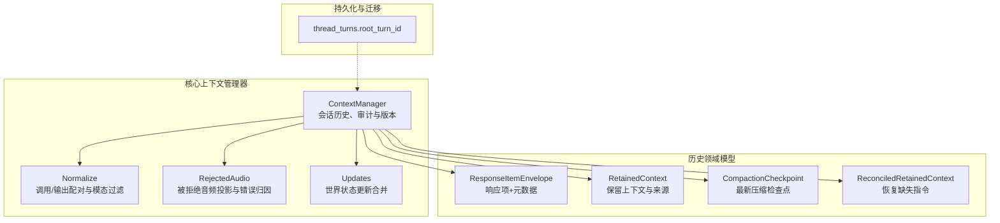
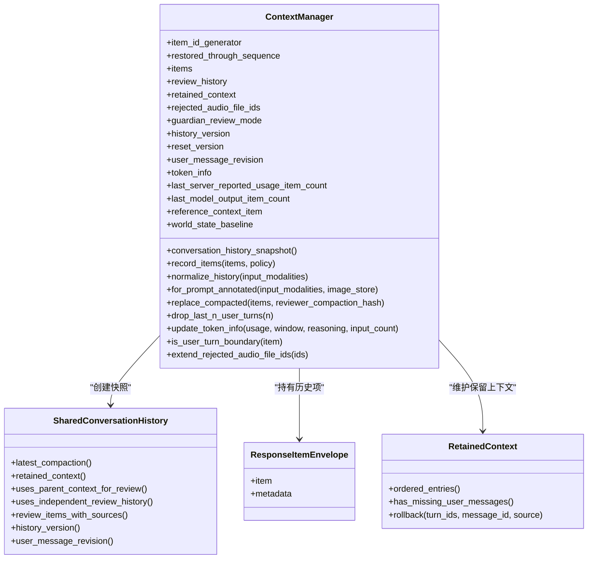
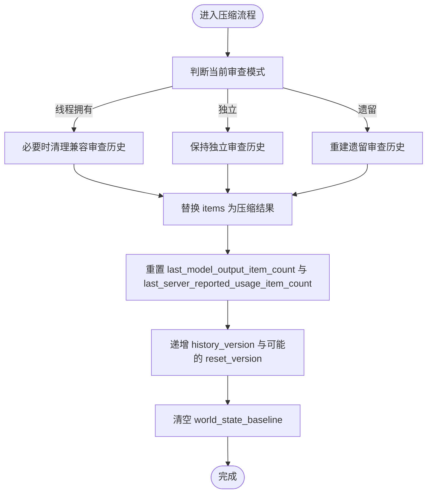
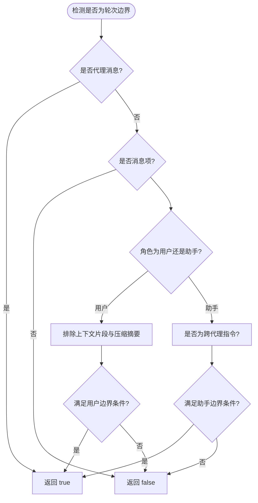
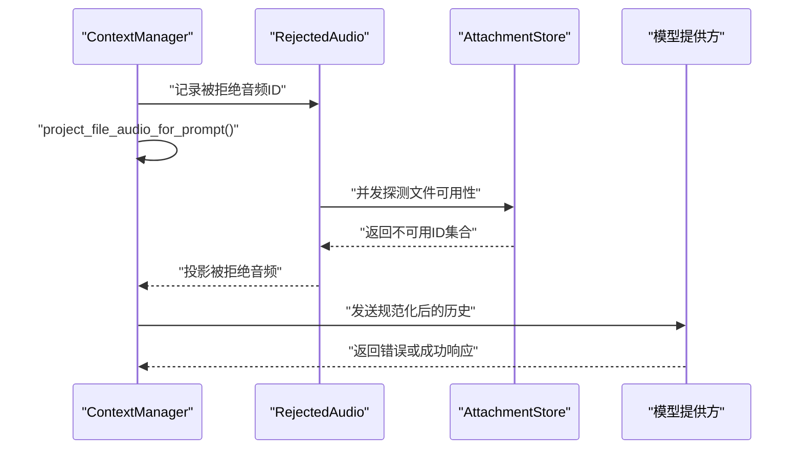
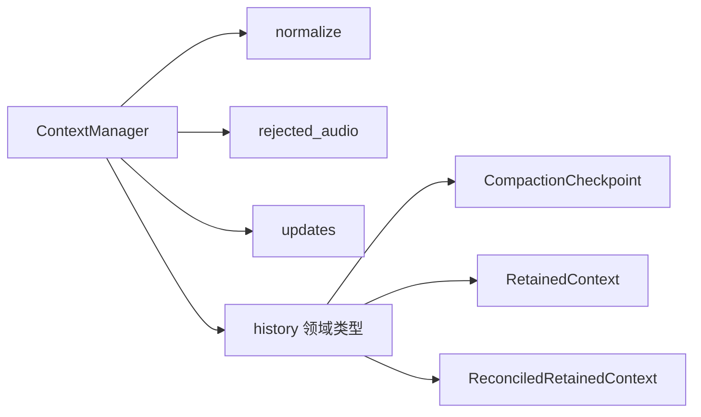

# 历史消息处理

<cite>
**本文引用的文件**   
- [codex-rs/core/src/context_manager/mod.rs](file://codex-rs/core/src/context_manager/mod.rs)
- [codex-rs/core/src/context_manager/history.rs](file://codex-rs/core/src/context_manager/history.rs)
- [codex-rs/core/src/context_manager/normalize.rs](file://codex-rs/core/src/context_manager/normalize.rs)
- [codex-rs/core/src/context_manager/updates.rs](file://codex-rs/core/src/context_manager/updates.rs)
- [codex-rs/core/src/context_manager/history_rejected_audio.rs](file://codex-rs/core/src/context_manager/history_rejected_audio.rs)
- [codex-rs/history/src/lib.rs](file://codex-rs/history/src/lib.rs)
- [codex-rs/history/src/compaction_checkpoint.rs](file://codex-rs/history/src/compaction_checkpoint.rs)
- [codex-rs/history/src/reconciled_retained_context.rs](file://codex-rs/history/src/reconciled_retained_context.rs)
- [codex-rs/state/thread_history_migrations/0008_thread_turn_root.sql](file://codex-rs/state/thread_history_migrations/0008_thread_turn_root.sql)
</cite>

## 目录
1. [引言](#引言)
2. [项目结构](#项目结构)
3. [核心组件](#核心组件)
4. [架构总览](#架构总览)
5. [详细组件分析](#详细组件分析)
6. [依赖关系分析](#依赖关系分析)
7. [性能考虑](#性能考虑)
8. [故障排查指南](#故障排查指南)
9. [结论](#结论)
10. [附录：历史数据迁移与兼容性实践](#附录历史数据迁移与兼容性实践)

## 引言
本文聚焦于 Codex Rust 实现中的“历史消息处理”子系统，围绕 `ContextManager` 的会话历史结构、项序列管理、版本控制、压缩与上下文窗口管理、Guardian 审查集成、用户轮次边界检测、音频消息处理、快照原子性与检查点恢复、以及历史数据迁移与兼容性展开深入说明。目标是帮助读者在不直接阅读源码的情况下，理解历史数据的生命周期、一致性和可恢复性设计。

## 项目结构
历史消息处理的核心位于 `core` 模块的 `context_manager` 子模块，并广泛复用 `history` 领域类型（如 `ResponseItemEnvelope`、`RetainedContext`、`CompactedItem`、`GuardianHistoryCheckpoint` 等）。此外，线程历史数据库迁移定义在 `state/thread_history_migrations` 中。

**图表来源**
- [codex-rs/core/src/context_manager/history.rs:200-360](file://codex-rs/core/src/context_manager/history.rs#L200-L360)
- [codex-rs/core/src/context_manager/normalize.rs:1-200](file://codex-rs/core/src/context_manager/normalize.rs#L1-L200)
- [codex-rs/core/src/context_manager/history_rejected_audio.rs:1-200](file://codex-rs/core/src/context_manager/history_rejected_audio.rs#L1-L200)
- [codex-rs/history/src/lib.rs:1-200](file://codex-rs/history/src/lib.rs#L1-L200)
- [codex-rs/history/src/compaction_checkpoint.rs:1-61](file://codex-rs/history/src/compaction_checkpoint.rs#L1-L61)
- [codex-rs/history/src/reconciled_retained_context.rs:1-177](file://codex-rs/history/src/reconciled_retained_context.rs#L1-L177)
- [codex-rs/state/thread_history_migrations/0008_thread_turn_root.sql:1-1](file://codex-rs/state/thread_history_migrations/0008_thread_turn_root.sql#L1-L1)

**章节来源**
- [codex-rs/core/src/context_manager/mod.rs:1-15](file://codex-rs/core/src/context_manager/mod.rs#L1-L15)
- [codex-rs/history/src/lib.rs:1-200](file://codex-rs/history/src/lib.rs#L1-L200)

## 核心组件
- `ContextManager`：维护线程级对话历史、保留上下文、被拒绝音频集合、Token 用量估算、世界状态基线、Guardian 审查模式与检查点恢复策略。提供快照视图、规范化、压缩替换、回滚、用户轮次边界检测与音频投影等方法。
- `SharedConversationHistory`：不可变快照，面向 Guardian 审查和外部消费者暴露历史项、保留上下文、审查历史及版本信息。
- `normalize`：保证函数调用与输出的配对一致性，移除孤儿输出，按输入模态裁剪图像与音频，并支持合成输出 ID。
- `rejected_audio`：对由 Responses 拒绝的文件音频进行非破坏性请求投影，将错误归因到具体提交音频，并在压缩时生成可恢复的投影。
- `history` 领域类型：`ResponseItemEnvelope`、`RetainedContext`、`CompactedItem`、`GuardianHistoryCheckpoint`、`CompactionCheckpoint`、`ReconciledRetainedContext` 等，承载持久化、检查点与保留证据。

**章节来源**
- [codex-rs/core/src/context_manager/history.rs:200-360](file://codex-rs/core/src/context_manager/history.rs#L200-L360)
- [codex-rs/core/src/context_manager/normalize.rs:1-200](file://codex-rs/core/src/context_manager/normalize.rs#L1-L200)
- [codex-rs/core/src/context_manager/history_rejected_audio.rs:1-200](file://codex-rs/core/src/context_manager/history_rejected_audio.rs#L1-L200)
- [codex-rs/history/src/lib.rs:1-200](file://codex-rs/history/src/lib.rs#L1-L200)

## 架构总览
`ContextManager` 是历史消息处理的中心控制器。它维护一个以“最旧在前、最新在后”顺序存储的 `items` 向量，并通过 `Arc<Vec<ResponseItemEnvelope>>` 共享给只读消费者。每次修改通过写时复制语义（`Arc::make_mut`）避免深拷贝。其关键职责包括：

- 记录 API 可见的历史项，并同步 `review_history`（用于 Guardian 审查）、`retained_context`（保留上下文）和 `rejected_audio_file_ids`（被拒绝音频）。
- 为模型请求准备规范化历史，裁剪不支持的媒体内容，并替换不可解析的图片引用。
- 根据 Token 用量信息和最后模型输出位置计算上下文窗口使用情况。
- 执行压缩替换、回滚、删除首项、世界状态渲染与增量差异。
- 暴露用户轮次边界检测算法，供上层回滚或提示构建使用。

**图表来源**
- [codex-rs/core/src/context_manager/history.rs:200-360](file://codex-rs/core/src/context_manager/history.rs#L200-L360)
- [codex-rs/history/src/lib.rs:1-200](file://codex-rs/history/src/lib.rs#L1-L200)

**章节来源**
- [codex-rs/core/src/context_manager/history.rs:200-360](file://codex-rs/core/src/context_manager/history.rs#L200-L360)

## 详细组件分析

### ContextManager：会话历史结构与版本控制
- **数据结构**
  - `items`：`Arc<Vec<ResponseItemEnvelope>>`，按时间顺序保存所有 API 可见的历史项；通过共享引用降低复制成本。
  - `review_history`：独立于模型窗口的 Guardian 审查历史，支持独立模式或线程拥有模式。
  - `retained_context`：保留上下文，包含已验证回答、用户/助手消息来源、排序与完整性标记。
  - `rejected_audio_file_ids`：被 Responses 拒绝的文件音频 ID 集合，仅影响请求投影，不改变追加写入的保留历史。
  - `history_version`、`reset_version`、`user_message_revision`：分别跟踪历史重写、重置与用户消息修订；`guardian_review_context_revision` 使审查上下文失效重建。
  - `token_info`、`last_server_reported_usage_item_count`、`last_model_output_item_count`：追踪 Token 用量、覆盖范围与最后模型输出位置，用于增量估算。
  - `reference_context_item`、`world_state_baseline`：世界状态增量基线，支持下次常规轮次的 diff 与全量重新注入。

- **版本与一致性**
  - 压缩、回滚、替换等操作都会递增 `history_version`，并可能触发 `reset_version` 与 `user_message_revision` 更新。
  - 通过 `SharedConversationHistory` 暴露的版本字段，外部消费者可感知审查策略变化与历史变更。

**章节来源**
- [codex-rs/core/src/context_manager/history.rs:200-360](file://codex-rs/core/src/context_manager/history.rs#L200-L360)

### 历史压缩算法与上下文窗口管理
- **压缩入口**
  - `replace_compacted`：接收压缩后的新历史项，决定是否提升 Guardian 审查模式、清理兼容审查历史、重置使用边界与基准世界状态。
  - `checkpoint_sampling` 与 `restore_review_context`：结合检查点与保留上下文，决定审查模式（线程拥有、独立或遗留），并重建兼容审查历史。

- **上下文窗口管理**
  - `set_token_info_with_boundary`：将服务器返回的 Token 用量与覆盖项数绑定，随后通过 `update_token_info` 增量追加。
  - `get_total_token_usage` 与 `estimated_tokens_since_last_usage`：基于 `last_server_reported_usage_item_count` 之后的未报告项进行粗略估算，并对加密推理内容进行特殊估计。
  - `fill_to_context_window`：当首次获得用量信息时，填充整个上下文窗口大小，确保后续估算与窗口对齐。

- **Guardian 审查集成**
  - 根据 `GuardianContextMode` 决定审查源：线程拥有时使用当前历史，独立模式使用独立审查历史，遗留模式需要兼容备份。
  - 审查历史版本与 `history_version` 联动，压缩后若仍为遗留模式且无审查历史，则从当前历史重建。

**图表来源**
- [codex-rs/core/src/context_manager/history.rs:900-1000](file://codex-rs/core/src/context_manager/history.rs#L900-L1000)

**章节来源**
- [codex-rs/core/src/context_manager/history.rs:600-985](file://codex-rs/core/src/context_manager/history.rs#L600-L985)
- [codex-rs/core/src/context_manager/history.rs:985-1353](file://codex-rs/core/src/context_manager/history.rs#L985-L1353)

### 用户轮次边界检测算法
- **边界判定规则**
  - `is_user_turn_boundary` 将以下项视为用户轮次边界：
    - 代理消息（`AgentMessage`）。
    - 角色为 `user` 的消息，但排除上下文片段消息与本地压缩生成的摘要消息。
    - 角色为 `assistant` 的消息，且内容为跨代理通信指令。
  - `user_message_positions` 扫描历史并收集边界索引，供回滚与裁剪使用。

- **会话状态维护**
  - 用户轮次边界用于 `drop_last_n_user_turns` 的回滚逻辑，确定要裁剪的起始位置。
  - 回滚过程中会同时清理预转上下文更新，并根据保留上下文的来源（继承、接受顺序、历史答案）执行相应的回滚或保留策略。

**图表来源**
- [codex-rs/core/src/context_manager/history.rs:1500-1664](file://codex-rs/core/src/context_manager/history.rs#L1500-L1664)

**章节来源**
- [codex-rs/core/src/context_manager/history.rs:1500-1664](file://codex-rs/core/src/context_manager/history.rs#L1500-L1664)

### 音频消息处理机制
- **被拒绝音频管理**
  - `extend_rejected_audio_file_ids`：追加被拒绝音频 ID，并递增 `history_version` 与 `guardian_review_context_revision`，以刷新审查上下文。
  - `project_file_audio_for_prompt`：在构造请求前，对被拒绝音频执行非破坏性投影，仅从消息内容中移除对应文件音频引用，保留其他内容。

- **音频时长估计与令牌估算优化**
  - `estimate_item_token_count_with_audio`：通过 `FileAudioDurations` 查询文件音频的预估令牌数，并结合文本、图像与工具输出字节估算。
  - `estimate_audio_reference_bytes`：对内联音频使用通用估计，对文件音频使用缓存时长换算的令牌数。

- **错误归因与可用性探测**
  - `SubmittedFileAudio::from_request`：从提交请求中提取文件音频 ID，结合已接受信息与压缩检查点元数据，定位唯一候选音频。
  - `unavailable_file_audio_ids`：对未知文件错误进行并发可用性探测，限制超时以避免阻塞请求流。
  - `project_compaction_audio`：在压缩前将被拒绝音频投影到请求与元数据，确保检查点可恢复。

**图表来源**
- [codex-rs/core/src/context_manager/history.rs:600-985](file://codex-rs/core/src/context_manager/history.rs#L600-L985)
- [codex-rs/core/src/context_manager/history_rejected_audio.rs:200-360](file://codex-rs/core/src/context_manager/history_rejected_audio.rs#L200-L360)

**章节来源**
- [codex-rs/core/src/context_manager/history.rs:600-985](file://codex-rs/core/src/context_manager/history.rs#L600-L985)
- [codex-rs/core/src/context_manager/history_rejected_audio.rs:1-360](file://codex-rs/core/src/context_manager/history_rejected_audio.rs#L1-L360)

### 历史快照的原子性、检查点恢复与数据一致性
- **原子性保证**
  - `conversation_history_snapshot` 返回 `SharedConversationHistory`，该快照共享底层 `items` 引用，读取路径无锁且不可变；任何写入都通过 `Arc::make_mut` 触发写时复制，避免中间状态泄漏。
  - 压缩替换通过 `replace_compacted` 一次性替换 `items`，并统一重置使用边界与基准世界状态。

- **检查点恢复**
  - `restore_review_context` 根据保留上下文与检查点重建审查历史，并在兼容失败时退回线程拥有模式，防止部分模型窗口被误判为完整兼容转录。
  - `CompactionCheckpoint::latest` 与 `is_compatible_with` 用于判断最新压缩检查点的可用性与模型哈希兼容性。

- **数据一致性策略**
  - `normalize_history` 强制调用与输出配对、移除孤儿输出、按模态裁剪媒体内容，确保内存历史的一致性。
  - `replay_annotated_item` 在重放持久化原始项时，尝试恢复保留来源修订号，避免重复分配新标识。

**章节来源**
- [codex-rs/core/src/context_manager/history.rs:200-360](file://codex-rs/core/src/context_manager/history.rs#L200-L360)
- [codex-rs/history/src/compaction_checkpoint.rs:1-61](file://codex-rs/history/src/compaction_checkpoint.rs#L1-L61)
- [codex-rs/core/src/context_manager/normalize.rs:1-200](file://codex-rs/core/src/context_manager/normalize.rs#L1-L200)

## 依赖关系分析
`ContextManager` 与多个内部模块存在强耦合：

- **直接依赖**
  - `normalize`：保证调用/输出配对与媒体模态过滤。
  - `rejected_audio`：处理被拒绝音频的请求投影与错误归因。
  - `updates`：合并世界状态更新，生成渲染消息。
  - `history` 领域类型：封装响应信封、保留上下文、压缩项与检查点。

- **潜在循环依赖**
  - `ContextManager` 与 `history` 领域类型之间通过共享枚举与结构体交互，但无直接循环导入；循环风险较低。

**图表来源**
- [codex-rs/core/src/context_manager/history.rs:200-360](file://codex-rs/core/src/context_manager/history.rs#L200-L360)
- [codex-rs/history/src/lib.rs:1-200](file://codex-rs/history/src/lib.rs#L1-L200)

**章节来源**
- [codex-rs/core/src/context_manager/mod.rs:1-15](file://codex-rs/core/src/context_manager/mod.rs#L1-L15)
- [codex-rs/core/src/context_manager/history.rs:200-360](file://codex-rs/core/src/context_manager/history.rs#L200-L360)

## 性能考虑
- **共享历史减少复制**：通过 `Arc<Vec<ResponseItemEnvelope>>` 共享历史，读取路径零拷贝，写入时延迟复制。
- **Token 估算优化**：使用字节估算与缓存（如原图细节估算缓存）避免频繁解码与精确分词；对加密输出采用固定比例估算。
- **并发可用性探测**：对文件音频可用性探测使用并发流与超时限制，避免阻塞请求流水线。
- **增量世界状态差异**：通过 `reference_context_item` 与 `world_state_baseline` 支持增量渲染，减少全量重新注入开销。

[本节为一般性指导，无需特定文件分析]

## 故障排查指南
- **调用与输出不一致**
  - 检查 `ensure_call_outputs_present` 是否插入合成输出，确认 `remove_orphan_outputs` 是否移除孤儿输出。
  - 关注日志中的缺失调用或输出警告。

- **音频请求失败**
  - 确认 `extend_rejected_audio_file_ids` 是否正确记录被拒绝音频 ID。
  - 检查 `unavailable_file_audio_ids` 的可用性探测是否超时或失败。

- **审查历史不一致**
  - 验证 `restore_review_context` 是否根据保留上下文与检查点正确选择审查模式。
  - 检查 `CompactionCheckpoint::is_compatible_with` 的模型哈希匹配。

**章节来源**
- [codex-rs/core/src/context_manager/normalize.rs:1-200](file://codex-rs/core/src/context_manager/normalize.rs#L1-L200)
- [codex-rs/core/src/context_manager/history_rejected_audio.rs:200-360](file://codex-rs/core/src/context_manager/history_rejected_audio.rs#L200-L360)
- [codex-rs/core/src/context_manager/history.rs:200-360](file://codex-rs/core/src/context_manager/history.rs#L200-L360)

## 结论
`ContextManager` 通过共享历史、严格规范化、增量 Token 估算、审查模式切换与检查点恢复，构建了健壮的历史消息处理框架。其设计兼顾性能与一致性，支持复杂的多模态输入、音频错误归因与 Guardian 审查集成。配合 `history` 领域类型与线程历史迁移，系统可在冷启动、压缩与回滚场景下保持稳定行为。

[本节为总结性内容，无需特定文件分析]

## 附录：历史数据迁移与兼容性实践
- **线程轮次根标识**
  - `0008_thread_turn_root.sql` 为 `thread_turns` 表新增 `root_turn_id` 列，用于标识轮次根，辅助回滚与边界检测。

- **最佳实践**
  - 迁移应向后兼容，保留旧字段与默认值。
  - 历史重构时优先使用 `ReconciledRetainedContext` 恢复缺失指令，避免丢失用户授权。
  - 压缩检查点应携带模型哈希与 token 用量快照，便于恢复时快速定位用量边界。

**章节来源**
- [codex-rs/state/thread_history_migrations/0008_thread_turn_root.sql:1-1](file://codex-rs/state/thread_history_migrations/0008_thread_turn_root.sql#L1-L1)
- [codex-rs/history/src/reconciled_retained_context.rs:1-177](file://codex-rs/history/src/reconciled_retained_context.rs#L1-L177)