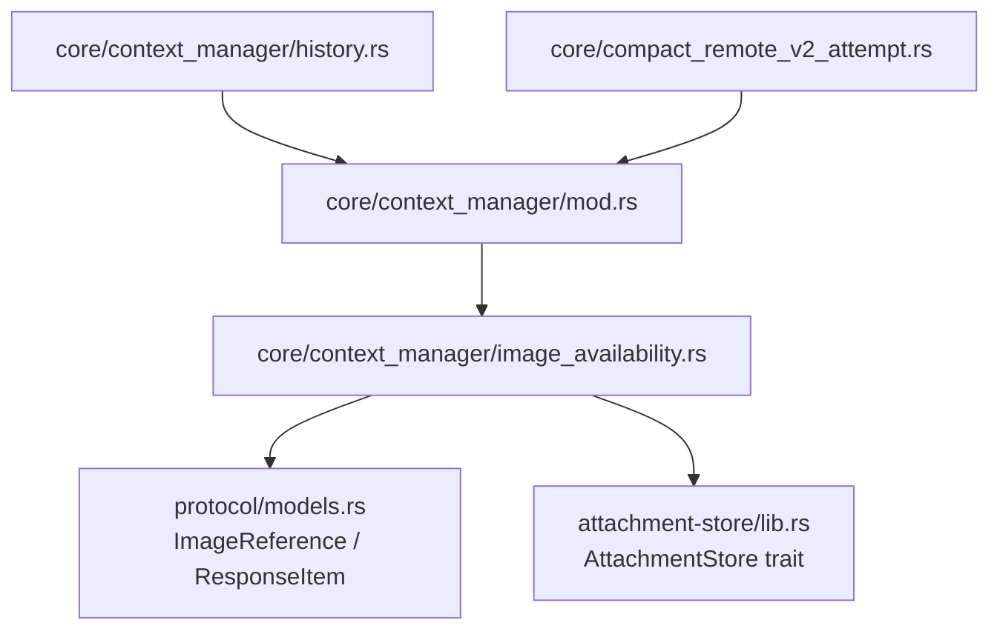
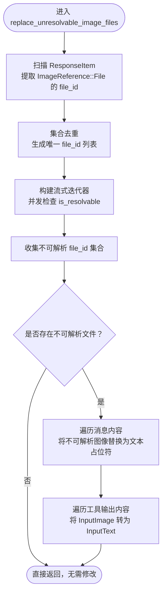
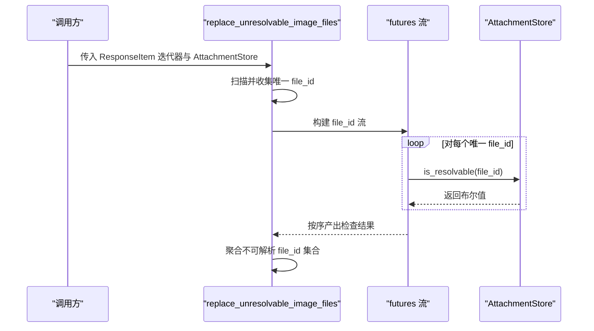
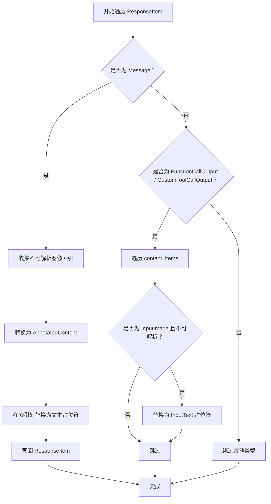
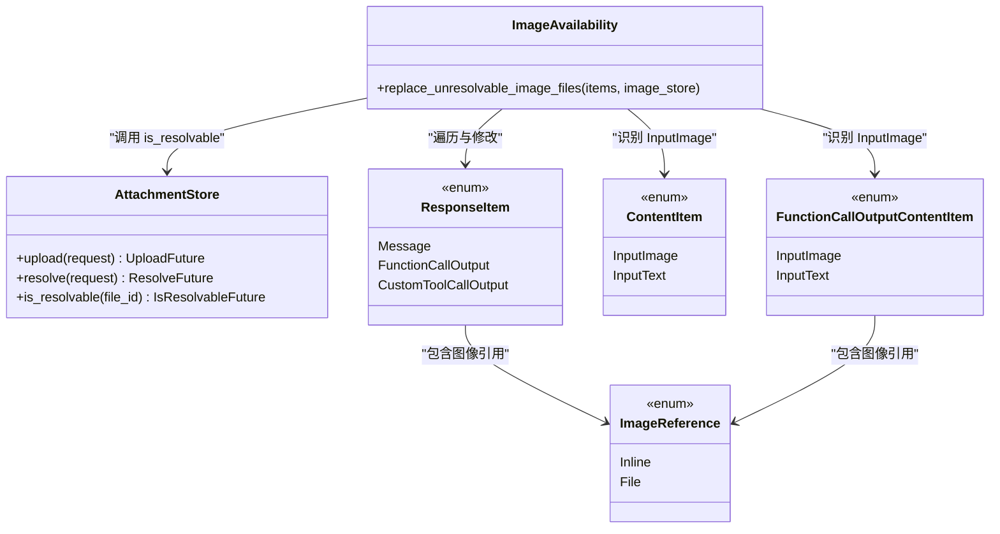

# 图像可用性管理

<cite>
**本文引用的文件**   
- [image_availability.rs](file://codex-rs/core/src/context_manager/image_availability.rs)
- [mod.rs（context_manager）](file://codex-rs/core/src/context_manager/mod.rs)
- [history.rs（context_manager）](file://codex-rs/core/src/context_manager/history.rs)
- [compact_remote_v2_attempt.rs](file://codex-rs/core/src/compact_remote_v2_attempt.rs)
- [lib.rs（attachment-store）](file://codex-rs/attachment-store/src/lib.rs)
- [models.rs（protocol）](file://codex-rs/protocol/src/models.rs)
</cite>

## 目录
1. [引言](#引言)
2. [项目结构定位](#项目结构定位)
3. [核心组件](#核心组件)
4. [架构总览](#架构总览)
5. [详细组件分析](#详细组件分析)
6. [依赖关系分析](#依赖关系分析)
7. [性能与并发特性](#性能与并发特性)
8. [故障排查指南](#故障排查指南)
9. [结论](#结论)
10. [附录：调用点与数据模型速查](#附录调用点与数据模型速查)

## 引言
本文聚焦于 Codex Rust 代码库中的“图像可用性管理”机制，围绕 `replace_unresolvable_image_files` 函数展开。该函数的职责是：在响应项中扫描所有以“文件引用”形式存在的图像，判断其是否可解析；对不可解析的图像进行降级处理，将其替换为文本占位符，从而保证上下文消息、工具输出等内容在附件缺失或不可访问时仍可继续消费，同时尽量保持内容结构与标注信息不被破坏。

文档将系统解释以下方面：
- 如何从 `ResponseItem` 中提取 `ImageReference`，并进行去重。
- 异步并发检查的实现模式与并发上限控制。
- 不可用图像的降级策略与类型转换规则。
- 与 `AttachmentStore` 的交互约定和错误处理语义。
- 缓存与性能优化建议。

## 项目结构定位
图像可用性管理的核心实现位于 `core` 模块的上下文管理器中，并通过 `context_manager::mod` 对外暴露。它依赖协议层的数据模型和附件存储抽象：

**图表来源**
- [image_availability.rs:1-122](file://codex-rs/core/src/context_manager/image_availability.rs#L1-L122)
- [mod.rs（context_manager）:14-14](file://codex-rs/core/src/context_manager/mod.rs#L14-L14)
- [history.rs（context_manager）:28-28](file://codex-rs/core/src/context_manager/history.rs#L28-L28)
- [compact_remote_v2_attempt.rs:21-21](file://codex-rs/core/src/compact_remote_v2_attempt.rs#L21-L21)
- [models.rs（protocol）:957-960](file://codex-rs/protocol/src/models.rs#L957-L960)
- [lib.rs（attachment-store）:1-40](file://codex-rs/attachment-store/src/lib.rs#L1-L40)

**章节来源**
- [image_availability.rs:1-20](file://codex-rs/core/src/context_manager/image_availability.rs#L1-L20)
- [mod.rs（context_manager）:14-14](file://codex-rs/core/src/context_manager/mod.rs#L14-L14)

## 核心组件
- `replace_unresolvable_image_files`：主入口函数，负责发现图像、并发检查可用性并执行降级替换。
- `MAX_CONCURRENT_IMAGE_AVAILABILITY_CHECKS`：并发检查上限常量，限制并发任务数量。
- `AttachmentStore`：附件存储抽象接口，提供上传、解析和“是否可解析”的判断能力。
- `ImageReference`：协议层图像引用模型，支持内联 URL 与外部文件 ID 两种形式。
- `ResponseItem`、`ContentItem`、`FunctionCallOutputContentItem`：协议层响应与内容项模型，用于遍历和修改消息及工具输出内容。

**章节来源**
- [image_availability.rs:18-21](file://codex-rs/core/src/context_manager/image_availability.rs#L18-L21)
- [lib.rs（attachment-store）:18-40](file://codex-rs/attachment-store/src/lib.rs#L18-L40)
- [models.rs（protocol）:957-960](file://codex-rs/protocol/src/models.rs#L957-L960)

## 架构总览
`replace_unresolvable_image_files` 的整体流程可以概括为三个阶段：
1. **扫描与去重**：遍历传入的所有 `ResponseItem`，收集所有以 `ImageReference::File` 形式存在的 `file_id`，并使用集合去重。
2. **并发检查**：使用流式迭代器配合 `buffer_unordered`，并行调用 `AttachmentStore::is_resolvable` 检查每个唯一 `file_id` 是否可解析，并将结果聚合为不可解析集合。
3. **降级替换**：再次遍历原始 `ResponseItem`，将不可解析的文件图像替换为文本占位符；对于工具输出内容，还会将图像内容项转换为文本内容项。

**图表来源**
- [image_availability.rs:21-122](file://codex-rs/core/src/context_manager/image_availability.rs#L21-L122)

## 详细组件分析

### 图像发现与去重机制
函数首先将所有 `ResponseItem` 收集到向量中，以便后续多次遍历。随后针对两类节点进行扫描：
- 消息内容：匹配 `ContentItem::InputImage`，且图像引用类型为 `ImageReference::File`，提取其中的 `file_id`。
- 工具输出内容：匹配 `FunctionCallOutputContentItem::InputImage`，同样要求 `ImageReference::File`，并提取 `file_id`。

所有被发现的 `file_id` 都插入到一个哈希集合中，从而自动完成去重。这样即使同一个图像在多个位置出现，也只会进行一次可用性检查，减少不必要的网络或后端开销。

**复杂度说明**
- 时间复杂度：O(N + M)，其中 N 为所有 `ResponseItem` 中的内容片段总数，M 为唯一 `file_id` 数量。
- 空间复杂度：O(U + I)，其中 U 是唯一 `file_id` 的数量，I 是输入 `ResponseItem` 向量的临时拷贝大小。

**章节来源**
- [image_availability.rs:21-58](file://codex-rs/core/src/context_manager/image_availability.rs#L21-L58)
- [models.rs（protocol）:957-960](file://codex-rs/protocol/src/models.rs#L957-L960)

### 异步并发检查与流式处理
图像可用性检查通过 `futures::stream::iter(file_ids)` 创建流，并对每个 `file_id` 调用 `image_store.is_resolvable(&file_id).await`。关键点如下：
- 每个检查都是独立的异步任务，不会相互阻塞。
- 使用 `buffer_unordered(MAX_CONCURRENT_IMAGE_AVAILABILITY_CHECKS)` 控制最大并发数，避免无界并发导致资源耗尽。
- 检查结果通过流依次产出，函数内部维护一个不可解析 `file_id` 集合，最终得到需要降级的目标集合。

并发上限常量 `MAX_CONCURRENT_IMAGE_AVAILABILITY_CHECKS` 固定为 8，表示最多同时发起 8 个 `is_resolvable` 请求。

**图表来源**
- [image_availability.rs:58-78](file://codex-rs/core/src/context_manager/image_availability.rs#L58-L78)
- [lib.rs（attachment-store）:28-36](file://codex-rs/attachment-store/src/lib.rs#L28-L36)

**章节来源**
- [image_availability.rs:18-18](file://codex-rs/core/src/context_manager/image_availability.rs#L18-L18)
- [image_availability.rs:58-78](file://codex-rs/core/src/context_manager/image_availability.rs#L58-L78)

### 不可用图像的降级策略
当存在不可解析的 `file_id` 时，函数会进行两轮替换：

1. **消息内容降级**  
   - 遍历 `ResponseItem::Message` 的 `content` 数组。
   - 若某个片段是 `ContentItem::InputImage` 且其 `file_id` 属于不可解析集合，则记录其索引。
   - 如果存在待替换索引，函数会把当前 `ResponseItem` 转换为 `AnnotatedContent`，然后在对应索引处替换为文本占位符，再写回原 `ResponseItem`。
   - 文本占位符的内容固定为 `"[image unavailable]"`，并带有特定的内容类型标识，用于表明该占位符来源于不可用图像。

2. **工具输出内容降级**  
   - 遍历 `FunctionCallOutputContentItem` 列表。
   - 若某个元素是 `InputImage` 且其 `file_id` 不可解析，则直接将该元素替换为 `InputText`，文本内容为 `"[image unavailable]"`。
   - 这种方式不仅隐藏了不可用图像，还改变了内容类型，使下游消费者明确这是“文本形式的降级结果”。

这种设计保证了：
- 消息结构基本保持不变，仅把图像片段替换为等价文本。
- 工具输出中图像类型会被转换为文本类型，避免下游继续尝试解析图像。
- 不可用图像的可见性通过固定文案提示用户和系统。

**图表来源**
- [image_availability.rs:80-122](file://codex-rs/core/src/context_manager/image_availability.rs#L80-L122)

**章节来源**
- [image_availability.rs:80-122](file://codex-rs/core/src/context_manager/image_availability.rs#L80-L122)

### 与 AttachmentStore 的交互模式与错误处理
`AttachmentStore` 是一个可插拔的附件存储抽象，关键方法包括：
- `upload`：上传附件，返回内联字节或外部文件 ID。
- `resolve`：解析附件元数据和可选下载 URL。
- `is_resolvable`：判断某个 `file_id` 是否应保留在模型请求中。

默认实现中，`is_resolvable` 总是返回 `true`，即保守策略：除非具体实现明确知道文件缺失，否则不主动拒绝引用。这意味着：
- 后端错误或未知错误不会轻易导致图像被标记为不可用。
- 只有权威存储实现能够选择性地返回 `false`，从而触发降级逻辑。
- 调用方不需要捕获 `is_resolvable` 的具体异常；该函数只接收布尔结果。

因此，`replace_unresolvable_image_files` 的错误处理策略是“失败即视为可用”，除非存储实现显式判定不可解析。这降低了调用方的错误处理复杂度，同时将可靠性责任交给存储层。

**章节来源**
- [lib.rs（attachment-store）:18-40](file://codex-rs/attachment-store/src/lib.rs#L18-L40)
- [image_availability.rs:58-78](file://codex-rs/core/src/context_manager/image_availability.rs#L58-L78)

### 调用点与控制流
`replace_unresolvable_image_files` 并非孤立存在，它在两个关键位置被调用：
- 历史上下文处理：在处理历史消息时，确保历史中的图像引用在上下文中可用。
- 远程压缩流程：在对远端响应进行压缩或适配时，保证压缩后的响应内容仍然具备合理的图像占位行为。

这表明该函数参与的是“上下文构建与响应预处理”阶段，而不是终端渲染阶段。它的目标是让上层逻辑拿到尽可能可用的结构化内容，而不是直接决定 UI 显示。

**章节来源**
- [history.rs（context_manager）:28-28](file://codex-rs/core/src/context_manager/history.rs#L28-L28)
- [history.rs（context_manager）:730-730](file://codex-rs/core/src/context_manager/history.rs#L730-L730)
- [compact_remote_v2_attempt.rs:21-21](file://codex-rs/core/src/compact_remote_v2_attempt.rs#L21-L21)
- [compact_remote_v2_attempt.rs:341-341](file://codex-rs/core/src/compact_remote_v2_attempt.rs#L341-L341)

## 依赖关系分析

**图表来源**
- [image_availability.rs:1-122](file://codex-rs/core/src/context_manager/image_availability.rs#L1-L122)
- [lib.rs（attachment-store）:18-40](file://codex-rs/attachment-store/src/lib.rs#L18-L40)
- [models.rs（protocol）:957-960](file://codex-rs/protocol/src/models.rs#L957-L960)

**章节来源**
- [image_availability.rs:1-122](file://codex-rs/core/src/context_manager/image_availability.rs#L1-L122)
- [lib.rs（attachment-store）:18-40](file://codex-rs/attachment-store/src/lib.rs#L18-L40)
- [models.rs（protocol）:957-960](file://codex-rs/protocol/src/models.rs#L957-L960)

## 性能与并发特性
### 并发控制
- 使用 `buffer_unordered(MAX_CONCURRENT_IMAGE_AVAILABILITY_CHECKS)` 控制并发度，防止大量图像检查同时发起造成后端压力或内存增长。
- 当前并发上限为 8，适合大多数本地或云端场景。如果部署环境有大量图像且网络延迟较高，可根据实际情况调整该常量。

### 流式处理优势
- 流式迭代器允许逐个产出检查结果，无需等待全部完成后再处理。
- 不可解析集合在流消费过程中逐步累积，减少中间数据结构体积。
- 只有在确认存在不可解析图像后，才进入昂贵的替换阶段，避免无谓修改。

### 时间复杂度与空间复杂度
- 扫描阶段：线性于所有内容片段数量。
- 检查阶段：线性于唯一 `file_id` 数量，并发度受常量限制。
- 替换阶段：线性于 `ResponseItem` 总量和内容片段总量。
- 额外空间：唯一 `file_id` 集合、临时 `ResponseItem` 向量、不可解析集合。

### 缓存与优化建议
- **文件级可用性缓存**：可在应用层维护 `file_id -> bool` 的短期缓存，避免重复检查相同文件。注意缓存失效策略要覆盖文件删除、权限变化等场景。
- **批量检查接口**：如果未来 `AttachmentStore` 支持批量 `is_resolvable`，可将多次单文件检查合并为一次批量请求，显著降低网络往返。
- **惰性检查**：仅在真正需要渲染或发送模型请求前进行检查，减少无用计算。
- **分层存储策略**：对高频图像优先走快速路径，例如本地缓存命中则直接标记为可解析。
- **可配置并发度**：将 `MAX_CONCURRENT_IMAGE_AVAILABILITY_CHECKS` 暴露为运行时配置，便于在不同环境下调优。

[本节为通用性能建议，未直接分析具体文件]

## 故障排查指南
### 常见现象
- 图像始终显示为 `"[image unavailable]"`。
- 某些图像正常，部分图像降级。
- 工具输出中的图像被替换为文本，但消息中的图像仍为占位符。

### 排查步骤
1. **确认图像引用类型**  
   检查 `ImageReference` 是否为 `File` 形式。如果是 `Inline`，则不会进入该降级逻辑。
   - 参考位置：`ImageReference` 定义。

2. **检查 `AttachmentStore::is_resolvable` 实现**  
   如果自定义存储实现返回 `false`，会导致降级。确认实现是否符合预期，尤其是后端错误时应保守返回 `true`。
   - 参考位置：`AttachmentStore` trait 默认实现说明。

3. **验证 file_id 是否正确**  
   确保 `file_id` 与实际存储一致，没有被截断、编码错误或来源不一致。

4. **观察调用点**  
   确认调用发生在合适的生命周期阶段，例如历史上下文加载或远程响应压缩阶段。

5. **查看日志与追踪**  
   如果 `AttachmentStore` 实现使用了追踪或日志，结合 `is_resolvable` 的输出进一步定位问题。

**章节来源**
- [lib.rs（attachment-store）:28-36](file://codex-rs/attachment-store/src/lib.rs#L28-L36)
- [models.rs（protocol）:957-960](file://codex-rs/protocol/src/models.rs#L957-L960)
- [image_availability.rs:58-122](file://codex-rs/core/src/context_manager/image_availability.rs#L58-L122)

## 结论
`replace_unresolvable_image_files` 是 Codex 上下文与响应管线中的关键健壮性组件。它通过：
- 从 `ResponseItem` 中稳定提取 `ImageReference::File`；
- 使用哈希集合去重；
- 借助 `AttachmentStore::is_resolvable` 进行有限并发检查；
- 将不可用图像降级为文本占位符；
- 对工具输出进行类型安全转换；

实现了“附件缺失时仍可继续处理上下文”的目标。该设计将错误处理下沉到存储层，并在应用层保持简单可靠的降级语义。在生产环境中，建议结合缓存、批量检查和可配置并发度进一步优化性能与稳定性。

[本节为总结性内容，未直接分析具体文件]

## 附录：调用点与数据模型速查
- 主要实现：`replace_unresolvable_image_files`
- 并发上限：`MAX_CONCURRENT_IMAGE_AVAILABILITY_CHECKS = 8`
- 存储接口：`AttachmentStore`，重点关注 `is_resolvable`
- 图像引用：`ImageReference::Inline` 与 `ImageReference::File`
- 响应项：`ResponseItem::Message`、`ResponseItem::FunctionCallOutput`、`ResponseItem::CustomToolCallOutput`
- 内容项：`ContentItem::InputImage`、`FunctionCallOutputContentItem::InputImage`

**章节来源**
- [image_availability.rs:18-122](file://codex-rs/core/src/context_manager/image_availability.rs#L18-L122)
- [lib.rs（attachment-store）:18-40](file://codex-rs/attachment-store/src/lib.rs#L18-L40)
- [models.rs（protocol）:957-960](file://codex-rs/protocol/src/models.rs#L957-L960)