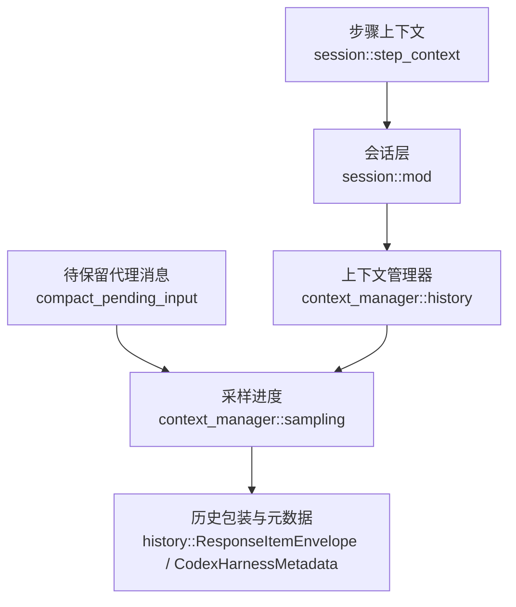
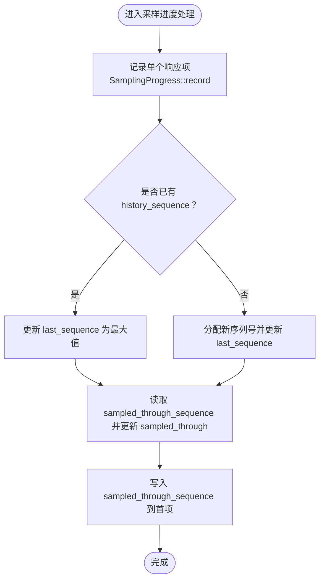
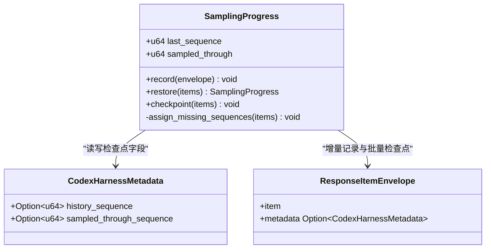
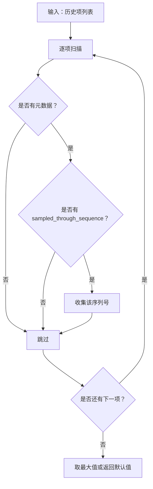
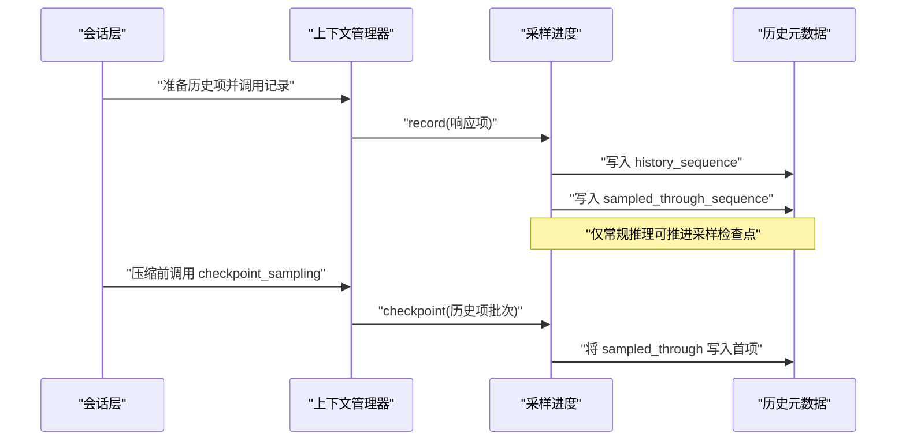
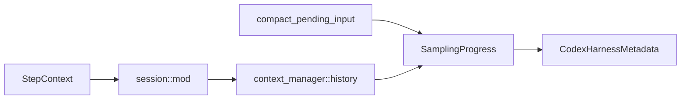

# 采样算法

<cite>
**本文引用的文件**   
- [codex-rs/core/src/context_manager/sampling.rs](file://codex-rs/core/src/context_manager/sampling.rs)
- [codex-rs/history/src/lib.rs](file://codex-rs/history/src/lib.rs)
- [codex-rs/core/src/compact_pending_input.rs](file://codex-rs/core/src/compact_pending_input.rs)
- [codex-rs/core/src/context_manager/history.rs](file://codex-rs/core/src/context_manager/history.rs)
- [codex-rs/core/src/session/mod.rs](file://codex-rs/core/src/session/mod.rs)
- [codex-rs/core/src/session/step_context.rs](file://codex-rs/core/src/session/step_context.rs)
</cite>

## 目录
1. [引言](#引言)
2. [项目结构定位](#项目结构定位)
3. [核心组件](#核心组件)
4. [架构总览](#架构总览)
5. [详细组件分析](#详细组件分析)
6. [依赖关系分析](#依赖关系分析)
7. [性能与并发特性](#性能与并发特性)
8. [故障排查指南](#故障排查指南)
9. [结论](#结论)

## 引言
本文围绕采样算法的核心实现，系统解释 `SamplingProgress` 的设计原理、序列号分配策略、采样进度跟踪与检查点机制；深入说明 `sampled_through` 函数如何确定“已采样的历史范围”，并处理没有显式交付证明的遗留输入；梳理采样过程中 `history_sequence` 与 `sampled_through_sequence` 字段的语义与作用；最后给出并发环境下的线程安全保证、会话恢复时的状态重建机制，以及性能优化与调试实践。

## 项目结构定位
采样相关逻辑主要分布在以下模块：
- `context_manager::sampling`：定义 `SamplingProgress` 与 `sampled_through`，负责采样进度与序列号管理。
- `history`：定义持久化历史项包装 `ResponseItemEnvelope` 及其元数据 `CodexHarnessMetadata`，其中包含 `history_sequence` 和 `sampled_through_sequence`。
- `compact_pending_input`：利用 `sampled_through` 判断哪些代理消息属于“尚未被常规采样确认”的待保留邮件。
- `context_manager::history`：在记录模型输出时调用 `SamplingProgress::record`，在压缩等关键路径上调用 `checkpoint_sampling`。
- `session`：创建每步上下文 `StepContext`，并在压缩流程中触发采样检查点。



**图表来源**
- [codex-rs/core/src/context_manager/sampling.rs:1-76](file://codex-rs/core/src/context_manager/sampling.rs#L1-L76)
- [codex-rs/history/src/lib.rs:1-200](file://codex-rs/history/src/lib.rs#L1-L200)
- [codex-rs/core/src/compact_pending_input.rs:1-49](file://codex-rs/core/src/compact_pending_input.rs#L1-L49)
- [codex-rs/core/src/context_manager/history.rs:100-120](file://codex-rs/core/src/context_manager/history.rs#L100-L120)
- [codex-rs/core/src/session/mod.rs:4596-4598](file://codex-rs/core/src/session/mod.rs#L4596-L4598)

**章节来源**
- [codex-rs/core/src/context_manager/sampling.rs:1-76](file://codex-rs/core/src/context_manager/sampling.rs#L1-L76)
- [codex-rs/history/src/lib.rs:1-200](file://codex-rs/history/src/lib.rs#L1-L200)
- [codex-rs/core/src/compact_pending_input.rs:1-49](file://codex-rs/core/src/compact_pending_input.rs#L1-L49)
- [codex-rs/core/src/context_manager/history.rs:100-120](file://codex-rs/core/src/context_manager/history.rs#L100-L120)
- [codex-rs/core/src/session/mod.rs:4596-4598](file://codex-rs/core/src/session/mod.rs#L4596-L4598)

## 核心组件
- `SamplingProgress`：维护两个关键状态
  - `last_sequence`：当前已看到的最大历史序列号。
  - `sampled_through`：最近一次常规采样所确认的最高输入序列号，表示“常规请求已经见过且可回退到该位置”。
- `CodexHarnessMetadata`：每条历史项上的宿主元数据，关键字段包括：
  - `history_sequence`：线程追加序列号，用于标识输入或输出项在历史中的顺序身份。
  - `sampled_through_sequence`：某条历史项所在批次中被常规采样确认过的最高输入序列号，作为检查点标记。
- `ResponseItemEnvelope`：将模型响应项与其宿主元数据一起持久化，采样算法在此包装对象上工作。

**章节来源**
- [codex-rs/core/src/context_manager/sampling.rs:1-76](file://codex-rs/core/src/context_manager/sampling.rs#L1-L76)
- [codex-rs/history/src/lib.rs:1-200](file://codex-rs/history/src/lib.rs#L1-L200)

## 架构总览
采样算法的职责不是决定“是否向模型发送请求”，而是为“哪些历史输入已被常规推理确认”提供不可变、可重放的状态视图。它的关键约束是：
- 只有常规推理（normal inference）的输出才能“承认”某些输入已经被看到。
- 压缩、回放等过程不会主动推进 `sampled_through`，只能携带已有检查点。
- 没有 `history_sequence` 的遗留输入必须获得唯一身份，并被视作“仍待确认”，不能仅凭输出顺序猜测其已采样。



**图表来源**
- [codex-rs/core/src/context_manager/sampling.rs:1-76](file://codex-rs/core/src/context_manager/sampling.rs#L1-L76)

**章节来源**
- [codex-rs/core/src/context_manager/sampling.rs:1-76](file://codex-rs/core/src/context_manager/sampling.rs#L1-L76)

## 详细组件分析

### SamplingProgress 设计原理
`SamplingProgress` 是采样进度的轻量级有状态记录器，核心行为如下：
- `record(envelope)`：对每个响应项进行增量更新。
  - 若元数据缺失则创建默认元数据。
  - 若 `history_sequence` 缺失，则使用 `last_sequence` 自增后的值作为新序列号，确保每个需要身份的项都有唯一递增编号。
  - `last_sequence` 始终取当前项序列号与已有值的最大值。
  - `sampled_through` 取当前值与该项 `sampled_through_sequence` 的最大值。
  - 最终将最新 `sampled_through` 写回该元数据，使其成为持久化的检查点信息。
- `restore(items)`：从已有历史项重建进度。
  - 遍历所有带元数据的项，分别计算最大 `history_sequence` 和最大 `sampled_through_sequence`。
  - 令 `last_sequence` 至少等于 `sampled_through`，避免后续分配序列号出现倒退。
  - 对缺少 `history_sequence` 的遗留项调用内部 `assign_missing_sequences`，为其分配唯一序列号。
- `checkpoint(items)`：用于批量检查点。
  - 先为所有缺失序列号的项分配序列号。
  - 然后将当前 `sampled_through` 写入该批次的第一个响应项的元数据中，形成“本批次已确认的最高输入序列号”。



**图表来源**
- [codex-rs/core/src/context_manager/sampling.rs:1-76](file://codex-rs/core/src/context_manager/sampling.rs#L1-L76)
- [codex-rs/history/src/lib.rs:1-200](file://codex-rs/history/src/lib.rs#L1-L200)

**章节来源**
- [codex-rs/core/src/context_manager/sampling.rs:1-76](file://codex-rs/core/src/context_manager/sampling.rs#L1-L76)

### `sampled_through` 函数的实现逻辑
`sampled_through(items)` 是一个纯函数，用于从一批历史项中提取“已采样上限”：
- 遍历所有响应项。
- 过滤出存在元数据且 `sampled_through_sequence` 非空的项。
- 返回这些序列号的最大值；如果没有任何检查点，则返回默认值 `0`。

它的作用不是决定“哪些输入会进入下一次模型请求”，而是回答“在当前历史视图中，哪个输入序列号之前已经被常规采样确认过”。这个值被下游用于：
- 判断代理消息是否属于“未采样邮件”。
- 在压缩后保留摘要，并将其插入尚未被确认的代理消息之前。



**图表来源**
- [codex-rs/core/src/context_manager/sampling.rs:1-76](file://codex-rs/core/src/context_manager/sampling.rs#L1-L76)

**章节来源**
- [codex-rs/core/src/context_manager/sampling.rs:1-76](file://codex-rs/core/src/context_manager/sampling.rs#L1-L76)

### 历史范围判定与遗留输入处理
采样算法区分两类输入：
- 具有 `history_sequence` 的输入：可以通过严格单调序列号参与排序、比较和检查点判定。
- 没有 `history_sequence` 的遗留输入：被视为“没有交付证明”，必须获得独立身份，并且保持“待定”状态，直到某个常规请求将其纳入采样确认。

在 `SamplingProgress::assign_missing_sequences` 中，所有缺少 `history_sequence` 的项都会调用 `record`，从而获得新序列号。这样做的目的是：
- 不根据输出顺序猜测输入顺序。
- 保证遗留输入不会错误地被当作“已经采样通过”。
- 让后续基于 `history_sequence` 的比较逻辑保持稳定。

在 `compact_pending_input` 中，`pending_mail_sequence` 借助 `sampled_through` 找到第一条大于该阈值的代理消息序列号，从而确定摘要应插入的位置。

**章节来源**
- [codex-rs/core/src/context_manager/sampling.rs:1-76](file://codex-rs/core/src/context_manager/sampling.rs#L1-L76)
- [codex-rs/core/src/compact_pending_input.rs:1-49](file://codex-rs/core/src/compact_pending_input.rs#L1-L49)

### 元数据字段语义：`history_sequence` 与 `sampled_through_sequence`
- `history_sequence`
  - 含义：线程内追加序列号，用于稳定标识输入或输出的相对顺序。
  - 作用：压缩时保留保留输入的身份；回放时维持历史顺序；采样算法用其判断是否需要为新项分配序列号。
  - 更新时机：首次记录项时可能由 `SamplingProgress` 分配；也可能由上游注入。
- `sampled_through_sequence`
  - 含义：某次常规推理请求中，已经见过的最高输入序列号。
  - 作用：作为“已采样检查点”，允许系统在压缩、回放、回滚等场景下恢复“已知历史边界”。
  - 重要约束：压缩器和回放过程不会主动推进该值；只有常规推理的检查点才能提升它。

这两个字段共同构成采样算法的稳定锚点：
- `history_sequence` 解决“项是谁、排在第几”。
- `sampled_through_sequence` 解决“常规推理已经看到了哪里”。

**章节来源**
- [codex-rs/history/src/lib.rs:1-200](file://codex-rs/history/src/lib.rs#L1-L200)
- [codex-rs/core/src/context_manager/sampling.rs:1-76](file://codex-rs/core/src/context_manager/sampling.rs#L1-L76)

### 采样过程中的集成点
`context_manager::history` 是采样进度与历史记录的桥梁：
- 在记录模型输出时，对每个响应项调用 `self.sampling.record(envelope)`。
- 在压缩等关键路径上调用 `checkpoint_sampling`，即 `SamplingProgress::checkpoint`，把当前 `sampled_through` 写入该批次的头部项。
- `input_sequence()` 暴露当前 `last_sequence`，供上层获取“当前输入边界”。



**图表来源**
- [codex-rs/core/src/context_manager/history.rs:622-628](file://codex-rs/core/src/context_manager/history.rs#L622-L628)
- [codex-rs/core/src/context_manager/history.rs:815-821](file://codex-rs/core/src/context_manager/history.rs#L815-L821)
- [codex-rs/core/src/context_manager/sampling.rs:1-76](file://codex-rs/core/src/context_manager/sampling.rs#L1-L76)

**章节来源**
- [codex-rs/core/src/context_manager/history.rs:622-628](file://codex-rs/core/src/context_manager/history.rs#L622-L628)
- [codex-rs/core/src/context_manager/history.rs:815-821](file://codex-rs/core/src/context_manager/history.rs#L815-L821)

### 会话恢复与状态重建
当历史被替换或恢复时，`ContextManager::replace_annotated` 会：
- 调用 `SamplingProgress::restore(&mut items)`，从现有历史项重建 `last_sequence` 和 `sampled_through`。
- 将 `restored_through_sequence` 更新为已有最小值与恢复出的 `last_sequence` 的最小值，以保守地限制仍在 fork 源中可能运行的调用边界。
- 重置部分宿主上下文状态，但保留采样进度提供的稳定历史边界。

此外，`StepContext` 在每个采样请求中保存 `sampled_through_sequence: Option<u64>`，用于绑定“本次请求捕获的输入前缀”。它在构造时被初始化为 `None`，随后由更高层逻辑在正常推理完成后回填，使请求级状态与全局采样进度保持一致。

```mermaid
stateDiagram-v2
    [*] --> 初始化
    初始化 --> 重建中 : "replace_annotated"
    重建中 --> 就绪 : "SamplingProgress::restore"
    就绪 --> 请求阶段 : "capture_step_context"
    请求阶段 --> 采样记录 : "record_item_with_metadata"
    采样记录 --> 检查点 : "checkpoint_sampling"
    检查点 --> 就绪 : "写入 sampled_through_sequence"
```

**图表来源**
- [codex-rs/core/src/context_manager/history.rs:880-884](file://codex-rs/core/src/context_manager/history.rs#L880-L884)
- [codex-rs/core/src/session/mod.rs:4596-4598](file://codex-rs/core/src/session/mod.rs#L4596-L4598)
- [codex-rs/core/src/context_manager/sampling.rs:1-76](file://codex-rs/core/src/context_manager/sampling.rs#L1-L76)

**章节来源**
- [codex-rs/core/src/context_manager/history.rs:880-884](file://codex-rs/core/src/context_manager/history.rs#L880-L884)
- [codex-rs/core/src/session/mod.rs:4596-4598](file://codex-rs/core/src/session/mod.rs#L4596-L4598)
- [codex-rs/core/src/session/step_context.rs:1-112](file://codex-rs/core/src/session/step_context.rs#L1-L112)

## 依赖关系分析
采样算法依赖的数据类型和调用关系如下：
- `SamplingProgress` 直接操作 `ResponseItemEnvelope.metadata`，读写 `history_sequence` 与 `sampled_through_sequence`。
- `compact_pending_input` 依赖 `sampled_through` 来确定“未采样代理消息”的起始位置。
- `context_manager::history` 在记录输出和压缩时调用 `SamplingProgress`。
- `session::mod` 在压缩流程中调用 `checkpoint_sampling`，并在构建 `StepContext` 时初始化请求级采样边界。



**图表来源**
- [codex-rs/core/src/context_manager/sampling.rs:1-76](file://codex-rs/core/src/context_manager/sampling.rs#L1-L76)
- [codex-rs/core/src/compact_pending_input.rs:1-49](file://codex-rs/core/src/compact_pending_input.rs#L1-L49)
- [codex-rs/core/src/context_manager/history.rs:622-628](file://codex-rs/core/src/context_manager/history.rs#L622-L628)
- [codex-rs/core/src/session/mod.rs:4596-4598](file://codex-rs/core/src/session/mod.rs#L4596-L4598)

**章节来源**
- [codex-rs/core/src/context_manager/sampling.rs:1-76](file://codex-rs/core/src/context_manager/sampling.rs#L1-L76)
- [codex-rs/core/src/compact_pending_input.rs:1-49](file://codex-rs/core/src/compact_pending_input.rs#L1-L49)
- [codex-rs/core/src/context_manager/history.rs:622-628](file://codex-rs/core/src/context_manager/history.rs#L622-L628)
- [codex-rs/core/src/session/mod.rs:4596-4598](file://codex-rs/core/src/session/mod.rs#L4596-L4598)

## 性能与并发特性

### 时间复杂度与空间复杂度
- `record`：单次 O(1)，只访问单个响应项的元数据。
- `restore`：O(n)，遍历所有历史项以计算最大序列号。
- `checkpoint`：O(k)，k 为该批次项数，主要用于补齐缺失序列号和写入首个项的检查点。
- `sampled_through`：O(n)，线性扫描历史项并取最大值。
- 空间上，`SamplingProgress` 只维护两个 u64 字段；`restore` 不复制历史项，只是读取元数据。

因此，采样算法本身开销较低，主要成本来自历史项数量较大的线性扫描。

**章节来源**
- [codex-rs/core/src/context_manager/sampling.rs:1-76](file://codex-rs/core/src/context_manager/sampling.rs#L1-L76)

### 线程安全与并发假设
从源码可见：
- `SamplingProgress` 是普通结构体，没有内部锁。
- `ContextManager` 持有 `sampling` 字段，并通过方法暴露 `record` 与 `checkpoint`。
- `ContextManager` 自身通常受会话状态锁保护，采样进度更新发生在受控的上下文管理器生命周期内。
- `StepContext` 是请求级不可变快照，其 `sampled_through_sequence` 在请求开始时设为 `None`，由调用方在正常推理完成后填充。

这意味着采样算法的正确性依赖于调用方对上下文管理器的串行访问，而不是在 `SamplingProgress` 内部做细粒度同步。

**章节来源**
- [codex-rs/core/src/context_manager/sampling.rs:1-76](file://codex-rs/core/src/context_manager/sampling.rs#L1-L76)
- [codex-rs/core/src/context_manager/history.rs:100-120](file://codex-rs/core/src/context_manager/history.rs#L100-L120)
- [codex-rs/core/src/session/step_context.rs:1-112](file://codex-rs/core/src/session/step_context.rs#L1-L112)

### 性能优化建议
- 避免频繁对超大历史数组调用 `sampled_through`：可在上层缓存最近一次的 `sampled_through`，仅在新增历史项后重新计算。
- 批量检查点优先使用 `checkpoint`，减少多次 `record` 造成的重复元数据访问。
- 对于只读消费者，优先复用共享的历史向量，避免深拷贝。
- 只在真正发生常规推理确认后推进 `sampled_through`，不要在压缩、回放等辅助流程中误判。

### 调试技巧
- 检查 `history_sequence` 是否连续且单调递增，尤其关注遗留输入是否获得了唯一序列号。
- 检查 `sampled_through_sequence` 是否只在常规推理检查点处更新，压缩输出不应自行提升该值。
- 验证 `last_sequence` 不小于 `sampled_through`，否则可能出现序列号倒退。
- 在代理消息场景中，确认 `pending_mail_sequence` 找到的插入位置确实位于已采样边界之后。

**章节来源**
- [codex-rs/core/src/context_manager/sampling.rs:1-76](file://codex-rs/core/src/context_manager/sampling.rs#L1-L76)
- [codex-rs/core/src/compact_pending_input.rs:1-49](file://codex-rs/core/src/compact_pending_input.rs#L1-L49)

## 故障排查指南
常见问题及对应线索：

| 现象 | 可能原因 | 排查位置 |
| --- | --- | --- |
| 历史项顺序不稳定 | `history_sequence` 缺失或重复，导致遗留输入身份不确定 | `SamplingProgress::assign_missing_sequences` |
| 压缩后摘要插入位置错误 | `sampled_through` 未被正确更新或代理消息序列号异常 | `compact_pending_input::pending_mail_sequence` |
| 回放时误认为输入已采样 | 非常规路径更新了 `sampled_through_sequence` | `SamplingProgress::record`、`checkpoint` |
| 恢复会话后采样边界倒退 | `restore` 未正确设置 `last_sequence` 与 `sampled_through` 的关系 | `SamplingProgress::restore` |
| 请求级采样边界为空 | `StepContext.sampled_through_sequence` 未被回填 | `session::mod` 中步骤上下文创建与回填逻辑 |

**章节来源**
- [codex-rs/core/src/context_manager/sampling.rs:1-76](file://codex-rs/core/src/context_manager/sampling.rs#L1-L76)
- [codex-rs/core/src/compact_pending_input.rs:1-49](file://codex-rs/core/src/compact_pending_input.rs#L1-L49)
- [codex-rs/core/src/session/step_context.rs:1-112](file://codex-rs/core/src/session/step_context.rs#L1-L112)

## 结论
采样算法通过 `SamplingProgress` 将“历史项身份”和“常规采样确认边界”解耦：
- `history_sequence` 提供稳定的历史顺序身份。
- `sampled_through_sequence` 提供不可逆的采样检查点。
- `sampled_through` 提供查询接口，用于判断历史中哪些内容已经由常规推理确认。
- `restore` 和 `checkpoint` 保证会话恢复与批量检查点的稳定性。
- 遗留输入通过强制分配序列号而被隔离为“待确认”，避免基于输出顺序的错误推断。

该设计适合高可靠性的对话历史管理，尤其在压缩、回放、回滚和跨进程恢复场景中，能够保持输入顺序与采样边界的确定性。实际使用中，应严格保证只有常规推理推进 `sampled_through`，并配合上下文管理器的调用约定，确保线程安全与状态一致性。