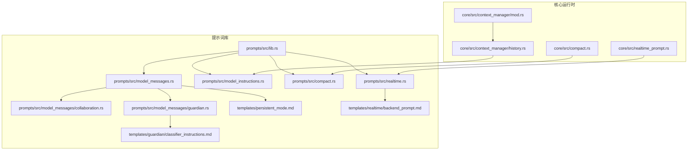
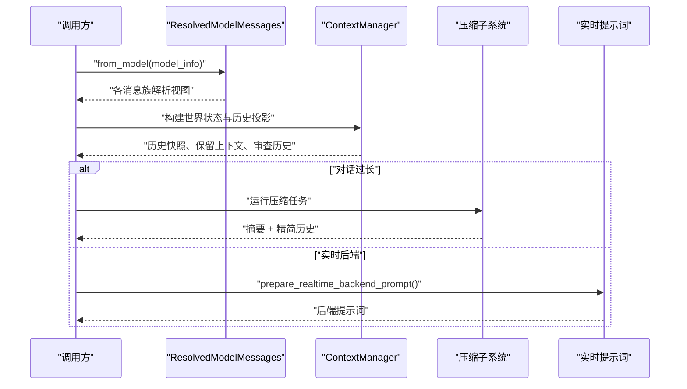
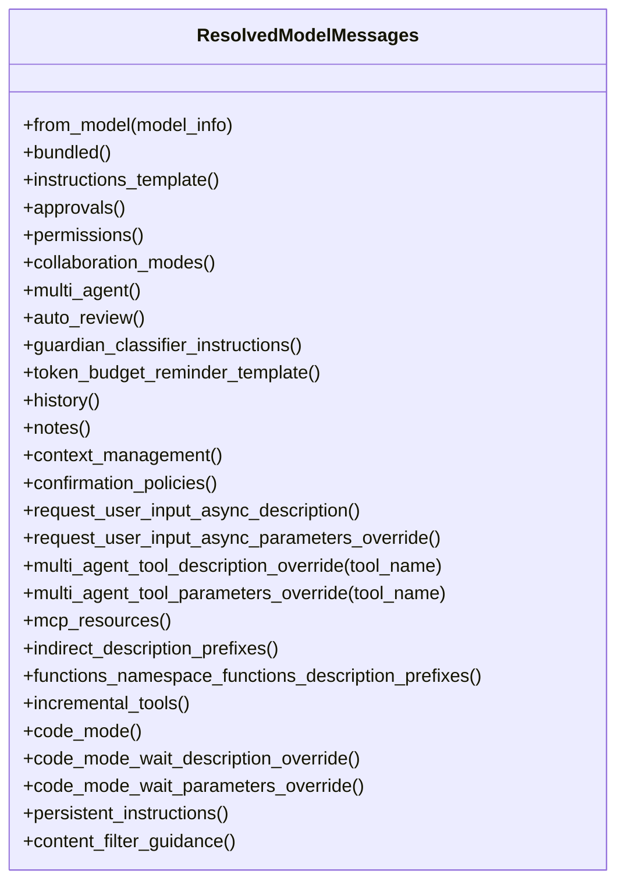
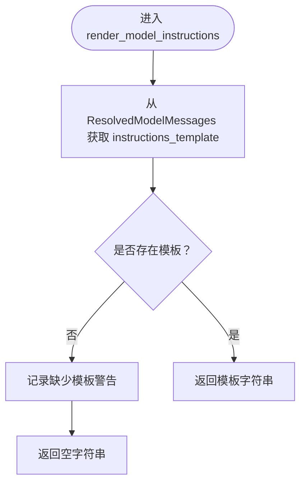
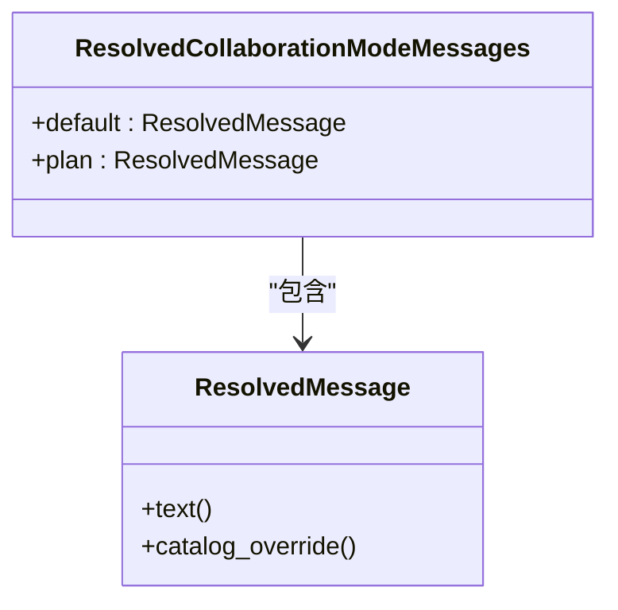
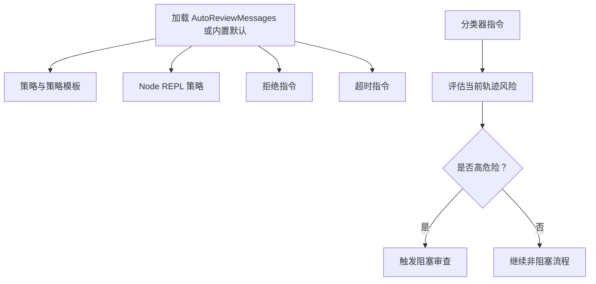
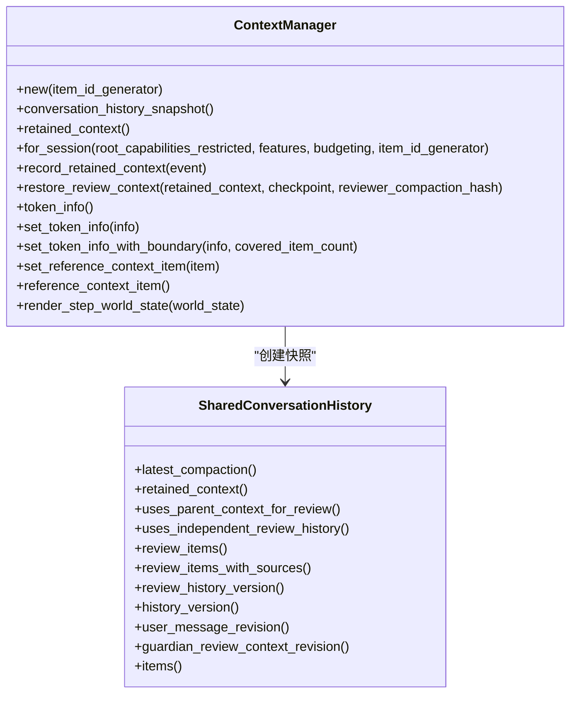
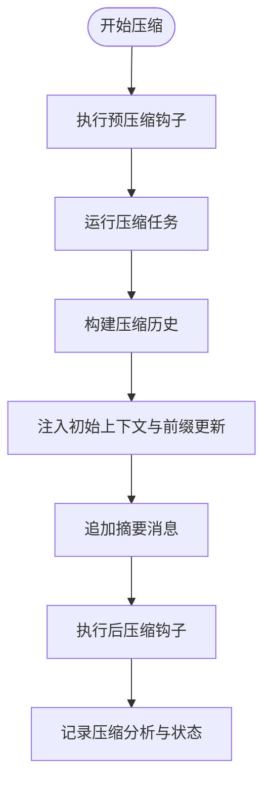
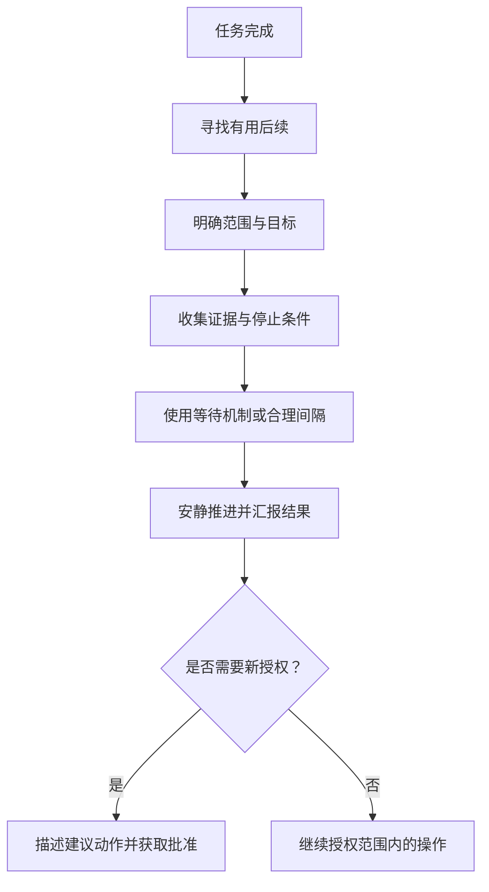
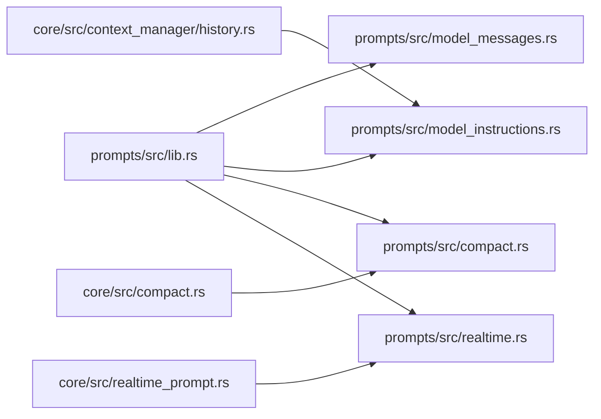

# 提示词工程

<cite>
**本文引用的文件**   
- [lib.rs](file://codex-rs/prompts/src/lib.rs)
- [model_messages.rs](file://codex-rs/prompts/src/model_messages.rs)
- [collaboration.rs](file://codex-rs/prompts/src/model_messages/collaboration.rs)
- [guardian.rs](file://codex-rs/prompts/src/model_messages/guardian.rs)
- [model_instructions.rs](file://codex-rs/prompts/src/model_instructions.rs)
- [compact.rs](file://codex-rs/prompts/src/compact.rs)
- [realtime.rs](file://codex-rs/prompts/src/realtime.rs)
- [persistent_mode.md](file://codex-rs/prompts/templates/persistent_mode.md)
- [backend_prompt.md](file://codex-rs/prompts/templates/realtime/backend_prompt.md)
- [classifier_instructions.md](file://codex-rs/prompts/templates/guardian/classifier_instructions.md)
- [mod.rs](file://codex-rs/core/src/context_manager/mod.rs)
- [history.rs](file://codex-rs/core/src/context_manager/history.rs)
- [compact.rs](file://codex-rs/core/src/compact.rs)
- [realtime_prompt.rs](file://codex-rs/core/src/realtime_prompt.rs)
</cite>

## 目录
1. [引言](#引言)
2. [项目结构](#项目结构)
3. [核心组件](#核心组件)
4. [架构总览](#架构总览)
5. [详细组件分析](#详细组件分析)
6. [依赖关系分析](#依赖关系分析)
7. [性能与上下文管理](#性能与上下文管理)
8. [调试、预览与版本对比](#调试预览与版本对比)
9. [多模型适配机制](#多模型适配机制)
10. [最佳实践与自定义集成](#最佳实践与自定义集成)
11. [故障排查](#故障排查)
12. [结论](#结论)

## 引言
本文件面向提示词工程，系统性说明 Codex 中“系统提示、用户提示、工具描述”的构建流程，以及不同模式下的模板设计。重点覆盖：
- 提示词来源与解析：从模型目录、内置模板到运行时配置的分层优先级。
- 多模式提示词：通用对话、代码协作、实时后端代理、安全审查等。
- 上下文管理器：历史投影、压缩摘要、记忆保留与安全审查隔离。
- 调试与可观测性：提示词预览、版本追踪、性能指标。
- 多模型适配：按模型能力裁剪工具描述、权限指令与持续行为策略。

## 项目结构
提示词工程横跨两个主要模块：
- `codex-rs/prompts`：集中定义提示词模板、模型消息解析器与渲染入口。
- `codex-rs/core`：在会话、上下文、实时通道、压缩流程等运行时场景中消费这些模板，组装最终发送给模型的请求。



**图表来源**
- [lib.rs:1-40](file://codex-rs/prompts/src/lib.rs#L1-L40)
- [model_messages.rs:1-289](file://codex-rs/prompts/src/model_messages.rs#L1-L289)
- [collaboration.rs:1-22](file://codex-rs/prompts/src/model_messages/collaboration.rs#L1-L22)
- [guardian.rs:1-62](file://codex-rs/prompts/src/model_messages/guardian.rs#L1-L62)
- [model_instructions.rs:1-21](file://codex-rs/prompts/src/model_instructions.rs#L1-L21)
- [compact.rs:1-2](file://codex-rs/prompts/src/compact.rs#L1-L2)
- [realtime.rs:1-3](file://codex-rs/prompts/src/realtime.rs#L1-L3)
- [persistent_mode.md:1-13](file://codex-rs/prompts/templates/persistent_mode.md#L1-L13)
- [backend_prompt.md:1-65](file://codex-rs/prompts/templates/realtime/backend_prompt.md#L1-L65)
- [classifier_instructions.md:1-82](file://codex-rs/prompts/templates/guardian/classifier_instructions.md#L1-L82)
- [mod.rs:1-15](file://codex-rs/core/src/context_manager/mod.rs#L1-L15)
- [history.rs:1-200](file://codex-rs/core/src/context_manager/history.rs#L1-L200)
- [compact.rs:60-250](file://codex-rs/core/src/compact.rs#L60-L250)
- [realtime_prompt.rs:1-82](file://codex-rs/core/src/realtime_prompt.rs#L1-L82)

**章节来源**
- [lib.rs:1-40](file://codex-rs/prompts/src/lib.rs#L1-L40)
- [model_messages.rs:1-289](file://codex-rs/prompts/src/model_messages.rs#L1-L289)
- [mod.rs:1-15](file://codex-rs/core/src/context_manager/mod.rs#L1-L15)

## 核心组件
- 提示词库导出层：统一暴露压缩摘要模板、Guardian 分类/策略指令、模型基础指令、协作模式消息、实时提示词、审查请求等。
- 模型消息解析器：将模型目录中的 `ModelMessages` 与内置默认值组合，保持“目录优先、缺失回退、空字符串即覆盖”的可控语义。
- 上下文管理器：维护线程级响应历史、保留上下文、审查历史、世界状态快照、引用基线，并负责投影与压缩。
- 压缩子系统：将长历史转为“摘要 + 有限历史片段”，并在必要时注入初始上下文与世界状态更新。
- 实时后端提示词：根据请求或配置选择后端代理提示词，支持用户名字符串替换与默认模板。

**章节来源**
- [lib.rs:1-40](file://codex-rs/prompts/src/lib.rs#L1-L40)
- [model_messages.rs:1-289](file://codex-rs/prompts/src/model_messages.rs#L1-L289)
- [history.rs:1-200](file://codex-rs/core/src/context_manager/history.rs#L1-L200)
- [compact.rs:60-250](file://codex-rs/core/src/compact.rs#L60-L250)
- [realtime_prompt.rs:1-82](file://codex-rs/core/src/realtime_prompt.rs#L1-L82)

## 架构总览
提示词构建的核心路径如下：
1. 选择模型元数据，构造 `ResolvedModelMessages`。
2. 按需解析各类消息：系统指令、协作模式、多智能体、自动审查、权限、工具描述、持续模式、内容过滤指导、令牌预算提醒等。
3. 在上下文管理器中，把世界状态、保留上下文、历史投影、审查策略等与提示词组装成最终请求。
4. 对长对话执行压缩，生成“摘要 + 精简历史”，并通过压缩钩子与遥测记录结果。
5. 对实时场景使用后端提示词，并根据配置或请求覆盖默认模板。



**图表来源**
- [model_messages.rs:1-289](file://codex-rs/prompts/src/model_messages.rs#L1-L289)
- [history.rs:1-200](file://codex-rs/core/src/context_manager/history.rs#L1-L200)
- [compact.rs:60-250](file://codex-rs/core/src/compact.rs#L60-L250)
- [realtime_prompt.rs:1-82](file://codex-rs/core/src/realtime_prompt.rs#L1-L82)

## 详细组件分析

### 模型消息解析与提示词组装
`ResolvedModelMessages` 是提示词装配的中央入口。它从选定的模型元数据中读取 `ModelMessages`，并为每个“消息族”提供解析视图；当目录未提供字段时，回退到内置常量或模板。关键特性包括：
- 区分“来自目录”和“来自内置”的文本来源，便于追踪覆盖来源。
- 为审批、权限、协作模式、多智能体、自动审查、工具描述、持久模式、内容过滤、令牌预算等分别提供独立解析方法。
- 工具描述既可按名称选择多智能体工具的静态描述，也可为函数命名空间、间接工具、增量工具、Code Mode 等提供细粒度覆盖。
- 内容过滤指导会进行长度限制，避免过长的恢复提示占用过多上下文。



**图表来源**
- [model_messages.rs:1-289](file://codex-rs/prompts/src/model_messages.rs#L1-L289)

**章节来源**
- [model_messages.rs:1-289](file://codex-rs/prompts/src/model_messages.rs#L1-L289)

### 系统提示与基础指令
基础系统提示通过 `render_model_instructions` 获取。该函数从模型元数据中提取指令模板；如果缺失，会输出警告并使用空字符串。这使“无模板”成为合法输入，同时保留诊断信息。



**图表来源**
- [model_instructions.rs:1-21](file://codex-rs/prompts/src/model_instructions.rs#L1-L21)

**章节来源**
- [model_instructions.rs:1-21](file://codex-rs/prompts/src/model_instructions.rs#L1-L21)

### 协作模式与多智能体提示词
协作模式消息由 `ResolvedCollaborationModeMessages` 解析，支持默认模式和计划模式两种预设，并保留每条消息的来源（目录或内置）。多智能体相关消息则通过 `ResolvedMultiAgentMessages` 暴露给上层，用于构建多智能体工作流中的角色与工具描述。



**图表来源**
- [collaboration.rs:1-22](file://codex-rs/prompts/src/model_messages/collaboration.rs#L1-L22)
- [model_messages.rs:1-289](file://codex-rs/prompts/src/model_messages.rs#L1-L289)

**章节来源**
- [collaboration.rs:1-22](file://codex-rs/prompts/src/model_messages/collaboration.rs#L1-L22)
- [model_messages.rs:1-289](file://codex-rs/prompts/src/model_messages.rs#L1-L289)

### 安全审查与 Guardian 分类提示词
自动审查消息由 `ResolvedAutoReviewMessages` 解析，包含策略、策略模板、Node REPL 策略、拒绝指令与时超指令。Guardian 分类指令从目录或内置模板加载，用于异步风险评估，决定后续动作是否触发阻塞式审查。



**图表来源**
- [guardian.rs:1-62](file://codex-rs/prompts/src/model_messages/guardian.rs#L1-L62)
- [classifier_instructions.md:1-82](file://codex-rs/prompts/templates/guardian/classifier_instructions.md#L1-L82)

**章节来源**
- [guardian.rs:1-62](file://codex-rs/prompts/src/model_messages/guardian.rs#L1-L62)
- [classifier_instructions.md:1-82](file://codex-rs/prompts/templates/guardian/classifier_instructions.md#L1-L82)

### 实时后端提示词
实时后端提示词通过 `prepare_realtime_backend_prompt` 准备，优先级为：
1. 配置中的提示词覆盖。
2. 请求中的提示词。
3. 默认后端提示词模板，其中包含用户名字符串占位符替换。

```mermaid
flowchart TD
    Entry(["prepare_realtime_backend_prompt"]) --> CheckConfig{"配置提示词存在且非空？"}
    CheckConfig -->|是| ReturnConfig["返回配置提示词"]
    CheckConfig -->|否| CheckRequest{"请求提示词存在？"}
    CheckRequest -->|Some(Some)| ReturnRequest["返回请求提示词"]
    CheckRequest -->|Some(None)| ReturnEmpty["返回空字符串"]
    CheckRequest -->|None| UseDefault["使用 BACKEND_PROMPT 并替换用户名"]
```

**图表来源**
- [realtime_prompt.rs:1-82](file://codex-rs/core/src/realtime_prompt.rs#L1-L82)
- [realtime.rs:1-3](file://codex-rs/prompts/src/realtime.rs#L1-L3)
- [backend_prompt.md:1-65](file://codex-rs/prompts/templates/realtime/backend_prompt.md#L1-L65)

**章节来源**
- [realtime_prompt.rs:1-82](file://codex-rs/core/src/realtime_prompt.rs#L1-L82)
- [realtime.rs:1-3](file://codex-rs/prompts/src/realtime.rs#L1-L3)
- [backend_prompt.md:1-65](file://codex-rs/prompts/templates/realtime/backend_prompt.md#L1-L65)

### 上下文管理器的工作原理
上下文管理器维护线程级历史、保留上下文、审查历史、世界状态快照、引用基线、音频拒绝集合等。其职责包括：
- 构建会话级 `ConversationHistorySnapshot`，供审查与压缩等组件消费。
- 在恢复审查上下文时，依据保留事实、检查点、功能开关决定使用“线程内审查”还是“独立审查”。
- 维护历史版本、重置版本、用户消息修订号，保证压缩、回滚与差异计算的一致性。
- 对不可用图片进行投影替换，而不污染保留历史。
- 为世界状态变化生成增量更新项，减少重复注入。



**图表来源**
- [history.rs:1-200](file://codex-rs/core/src/context_manager/history.rs#L1-L200)

**章节来源**
- [history.rs:1-200](file://codex-rs/core/src/context_manager/history.rs#L1-L200)
- [mod.rs:1-15](file://codex-rs/core/src/context_manager/mod.rs#L1-L15)

### 上下文压缩、历史摘要与记忆检索
压缩流程将长对话转换为“摘要 + 精简历史”，并可选择性地注入初始上下文与世界状态更新：
- 自动压缩与手动压缩共用内部实现，支持预压缩钩子、后压缩钩子与遥测统计。
- 压缩历史通过 `build_compacted_history` 拼接：先插入初始上下文，再追加最近的用户消息片段，最后追加摘要。
- 对于超大用户消息，会根据 token 预算选择性保留原始文本或仅保留带标注的文本片段，并标记源不完整。
- 摘要文本来自压缩提示词，默认使用 `SUMMARIZATION_PROMPT`；若未提供，则回退到内置模板。



**图表来源**
- [compact.rs:60-250](file://codex-rs/core/src/compact.rs#L60-L250)
- [compact.rs:716-840](file://codex-rs/core/src/compact.rs#L716-L840)
- [compact.rs:1-2](file://codex-rs/prompts/src/compact.rs#L1-L2)

**章节来源**
- [compact.rs:60-250](file://codex-rs/core/src/compact.rs#L60-L250)
- [compact.rs:716-840](file://codex-rs/core/src/compact.rs#L716-L840)
- [compact.rs:1-2](file://codex-rs/prompts/src/compact.rs#L1-L2)

### 持久模式与后续行为策略
持久模式指令通过 `persistent_instructions` 暴露，用于模型在完成任务后的主动跟进行为，例如：
- 寻找直接支持已完成工作的后续事项。
- 避免重复消息，保持自然连贯。
- 明确范围、目标、证据与停止条件。
- 使用现有等待机制或合理间隔检查进度。
- 对需要新授权的操作，描述建议动作并获取批准。



**图表来源**
- [model_messages.rs:201-289](file://codex-rs/prompts/src/model_messages.rs#L201-L289)
- [persistent_mode.md:1-13](file://codex-rs/prompts/templates/persistent_mode.md#L1-L13)

**章节来源**
- [model_messages.rs:201-289](file://codex-rs/prompts/src/model_messages.rs#L201-L289)
- [persistent_mode.md:1-13](file://codex-rs/prompts/templates/persistent_mode.md#L1-L13)

## 依赖关系分析
提示词库与核心运行时之间的依赖清晰：
- `prompts/src/lib.rs` 作为导出层，聚合所有提示词相关类型与常量。
- `model_messages.rs` 依赖协议模型与多个消息族解析器，统一管理目录与内置模板。
- `core/src/context_manager/history.rs` 消费 `render_model_instructions` 以获取基础指令，并参与上下文投影与审查历史。
- `core/src/compact.rs` 复用 `prompts/src/compact.rs` 提供的摘要模板，并实现压缩生命周期。
- `core/src/realtime_prompt.rs` 使用 `BACKEND_PROMPT` 并支持配置覆盖。



**图表来源**
- [lib.rs:1-40](file://codex-rs/prompts/src/lib.rs#L1-L40)
- [model_messages.rs:1-289](file://codex-rs/prompts/src/model_messages.rs#L1-L289)
- [model_instructions.rs:1-21](file://codex-rs/prompts/src/model_instructions.rs#L1-L21)
- [compact.rs:1-2](file://codex-rs/prompts/src/compact.rs#L1-L2)
- [realtime.rs:1-3](file://codex-rs/prompts/src/realtime.rs#L1-L3)
- [history.rs:1-200](file://codex-rs/core/src/context_manager/history.rs#L1-L200)
- [compact.rs:60-250](file://codex-rs/core/src/compact.rs#L60-L250)
- [realtime_prompt.rs:1-82](file://codex-rs/core/src/realtime_prompt.rs#L1-L82)

**章节来源**
- [lib.rs:1-40](file://codex-rs/prompts/src/lib.rs#L1-L40)
- [model_messages.rs:1-289](file://codex-rs/prompts/src/model_messages.rs#L1-L289)
- [history.rs:1-200](file://codex-rs/core/src/context_manager/history.rs#L1-L200)
- [compact.rs:60-250](file://codex-rs/core/src/compact.rs#L60-L250)
- [realtime_prompt.rs:1-82](file://codex-rs/core/src/realtime_prompt.rs#L1-L82)

## 性能与上下文管理
- 上下文窗口接近耗尽时，系统会注入令牌预算提醒，告知即将重置上下文，并说明哪些内容会在新窗口中保留。
- 压缩任务支持自动与手动触发，并提供预压缩和后压缩钩子，允许扩展或中断流程。
- 压缩历史构建时对超长用户消息进行 token 估算与截断，避免单次注入过大内容。
- 上下文管理器维护服务器报告的 token 用量边界，有助于更精确地估计剩余容量。

优化建议：
- 尽量通过目录覆盖精简工具描述，减少每次请求的工具定义体积。
- 使用增量工具描述与 Code Mode 专用参数，仅在需要的模型上启用更复杂的 schema。
- 控制持久模式指令的长度，避免不必要的冗长行为约束。
- 对压缩提示词进行 A/B 测试，比较不同摘要风格对下游任务质量的影响。

**章节来源**
- [model_messages.rs:1-289](file://codex-rs/prompts/src/model_messages.rs#L1-L289)
- [compact.rs:60-250](file://codex-rs/core/src/compact.rs#L60-L250)
- [compact.rs:716-840](file://codex-rs/core/src/compact.rs#L716-L840)

## 调试、预览与版本对比
虽然仓库中没有独立的“提示词调试工具”模块，但以下机制可用于提示词调试：
- 目录覆盖来源标记：`ResolvedMessage` 能区分文本来自目录还是内置，便于判断是否被覆盖。
- 缺少模板警告：`render_model_instructions` 在无模板时会记录警告，帮助发现模型配置遗漏。
- 实时提示词单元测试：验证配置覆盖、请求覆盖与默认模板渲染逻辑。
- 压缩分析与状态：压缩流程记录触发原因、实现方式、阶段与结果，可用于性能分析。

调试步骤建议：
1. 确认模型目录是否提供了所需消息字段。
2. 检查是否出现“缺少指令模板”的警告。
3. 在实时后端场景，验证配置覆盖是否生效。
4. 对压缩流程观察触发原因与最终状态，确认摘要是否满足预期。

**章节来源**
- [model_messages.rs:1-289](file://codex-rs/prompts/src/model_messages.rs#L1-L289)
- [model_instructions.rs:1-21](file://codex-rs/prompts/src/model_instructions.rs#L1-L21)
- [realtime_prompt.rs:1-82](file://codex-rs/core/src/realtime_prompt.rs#L1-L82)
- [compact.rs:60-250](file://codex-rs/core/src/compact.rs#L60-L250)

## 多模型适配机制
多模型适配主要通过 `ResolvedModelMessages` 与协议模型完成：
- 每个模型可以拥有自己的 `ModelMessages`，覆盖指令模板、审批消息、权限消息、协作模式、多智能体工具描述、Code Mode 描述、持续模式指令、内容过滤指导等。
- 当目录未提供字段时，系统回退到内置默认值，保证向后兼容。
- 工具描述可按名称选择，避免对所有模型广播全部工具细节。
- 对于敏感或昂贵的 schema，可通过 `functions_namespace_functions_description_prefixes`、`indirect_description_prefixes` 等字段精细化控制。

适配策略：
- 对简单模型：仅提供必要指令与最小工具描述，减少上下文开销。
- 对高级模型：启用增量工具描述、Code Mode 参数、多智能体工具描述，提升能力表达精度。
- 对受限环境：强化内容过滤指导与权限指令，降低误判风险。

**章节来源**
- [model_messages.rs:1-289](file://codex-rs/prompts/src/model_messages.rs#L1-L289)

## 最佳实践与自定义集成
- 优先使用模型目录覆盖提示词，而不是修改源码中的内置模板。
- 保持工具描述简洁明确，避免重复或模糊语义。
- 对需要长期行为的模型，合理使用持久模式指令，但不要过度扩展权限。
- 在实时场景中，优先通过配置覆盖后端提示词，避免硬编码。
- 对压缩摘要进行测试，确保摘要既能保留关键意图，又不会丢失重要上下文。
- 自定义提示词应遵循现有分层：系统指令、工具描述、权限策略、协作模式、审查策略、实时后端提示、持久模式。

集成步骤建议：
1. 在模型目录中添加 `ModelMessages` 对应字段。
2. 如需自定义实时后端提示词，提供配置覆盖。
3. 如需调整压缩摘要，提供 `compact_prompt` 或使用默认模板。
4. 在审查策略中调整拒绝与时超指令，使其符合业务风险偏好。
5. 通过日志与压缩分析验证效果。

**章节来源**
- [model_messages.rs:1-289](file://codex-rs/prompts/src/model_messages.rs#L1-L289)
- [realtime_prompt.rs:1-82](file://codex-rs/core/src/realtime_prompt.rs#L1-L82)
- [compact.rs:60-250](file://codex-rs/core/src/compact.rs#L60-L250)

## 故障排查
常见问题与处理：
- 模型无指令模板：检查模型目录是否提供 `instructions_template`，并注意警告日志。
- 实时后端提示词未生效：确认配置覆盖是否正确传入，以及请求提示词是否为空。
- 压缩后行为异常：检查压缩提示词是否过于简短或缺少关键约束，查看压缩分析与状态。
- 审查策略不符合预期：检查自动审查策略、拒绝指令与时超指令，确认分类器指令是否被覆盖。

定位建议：
- 使用 `ResolvedMessage.catalog_override()` 判断提示词是否来自目录。
- 查看压缩任务的触发原因、阶段与结果。
- 检查上下文管理器中的历史版本与重置版本，确认是否发生重写或回滚。

**章节来源**
- [model_instructions.rs:1-21](file://codex-rs/prompts/src/model_instructions.rs#L1-L21)
- [realtime_prompt.rs:1-82](file://codex-rs/core/src/realtime_prompt.rs#L1-L82)
- [compact.rs:60-250](file://codex-rs/core/src/compact.rs#L60-L250)
- [history.rs:1-200](file://codex-rs/core/src/context_manager/history.rs#L1-L200)

## 结论
Codex 的提示词工程以“目录覆盖优先、内置默认兜底”为核心原则，通过 `ResolvedModelMessages` 将模型元数据与模板解耦，再由上下文管理器、压缩子系统与实时提示词在运行时灵活组装。该设计既保证了多模型适配能力，也为调试、性能优化与自定义扩展提供了清晰路径。在实际使用中，建议优先通过目录与配置进行定制，结合压缩分析与上下文管理器的状态信息，持续迭代提示词质量与效率。