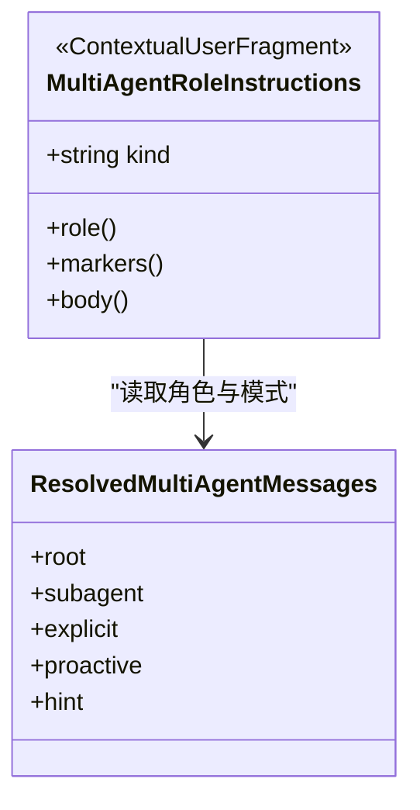
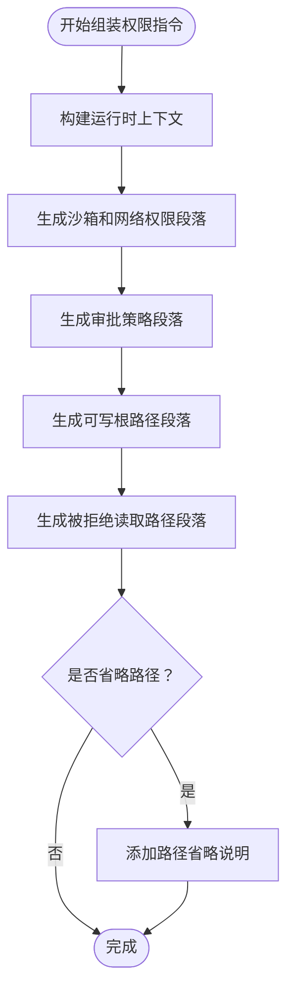
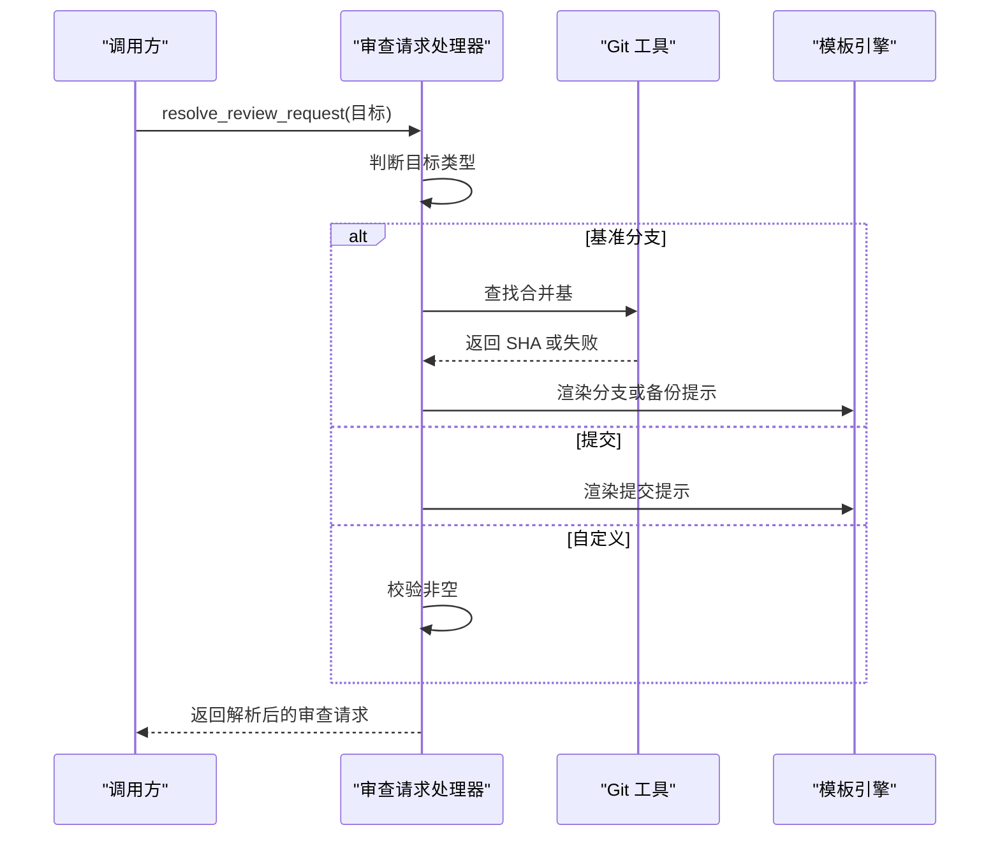
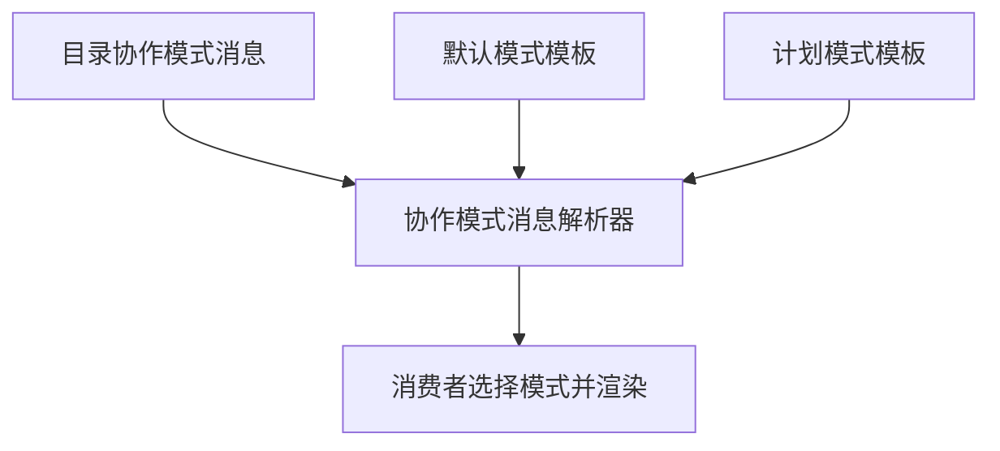
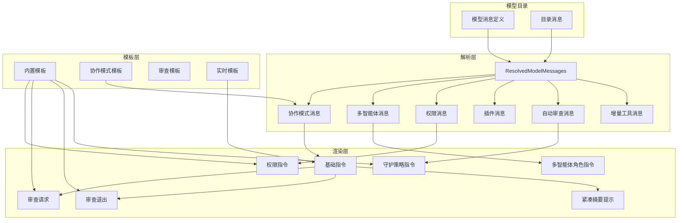
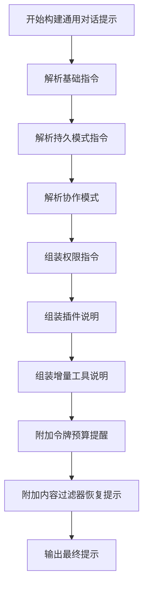
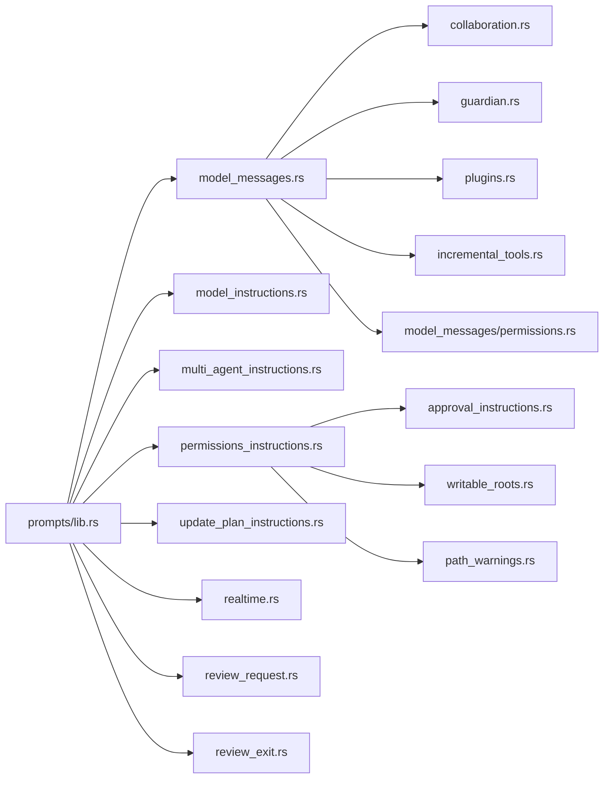

# 提示词模板管理

<cite>
**本文引用的文件**   
- [prompts/lib.rs](file://codex-rs/prompts/src/lib.rs)
- [prompts/model_messages.rs](file://codex-rs/prompts/src/model_messages.rs)
- [prompts/model_instructions.rs](file://codex-rs/prompts/src/model_instructions.rs)
- [prompts/multi_agent_instructions.rs](file://codex-rs/prompts/src/multi_agent_instructions.rs)
- [prompts/permissions_instructions.rs](file://codex-rs/prompts/src/permissions_instructions.rs)
- [prompts/update_plan_instructions.rs](file://codex-rs/prompts/src/update_plan_instructions.rs)
- [prompts/realtime.rs](file://codex-rs/prompts/src/realtime.rs)
- [prompts/review_request.rs](file://codex-rs/prompts/src/review_request.rs)
- [prompts/review_exit.rs](file://codex-rs/prompts/src/review_exit.rs)
- [prompts/model_messages/collaboration.rs](file://codex-rs/prompts/src/model_messages/collaboration.rs)
- [prompts/model_messages/multi_agent.rs](file://codex-rs/prompts/src/model_messages/multi_agent.rs)
- [prompts/model_messages/permissions.rs](file://codex-rs/prompts/src/model_messages/permissions.rs)
- [prompts/model_messages/incremental_tools.rs](file://codex-rs/prompts/src/model_messages/incremental_tools.rs)
- [prompts/model_messages/plugins.rs](file://codex-rs/prompts/src/model_messages/plugins.rs)
- [prompts/model_messages/guardian.rs](file://codex-rs/prompts/src/model_messages/guardian.rs)
- [prompts/permissions_instructions/approval_instructions.rs](file://codex-rs/prompts/src/permissions_instructions/approval_instructions.rs)
- [prompts/permissions_instructions/writable_roots.rs](file://codex-rs/prompts/src/permissions_instructions/writable_roots.rs)
- [prompts/permissions_instructions/path_warnings.rs](file://codex-rs/prompts/src/permissions_instructions/path_warnings.rs)
- [prompts/guardian_instructions.rs](file://codex-rs/prompts/src/guardian_instructions.rs)
- [prompts/compact.rs](file://codex-rs/prompts/src/compact.rs)
- [collaboration-mode-templates/lib.rs](file://codex-rs/collaboration-mode-templates/src/lib.rs)
- [collaboration-mode-templates/default.md](file://codex-rs/collaboration-mode-templates/templates/default.md)
- [collaboration-mode-templates/plan.md](file://codex-rs/collaboration-mode-templates/templates/plan.md)
</cite>

## 目录

1. [引言](#引言)
2. [项目结构](#项目结构)
3. [核心组件](#核心组件)
4. [架构总览](#架构总览)
5. [详细组件分析](#详细组件分析)
6. [依赖关系分析](#依赖关系分析)
7. [性能与预算约束](#性能与预算约束)
8. [模板开发与最佳实践](#模板开发与最佳实践)
9. [故障排查](#故障排查)
10. [结论](#结论)

## 引言

本仓库中的提示词模板管理集中在 `codex-rs/prompts`、`codex-rs/collaboration-mode-templates`、以及部分嵌入在 `codex-rs/core/templates` 的辅助说明文件中。其目标是把系统提示、用户提示和工具描述从硬编码逻辑中分离出来，通过“目录配置覆盖 + 内置默认模板”的双层机制，为不同模型、不同工作模式和多智能体角色提供可维护、可测试、可审计的提示词组装流程。

该体系同时承担以下职责：

- 解析模型目录中的消息定义，并保留每条文本的来源身份：来自目录还是内置默认。
- 构建通用对话、代码审查、实时协作、权限策略、多智能体角色等场景的提示词片段。
- 控制变量替换、条件插入、动态内容生成，并对长文本进行边界裁剪。
- 隔离易变运行时数据（路径、权限、沙箱模式）与稳定模板文本。
- 为更新计划指令、自动审查、插件能力、增量工具描述等提供专用渲染通道。

## 项目结构

提示词模板相关的主要组织方式如下：

| 区域 | 职责 | 关键实现 |
|---|---|---|
| `codex-rs/prompts/src` | 提示词解析、渲染、组装、校验的主逻辑 | `lib.rs`、`model_messages.rs`、`model_instructions.rs`、`multi_agent_instructions.rs`、`permissions_instructions.rs`、`update_plan_instructions.rs`、`guardian_instructions.rs`、`realtime.rs`、`review_request.rs`、`review_exit.rs` |
| `codex-rs/prompts/templates` | 内置 Markdown、XML 和策略模板 | 权限、审查、实时、紧凑摘要、守护策略等 |
| `codex-rs/collaboration-mode-templates` | 协作模式的默认模板 | `default.md`、`plan.md` |
| `codex-rs/core/templates` | 非 prompts 模块使用的辅助提示词或工具描述 | 编排者、协作实验提示、审查历史消息、搜索工具描述 |

```mermaid
graph TB
    PromptsLib["提示词库入口<br/>prompts/lib.rs"] --> ModelMessages["模型消息解析<br/>prompts/model_messages.rs"]
    PromptsLib --> Instructions["模型基础指令<br/>prompts/model_instructions.rs"]
    PromptsLib --> MultiAgent["多智能体角色指令<br/>prompts/multi_agent_instructions.rs"]
    PromptsLib --> Permissions["权限指令组装<br/>prompts/permissions_instructions.rs"]
    PromptsLib --> UpdatePlan["更新计划指令过滤<br/>prompts/update_plan_instructions.rs"]
    PromptsLib --> Realtime["实时协作提示词<br/>prompts/realtime.rs"]
    PromptsLib --> ReviewRequest["代码审查请求<br/>prompts/review_request.rs"]
    PromptsLib --> ReviewExit["代码审查退出<br/>prompts/review_exit.rs"]

    ModelMessages --> Collaboration["协作模式消息<br/>model_messages/collaboration.rs"]
    ModelMessages --> GuardianMsg["自动审查消息<br/>model_messages/guardian.rs"]
    ModelMessages --> PluginMsg["插件消息<br/>model_messages/plugins.rs"]
    ModelMessages --> Incremental["增量工具消息<br/>model_messages/incremental_tools.rs"]

    Permissions --> Approval["审批指令<br/>permissions_instructions/approval_instructions.rs"]
    Permissions --> WritableRoots["可写根路径<br/>permissions_instructions/writable_roots.rs"]
    Permissions --> PathWarnings["路径警告<br/>permissions_instructions/path_warnings.rs"]

    CollabTemplates["协作模式模板<br/>collaboration-mode-templates"] --> Collaboration
```

**图表来源**
- [prompts/lib.rs:1-40](file://codex-rs/prompts/src/lib.rs#L1-L40)
- [prompts/model_messages.rs:1-289](file://codex-rs/prompts/src/model_messages.rs#L1-L289)
- [prompts/model_messages/collaboration.rs:1-22](file://codex-rs/prompts/src/model_messages/collaboration.rs#L1-L22)
- [prompts/permissions_instructions.rs:1-200](file://codex-rs/prompts/src/permissions_instructions.rs#L1-L200)
- [collaboration-mode-templates/lib.rs:1-2](file://codex-rs/collaboration-mode-templates/src/lib.rs#L1-L2)

**章节来源**
- [prompts/lib.rs:1-40](file://codex-rs/prompts/src/lib.rs#L1-L40)
- [prompts/model_messages.rs:1-60](file://codex-rs/prompts/src/model_messages.rs#L1-L60)
- [collaboration-mode-templates/lib.rs:1-2](file://codex-rs/collaboration-mode-templates/src/lib.rs#L1-L2)

## 核心组件

### 1. 模型消息解析器

`ResolvedModelMessages` 是提示词体系的中心视图。它不直接决定提示词如何拼接，而是从当前模型的目录消息中按需解析各个家族的消息，缺失字段回退到内置默认，同时保留哪些文本来自目录、哪些来自内置。

主要能力包括：

- 获取模型基础指令模板。
- 解析权限和审批消息。
- 解析协作模式消息。
- 解析多智能体角色消息。
- 解析自动审查策略和拒绝提示。
- 解析增量工具描述。
- 解析插件通用提示、选中插件提示和推荐插件介绍。
- 解析持久模式指令、内容过滤器恢复提示、令牌预算提醒。
- 解析异步用户输入工具描述和参数。
- 按名称查找多智能体工具的静态描述与参数覆盖。

这种设计让上层消费者可以精确选择需要注入上下文窗口的片段，而不是一次性把所有模板塞进模型消息。

**章节来源**
- [prompts/model_messages.rs:1-289](file://codex-rs/prompts/src/model_messages.rs#L1-L289)

### 2. 模型基础指令

`render_model_instructions` 负责从模型元信息中取出指令模板。如果模型没有指令模板，它会记录警告并返回空字符串；如果模板存在但为空，则仍视为合法输入，不会隐式填充默认值。

这是“系统提示”最底层的一条通道：模板缺失不等于错误，但会触发可观测告警。

**章节来源**
- [prompts/model_instructions.rs:1-21](file://codex-rs/prompts/src/model_instructions.rs#L1-L21)

### 3. 多智能体角色指令

`MultiAgentRoleInstructions` 封装了多智能体角色的开发者提示片段。它可以是完整配置的指令，也可以是由目录或内置文本加上运行时能力组合而成的指令。

关键特性：

- 使用固定标记 `<multi_agent_role>` 包裹角色指令。
- 支持省略更新计划指导。
- 根据并发槽数量、是否启用等待子智能体、是否暴露模型覆盖，动态追加使用说明。
- 共享目录、容器和工作目录的行为会被明确告知模型。
- 区分根智能体和子智能体的默认角色描述。

**图表来源**
- [prompts/multi_agent_instructions.rs:1-99](file://codex-rs/prompts/src/multi_agent_instructions.rs#L1-L99)
- [prompts/model_messages/multi_agent.rs:1-84](file://codex-rs/prompts/src/model_messages/multi_agent.rs#L1-L84)

**章节来源**
- [prompts/multi_agent_instructions.rs:1-99](file://codex-rs/prompts/src/multi_agent_instructions.rs#L1-L99)
- [prompts/model_messages/multi_agent.rs:1-84](file://codex-rs/prompts/src/model_messages/multi_agent.rs#L1-L84)

### 4. 权限指令

权限指令是提示词中最复杂的动态片段之一。它不是单纯加载一个 Markdown 文件，而是根据沙箱模式、网络访问、审批策略、已批准前缀、可写根路径、被拒绝读取路径、执行权限审批开关和 `request_permissions` 工具可用性，拼装一段稳定的开发者提示。

核心要点：

- 使用 `PermissionsRenderContext` 表达运行时事实。
- 使用 `ApprovalPromptContext` 表达审批和权限消息来源。
- 对路径列表做字节级预算控制，避免权限细节撑爆上下文窗口。
- 将目录覆盖文本与内置模板解析结果分开处理。
- 对可写根路径和被拒绝读取路径分别提供受控的占位符替换。
- 当目录文本不安全或过长时，回退到内置默认。

**图表来源**
- [prompts/permissions_instructions.rs:1-200](file://codex-rs/prompts/src/permissions_instructions.rs#L1-L200)
- [prompts/permissions_instructions/writable_roots.rs:1-72](file://codex-rs/prompts/src/permissions_instructions/writable_roots.rs#L1-L72)
- [prompts/permissions_instructions/path_warnings.rs:1-67](file://codex-rs/prompts/src/permissions_instructions/path_warnings.rs#L1-L67)

**章节来源**
- [prompts/permissions_instructions.rs:1-200](file://codex-rs/prompts/src/permissions_instructions.rs#L1-L200)
- [prompts/permissions_instructions/approval_instructions.rs:1-59](file://codex-rs/prompts/src/permissions_instructions/approval_instructions.rs#L1-L59)
- [prompts/permissions_instructions/writable_roots.rs:1-72](file://codex-rs/prompts/src/permissions_instructions/writable_roots.rs#L1-L72)
- [prompts/permissions_instructions/path_warnings.rs:1-67](file://codex-rs/prompts/src/permissions_instructions/path_warnings.rs#L1-L67)

### 5. 更新计划指令过滤

`without_update_plan_instructions` 是一个纯函数，专门用于从 Codex 拥有的提示词中移除检查清单或 `update_plan` 工具指导，然后再加入调用方自己的指令。它不会改变自定义指令。

过滤规则包括：

- 识别规划标题。
- 识别 `update_plan` 工具段。
- 识别计划工具与进度可见性段落。
- 跳过以特定行开头的任务列表项。
- 只删除匹配段落，其余行原样输出。

这个组件适合在多智能体角色、协作模式或其他不希望重复出现计划工具指导的场景中使用。

**章节来源**
- [prompts/update_plan_instructions.rs:1-63](file://codex-rs/prompts/src/update_plan_instructions.rs#L1-L63)

### 6. 实时协作提示词

实时协作提示词由三个常量组成：后端提示、开始指令和结束指令。它们直接从 `realtime` 模板目录加载，并通过 `lib.rs` 导出。

这类提示词通常用于会话生命周期管理，而不是单次请求的详细业务指令。

**章节来源**
- [prompts/realtime.rs:1-3](file://codex-rs/prompts/src/realtime.rs#L1-L3)

### 7. 代码审查提示词

代码审查分为两个阶段：

1. **审查请求**：根据目标类型生成审查提示和用户可见提示。
2. **审查退出**：根据成功或中断状态生成结构化退出文本。

审查请求支持以下目标：

| 目标 | 行为 |
|---|---|
| 未提交变更 | 直接使用内置审查提示。 |
| 基准分支 | 尝试计算合并基，然后使用带 SHA 的模板；失败时回退到带分支名的备份模板。 |
| 提交 | 可选包含提交标题，并使用相应模板。 |
| 自定义指令 | 要求非空，否则报错。 |

审查退出使用预编译模板，并统一处理 Windows 换行符。

**图表来源**
- [prompts/review_request.rs:1-137](file://codex-rs/prompts/src/review_request.rs#L1-L137)

**章节来源**
- [prompts/review_request.rs:1-137](file://codex-rs/prompts/src/review_request.rs#L1-L137)
- [prompts/review_exit.rs:1-36](file://codex-rs/prompts/src/review_exit.rs#L1-L36)

### 8. 协作模式模板

协作模式有两个默认模板：

- **默认模式**：强调主动假设、优先执行、限制非必要提问。
- **计划模式**：强调探索、意图澄清、实施方案讨论，并要求最终产出 `<proposed_plan>` 块。

这些模板通过 `codex_collaboration_mode_templates` 暴露给 `ResolvedCollaborationModeMessages`，后者再与目录覆盖消息组合。

**图表来源**
- [prompts/model_messages/collaboration.rs:1-22](file://codex-rs/prompts/src/model_messages/collaboration.rs#L1-L22)
- [collaboration-mode-templates/lib.rs:1-2](file://codex-rs/collaboration-mode-templates/src/lib.rs#L1-L2)
- [collaboration-mode-templates/default.md:1-19](file://codex-rs/collaboration-mode-templates/templates/default.md#L1-L19)
- [collaboration-mode-templates/plan.md:1-128](file://codex-rs/collaboration-mode-templates/templates/plan.md#L1-L128)

**章节来源**
- [prompts/model_messages/collaboration.rs:1-22](file://codex-rs/prompts/src/model_messages/collaboration.rs#L1-L22)
- [collaboration-mode-templates/default.md:1-19](file://codex-rs/collaboration-mode-templates/templates/default.md#L1-L19)
- [collaboration-mode-templates/plan.md:1-128](file://codex-rs/collaboration-mode-templates/templates/plan.md#L1-L128)

## 架构总览

提示词系统的整体分层如下：

**图表来源**
- [prompts/model_messages.rs:1-289](file://codex-rs/prompts/src/model_messages.rs#L1-L289)
- [prompts/model_messages/collaboration.rs:1-22](file://codex-rs/prompts/src/model_messages/collaboration.rs#L1-L22)
- [prompts/model_messages/multi_agent.rs:1-84](file://codex-rs/prompts/src/model_messages/multi_agent.rs#L1-L84)
- [prompts/model_messages/permissions.rs:1-113](file://codex-rs/prompts/src/model_messages/permissions.rs#L1-L113)
- [prompts/model_messages/plugins.rs:1-192](file://codex-rs/prompts/src/model_messages/plugins.rs#L1-L192)
- [prompts/model_messages/guardian.rs:1-62](file://codex-rs/prompts/src/model_messages/guardian.rs#L1-L62)
- [prompts/model_messages/incremental_tools.rs:1-61](file://codex-rs/prompts/src/model_messages/incremental_tools.rs#L1-L61)
- [prompts/permissions_instructions.rs:1-200](file://codex-rs/prompts/src/permissions_instructions.rs#L1-L200)
- [prompts/review_request.rs:1-137](file://codex-rs/prompts/src/review_request.rs#L1-L137)
- [prompts/review_exit.rs:1-36](file://codex-rs/prompts/src/review_exit.rs#L1-L36)
- [prompts/guardian_instructions.rs:1-177](file://codex-rs/prompts/src/guardian_instructions.rs#L1-L177)
- [prompts/realtime.rs:1-3](file://codex-rs/prompts/src/realtime.rs#L1-L3)
- [collaboration-mode-templates/lib.rs:1-2](file://codex-rs/collaboration-mode-templates/src/lib.rs#L1-L2)

## 详细组件分析

### 通用对话提示词构建

通用对话的提示词并不只有一个大模板，而是由多个片段拼成：

1. **模型基础指令**：来自 `instructions_template`，缺失时记录警告。
2. **持久模式指令**：来自目录或内置 `persistent_mode.md`。
3. **协作模式指令**：来自协作模式消息，默认使用 `default.md` 或 `plan.md`。
4. **权限指令**：根据沙箱和审批策略动态生成。
5. **插件能力说明**：通用插件说明和选中插件能力说明。
6. **增量工具更新**：工具定义变化时的增量提示。
7. **令牌预算提醒**：上下文接近耗尽时的提醒模板。
8. **内容过滤器恢复提示**：被内容过滤器阻断时的恢复引导。

**图表来源**
- [prompts/model_instructions.rs:1-21](file://codex-rs/prompts/src/model_instructions.rs#L1-L21)
- [prompts/model_messages.rs:1-289](file://codex-rs/prompts/src/model_messages.rs#L1-L289)
- [prompts/model_messages/collaboration.rs:1-22](file://codex-rs/prompts/src/model_messages/collaboration.rs#L1-L22)
- [prompts/permissions_instructions.rs:1-200](file://codex-rs/prompts/src/permissions_instructions.rs#L1-L200)
- [prompts/model_messages/plugins.rs:1-192](file://codex-rs/prompts/src/model_messages/plugins.rs#L1-L192)
- [prompts/model_messages/incremental_tools.rs:1-61](file://codex-rs/prompts/src/model_messages/incremental_tools.rs#L1-L61)

**章节来源**
- [prompts/model_instructions.rs:1-21](file://codex-rs/prompts/src/model_instructions.rs#L1-L21)
- [prompts/model_messages.rs:1-289](file://codex-rs/prompts/src/model_messages.rs#L1-L289)
- [prompts/model_messages/plugins.rs:1-192](file://codex-rs/prompts/src/model_messages/plugins.rs#L1-L192)
- [prompts/model_messages/incremental_tools.rs:1-61](file://codex-rs/prompts/src/model_messages/incremental_tools.rs#L1-L61)

### 代码审查提示词结构与内容组织

代码审查提示词的核心是 `REVIEW_PROMPT`，它指向审查评分标准模板，而具体任务指令由 `resolve_review_request` 生成。

内容组织原则：

- 评分标准与任务指令分离。
- 任务指令根据目标类型选择模板。
- 模板变量在解析阶段提前绑定。
- 用户可见提示与模型指令分开返回。

这使评审结果更稳定，也便于测试不同目标下的提示词行为。

**章节来源**
- [prompts/review_request.rs:1-137](file://codex-rs/prompts/src/review_request.rs#L1-L137)

### 实时协作提示词

实时协作提示词由后端提示、开始指令和结束指令构成。它们的职责是界定实时会话的生命周期语义，而不是承载复杂业务逻辑。

最佳实践：

- 保持实时提示简洁。
- 不要在实时提示中嵌入大量动态路径或权限细节。
- 将运行时状态交给其他提示词片段处理。

**章节来源**
- [prompts/realtime.rs:1-3](file://codex-rs/prompts/src/realtime.rs#L1-L3)

### 多智能体角色指令

多智能体角色指令分为两类：

1. **根智能体指令**：作为团队主智能体，负责分派任务、传递消息、管理子智能体。
2. **子智能体指令**：继承父智能体能力，并向父智能体返回最终答案。

此外，还有两种模式：

- **显式模式**：仅在用户或相关指令明确要求时才委派子智能体。
- **主动模式**：允许主动并行委派，直到后续开发者消息改变模式。

`MultiAgentRoleInstructions` 会将基础角色文本、共享运行环境说明、并发限制、等待智能体建议和模型覆盖提示组合成一段开发者提示。

**章节来源**
- [prompts/model_messages/multi_agent.rs:1-84](file://codex-rs/prompts/src/model_messages/multi_agent.rs#L1-L84)
- [prompts/multi_agent_instructions.rs:1-99](file://codex-rs/prompts/src/multi_agent_instructions.rs#L1-L99)

### 权限指令与更新计划指令

权限指令负责把安全边界翻译成模型可读的开发者提示。更新计划指令则负责从 Codex 自有提示中剔除可能引起混淆的计划工具指导。

两者共同保证：

- 权限边界不会被模板文本放大。
- 路径和 glob 不会无限增长。
- 目录覆盖不能绕过安全检查。
- 多智能体模式下不会重复声明计划工具行为。

**章节来源**
- [prompts/permissions_instructions.rs:1-200](file://codex-rs/prompts/src/permissions_instructions.rs#L1-L200)
- [prompts/update_plan_instructions.rs:1-63](file://codex-rs/prompts/src/update_plan_instructions.rs#L1-L63)

## 依赖关系分析

**图表来源**
- [prompts/lib.rs:1-40](file://codex-rs/prompts/src/lib.rs#L1-L40)
- [prompts/model_messages.rs:1-289](file://codex-rs/prompts/src/model_messages.rs#L1-L289)
- [prompts/permissions_instructions.rs:1-200](file://codex-rs/prompts/src/permissions_instructions.rs#L1-L200)

关键依赖特征：

- `lib.rs` 是对外 API 门面，隐藏内部模块划分。
- `model_messages.rs` 是消息解析中心，但不直接组装所有提示。
- `permissions_instructions.rs` 是权限上下文的主要组装点。
- 协作模式和权限模板分别由独立模块加载。
- 审查逻辑依赖 Git 工具和模板引擎。

**章节来源**
- [prompts/lib.rs:1-40](file://codex-rs/prompts/src/lib.rs#L1-L40)
- [prompts/model_messages.rs:1-289](file://codex-rs/prompts/src/model_messages.rs#L1-L289)
- [prompts/permissions_instructions.rs:1-200](file://codex-rs/prompts/src/permissions_instructions.rs#L1-L200)

## 性能与预算约束

提示词系统对性能和上下文窗口有明确保护：

| 位置 | 约束 | 目的 |
|---|---|---|
| 增量工具消息 | 每个字段最多 512 字节 | 防止增量更新文案膨胀 |
| 插件通用文案 | 最多 500 字节 | 控制世界状态大小 |
| 插件使用说明 | 最多 2000 字节 | 防止使用说明过长 |
| 内容过滤器恢复提示 | 最多 512 字节 | 快速恢复，不干扰主指令 |
| 权限路径总预算 | 约 32 KiB | 控制路径和 glob 展示 |
| 可写根路径模板 | 最多 1000 字节 | 防止单句模板过大 |
| 被拒绝读取路径展示 | 最多 1000 字节 | 控制展示成本 |
| 插件目录覆盖 | 禁止控制字符和特定标记 | 防止注入或破坏结构 |

模板渲染还使用预编译模板对象和惰性初始化，减少重复解析开销。

**章节来源**
- [prompts/model_messages/incremental_tools.rs:1-61](file://codex-rs/prompts/src/model_messages/incremental_tools.rs#L1-L61)
- [prompts/model_messages/plugins.rs:1-192](file://codex-rs/prompts/src/model_messages/plugins.rs#L1-L192)
- [prompts/model_messages.rs:1-289](file://codex-rs/prompts/src/model_messages.rs#L1-L289)
- [prompts/permissions_instructions.rs:1-200](file://codex-rs/prompts/src/permissions_instructions.rs#L1-L200)
- [prompts/permissions_instructions/writable_roots.rs:1-72](file://codex-rs/prompts/src/permissions_instructions/writable_roots.rs#L1-L72)
- [prompts/permissions_instructions/path_warnings.rs:1-67](file://codex-rs/prompts/src/permissions_instructions/path_warnings.rs#L1-L67)

## 模板开发与最佳实践

### 1. 模板分类建议

| 类别 | 建议 |
|---|---|
| 系统提示 | 放在模型基础指令或持久模式指令中，保持长期稳定。 |
| 用户提示 | 放在审查请求、协作模式或多智能体角色指令中，按场景拆分。 |
| 工具描述 | 放在增量工具消息、插件消息或多智能体工具消息中。 |
| 权限说明 | 使用权限指令组件，不要直接拼接路径。 |
| 实时提示 | 保持简短，只表达会话生命周期语义。 |

### 2. 变量替换规范

- 使用预编译模板对象，如审查请求和审查退出中的模板。
- 变量名应具有领域含义，例如 `base_branch`、`merge_base_sha`、`sha`、`title`。
- 对目录覆盖模板进行占位符校验，确保替换后结构不被破坏。
- 对长文本使用截断或省略说明，而不是静默丢弃。

### 3. 条件插入规范

- 根据沙箱模式选择权限模板。
- 根据审批策略选择审批提示。
- 根据是否启用 `wait_agent` 决定是否追加等待建议。
- 根据是否暴露模型覆盖决定是否追加覆盖说明。
- 根据是否省略路径追加省略提示。

### 4. 动态内容生成规范

- 动态内容应来自运行时上下文，而不是模板本身。
- 路径、glob、工具名、插件名等运行时值应在渲染层格式化。
- 模板只负责结构和人类可读包装。
- 对动态内容进行字节级预算控制。

### 5. 模板测试建议

- 为每个模板类别编写单元测试。
- 测试目录覆盖和内置默认两条路径。
- 测试空值、超长值、非法字符和边界预算。
- 测试模板解析失败时是否回退到安全默认。
- 测试审查目标的不同分支情况。
- 测试权限路径省略是否只在整条条目边界发生。

### 6. 版本管理建议

- 模板变更应与功能变更一起提交。
- 模板文件名应体现用途，例如 `default.md`、`plan.md`、`policy.md`。
- 对模板语法变更增加回归测试。
- 对模板内容变更记录影响范围，尤其是权限和安全相关模板。
- 目录覆盖不应替代内置模板的安全约束。

### 7. 性能优化建议

- 避免在每次请求中重新解析大型模板。
- 使用惰性初始化缓存模板。
- 限制目录覆盖长度。
- 避免在提示中重复列出相同路径或工具。
- 将高频短提示拆分为独立片段，按需注入。
- 对增量工具描述使用最小化文案。

**章节来源**
- [prompts/review_request.rs:1-137](file://codex-rs/prompts/src/review_request.rs#L1-L137)
- [prompts/review_exit.rs:1-36](file://codex-rs/prompts/src/review_exit.rs#L1-L36)
- [prompts/permissions_instructions.rs:1-200](file://codex-rs/prompts/src/permissions_instructions.rs#L1-L200)
- [prompts/model_messages/plugins.rs:1-192](file://codex-rs/prompts/src/model_messages/plugins.rs#L1-L192)

## 故障排查

### 模型缺少指令模板

**现象**：日志中出现模型无指令模板的警告。  
**原因**：当前模型目录未提供 `instructions_template`。  
**处理**：确认模型元数据是否正确，或接受空指令为合法降级。

**章节来源**
- [prompts/model_instructions.rs:1-21](file://codex-rs/prompts/src/model_instructions.rs#L1-L21)

### 审查提示为空

**现象**：自定义审查提示被拒绝。  
**原因**：`ReviewTarget::Custom` 要求非空指令。  
**处理**：传入有效的审查指令，或使用内置目标类型。

**章节来源**
- [prompts/review_request.rs:1-137](file://codex-rs/prompts/src/review_request.rs#L1-L137)

### 权限路径过多导致省略

**现象**：权限提示末尾出现路径省略说明。  
**原因**：路径列表超过字节预算。  
**处理**：减少无关路径，或调整权限策略，而不是信任省略意味着限制失效。

**章节来源**
- [prompts/permissions_instructions.rs:1-200](file://codex-rs/prompts/src/permissions_instructions.rs#L1-L200)
- [prompts/permissions_instructions/path_warnings.rs:1-67](file://codex-rs/prompts/src/permissions_instructions/path_warnings.rs#L1-L67)

### 模板解析失败

**现象**：启动或初始化时报错，提示模板必须解析。  
**原因**：内置模板语法错误或占位符不符合预期。  
**处理**：修复模板语法，确保占位符存在且未被非法字符污染。

**章节来源**
- [prompts/review_request.rs:1-137](file://codex-rs/prompts/src/review_request.rs#L1-L137)
- [prompts/review_exit.rs:1-36](file://codex-rs/prompts/src/review_exit.rs#L1-L36)
- [prompts/permissions_instructions.rs:1-200](file://codex-rs/prompts/src/permissions_instructions.rs#L1-L200)

## 结论

该项目的提示词模板管理实现了“稳定模板 + 动态上下文 + 目录覆盖 + 严格预算”的组合方案。它把系统提示、用户提示和工具描述拆分为多个职责清晰的组件，并通过 `ResolvedModelMessages`、权限指令、多智能体角色指令、审查请求和协作模式消息等抽象，把模板与运行时数据解耦。

对于模板开发者来说，最重要的原则是：

- 模板负责结构和语义，运行时负责数据和边界。
- 目录覆盖要谨慎，不能绕过安全约束。
- 动态内容必须受预算控制。
- 每种场景应有独立的提示词入口和测试。
- 安全和权限相关模板应优先考虑健壮性和可观测性。

这套机制既适合通用对话，也适合代码审查、实时协作和多智能体角色等复杂场景，并为后续扩展新的提示词家族提供了清晰接口。