# 提示词调试

<cite>
**本文引用的文件**   
- [codex-rs/core/src/prompt_debug.rs](file://codex-rs/core/src/prompt_debug.rs)
- [codex-rs/core/src/session/turn.rs](file://codex-rs/core/src/session/turn.rs)
- [codex-rs/tui/src/temporary_structured_request.rs](file://codex-rs/tui/src/temporary_structured_request.rs)
- [codex-rs/tui/src/debug_config.rs](file://codex-rs/tui/src/debug_config.rs)
- [codex-rs/core/src/turn_diff_tracker.rs](file://codex-rs/core/src/turn_diff_tracker.rs)
- [codex-rs/core/src/turn_timing/report.rs](file://codex-rs/core/src/turn_timing/report.rs)
- [scripts/debug-codex.sh](file://scripts/debug-codex.sh)
</cite>

## 目录
1. [引言](#引言)
2. [项目结构](#项目结构)
3. [核心组件](#核心组件)
4. [架构总览](#架构总览)
5. [详细组件分析](#详细组件分析)
6. [依赖关系分析](#依赖关系分析)
7. [性能分析方法](#性能分析方法)
8. [特定调试场景](#特定调试场景)
9. [版本对比与回归检测](#版本对比与回归检测)
10. [调试最佳实践](#调试最佳实践)
11. [故障排查指南](#故障排查指南)
12. [结论](#结论)

## 引言
本文面向需要调试 Codex 提示词构建、渲染输出和运行时行为的开发者。文档聚焦以下目标：
- 解释调试模式如何创建临时会话、注入配置并实现环境隔离。
- 说明提示词预览的完整输入构建、渲染结果展示与格式验证路径。
- 描述变更追踪、差异分析与回归检测的实现方式。
- 总结耗时统计、关键路径指标及优化建议。
- 覆盖 Guardian 指令调试、审查请求调试等典型场景。
- 提供可操作的调试流程和问题排查清单。

## 项目结构
与提示词调试直接相关的代码分布在以下模块：
- 核心层：负责会话上下文、提示词构建、工具路由、Guardian 指令注入和性能记录。
- TUI 层：提供调试配置输出、临时结构化请求、沙箱权限约束和命令入口。
- 脚本层：提供本地开发调试入口，便于在 VSCode 扩展中调用最新二进制。

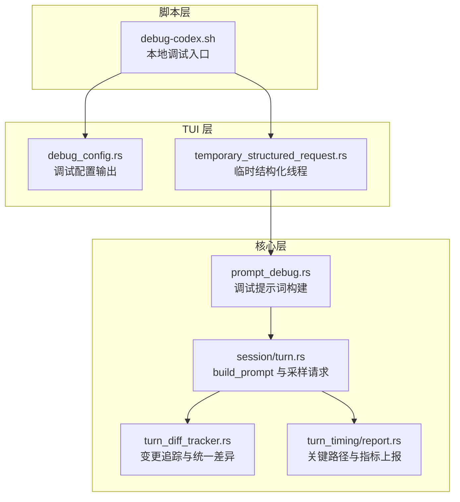

**图表来源**
- [scripts/debug-codex.sh:1-10](file://scripts/debug-codex.sh#L1-L10)
- [codex-rs/tui/src/debug_config.rs:1-200](file://codex-rs/tui/src/debug_config.rs#L1-L200)
- [codex-rs/tui/src/temporary_structured_request.rs:1-200](file://codex-rs/tui/src/temporary_structured_request.rs#L1-L200)
- [codex-rs/core/src/prompt_debug.rs:1-131](file://codex-rs/core/src/prompt_debug.rs#L1-L131)
- [codex-rs/core/src/session/turn.rs:1842-1885](file://codex-rs/core/src/session/turn.rs#L1842-L1885)
- [codex-rs/core/src/turn_diff_tracker.rs:1-200](file://codex-rs/core/src/turn_diff_tracker.rs#L1-L200)
- [codex-rs/core/src/turn_timing/report.rs:1-77](file://codex-rs/core/src/turn_timing/report.rs#L1-L77)

**章节来源**
- [scripts/debug-codex.sh:1-10](file://scripts/debug-codex.sh#L1-L10)
- [codex-rs/tui/src/debug_config.rs:1-200](file://codex-rs/tui/src/debug_config.rs#L1-L200)
- [codex-rs/tui/src/temporary_structured_request.rs:1-200](file://codex-rs/tui/src/temporary_structured_request.rs#L1-L200)
- [codex-rs/core/src/prompt_debug.rs:1-131](file://codex-rs/core/src/prompt_debug.rs#L1-L131)
- [codex-rs/core/src/session/turn.rs:1842-1885](file://codex-rs/core/src/session/turn.rs#L1842-L1885)
- [codex-rs/core/src/turn_diff_tracker.rs:1-200](file://codex-rs/core/src/turn_diff_tracker.rs#L1-L200)
- [codex-rs/core/src/turn_timing/report.rs:1-77](file://codex-rs/core/src/turn_timing/report.rs#L1-L77)

## 核心组件
- 调试提示词构建：通过临时会话构造模型可见的 `input` 列表，避免进入正常轮次执行流程，适合离线验证提示词内容。
- 临时结构化请求：通过应用服务器启动只读、功能关闭、MCP 禁用的临时线程，保证结构化提示不受真实环境能力影响。
- 提示词构建函数：组装历史输入、工具规格、基础指令、输出 Schema 与缓存策略，形成最终模型请求。
- 变更追踪器：基于 apply_patch 变更跟踪工作区文本差异，生成统一 diff，用于变更对比与回归观察。
- 关键路径性能报告：采集推理、压缩、自动审查、工具调用、用户等待、开销等阶段耗时，并上报遥测指标。
- 调试配置输出：展示配置层栈、需求来源、代理、安全策略与审核相关设置，帮助定位配置问题。

**章节来源**
- [codex-rs/core/src/prompt_debug.rs:1-131](file://codex-rs/core/src/prompt_debug.rs#L1-L131)
- [codex-rs/tui/src/temporary_structured_request.rs:1-200](file://codex-rs/tui/src/temporary_structured_request.rs#L1-L200)
- [codex-rs/core/src/session/turn.rs:1842-1885](file://codex-rs/core/src/session/turn.rs#L1842-L1885)
- [codex-rs/core/src/turn_diff_tracker.rs:1-200](file://codex-rs/core/src/turn_diff_tracker.rs#L1-L200)
- [codex-rs/core/src/turn_timing/report.rs:1-77](file://codex-rs/core/src/turn_timing/report.rs#L1-L77)
- [codex-rs/tui/src/debug_config.rs:1-200](file://codex-rs/tui/src/debug_config.rs#L1-L200)

## 架构总览
提示词调试的整体流程如下：
1. 使用本地调试脚本启动 Codex，或在 TUI 中触发调试命令。
2. TUI 层根据当前上下文准备临时结构化线程或本地调试会话。
3. 核心层构建会话上下文、历史快照、工具规格与基础指令。
4. 生成模型可见的 `input` 列表，必要时注入 Guardian 指令。
5. 可选地提交到应用服务器进行隔离执行；或者仅在本地完成提示词构建并返回供预览。
6. 变更记录被追踪，生成统一差异；性能数据被采集并上报。

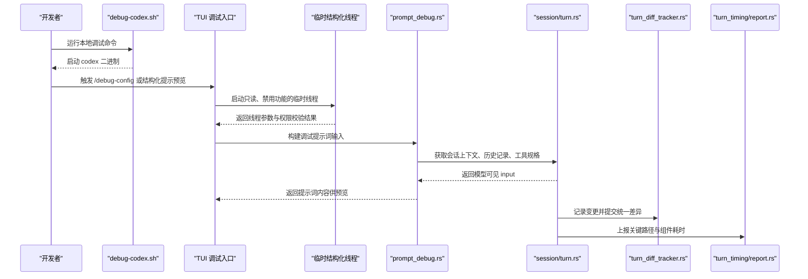

**图表来源**
- [scripts/debug-codex.sh:1-10](file://scripts/debug-codex.sh#L1-L10)
- [codex-rs/tui/src/temporary_structured_request.rs:1-200](file://codex-rs/tui/src/temporary_structured_request.rs#L1-L200)
- [codex-rs/core/src/prompt_debug.rs:1-131](file://codex-rs/core/src/prompt_debug.rs#L1-L131)
- [codex-rs/core/src/session/turn.rs:1842-1885](file://codex-rs/core/src/session/turn.rs#L1842-L1885)
- [codex-rs/core/src/turn_diff_tracker.rs:1-200](file://codex-rs/core/src/turn_diff_tracker.rs#L1-L200)
- [codex-rs/core/src/turn_timing/report.rs:1-77](file://codex-rs/core/src/turn_timing/report.rs#L1-L77)

## 详细组件分析

### 调试模式与临时会话
调试提示词构建的核心目标是“构造一个模型可见的请求输入”，而不真正执行完整的轮次。其实现要点包括：
- 将配置标记为临时会话，避免持久化状态污染。
- 初始化认证管理器、本地运行时路径、线程存储、安装标识与启动模型。
- 使用线程管理器创建临时线程，并通过会话方法捕获步骤上下文。
- 不进入 `run_turn`，而是仅构建并记录上下文、用户输入、世界状态和历史快照。
- 最终通过 `build_prompt` 生成模型可见的 `input` 列表。

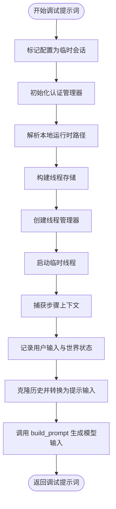

**图表来源**
- [codex-rs/core/src/prompt_debug.rs:1-131](file://codex-rs/core/src/prompt_debug.rs#L1-L131)

**章节来源**
- [codex-rs/core/src/prompt_debug.rs:1-131](file://codex-rs/core/src/prompt_debug.rs#L1-L131)

### 配置注入与环境隔离
TUI 层的临时结构化请求提供了更强的隔离保障，适用于处理不可信结构化提示的场景：
- 显式关闭大量功能开关，例如应用、代码模式、多智能体、插件、Web 搜索、统一执行等。
- 若未指定自定义权限配置文件，则强制启用内置只读权限配置文件。
- 读取应用服务器的有效配置，并将所有 MCP 服务器显式禁用。
- 启动参数包含 `ephemeral=true`、空工作区根、空动态工具、空能力根。
- 对权限配置文件与沙箱模式进行严格校验，失败时拒绝继续。

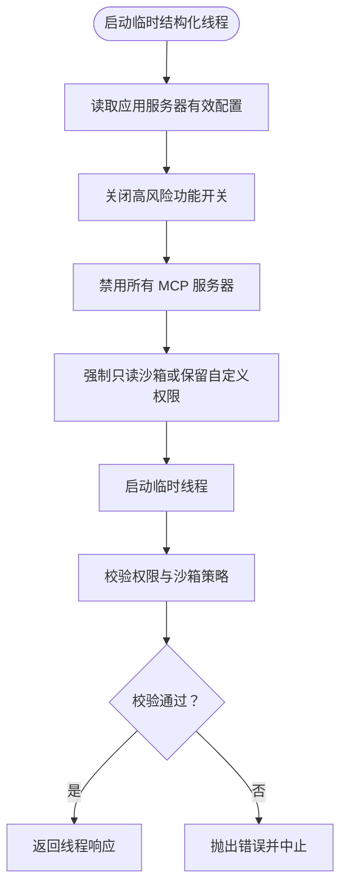

**图表来源**
- [codex-rs/tui/src/temporary_structured_request.rs:1-200](file://codex-rs/tui/src/temporary_structured_request.rs#L1-L200)

**章节来源**
- [codex-rs/tui/src/temporary_structured_request.rs:1-200](file://codex-rs/tui/src/temporary_structured_request.rs#L1-L200)

### 提示词预览：完整输入构建、渲染结果展示与格式验证
提示词预览由两部分组成：
- 输入构建：从会话历史中提取模型可见输入，附加工具规格、基础指令、输出 Schema、缓存策略等。
- 渲染展示：TUI 将调试配置、会话代理信息、审核与网络需求等以可读形式输出。
- 格式验证：通过输出 Schema 与严格模式控制，确保模型响应结构符合预期。

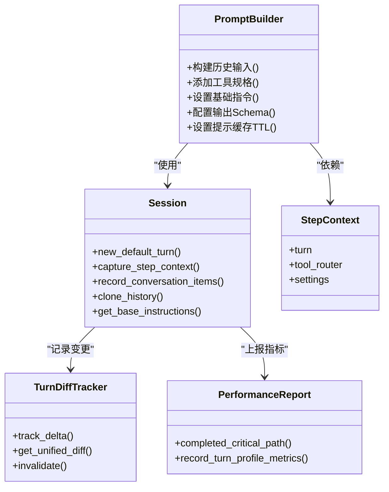

**图表来源**
- [codex-rs/core/src/session/turn.rs:1842-1885](file://codex-rs/core/src/session/turn.rs#L1842-L1885)
- [codex-rs/core/src/turn_diff_tracker.rs:1-200](file://codex-rs/core/src/turn_diff_tracker.rs#L1-L200)
- [codex-rs/core/src/turn_timing/report.rs:1-77](file://codex-rs/core/src/turn_timing/report.rs#L1-L77)

**章节来源**
- [codex-rs/core/src/session/turn.rs:1842-1885](file://codex-rs/core/src/session/turn.rs#L1842-L1885)
- [codex-rs/tui/src/debug_config.rs:1-200](file://codex-rs/tui/src/debug_config.rs#L1-L200)

### 版本对比机制：差异分析、变更追踪与回归检测
变更追踪基于已提交的 apply_patch 变更，避免重复读取文件系统：
- 维护基线与当前内容的映射，支持新增、删除、更新与重命名。
- 对非精确变更立即失效缓存，避免阻塞工具调用。
- 合并重命名配对后，按显示路径排序生成统一差异。
- 对差异结果进行缓存，减少重复计算。
- 提供超时保护，防止极端输入导致长时间阻塞。

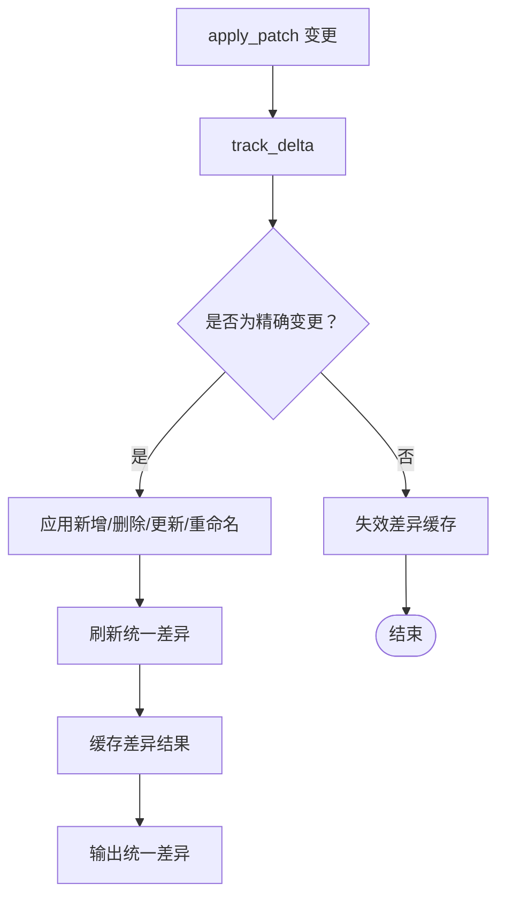

**图表来源**
- [codex-rs/core/src/turn_diff_tracker.rs:1-200](file://codex-rs/core/src/turn_diff_tracker.rs#L1-L200)

**章节来源**
- [codex-rs/core/src/turn_diff_tracker.rs:1-200](file://codex-rs/core/src/turn_diff_tracker.rs#L1-L200)

## 依赖关系分析
提示词调试的关键依赖如下：
- TUI 层依赖应用服务器协议与客户端，用于启动临时线程、读取有效配置并限制功能。
- 核心层依赖会话管理、工具路由、Guardian 指令准备、历史管理与遥测上报。
- 变更追踪依赖 apply_patch 变更模型与路径 URI 工具。
- 性能报告依赖分析模型与 OpenTelemetry 指标名称。

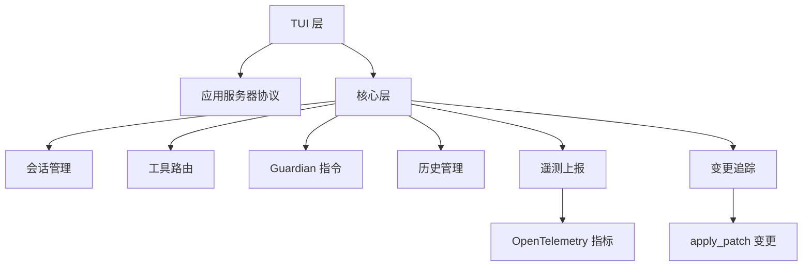

**图表来源**
- [codex-rs/tui/src/temporary_structured_request.rs:1-200](file://codex-rs/tui/src/temporary_structured_request.rs#L1-L200)
- [codex-rs/core/src/session/turn.rs:1842-1885](file://codex-rs/core/src/session/turn.rs#L1842-L1885)
- [codex-rs/core/src/turn_diff_tracker.rs:1-200](file://codex-rs/core/src/turn_diff_tracker.rs#L1-L200)
- [codex-rs/core/src/turn_timing/report.rs:1-77](file://codex-rs/core/src/turn_timing/report.rs#L1-L77)

**章节来源**
- [codex-rs/tui/src/temporary_structured_request.rs:1-200](file://codex-rs/tui/src/temporary_structured_request.rs#L1-L200)
- [codex-rs/core/src/session/turn.rs:1842-1885](file://codex-rs/core/src/session/turn.rs#L1842-L1885)
- [codex-rs/core/src/turn_diff_tracker.rs:1-200](file://codex-rs/core/src/turn_diff_tracker.rs#L1-L200)
- [codex-rs/core/src/turn_timing/report.rs:1-77](file://codex-rs/core/src/turn_timing/report.rs#L1-L77)

## 性能分析方法
提示词调试的性能分析主要围绕关键路径与组件耗时：
- 关键路径会在轮次结束时冻结并计算总时长，以及推理、压缩、自动审查、工具调用、用户等待、开销与未知阶段耗时。
- 指标包含产品 SKU 与推理努力等级标签，便于区分不同模型与工作负载。
- 组件级指标分别上报推理、自动审查、工具、用户等待、开销与未知阶段，方便定位瓶颈。
- 变更追踪对差异计算设置了超时保护，避免极端输入阻塞工具完成。

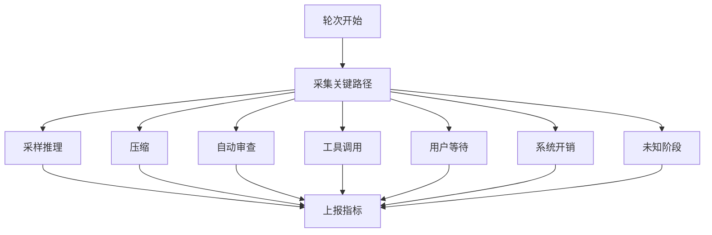

**图表来源**
- [codex-rs/core/src/turn_timing/report.rs:1-77](file://codex-rs/core/src/turn_timing/report.rs#L1-L77)

**章节来源**
- [codex-rs/core/src/turn_timing/report.rs:1-77](file://codex-rs/core/src/turn_timing/report.rs#L1-L77)
- [codex-rs/core/src/turn_diff_tracker.rs:1-200](file://codex-rs/core/src/turn_diff_tracker.rs#L1-L200)

## 特定调试场景

### Guardian 指令调试
Guardian 指令调试关注基础会话源下的提示词准备：
- 当会话源属于基本类型时，会调用 Guardian 准备逻辑，向提示词注入安全策略与额外策略。
- 调试配置输出会展示 guardian_policy_config、guardian_extra_policy、features.guardian_approval 等需求来源。
- 可通过 `/debug-config` 查看是否启用了审核策略、网络域名与头部注入等。

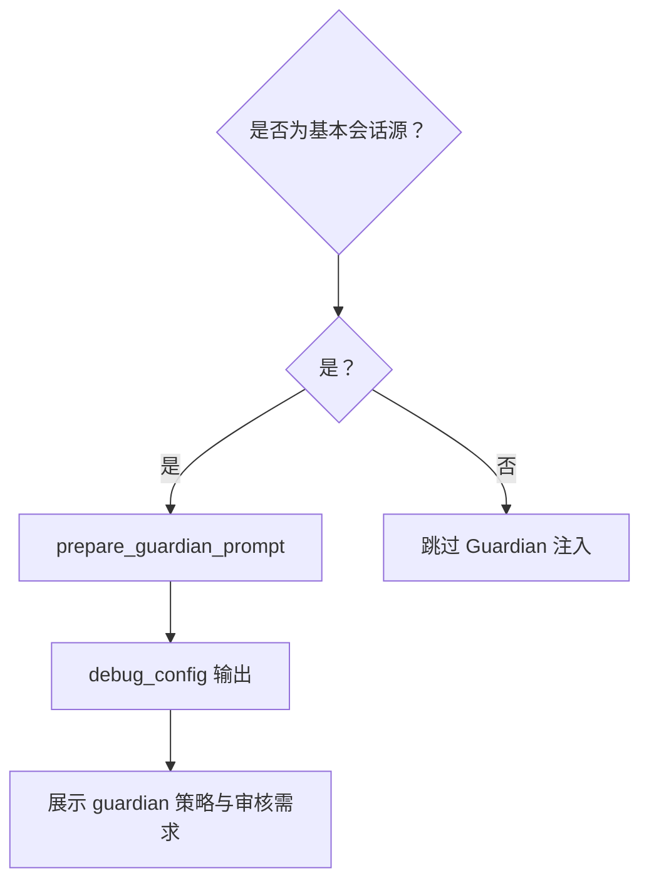

**图表来源**
- [codex-rs/core/src/session/turn.rs:1842-1885](file://codex-rs/core/src/session/turn.rs#L1842-L1885)
- [codex-rs/tui/src/debug_config.rs:1-200](file://codex-rs/tui/src/debug_config.rs#L1-L200)

**章节来源**
- [codex-rs/core/src/session/turn.rs:1842-1885](file://codex-rs/core/src/session/turn.rs#L1842-L1885)
- [codex-rs/tui/src/debug_config.rs:1-200](file://codex-rs/tui/src/debug_config.rs#L1-L200)

### 审查请求调试
审查请求调试涉及审核域名、自动审核与网络代理配置：
- 调试配置输出会列出允许的审核者、审核域名与网络代理状态。
- 若启用了审核域名，会在需求行中展示域名集合。
- 结合临时结构化线程的只读权限，可在审查模式下避免意外写入。

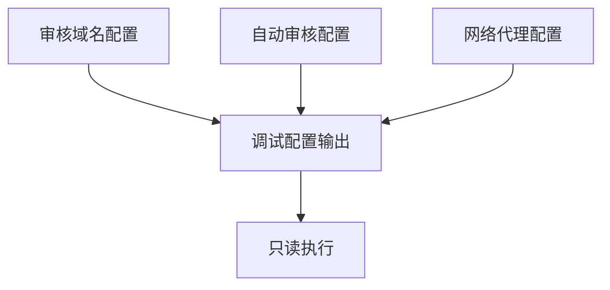

**图表来源**
- [codex-rs/tui/src/debug_config.rs:1-200](file://codex-rs/tui/src/debug_config.rs#L1-L200)
- [codex-rs/tui/src/temporary_structured_request.rs:1-200](file://codex-rs/tui/src/temporary_structured_request.rs#L1-L200)

**章节来源**
- [codex-rs/tui/src/debug_config.rs:1-200](file://codex-rs/tui/src/debug_config.rs#L1-L200)
- [codex-rs/tui/src/temporary_structured_request.rs:1-200](file://codex-rs/tui/src/temporary_structured_request.rs#L1-L200)

### 提示词预览与结构化请求
结构化提示预览通过临时线程完成，避免真实环境能力干扰：
- 先读取有效配置，再禁用所有 MCP 服务器。
- 使用只读沙箱或保留自定义权限配置文件。
- 提交结构化轮次时仅包含纯文本输入，避免执行工具。
- 超时与最大字节数限制可防止长轮次与大数据量响应。

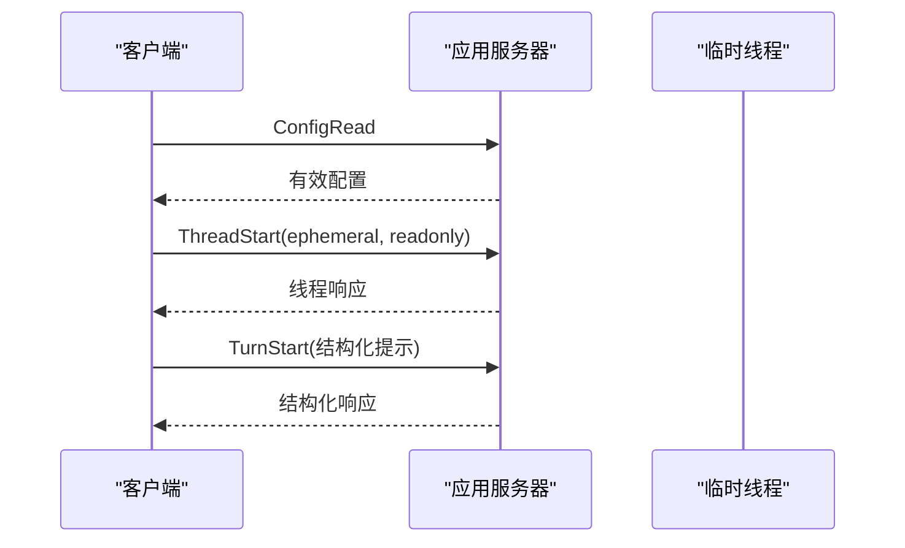

**图表来源**
- [codex-rs/tui/src/temporary_structured_request.rs:1-200](file://codex-rs/tui/src/temporary_structured_request.rs#L1-L200)

**章节来源**
- [codex-rs/tui/src/temporary_structured_request.rs:1-200](file://codex-rs/tui/src/temporary_structured_request.rs#L1-L200)

## 版本对比与回归检测
变更追踪与差异输出可用于回归检测：
- 在相同工作区环境下对比基线与当前版本的差异。
- 对于重命名操作，追踪器会自动配对源路径与目标路径。
- 统一差异聚合后可用于版本对比工具，辅助回归定位。
- 若差异过大或计算过慢，会触发超时保护，避免阻塞主流程。

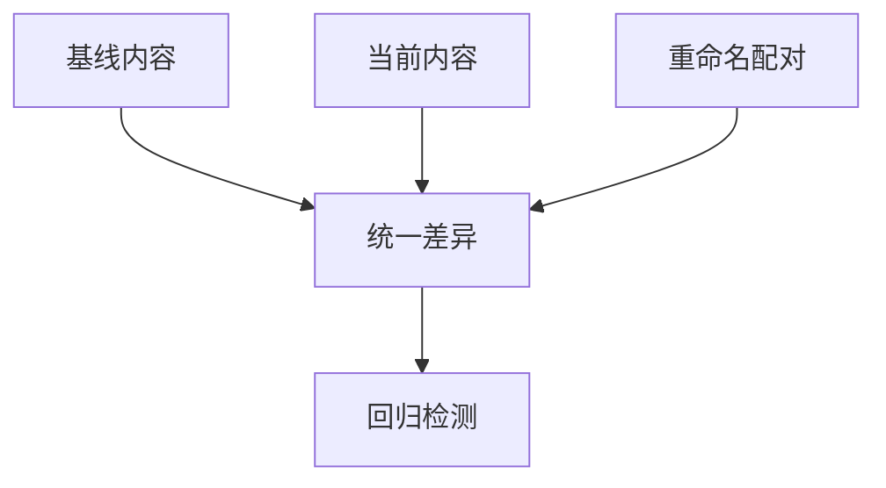

**图表来源**
- [codex-rs/core/src/turn_diff_tracker.rs:1-200](file://codex-rs/core/src/turn_diff_tracker.rs#L1-L200)

**章节来源**
- [codex-rs/core/src/turn_diff_tracker.rs:1-200](file://codex-rs/core/src/turn_diff_tracker.rs#L1-L200)

## 调试最佳实践
- 优先使用临时结构化线程进行不可信结构化提示测试，避免启用工具与外部服务。
- 使用 `/debug-config` 检查配置层栈、需求来源、代理与审核策略，确认环境与权限符合预期。
- 在本地开发环境中使用 `scripts/debug-codex.sh` 快速调用最新二进制，便于复现问题。
- 关注关键路径指标，尤其是推理、工具调用与用户等待阶段，定位性能瓶颈。
- 对大文件或复杂变更使用变更追踪器的统一差异输出，辅助回归分析。
- 在审查模式下保持只读权限，避免误写工作区文件。

**章节来源**
- [codex-rs/tui/src/temporary_structured_request.rs:1-200](file://codex-rs/tui/src/temporary_structured_request.rs#L1-L200)
- [codex-rs/tui/src/debug_config.rs:1-200](file://codex-rs/tui/src/debug_config.rs#L1-L200)
- [scripts/debug-codex.sh:1-10](file://scripts/debug-codex.sh#L1-L10)
- [codex-rs/core/src/turn_timing/report.rs:1-77](file://codex-rs/core/src/turn_timing/report.rs#L1-L77)
- [codex-rs/core/src/turn_diff_tracker.rs:1-200](file://codex-rs/core/src/turn_diff_tracker.rs#L1-L200)

## 故障排查指南
常见问题与排查思路：
- 临时线程启动超时：检查应用服务器配置是否可读、MCP 服务器是否过多或网络代理是否可用。
- 权限配置文件未保留：确认传入的自定义权限配置文件是否符合预期，或回退到只读沙箱。
- 提示词构建结果为空：检查会话历史是否为空、工具路由是否配置正确、基础指令是否被清空。
- Guardian 策略未生效：确认会话源是否为基本类型，并在调试配置中检查相关需求来源。
- 差异计算阻塞：检查是否存在非精确变更或超大文件，考虑降低变更粒度或禁用部分功能。
- 性能指标异常：关注关键路径组件耗时，区分推理、工具调用与用户等待，定位瓶颈阶段。

**章节来源**
- [codex-rs/tui/src/temporary_structured_request.rs:1-200](file://codex-rs/tui/src/temporary_structured_request.rs#L1-L200)
- [codex-rs/core/src/prompt_debug.rs:1-131](file://codex-rs/core/src/prompt_debug.rs#L1-L131)
- [codex-rs/core/src/session/turn.rs:1842-1885](file://codex-rs/core/src/session/turn.rs#L1842-L1885)
- [codex-rs/core/src/turn_diff_tracker.rs:1-200](file://codex-rs/core/src/turn_diff_tracker.rs#L1-L200)
- [codex-rs/core/src/turn_timing/report.rs:1-77](file://codex-rs/core/src/turn_timing/report.rs#L1-L77)

## 结论
提示词调试在 Codex 中由 TUI 层与核心层协同实现：TUI 提供隔离的执行环境与可读的配置输出，核心层负责会话上下文、提示词构建、变更追踪与性能指标上报。通过临时会话、配置注入、环境隔离、差异分析与关键路径统计，开发者可以高效定位提示词问题、验证渲染结果、追踪变更并优化性能。建议在不可信输入、审查模式与复杂工作区场景下优先采用临时结构化线程与只读权限，并结合调试配置与性能指标进行系统性排查。