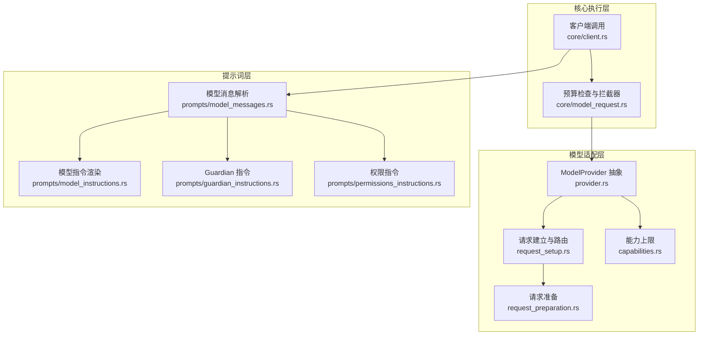
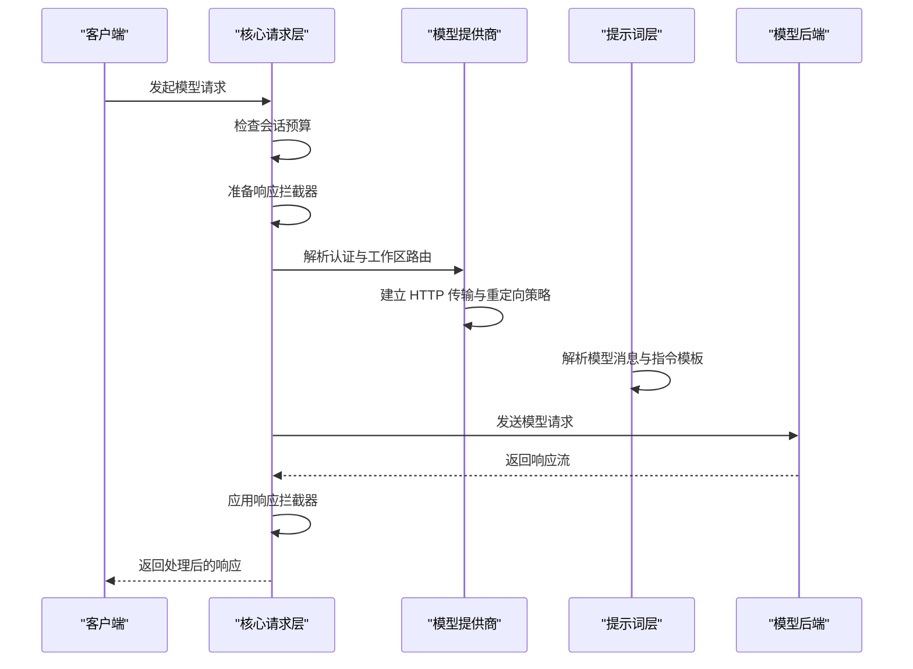
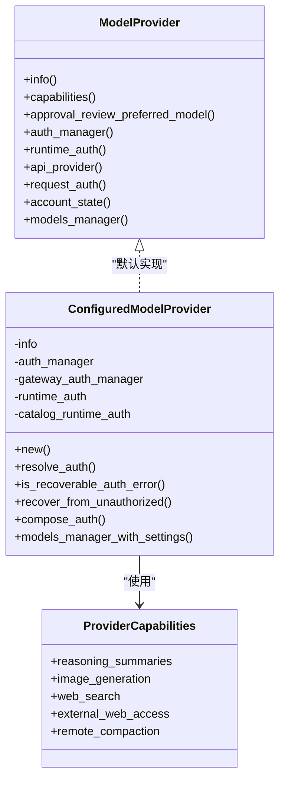
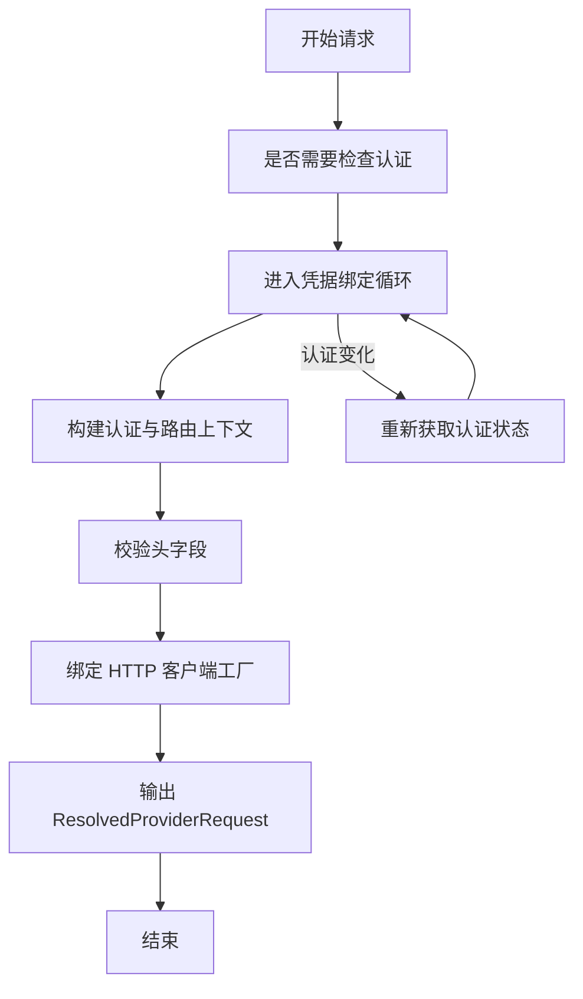
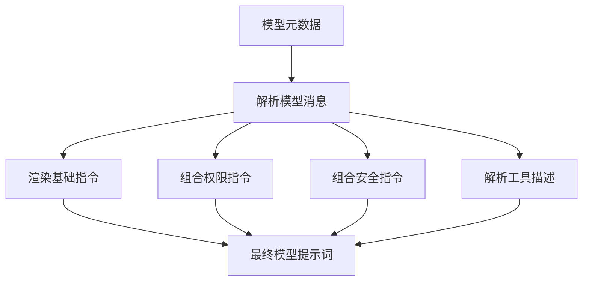
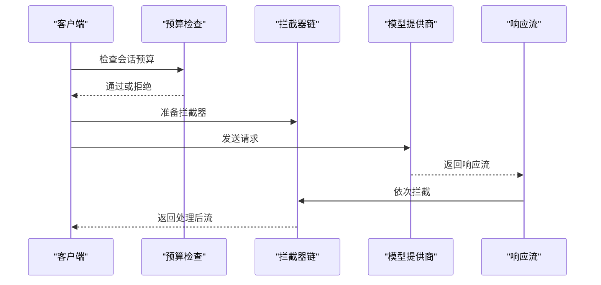
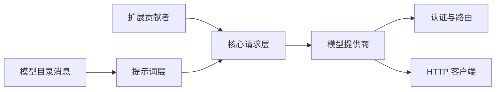
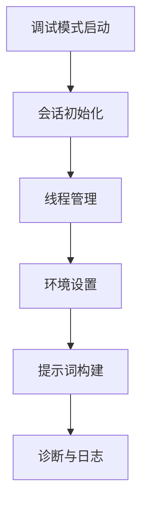

# 模型适配

<cite>
**本文引用的文件**
- [lib.rs](file://codex-rs/model-provider/src/lib.rs)
- [provider.rs](file://codex-rs/model-provider/src/provider.rs)
- [request_preparation.rs](file://codex-rs/model-provider/src/request_preparation.rs)
- [request_setup.rs](file://codex-rs/model-provider/src/request_setup.rs)
- [capabilities.rs](file://codex-rs/model-provider/src/capabilities.rs)
- [lib.rs](file://codex-rs/prompts/src/lib.rs)
- [model_instructions.rs](file://codex-rs/prompts/src/model_instructions.rs)
- [model_messages.rs](file://codex-rs/prompts/src/model_messages.rs)
- [guardian_instructions.rs](file://codex-rs/prompts/src/guardian_instructions.rs)
- [permissions_instructions.rs](file://codex-rs/prompts/src/permissions_instructions.rs)
- [model_request.rs](file://codex-rs/core/src/model_request.rs)
- [client.rs](file://codex-rs/core/src/client.rs)
- [gpt-5.1-codex-max_prompt.md](file://codex-rs/core/gpt-5.1-codex-max_prompt.md)
- [gpt-5.2-codex_prompt.md](file://codex-rs/core/gpt-5.2-codex_prompt.md)
</cite>

## 目录
1. [引言](#引言)
2. [项目结构](#项目结构)
3. [核心组件](#核心组件)
4. [架构总览](#架构总览)
5. [详细组件分析](#详细组件分析)
6. [依赖关系分析](#依赖关系分析)
7. [性能与预算特性](#性能与预算特性)
8. [调试模式与提示词构建](#调试模式与提示词构建)
9. [模型差异处理策略](#模型差异处理策略)
10. [开发与自定义扩展指南](#开发与自定义扩展指南)
11. [故障排查](#故障排查)
12. [结论](#结论)

## 引言
本文面向 Codex 的“模型适配”子系统，系统性说明以下主题：
- 不同模型的提示词适配机制、模板来源与内容优化。
- 预算检查、请求准备和响应拦截器的执行顺序与职责边界。
- 调试模式下会话初始化、线程管理与环境设置对提示词构建的影响。
- 模型指令生成逻辑，包括能力声明、约束设置和行为指导。
- 模型间差异的处理策略，包括输出格式转换、错误处理和兼容性保证。
- 如何扩展新的模型提供商并实现定制化的提示词与行为。

该文档尽量以代码仓库中的实际模块为基准，避免凭空推断；所有关键流程都对应到具体源文件和函数。

## 项目结构
Codex 的模型适配相关代码主要分布在三个协作区域：
- `codex-rs/model-provider`：模型提供商抽象、认证路由、请求准备与能力上限。
- `codex-rs/prompts`：模型消息与提示词模板解析、权限与安全指令组合。
- `codex-rs/core`：模型请求入口、预算检查、拦截器链组装以及调用客户端。

**图示来源**
- [provider.rs:1-200](file://codex-rs/model-provider/src/provider.rs#L1-L200)
- [request_preparation.rs:1-56](file://codex-rs/model-provider/src/request_preparation.rs#L1-L56)
- [request_setup.rs:1-200](file://codex-rs/model-provider/src/request_setup.rs#L1-L200)
- [capabilities.rs:1-60](file://codex-rs/model-provider/src/capabilities.rs#L1-L60)
- [model_messages.rs:1-200](file://codex-rs/prompts/src/model_messages.rs#L1-L200)
- [model_instructions.rs:1-21](file://codex-rs/prompts/src/model_instructions.rs#L1-L21)
- [guardian_instructions.rs:1-177](file://codex-rs/prompts/src/guardian_instructions.rs#L1-L177)
- [permissions_instructions.rs:1-200](file://codex-rs/prompts/src/permissions_instructions.rs#L1-L200)
- [model_request.rs:1-69](file://codex-rs/core/src/model_request.rs#L1-L69)
- [client.rs:2070-2111](file://codex-rs/core/src/client.rs#L2070-L2111)

**章节来源**
- [lib.rs:model-provider 公开接口](file://codex-rs/model-provider/src/lib.rs#L1-L73)
- [lib.rs:prompts 公开接口](file://codex-rs/prompts/src/lib.rs#L1-L40)

## 核心组件
### 模型提供商抽象
`ModelProvider` 是模型适配的核心抽象，负责：
- 返回模型提供商元信息。
- 提供能力上限，如是否支持推理摘要、图像生成、网络搜索等。
- 管理认证、网关凭证、运行时身份认证。
- 决定工作区路由、API 基地址、HTTP 传输策略。
- 定义自动审批、内存提取、内存整合的默认模型偏好。
- 暴露可恢复的未授权错误处理钩子。

它既定义了通用默认行为，也允许 Amazon Bedrock、GCP 和配置化提供商覆盖特定实现。

**章节来源**
- [provider.rs:1-200](file://codex-rs/model-provider/src/provider.rs#L1-L200)
- [provider.rs:450-775](file://codex-rs/model-provider/src/provider.rs#L450-L775)

### 请求准备与请求建立
- `prepare_provider_request` 将请求准备绑定到当前凭据版本，防止在刷新过程中出现账号归属变化。
- `resolve_request_auth` 选择运行时认证或主认证，并在必要时验证头字段。
- `resolve_request` 把认证、工作区路由、重定向策略、HTTP 客户端工厂组合成一次请求上下文。

**章节来源**
- [request_preparation.rs:1-56](file://codex-rs/model-provider/src/request_preparation.rs#L1-L56)
- [request_setup.rs:1-200](file://codex-rs/model-provider/src/request_setup.rs#L1-L200)

### 能力上限
`ProviderCapabilities` 由提供商配置合并默认值：
- 是否支持推理摘要、图像生成、网页搜索、外部网页访问。
- 是否支持远程压缩，OpenAI 与 Azure Responses 提供商默认启用 V2。

**章节来源**
- [capabilities.rs:1-60](file://codex-rs/model-provider/src/capabilities.rs#L1-L60)

### 提示词与模型消息
`ResolvedModelMessages` 从模型目录或内置默认中解析消息族：
- 基础指令模板。
- 权限与审批消息。
- 协作模式、多智能体、增量工具、Code Mode 等工具描述。
- 令牌预算提醒模板。
- 内容过滤指导文本。

**章节来源**
- [model_messages.rs:1-200](file://codex-rs/prompts/src/model_messages.rs#L1-L200)
- [model_messages.rs:200-289](file://codex-rs/prompts/src/model_messages.rs#L200-L289)

### 预算检查与响应拦截器
`check_budget` 在发送模型请求前遍历贡献者，若任一贡献者判定会话预算耗尽，则直接拒绝。
`prepare` 收集贡献者提供的响应拦截器，并把贡献者附加的元数据写入请求。
`intercept_stream` 按顺序包装上游响应流，使拦截器能够观察、转换或替换提供者返回的内容项。

**章节来源**
- [model_request.rs:1-69](file://codex-rs/core/src/model_request.rs#L1-L69)
- [client.rs:2070-2111](file://codex-rs/core/src/client.rs#L2070-L2111)
- [client.rs:2737-2745](file://codex-rs/core/src/client.rs#L2737-L2745)

## 架构总览
模型适配的整体调用链可以理解为：
1. 客户端发起模型请求。
2. 核心层先进行预算检查。
3. 通过贡献者生成响应拦截器，并注入可扩展的元数据。
4. 模型提供商解析认证、路由和 HTTP 传输策略。
5. 提示词层根据模型消息模板组合安全、权限、协作、工具等指令。
6. 最终请求被发送到模型后端，响应经过拦截器链后返回给上层。

**图示来源**
- [client.rs:2070-2111](file://codex-rs/core/src/client.rs#L2070-L2111)
- [model_request.rs:1-69](file://codex-rs/core/src/model_request.rs#L1-L69)
- [request_setup.rs:1-200](file://codex-rs/model-provider/src/request_setup.rs#L1-L200)
- [model_messages.rs:1-200](file://codex-rs/prompts/src/model_messages.rs#L1-L200)

## 详细组件分析

### 模型提供商生命周期
`ConfiguredModelProvider` 是默认配置化提供商的实现，负责：
- 构造网关认证管理器。
- 区分推理目的地与目录发现目的地的运行时认证。
- 将运行时认证拒绝纳入可恢复未授权错误判断。
- 根据认证类型选择自动审批偏好模型。
- 创建静态或动态模型目录管理器。

**图示来源**
- [provider.rs:1-200](file://codex-rs/model-provider/src/provider.rs#L1-L200)
- [provider.rs:450-775](file://codex-rs/model-provider/src/provider.rs#L450-L775)
- [capabilities.rs:1-60](file://codex-rs/model-provider/src/capabilities.rs#L1-L60)

**章节来源**
- [provider.rs:450-775](file://codex-rs/model-provider/src/provider.rs#L450-L775)

### 请求准备与认证路由
请求准备的关键是“绑定到凭据版本”，避免在认证刷新期间产生不一致状态。`prepare_provider_request` 会循环重试准备过程，直到认证状态稳定；如果账号归属发生变化，则直接失败。

`resolve_request` 进一步把以下信息统一封装为 `ResolvedProviderRequest`：
- 已选择的认证。
- 认证所有者。
- API 提供商实例。
- 重定向策略。
- HTTP 客户端工厂。
- 运行时标识。

**图示来源**
- [request_preparation.rs:1-56](file://codex-rs/model-provider/src/request_preparation.rs#L1-L56)
- [request_setup.rs:1-200](file://codex-rs/model-provider/src/request_setup.rs#L1-L200)

**章节来源**
- [request_preparation.rs:1-56](file://codex-rs/model-provider/src/request_preparation.rs#L1-L56)
- [request_setup.rs:1-200](file://codex-rs/model-provider/src/request_setup.rs#L1-L200)

### 提示词构建与模型指令
提示词构建分为两层：
1. **模型消息解析层**：从模型目录或内置模板中解析消息族。
2. **指令渲染层**：将安全策略、权限事实、协作模式、工具描述等组合成最终开发者指令片段。

`render_model_instructions` 直接从模型元数据中提取指令模板；如果缺失模板，会记录警告并使用空字符串。

`GuardianPolicyInstructions` 与 `GuardianClassifierInstructions` 则把租户策略、额外策略、输出契约和转录格式组合为安全指令。

`PermissionsInstructions` 根据沙箱模式、网络访问、审批策略、可写根路径、拒绝读取路径等运行时事实生成权限提示。

**图示来源**
- [model_instructions.rs:1-21](file://codex-rs/prompts/src/model_instructions.rs#L1-L21)
- [model_messages.rs:1-200](file://codex-rs/prompts/src/model_messages.rs#L1-L200)
- [guardian_instructions.rs:1-177](file://codex-rs/prompts/src/guardian_instructions.rs#L1-L177)
- [permissions_instructions.rs:1-200](file://codex-rs/prompts/src/permissions_instructions.rs#L1-L200)

**章节来源**
- [model_instructions.rs:1-21](file://codex-rs/prompts/src/model_instructions.rs#L1-L21)
- [model_messages.rs:1-200](file://codex-rs/prompts/src/model_messages.rs#L1-L200)
- [guardian_instructions.rs:1-177](file://codex-rs/prompts/src/guardian_instructions.rs#L1-L177)
- [permissions_instructions.rs:1-200](file://codex-rs/prompts/src/permissions_instructions.rs#L1-L200)

### 预算检查与拦截器链
预算检查和拦截器链位于核心层，是模型请求的“前置守卫”和“后置管道”。

**图示来源**
- [model_request.rs:1-69](file://codex-rs/core/src/model_request.rs#L1-L69)
- [client.rs:2070-2111](file://codex-rs/core/src/client.rs#L2070-L2111)
- [client.rs:2737-2745](file://codex-rs/core/src/client.rs#L2737-L2745)

**章节来源**
- [model_request.rs:1-69](file://codex-rs/core/src/model_request.rs#L1-L69)
- [client.rs:2070-2111](file://codex-rs/core/src/client.rs#L2070-L2111)

## 依赖关系分析
模型适配的依赖关系具有以下特点：
- 核心层依赖扩展 API 的贡献者来执行预算检查和拦截器注册。
- 提示词层依赖模型目录消息和内置模板，但不直接依赖网络层。
- 模型提供商层依赖认证、运行时身份、HTTP 客户端工厂和路由策略。
- 能力上限由提供商配置决定，并可被模型和会话设置进一步限制。

**图示来源**
- [model_request.rs:1-69](file://codex-rs/core/src/model_request.rs#L1-L69)
- [provider.rs:1-200](file://codex-rs/model-provider/src/provider.rs#L1-L200)
- [request_setup.rs:1-200](file://codex-rs/model-provider/src/request_setup.rs#L1-L200)
- [model_messages.rs:1-200](file://codex-rs/prompts/src/model_messages.rs#L1-L200)

**章节来源**
- [model_request.rs:1-69](file://codex-rs/core/src/model_request.rs#L1-L69)
- [provider.rs:1-200](file://codex-rs/model-provider/src/provider.rs#L1-L200)
- [request_setup.rs:1-200](file://codex-rs/model-provider/src/request_setup.rs#L1-L200)
- [model_messages.rs:1-200](file://codex-rs/prompts/src/model_messages.rs#L1-L200)

## 性能与预算特性
预算检查的性能影响很小：它仅在每次模型请求开始时遍历贡献者，并在热身请求时跳过。真正的成本在于拦截器和下游模型调用。

令牌预算相关的提示词行为还体现在模型消息中：
- 令牌预算提醒模板用于提示上下文窗口即将耗尽。
- 内容过滤指导文本用于告诉模型如何处理被内容过滤器阻断的情况。
- 远程压缩和本地压缩会结合 token budget 对历史与媒体内容进行截断。

**章节来源**
- [model_request.rs:1-69](file://codex-rs/core/src/model_request.rs#L1-L69)
- [model_messages.rs:1-200](file://codex-rs/prompts/src/model_messages.rs#L1-L200)

## 调试模式与提示词构建
调试模式下的提示词构建并不改变底层适配机制，但会影响：
- 会话初始化：调试配置会影响会话启动、线程标题、线程路由和默认模型选择。
- 线程管理：线程事件、标题生成、会话恢复和归档命令会影响上下文可见性。
- 环境设置：调试日志、诊断 ZIP、TUI 面板和聊天控件会让提示词构建过程更透明。

虽然这些行为不直接属于 model-provider，但它们决定了提示词最终呈现给模型时的上下文质量。

[本图为概念流程图，不对应具体源码文件]

## 模型差异处理策略
### 输出格式转换
模型消息解析层保留了“目录覆盖”和“内置默认”的来源标记，这样上层可以知道某段提示词是模型目录提供的还是系统内置的。对于工具描述、参数 schema 和间接描述前缀，解析层只做选择，不负责复杂解析；解析责任交给工具消费者，从而降低模型差异带来的耦合。

### 错误处理
提供商层对未授权错误的可恢复性做了差异化处理：
- 默认只认为 HTTP 401 是可恢复的未授权错误。
- 配置化提供商还会排除运行时认证拒绝的错误。
- 网关 OAuth 提供商可以通过 `recover_from_unauthorized` 尝试主动恢复认证。

### 兼容性保证
- 能力上限由提供商配置设定，模型和会话设置可进一步限制功能。
- 认证方式支持 API Key、Bearer、ChatGPT、Bedrock、Agent Identity 等多种形态。
- 工作区路由允许 OpenAI 兼容 API 在不同域名之间转发，同时保持重定向策略可控。

**章节来源**
- [model_messages.rs:1-200](file://codex-rs/prompts/src/model_messages.rs#L1-L200)
- [provider.rs:450-775](file://codex-rs/model-provider/src/provider.rs#L450-L775)
- [capabilities.rs:1-60](file://codex-rs/model-provider/src/capabilities.rs#L1-L60)

## 开发与自定义扩展指南

### 新增模型提供商
要新增一个模型提供商，建议遵循以下步骤：
1. 实现 `ModelProvider` 接口，或在现有默认实现基础上覆盖必要方法。
2. 如果需要专用认证方式，重写 `compose_auth`、`api_auth_for_scope` 或 `request_auth`。
3. 如果需要工作区路由，重写 `route_responses_api_provider`。
4. 如果需要自定义能力上限，重写 `capabilities`。
5. 如果需要自定义模型目录发现，重写 `models_manager`、`models_manager_with_settings` 等方法。
6. 如果需要调试和诊断，确保认证状态、路由结果和 HTTP 客户端工厂可观测。

**章节来源**
- [provider.rs:1-200](file://codex-rs/model-provider/src/provider.rs#L1-L200)
- [provider.rs:450-775](file://codex-rs/model-provider/src/provider.rs#L450-L775)

### 扩展提示词模板
1. 在模型目录中提供 `ModelMessages`，覆盖指令模板、权限消息、协作模式或多智能体消息。
2. 如果只需要基础指令，优先修改 `instructions_template`。
3. 如果需要调整工具描述，优先修改对应工具的 description 和 parameters。
4. 如果需要对安全策略或权限信息进行控制，组合 `GuardianPolicyInstructions` 和 `PermissionsInstructions`。
5. 如果希望保留“目录覆盖 vs 内置默认”的可观测性，不要绕过 `ResolvedModelMessages`。

**章节来源**
- [model_messages.rs:1-200](file://codex-rs/prompts/src/model_messages.rs#L1-L200)
- [model_instructions.rs:1-21](file://codex-rs/prompts/src/model_instructions.rs#L1-L21)
- [guardian_instructions.rs:1-177](file://codex-rs/prompts/src/guardian_instructions.rs#L1-L177)
- [permissions_instructions.rs:1-200](file://codex-rs/prompts/src/permissions_instructions.rs#L1-L200)

### 添加预算检查与响应拦截器
1. 实现 `ModelRequestContributor`，在 `budget_exhausted` 中判断是否应拒绝请求。
2. 在 `request` 中返回 `ModelResponseInterceptor`，用于观察或改写响应流。
3. 如需向请求添加元数据，填充 `ModelRequestInput.client_metadata`。
4. 注意拦截器按顺序执行，后注册的拦截器会包裹更早注册的拦截器。

**章节来源**
- [model_request.rs:1-69](file://codex-rs/core/src/model_request.rs#L1-L69)

### 模型指令与行为指导示例参考
仓库中包含 GPT-5 系列的 Codex 提示词模板，例如：
- `gpt-5.1-codex-max_prompt.md`
- `gpt-5.2-codex_prompt.md`

这些文件体现了编辑约束、计划工具、前端任务、最终回答结构和文件引用规范，可作为模型指令设计的参考。

**章节来源**
- [gpt-5.1-codex-max_prompt.md:1-80](file://codex-rs/core/gpt-5.1-codex-max_prompt.md#L1-L80)
- [gpt-5.2-codex_prompt.md:1-80](file://codex-rs/core/gpt-5.2-codex_prompt.md#L1-L80)

## 故障排查

### 认证失败或账号切换导致请求失败
常见原因：
- 认证所有者在请求准备期间发生变化。
- 运行时认证被拒绝，但未被视为可恢复错误。
- 网关 OAuth 需要显式登录或凭据导出。

排查建议：
- 检查 `prepare_provider_request` 返回的账号变更错误。
- 检查 `is_recoverable_auth_error` 是否识别了当前后端错误。
- 检查 `recover_from_unauthorized` 是否启用了网关重试。

**章节来源**
- [request_preparation.rs:1-56](file://codex-rs/model-provider/src/request_preparation.rs#L1-L56)
- [provider.rs:450-775](file://codex-rs/model-provider/src/provider.rs#L450-L775)

### 会话预算耗尽
现象：
- 非热身请求被拒绝。
- 扩展贡献者认为预算已耗尽。

排查建议：
- 检查各贡献者的 `budget_exhausted` 实现。
- 检查会话级别、目标级别或工具级别的 token budget 配置。
- 确认预算检查是否被正确调用，而不是被跳过。

**章节来源**
- [model_request.rs:1-69](file://codex-rs/core/src/model_request.rs#L1-L69)

### 提示词不符合预期
现象：
- 模型没有收到期望的基础指令。
- 权限或安全指令缺失。
- 工具描述与参数 schema 不正确。

排查建议：
- 确认模型目录提供了对应的 `ModelMessages`。
- 检查 `render_model_instructions` 是否记录了缺少模板的警告。
- 检查权限指令和安全指令是否在上下文中被组合。
- 检查工具描述是否被目录覆盖或被消费者解析。

**章节来源**
- [model_instructions.rs:1-21](file://codex-rs/prompts/src/model_instructions.rs#L1-L21)
- [model_messages.rs:1-200](file://codex-rs/prompts/src/model_messages.rs#L1-L200)
- [permissions_instructions.rs:1-200](file://codex-rs/prompts/src/permissions_instructions.rs#L1-L200)
- [guardian_instructions.rs:1-177](file://codex-rs/prompts/src/guardian_instructions.rs#L1-L177)

### 响应被拦截器意外替换
现象：
- 模型原始响应被拦截器改写。
- 元数据丢失或重复。

排查建议：
- 检查贡献者返回的拦截器链。
- 检查拦截器是否替换了上游流。
- 检查元数据过滤逻辑是否排除了不应透传的键。

**章节来源**
- [model_request.rs:1-69](file://codex-rs/core/src/model_request.rs#L1-L69)
- [client.rs:2737-2745](file://codex-rs/core/src/client.rs#L2737-L2745)

## 结论
Codex 的模型适配体系通过三层协作完成：
- 模型提供商层负责认证、路由、能力和传输策略。
- 提示词层负责模型消息解析、安全策略、权限信息和工具描述的组合。
- 核心层负责预算检查、拦截器链和请求生命周期管理。

这种设计让模型适配具备良好扩展性：新增模型不需要改动提示词构建和预算检查；新增提示词也不需要深入理解认证和 HTTP 细节；新增扩展贡献者可以在不影响现有流程的情况下增强预算控制和响应处理。

在实际开发中，建议优先通过模型目录消息和扩展贡献者进行适配，只在确实需要后端行为差异时重写模型提供商接口。这样可以最大限度保持模型间的一致性，同时保留必要的灵活性。