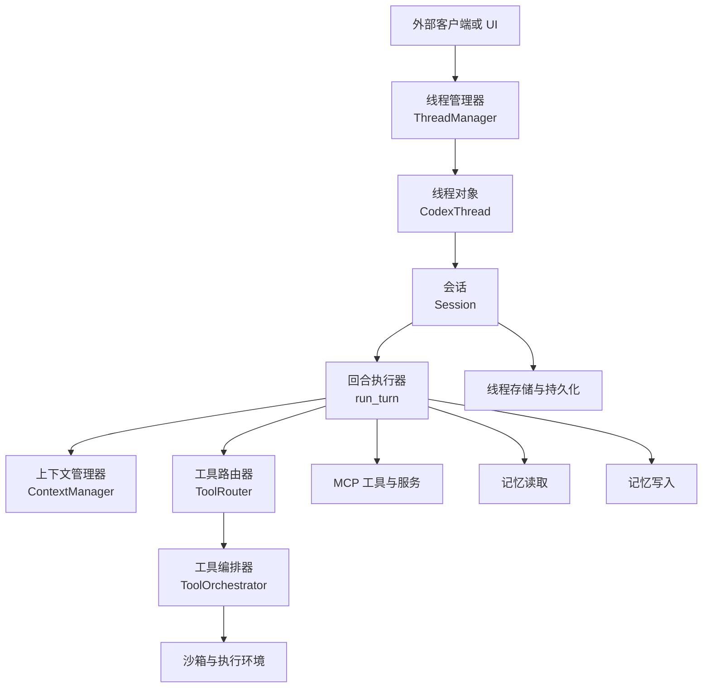
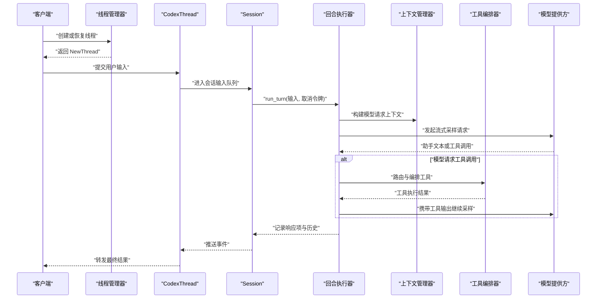
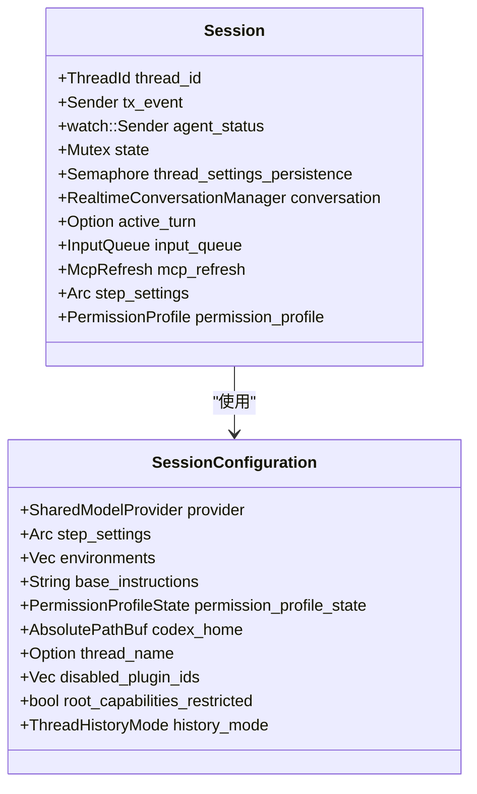
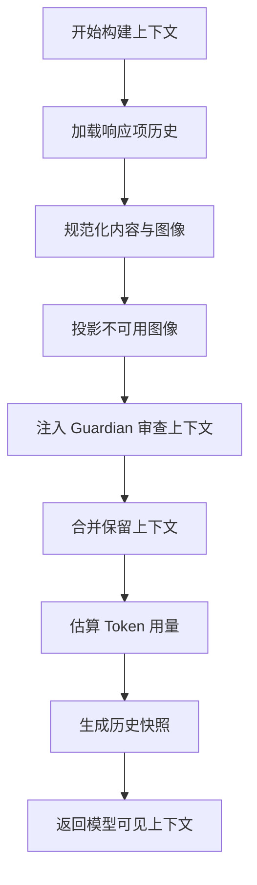
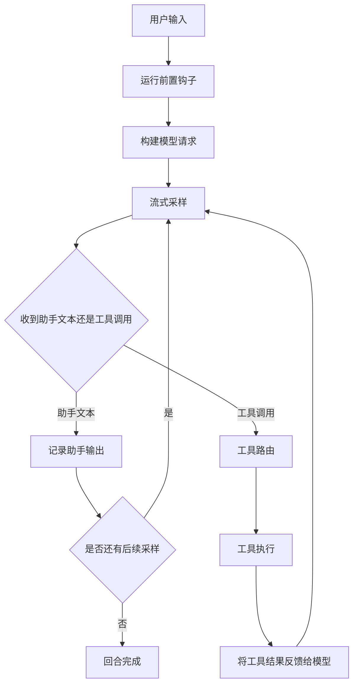
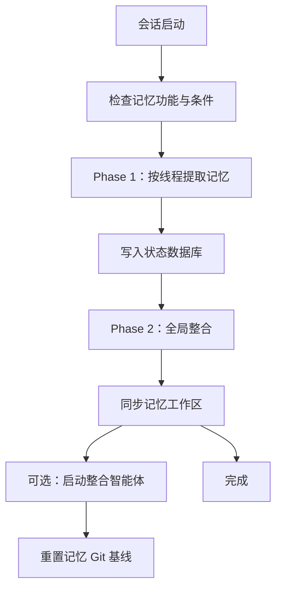
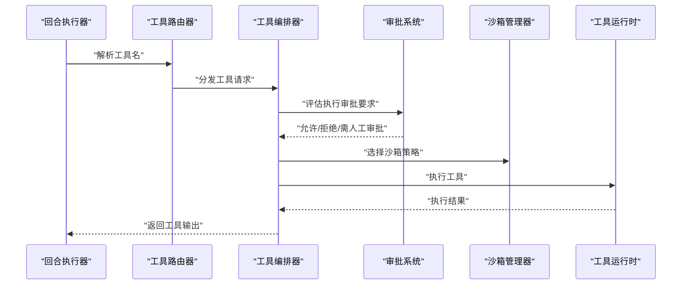
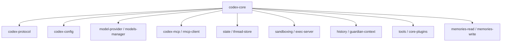

# 智能体核心

<cite>
**本文引用的文件**   
- [lib.rs](file://codex-rs/core/src/lib.rs)
- [agent/mod.rs](file://codex-rs/core/src/agent/mod.rs)
- [agent/api.rs](file://codex-rs/core/src/agent/api.rs)
- [session/mod.rs](file://codex-rs/core/src/session/mod.rs)
- [session/session.rs](file://codex-rs/core/src/session/session.rs)
- [session/turn.rs](file://codex-rs/core/src/session/turn.rs)
- [context_manager/history.rs](file://codex-rs/core/src/context_manager/history.rs)
- [thread_manager.rs](file://codex-rs/core/src/thread_manager.rs)
- [codex_thread.rs](file://codex-rs/core/src/codex_thread.rs)
- [tools/mod.rs](file://codex-rs/core/src/tools/mod.rs)
- [tools/orchestrator.rs](file://codex-rs/core/src/tools/orchestrator.rs)
- [memories/read/src/lib.rs](file://codex-rs/memories/read/src/lib.rs)
- [memories/write/src/lib.rs](file://codex-rs/memories/write/src/lib.rs)
- [memories/README.md](file://codex-rs/memories/README.md)
</cite>

## 目录

1. [引言](#引言)
2. [项目结构](#项目结构)
3. [核心组件](#核心组件)
4. [架构总览](#架构总览)
5. [详细组件分析](#详细组件分析)
6. [依赖关系分析](#依赖关系分析)
7. [性能与并发特性](#性能与并发特性)
8. [故障排查指南](#故障排查指南)
9. [结论](#结论)
10. [附录：扩展智能体行为的 API 参考](#附录扩展智能体行为的-api-参考)

## 引言

`codex-core` 是 Codex 智能体系统的业务逻辑核心。它不负责终端界面，而是为多种 Rust 前端提供统一的智能体生命周期、会话管理、上下文处理、提示词工程、工具执行、记忆系统、线程管理与状态持久化能力。从用户输入到模型响应，再到工具调用和记忆更新，整个流程由线程管理器、会话对象、回合执行器、上下文管理器和工具编排器等组件协同完成。

本文件面向两类读者：

- **使用者**：希望理解智能体如何工作、如何扩展其行为、如何处理长会话和工具调用。
- **维护者**：需要定位消息流、上下文窗口、记忆写入、线程创建、权限与安全策略的源码位置。

## 项目结构

`codex-core` 采用按领域划分的模块结构：

| 领域 | 主要职责 | 关键路径 |
|---|---|---|
| 智能体接口与宿主 | 暴露智能体控制、注册、多智能体协调 | `codex-rs/core/src/agent` |
| 会话与会话启动 | 会话配置、初始化、设置刷新、多代理版本 | `codex-rs/core/src/session` |
| 回合执行 | 将用户输入转换为模型请求、处理函数调用和助手消息 | `codex-rs/core/src/session/turn.rs` |
| 上下文管理 | 构建模型可见历史、压缩、Guardian 审查上下文 | `codex-rs/core/src/context_manager` |
| 线程管理 | 创建、恢复、分叉、关闭线程树 | `codex-rs/core/src/thread_manager.rs` |
| 线程对象 | 封装单个线程的运行期状态和事件通道 | `codex-rs/core/src/codex_thread.rs` |
| 工具系统 | 工具注册、路由、审批、沙箱、执行编排 | `codex-rs/core/src/tools` |
| 记忆系统 | 短期上下文与长期记忆读写、两阶段记忆流水线 | `codex-rs/core/src/context_manager`、`codex-rs/memories` |

**图示来源**
- [thread_manager.rs:180-439](file://codex-rs/core/src/thread_manager.rs#L180-L439)
- [codex_thread.rs:1-250](file://codex-rs/core/src/codex_thread.rs#L1-L250)
- [session/session.rs:1-260](file://codex-rs/core/src/session/session.rs#L1-L260)
- [session/turn.rs:1-240](file://codex-rs/core/src/session/turn.rs#L1-L240)
- [context_manager/history.rs:1-260](file://codex-rs/core/src/context_manager/history.rs#L1-L260)
- [tools/mod.rs:1-140](file://codex-rs/core/src/tools/mod.rs#L1-L140)
- [tools/orchestrator.rs:1-240](file://codex-rs/core/src/tools/orchestrator.rs#L1-L240)
- [memories/read/src/lib.rs:1-15](file://codex-rs/memories/read/src/lib.rs#L1-L15)
- [memories/write/src/lib.rs:1-151](file://codex-rs/memories/write/src/lib.rs#L1-L151)

**章节来源**
- [lib.rs:1-200](file://codex-rs/core/src/lib.rs#L1-L200)

## 核心组件

### 线程管理器：线程树的根控制器

`ThreadManager` 是线程的工厂和运行时容器。它负责：

- 创建新线程并返回包含初始配置事件的 `NewThread`。
- 加载已持久化的线程。
- 根据提交历史、会话源、父线程和运行期选项构造线程。
- 管理线程的分叉、中断、恢复和关闭。
- 管理 MCP 刷新原因、提示缓存键、内部会话父引用等跨线程共享信息。
- 暴露线程注册状态、线程关闭报告等观察能力。

`ThreadManager` 不是简单“创建对象”，而是协调多个子系统：配置、认证、模型目录、执行策略、插件、技能、扩展、状态数据库、线程存储和历史初始化。

**章节来源**
- [thread_manager.rs:180-439](file://codex-rs/core/src/thread_manager.rs#L180-L439)

### 线程对象：单条对话的生命周期载体

`CodexThread` 是对外暴露的主要线程句柄。它持有：

- 对 `Session` 的强引用。
- 会话输入输出通道。
- 常驻性门控，用于防止线程在需要时被驱逐。
- 会话来源、启动元数据、回滚路径。
- 带外征求用户输入登记。
- 诊断指标守卫。

`CodexThread` 还定义了线程配置快照，包括模型、服务等级、审批策略、权限配置、工作环境、工作区根、协作模式、历史模式、父子线程关系、插件禁用列表等。这些字段区分“仅运行期继承”和“可能参与持久化”的数据。

**章节来源**
- [codex_thread.rs:1-250](file://codex-rs/core/src/codex_thread.rs#L1-L250)

### 会话：单次智能体运行的状态中心

`Session` 是一个线程内最多只有一个运行任务的状态机。它维护：

- 线程 ID、项 ID 生成器。
- 智能体运行时服务。
- 结果上报器与任务跟踪器。
- 事件发送通道。
- 智能体状态广播。
- 当前活跃回合。
- 输入队列。
- 实时对话管理器。
- 异步钩子结果接收器。
- MCP 预热、刷新、资源客户端。
- 动态工具集。
- 权限与网络策略相关状态。

`SessionConfiguration` 则保存会话级配置，如模型提供者、步骤设置、开发者指令、基础指令、权限配置文件、Windows 沙箱级别、工作区根、Codex 家目录、线程名称、插件选择、原始配置、服务名、会话来源、历史模式、动态工具、用户 Shell 覆盖等。

**章节来源**
- [session/session.rs:1-260](file://codex-rs/core/src/session/session.rs#L1-L260)
- [session/mod.rs:1-200](file://codex-rs/core/src/session/mod.rs#L1-L200)

### 智能体接口：多智能体控制的统一契约

`AgentControl` 是智能体控制的抽象接口，屏蔽本地实现与宿主后端差异。它提供：

- 智能体身份解析。
- 子智能体创建与接受。
- 向目标智能体发送消息。
- 取邮箱中排队消息。
- 监听邮箱可用性。
- 确保子智能体已加载。
- 中断智能体。
- 列出已加载智能体。
- 检查容量准入。
- 记录推理用量。
- 上报回合结束结果。
- 发布共享配置更新。
- 查询 Guardian 根证据。
- 预算提醒标记。

该接口明确说明：成功投递不等于模型已消费；V2 快照会针对启动元数据校验努力值，但不改变子智能体的配置努力值。

**章节来源**
- [agent/api.rs:1-251](file://codex-rs/core/src/agent/api.rs#L1-L251)
- [agent/mod.rs:1-16](file://codex-rs/core/src/agent/mod.rs#L1-L16)

## 架构总览

下图展示从用户输入到模型响应的完整主路径：

**图示来源**
- [thread_manager.rs:180-439](file://codex-rs/core/src/thread_manager.rs#L180-L439)
- [codex_thread.rs:1-250](file://codex-rs/core/src/codex_thread.rs#L1-L250)
- [session/turn.rs:1-240](file://codex-rs/core/src/session/turn.rs#L1-L240)
- [context_manager/history.rs:1-260](file://codex-rs/core/src/context_manager/history.rs#L1-L260)
- [tools/orchestrator.rs:1-240](file://codex-rs/core/src/tools/orchestrator.rs#L1-L240)

## 详细组件分析

### 会话管理

会话是智能体在一次线程中的核心运行态。它的职责包括：

1. **会话启动**：解析配置、准备模型提供者、初始化权限、启用功能开关、加载历史初始化策略。
2. **设置刷新**：串行化线程设置持久化，避免 I/O 阻塞运行期状态访问。
3. **权限与环境**：计算有效权限配置、工作区根、沙箱类型、Shell 环境策略。
4. **MCP 管理**：预热、刷新、资源客户端、Elicitation 生命周期。
5. **多代理版本**：通过一次性锁保存多代理协议版本。
6. **实时对话与历史**：与实时对话管理器和实时历史组件协作。
7. **活跃回合保护**：同一时刻最多一个活跃回合，可被用户输入中断。

**图示来源**
- [session/session.rs:1-260](file://codex-rs/core/src/session/session.rs#L1-L260)

**章节来源**
- [session/session.rs:1-260](file://codex-rs/core/src/session/session.rs#L1-L260)
- [session/mod.rs:1-200](file://codex-rs/core/src/session/mod.rs#L1-L200)

### 上下文处理与提示词工程

上下文管理器维护父模型历史和受托管事实，支持：

- 历史投影与替换。
- 图像不可用时的文件替代。
- 音频拒绝集合。
- Guardian 审查上下文。
- 世界状态快照。
- Token 估算与使用边界。
- 压缩检查点。
- 保留上下文条目。

`ContextManager` 内部持有响应项包序列、审查历史、保留上下文、拒绝音频 ID、审计时间戳、世界状态基线等。它不是单纯拼接字符串，而是维护结构化历史，以便压缩、回放、回滚、审查和增量更新。

**图示来源**
- [context_manager/history.rs:1-260](file://codex-rs/core/src/context_manager/history.rs#L1-L260)

**章节来源**
- [context_manager/history.rs:1-260](file://codex-rs/core/src/context_manager/history.rs#L1-L260)
- [context_manager/mod.rs:1-15](file://codex-rs/core/src/context_manager/mod.rs#L1-L15)

### 消息处理流程

`run_turn` 是智能体回合的核心循环。其基本流程如下：

1. 捕获当前模型信息。
2. 检查音频模态兼容性。
3. 运行钩子并记录输入。
4. 构建模型请求。
5. 发起流式采样。
6. 处理助手文本、计划片段、推理内容。
7. 若模型请求函数调用，则路由到工具系统。
8. 执行工具后把结果回传给模型。
9. 记录响应项、更新历史、触发自动压缩。
10. 直到模型返回纯助手消息或回合被中止。

**图示来源**
- [session/turn.rs:1-240](file://codex-rs/core/src/session/turn.rs#L1-L240)

**章节来源**
- [session/turn.rs:1-240](file://codex-rs/core/src/session/turn.rs#L1-L240)

### 记忆系统：短期记忆与长期记忆

记忆系统分为两个层次：

#### 短期记忆：会话上下文

短期记忆主要由 `ContextManager` 和 `Session` 管理。它基于响应项历史、世界状态、保留上下文和 Guardian 审查上下文构建模型可见输入。它会估算 Token 用量，并在必要时进行压缩或投影。

#### 长期记忆：Memories 两阶段流水线

长期记忆位于独立 crate：

- `codex-memories-read`：记忆注入、引用解析、读取用量遥测。
- `codex-memories-write`：Phase 1 提取、Phase 2 全局整合、文件系统工件、扩展资源修剪、工作区差异。

Phase 1 针对近期可提取的 rollout，并行抽取结构化记忆并写入状态数据库。  
Phase 2 获取全局锁后同步 `raw_memories.md`、`rollout_summaries/`、扩展资源，并可选地启动内部整合智能体生成更高层记忆摘要。

**图示来源**
- [memories/README.md:1-157](file://codex-rs/memories/README.md#L1-L157)
- [memories/write/src/lib.rs:1-151](file://codex-rs/memories/write/src/lib.rs#L1-L151)
- [memories/read/src/lib.rs:1-15](file://codex-rs/memories/read/src/lib.rs#L1-L15)

**章节来源**
- [memories/read/src/lib.rs:1-15](file://codex-rs/memories/read/src/lib.rs#L1-L15)
- [memories/write/src/lib.rs:1-151](file://codex-rs/memories/write/src/lib.rs#L1-L151)
- [memories/README.md:1-157](file://codex-rs/memories/README.md#L1-L157)

### 工具调用机制

工具系统由以下部分组成：

| 组件 | 职责 |
|---|---|
| 工具注册表 | 注册发现工具、命名空间、参数规范 |
| 工具路由器 | 根据工具名和命名空间分发请求 |
| 工具编排器 | 审批、沙箱选择、网络批准、重试、遥测 |
| 工具执行运行时 | 实际执行命令、应用补丁、统一执行、MCP 调用 |
| 多代理工具 | 多智能体间消息、等待、暂停、唤醒 |
| 代码模式工具 | 代码模式下的执行与等待适配 |

`ToolOrchestrator` 是工具调用的安全中枢。它负责：

1. 解析工具需求的环境与权限。
2. 判断是否需要人类审批或自动审查。
3. 选择沙箱策略。
4. 启动网络批准流程。
5. 执行工具。
6. 处理失败后的重试。
7. 记录决策来源和遥测数据。

**图示来源**
- [tools/mod.rs:1-140](file://codex-rs/core/src/tools/mod.rs#L1-L140)
- [tools/orchestrator.rs:1-240](file://codex-rs/core/src/tools/orchestrator.rs#L1-L240)

**章节来源**
- [tools/mod.rs:1-140](file://codex-rs/core/src/tools/mod.rs#L1-L140)
- [tools/orchestrator.rs:1-240](file://codex-rs/core/src/tools/orchestrator.rs#L1-L240)

### 线程管理、状态持久化与并发控制

#### 线程生命周期

线程管理器维护线程的创建、恢复、分叉和关闭。`ForkSnapshot` 支持两种分叉模式：

- 在第 N 个用户消息前截断。
- 模拟当前中断状态。

`ThreadShutdownReport` 汇总已完成、提交失败和超时的线程。

#### 状态持久化

线程状态通过线程存储层持久化，包括：

- 线程历史。
- 元数据。
- 模型上下文。
- 回滚路径。
- 会话来源。
- 历史模式。
- 权限与沙箱相关配置。

#### 并发控制

会话层使用互斥锁保护活跃回合；线程管理器使用广播通道、原子布尔、RwLock、Semaphore 等控制并发。工具编排器通过审批和网络批准机制限制危险操作；记忆系统通过全局锁保证 Phase 2 一致性。

**章节来源**
- [thread_manager.rs:180-439](file://codex-rs/core/src/thread_manager.rs#L180-L439)
- [codex_thread.rs:1-250](file://codex-rs/core/src/codex_thread.rs#L1-L250)
- [session/session.rs:1-260](file://codex-rs/core/src/session/session.rs#L1-L260)

## 依赖关系分析

`codex-core` 的依赖关系可以划分为以下几层：

**图示来源**
- [core/Cargo.toml:1-193](file://codex-rs/core/Cargo.toml#L1-L193)
- [lib.rs:1-200](file://codex-rs/core/src/lib.rs#L1-L200)

**章节来源**
- [core/Cargo.toml:1-193](file://codex-rs/core/Cargo.toml#L1-L193)
- [lib.rs:1-200](file://codex-rs/core/src/lib.rs#L1-L200)

## 性能与并发特性

### 并发模型

- 线程管理器使用异步运行时调度线程。
- 会话同一时间最多一个活跃回合，避免竞态。
- 工具执行可并行调用，但编排器串行化处理审批和安全策略。
- 记忆 Phase 1 支持有限并发提取，Phase 2 使用全局锁序列化。
- 会话设置持久化通过信号量串行化，避免阻塞运行期状态。

### 上下文与 Token 优化

- 上下文管理器估算 Token 用量，避免无界增长。
- 历史压缩在会话和远程历史中都有支持。
- 图像引用和音频引用有专用估算与投影逻辑。
- 工具输出会被截断，避免模型输入爆炸。

### 沙箱与权限

- 工具执行前评估执行审批要求。
- 沙箱策略根据权限配置文件和工作区根决定。
- Windows、Linux、macOS 的沙箱路径存在平台差异。
- 网络访问可通过网络批准机制延迟确认。

[本节为通用性能指导，不直接分析具体代码行]

## 故障排查指南

### 智能体无法创建线程

检查：

- 线程管理器是否正确传入配置、历史初始化、会话来源。
- 是否启用了所需功能。
- 认证和模型目录是否可用。
- 是否触发了 MCP 刷新或权限变更。

参考：

- [thread_manager.rs:180-439](file://codex-rs/core/src/thread_manager.rs#L180-L439)

### 会话长时间无响应

检查：

- 是否存在活跃回合未结束。
- 是否有工具调用被审批阻塞。
- 是否有 MCP 预热或刷新卡住。
- 是否触发了自动压缩。

参考：

- [session/session.rs:1-260](file://codex-rs/core/src/session/session.rs#L1-L260)
- [session/turn.rs:1-240](file://codex-rs/core/src/session/turn.rs#L1-L240)

### 工具调用被拒绝

检查：

- 执行审批要求是否为禁止。
- 是否缺少人类审批。
- 沙箱策略是否不允许执行。
- 网络批准是否被取消。

参考：

- [tools/orchestrator.rs:1-240](file://codex-rs/core/src/tools/orchestrator.rs#L1-L240)

### 记忆未更新

检查：

- 是否满足记忆启动条件。
- Phase 1 是否成功产出结构化记忆。
- Phase 2 是否获得全局锁。
- 记忆工作区是否被 Git 基线覆盖。

参考：

- [memories/README.md:1-157](file://codex-rs/memories/README.md#L1-L157)
- [memories/write/src/lib.rs:1-151](file://codex-rs/memories/write/src/lib.rs#L1-L151)

**章节来源**
- [tools/orchestrator.rs:1-240](file://codex-rs/core/src/tools/orchestrator.rs#L1-L240)
- [memories/README.md:1-157](file://codex-rs/memories/README.md#L1-L157)

## 结论

`codex-core` 将智能体的核心能力抽象为线程、会话、回合、上下文、工具和记忆六大支柱。线程管理器负责组织线程树；会话封装运行期状态；回合执行器驱动模型交互；上下文管理器维护模型可见历史；工具编排器保障安全和审批；记忆系统连接短期上下文与长期知识。这种分层设计使智能体既能处理复杂的多轮任务，又能保持可扩展、可观测、可持久化的工程特性。

[本节为总结性内容，不直接分析具体文件]

## 附录：扩展智能体行为的 API 参考

### 智能体控制接口

| API | 用途 | 返回值 |
|---|---|---|
| `identity` | 获取智能体身份 | `SessionId` |
| `resolve` | 相对调用方来源解析目标 | `ThreadId` |
| `spawn` | 创建子智能体并接收初始输入 | `LiveAgent`、`ThreadConfigSnapshot` |
| `send` | 向目标智能体发送消息 | `DeliveryReceipt` |
| `take_mailbox` | 取出排队邮件 | `Vec<PendingAgentMessage>` |
| `watch_mailbox` | 订阅邮件通知 | `watch::Receiver<bool>` |
| `ensure_child_loaded` | 确保子智能体已加载 | `()` |
| `interrupt` | 中断智能体 | `AgentInfo` |
| `list` | 列出智能体 | `Vec<LiveAgent>` |
| `child_agent_paths` | 获取已知子智能体路径 | `Vec<AgentPath>` |
| `check_turn_admission` | 检查容量 | `Result<()>` |
| `admit_turn` | 获取执行守卫 | `Option<AgentExecutionGuard>` |
| `record_usage` | 记录用量 | `Result<()>` |
| `turn_finished` | 上报回合结束 | `Future<(), ()>` |
| `service_tier` | 读取服务等级 | `Option<String>` |
| `propagate_config_update` | 发布配置更新 | `()` |
| `get_guardian_package` | 读取根证据 | `Option<GuardianRootSnapshot>` |
| `pending_budget_reminder` | 查询预算提醒 | `Option<RolloutBudgetReminder>` |
| `mark_budget_reminder_delivered` | 标记预算提醒已投递 | `Future<(), ()>` |

**章节来源**
- [agent/api.rs:1-251](file://codex-rs/core/src/agent/api.rs#L1-L251)

### 线程创建选项

| 字段 | 含义 |
|---|---|
| `config` | 线程配置 |
| `prompt_cache_key` | 提示缓存键策略 |
| `thread_instructions_provider` | 线程附加指令提供者 |
| `allow_provider_model_fallback` | 是否允许模型提供商回退 |
| `initial_history` | 初始历史 |
| `resume_preparation` | 恢复预准备状态 |
| `internal_parent` | 内部父会话引用 |
| `history_mode` | 历史模式 |
| `session_source` | 会话来源 |
| `thread_source` | 线程来源 |
| `attached_thread` | 是否附加线程 |
| `dynamic_tools` | 动态工具规范 |
| `metrics_service_name` | 指标服务名 |
| `parent_trace` | 父追踪上下文 |
| `environments` | 环境请求 |
| `inherited_environments` | 继承环境快照 |
| `user_instructions` | 用户指令 |
| `thread_extension_init` | 线程扩展初始化数据 |
| `turn_extension_init` | 回合扩展初始化数据 |
| `client_mcp_extensions` | 客户端 MCP 扩展 |
| `reserved_thread_id` | 预留线程 ID |
| `disabled_plugin_ids` | 禁用插件 ID |

**章节来源**
- [thread_manager.rs:180-439](file://codex-rs/core/src/thread_manager.rs#L180-L439)

### 记忆系统 API 概览

| 能力 | 所属 crate | 作用 |
|---|---|---|
| `memory_root` | `memories-read` | 计算记忆根目录 |
| `start_memories_startup_task` | `memories-write` | 启动记忆后台任务 |
| `build_stage_one_input_message` | `memories-write` | 构建 Phase 1 输入消息 |
| `build_consolidation_prompt` | `memories-write` | 构建整合提示词 |
| `rebuild_raw_memories_file_from_memories` | `memories-write` | 重建原始记忆文件 |
| `sync_rollout_summaries_from_memories` | `memories-write` | 同步 rollout 摘要 |
| `prune_old_extension_resources` | `memories-write` | 清理过期扩展资源 |
| `clear_memory_roots_contents` | `memories-write` | 清空记忆根内容 |
| `MemoryWorkspaceLock` | `memories-write` | 获取记忆工作区全局锁 |

**章节来源**
- [memories/read/src/lib.rs:1-15](file://codex-rs/memories/read/src/lib.rs#L1-L15)
- [memories/write/src/lib.rs:1-151](file://codex-rs/memories/write/src/lib.rs#L1-L151)