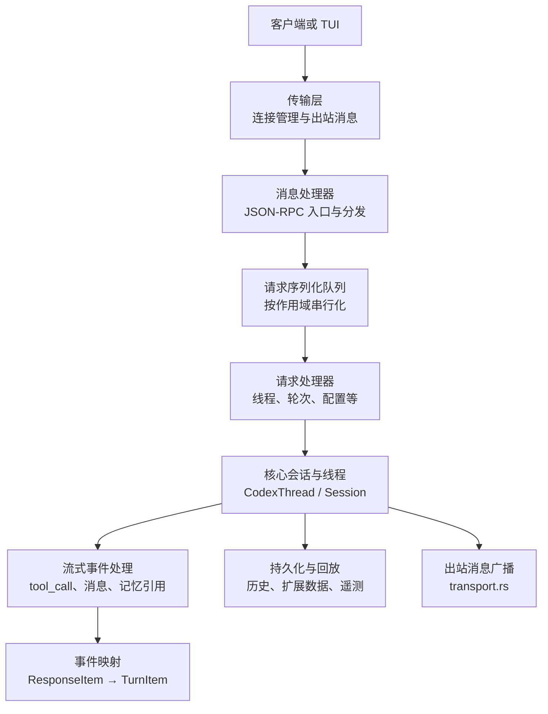
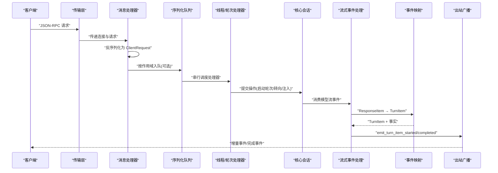
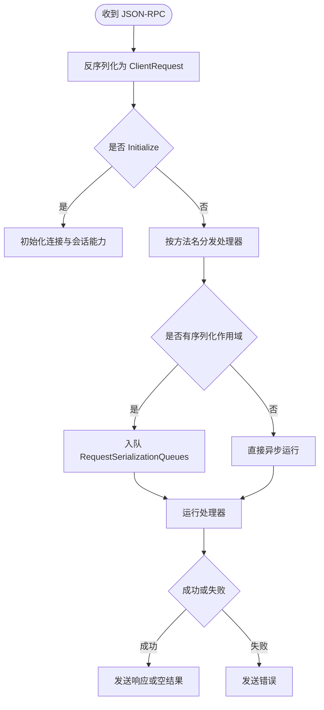
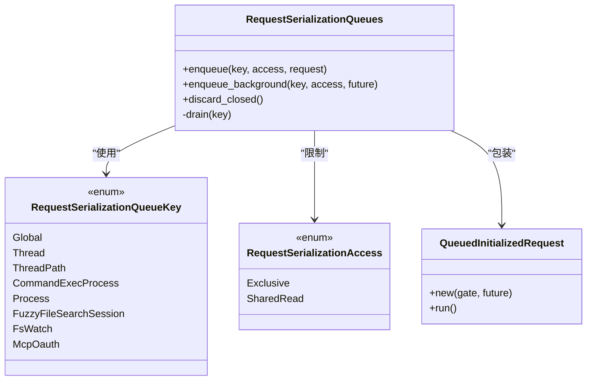
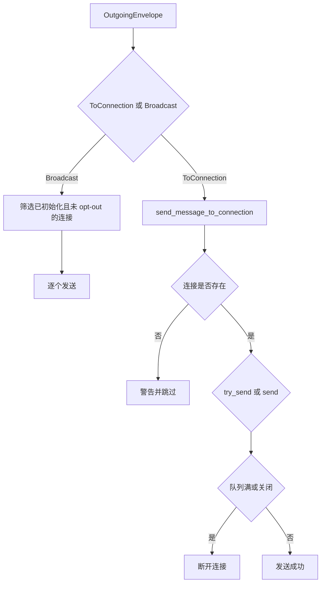
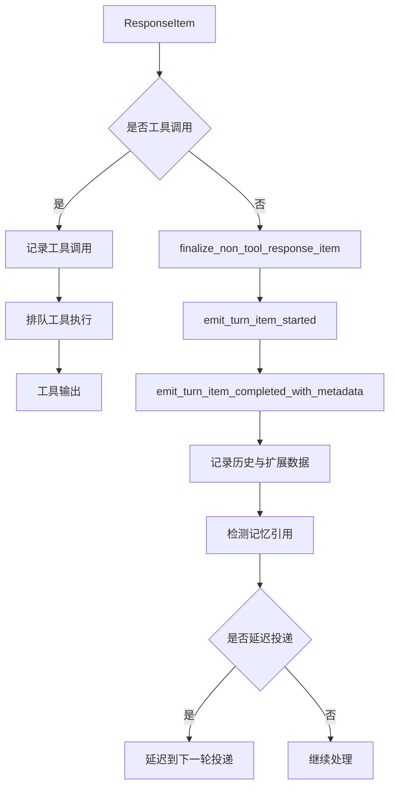
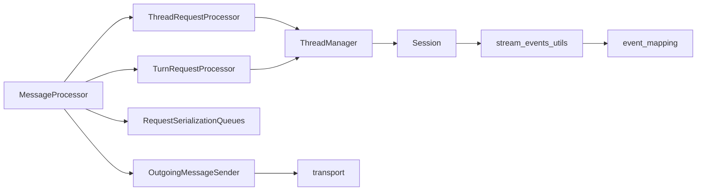
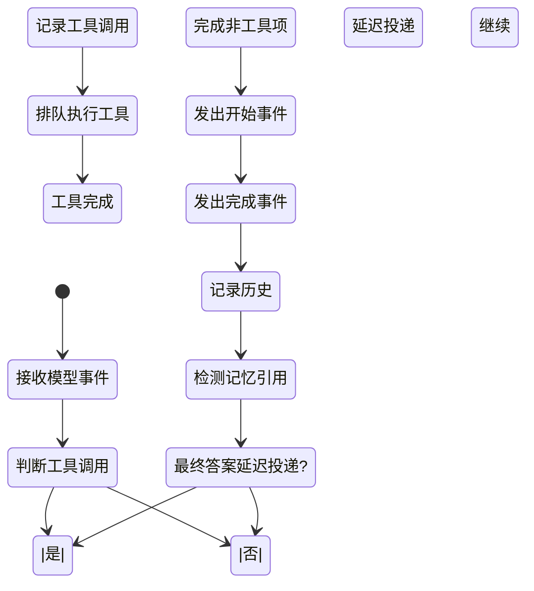
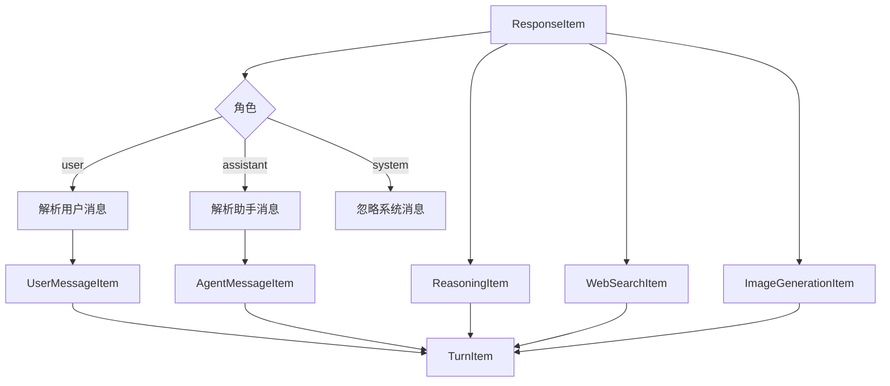
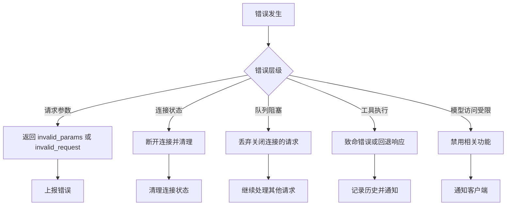

# 消息处理流程

<cite>
**本文引用的文件**   
- [codex-rs/app-server/src/message_processor.rs](file://codex-rs/app-server/src/message_processor.rs)
- [codex-rs/app-server/src/request_serialization.rs](file://codex-rs/app-server/src/request_serialization.rs)
- [codex-rs/app-server/src/transport.rs](file://codex-rs/app-server/src/transport.rs)
- [codex-rs/app-server/src/request_processors/thread_processor.rs](file://codex-rs/app-server/src/request_processors/thread_processor.rs)
- [codex-rs/app-server/src/request_processors/turn_processor.rs](file://codex-rs/app-server/src/request_processors/turn_processor.rs)
- [codex-rs/core/src/lib.rs](file://codex-rs/core/src/lib.rs)
- [codex-rs/core/src/event_mapping.rs](file://codex-rs/core/src/event_mapping.rs)
- [codex-rs/core/src/stream_events_utils.rs](file://codex-rs/core/src/stream_events_utils.rs)
- [codex-rs/core/src/codex_thread.rs](file://codex-rs/core/src/codex_thread.rs)
- [codex-rs/core/src/session/turn_context.rs](file://codex-rs/core/src/session/turn_context.rs)
</cite>

## 目录
1. [引言](#引言)
2. [项目结构与入口](#项目结构与入口)
3. [端到端消息处理总览](#端到端消息处理总览)
4. [核心组件职责](#核心组件职责)
5. [详细组件分析](#详细组件分析)
6. [依赖关系与耦合分析](#依赖关系与耦合分析)
7. [流式响应、进度更新与中断](#流式响应进度更新与中断)
8. [事件映射机制](#事件映射机制)
9. [序列化、反序列化和协议兼容性](#序列化反序列化和协议兼容性)
10. [错误处理、重试与服务降级](#错误处理重试与服务降级)
11. [监控、可观测性与调试工具](#监控可观测性与调试工具)
12. [故障排查指南](#故障排查指南)
13. [结论](#结论)

## 引言
本文面向“从用户输入到模型响应”的完整消息处理路径，覆盖以下关键目标：
- 解析、验证、路由和分发。
- 流式响应的增量输出、进度更新和中断处理。
- 底层事件到上层业务事件的映射。
- 请求与响应的序列化、反序列化及协议兼容性。
- 网络异常、超时和服务降级的错误处理策略。
- 消息处理的监控、诊断和调试方法。

该仓库是一个大型 Rust 多 crate 工程，消息处理主要横跨 `app-server`（服务端 RPC 路由、连接管理、序列化队列）和 `core`（会话、轮次、流式事件处理、事件映射）。TUI、CLI、协议定义、状态存储等模块作为上下游参与者参与整体链路。

## 项目结构与入口
从消息处理角度，最关键的代码集中在：
- 应用服务器入口层：`message_processor.rs`、`transport.rs`、`request_serialization.rs`。
- 请求处理器：`thread_processor.rs`、`turn_processor.rs`。
- 核心会话与事件层：`core/src/lib.rs`、`event_mapping.rs`、`stream_events_utils.rs`、`codex_thread.rs`、`session/turn_context.rs`。

**图示来源**
- [codex-rs/app-server/src/message_processor.rs:1-400](file://codex-rs/app-server/src/message_processor.rs#L1-L400)
- [codex-rs/app-server/src/transport.rs:1-249](file://codex-rs/app-server/src/transport.rs#L1-L249)
- [codex-rs/app-server/src/request_serialization.rs:1-320](file://codex-rs/app-server/src/request_serialization.rs#L1-L320)
- [codex-rs/core/src/stream_events_utils.rs:1-320](file://codex-rs/core/src/stream_events_utils.rs#L1-L320)
- [codex-rs/core/src/event_mapping.rs:1-260](file://codex-rs/core/src/event_mapping.rs#L1-L260)

**章节来源**
- [codex-rs/app-server/src/message_processor.rs:1-400](file://codex-rs/app-server/src/message_processor.rs#L1-L400)
- [codex-rs/app-server/src/transport.rs:1-249](file://codex-rs/app-server/src/transport.rs#L1-L249)

## 端到端消息处理总览
一个典型的用户输入消息处理路径如下：
1. 客户端通过 JSON-RPC 发送请求，例如创建线程、开始轮次、转向、注入内容等。
2. 传输层接收请求并维护连接状态；出站消息通过 `OutgoingMessageSender` 广播或定向推送。
3. `MessageProcessor` 将 JSON-RPC 请求反序列化为 `ClientRequest`，并根据方法名分发给对应处理器。
4. 对需要共享资源访问的请求，进入 `RequestSerializationQueues`，按作用域串行执行。
5. 线程相关请求由 `ThreadRequestProcessor` 处理；轮次相关请求由 `TurnRequestProcessor` 处理。
6. 核心会话在 `core` 中执行模型调用、工具调用、流式事件消费、历史写入、记忆引用统计。
7. 流式事件通过 `stream_events_utils.rs` 转换为 `TurnItem`，再经由事件系统向上游广播。
8. 最终结果或中间状态通过 `transport.rs` 写回客户端。

**图示来源**
- [codex-rs/app-server/src/message_processor.rs:901-1276](file://codex-rs/app-server/src/message_processor.rs#L901-L1276)
- [codex-rs/app-server/src/request_serialization.rs:1-320](file://codex-rs/app-server/src/request_serialization.rs#L1-L320)
- [codex-rs/app-server/src/transport.rs:1-249](file://codex-rs/app-server/src/transport.rs#L1-L249)
- [codex-rs/core/src/stream_events_utils.rs:321-642](file://codex-rs/core/src/stream_events_utils.rs#L321-L642)
- [codex-rs/core/src/event_mapping.rs:1-260](file://codex-rs/core/src/event_mapping.rs#L1-L260)

## 核心组件职责
| 组件 | 主要职责 | 关键行为 |
|---|---|---|
| 传输层 | 连接生命周期、出站消息路由、过滤、断开保护 | 维护连接状态、丢弃慢连接、广播通知、实验性 API 字段过滤 |
| 消息处理器 | JSON-RPC 入口、初始化、认证、方法分发 | 反序列化、鉴权、序列化队列、错误返回、RPC 跟踪 |
| 序列化队列 | 按作用域串行化请求，支持独占和共享读 | FIFO、并发共享读、关闭连接清理、RPC Gate 集成 |
| 线程处理器 | 线程生命周期、历史、设置、附件、采样、队列 | 创建/恢复/删除/归档线程、监听器管理、状态同步 |
| 轮次处理器 | 轮次开始、转向、注入、实时语音、Guardian 审查 | 用户输入校验、环境选择、模型调用、错误追踪 |
| 核心会话 | 会话上下文、轮次上下文、工具调用、流事件消费 | 记录对话项、记忆引用、扩展数据、OTel 遥测 |
| 流式事件处理 | 工具调用调度、消息完成、最终答案延迟投递 | 工具执行、非工具项完成、内存引用检测、邮箱投递延迟 |
| 事件映射 | 将底层 ResponseItem 转为 TurnItem | 用户消息、助手消息、推理项、搜索调用、图片生成调用 |

**章节来源**
- [codex-rs/app-server/src/message_processor.rs:1-400](file://codex-rs/app-server/src/message_processor.rs#L1-L400)
- [codex-rs/app-server/src/request_serialization.rs:1-320](file://codex-rs/app-server/src/request_serialization.rs#L1-L320)
- [codex-rs/app-server/src/request_processors/thread_processor.rs:1-300](file://codex-rs/app-server/src/request_processors/thread_processor.rs#L1-L300)
- [codex-rs/app-server/src/request_processors/turn_processor.rs:1-350](file://codex-rs/app-server/src/request_processors/turn_processor.rs#L1-L350)
- [codex-rs/core/src/stream_events_utils.rs:1-320](file://codex-rs/core/src/stream_events_utils.rs#L1-L320)
- [codex-rs/core/src/event_mapping.rs:1-260](file://codex-rs/core/src/event_mapping.rs#L1-L260)

## 详细组件分析

### 消息处理器：JSON-RPC 入口与分发
`MessageProcessor` 是服务端消息处理的核心入口。它负责：
- 构造请求上下文、追踪跨度、提取 W3C Trace Context。
- 反序列化 JSON-RPC 为 `ClientRequest`，拒绝废弃字段。
- 处理 `Initialize`，并在初始化完成后注册连接能力。
- 根据 `ClientRequest` 类型分发给具体处理器，如账户、应用、目录、命令执行、配置、文件系统、Git、市场、MCP、插件、项目、远程控制和线程/轮次处理器。
- 使用 `RequestSerializationQueues` 控制并发与串行化范围。
- 将错误或成功结果通过 `OutgoingMessageSender` 写回。

**图示来源**
- [codex-rs/app-server/src/message_processor.rs:1-400](file://codex-rs/app-server/src/message_processor.rs#L1-L400)
- [codex-rs/app-server/src/message_processor.rs:901-1276](file://codex-rs/app-server/src/message_processor.rs#L901-L1276)

**章节来源**
- [codex-rs/app-server/src/message_processor.rs:1-400](file://codex-rs/app-server/src/message_processor.rs#L1-L400)
- [codex-rs/app-server/src/message_processor.rs:901-1276](file://codex-rs/app-server/src/message_processor.rs#L901-L1276)

### 请求序列化队列：作用域与并发控制
`RequestSerializationQueues` 提供按作用域的请求串行化，避免同一资源的并发修改导致状态不一致。其关键特性包括：
- 作用域键：全局名称、线程 ID、线程路径、进程句柄、模糊搜索会话、文件监视、MCP OAuth 等。
- 访问模式：独占写、共享读。
- FIFO 顺序：同 key 的请求按入队顺序执行。
- 共享读并发：多个共享读可同时执行，但遇到独占写会阻塞后续共享读。
- 关闭连接清理：连接关闭后丢弃仍在队列中的请求。
- RPC Gate：请求执行前可等待连接级 RPC Gate，支持优雅关闭。

**图示来源**
- [codex-rs/app-server/src/request_serialization.rs:1-320](file://codex-rs/app-server/src/request_serialization.rs#L1-L320)

**章节来源**
- [codex-rs/app-server/src/request_serialization.rs:1-320](file://codex-rs/app-server/src/request_serialization.rs#L1-L320)

### 传输层：连接与出站消息
`transport.rs` 负责：
- 连接状态、出站通道、实验性 API 开关、禁用通知方法集合。
- 单连接发送：若慢连接出站队列满则断开，防止背压放大。
- 广播：仅向已初始化且未选择禁用的连接发送通知。
- 过滤：对实验性 API 字段进行剥离，确保旧客户端不受影响。
- 连接关闭：取消断开信号、移除连接、触发下游清理。

**图示来源**
- [codex-rs/app-server/src/transport.rs:1-249](file://codex-rs/app-server/src/transport.rs#L1-L249)

**章节来源**
- [codex-rs/app-server/src/transport.rs:1-249](file://codex-rs/app-server/src/transport.rs#L1-L249)

### 线程处理器与轮次处理器
- `ThreadRequestProcessor`：负责线程列表、加载、恢复、设置、附件、采样、Guardian 审查、队列、实时会话等。
- `TurnRequestProcessor`：负责轮次开始、转向、注入、设置更新、实时语音、中断、Guardian 审查等。

它们共同特点：
- 参数校验：拒绝远程图片 URL、校验用户输入结构。
- 上下文加载：获取线程、检查直输权限、合并配置与环境。
- 错误映射：将核心错误映射为 JSON-RPC 错误。
- 事件广播：通过 `OutgoingMessageSender` 将状态变化通知客户端。

**章节来源**
- [codex-rs/app-server/src/request_processors/thread_processor.rs:1-300](file://codex-rs/app-server/src/request_processors/thread_processor.rs#L1-L300)
- [codex-rs/app-server/src/request_processors/turn_processor.rs:1-350](file://codex-rs/app-server/src/request_processors/turn_processor.rs#L1-L350)

### 核心会话与流式事件处理
核心会话在 `core` 中承担实际的消息处理逻辑：
- 会话与轮次上下文：保存配置、环境、权限、沙箱、工具、技能、时间提供者等。
- 工具调用：识别模型输出的工具调用，排队执行，处理中止与返回值。
- 非工具响应：将消息、推理、搜索调用等转换为 `TurnItem`，记录历史、扩展数据和遥测。
- 记忆引用：检测助手文本中的记忆引用，记录阶段一输出使用量，标记线程记忆模式污染。
- 最终答案延迟投递：对 `FinalAnswer` 类型的助手消息延迟投递，保证消息顺序与一致性。

**图示来源**
- [codex-rs/core/src/stream_events_utils.rs:321-642](file://codex-rs/core/src/stream_events_utils.rs#L321-L642)
- [codex-rs/core/src/event_mapping.rs:1-260](file://codex-rs/core/src/event_mapping.rs#L1-L260)

**章节来源**
- [codex-rs/core/src/stream_events_utils.rs:321-642](file://codex-rs/core/src/stream_events_utils.rs#L321-L642)
- [codex-rs/core/src/event_mapping.rs:1-260](file://codex-rs/core/src/event_mapping.rs#L1-L260)

## 依赖关系与耦合分析
- `MessageProcessor` 强依赖 `OutgoingMessageSender`、`ThreadManager`、`ConfigManager`、`AuthManager`、`EnvironmentManager`、`ModelsRefreshWorker`、`TurnCostWorker`。
- `RequestSerializationQueues` 与 `ConnectionRpcGate` 解耦：队列负责调度，RPC Gate 负责连接级准入与关闭。
- `transport.rs` 与 `OutgoingMessage` 解耦：仅关注发送与过滤，不关心业务语义。
- `core` 层通过 `Session`、`TurnContext`、`StepContext` 组织复杂状态，对外暴露 `CodexThread` 作为线程入口。
- 事件映射将底层协议对象 `ResponseItem` 转换为上层业务对象 `TurnItem`，降低上游对底层细节的耦合。

**图示来源**
- [codex-rs/app-server/src/message_processor.rs:1-400](file://codex-rs/app-server/src/message_processor.rs#L1-L400)
- [codex-rs/app-server/src/request_serialization.rs:1-320](file://codex-rs/app-server/src/request_serialization.rs#L1-L320)
- [codex-rs/app-server/src/transport.rs:1-249](file://codex-rs/app-server/src/transport.rs#L1-L249)
- [codex-rs/core/src/stream_events_utils.rs:1-320](file://codex-rs/core/src/stream_events_utils.rs#L1-L320)
- [codex-rs/core/src/event_mapping.rs:1-260](file://codex-rs/core/src/event_mapping.rs#L1-L260)

**章节来源**
- [codex-rs/app-server/src/message_processor.rs:1-400](file://codex-rs/app-server/src/message_processor.rs#L1-L400)
- [codex-rs/core/src/lib.rs:1-260](file://codex-rs/core/src/lib.rs#L1-L260)

## 流式响应、进度更新与中断
流式响应处理的关键点：
- 增量输出：每个 `ResponseItem` 被处理并转换为 `TurnItem`，随后发出 `emit_turn_item_started` 与 `emit_turn_item_completed_with_metadata`。
- 进度更新：助手消息的可见文本会被清理隐藏标记并提取记忆引用，用于 UI 渲染与进度展示。
- 中断处理：工具调用使用 `CancellationToken` 子令牌，若中断发生，工具执行返回中止响应，但仍保留历史一致性。
- 最终答案延迟投递：`FinalAnswer` 类型的助手消息可能延迟投递到下一轮，以避免消息顺序错乱。
- 外部上下文污染：当模型输出包含外部上下文时，可能标记线程记忆模式为污染，以抑制不安全记忆写入。

**图示来源**
- [codex-rs/core/src/stream_events_utils.rs:321-642](file://codex-rs/core/src/stream_events_utils.rs#L321-L642)
- [codex-rs/core/src/event_mapping.rs:1-260](file://codex-rs/core/src/event_mapping.rs#L1-L260)

**章节来源**
- [codex-rs/core/src/stream_events_utils.rs:321-642](file://codex-rs/core/src/stream_events_utils.rs#L321-L642)

## 事件映射机制
`event_mapping.rs` 负责将底层 `ResponseItem` 转换为上层可用的 `TurnItem`：
- 用户消息：过滤上下文片段，提取纯用户输入部分，忽略媒体标签包裹文本。
- 助手消息：聚合文本内容，生成 `AgentMessageItem`。
- 推理项：提取摘要与原始内容，封装为 `ReasoningItem`。
- Web 搜索调用：提取动作与查询，封装为 `WebSearchItem`。
- 图像生成调用：封装为 `ImageGenerationItem`。

**图示来源**
- [codex-rs/core/src/event_mapping.rs:1-260](file://codex-rs/core/src/event_mapping.rs#L1-L260)

**章节来源**
- [codex-rs/core/src/event_mapping.rs:1-260](file://codex-rs/core/src/event_mapping.rs#L1-L260)

## 序列化、反序列化和协议兼容性
- 反序列化入口：`deserialize_client_request` 将 JSON-RPC 请求转换为 `ClientRequest`，并拒绝废弃字段。
- 废弃字段处理：例如 `permissionProfile` 不再受支持，必须替换为 `permissions` 命名配置文件 ID。
- 序列化作用域：请求通过 `serialization_scope()` 指定作用域，进入 `RequestSerializationQueues` 控制并发。
- 协议兼容：传输层对实验性 API 字段进行过滤，确保旧客户端不受新字段影响。
- 数据完整性：流式事件在处理过程中立即记录历史，即使轮次被取消，也能保持历史一致。

**章节来源**
- [codex-rs/app-server/src/message_processor.rs:1-400](file://codex-rs/app-server/src/message_processor.rs#L1-L400)
- [codex-rs/app-server/src/request_serialization.rs:1-320](file://codex-rs/app-server/src/request_serialization.rs#L1-L320)
- [codex-rs/app-server/src/transport.rs:1-249](file://codex-rs/app-server/src/transport.rs#L1-L249)

## 错误处理、重试与服务降级
错误处理贯穿整个消息处理链路：
- 请求层：无效请求、废弃字段、未初始化、实验性 API 未启用都会返回 JSON-RPC 错误。
- 传输层：慢连接出站队列满时断开连接，避免背压扩散；连接关闭后清理所有状态。
- 序列化队列：连接关闭后丢弃队列中的请求；RPC Gate 关闭时等待正在运行的请求完成。
- 核心会话：工具调用失败时返回致命错误或响应给模型；记忆引用检测失败时记录日志但不阻断主流程。
- 服务降级：无状态数据库时线程队列后端不可用；某些功能在沙箱或权限不足时被禁用；模型访问受限时会禁用 Daybreak 等高级功能。

**图示来源**
- [codex-rs/app-server/src/message_processor.rs:1-400](file://codex-rs/app-server/src/message_processor.rs#L1-L400)
- [codex-rs/app-server/src/transport.rs:1-249](file://codex-rs/app-server/src/transport.rs#L1-L249)
- [codex-rs/app-server/src/request_serialization.rs:1-320](file://codex-rs/app-server/src/request_serialization.rs#L1-L320)
- [codex-rs/core/src/stream_events_utils.rs:321-642](file://codex-rs/core/src/stream_events_utils.rs#L321-L642)

**章节来源**
- [codex-rs/app-server/src/message_processor.rs:1-400](file://codex-rs/app-server/src/message_processor.rs#L1-L400)
- [codex-rs/app-server/src/transport.rs:1-249](file://codex-rs/app-server/src/transport.rs#L1-L249)
- [codex-rs/core/src/stream_events_utils.rs:321-642](file://codex-rs/core/src/stream_events_utils.rs#L321-L642)

## 监控、可观测性与调试工具
- 遥测与指标：核心会话在记录助手响应时可选择启用 OTel 代理响应日志，记录 turn_id、parent_turn_id、root_turn_id、initiating_agent_path 等上下文。
- 诊断端口：`ServerDiagnostics` 请求可读取服务器诊断信息。
- 连接诊断：传输层对慢连接和断开连接进行警告日志。
- 序列化队列指标：`QUEUED_REQUESTS` Gauge 跟踪排队请求数量。
- 调试建议：
  - 使用 `ServerDiagnostics` 查看当前服务器状态。
  - 观察传输层日志，定位慢连接和断开原因。
  - 通过 `trace` 和 `debug` 日志查看事件映射和流式事件处理过程。
  - 在工具调用路径中观察 `call_trace::received` 和工具执行结果。

**章节来源**
- [codex-rs/core/src/stream_events_utils.rs:1-320](file://codex-rs/core/src/stream_events_utils.rs#L1-L320)
- [codex-rs/app-server/src/request_serialization.rs:1-320](file://codex-rs/app-server/src/request_serialization.rs#L1-L320)
- [codex-rs/app-server/src/transport.rs:1-249](file://codex-rs/app-server/src/transport.rs#L1-L249)

## 故障排查指南
常见问题与排查步骤：
- 客户端无法初始化：
  - 检查 `Initialize` 请求是否携带正确参数。
  - 确认连接是否已通过 `initialize_processor.initialize` 完成。
- 请求被拒绝：
  - 检查是否使用了废弃字段，如 `permissionProfile`。
  - 确认实验性 API 是否启用。
- 流式事件未到达客户端：
  - 检查传输层是否过滤了通知方法。
  - 确认连接是否仍活跃，出站队列是否已满。
- 工具调用未执行：
  - 检查工具调用是否被拦截或拒绝。
  - 查看工具执行日志和回调结果。
- 记忆引用未生效：
  - 检查助手消息是否包含记忆引用标记。
  - 确认记忆存储版本和线程记忆模式是否允许。

**章节来源**
- [codex-rs/app-server/src/message_processor.rs:1-400](file://codex-rs/app-server/src/message_processor.rs#L1-L400)
- [codex-rs/app-server/src/transport.rs:1-249](file://codex-rs/app-server/src/transport.rs#L1-L249)
- [codex-rs/core/src/stream_events_utils.rs:321-642](file://codex-rs/core/src/stream_events_utils.rs#L321-L642)

## 结论
该项目的消息处理流程围绕 JSON-RPC 请求、作用域串行化、线程与轮次处理器、核心会话流式事件处理和事件映射展开。通过分层设计，系统实现了高内聚低耦合的消息处理能力，同时提供了完善的错误处理、监控和调试手段。对于流式响应，系统在增量输出、进度更新和中断处理方面具备健壮性；对于协议兼容性，系统通过字段过滤和废弃字段拒绝保证了向后兼容。在实际使用中，建议重点关注传输层背压、序列化队列阻塞、工具调用失败和记忆引用检测等关键环节。