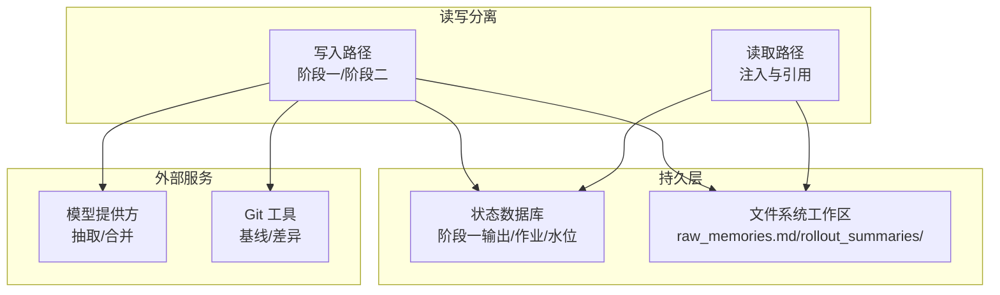
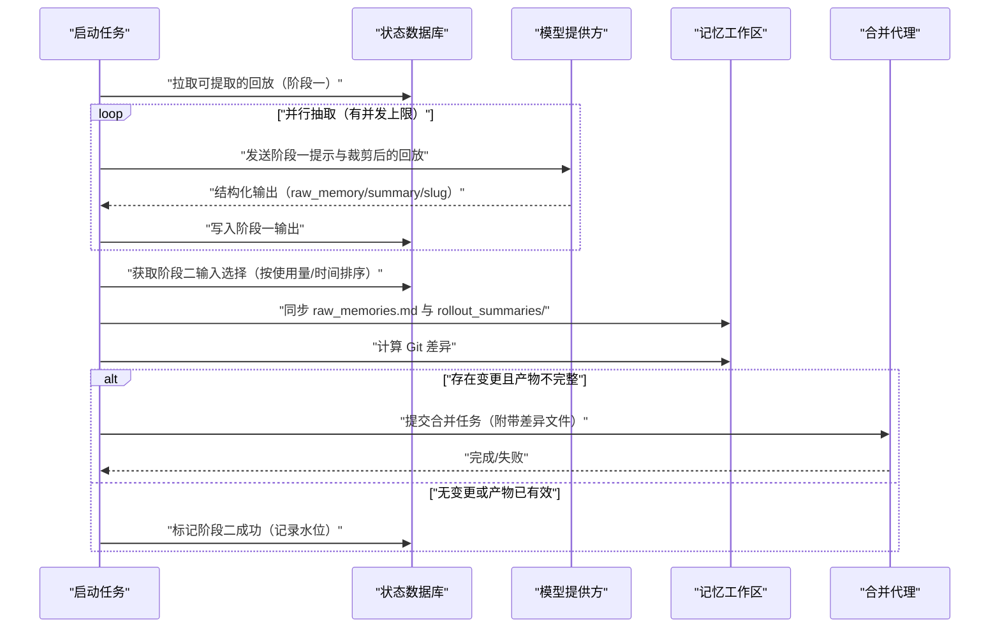
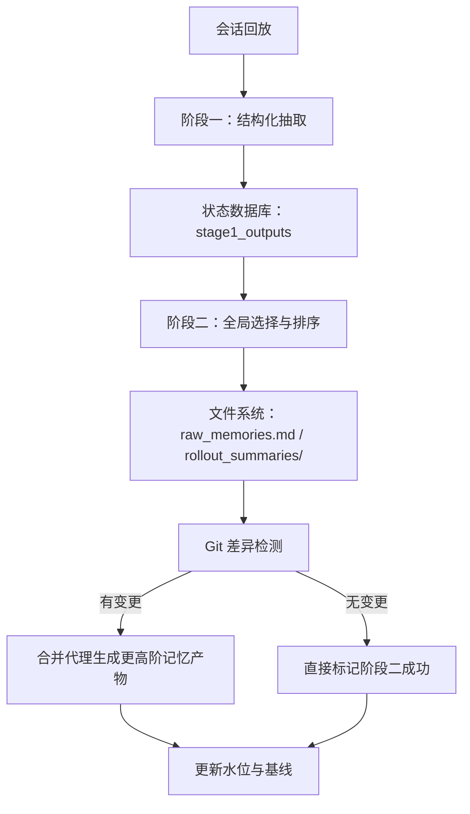
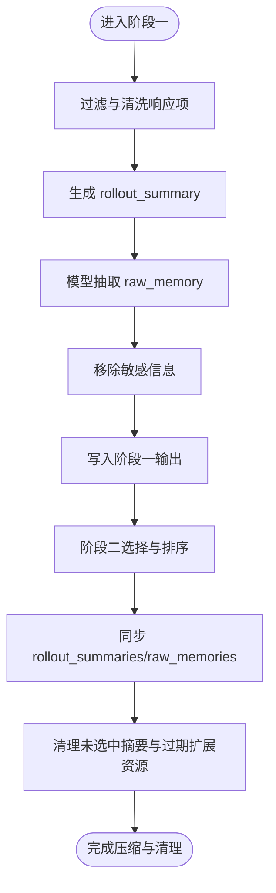
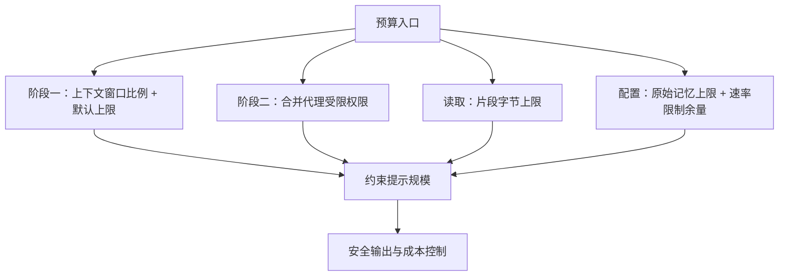
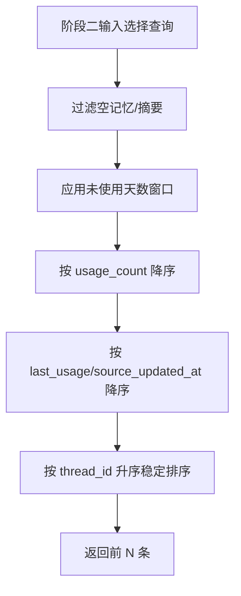
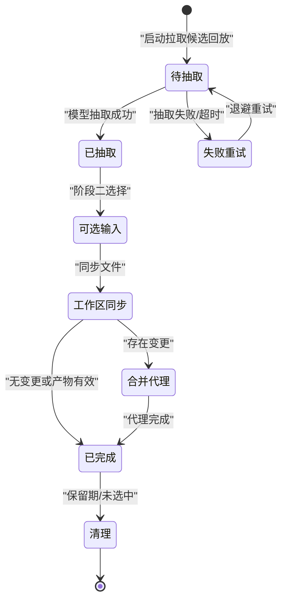
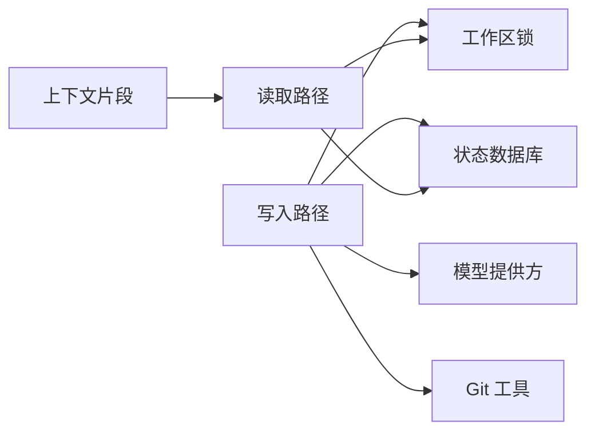

# 记忆系统

<cite>
**本文引用的文件**   
- [README.md](file://codex-rs/memories/README.md)
- [lib.rs（写入路径）](file://codex-rs/memories/write/src/lib.rs)
- [phase1.rs](file://codex-rs/memories/write/src/phase1.rs)
- [phase2.rs](file://codex-rs/memories/write/src/phase2.rs)
- [lib.rs（读取路径）](file://codex-rs/memories/read/src/lib.rs)
- [memory.rs（上下文片段）](file://codex-rs/core/src/context/memory.rs)
- [memories.rs（状态模型）](file://codex-rs/state/src/model/memories.rs)
- [memories.rs（运行时存储）](file://codex-rs/state/src/runtime/memories.rs)
- [types.rs（配置类型）](file://codex-rs/config/src/types.rs)
</cite>

## 目录
1. [引言](#引言)
2. [项目结构](#项目结构)
3. [核心组件](#核心组件)
4. [架构总览](#架构总览)
5. [详细组件分析](#详细组件分析)
6. [依赖关系分析](#依赖关系分析)
7. [性能与预算特性](#性能与预算特性)
8. [故障排查指南](#故障排查指南)
9. [结论](#结论)
10. [附录：配置项速查](#附录配置项速查)

## 引言
本文件面向开发者，系统性说明 Codex 的记忆系统。它围绕“短期记忆”和“长期记忆”的协作展开：短期记忆由会话回放阶段生成结构化记录，长期记忆由文件系统工作区中的合并产物呈现；两者通过数据库、工作区和内部代理完成生命周期管理。文档覆盖以下主题：
- 短期记忆与长期记忆的区别与协作机制
- 记忆压缩算法：文本摘要、关键信息提取、冗余删除
- Token 预算管理与上下文空间优化
- 记忆检索策略：使用计数、时间衰减、相关性排序
- 生命周期管理：创建、更新、过期、清理
- 配置选项与优化建议

## 项目结构
记忆系统采用多 crate 分层设计：
- `codex-rs/memories/read`：负责读取路径，包括记忆注入、引用解析和读取用量分类。
- `codex-rs/memories/write`：负责写入路径，包括启动任务编排、第一阶段抽取、第二阶段全局合并、工作区差异生成、扩展资源修剪等。
- `codex-rs/core/src/context/memory.rs`：将记忆内容以受控大小的上下文片段注入模型对话。
- `codex-rs/state/src/*`：维护阶段一输出、阶段二作业、使用统计等持久化状态。
- `codex-rs/config/src/types.rs`：定义记忆系统的配置结构和默认值。

**图示来源**
- [README.md:28-157](file://codex-rs/memories/README.md#L28-L157)
- [lib.rs（写入路径）:1-151](file://codex-rs/memories/write/src/lib.rs#L1-L151)
- [lib.rs（读取路径）:1-15](file://codex-rs/memories/read/src/lib.rs#L1-L15)
- [memories.rs（运行时存储）:1-100](file://codex-rs/state/src/runtime/memories.rs#L1-L100)

**章节来源**
- [README.md:28-157](file://codex-rs/memories/README.md#L28-L157)
- [lib.rs（写入路径）:1-151](file://codex-rs/memories/write/src/lib.rs#L1-L151)
- [lib.rs（读取路径）:1-15](file://codex-rs/memories/read/src/lib.rs#L1-L15)

## 核心组件
- 读取路径
  - 提供记忆根路径计算、记忆引用解析和读取用量分类能力。
  - 不依赖写入管线，保持职责单一。
- 写入路径
  - 启动任务：异步运行阶段一和阶段二。
  - 阶段一：从状态数据库拉取可提取的回放，调用模型进行结构化抽取，产出 raw_memory、rollout_summary 等字段，并回写状态数据库。
  - 阶段二：锁定工作区，加载阶段一输出，同步 raw_memories.md 和 rollout_summaries/，基于 Git 差异决定是否触发合并代理。
- 上下文片段
  - MemoryContextFragment 将记忆指令或抽取证据注入为受限大小的文本片段，确保不超过约 8,900 字节，从而控制对整体上下文窗口的影响。
- 状态模型
  - Stage1Output：单线程的阶段一记忆输出，包含原始记忆、摘要、slug、工作目录、分支、生成时间等。
  - 作业声明结果：阶段一的单线程作业和阶段二的全局作业均支持重试、冷却、并发限制和所有权令牌。
- 运行时存储
  - MemoryStore：封装 SQLite 操作，包括阶段一输出的使用记录、可用性检查、阶段一启动作业拉取、阶段二输入选择、保留期清理等。
- 配置
  - MemoriesToml/MemoriesConfig：控制是否生成和使用记忆、最大原始记忆数、未使用天数、回放年龄、每启动处理回放数、空闲时间阈值、速率限制余量、抽取模型、合并模型与服务层级等。

**章节来源**
- [lib.rs（读取路径）:1-15](file://codex-rs/memories/read/src/lib.rs#L1-L15)
- [lib.rs（写入路径）:1-151](file://codex-rs/memories/write/src/lib.rs#L1-L151)
- [memory.rs（上下文片段）:1-47](file://codex-rs/core/src/context/memory.rs#L1-L47)
- [memories.rs（状态模型）:1-69](file://codex-rs/state/src/model/memories.rs#L1-L69)
- [memories.rs（运行时存储）:1-100](file://codex-rs/state/src/runtime/memories.rs#L1-L100)
- [types.rs（配置类型）:324-456](file://codex-rs/config/src/types.rs#L324-L456)

## 架构总览
记忆系统分为两条主线：
- 短期记忆（阶段一）：按线程回放粒度，把历史交互响应转换为结构化记忆记录，持久化在状态数据库。
- 长期记忆（阶段二）：按全局视图，从阶段一输出中筛选近期高价值记忆，同步到文件系统工作区，并通过 Git 差异驱动合并代理生成更高层的记忆产物。

**图示来源**
- [phase1.rs:1-200](file://codex-rs/memories/write/src/phase1.rs#L1-L200)
- [phase2.rs:1-200](file://codex-rs/memories/write/src/phase2.rs#L1-L200)
- [memories.rs（运行时存储）:153-200](file://codex-rs/state/src/runtime/memories.rs#L153-L200)
- [memories.rs（运行时存储）:456-551](file://codex-rs/state/src/runtime/memories.rs#L456-L551)

**章节来源**
- [README.md:60-157](file://codex-rs/memories/README.md#L60-L157)
- [phase1.rs:1-200](file://codex-rs/memories/write/src/phase1.rs#L1-L200)
- [phase2.rs:1-200](file://codex-rs/memories/write/src/phase2.rs#L1-L200)

## 详细组件分析

### 短期记忆与长期记忆的区别与协作
- 短期记忆
  - 粒度：按线程回放。
  - 目标：将一次完整会话中的关键交互提炼为结构化数据，便于后续复用。
  - 存储：状态数据库中的 stage1_outputs。
  - 生命周期：启动时拉取候选回放，调用模型抽取，成功后写入，失败则带退避重试。
- 长期记忆
  - 粒度：全局视角。
  - 目标：汇总最近的高价值短期记忆，形成稳定的用户可见记忆工件。
  - 存储：文件系统工作区下的 raw_memories.md、rollout_summaries/、MEMORY.md 等。
  - 生命周期：阶段二根据使用计数和时间窗口选择输入，同步文件后基于 Git 差异决定是否执行合并。
- 协作机制
  - 阶段一产出是阶段二的输入；阶段二完成后会更新水位，避免重复工作。
  - 读取路径通过记忆根路径访问工作区，同时通过状态数据库追踪使用次数，影响后续阶段二选择。

**图示来源**
- [README.md:60-157](file://codex-rs/memories/README.md#L60-L157)
- [phase2.rs:1-200](file://codex-rs/memories/write/src/phase2.rs#L1-L200)

**章节来源**
- [README.md:60-157](file://codex-rs/memories/README.md#L60-L157)
- [memories.rs（状态模型）:1-69](file://codex-rs/state/src/model/memories.rs#L1-L69)

### 记忆压缩算法：摘要、关键信息提取与冗余删除
- 文本摘要
  - 阶段一输出包含 rollout_summary，用于概括回放的关键进展。
  - 阶段二在合并阶段进一步聚合这些摘要，形成更高层次的记忆总结。
- 关键信息提取
  - 阶段一将 response items 过滤为与记忆相关的部分，再交由模型抽取 raw_memory。
  - 抽取过程中会去除敏感信息（redact secrets），确保生成的记忆不包含机密数据。
- 冗余信息删除
  - 阶段二只同步被选中的 rollout_summaries，未选中项会被清理。
  - 扩展资源文件超过保留窗口会被修剪，使清理行为体现在工作区差异中。
  - 阶段一输出在未被阶段二选中且超过未使用天数后，会从数据库中删除。

**图示来源**
- [phase1.rs:1-200](file://codex-rs/memories/write/src/phase1.rs#L1-L200)
- [phase2.rs:1-200](file://codex-rs/memories/write/src/phase2.rs#L1-L200)
- [lib.rs（写入路径）:1-151](file://codex-rs/memories/write/src/lib.rs#L1-L151)

**章节来源**
- [phase1.rs:1-200](file://codex-rs/memories/write/src/phase1.rs#L1-L200)
- [phase2.rs:1-200](file://codex-rs/memories/write/src/phase2.rs#L1-L200)
- [lib.rs（写入路径）:1-151](file://codex-rs/memories/write/src/lib.rs#L1-L151)

### Token 预算管理机制
- 阶段一
  - 使用模型的上下文窗口的一个固定比例作为回放输入的预留空间，避免系统提示和输出挤占过多上下文。
  - 当模型元数据不可用时，使用默认的回放 token 上限作为降级保护。
  - 抽取任务的推理强度设置为较低级别，以降低单次成本。
- 阶段二
  - 合并任务使用中等推理强度，平衡质量与成本。
  - 合并代理仅拥有本地写权限、禁用网络与协作，避免递归委托和额外开销。
- 上下文片段
  - 读取路径将记忆内容截断至约 8,900 字节，确保不会过度占用上下文窗口。
- 配置级预算
  - 可通过 max_raw_memories_for_consolidation 控制参与合并的原始记忆数量，间接控制最终提示规模。
  - min_rate_limit_remaining_percent 保证在速率限制余量不足时不启动记忆任务，避免加剧限流风险。

**图示来源**
- [lib.rs（写入路径）:1-151](file://codex-rs/memories/write/src/lib.rs#L1-L151)
- [memory.rs（上下文片段）:1-47](file://codex-rs/core/src/context/memory.rs#L1-L47)
- [types.rs（配置类型）:324-456](file://codex-rs/config/src/types.rs#L324-L456)

**章节来源**
- [lib.rs（写入路径）:1-151](file://codex-rs/memories/write/src/lib.rs#L1-L151)
- [memory.rs（上下文片段）:1-47](file://codex-rs/core/src/context/memory.rs#L1-L47)
- [types.rs（配置类型）:324-456](file://codex-rs/config/src/types.rs#L324-L456)

### 记忆的检索策略：语义搜索、关键词匹配与相关性排序
- 当前实现以“使用相关性与时间相关性”为主：
  - 阶段二选择阶段一输出时，优先按 usage_count 降序，再按 last_usage/source_updated_at 降序，最后按 thread_id 稳定排序。
  - 只有非空 raw_memory 或 rollout_summary 的记录才具备入选资格。
  - 若 last_usage 为空，则回退到 source_updated_at，确保新鲜但未使用的记忆也能被考虑。
- 语义搜索与关键词匹配
  - 仓库中没有发现显式的向量语义搜索或全文关键词索引逻辑。
  - 记忆检索主要依赖结构化字段（usage_count、last_usage、source_updated_at、thread_id）与文件系统内容。
- 实际效果
  - 高频使用且近期更新的记忆更容易进入阶段二，从而提升长期记忆的相关性。
  - 通过限制 max_raw_memories_for_consolidation 和 max_unused_days，可调节检索范围与时效性。

**图示来源**
- [memories.rs（运行时存储）:456-551](file://codex-rs/state/src/runtime/memories.rs#L456-L551)

**章节来源**
- [memories.rs（运行时存储）:456-551](file://codex-rs/state/src/runtime/memories.rs#L456-L551)

### 记忆的生命周期管理：创建、更新、过期与清理
- 创建
  - 阶段一在启动时拉取候选回放，调用模型抽取后写入阶段一输出。
  - 阶段二在确认工作区变更后触发合并代理，生成更高阶记忆产物。
- 更新
  - 阶段一输出包含 source_updated_at，用于判断是否需要重新抽取。
  - 阶段二成功完成后会记录完成水位，避免重复合并。
- 过期
  - 阶段二输入选择忽略 last_usage 超出 max_unused_days 的记忆。
  - 阶段一输出若未选中且超期，会在保留期清理中被删除。
- 清理
  - 阶段一输出保留期清理：按 COALESCE(last_usage, source_updated_at) 升序删除未选中记录。
  - 阶段二工作区清理：删除未选中的 rollout_summaries 和过期的扩展资源文件。

**图示来源**
- [phase1.rs:1-200](file://codex-rs/memories/write/src/phase1.rs#L1-L200)
- [phase2.rs:1-200](file://codex-rs/memories/write/src/phase2.rs#L1-L200)
- [memories.rs（运行时存储）:406-439](file://codex-rs/state/src/runtime/memories.rs#L406-L439)

**章节来源**
- [phase1.rs:1-200](file://codex-rs/memories/write/src/phase1.rs#L1-L200)
- [phase2.rs:1-200](file://codex-rs/memories/write/src/phase2.rs#L1-L200)
- [memories.rs（运行时存储）:406-439](file://codex-rs/state/src/runtime/memories.rs#L406-L439)

## 依赖关系分析
- 模块耦合
  - 写入路径依赖状态数据库、模型提供方、Git 工具与工作区锁。
  - 读取路径依赖工作区与状态数据库，但不依赖写入路径。
  - 上下文片段位于 core 层，独立于 memories 读写 crate，仅消费字符串内容。
- 外部依赖
  - SQLite 用于持久化阶段一输出与作业状态。
  - Git 用于记忆工作区的基线与差异检测。
  - 模型提供方用于阶段一抽取与阶段二合并。
- 潜在循环依赖
  - 读取路径明确不依赖写入路径，降低耦合风险。
  - 写入路径通过 runtime 抽象访问状态数据库，避免直接硬编码数据库访问位置。

**图示来源**
- [lib.rs（写入路径）:1-151](file://codex-rs/memories/write/src/lib.rs#L1-L151)
- [lib.rs（读取路径）:1-15](file://codex-rs/memories/read/src/lib.rs#L1-L15)
- [memory.rs（上下文片段）:1-47](file://codex-rs/core/src/context/memory.rs#L1-L47)

**章节来源**
- [lib.rs（写入路径）:1-151](file://codex-rs/memories/write/src/lib.rs#L1-L151)
- [lib.rs（读取路径）:1-15](file://codex-rs/memories/read/src/lib.rs#L1-L15)
- [memory.rs（上下文片段）:1-47](file://codex-rs/core/src/context/memory.rs#L1-L47)

## 性能与预算特性
- 并发与限流
  - 阶段一抽取任务有固定并发上限，避免一次性压垮模型接口。
  - 启动时可限制扫描的回放数量和可声明的最大任务数，防止状态数据库扫描压力过大。
  - 阶段二全局合并任务有冷却时间与冷却间隔，避免频繁触发。
- 数据选择效率
  - 阶段二输入选择使用分页查询，并校验线程启用状态，减少无效数据回传。
  - 输出按 thread_id 升序稳定排序，避免使用排名变化导致的工作区抖动。
- 存储与清理
  - 阶段一输出清理使用批量删除，限制每次清理行数，降低数据库压力。
  - 工作区变更通过 Git 差异快速判定，避免不必要的合并代理调用。
- 模型调用优化
  - 阶段一使用低推理强度，阶段二使用中等推理强度。
  - 合并代理禁用网络和协作，减少外部调用与递归风险。

[本节为通用性能讨论，无需具体文件分析]

## 故障排查指南
- 阶段一抽取失败
  - 现象：日志出现抽取失败或无输出。
  - 可能原因：模型接口异常、回放内容过长、敏感信息未正确脱敏。
  - 处理建议：检查模型提供方配置、调整阶段一提示与回放裁剪策略、查看是否有退避重试。
- 阶段二合并失败
  - 现象：工作区锁定失败、工作区准备失败、无法加载阶段一输出、工作区差异检测失败。
  - 可能原因：权限不足、Git 仓库损坏、状态数据库不可用。
  - 处理建议：检查工作区权限与 Git 状态、确认状态数据库连接、查看阶段二作业状态码。
- 记忆未被选中
  - 现象：raw_memories.md 中缺少某条记忆。
  - 可能原因：last_usage 超出未使用天数、usage_count 较低、线程已禁用。
  - 处理建议：调整 max_unused_days、max_raw_memories_for_consolidation，检查线程 memory_mode。
- 工作区持续变化
  - 现象：阶段二总是认为工作区有变更。
  - 可能原因：扩展资源未及时清理、rollout_summaries 不同步、Git 基线未重置。
  - 处理建议：清理过期扩展资源、重新同步 rollout_summaries、确认合并成功后基线已重置。

**章节来源**
- [phase1.rs:1-200](file://codex-rs/memories/write/src/phase1.rs#L1-L200)
- [phase2.rs:1-200](file://codex-rs/memories/write/src/phase2.rs#L1-L200)
- [memories.rs（运行时存储）:406-439](file://codex-rs/state/src/runtime/memories.rs#L406-L439)

## 结论
Codex 的记忆系统通过阶段一的结构化抽取与阶段二的全局合并，构建了从短期记忆到长期记忆的清晰路径。系统在并发控制、Token 预算、使用相关性和时间相关性方面提供了稳健的实现；同时通过 Git 差异与作业水位机制，确保工作区的一致性与可追溯性。开发者可根据场景调整配置参数，以平衡记忆质量、成本与稳定性。

[本节为总结性内容，无需具体文件分析]

## 附录：配置项速查
- version：记忆版本（v1/v2），决定目录名与模板选择。
- dual_write：是否在切换期间双写。
- disable_on_external_context：外部上下文是否污染 memory_mode。
- generate_memories：是否为新线程生成记忆。
- use_memories：是否在开发者提示中注入记忆使用说明。
- dedicated_tools：是否暴露专用记忆工具。
- max_raw_memories_for_consolidation：参与合并的原始记忆最大数量。
- max_unused_days：记忆未使用超过该天数即被视为过期。
- max_rollout_age_days：可用于记忆的回放最大年龄。
- max_rollouts_per_startup：每启动处理的最大回放数。
- min_rollout_idle_hours：回放最小空闲小时数。
- min_rate_limit_remaining_percent：最低速率限制剩余百分比。
- extract_model：阶段一抽取模型。
- consolidation_model：阶段二合并模型。
- consolidation_service_tier：合并服务层级。

**章节来源**
- [types.rs（配置类型）:324-456](file://codex-rs/config/src/types.rs#L324-L456)