# Connector 系统

<cite>
**本文引用的文件**   
- [connectors/src/lib.rs](file://codex-rs/connectors/src/lib.rs)
- [connectors/src/app_info.rs](file://codex-rs/connectors/src/app_info.rs)
- [connectors/src/merge.rs](file://codex-rs/connectors/src/merge.rs)
- [connectors/src/filter.rs](file://codex-rs/connectors/src/filter.rs)
- [connectors/src/metadata.rs](file://codex-rs/connectors/src/metadata.rs)
- [connectors/src/snapshot.rs](file://codex-rs/connectors/src/snapshot.rs)
- [connectors/src/runtime_projection.rs](file://codex-rs/connectors/src/runtime_projection.rs)
- [connectors/src/plugin_config.rs](file://codex-rs/connectors/src/plugin_config.rs)
- [connectors/src/app_tool_policy.rs](file://codex-rs/connectors/src/app_tool_policy.rs)
- [connectors/src/directory_cache.rs](file://codex-rs/connectors/src/directory_cache.rs)
- [connectors/src/metadata_store.rs](file://codex-rs/connectors/src/metadata_store.rs)
- [connectors/src/connector_runtime/mod.rs](file://codex-rs/connectors/src/connector_runtime/mod.rs)
- [core/src/connectors.rs](file://codex-rs/core/src/connectors.rs)
</cite>

## 目录
1. [简介](#简介)
2. [项目结构](#项目结构)
3. [核心组件](#核心组件)
4. [架构总览](#架构总览)
5. [详细组件分析](#详细组件分析)
6. [依赖关系分析](#依赖关系分析)
7. [性能与缓存策略](#性能与缓存策略)
8. [错误处理与故障恢复](#错误处理与故障恢复)
9. [Connector 开发指南](#connector-开发指南)
10. [政策评估与权限控制](#政策评估与权限控制)
11. [工作区账户与公共目录差异](#工作区账户与公共目录差异)
12. [常见问题排查](#常见问题排查)
13. [结论](#结论)

## 简介
Connector 系统是 Codex CLI 中连接外部应用和服务的扩展机制。它负责：
- 发现连接器（包括公共目录、工作区目录和插件声明）。
- 加载并合并连接器元数据，生成统一的 AppInfo 模型。
- 管理连接器运行时快照、工具投影、启用状态和可调用性。
- 对连接器及其工具进行品牌化、截图、分类、可见性和权限控制。
- 提供多层次的缓存策略，保证冷启动速度与网络异常下的稳定性。
- 在工作区账户和个人账户之间隔离目录来源、缓存键和运行时上下文。

该文档面向 Connector 使用者、集成方和开发者，既给出高层架构，也深入到代码级数据结构、缓存路径、政策评估流程与实现示例。

## 项目结构
`codex-rs/connectors` 是 Connector 系统的核心 Rust crate，主要职责如下：
- `lib.rs`：对外暴露 API，统一连接器发现、目录缓存、安装 URL 生成、名称规范化、目录应用合并等。
- `app_info.rs`：定义连接器与应用相关的品牌、评论、截图、元数据和通用信息。
- `merge.rs`：合并来自不同来源的连接器，并处理插件占位符、展示名去重与排序。
- `filter.rs`：在“工具建议”场景下过滤出真正需要发现的连接器。
- `snapshot.rs`：从插件能力摘要构建连接器选择快照，追踪贡献来源和禁用集合。
- `runtime_projection.rs`：将 MCP 原始工具投影为已安装连接器运行时的启用状态与可调用性。
- `plugin_config.rs`：解析插件中的 app 配置，提取 connector_id 和分类。
- `app_tool_policy.rs`：基于配置层栈评估应用和工具的启用状态、审批策略。
- `directory_cache.rs`：连接器目录缓存的磁盘布局、版本号和读写逻辑。
- `metadata_store.rs`：进程内连接器元数据缓存，支持按身份作用域隔离。
- `connector_runtime/mod.rs`：连接器运行时快照、上下文键、管理器、持久化路径和发布通道。

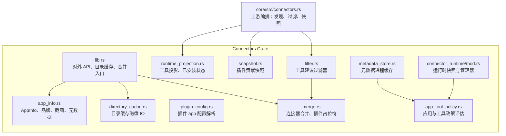

**图表来源**
- [connectors/src/lib.rs:1-120](file://codex-rs/connectors/src/lib.rs#L1-L120)
- [connectors/src/merge.rs:1-120](file://codex-rs/connectors/src/merge.rs#L1-L120)
- [connectors/src/filter.rs:1-60](file://codex-rs/connectors/src/filter.rs#L1-L60)
- [connectors/src/snapshot.rs:1-80](file://codex-rs/connectors/src/snapshot.rs#L1-L80)
- [connectors/src/runtime_projection.rs:1-100](file://codex-rs/connectors/src/runtime_projection.rs#L1-L100)
- [connectors/src/plugin_config.rs:1-50](file://codex-rs/connectors/src/plugin_config.rs#L1-L50)
- [connectors/src/app_tool_policy.rs:1-120](file://codex-rs/connectors/src/app_tool_policy.rs#L1-L120)
- [connectors/src/directory_cache.rs:1-60](file://codex-rs/connectors/src/directory_cache.rs#L1-L60)
- [connectors/src/metadata_store.rs:1-80](file://codex-rs/connectors/src/metadata_store.rs#L1-L80)
- [connectors/src/connector_runtime/mod.rs:1-120](file://codex-rs/connectors/src/connector_runtime/mod.rs#L1-L120)
- [core/src/connectors.rs:80-120](file://codex-rs/core/src/connectors.rs#L80-L120)

**章节来源**
- [connectors/src/lib.rs:1-120](file://codex-rs/connectors/src/lib.rs#L1-L120)
- [core/src/connectors.rs:80-120](file://codex-rs/core/src/connectors.rs#L80-L120)

## 核心组件
- **AppInfo**：连接器最终呈现给上层的核心数据结构，包含 id、name、描述、图标、品牌、元数据、标签、安装链接、是否可访问、是否启用以及插件展示名。
- **ConnectorSnapshot**：由插件能力摘要构建的最终连接器选择结果，记录贡献来源、禁用集合和贡献顺序。
- **InstalledConnectorRuntime**：每个已安装连接器的运行时视图，包含 id、运行时名称、enabled 与 callable。
- **AppToolPolicy / AppToolPolicyEvaluator**：评估单个连接器工具是否启用及审批级别；同时提供连接器整体 enabled 判断。
- **ConnectorMetadataStore**：进程内连接器元数据缓存，按后端地址、账户、用户和工作区分隔，支持工具摘要优先保护。
- **ConnectorDirectoryCacheContext**：连接器目录缓存上下文，提供按身份哈希后的磁盘缓存路径。
- **ConnectorRuntimeManager**：进程内连接器运行时快照管理器，按身份隔离，支持共享快照或无共享模式。

**章节来源**
- [connectors/src/app_info.rs:1-111](file://codex-rs/connectors/src/app_info.rs#L1-L111)
- [connectors/src/snapshot.rs:1-155](file://codex-rs/connectors/src/snapshot.rs#L1-L155)
- [connectors/src/runtime_projection.rs:1-103](file://codex-rs/connectors/src/runtime_projection.rs#L1-L103)
- [connectors/src/app_tool_policy.rs:1-200](file://codex-rs/connectors/src/app_tool_policy.rs#L1-L200)
- [connectors/src/metadata_store.rs:1-144](file://codex-rs/connectors/src/metadata_store.rs#L1-L144)
- [connectors/src/directory_cache.rs:1-113](file://codex-rs/connectors/src/directory_cache.rs#L1-L113)
- [connectors/src/connector_runtime/mod.rs:1-200](file://codex-rs/connectors/src/connector_runtime/mod.rs#L1-L200)

## 架构总览
Connector 系统分为四层：
1. **发现层**：从公共连接器目录、工作区目录和插件声明收集候选连接器。
2. **合并层**：将目录响应、插件占位符和可访问连接器合并为统一 AppInfo 列表。
3. **运行时层**：将 MCP 工具投影为已安装连接器运行时状态，并结合政策评估 callable 和 enabled。
4. **缓存与元数据层**：维护目录缓存、元数据缓存、运行时快照缓存和磁盘持久化。

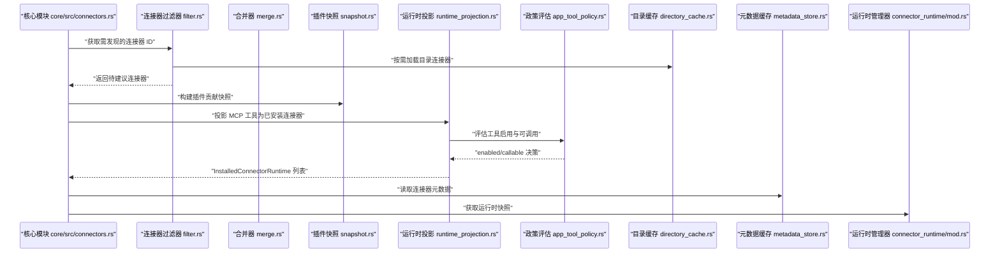

**图表来源**
- [core/src/connectors.rs:80-120](file://codex-rs/core/src/connectors.rs#L80-L120)
- [connectors/src/filter.rs:1-60](file://codex-rs/connectors/src/filter.rs#L1-L60)
- [connectors/src/merge.rs:1-120](file://codex-rs/connectors/src/merge.rs#L1-L120)
- [connectors/src/snapshot.rs:1-155](file://codex-rs/connectors/src/snapshot.rs#L1-L155)
- [connectors/src/runtime_projection.rs:1-103](file://codex-rs/connectors/src/runtime_projection.rs#L1-L103)
- [connectors/src/app_tool_policy.rs:1-200](file://codex-rs/connectors/src/app_tool_policy.rs#L1-L200)
- [connectors/src/directory_cache.rs:1-113](file://codex-rs/connectors/src/directory_cache.rs#L1-L113)
- [connectors/src/metadata_store.rs:1-144](file://codex-rs/connectors/src/metadata_store.rs#L1-L144)
- [connectors/src/connector_runtime/mod.rs:1-200](file://codex-rs/connectors/src/connector_runtime/mod.rs#L1-L200)

## 详细组件分析

### 连接器目录发现与加载
Connector 目录发现支持两类来源：
- 公共连接器目录：通过分页接口 `/connectors/directory/list` 拉取，自动过滤 visibility 为 HIDDEN 的应用。
- 工作区连接器目录：当 is_workspace_account 为真时，额外并行请求 `/connectors/directory/list_workspace`。

关键行为：
- 使用 `list_all_connectors_with_options` 作为统一入口，支持内存缓存、磁盘缓存和强制刷新。
- 合并多个页码、多个来源的 DirectoryApp，再转换为 AppInfo。
- 生成 install_url，规范化 name 和 description，设置 is_accessible 为 false。
- 写入内存缓存和磁盘缓存。

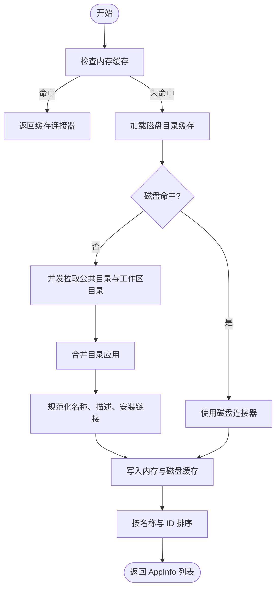

**图表来源**
- [connectors/src/lib.rs:120-250](file://codex-rs/connectors/src/lib.rs#L120-L250)
- [connectors/src/lib.rs:250-500](file://codex-rs/connectors/src/lib.rs#L250-L500)
- [connectors/src/directory_cache.rs:1-113](file://codex-rs/connectors/src/directory_cache.rs#L1-L113)

**章节来源**
- [connectors/src/lib.rs:120-500](file://codex-rs/connectors/src/lib.rs#L120-L500)
- [connectors/src/directory_cache.rs:1-113](file://codex-rs/connectors/src/directory_cache.rs#L1-L113)

### 连接器元数据与品牌化
AppInfo 承载连接器对外展示的所有元数据：
- 基础字段：id、name、description、logo_url、logo_url_dark、icon_assets、icon_dark_assets、distribution_channel。
- 品牌字段：branding.category、developer、website、privacy_policy、terms_of_service、is_discoverable_app。
- 应用元数据：review、categories、sub_categories、seo_description、screenshots、developer、version、version_id、version_notes、first_party_requires_install、show_in_composer_when_unlinked。
- 运行时标记：install_url、is_accessible、is_enabled、plugin_display_names。

品牌化和截图相关要点：
- 品牌分类优先取 branding.category，其次取 app_metadata.categories 中首个非空分类。
- 截图由 AppScreenshot 表示，包含 url、file_id、user_prompt。
- 图标资产支持亮色与暗色两套资源映射。

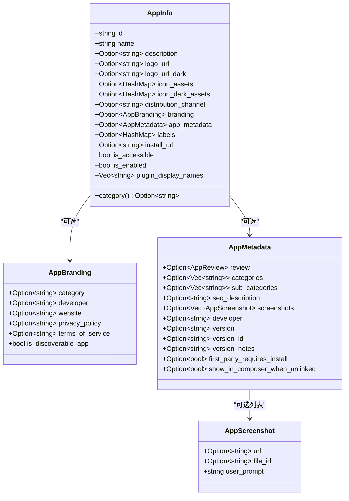

**图表来源**
- [connectors/src/app_info.rs:1-111](file://codex-rs/connectors/src/app_info.rs#L1-L111)

**章节来源**
- [connectors/src/app_info.rs:1-111](file://codex-rs/connectors/src/app_info.rs#L1-L111)

### 连接器合并与插件占位符
Connector 可能来自多个来源：
- 目录连接器：从公共或工作区目录拉取。
- 插件连接器：插件声明的 connector_id，初始以占位符形式插入。
- 可访问连接器：已在本地可用或已安装的连接器。

合并规则：
- 目录连接器默认 is_accessible=false。
- 可访问连接器覆盖同名目录连接器，并提升 is_accessible=true。
- 若目录连接器 name 仍等于 id，则使用可访问连接器的友好 name。
- 补充缺失的 logo、图标资产、分布渠道等。
- 合并 plugin_display_names 并去重。
- 最终按 is_accessible、name、id 排序。

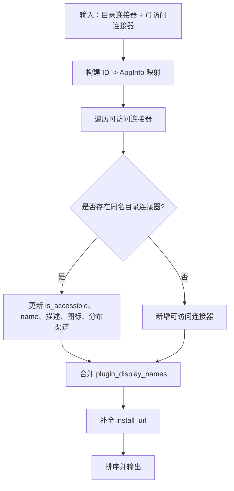

**图表来源**
- [connectors/src/merge.rs:1-120](file://codex-rs/connectors/src/merge.rs#L1-L120)

**章节来源**
- [connectors/src/merge.rs:1-200](file://codex-rs/connectors/src/merge.rs#L1-L200)

### 工具建议与连接器过滤
`filter_tool_suggest_discoverable_connectors` 用于“工具建议”场景，避免重复请求目录：
- 先从 accessible_connectors 中移除已可访问的连接器的 ID。
- 如果剩余候选为空，直接返回空列表，不触发目录查询。
- 否则等待目录连接器 Future，过滤出仍在候选集中的 ID。
- 将仍未匹配到的候选转为插件占位符 AppInfo。
- 最终按 name 和 id 排序。

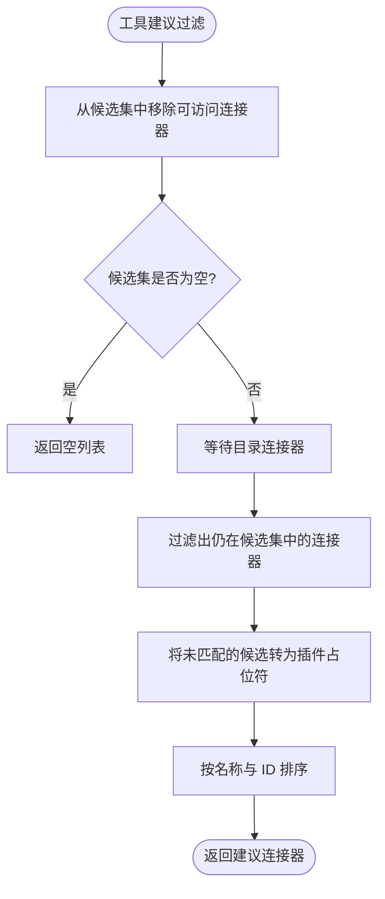

**图表来源**
- [connectors/src/filter.rs:1-80](file://codex-rs/connectors/src/filter.rs#L1-L80)

**章节来源**
- [connectors/src/filter.rs:1-144](file://codex-rs/connectors/src/filter.rs#L1-L144)

### 插件声明与连接器快照
插件可以通过 app 配置文件声明连接器：
- 解析 PluginAppFile.apps，提取 name、connector_id、category。
- 清理 category 的空值与空白字符。
- 将插件能力摘要转换为 PluginConnectorSource。
- 构建 ConnectorSnapshot，记录贡献来源、禁用连接器集合和贡献顺序。

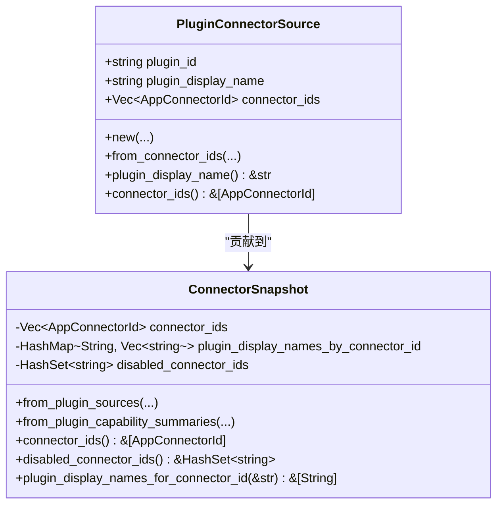

**图表来源**
- [connectors/src/plugin_config.rs:1-50](file://codex-rs/connectors/src/plugin_config.rs#L1-L50)
- [connectors/src/snapshot.rs:1-155](file://codex-rs/connectors/src/snapshot.rs#L1-L155)

**章节来源**
- [connectors/src/plugin_config.rs:1-50](file://codex-rs/connectors/src/plugin_config.rs#L1-L50)
- [connectors/src/snapshot.rs:1-155](file://codex-rs/connectors/src/snapshot.rs#L1-L155)

### 连接器运行时投影与可调用性
MCP 暴露的工具可能属于某个连接器。运行时投影将这些原始工具转换为 InstalledConnectorRuntime：
- 忽略 synthetic_link 辅助工具。
- 按 connector_id 聚合，保留首次出现的 runtime_name。
- 对每个工具调用 AppToolPolicyEvaluator.policy 评估 enable 与 approval。
- 若任一 model_visible 且 policy 允许，则 callable=true。
- enabled 由 app_enabled 决定，callable 由工具级策略决定。

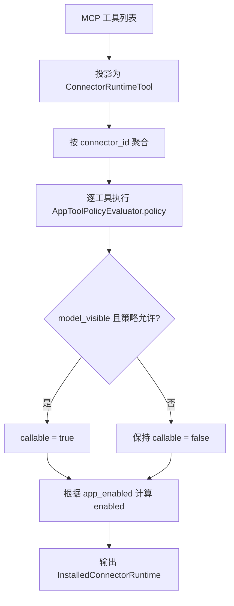

**图表来源**
- [connectors/src/runtime_projection.rs:1-103](file://codex-rs/connectors/src/runtime_projection.rs#L1-L103)
- [connectors/src/app_tool_policy.rs:1-200](file://codex-rs/connectors/src/app_tool_policy.rs#L1-L200)

**章节来源**
- [connectors/src/runtime_projection.rs:1-103](file://codex-rs/connectors/src/runtime_projection.rs#L1-L103)
- [connectors/src/app_tool_policy.rs:1-200](file://codex-rs/connectors/src/app_tool_policy.rs#L1-L200)

### 连接器运行时快照与管理器
ConnectorRuntimeManager 维护进程内运行时快照：
- 按 ConnectorRuntimeContextKey 隔离个人与工作区账户。
- 支持 process-local shared snapshot、without_shared_snapshot、without cache 三种模式。
- 快照包含 tools、tool_list_meta、discovery_scope、refreshed_at、generation、tools_version。
- 相同 identity 的上下文共享一个 CatalogProvider，减少重复 fetch。
- 持久化路径由 identity 与 codex_home 决定。

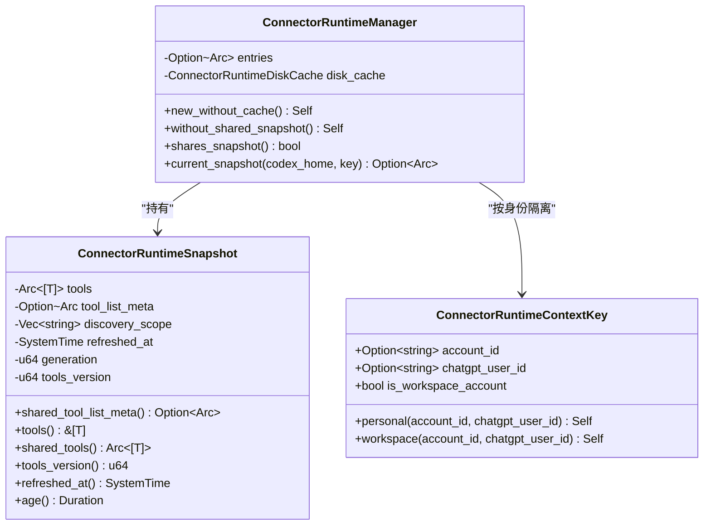

**图表来源**
- [connectors/src/connector_runtime/mod.rs:1-200](file://codex-rs/connectors/src/connector_runtime/mod.rs#L1-L200)

**章节来源**
- [connectors/src/connector_runtime/mod.rs:1-200](file://codex-rs/connectors/src/connector_runtime/mod.rs#L1-L200)

### 连接器元数据缓存
ConnectorMetadataStore 提供进程内元数据缓存：
- 作用域包括 backend_base_url、account_id、chatgpt_user_id、is_workspace_account。
- fresh_records 只返回未过期且满足 include_tools 条件的记录。
- commit 不会用缺少 tool_summaries 的响应覆盖已有新鲜工具摘要。
- TTL 与目录缓存一致，默认为 CONNECTOR_METADATA_CACHE_TTL。

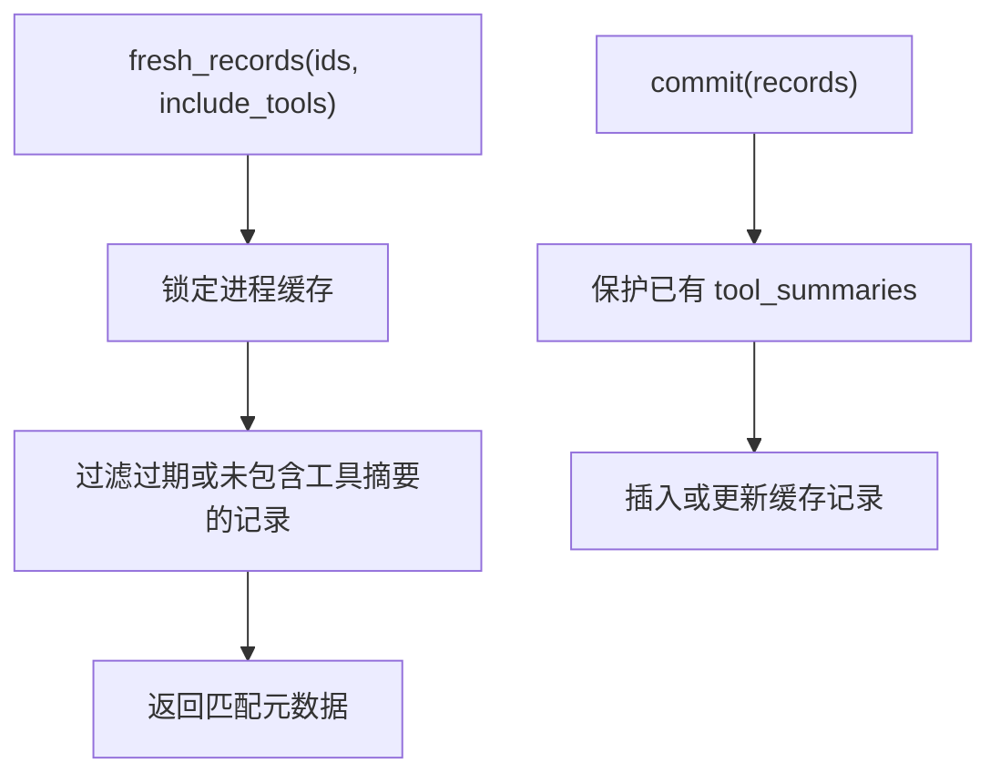

**图表来源**
- [connectors/src/metadata_store.rs:1-144](file://codex-rs/connectors/src/metadata_store.rs#L1-L144)

**章节来源**
- [connectors/src/metadata_store.rs:1-144](file://codex-rs/connectors/src/metadata_store.rs#L1-L144)

## 依赖关系分析
Connector 系统与上游核心模块存在明确分工：
- core/src/connectors.rs 负责编排：获取连接器 ID、调用 connectors::filter、构建快照、投影运行时。
- connectors crate 提供可复用能力：目录缓存、合并、过滤、快照、投影、政策、元数据缓存、运行时管理。
- 外部依赖包括：
  - codex_config：配置层栈、AppsConfigToml、PluginsConfigToml。
  - codex_login：认证上下文，用于构造运行时上下文键。
  - codex_protocol：MCP 服务器信息等协议类型。
  - codex_plugin：插件声明、连接器 ID、能力摘要。
  - serde/serde_json：序列化与反序列化。
  - tokio：异步 Future、watch channel。
  - arc_swap：原子替换当前快照。
  - sha1：目录缓存文件名哈希。

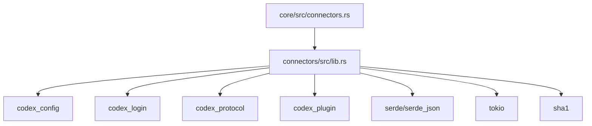

**图表来源**
- [core/src/connectors.rs:80-120](file://codex-rs/core/src/connectors.rs#L80-L120)
- [connectors/src/lib.rs:1-120](file://codex-rs/connectors/src/lib.rs#L1-L120)

**章节来源**
- [core/src/connectors.rs:80-120](file://codex-rs/core/src/connectors.rs#L80-L120)
- [connectors/src/lib.rs:1-120](file://codex-rs/connectors/src/lib.rs#L1-L120)

## 性能与缓存策略
Connector 系统采用多层缓存以降低网络延迟、避免重复解析和减少进程状态抖动：

| 缓存层级 | 存储位置 | 作用范围 | 失效条件 | 特点 |
|---|---|---|---|---|
| 内存目录缓存 | 进程静态变量 | 全局 | 过期或 key 不匹配 | 快速返回，避免磁盘 IO |
| 磁盘目录缓存 | codex_home/cache/codex_app_directory | 按身份哈希 | schema_version 变化或 JSON 损坏 | 冷启动加速 |
| 元数据缓存 | 进程内 HashMap | 按后端+账户+用户+工作区分隔 | 过期或 tool_summaries 保护 | 不污染旧记录 |
| 运行时快照缓存 | 进程内 Entry + watch channel | 按身份隔离 | 新快照替换 | 相等定义保留 storage 与 ordering |

关键优化点：
- 目录缓存 TTL 为 CONNECTORS_CACHE_TTL，默认一小时。
- 元数据缓存 TTL 与目录缓存对齐。
- 工作区账户并行发起公共目录与工作区目录请求，避免串行阻塞。
- 仅当仍有候选连接器时才请求目录，降低无效网络开销。
- 快照 tools_version 仅在工具定义变化时递增，便于调用方复用准备结果。
- 元数据 commit 不会用缺少 tool_summaries 的响应覆盖已有新鲜工具摘要。

**章节来源**
- [connectors/src/lib.rs:1-120](file://codex-rs/connectors/src/lib.rs#L1-L120)
- [connectors/src/directory_cache.rs:1-113](file://codex-rs/connectors/src/directory_cache.rs#L1-L113)
- [connectors/src/metadata_store.rs:1-144](file://codex-rs/connectors/src/metadata_store.rs#L1-L144)
- [connectors/src/connector_runtime/mod.rs:1-200](file://codex-rs/connectors/src/connector_runtime/mod.rs#L1-L200)

## 错误处理与故障恢复
Connector 系统在多处对错误采取稳健策略：
- 目录缓存磁盘读取失败时记录 warn 日志并返回 Invalid。
- JSON 解析失败时删除损坏缓存文件，避免持续失败。
- schema_version 不匹配时删除缓存文件，确保升级后重新拉取。
- 元数据缓存 commit 跳过会破坏 tool_summaries 的更新。
- 运行时快照使用 watch channel 发布成功变更，避免脏读。
- 工具建议过滤器在无候选时短路，避免无意义网络请求。
- 名称规范化将空 name 回退为 connector_id，保证 install_url 始终有效。

典型恢复路径：
1. 磁盘缓存损坏 → 删除 → 下次走网络拉取 → 重新写入磁盘。
2. 元数据响应缺少工具摘要 → 保留旧摘要 → 后续补充。
3. 目录请求失败 → 上层继续处理已缓存结果或返回错误，取决于调用方。
4. 运行时快照更新 → 仅当 tools_version 变化时通知订阅者。

**章节来源**
- [connectors/src/directory_cache.rs:1-113](file://codex-rs/connectors/src/directory_cache.rs#L1-L113)
- [connectors/src/metadata_store.rs:1-144](file://codex-rs/connectors/src/metadata_store.rs#L1-L144)
- [connectors/src/filter.rs:1-80](file://codex-rs/connectors/src/filter.rs#L1-L80)
- [connectors/src/lib.rs:500-928](file://codex-rs/connectors/src/lib.rs#L500-L928)

## Connector 开发指南

### 如何声明一个 Connector
开发者通常通过插件配置声明连接器：
1. 在插件 app 配置文件中添加 apps 表项。
2. 指定 id 作为 connector_id。
3. 可选指定 category，用于分类展示。
4. 使用 parse_plugin_app_config 或 parse_plugin_app_config_value 解析配置。
5. 将 AppDeclaration 转换为 PluginConnectorSource。
6. 构建 ConnectorSnapshot，传入禁用插件列表与 canonical_disabled_connector_ids。

推荐实践：
- connector_id 应稳定且唯一。
- category 应避免空字符串和多余空白。
- 若连接器可由多个插件贡献，保留 plugin_display_names 以便追溯来源。

**章节来源**
- [connectors/src/plugin_config.rs:1-50](file://codex-rs/connectors/src/plugin_config.rs#L1-L50)
- [connectors/src/snapshot.rs:1-155](file://codex-rs/connectors/src/snapshot.rs#L1-L155)

### 如何集成外部应用与服务
外部应用通常通过连接器目录或 MCP 工具暴露能力：
- 对于目录型连接器：确保 DirectoryApp 的 id、name、branding、app_metadata 完整；visibility 不要设为 HIDDEN。
- 对于 MCP 工具：确保工具元数据中包含 connector_id 和 connector_name，以便运行时投影。
- 对于品牌化：提供 logo_url 或 icon_assets，并为暗色主题提供对应资源。
- 对于截图：提供 AppScreenshot，包含 url 或 file_id 与 user_prompt。

集成步骤：
1. 确认连接器 id 与插件声明一致。
2. 在连接器目录或服务端返回完整的 AppInfo 字段。
3. 在 MCP 工具定义中附加 connector_id。
4. 通过 InstalledConnectorRuntime 观察 enabled 与 callable。
5. 结合 AppToolPolicyEvaluator 调整启用与审批策略。

**章节来源**
- [connectors/src/app_info.rs:1-111](file://codex-rs/connectors/src/app_info.rs#L1-L111)
- [connectors/src/runtime_projection.rs:1-103](file://codex-rs/connectors/src/runtime_projection.rs#L1-L103)
- [connectors/src/merge.rs:1-120](file://codex-rs/connectors/src/merge.rs#L1-L120)

### Connector 元数据格式说明
| 字段 | 类型 | 说明 |
|---|---|---|
| id | string | 连接器唯一标识 |
| name | string | 连接器显示名称；空时回退为 id |
| description | string? | 连接器描述；空会被清理 |
| logo_url | string? | 主图标链接 |
| logo_url_dark | string? | 暗色图标链接 |
| icon_assets | map? | 亮色图标资源映射 |
| icon_dark_assets | map? | 暗色图标资源映射 |
| distribution_channel | string? | 分发渠道，如 workspace |
| branding | object? | 品牌信息 |
| app_metadata | object? | 应用扩展元数据 |
| labels | map? | 标签 |
| install_url | string? | 安装页面链接；缺失时自动生成 |
| is_accessible | bool | 是否已在本地可访问 |
| is_enabled | bool | 是否启用；受政策影响 |
| plugin_display_names | list<string> | 贡献该连接器的插件展示名 |

**章节来源**
- [connectors/src/app_info.rs:1-111](file://codex-rs/connectors/src/app_info.rs#L1-L111)

## 政策评估与权限控制
Connector 的政策评估分为两层：
- 应用级 enabled：由 AppsConfigToml.default 或 apps[id].enabled 决定。
- 工具级 policy：由 AppToolPolicyInput 决定 enabled 与 approval。

评估输入包括：
- connector_id：连接器标识。
- link_id：可选链接标识。
- tool_name：工具名称。
- tool_title：工具标题。
- destructive_hint：是否具有破坏性提示。
- open_world_hint：是否具有开放世界提示。

评估流程：
1. 从配置层栈提取 effective apps 配置。
2. 合并 requirements_apps 约束。
3. 计算 managed_app_tool_approval。
4. 对每个工具调用 policy。
5. 对连接器调用 app_enabled。
6. 返回 AppToolPolicy 或布尔 enabled。

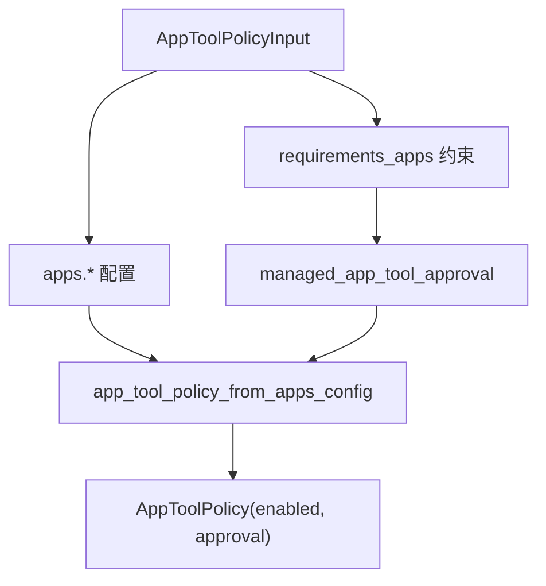

**图表来源**
- [connectors/src/app_tool_policy.rs:1-200](file://codex-rs/connectors/src/app_tool_policy.rs#L1-L200)

**章节来源**
- [connectors/src/app_tool_policy.rs:1-200](file://codex-rs/connectors/src/app_tool_policy.rs#L1-L200)

## 工作区账户与公共目录差异
Connector 系统对工作区账户和普通账户做了明确区分：

| 维度 | 公共目录 | 工作区目录 |
|---|---|---|
| 发现接口 | /connectors/directory/list | /connectors/directory/list_workspace |
| 并行请求 | 普通账户只请求公共目录 | 工作区账户并行请求公共与工作区目录 |
| 可见性过滤 | 过滤 visibility=HIDDEN | 同上，但来源独立 |
| 缓存键 | 包含 is_workspace_account=false | 包含 is_workspace_account=true |
| 运行时上下文 | personal(account_id, chatgpt_user_id) | workspace(account_id, chatgpt_user_id) |
| 元数据缓存作用域 | 按后端+账户+用户+工作区分隔 | 同样按作用域隔离 |

关键区别：
- 工作区目录与公共目录独立，不会互相覆盖。
- 工作区账户在发现阶段并发拉取两个来源，提升首屏速度。
- 运行时上下文 key 通过 is_workspace_account 区分，避免跨环境共享快照。
- 目录缓存路径通过 ConnectorDirectoryCacheKey 哈希，确保不同身份互不影响。

**章节来源**
- [connectors/src/lib.rs:120-250](file://codex-rs/connectors/src/lib.rs#L120-L250)
- [connectors/src/connector_runtime/mod.rs:1-200](file://codex-rs/connectors/src/connector_runtime/mod.rs#L1-L200)
- [connectors/src/directory_cache.rs:1-113](file://codex-rs/connectors/src/directory_cache.rs#L1-L113)

## 常见问题排查

| 问题现象 | 可能原因 | 排查建议 |
|---|---|---|
| 连接器未出现在建议列表 | 连接器已被 is_accessible 覆盖或候选集为空 | 检查 accessible_connectors 与 discoverable_connector_ids |
| 目录缓存不生效 | 磁盘 schema_version 变化或 JSON 损坏 | 查看缓存文件是否被删除，确认 schema_version |
| 元数据缺少工具摘要 | 服务端响应不完整或缓存保护逻辑跳过 | 确认 include_tools 参数与 commit 行为 |
| 连接器 enabled=false | apps 配置或 requirements 约束禁用 | 检查 AppsConfigToml.default 和 apps[id] |
| 连接器 callable=false | 工具策略拒绝或 model_visible=false | 检查 AppToolPolicyInput 与工具元数据 |
| 工作区连接器未出现 | 工作区目录接口未返回或 visibility=HIDDEN | 检查工作区接口返回值与 visibility 字段 |
| 运行时快照未更新 | tools_version 未变化或快照未发布 | 检查 ConnectorRuntimeSnapshot.tools_version 与 watch 通道 |

**章节来源**
- [connectors/src/filter.rs:1-80](file://codex-rs/connectors/src/filter.rs#L1-L80)
- [connectors/src/directory_cache.rs:1-113](file://codex-rs/connectors/src/directory_cache.rs#L1-L113)
- [connectors/src/metadata_store.rs:1-144](file://codex-rs/connectors/src/metadata_store.rs#L1-L144)
- [connectors/src/runtime_projection.rs:1-103](file://codex-rs/connectors/src/runtime_projection.rs#L1-L103)
- [connectors/src/app_tool_policy.rs:1-200](file://codex-rs/connectors/src/app_tool_policy.rs#L1-L200)

## 结论
Connector 系统在 Codex CLI 中承担了连接器发现、合并、品牌化、运行时投影和政策评估的关键职责。其设计强调：
- 明确的职责分层：发现、合并、运行时、缓存、政策各自独立。
- 严格的身份隔离：工作区与个人账户在目录、缓存、运行时上下文中完全分离。
- 稳健的缓存策略：内存、磁盘、元数据、运行时快照共同保障性能与一致性。
- 可扩展的插件生态：通过插件声明与快照机制，支持多来源连接器贡献。
- 安全的政策控制：应用级与工具级策略共同决定启用与审批行为。

对于 Connector 开发者，建议优先关注 connector_id 稳定性、AppInfo 完整性、MCP 工具元数据准确性，以及插件配置的规范性。对于系统集成者，应充分利用 InstalledConnectorRuntime 和 AppToolPolicyEvaluator，确保连接器在 UI 和工具调用链中表现一致。