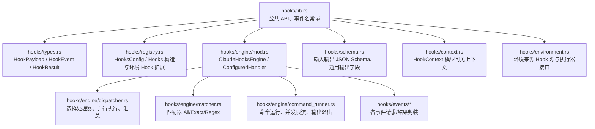
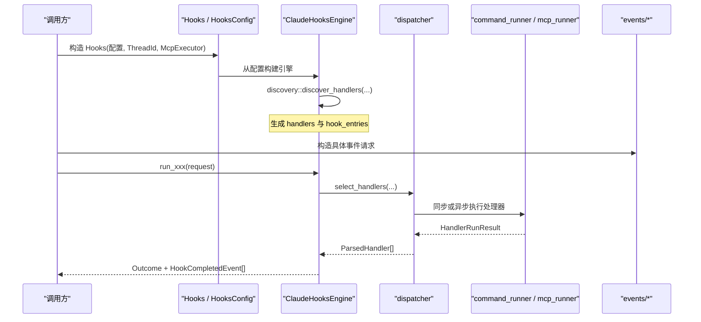
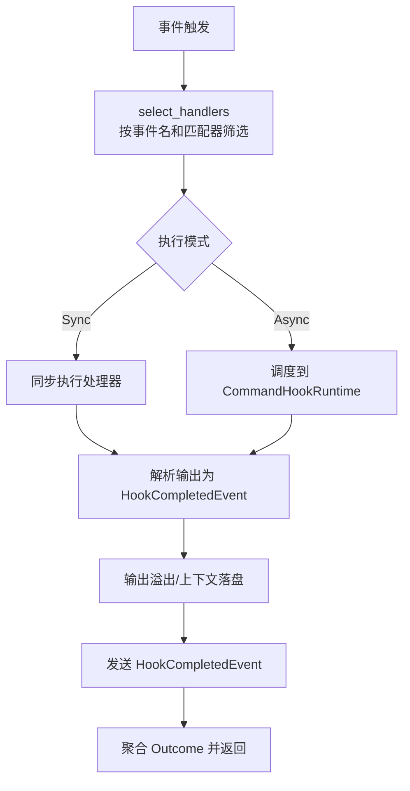
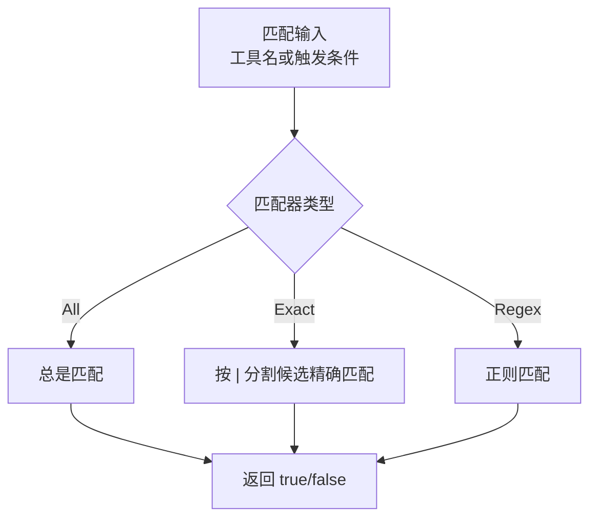
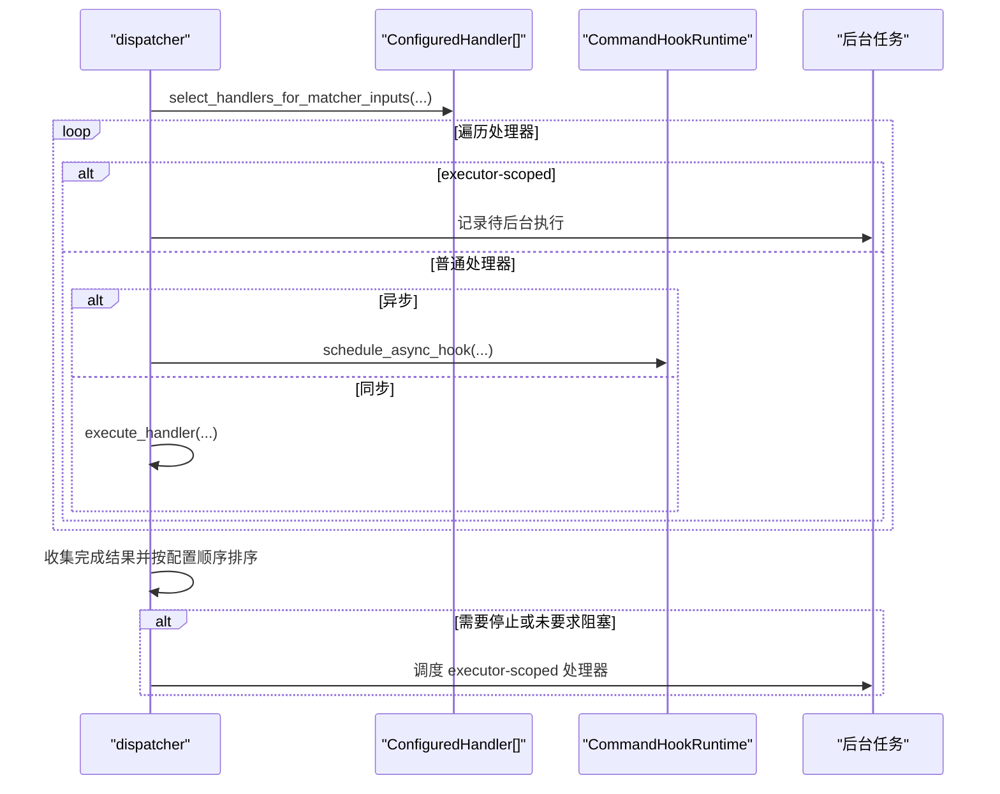
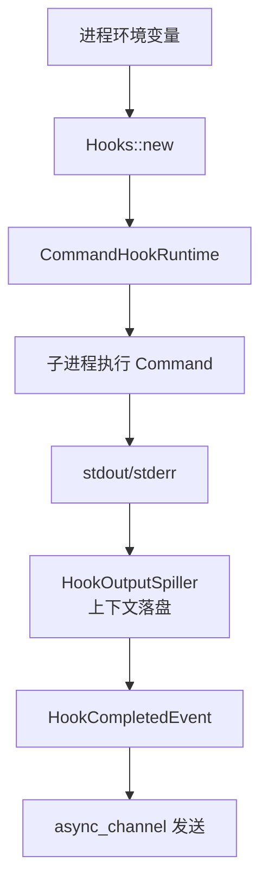
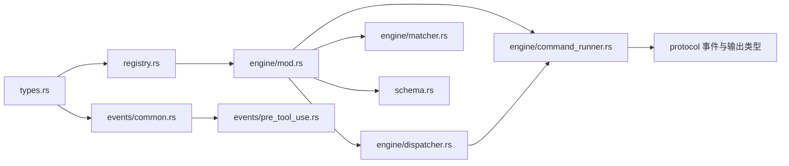

# Hook 基础概念

<cite>
**本文引用的文件**   
- [hooks/lib.rs](file://codex-rs/hooks/src/lib.rs)
- [hooks/types.rs](file://codex-rs/hooks/src/types.rs)
- [hooks/registry.rs](file://codex-rs/hooks/src/registry.rs)
- [hooks/schema.rs](file://codex-rs/hooks/src/schema.rs)
- [hooks/context.rs](file://codex-rs/hooks/src/context.rs)
- [hooks/environment.rs](file://codex-rs/hooks/src/environment.rs)
- [hooks/engine/mod.rs](file://codex-rs/hooks/src/engine/mod.rs)
- [hooks/engine/dispatcher.rs](file://codex-rs/hooks/src/engine/dispatcher.rs)
- [hooks/engine/matcher.rs](file://codex-rs/hooks/src/engine/matcher.rs)
- [hooks/engine/command_runner.rs](file://codex-rs/hooks/src/engine/command_runner.rs)
- [hooks/events/common.rs](file://codex-rs/hooks/src/events/common.rs)
- [hooks/events/pre_tool_use.rs](file://codex-rs/hooks/src/events/pre_tool_use.rs)
</cite>

## 目录
1. [引言](#引言)
2. [项目结构](#项目结构)
3. [核心组件](#核心组件)
4. [架构总览](#架构总览)
5. [详细组件分析](#详细组件分析)
6. [依赖关系分析](#依赖关系分析)
7. [性能考虑](#性能考虑)
8. [故障排查指南](#故障排查指南)
9. [结论](#结论)
10. [附录：Hook 实现示例与最佳实践](#附录hook-实现示例与最佳实践)

## 引言
本文面向 Codex CLI Hook 机制的基础概念，聚焦 Hook 系统的设计思想、执行模型、数据结构、注册与匹配规则、调度流程、配置语法、环境变量注入、输出处理、状态管理、错误处理和回滚机制。目标是让读者既能理解 Hook 在 Codex 中的整体定位，又能掌握如何编写简单可靠的 Hook 函数并正确理解其生命周期和结果语义。

Hook 的核心思想是“事件驱动的可插拔扩展点”。Codex 在会话、工具调用、压缩、用户提交提示词等关键阶段触发 Hook 事件；每个事件可匹配多个处理器（Command 或 MCP Tool），由引擎统一调度、超时控制、并发限制、输出落盘与状态上报。

## 项目结构
Hook 相关代码集中在 `codex-rs/hooks` 模块中，采用“类型定义 + 注册表 + 引擎调度 + 事件适配”的分层组织方式：

**图示来源**
- [hooks/lib.rs:1-139](file://codex-rs/hooks/src/lib.rs#L1-L139)
- [hooks/types.rs:1-152](file://codex-rs/hooks/src/types.rs#L1-L152)
- [hooks/registry.rs:1-200](file://codex-rs/hooks/src/registry.rs#L1-L200)
- [hooks/engine/mod.rs:1-200](file://codex-rs/hooks/src/engine/mod.rs#L1-L200)
- [hooks/engine/dispatcher.rs:1-200](file://codex-rs/hooks/src/engine/dispatcher.rs#L1-L200)
- [hooks/engine/matcher.rs:1-49](file://codex-rs/hooks/src/engine/matcher.rs#L1-L49)
- [hooks/engine/command_runner.rs:1-200](file://codex-rs/hooks/src/engine/command_runner.rs#L1-L200)
- [hooks/schema.rs:1-200](file://codex-rs/hooks/src/schema.rs#L1-L200)
- [hooks/context.rs:1-18](file://codex-rs/hooks/src/context.rs#L1-L18)
- [hooks/environment.rs:1-35](file://codex-rs/hooks/src/environment.rs#L1-L35)

**章节来源**
- [hooks/lib.rs:1-139](file://codex-rs/hooks/src/lib.rs#L1-L139)

## 核心组件
本节概述 Hook 系统中最关键的类型和职责边界。

### Hook 基本数据类型
- `HookFn`：异步 Hook 函数签名，接收 `&HookPayload`，返回 `BoxFuture<'_, HookResult>`。
- `HookResult`：三种结果语义：
  - `Success`：成功完成。
  - `FailedContinue`：失败但允许后续 Hook 继续执行。
  - `FailedAbort`：失败且应中止操作。
- `HookResponse`：包装 Hook 名称与其执行结果。
- `Hook`：轻量级 Hook 对象，包含名称与函数，提供 `execute` 方法。
- `HookPayload`：Hook 运行时上下文负载，包含会话 ID、当前工作目录、可选客户端标识、触发时间戳、以及具体 Hook 事件。
- `HookEvent`：目前公开为通用事件枚举，用于序列化负载中的事件标签。

这些类型定义了 Hook 的“输入-处理-输出”契约，是上层事件适配器和调度器的共同基础。

**章节来源**
- [hooks/types.rs:1-152](file://codex-rs/hooks/src/types.rs#L1-L152)

### Hook 配置与注册
- `HooksConfig`：描述 Hook 功能开关、是否绕过信任检查、Shell 程序与参数、插件 Hook 源、配置层栈等。
- `Hooks`：会话级 Hook 运行时容器，负责：
  - 从配置构建引擎。
  - 保留 legacy notify 钩子。
  - 添加“环境来源 Hook”（Environment Hook）。
  - 暴露 `list_hooks`、`list_with_environment_hooks` 等列表能力。
  - 支持配置刷新时复用已运行的后台任务。
- `HookListOutcome`：列出 Hook 条目及发现阶段的警告信息。

注册过程并非直接把字符串命令绑定到事件，而是通过“声明 → 解析 → 构建 `ConfiguredHandler` → 加入引擎处理器列表”的流程完成。

**章节来源**
- [hooks/registry.rs:1-200](file://codex-rs/hooks/src/registry.rs#L1-L200)

### 引擎与处理器
- `ClaudeHooksEngine`：引擎核心，持有：
  - 是否启用 Hook。
  - 当前处理器列表 `handlers`。
  - 供 UI/遥测展示的 `hook_entries`。
  - 命令运行期 `CommandHookRuntime`。
  - MCP 执行器 `HookMcpExecutor`。
- `ConfiguredHandler`：已配置的处理器，包含事件名、匹配器、超时、状态消息、附加上下文限制、来源路径、来源分类、显示顺序、处理器种类（Command/MCP Tool）等。
- `HookListEntry`：对外暴露的 Hook 清单项，包括键、事件名、处理器信息、匹配器、超时、来源、信任状态、是否托管、哈希值等。

**章节来源**
- [hooks/engine/mod.rs:1-200](file://codex-rs/hooks/src/engine/mod.rs#L1-L200)
- [hooks/engine/mod.rs:200-571](file://codex-rs/hooks/src/engine/mod.rs#L200-L571)

## 架构总览
下图展示 Hook 系统从“配置与声明”到“事件调度与执行”的整体流程：

**图示来源**
- [hooks/registry.rs:1-200](file://codex-rs/hooks/src/registry.rs#L1-L200)
- [hooks/engine/mod.rs:1-200](file://codex-rs/hooks/src/engine/mod.rs#L1-L200)
- [hooks/engine/dispatcher.rs:1-200](file://codex-rs/hooks/src/engine/dispatcher.rs#L1-L200)
- [hooks/engine/command_runner.rs:1-200](file://codex-rs/hooks/src/engine/command_runner.rs#L1-L200)

## 详细组件分析

### Hook 生命周期与执行模型
Hook 的生命周期大致分为以下阶段：

1. **声明与发现**：通过配置文件、插件源或环境来源声明 Hook。引擎在启动时解析这些声明，构建 `ConfiguredHandler` 列表。
2. **匹配阶段**：当某个事件发生时，调度器根据事件名和匹配器筛选处理器。
3. **调度阶段**：根据处理器的执行模式决定同步执行还是异步调度；非 executor-scoped 的处理器按声明顺序进入等待队列。
4. **执行阶段**：Command 处理器通过 Shell 进程执行，MCP Tool 处理器通过 MCP 执行器调用。
5. **结果解析阶段**：将命令输出或 MCP 响应解析为 `HookCompletedEvent` 和领域特定的 Outcome。
6. **输出处理阶段**：上下文输出可能被写入额外文件；警告和错误被合并到事件条目中。
7. **上报阶段**：通过 `async_channel` 发送 `HookCompletedEvent`，供 TUI、历史、遥测消费。

**图示来源**
- [hooks/engine/dispatcher.rs:1-200](file://codex-rs/hooks/src/engine/dispatcher.rs#L1-L200)
- [hooks/engine/command_runner.rs:1-200](file://codex-rs/hooks/src/engine/command_runner.rs#L1-L200)
- [hooks/events/common.rs:1-200](file://codex-rs/hooks/src/events/common.rs#L1-L200)

#### 执行顺序
- 同一事件的处理器按声明顺序（`display_order`）保持稳定。
- 异步处理器不阻塞同步处理器；最终结果按“完成顺序”记录，但对外报告仍按“配置顺序”排序。
- Executor-scoped 处理器在当前事件主流程结束后作为后台任务执行，不会阻塞主流程。

#### 上下文传递
- `HookPayload` 携带会话 ID、工作目录、触发时间戳、Hook 事件。
- 各事件适配器将更具体的业务数据（例如工具名、工具输入、权限模式、转储路径等）序列化为 JSON，通过标准输入传给 Command 处理器。
- `HookContext` 表示模型可见的 Hook 上下文，带有元数据，可用于追加给下游模型或审计。

**章节来源**
- [hooks/types.rs:1-152](file://codex-rs/hooks/src/types.rs#L1-L152)
- [hooks/context.rs:1-18](file://codex-rs/hooks/src/context.rs#L1-L18)
- [hooks/engine/dispatcher.rs:1-200](file://codex-rs/hooks/src/engine/dispatcher.rs#L1-L200)
- [hooks/engine/command_runner.rs:1-200](file://codex-rs/hooks/src/engine/command_runner.rs#L1-L200)
- [hooks/events/common.rs:1-200](file://codex-rs/hooks/src/events/common.rs#L1-L200)

### Hook 匹配规则
匹配器有三种形态：

- `All`：始终匹配。
- `Exact`：精确匹配，支持用竖线分隔多个候选值，如 `Write|Edit`。
- `Regex`：正则表达式匹配。

匹配发生在“选择处理器”阶段，不同事件对匹配器的使用方式不同：

- 对工具相关事件（`PreToolUse`、`PermissionRequest`、`PostToolUse`）、会话开始/结束、子代理开始/停止、压缩前后事件，匹配器会基于工具名或其别名集合进行匹配。
- 对 `PreModelRequest`、`PostModelRequest`、`UserPromptSubmit`、`Stop`、`Interrupt` 等事件，匹配器不参与筛选，所有同事件处理器都会被选中。

**图示来源**
- [hooks/engine/matcher.rs:1-49](file://codex-rs/hooks/src/engine/matcher.rs#L1-L49)
- [hooks/engine/dispatcher.rs:1-200](file://codex-rs/hooks/src/engine/dispatcher.rs#L1-L200)
- [hooks/events/common.rs:1-200](file://codex-rs/hooks/src/events/common.rs#L1-L200)

**章节来源**
- [hooks/engine/matcher.rs:1-49](file://codex-rs/hooks/src/engine/matcher.rs#L1-L49)
- [hooks/engine/dispatcher.rs:1-200](file://codex-rs/hooks/src/engine/dispatcher.rs#L1-L200)
- [hooks/events/common.rs:1-200](file://codex-rs/hooks/src/events/common.rs#L1-L200)

### Hook 调度流程
调度器负责：

1. 根据事件名和匹配输入选择处理器。
2. 将处理器分为两类：
   - 普通处理器：同步或异步执行，保持配置顺序。
   - executor-scoped 处理器：在主流程结束后作为后台任务执行。
3. 使用 `FuturesUnordered` 收集完成结果，并维护“完成顺序”，用于某些事件（如 `PreToolUse`）解决竞争更新。
4. 如果任何处理器标记为“停止”，或没有处理器要求“阻塞”，则立即调度 executor-scoped 处理器。

**图示来源**
- [hooks/engine/dispatcher.rs:1-200](file://codex-rs/hooks/src/engine/dispatcher.rs#L1-L200)
- [hooks/engine/command_runner.rs:1-200](file://codex-rs/hooks/src/engine/command_runner.rs#L1-L200)

**章节来源**
- [hooks/engine/dispatcher.rs:1-200](file://codex-rs/hooks/src/engine/dispatcher.rs#L1-L200)

### Hook 配置语法与通用输出
Hook 的输入输出遵循 JSON Schema，并通过 `schema.rs` 中的 wire 类型描述。每个事件有独立的输入结构和输出结构，但共享一组通用输出字段：

- `continue`：是否允许继续。
- `stop_reason`：停止原因。
- `suppress_output`：是否抑制输出。
- `system_message`：系统消息。

此外，各事件还有专属字段，例如 `PreToolUse` 的输出包含决策、原因和特定 Hook 输出；`PermissionRequest` 的输出包含决策和事件名等。

对于 Command 处理器，输入通过标准输入传入，输出通过标准输出解析；对于 MCP Tool 处理器，输入以结构化 Map 形式传入 MCP 工具。

**章节来源**
- [hooks/schema.rs:1-200](file://codex-rs/hooks/src/schema.rs#L1-L200)

### 环境变量注入与输出处理
- `Hooks::new` 在构造时捕获进程环境变量快照，并将其传递给命令运行期。
- `CommandHookRuntime` 负责：
  - 创建命令进程。
  - 限制并发异步 Hook 数量。
  - 将输出中的“上下文”内容写入额外文件，避免阻塞主输出。
  - 将警告和错误合并到 Hook 输出条目。
  - 通过通道发送 `HookCompletedEvent`。
- 环境来源 Hook（Environment Hook）通过 `EnvironmentHookSource` 和 `HookEnvironmentExecutor` 解耦执行环境，允许由受信任的环境所有者注入 Hook，而不是直接来自用户配置。

**图示来源**
- [hooks/registry.rs:1-200](file://codex-rs/hooks/src/registry.rs#L1-L200)
- [hooks/engine/command_runner.rs:1-200](file://codex-rs/hooks/src/engine/command_runner.rs#L1-L200)
- [hooks/environment.rs:1-35](file://codex-rs/hooks/src/environment.rs#L1-L35)

**章节来源**
- [hooks/registry.rs:1-200](file://codex-rs/hooks/src/registry.rs#L1-L200)
- [hooks/engine/command_runner.rs:1-200](file://codex-rs/hooks/src/engine/command_runner.rs#L1-L200)
- [hooks/environment.rs:1-35](file://codex-rs/hooks/src/environment.rs#L1-L35)

### 状态管理与错误处理
- `HookResult` 明确区分“继续失败”和“中止失败”，调用方可据此决定是否终止整个操作。
- 调度器根据处理器返回的状态设置 Hook 运行摘要的 `status`，并记录持续时间、退出码、标准输出、标准错误和错误信息。
- 序列化失败时，`common.rs` 提供辅助函数生成失败的 `HookCompletedEvent`，确保 Hook 执行即使出错也能产生可观测的记录。
- 引擎在禁用 Hook 时仅保留内置处理器，并清空警告与必需加载错误，以避免普通 Hook 不可用时阻断会话启动。
- executor-scoped 处理器失败时通过日志警告记录，而不直接中断主流程。

**章节来源**
- [hooks/types.rs:1-152](file://codex-rs/hooks/src/types.rs#L1-L152)
- [hooks/engine/dispatcher.rs:200-683](file://codex-rs/hooks/src/engine/dispatcher.rs#L200-L683)
- [hooks/events/common.rs:1-200](file://codex-rs/hooks/src/events/common.rs#L1-L200)
- [hooks/engine/mod.rs:200-571](file://codex-rs/hooks/src/engine/mod.rs#L200-L571)

### 回滚机制说明
当前 Hook 系统并没有统一的“自动回滚”语义。它主要通过以下方式控制副作用：

- `PreToolUse` 可通过阻止工具调用、修改工具输入、追加模型上下文等方式影响后续行为。
- `PermissionRequest` 可表达拒绝或允许决策。
- `HookResult::FailedAbort` 可让调用方中止外层操作。
- 对工具调用的重写以“最后完成的处理器”为准，用于解决多个处理器同时改写输入时的竞争。

因此，“回滚”通常应由 Hook 自身实现幂等补偿逻辑，或由上层调用方根据 Outcome 决定是否撤销变更。

**章节来源**
- [hooks/events/pre_tool_use.rs:1-200](file://codex-rs/hooks/src/events/pre_tool_use.rs#L1-L200)
- [hooks/types.rs:1-152](file://codex-rs/hooks/src/types.rs#L1-L152)

## 依赖关系分析
Hook 模块内部依赖关系如下：

**图示来源**
- [hooks/types.rs:1-152](file://codex-rs/hooks/src/types.rs#L1-L152)
- [hooks/registry.rs:1-200](file://codex-rs/hooks/src/registry.rs#L1-L200)
- [hooks/engine/mod.rs:1-200](file://codex-rs/hooks/src/engine/mod.rs#L1-L200)
- [hooks/engine/dispatcher.rs:1-200](file://codex-rs/hooks/src/engine/dispatcher.rs#L1-L200)
- [hooks/engine/matcher.rs:1-49](file://codex-rs/hooks/src/engine/matcher.rs#L1-L49)
- [hooks/engine/command_runner.rs:1-200](file://codex-rs/hooks/src/engine/command_runner.rs#L1-L200)
- [hooks/events/common.rs:1-200](file://codex-rs/hooks/src/events/common.rs#L1-L200)
- [hooks/events/pre_tool_use.rs:1-200](file://codex-rs/hooks/src/events/pre_tool_use.rs#L1-L200)

**章节来源**
- [hooks/engine/mod.rs:1-200](file://codex-rs/hooks/src/engine/mod.rs#L1-L200)
- [hooks/engine/dispatcher.rs:1-200](file://codex-rs/hooks/src/engine/dispatcher.rs#L1-L200)

## 性能考虑
- **并发限制**：异步 Hook 最大并发数为固定上限，防止大量外部命令同时启动拖慢系统。
- **异步优先**：异步处理器不会阻塞主流程，适合耗时较长的监控、审计或通知类任务。
- **输出溢出**：大体积上下文输出会被溢出到额外文件，避免阻塞标准输出通道。
- **处理器选择优化**：匹配器在发现阶段编译，调度阶段只做快速匹配；重复匹配别名只计算一次，避免重复触发。
- **executor-scoped 处理器隔离**：这类处理器默认异步执行，避免影响用户可见的 Hook 生命周期和摘要。

建议：
- 将长耗时任务设为异步。
- 避免在同步 Hook 中执行重型 I/O。
- 合理使用匹配器，减少无关处理器参与。
- 对可能产生大量输出的 Hook 使用上下文溢出机制。

**章节来源**
- [hooks/engine/command_runner.rs:1-200](file://codex-rs/hooks/src/engine/command_runner.rs#L1-L200)
- [hooks/engine/dispatcher.rs:1-200](file://codex-rs/hooks/src/engine/dispatcher.rs#L1-L200)
- [hooks/engine/matcher.rs:1-49](file://codex-rs/hooks/src/engine/matcher.rs#L1-L49)

## 故障排查指南
常见问题与定位思路：

1. **Hook 未触发**
   - 检查事件名是否正确。
   - 检查匹配器是否与工具名或触发条件匹配。
   - 确认 Hook 未被禁用或信任检查失败。

2. **Hook 执行超时**
   - 查看 `timeout_sec` 配置。
   - 检查命令是否卡住或等待交互式输入。
   - 观察 `HookCompletedEvent` 中的退出码和标准错误。

3. **Hook 输出过大导致阻塞**
   - 检查是否产生大量上下文输出。
   - 确认输出溢出是否正常工作。
   - 调整 `additional_context_limit` 限制。

4. **Hook 失败但未中止**
   - 确认返回的是 `FailedContinue` 而非 `FailedAbort`。
   - 检查上层调用方是否根据 `should_abort_operation` 决定是否继续。

5. **配置刷新后行为不一致**
   - 注意 `reconfigured` 会复用已运行的后台任务。
   - 检查 executor-scoped 处理器是否在刷新后被替换。

**章节来源**
- [hooks/types.rs:1-152](file://codex-rs/hooks/src/types.rs#L1-L152)
- [hooks/engine/dispatcher.rs:200-683](file://codex-rs/hooks/src/engine/dispatcher.rs#L200-L683)
- [hooks/engine/command_runner.rs:1-200](file://codex-rs/hooks/src/engine/command_runner.rs#L1-L200)
- [hooks/registry.rs:1-200](file://codex-rs/hooks/src/registry.rs#L1-L200)

## 结论
Codex Hook 系统是一个以事件为中心、支持多种处理器类型、具备匹配规则、并发控制和输出管理的可扩展机制。它通过清晰的类型契约、稳定的执行顺序和完善的输出上报，使 Hook 既能做轻量拦截，也能承载复杂的外部集成。编写可靠 Hook 的关键在于理解事件语义、正确使用匹配器、合理选择同步或异步执行、正确处理结果语义，并谨慎管理副作用。

## 附录：Hook 实现示例与最佳实践

### 如何实现一个简单的 Hook 函数
- 使用 `HookFn` 定义一个异步函数，接收 `&HookPayload`。
- 返回 `HookResult`：
  - 正常完成返回 `Success`。
  - 可恢复错误返回 `FailedContinue`。
  - 严重错误返回 `FailedAbort`。
- 将函数包装进 `Hook`，并通过注册机制加入引擎。

参考路径：
- [hooks/types.rs:1-152](file://codex-rs/hooks/src/types.rs#L1-L152)

### 如何处理不同类型的结果
- 如果只需要记录日志，可使用 `FailedContinue`。
- 如果需要阻止后续流程，应使用 `FailedAbort`。
- 对于工具调用前的拦截，优先通过 `PreToolUse` 的 Outcome 控制是否阻止、是否修改输入、是否追加上下文。

参考路径：
- [hooks/types.rs:1-152](file://codex-rs/hooks/src/types.rs#L1-L152)
- [hooks/events/pre_tool_use.rs:1-200](file://codex-rs/hooks/src/events/pre_tool_use.rs#L1-L200)

### 最佳实践
- 使用明确的匹配器，避免过度宽泛的正则。
- 将耗时任务设为异步。
- 对可能产生大输出的 Hook 使用上下文溢出。
- 在 `PreToolUse` 中尽量保持幂等，避免多次重写输入造成不确定行为。
- 对敏感 Hook 启用信任检查，或通过环境来源 Hook 由可信环境注入。

[本附录为概念性指导，不直接分析具体代码行]