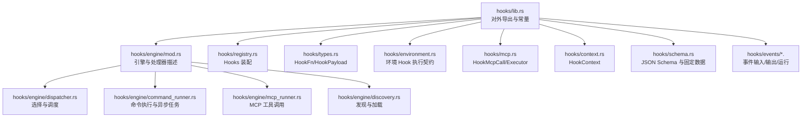
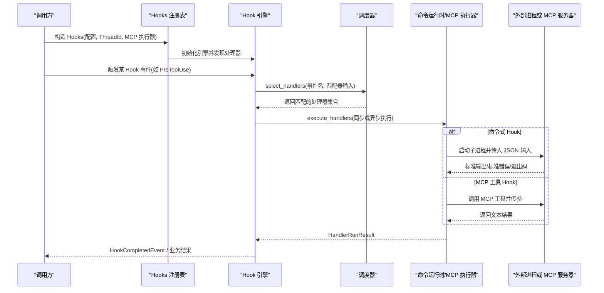
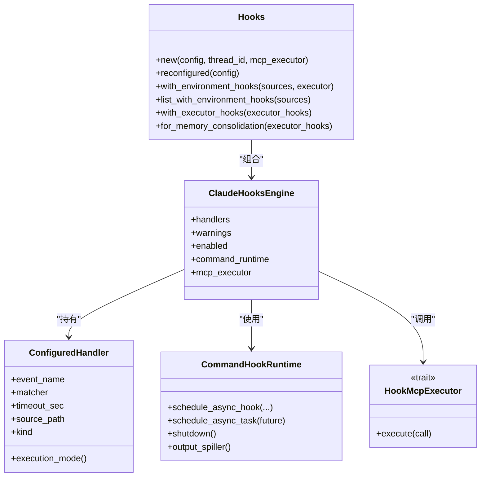

# Hook 开发指南

<cite>
**本文引用的文件**   
- [codex-rs/hooks/src/lib.rs](file://codex-rs/hooks/src/lib.rs)
- [codex-rs/hooks/src/engine/mod.rs](file://codex-rs/hooks/src/engine/mod.rs)
- [codex-rs/hooks/src/engine/dispatcher.rs](file://codex-rs/hooks/src/engine/dispatcher.rs)
- [codex-rs/hooks/src/engine/command_runner.rs](file://codex-rs/hooks/src/engine/command_runner.rs)
- [codex-rs/hooks/src/engine/mcp_runner.rs](file://codex-rs/hooks/src/engine/mcp_runner.rs)
- [codex-rs/hooks/src/engine/discovery.rs](file://codex-rs/hooks/src/engine/discovery.rs)
- [codex-rs/hooks/src/registry.rs](file://codex-rs/hooks/src/registry.rs)
- [codex-rs/hooks/src/types.rs](file://codex-rs/hooks/src/types.rs)
- [codex-rs/hooks/src/environment.rs](file://codex-rs/hooks/src/environment.rs)
- [codex-rs/hooks/src/mcp.rs](file://codex-rs/hooks/src/mcp.rs)
- [codex-rs/hooks/src/context.rs](file://codex-rs/hooks/src/context.rs)
- [codex-rs/hooks/src/schema.rs](file://codex-rs/hooks/src/schema.rs)
- [codex-rs/hooks/src/events/common.rs](file://codex-rs/hooks/src/events/common.rs)
- [codex-rs/hooks/src/events/pre_tool_use.rs](file://codex-rs/hooks/src/events/pre_tool_use.rs)
- [codex-rs/hooks/src/events/session_start.rs](file://codex-rs/hooks/src/events/session_start.rs)
- [codex-rs/hooks/src/events/permission_request.rs](file://codex-rs/hooks/src/events/permission_request.rs)
</cite>

## 目录
1. [引言](#引言)
2. [项目结构](#项目结构)
3. [核心组件](#核心组件)
4. [架构总览](#架构总览)
5. [详细组件分析](#详细组件分析)
6. [依赖关系分析](#依赖关系分析)
7. [性能与并发特性](#性能与并发特性)
8. [调试与测试方法](#调试与测试方法)
9. [错误处理、日志与监控](#错误处理日志与监控)
10. [环境变量、工作目录与资源访问](#环境变量工作目录与资源访问)
11. [Hook 开发模板与最佳实践](#hook-开发模板与最佳实践)
12. [常见问题与排障](#常见问题与排障)
13. [打包、发布与分发](#打包发布与分发)
14. [结论](#结论)

## 引言
本指南面向 Codex CLI Hook 开发者，说明如何在当前代码库中理解、实现、调试和测试 Hook。Hook 是 Codex 在执行模型请求、工具调用、权限审批、会话生命周期等关键路径时触发的扩展点。Codex 的 Hook 系统支持：
- 同步命令式 Hook
- 异步命令式 Hook
- MCP（Model Context Protocol）工具 Hook
- 环境绑定 Hook
- 执行器作用域 Hook

本文从仓库源码出发，给出体系化说明，包括 Hook 发现、匹配、调度、执行、输出解析、MCP 集成、状态持久键、事件负载结构、以及开发与运维注意事项。

## 项目结构
Hook 相关代码集中在 `codex-rs/hooks` 包中，采用按职责分层的 Rust crate 组织方式：
- `lib.rs`：对外导出 Hook 类型、事件名称、Hook 列表结果、上下文等公共 API。
- `engine/`：Hook 引擎核心，包含发现、匹配、调度、命令执行、MCP 执行、输出解析、信任与指纹等。
- `events/`：具体 Hook 事件的输入、输出、预览和运行逻辑。
- `schema.rs`：生成各事件 JSON Schema 及 fixture，约束 Hook 标准输入输出。
- `environment.rs`：描述“环境 Hook”的执行契约。
- `mcp.rs`：定义 Hook 调用的 MCP 抽象。
- `registry.rs`：组装 Hooks 配置、注册引擎、暴露列出 Hook 的能力。
- `types.rs`：通用 Hook 函数签名、负载、响应等基础类型。
- `context.rs`：模型可见的 Hook 上下文包装。

图表来源
- [codex-rs/hooks/src/lib.rs:1-139](file://codex-rs/hooks/src/lib.rs#L1-L139)
- [codex-rs/hooks/src/engine/mod.rs:1-200](file://codex-rs/hooks/src/engine/mod.rs#L1-L200)
- [codex-rs/hooks/src/engine/dispatcher.rs:1-200](file://codex-rs/hooks/src/engine/dispatcher.rs#L1-L200)
- [codex-rs/hooks/src/engine/command_runner.rs:1-200](file://codex-rs/hooks/src/engine/command_runner.rs#L1-L200)
- [codex-rs/hooks/src/engine/mcp_runner.rs:1-183](file://codex-rs/hooks/src/engine/mcp_runner.rs#L1-L183)
- [codex-rs/hooks/src/engine/discovery.rs:1-200](file://codex-rs/hooks/src/engine/discovery.rs#L1-L200)
- [codex-rs/hooks/src/registry.rs:1-200](file://codex-rs/hooks/src/registry.rs#L1-L200)

章节来源
- [codex-rs/hooks/src/lib.rs:1-139](file://codex-rs/hooks/src/lib.rs#L1-L139)

## 核心组件
- Hook 引擎：负责发现用户/插件/托管 Hook，构建处理器，根据事件名与匹配器选择处理器，并串行或异步执行。
- 命令运行时：封装外部进程启动、并发限制、超时、输出溢出控制、异步任务回收。
- MCP 执行器：将 Hook 配置中的 MCP 工具调用委托给上层 MCP 层执行，负责信任校验、参数展开、超时与元数据传递。
- 事件模块：为每个 Hook 事件定义输入结构、输出语义、预览摘要、运行流程与结果合并策略。
- 注册表：聚合配置、创建引擎、提供列出 Hook、追加环境 Hook、切换执行器 Hook 的能力。
- 类型与上下文：统一 Hook 函数签名、负载序列化、Hook 完成事件、Hook 上下文包装。

章节来源
- [codex-rs/hooks/src/engine/mod.rs:1-200](file://codex-rs/hooks/src/engine/mod.rs#L1-L200)
- [codex-rs/hooks/src/engine/command_runner.rs:1-200](file://codex-rs/hooks/src/engine/command_runner.rs#L1-L200)
- [codex-rs/hooks/src/engine/mcp_runner.rs:1-183](file://codex-rs/hooks/src/engine/mcp_runner.rs#L1-L183)
- [codex-rs/hooks/src/events/common.rs:1-200](file://codex-rs/hooks/src/events/common.rs#L1-L200)
- [codex-rs/hooks/src/registry.rs:1-200](file://codex-rs/hooks/src/registry.rs#L1-L200)
- [codex-rs/hooks/src/types.rs:1-152](file://codex-rs/hooks/src/types.rs#L1-L152)
- [codex-rs/hooks/src/context.rs:1-18](file://codex-rs/hooks/src/context.rs#L1-L18)

## 架构总览
Hook 的执行流程由“事件驱动 + 处理器选择 + 调度执行”构成。

图表来源
- [codex-rs/hooks/src/registry.rs:1-200](file://codex-rs/hooks/src/registry.rs#L1-L200)
- [codex-rs/hooks/src/engine/dispatcher.rs:1-200](file://codex-rs/hooks/src/engine/dispatcher.rs#L1-L200)
- [codex-rs/hooks/src/engine/command_runner.rs:1-200](file://codex-rs/hooks/src/engine/command_runner.rs#L1-L200)
- [codex-rs/hooks/src/engine/mcp_runner.rs:1-183](file://codex-rs/hooks/src/engine/mcp_runner.rs#L1-L183)

## 详细组件分析

### Hook 处理器与执行模式
Hook 处理器通过 `ConfiguredHandler` 表示，包含事件名、匹配器、超时、状态消息、上下文限制、来源路径、来源、显示顺序和执行类别。执行类别分为：
- 命令式：`Command { command, env, async }`
- MCP 工具：`McpTool { server, tool, input }`

来源路径分为：
- 本地路径
- 环境路径：携带环境 ID、工作目录、源路径；在构造事件输入时会注入 `cwd` 并隐藏控制器拥有的转录路径。
- 执行器作用域：用于内部策略和清理钩子，总是异步执行，不进入用户可见的 Hook 汇总。

执行模式由来源路径和处理器的 `async` 标志决定：
- 执行器作用域处理器始终为异步。
- 命令式处理器若标记 `async=true`，则为异步。
- 其余为同步。

章节来源
- [codex-rs/hooks/src/engine/mod.rs:1-200](file://codex-rs/hooks/src/engine/mod.rs#L1-L200)

### 处理器选择与调度
调度器根据事件名和匹配器输入筛选处理器：
- 对部分事件使用匹配器过滤，例如工具前/后、权限请求、会话开始/结束、子代理开始/停止、压缩前后。
- 对其他事件直接全部匹配，例如模型请求前/后、用户提示提交、停止、中断。
- 同一处理器在一次工具调用中只执行一次，即使多个别名匹配。

调度器会区分两类处理器：
- 普通处理器：参与阻塞/阻止判断，并进入正常完成排序。
- 执行器作用域处理器：不参与主流程阻断，而是在主流程结束后作为后台任务执行，失败时记录警告。

章节来源
- [codex-rs/hooks/src/engine/dispatcher.rs:1-200](file://codex-rs/hooks/src/engine/dispatcher.rs#L1-L200)

### 命令式 Hook 执行
命令式 Hook 通过 `CommandHookRuntime` 管理：
- 并发限制：最多同时运行 8 个异步 Hook。
- 异步任务池：使用 JoinSet 管理，并在关闭时中止所有任务。
- 输出溢出：超出上下文限制的 Hook 上下文会被溢出到文件，避免内存膨胀。
- 结果通道：通过异步通道向调用方发送 `HookCompletedEvent`。

命令执行细节包括：
- Unix 上使用 PTY 能力，Windows 上结合 JobObject 和平台特定选项。
- 可配置 shell 程序与参数。
- 非继承环境变量过滤。
- 标准输出/标准错误收集。
- 退出码与错误字符串记录。

章节来源
- [codex-rs/hooks/src/engine/command_runner.rs:1-200](file://codex-rs/hooks/src/engine/command_runner.rs#L1-L200)

### MCP 工具 Hook 执行
MCP 工具 Hook 通过 `run_mcp_tool` 执行：
- 如果处理器带有插件信任信息，先进行信任验证，并扣除已消耗时间以保留整体超时预算。
- 从 Hook 事件值展开参数模板，支持对象、数组、字符串嵌套替换。
- 根据来源路径决定 environment_id 和 metadata：
  - 本地来源：无 environment_id，无额外 metadata。
  - 环境来源：使用环境 ID。
  - 执行器作用域来源：优先使用 MCP 环境 ID，否则回退到环境 ID；可附加 MCP metadata。
- 调用上层 `HookMcpExecutor.execute`，将文本结果转换为命令式 Hook 的输出语义。

参数模板展开规则：
- `${field.nested}` 占位符从 Hook 事件 JSON 中取值。
- 完整占位符保持原始 JSON 类型。
- 混合文本中的占位符最终转为字符串。
- 缺失字段会报错，不会把未解析的值传给远端。

章节来源
- [codex-rs/hooks/src/engine/mcp_runner.rs:1-183](file://codex-rs/hooks/src/engine/mcp_runner.rs#L1-L183)

### 事件系统与典型事件

#### 工具使用前 Hook
- 输入包含会话 ID、轮次 ID、工具名、工具输入、模型、权限模式、转录路径、工作目录等。
- 输出可以决定是否阻止工具调用、设置阻止原因、提供模型附加上下文、改写工具输入。
- 若有多个处理器改写输入，最终采用最后完成的改写结果。

章节来源
- [codex-rs/hooks/src/events/pre_tool_use.rs:1-200](file://codex-rs/hooks/src/events/pre_tool_use.rs#L1-L200)

#### 权限请求 Hook
- 在监护人或用户审批 UI 之前执行。
- 处理器可返回允许、拒绝或不决策。
- 合并策略保守：任意拒绝即拒绝；否则取最高优先级的允许。

章节来源
- [codex-rs/hooks/src/events/permission_request.rs:1-200](file://codex-rs/hooks/src/events/permission_request.rs#L1-L200)

#### 会话开始 Hook
- 支持会话启动、恢复、清空、压缩、分支等多种来源。
- 也支持子代理启动场景。
- 输出可决定是否停止会话并提供停止原因，也可提供模型附加上下文。

章节来源
- [codex-rs/hooks/src/events/session_start.rs:1-200](file://codex-rs/hooks/src/events/session_start.rs#L1-L200)

#### 公共事件辅助
- 提供匹配器模式提取、匹配器输入构造、Hook 完成事件序列化和工具调用关联等公共能力。

章节来源
- [codex-rs/hooks/src/events/common.rs:1-200](file://codex-rs/hooks/src/events/common.rs#L1-L200)

### Hook 发现与配置加载
Hook 发现从配置层栈和插件源加载：
- 支持托管要求、用户配置、项目配置、插件配置。
- 支持 JSON 与 TOML 两种 Hook 配置形式。
- 对同时存在 JSON 和 TOML 的情况发出警告，建议单一表示。
- 根据配置层栈计算 Hook 状态，受策略控制是否仅允许托管 Hook。
- 对必需托管 Hook 的加载失败进行报告，并在注册阶段强制检查。

章节来源
- [codex-rs/hooks/src/engine/discovery.rs:1-200](file://codex-rs/hooks/src/engine/discovery.rs#L1-L200)

### 注册表与生命周期
`Hooks` 负责：
- 根据配置创建引擎。
- 保存线程级环境快照。
- 创建异步通道接收 Hook 完成事件。
- 追加环境 Hook 和执行器 Hook。
- 列出 Hook 清单，包括未启用或未信任的处理器。
- 为记忆整理场景过滤出仅用于内部策略和清理的处理器。

章节来源
- [codex-rs/hooks/src/registry.rs:1-200](file://codex-rs/hooks/src/registry.rs#L1-L200)

### Hook 类型与负载
- `HookFn` 是统一的异步函数签名，接收 `HookPayload` 并返回 `HookResult`。
- `HookResult` 支持成功、继续失败、中止失败三种语义。
- `HookPayload` 包含会话 ID、工作目录、客户端标识、触发时间和 Hook 事件。
- `HookContext` 是模型可见的 Hook 上下文包装，包含文本与内容元数据。

章节来源
- [codex-rs/hooks/src/types.rs:1-152](file://codex-rs/hooks/src/types.rs#L1-L152)
- [codex-rs/hooks/src/context.rs:1-18](file://codex-rs/hooks/src/context.rs#L1-L18)

### 环境 Hook 与 MCP 抽象
- 环境 Hook 由 `EnvironmentHookSource` 描述，绑定环境 ID、工作目录和 Hook 配置。
- `HookEnvironmentExecutor` 是环境 Hook 的执行契约，必须遵守超时、终止超时进程、限制捕获输出。
- MCP Hook 抽象由 `HookMcpCall` 和 `HookMcpExecutor` 组成，隔离 Hook 引擎与 MCP 层的具体实现。

章节来源
- [codex-rs/hooks/src/environment.rs:1-35](file://codex-rs/hooks/src/environment.rs#L1-L35)
- [codex-rs/hooks/src/mcp.rs:1-30](file://codex-rs/hooks/src/mcp.rs#L1-L30)

## 依赖关系分析

图表来源
- [codex-rs/hooks/src/registry.rs:1-200](file://codex-rs/hooks/src/registry.rs#L1-L200)
- [codex-rs/hooks/src/engine/mod.rs:1-200](file://codex-rs/hooks/src/engine/mod.rs#L1-L200)
- [codex-rs/hooks/src/engine/command_runner.rs:1-200](file://codex-rs/hooks/src/engine/command_runner.rs#L1-L200)
- [codex-rs/hooks/src/mcp.rs:1-30](file://codex-rs/hooks/src/mcp.rs#L1-L30)

章节来源
- [codex-rs/hooks/src/registry.rs:1-200](file://codex-rs/hooks/src/registry.rs#L1-L200)
- [codex-rs/hooks/src/engine/mod.rs:1-200](file://codex-rs/hooks/src/engine/mod.rs#L1-L200)

## 性能与并发特性
- 异步 Hook 并发上限为 8，防止大量 Hook 同时占用资源。
- 异步任务通过 JoinSet 管理，并在 shutdown 时批量中止，确保进程退出时释放资源。
- Hook 上下文输出可能很大，因此通过溢出机制将超出限制的上下文写入文件，避免阻塞主流程。
- 命令执行使用平台特定的 PTY 或进程抽象，提高交互能力和可靠性。
- MCP 调用会扣除信任验证耗时，保证整体超时预算不被子步骤耗尽。

优化建议：
- 尽量让长时间运行的任务使用异步 Hook。
- 对大输出使用上下文溢出，避免阻塞。
- 合理设置超时，避免远程 MCP 服务拖慢整个调用链。
- 避免在同步 Hook 中执行重 IO。

[本节为一般性指导，不直接分析具体文件]

## 调试与测试方法

### 调试技巧
- 使用 Hook 完成事件：Hook 引擎通过异步通道发送 `HookCompletedEvent`，可用于观察处理器执行状态、持续时间、输出条目和错误。
- 查看 Hook 运行摘要：调度器会为每个处理器生成运行摘要，包含事件名、处理器类型、执行模式、来源路径、状态、开始时间、完成时间、时长和条目。
- 利用 tracing 注解：MCP 工具调用带 trace 级别日志，便于定位远端调用问题。
- 检查 Hook 输出溢出：当上下文过大时，引擎会将上下文溢出到文件，可通过输出溢出器获取实际文本。
- 使用 Hook 清单：注册表暴露 `list_with_environment_hooks`，可列出所有处理器，包括未启用或未信任的处理器，帮助排查配置问题。

### 测试方法
- 单元测试覆盖：
  - 事件负载序列化稳定性。
  - 匹配器行为。
  - MCP 参数模板展开。
  - Hook 完成事件序列化。
- 使用 fixtures：Schema 模块为各事件输入输出生成 JSON schema 与 fixture，可用于端到端校验。
- 模拟执行器：
  - 使用 `HookEnvironmentExecutor` 模拟环境 Hook 执行。
  - 使用 `HookMcpExecutor` 模拟 MCP 工具调用。

章节来源
- [codex-rs/hooks/src/engine/command_runner.rs:1-200](file://codex-rs/hooks/src/engine/command_runner.rs#L1-L200)
- [codex-rs/hooks/src/engine/mcp_runner.rs:1-183](file://codex-rs/hooks/src/engine/mcp_runner.rs#L1-L183)
- [codex-rs/hooks/src/schema.rs:1-200](file://codex-rs/hooks/src/schema.rs#L1-L200)
- [codex-rs/hooks/src/types.rs:1-152](file://codex-rs/hooks/src/types.rs#L1-L152)

## 错误处理、日志与监控

### 错误处理策略
- Hook 结果分为成功、继续失败、中止失败：
  - 继续失败：后续处理器仍可执行，操作继续。
  - 中止失败：后续处理器不应执行，操作中止。
- 命令执行失败会记录 stderr 和 error 字符串。
- MCP 执行失败会返回错误字符串，并将 exit_code 置空。
- 序列化失败会生成 Hook 完成事件，状态为失败，并附带错误消息。
- 必需托管 Hook 加载失败会在注册阶段抛出错误，阻止会话启动。

### 日志与监控
- 调度器对执行器作用域 Hook 失败记录警告日志。
- MCP 工具调用带 trace 日志，包含服务器、工具名、超时秒数等字段。
- Hook 完成事件包含运行摘要，适合上报指标和审计。

章节来源
- [codex-rs/hooks/src/types.rs:1-152](file://codex-rs/hooks/src/types.rs#L1-L152)
- [codex-rs/hooks/src/engine/dispatcher.rs:1-200](file://codex-rs/hooks/src/engine/dispatcher.rs#L1-L200)
- [codex-rs/hooks/src/engine/mcp_runner.rs:1-183](file://codex-rs/hooks/src/engine/mcp_runner.rs#L1-L183)
- [codex-rs/hooks/src/engine/discovery.rs:1-200](file://codex-rs/hooks/src/engine/discovery.rs#L1-L200)

## 环境变量、工作目录与资源访问

### 环境变量
- 命令执行时会对非继承环境变量进行过滤，避免敏感变量泄漏。
- 命令处理器可配置自定义环境变量。
- 注册表在创建 Hooks 时保存当前进程的环境快照，供 legacy notify 等场景使用。

### 工作目录
- 本地处理器直接使用处理器所在路径。
- 环境处理器会在工作目录中执行，并在事件输入中注入 `cwd`，同时隐藏控制器拥有的转录路径。
- 执行器作用域处理器通常不参与用户可见的 Hook 汇报。

### 资源访问权限
- 命令式 Hook 通过外部进程执行，权限取决于宿主系统和沙箱策略。
- MCP 工具 Hook 由上层 MCP 层负责连接、就绪、策略、超时和 elicitation。
- 环境 Hook 的执行契约要求实现者遵守超时、终止超时进程和限制捕获输出。

章节来源
- [codex-rs/hooks/src/engine/command_runner.rs:1-200](file://codex-rs/hooks/src/engine/command_runner.rs#L1-L200)
- [codex-rs/hooks/src/engine/mod.rs:1-200](file://codex-rs/hooks/src/engine/mod.rs#L1-L200)
- [codex-rs/hooks/src/environment.rs:1-35](file://codex-rs/hooks/src/environment.rs#L1-L35)
- [codex-rs/hooks/src/registry.rs:1-200](file://codex-rs/hooks/src/registry.rs#L1-L200)

## Hook 开发模板与最佳实践

### 同步 Hook
适用场景：
- 快速校验、轻量转换、简单日志。
实现要点：
- 使用命令式处理器，不标记异步。
- 设置合理的超时。
- 输出稳定 JSON，遵循对应事件的 schema。
- 对大输出使用上下文溢出，避免阻塞。

### 异步 Hook
适用场景：
- 网络请求、数据库查询、长时间计算。
实现要点：
- 使用命令式处理器，标记异步。
- 注意并发上限，避免过多异步任务竞争。
- 通过 Hook 完成事件观察执行状态。
- 超时内完成，否则会触发超时错误。

### 环境 Hook
适用场景：
- 由环境所有者注入的受限 Hook。
实现要点：
- 使用 `EnvironmentHookSource` 绑定环境 ID 和工作目录。
- 实现 `HookEnvironmentExecutor`，遵守超时、终止、输出限制。
- 不要从用户配置直接填充环境来源。

### MCP 工具 Hook
适用场景：
- 调用远程 MCP 服务器提供的工具。
实现要点：
- 使用 MCP 工具处理器，指定服务器、工具和参数模板。
- 使用 `${field.nested}` 占位符从事件值展开参数。
- 使用 `HookMcpExecutor` 实现远端调用。
- 正确处理信任校验和超时预算。

### 最佳实践
- 明确事件语义：不同事件有不同输入输出和业务影响。
- 最小化副作用：Hook 应幂等、可重试、可观测。
- 显式超时：为所有外部调用设置超时。
- 结构化输出：遵循 schema，避免下游解析失败。
- 谨慎修改输入：只在必要时改写工具输入，并注意最终完成顺序。
- 安全敏感数据：避免在 stdout/stderr 中泄露密钥。
- 可测试性：为 Hook 编写单测和 fixture 校验。

[本节为概念性指导，不直接分析具体文件]

## 常见问题与排障

### 问题一：Hook 没有执行
可能原因：
- 处理器未被发现：检查配置层栈、JSON/TOML 配置、托管策略。
- 匹配器不匹配：检查事件名和匹配器输入。
- 处理器被禁用或未信任：使用 Hook 清单查看状态。

排查步骤：
- 调用 Hook 清单接口，确认处理器是否存在。
- 检查匹配器输入是否与事件语义一致。
- 查看 Hook 完成事件，确认是否到达调度阶段。

章节来源
- [codex-rs/hooks/src/engine/discovery.rs:1-200](file://codex-rs/hooks/src/engine/discovery.rs#L1-L200)
- [codex-rs/hooks/src/engine/dispatcher.rs:1-200](file://codex-rs/hooks/src/engine/dispatcher.rs#L1-L200)
- [codex-rs/hooks/src/registry.rs:1-200](file://codex-rs/hooks/src/registry.rs#L1-L200)

### 问题二：MCP 工具调用失败
可能原因：
- 参数模板展开失败：字段不存在或路径错误。
- 信任校验超时：插件信任验证消耗时间过长。
- 远端服务不可用：MCP 服务器未就绪或网络异常。

排查步骤：
- 检查 MCP 参数模板是否正确引用事件字段。
- 查看 trace 日志中的服务器、工具名和超时字段。
- 确认 MCP 执行器实现的连接和就绪逻辑。

章节来源
- [codex-rs/hooks/src/engine/mcp_runner.rs:1-183](file://codex-rs/hooks/src/engine/mcp_runner.rs#L1-L183)

### 问题三：Hook 输出过大导致卡顿
可能原因：
- 上下文输出超过限制，未使用溢出机制。

排查步骤：
- 检查处理器输出的上下文大小。
- 使用上下文溢出机制，避免阻塞主流程。
- 观察 Hook 完成事件中的条目数量和长度。

章节来源
- [codex-rs/hooks/src/engine/command_runner.rs:1-200](file://codex-rs/hooks/src/engine/command_runner.rs#L1-L200)

### 问题四：异步 Hook 不阻塞主流程但行为不稳定
可能原因：
- 异步任务未完成就退出。
- 并发过高导致资源竞争。

排查步骤：
- 检查异步任务是否在 shutdown 前完成。
- 调整并发上限和超时。
- 使用 Hook 完成事件追踪任务生命周期。

章节来源
- [codex-rs/hooks/src/engine/command_runner.rs:1-200](file://codex-rs/hooks/src/engine/command_runner.rs#L1-L200)
- [codex-rs/hooks/src/engine/dispatcher.rs:1-200](file://codex-rs/hooks/src/engine/dispatcher.rs#L1-L200)

## 打包、发布与分发

### 打包
- Hook 配置通常以 JSON 或 TOML 形式存在于项目或用户配置目录中。
- 插件 Hook 由插件 bundle 声明，并通过插件源加载。
- 环境 Hook 由环境所有者注入，不来自用户配置。

### 发布
- 插件 Hook 随插件一起发布，需要保证配置与处理器一致性。
- 托管 Hook 由托管策略控制，发布时需满足托管要求。
- MCP 工具 Hook 需要上游 MCP 服务器提供稳定的工具接口。

### 分发
- 通过配置层栈分发用户/项目 Hook。
- 通过插件分发内置 Hook。
- 通过环境注入分发受限 Hook。

[本节为概念性指导，不直接分析具体文件]

## 结论
Codex Hook 系统通过清晰的处理器分类、事件驱动的执行模型、严格的 schema 约束和可扩展的 MCP 抽象，为 CLI 扩展提供了强大而安全的机制。开发者应根据业务需求选择合适的 Hook 类型，重视超时、并发、输出控制和错误处理，并使用清单、日志、事件和测试手段保障稳定性。对于远程 MCP 集成，务必关注参数展开、信任校验和超时预算，确保 Hook 行为可预测、可观测、可维护。