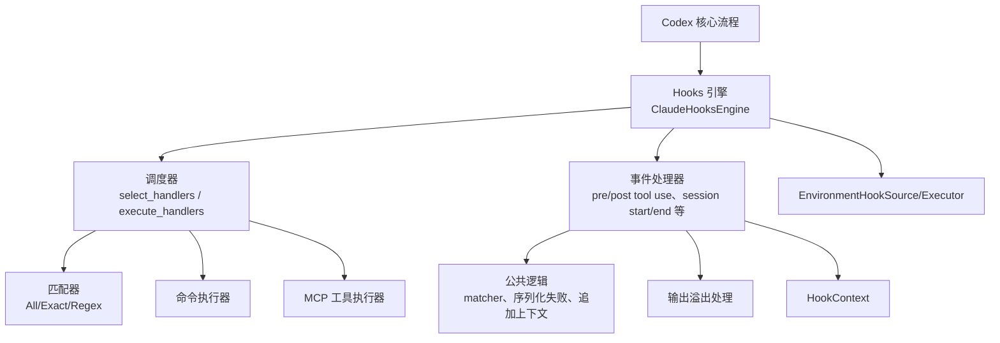
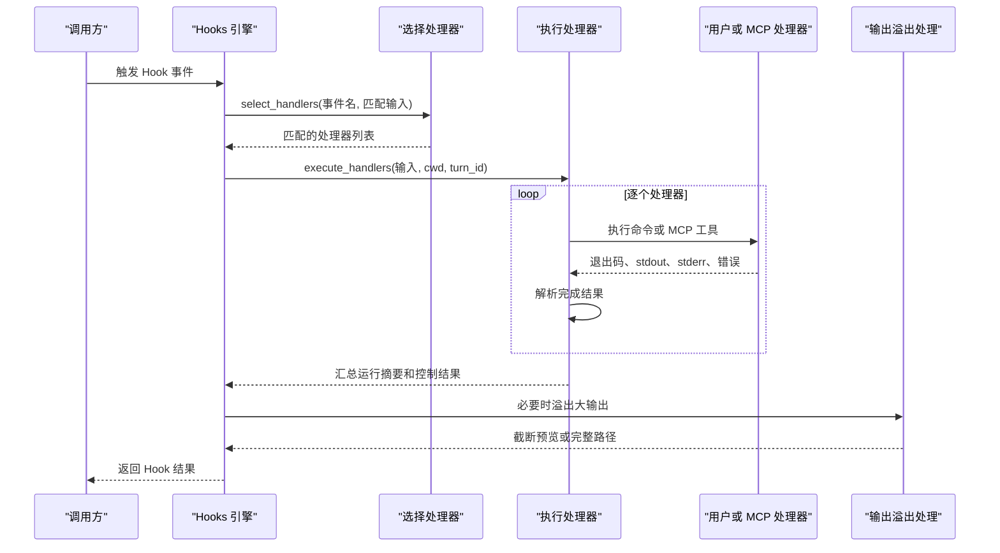
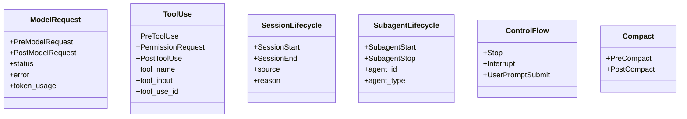
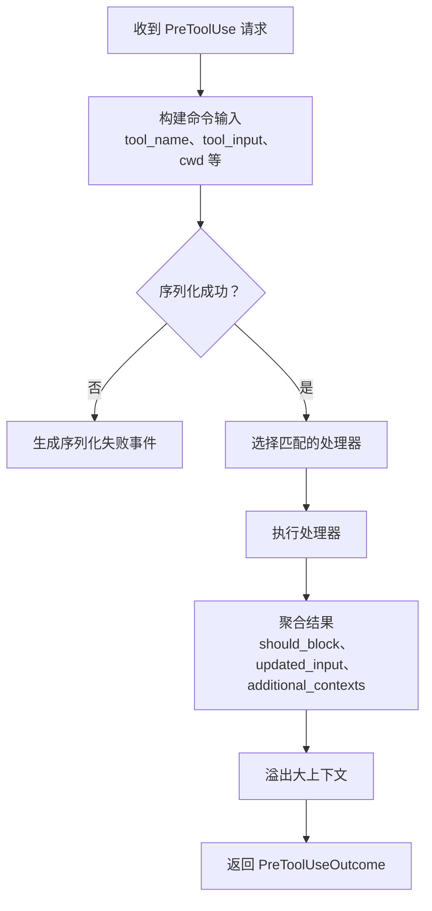
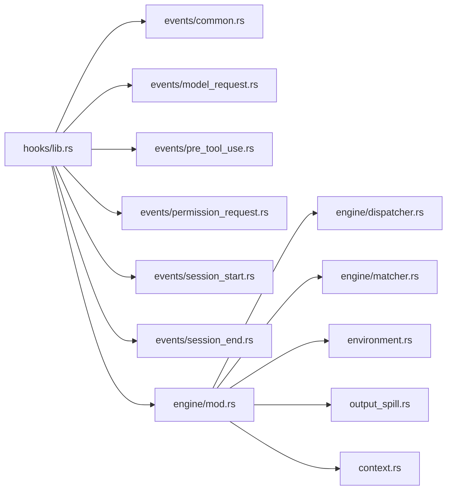
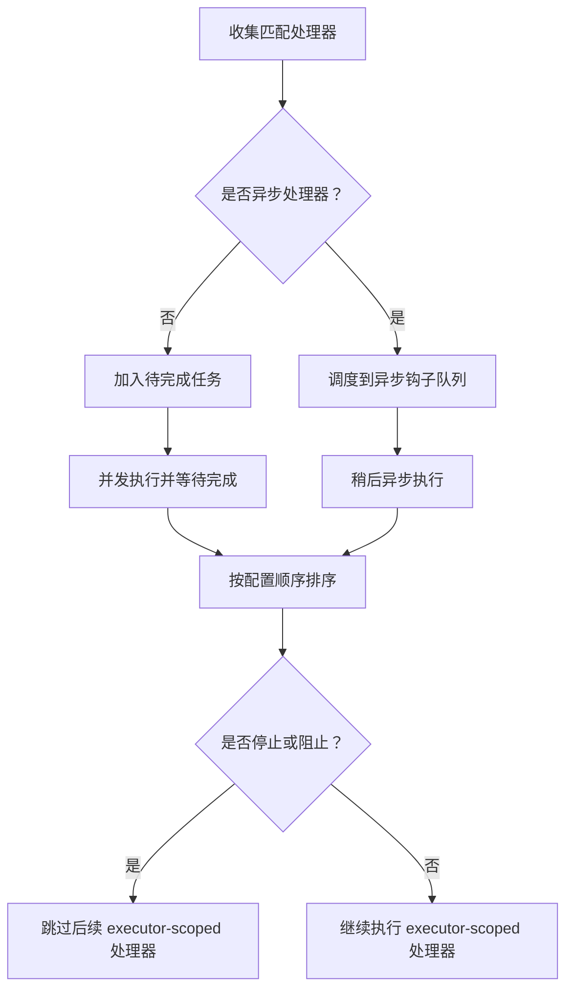
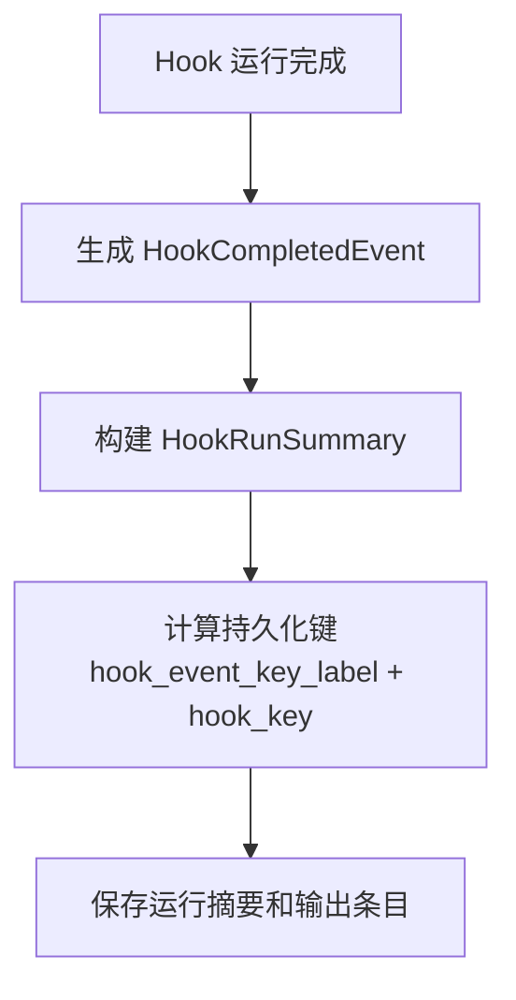

# Hook 机制

<cite>
**本文引用的文件**   
- [hooks/lib.rs](file://codex-rs/hooks/src/lib.rs)
- [hooks/events/common.rs](file://codex-rs/hooks/src/events/common.rs)
- [hooks/events/model_request.rs](file://codex-rs/hooks/src/events/model_request.rs)
- [hooks/events/pre_tool_use.rs](file://codex-rs/hooks/src/events/pre_tool_use.rs)
- [hooks/events/permission_request.rs](file://codex-rs/hooks/src/events/permission_request.rs)
- [hooks/events/session_start.rs](file://codex-rs/hooks/src/events/session_start.rs)
- [hooks/events/session_end.rs](file://codex-rs/hooks/src/events/session_end.rs)
- [hooks/engine/mod.rs](file://codex-rs/hooks/src/engine/mod.rs)
- [hooks/engine/dispatcher.rs](file://codex-rs/hooks/src/engine/dispatcher.rs)
- [hooks/engine/matcher.rs](file://codex-rs/hooks/src/engine/matcher.rs)
- [hooks/environment.rs](file://codex-rs/hooks/src/environment.rs)
- [hooks/context.rs](file://codex-rs/hooks/src/context.rs)
- [hooks/output_spill.rs](file://codex-rs/hooks/src/output_spill.rs)
</cite>

## 目录
1. [引言](#引言)
2. [项目结构](#项目结构)
3. [核心组件](#核心组件)
4. [架构总览](#架构总览)
5. [详细组件分析](#详细组件分析)
6. [依赖关系分析](#依赖关系分析)
7. [性能与资源特性](#性能与资源特性)
8. [Hook 配置、匹配与执行顺序](#hook-配置匹配与执行顺序)
9. [环境变量注入与输出处理](#环境变量注入与输出处理)
10. [Hook 开发指南](#hook-开发指南)
11. [调试技巧](#调试技巧)
12. [错误处理、状态持久化与回滚](#错误处理状态持久化与回滚)
13. [故障排查](#故障排查)
14. [结论](#结论)

## 引言
Codex CLI 的 Hook 机制为 Codex 的执行生命周期提供可插拔扩展点。它允许在模型请求前后、工具调用前后、权限审批、会话启动和结束、子代理生命周期以及中断等关键位置插入自定义逻辑。Hook 既可以是外部命令，也可以是 MCP 工具；既可同步执行以改变控制流，也可异步执行用于观测或清理。

该文档聚焦于 Hook 系统的设计原理、事件类型、匹配规则、执行模型、上下文传递、配置语法、环境变量、输出处理、开发指南、调试方法、性能优化、状态持久化和错误恢复策略。

## 项目结构
Hook 能力主要由 `codex-rs/hooks` 模块实现，并与其他子系统协作：
- `events`：定义各 Hook 事件的输入、输出和领域语义。
- `engine`：负责发现、调度、匹配、运行和汇总 Hook。
- `schema`：生成每个 Hook 命令的 JSON Schema 与 fixture。
- `environment`：描述环境绑定的 Hook 来源和执行接口。
- `output_spill`：对超出预算的 Hook 输出进行落盘与截断。
- `context`：暴露给模型的 Hook 附加上下文。
- `registry`、`declarations`、`config_rules`、`mcp`、`types`：注册表、声明、配置规则、MCP 封装和通用类型。

**图示来源**
- [hooks/engine/mod.rs:201-571](file://codex-rs/hooks/src/engine/mod.rs#L201-L571)
- [hooks/engine/dispatcher.rs:1-200](file://codex-rs/hooks/src/engine/dispatcher.rs#L1-L200)
- [hooks/engine/matcher.rs:1-49](file://codex-rs/hooks/src/engine/matcher.rs#L1-L49)
- [hooks/events/common.rs:1-200](file://codex-rs/hooks/src/events/common.rs#L1-L200)
- [hooks/output_spill.rs:1-135](file://codex-rs/hooks/src/output_spill.rs#L1-L135)
- [hooks/environment.rs:1-35](file://codex-rs/hooks/src/environment.rs#L1-L35)
- [hooks/context.rs:1-18](file://codex-rs/hooks/src/context.rs#L1-L18)

**章节来源**
- [hooks/lib.rs:1-139](file://codex-rs/hooks/src/lib.rs#L1-L139)

## 核心组件
- **Hook 事件集合**：包括 `PreModelRequest`、`PostModelRequest`、`PreToolUse`、`PermissionRequest`、`PostToolUse`、`PreCompact`、`PostCompact`、`SessionStart`、`SessionEnd`、`UserPromptSubmit`、`SubagentStart`、`SubagentStop`、`Stop`、`Interrupt`。其中部分事件支持 matcher 字段参与匹配。
- **引擎层**：`ClaudeHooksEngine` 持有已发现的 handler 列表、hook 条目清单、警告、命令运行时和 MCP 执行器。它对外暴露 preview 和 run 方法，将具体事件委托给 `events/*`。
- **调度层**：`dispatcher::select_handlers` 按事件名和 matcher 选择 handler；`execute_handlers` 统一串行或异步执行，并汇总完成结果。
- **匹配器**：支持三种模式：全匹配、精确多值匹配和正则表达式匹配。
- **事件处理器**：每个事件定义自己的请求结构体、输出结构和解析函数，统一通过 `dispatcher` 执行。
- **环境与输出**：环境绑定来源和 CWD；输出溢出处理将大文本写入临时目录并提供预览。

**章节来源**
- [hooks/lib.rs:1-139](file://codex-rs/hooks/src/lib.rs#L1-L139)
- [hooks/engine/mod.rs:201-571](file://codex-rs/hooks/src/engine/mod.rs#L201-L571)
- [hooks/engine/dispatcher.rs:1-200](file://codex-rs/hooks/src/engine/dispatcher.rs#L1-L200)
- [hooks/engine/matcher.rs:1-49](file://codex-rs/hooks/src/engine/matcher.rs#L1-L49)
- [hooks/output_spill.rs:1-135](file://codex-rs/hooks/src/output_spill.rs#L1-L135)

## 架构总览
Hook 系统采用“事件驱动 + 处理器链”架构。核心流程如下：
1. 上游触发某个 Hook 事件。
2. 引擎根据事件名筛选 handler。
3. 如果事件需要 matcher，则使用当前上下文构造匹配输入（如工具名、会话来源、子代理类型）。
4. 调度器并行或串行执行匹配到的 handler。
5. 每个 handler 的输出被解析为结构化结果和转录日志。
6. 控制型事件聚合多个 handler 的结果，决定继续、阻止、停止或决策。
7. 非控制型事件仅记录运行摘要和诊断信息。

**图示来源**
- [hooks/engine/dispatcher.rs:1-200](file://codex-rs/hooks/src/engine/dispatcher.rs#L1-L200)
- [hooks/events/pre_tool_use.rs:1-200](file://codex-rs/hooks/src/events/pre_tool_use.rs#L1-L200)
- [hooks/output_spill.rs:1-135](file://codex-rs/hooks/src/output_spill.rs#L1-L135)

## 详细组件分析

### Hook 事件类型与职责
Hook 事件分为控制型与非控制型两类：
- **模型请求观察型**：`PreModelRequest`、`PostModelRequest`。它们主要用于观测模型请求的生命周期，输出不会作为控制指令解释。
- **工具调用型**：`PreToolUse`、`PermissionRequest`、`PostToolUse`。`PreToolUse` 可重写工具输入、阻止执行并追加模型上下文；`PermissionRequest` 可在审批前给出 allow/deny 决策；`PostToolUse` 收集工具执行结果反馈。
- **会话生命周期型**：`SessionStart`、`SessionEnd`。`SessionStart` 可用于初始化、拦截启动来源或子代理启动；`SessionEnd` 用于清理。
- **压缩相关**：`PreCompact`、`PostCompact`。
- **交互与中断**：`UserPromptSubmit`、`Stop`、`Interrupt`、`SubagentStart`、`SubagentStop`。

**图示来源**
- [hooks/events/model_request.rs:1-168](file://codex-rs/hooks/src/events/model_request.rs#L1-L168)
- [hooks/events/pre_tool_use.rs:1-200](file://codex-rs/hooks/src/events/pre_tool_use.rs#L1-L200)
- [hooks/events/permission_request.rs:1-200](file://codex-rs/hooks/src/events/permission_request.rs#L1-L200)
- [hooks/events/session_start.rs:1-200](file://codex-rs/hooks/src/events/session_start.rs#L1-L200)
- [hooks/events/session_end.rs:1-139](file://codex-rs/hooks/src/events/session_end.rs#L1-L139)
- [hooks/lib.rs:1-139](file://codex-rs/hooks/src/lib.rs#L1-L139)

#### PreModelRequest 与 PostModelRequest
这两个事件是只读观察者：
- 输入包含会话、轮次、工作目录、转写路径、模型名称、可选子代理信息和事件本身。
- 执行结果不改变控制流；stderr 和 error 会作为诊断条目记录。
- 成功条件通常由退出码和是否出现 error 字段判断。

**章节来源**
- [hooks/events/model_request.rs:1-168](file://codex-rs/hooks/src/events/model_request.rs#L1-L168)

#### PreToolUse
`PreToolUse` 是最强大的控制型 Hook：
- 可阻止工具调用。
- 可重写 `tool_input`。
- 可向模型追加额外上下文，这些上下文经过 token 预算限制后可能溢出到磁盘。
- 匹配输入包含工具名称及其别名，确保同一工具调用只执行一次。
- 当多个处理器都重写输入时，最终取“最后完成”的那个重写结果。

**图示来源**
- [hooks/events/pre_tool_use.rs:1-200](file://codex-rs/hooks/src/events/pre_tool_use.rs#L1-L200)
- [hooks/output_spill.rs:1-135](file://codex-rs/hooks/src/output_spill.rs#L1-L135)

**章节来源**
- [hooks/events/pre_tool_use.rs:1-200](file://codex-rs/hooks/src/events/pre_tool_use.rs#L1-L200)

#### PermissionRequest
`PermissionRequest` 在审批流程之前运行：
- 不直接重写工具输入。
- 可返回明确允许或拒绝；拒绝优先，允许保留最高优先级匹配者的决策。
- 如果没有处理器返回决策，则走正常审批流程。

**章节来源**
- [hooks/events/permission_request.rs:1-200](file://codex-rs/hooks/src/events/permission_request.rs#L1-L200)

#### SessionStart 与 SessionEnd
`SessionStart`：
- 支持普通会话启动和子代理启动两种目标。
- 可阻止会话启动并返回原因。
- 可追加模型可见的额外上下文。
`SessionEnd`：
- 在会话关闭阶段运行。
- 超时较短，避免阻塞应用服务器关闭。
- 主要关注进程退出码和 stderr。

**章节来源**
- [hooks/events/session_start.rs:1-200](file://codex-rs/hooks/src/events/session_start.rs#L1-L200)
- [hooks/events/session_end.rs:1-139](file://codex-rs/hooks/src/events/session_end.rs#L1-L139)

### 引擎与调度器
`ClaudeHooksEngine` 是 Hook 系统的中心：
- 构造时加载 schema、发现 handler、组装 handler 列表。
- 禁用状态下保留内置 handler，并清除警告。
- 提供 preview 方法供 UI 展示即将运行的 Hook。
- 提供 run 方法执行真实 Hook。
- 可注入 executor-scoped Hook，这类 Hook 总是异步执行且不向用户公开。

调度器 `dispatcher`：
- `select_handlers` 先按事件名过滤，再按 matcher 过滤。
- `execute_handlers` 维护有序 pending 任务，按配置顺序排序完成后结果。
- 支持同步和异步执行模式；异步处理器不影响主流程阻塞。
- 遇到 stopped 或 blocked 状态时，决定是否继续执行 executor-scoped 处理器。

**章节来源**
- [hooks/engine/mod.rs:201-571](file://codex-rs/hooks/src/engine/mod.rs#L201-L571)
- [hooks/engine/dispatcher.rs:1-200](file://codex-rs/hooks/src/engine/dispatcher.rs#L1-L200)

### 匹配器
匹配器有三种形态：
- `All`：空字符串或 `*`，匹配所有输入。
- `Exact`：字母数字、下划线和竖线组成的字符串，竖线分隔多个候选名称。
- `Regex`：其他情况编译为正则表达式。

对于工具类事件，匹配输入是“工具名 + 别名”的序列；只要任意一个匹配即选中该处理器，但同一工具调用不会重复执行同名处理器。

**章节来源**
- [hooks/engine/matcher.rs:1-49](file://codex-rs/hooks/src/engine/matcher.rs#L1-L49)
- [hooks/events/common.rs:1-200](file://codex-rs/hooks/src/events/common.rs#L1-L200)

### 上下文与附加上下文
- `HookContext` 是模型可见的 Hook 上下文，包含文本和元数据。
- `append_additional_context` 将 Hook 输出的额外上下文加入转录和模型上下文队列。
- `flatten_additional_contexts` 合并多个处理器产生的上下文。
- 附加上下文受 token 预算限制，超限时落入临时目录并通过预览提示恢复路径。

**章节来源**
- [hooks/events/common.rs:1-200](file://codex-rs/hooks/src/events/common.rs#L1-L200)
- [hooks/context.rs:1-18](file://codex-rs/hooks/src/context.rs#L1-L18)
- [hooks/output_spill.rs:1-135](file://codex-rs/hooks/src/output_spill.rs#L1-L135)

## 依赖关系分析
Hook 系统内部依赖清晰：
- `events/*` 依赖 `engine` 中的处理器配置、运行结果和调度器。
- `engine/dispatcher` 依赖 `matcher`、命令执行器和 MCP 执行器。
- `engine/mod` 聚合 discovery、schema_loader、plugin_trust、command_runner、mcp_runner 等。
- `environment` 提供环境绑定和执行接口，解耦核心与传输层。
- `output_spill` 依赖临时目录、UUID 和 token 计数工具。
- `lib.rs` 暴露公共 API，包括事件名常量、Hook 类型、上下文、MCP 封装和注册表导出。

**图示来源**
- [hooks/lib.rs:1-139](file://codex-rs/hooks/src/lib.rs#L1-L139)
- [hooks/engine/mod.rs:201-571](file://codex-rs/hooks/src/engine/mod.rs#L201-L571)

**章节来源**
- [hooks/lib.rs:1-139](file://codex-rs/hooks/src/lib.rs#L1-L139)
- [hooks/engine/mod.rs:201-571](file://codex-rs/hooks/src/engine/mod.rs#L201-L571)

## 性能与资源特性
- **并发执行**：调度器使用并发任务池执行处理器，但最终结果按配置顺序排序，保证报告稳定性。
- **异步处理器**：标记为 async 的处理器不阻塞主流程；executor-scoped 处理器总是异步执行。
- **超时控制**：每个处理器有超时秒数；`SessionEnd` 默认超时很短，避免阻塞关闭。
- **输出预算**：Hook 输出可通过 token 预算截断，超大内容写入临时目录，避免污染模型上下文。
- **匹配缓存**：matcher 编译发生在发现阶段，调度阶段只做匹配判断。

建议：
- 将耗时操作放在异步处理器中。
- 合理设置超时，尤其是 `SessionEnd` 场景。
- 避免在 Hook 中输出过大文本，或使用附加上下文预算控制大小。
- 使用精确 matcher 减少无关处理器被匹配。

[本节为通用性能建议，不直接分析具体文件]

## Hook 配置、匹配与执行顺序

### 事件分类与匹配规则
- 支持 matcher 的事件：`PreToolUse`、`PermissionRequest`、`PostToolUse`、`PreCompact`、`PostCompact`、`SessionStart`、`SessionEnd`、`SubagentStart`、`SubagentStop`。
- 不支持 matcher 的事件：`PreModelRequest`、`PostModelRequest`、`UserPromptSubmit`、`Stop`、`Interrupt`。

匹配输入来源：
- 工具类事件：工具名 + 别名。
- 会话启动：会话来源或子代理类型。
- 会话结束：固定原因。
- 其他事件：不提供匹配输入。

**章节来源**
- [hooks/lib.rs:1-139](file://codex-rs/hooks/src/lib.rs#L1-L139)
- [hooks/events/common.rs:1-200](file://codex-rs/hooks/src/events/common.rs#L1-L200)
- [hooks/engine/dispatcher.rs:1-200](file://codex-rs/hooks/src/engine/dispatcher.rs#L1-L200)

### 执行顺序
- 处理器按 `display_order` 和配置顺序排列。
- 同步处理器按顺序等待完成。
- 异步处理器放入并发池，但最终结果仍按配置顺序排序。
- 遇到 `Stopped` 或 `Blocked` 状态时，引擎决定是否继续执行 executor-scoped 处理器。

**图示来源**
- [hooks/engine/dispatcher.rs:1-200](file://codex-rs/hooks/src/engine/dispatcher.rs#L1-L200)
- [hooks/engine/mod.rs:201-571](file://codex-rs/hooks/src/engine/mod.rs#L201-L571)

**章节来源**
- [hooks/engine/dispatcher.rs:1-200](file://codex-rs/hooks/src/engine/dispatcher.rs#L1-L200)
- [hooks/engine/mod.rs:201-571](file://codex-rs/hooks/src/engine/mod.rs#L201-L571)

## 环境变量注入与输出处理

### 环境变量与 CWD
- 环境绑定的 Hook 使用环境的 CWD，并隐藏控制器拥有的转写路径。
- 本地命令可使用工具的 CWD；远程命令保留主机 CWD。
- 环境执行器接口要求实现者尊重超时、终止超时进程并限制捕获输出。

**章节来源**
- [hooks/engine/mod.rs:201-571](file://codex-rs/hooks/src/engine/mod.rs#L201-L571)
- [hooks/environment.rs:1-35](file://codex-rs/hooks/src/environment.rs#L1-L35)

### 输出处理
- 标准输出主要用于诊断，不一定解释为控制指令。
- 标准错误和错误消息会被记录为错误条目。
- 附加上下文通过 `HookOutputSpiller` 进行 token 预算截断，并在失败时降级为截断预览。
- `SessionEnd` 的完成状态根据 error、exit_code 和是否缺少 exit_code 决定。

**章节来源**
- [hooks/events/model_request.rs:1-168](file://codex-rs/hooks/src/events/model_request.rs#L1-L168)
- [hooks/events/session_end.rs:1-139](file://codex-rs/hooks/src/events/session_end.rs#L1-L139)
- [hooks/output_spill.rs:1-135](file://codex-rs/hooks/src/output_spill.rs#L1-L135)

## Hook 开发指南

### 设计原则
- 明确事件用途：观测型事件不要试图控制流程；控制型事件应保守处理多处理器冲突。
- 保持幂等：Hook 可能被多次预览或重放，应避免副作用破坏状态。
- 控制输出体积：避免直接输出超大文本，使用附加上下文并按预算截断。
- 使用 matcher 精确匹配：避免不必要处理器被触发。
- 合理设置超时：特别是审批和会话结束场景。

### 典型实现示例

#### 拦截工具调用并重写输入
适用场景：在 `PreToolUse` 中校验工具参数、补充缺失字段、替换敏感值或注入默认行为。
步骤：
1. 订阅 `PreToolUse`。
2. 解析 `tool_input`。
3. 如果需要阻止，返回阻止标志和原因。
4. 如果需要改写，返回新的输入对象。
5. 如需让模型看到更多上下文，追加 `HookContext`。

关键点：
- 最终改写由最后完成的处理器决定。
- 阻止时不再合并改写输入。
- 附加上下文会被溢出处理。

参考实现路径：
- [hooks/events/pre_tool_use.rs:1-200](file://codex-rs/hooks/src/events/pre_tool_use.rs#L1-L200)
- [hooks/output_spill.rs:1-135](file://codex-rs/hooks/src/output_spill.rs#L1-L135)

#### 在权限审批前给出决策
适用场景：基于工具名、输入或上下文快速允许或拒绝。
步骤：
1. 订阅 `PermissionRequest`。
2. 解析工具名和输入。
3. 返回 Allow 或 Deny。
4. 多个处理器时，Deny 优先，Allow 取最高优先级匹配者。

参考实现路径：
- [hooks/events/permission_request.rs:1-200](file://codex-rs/hooks/src/events/permission_request.rs#L1-L200)

#### 会话启动时初始化资源
适用场景：在 `SessionStart` 中检查环境、准备密钥、建立连接或记录审计日志。
步骤：
1. 订阅 `SessionStart`。
2. 根据 source 区分普通会话或子代理。
3. 如需阻止启动，返回 should_stop 和 reason。
4. 可追加模型上下文用于后续推理。

参考实现路径：
- [hooks/events/session_start.rs:1-200](file://codex-rs/hooks/src/events/session_start.rs#L1-L200)

#### 会话结束时清理
适用场景：关闭网络连接、释放临时文件、发送遥测数据。
注意：
- 超时短，避免阻塞关闭。
- 即使失败也应尽量完成清理逻辑。

参考实现路径：
- [hooks/events/session_end.rs:1-139](file://codex-rs/hooks/src/events/session_end.rs#L1-L139)

#### 观测模型请求
适用场景：统计模型调用次数、记录成本、采样诊断。
注意：
- 输出不会被解释为控制指令。
- 主要关注 stderr 和 error。

参考实现路径：
- [hooks/events/model_request.rs:1-168](file://codex-rs/hooks/src/events/model_request.rs#L1-L168)

**章节来源**
- [hooks/events/pre_tool_use.rs:1-200](file://codex-rs/hooks/src/events/pre_tool_use.rs#L1-L200)
- [hooks/events/permission_request.rs:1-200](file://codex-rs/hooks/src/events/permission_request.rs#L1-L200)
- [hooks/events/session_start.rs:1-200](file://codex-rs/hooks/src/events/session_start.rs#L1-L200)
- [hooks/events/session_end.rs:1-139](file://codex-rs/hooks/src/events/session_end.rs#L1-L139)
- [hooks/events/model_request.rs:1-168](file://codex-rs/hooks/src/events/model_request.rs#L1-L168)

## 调试技巧
- 使用 preview 接口查看即将运行的 Hook 和预期匹配结果。
- 检查 stdout 和 stderr：stdout 多为诊断，stderr 更容易被识别为错误。
- 检查 HookRunSummary 中的 status、duration_ms、entries。
- 使用 matcher 预览功能验证工具名和别名匹配是否正确。
- 对于大输出，查看临时目录中的 hook_outputs 文件，确认是否被溢出。
- 对 `SessionEnd` 增加日志，确认是否在关闭阶段被触发且未阻塞。

**章节来源**
- [hooks/engine/mod.rs:201-571](file://codex-rs/hooks/src/engine/mod.rs#L201-L571)
- [hooks/output_spill.rs:1-135](file://codex-rs/hooks/src/output_spill.rs#L1-L135)

## 错误处理、状态持久化与回滚

### 错误处理
- 序列化失败：当 Hook 输入无法序列化时，生成统一的失败事件，并记录错误消息。
- 进程失败：error 存在或非零退出码时标记为 Failed。
- 缺少退出码：进程异常终止时会记录错误。
- 异步 Hook 失败：executor-scoped 处理器失败会记录警告，但不影响主流程。

**章节来源**
- [hooks/events/model_request.rs:1-168](file://codex-rs/hooks/src/events/model_request.rs#L1-L168)
- [hooks/events/session_end.rs:1-139](file://codex-rs/hooks/src/events/session_end.rs#L1-L139)
- [hooks/engine/dispatcher.rs:1-200](file://codex-rs/hooks/src/engine/dispatcher.rs#L1-L200)

### 状态持久化
- 每个 Hook 运行生成 `HookCompletedEvent`，包含 run summary 和输出条目。
- Hook 键通过事件标签、组索引和处理器索引组合，便于状态持久化和 UI 显示。
- `hook_event_key_label` 将事件名映射为稳定键标签。
- `hook_key` 生成持久化配置状态键。

**图示来源**
- [hooks/lib.rs:1-139](file://codex-rs/hooks/src/lib.rs#L1-L139)
- [hooks/engine/dispatcher.rs:1-200](file://codex-rs/hooks/src/engine/dispatcher.rs#L1-L200)

**章节来源**
- [hooks/lib.rs:1-139](file://codex-rs/hooks/src/lib.rs#L1-L139)

### 回滚机制
Hook 系统没有全局事务式回滚：
- `PreToolUse` 支持阻止执行和改写输入；一旦阻止，后续工具调用不会发生。
- `PermissionRequest` 支持 deny 决策，deny 具有最高优先级。
- 多个处理器冲突时，控制型事件通过聚合逻辑决定最终效果，例如 `PreToolUse` 取最后完成的改写，`PermissionRequest` 取 deny 或最高优先级 allow。
- 失败事件会被记录，但不会自动撤销已经发生的副作用。

最佳实践：
- 在 `PreToolUse` 中尽早校验和阻止危险操作。
- 在 `PermissionRequest` 中显式 deny 高风险操作。
- 在 `SessionEnd` 中做幂等清理，避免重复清理导致错误。

**章节来源**
- [hooks/events/pre_tool_use.rs:1-200](file://codex-rs/hooks/src/events/pre_tool_use.rs#L1-L200)
- [hooks/events/permission_request.rs:1-200](file://codex-rs/hooks/src/events/permission_request.rs#L1-L200)
- [hooks/events/session_end.rs:1-139](file://codex-rs/hooks/src/events/session_end.rs#L1-L139)

## 故障排查

### 常见症状与定位
- Hook 未被触发：检查事件名、matcher 是否为空或 `*`，工具名是否与别名一致。
- Hook 被重复触发：确认工具别名是否导致多个匹配，但同一工具调用不应重复执行同名处理器。
- Hook 输出未进入模型上下文：检查附加上下文是否超过 token 预算，或被溢出处理。
- 会话关闭卡住：检查 `SessionEnd` 是否耗时过长或阻塞。
- 权限审批未按预期 allow/deny：检查是否有多个处理器返回决策，deny 会覆盖 allow。

### 排查步骤
1. 使用 preview 查看匹配处理器。
2. 检查处理器配置中的 timeout_sec、async、matcher。
3. 查看 HookRunSummary 的 status、duration_ms、entries。
4. 检查临时目录中的 hook_outputs。
5. 对 `SessionEnd` 和 `PermissionRequest` 增加日志。
6. 对 `PreToolUse` 打印 tool_name、tool_input、tool_use_id。

**章节来源**
- [hooks/engine/dispatcher.rs:1-200](file://codex-rs/hooks/src/engine/dispatcher.rs#L1-L200)
- [hooks/output_spill.rs:1-135](file://codex-rs/hooks/src/output_spill.rs#L1-L135)
- [hooks/events/permission_request.rs:1-200](file://codex-rs/hooks/src/events/permission_request.rs#L1-L200)
- [hooks/events/session_end.rs:1-139](file://codex-rs/hooks/src/events/session_end.rs#L1-L139)

## 结论
Codex CLI 的 Hook 机制通过清晰的事件分层、灵活的匹配规则和可控的执行模型，提供了强大的扩展能力。开发者可以借助 `PreToolUse`、`PermissionRequest`、`SessionStart`、`SessionEnd` 等事件实现拦截、决策、初始化和清理。理解调度顺序、匹配规则、上下文传递、输出溢出和错误处理，是编写健壮 Hook 的关键。在实际项目中，建议优先使用精确 matcher、合理设置超时、控制输出体积，并将副作用最小化，以保证 Hook 的稳定性和可观测性。