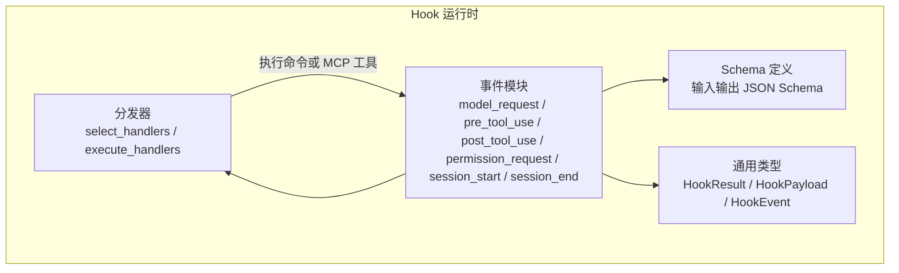
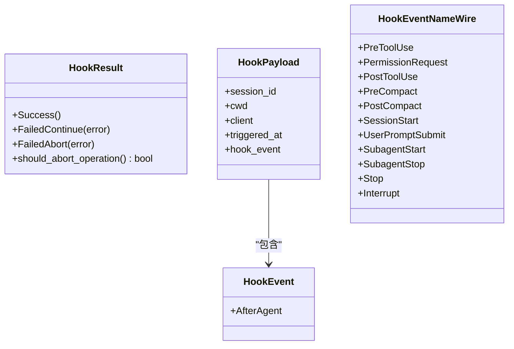
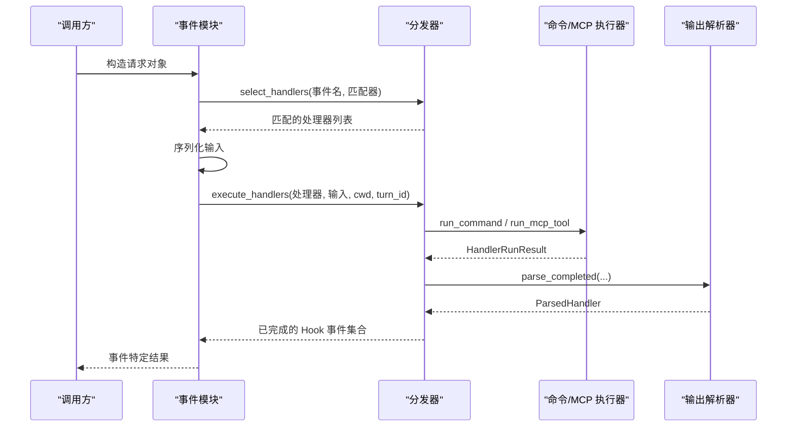
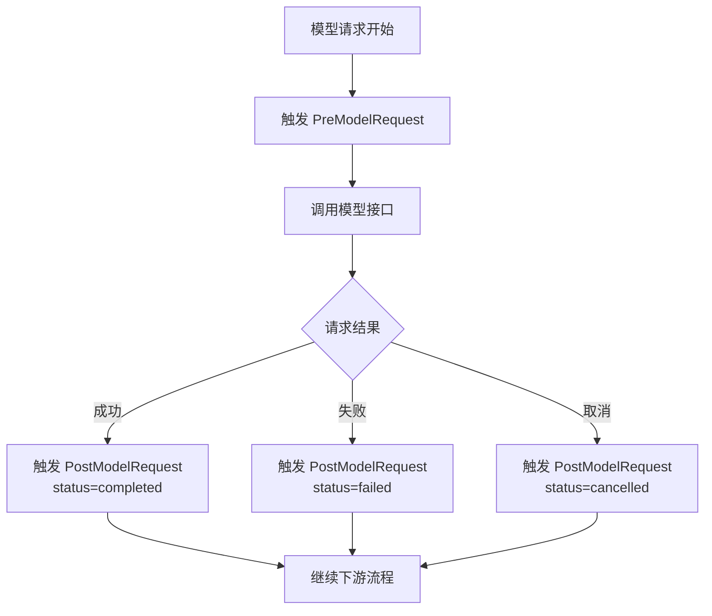
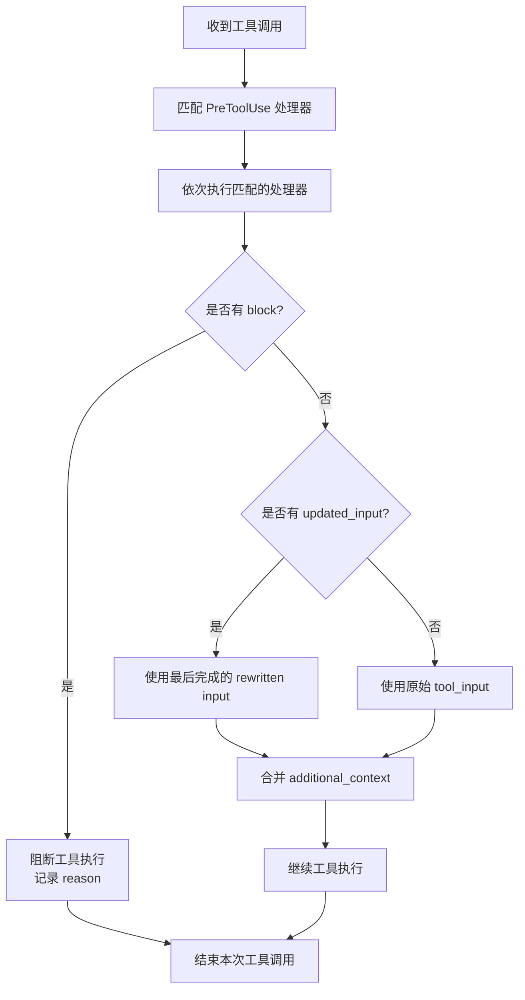
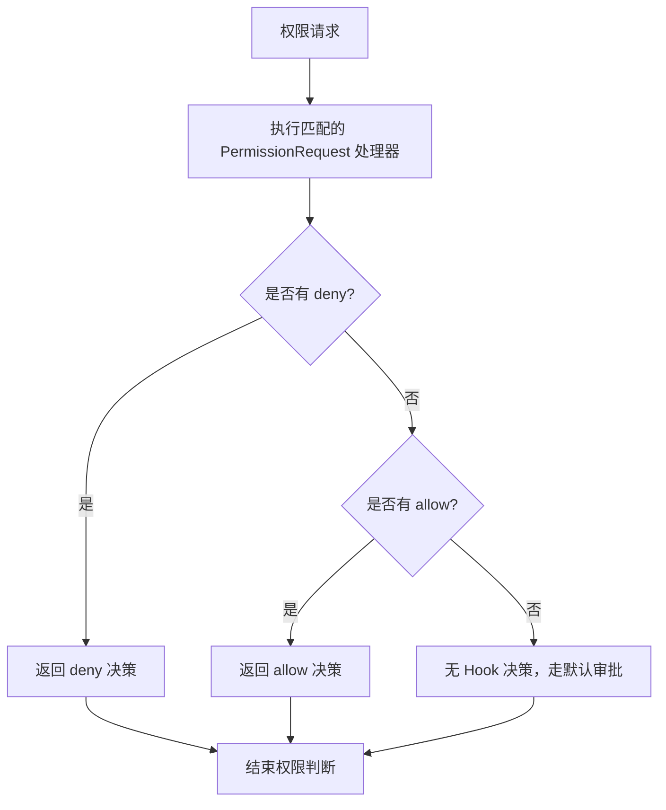
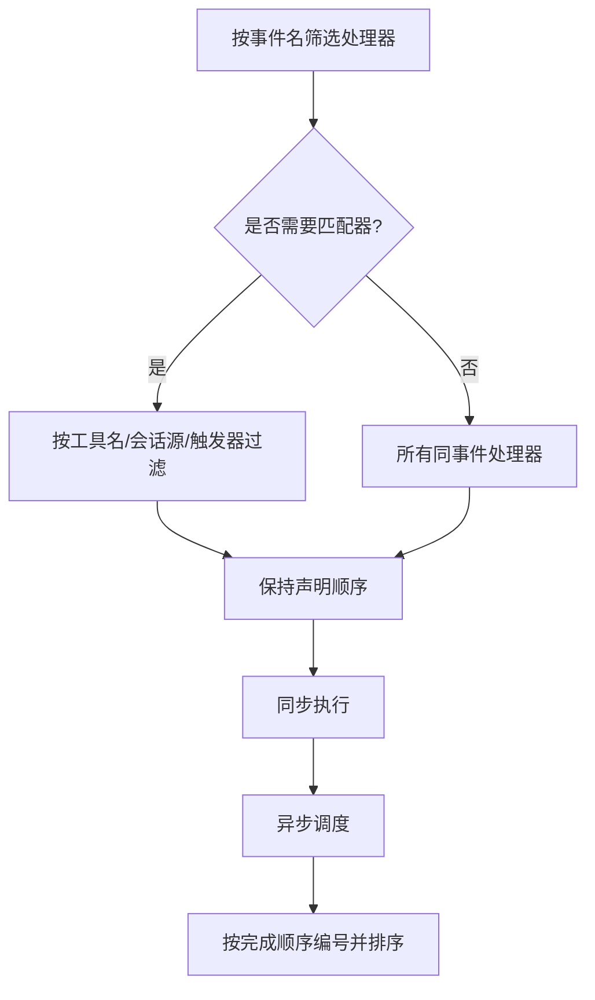
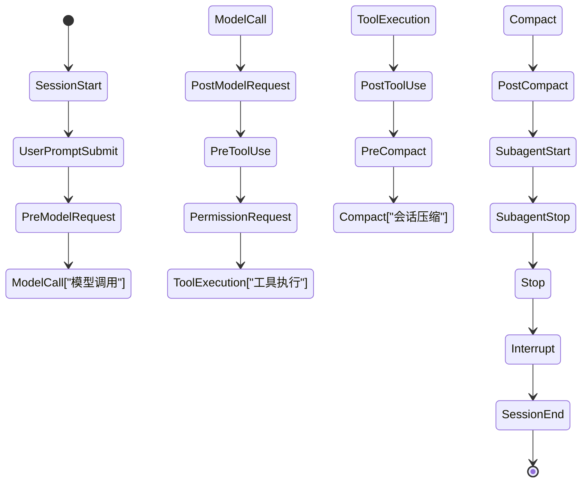

# 事件类型详解

<cite>
**本文引用的文件**
- [codex-rs/hooks/src/events/mod.rs](file://codex-rs/hooks/src/events/mod.rs)
- [codex-rs/hooks/src/types.rs](file://codex-rs/hooks/src/types.rs)
- [codex-rs/hooks/src/schema.rs](file://codex-rs/hooks/src/schema.rs)
- [codex-rs/hooks/src/declarations.rs](file://codex-rs/hooks/src/declarations.rs)
- [codex-rs/hooks/src/engine/dispatcher.rs](file://codex-rs/hooks/src/engine/dispatcher.rs)
- [codex-rs/hooks/src/events/model_request.rs](file://codex-rs/hooks/src/events/model_request.rs)
- [codex-rs/hooks/src/events/pre_tool_use.rs](file://codex-rs/hooks/src/events/pre_tool_use.rs)
- [codex-rs/hooks/src/events/post_tool_use.rs](file://codex-rs/hooks/src/events/post_tool_use.rs)
- [codex-rs/hooks/src/events/permission_request.rs](file://codex-rs/hooks/src/events/permission_request.rs)
- [codex-rs/hooks/src/events/session_start.rs](file://codex-rs/hooks/src/events/session_start.rs)
- [codex-rs/hooks/src/events/session_end.rs](file://codex-rs/hooks/src/events/session_end.rs)
</cite>

## 目录
1. [引言](#引言)
2. [项目结构与钩子系统边界](#项目结构与钩子系统边界)
3. [核心概念与通用数据结构](#核心概念与通用数据结构)
4. [架构总览](#架构总览)
5. [预定义 Hook 事件清单](#预定义-hook-事件清单)
6. [核心事件深度解析](#核心事件深度解析)
7. [事件匹配规则、过滤器与执行顺序](#事件匹配规则过滤器与执行顺序)
8. [依赖关系与生命周期顺序](#依赖关系与生命周期顺序)
9. [常见使用场景](#常见使用场景)
10. [故障排查指南](#故障排查指南)
11. [结论](#结论)

## 引言
本文面向 Codex CLI Hook 系统的用户和扩展开发者，系统梳理仓库中实现的 14 种预定义 Hook 事件。重点包括：
- 每个事件的用途、触发时机、输入参数、输出选项和控制流影响。
- 事件匹配规则、过滤器配置和条件判断机制。
- JSON Schema 字段语义及生成方式。
- 事件之间的依赖关系和执行顺序。
- 典型使用示例方向，例如日志记录、权限检查、会话管理、工具调用拦截等。

本说明基于 `codex-rs/hooks` 模块中的事件实现、Schema 定义、分发器逻辑和类型声明进行归纳。

## 项目结构与钩子系统边界
Codex Hook 系统位于 `codex-rs/hooks` 下，主要分为四类职责：
- 事件定义：每个事件一个子模块，负责请求结构、处理流程和结果聚合。
- Schema 定义：为所有命令输入和输出生成 JSON Schema。
- 分发器：根据事件名、匹配器和处理器类型选择并执行 Hook。
- 通用类型：Hook 运行结果、负载、事件枚举等。

**图表来源**
- [codex-rs/hooks/src/engine/dispatcher.rs:1-120](file://codex-rs/hooks/src/engine/dispatcher.rs#L1-L120)
- [codex-rs/hooks/src/events/mod.rs:1-12](file://codex-rs/hooks/src/events/mod.rs#L1-L12)
- [codex-rs/hooks/src/schema.rs:1-60](file://codex-rs/hooks/src/schema.rs#L1-L60)
- [codex-rs/hooks/src/types.rs:1-60](file://codex-rs/hooks/src/types.rs#L1-L60)

**章节来源**
- [codex-rs/hooks/src/events/mod.rs:1-12](file://codex-rs/hooks/src/events/mod.rs#L1-L12)
- [codex-rs/hooks/src/engine/dispatcher.rs:1-120](file://codex-rs/hooks/src/engine/dispatcher.rs#L1-L120)
- [codex-rs/hooks/src/schema.rs:1-60](file://codex-rs/hooks/src/schema.rs#L1-L60)
- [codex-rs/hooks/src/types.rs:1-60](file://codex-rs/hooks/src/types.rs#L1-L60)

## 核心概念与通用数据结构
Hook 系统对外暴露的通用概念如下：

| 概念 | 含义 | 关键行为 |
|---|---|---|
| `HookResult` | Hook 函数返回结果 | 成功、失败但继续、失败且中止 |
| `HookPayload` | 通用负载 | 包含会话标识、工作目录、触发时间、具体事件 |
| `HookEvent` | 内部事件枚举 | 当前代码路径中明确定义的轻量事件，例如 `after_agent` |
| `HookEventNameWire` | 外部可配置的 Hook 事件名称 | 用于配置文件和插件声明 |
| `HookUniversalOutputWire` | 通用输出字段 | `continue`、`stop_reason`、`suppress_output`、`system_message` |

重要细节：
- `HookResult.FailedAbort` 表示应终止后续 Hook 执行和当前操作。
- `HookPayload.triggered_at` 会序列化为带时区的 RFC3339 字符串。
- `HookEvent` 当前只显式定义 `AfterAgent`；其他 14 种 Hook 主要通过 `HookEventNameWire` 和命令输入输出 Schema 表达。

**图表来源**
- [codex-rs/hooks/src/types.rs:1-120](file://codex-rs/hooks/src/types.rs#L1-L120)
- [codex-rs/hooks/src/schema.rs:100-170](file://codex-rs/hooks/src/schema.rs#L100-L170)

**章节来源**
- [codex-rs/hooks/src/types.rs:1-120](file://codex-rs/hooks/src/types.rs#L1-L120)
- [codex-rs/hooks/src/schema.rs:100-170](file://codex-rs/hooks/src/schema.rs#L100-L170)

## 架构总览
Hook 执行流程可以概括为：
1. 上层业务触发某个 Hook 事件。
2. 分发器按事件名筛选处理器。
3. 对需要匹配的工具、会话源或触发器，使用匹配器过滤处理器。
4. 将输入序列化为命令标准输入。
5. 同步执行命令或异步调度 MCP 工具。
6. 解析命令输出为标准化的 `HookCompletedEvent`。
7. 各事件模块聚合结果，决定是否阻断、停止、追加上下文或修改输入。

**图表来源**
- [codex-rs/hooks/src/engine/dispatcher.rs:1-200](file://codex-rs/hooks/src/engine/dispatcher.rs#L1-L200)
- [codex-rs/hooks/src/engine/dispatcher.rs:200-340](file://codex-rs/hooks/src/engine/dispatcher.rs#L200-L340)

**章节来源**
- [codex-rs/hooks/src/engine/dispatcher.rs:1-340](file://codex-rs/hooks/src/engine/dispatcher.rs#L1-L340)

## 预定义 Hook 事件清单
Codex Hook 系统中通过 `HookEventNameWire`、Schema 和事件模块共同定义的预定义事件如下：

| 序号 | 事件名称 | 类别 | 主要用途 | 控制流影响 |
|---|---|---|---|---|
| 1 | `PreModelRequest` | 模型请求观察 | 在发起模型请求前记录诊断信息 | 仅观察，不改变控制流 |
| 2 | `PostModelRequest` | 模型请求观察 | 在模型请求完成后记录状态、错误、Token 用量 | 仅观察，不改变控制流 |
| 3 | `PreToolUse` | 工具调用前置 | 在工具执行前拦截、授权、改写输入 | 可阻止工具执行、改写输入、追加上下文 |
| 4 | `PermissionRequest` | 权限请求 | 在用户或守护策略之前提供明确允许或拒绝决策 | 可提前决定允许或拒绝 |
| 5 | `PostToolUse` | 工具调用后置 | 在工具执行后收集结果、追加上下文、反馈消息 | 可阻断后续流程、追加模型上下文 |
| 6 | `PreCompact` | 压缩前置 | 在会话压缩前通知 Hook | 通用输出控制 |
| 7 | `PostCompact` | 压缩后置 | 在会话压缩后通知 Hook | 通用输出控制 |
| 8 | `SessionStart` | 会话生命周期 | 会话启动、恢复、清理、压缩、分叉时触发 | 可停止会话、追加上下文 |
| 9 | `UserPromptSubmit` | 用户提示提交 | 用户提交提示词时触发 | 可阻止提交、追加上下文 |
| 10 | `SubagentStart` | 子代理生命周期 | 子代理启动时触发 | 可停止、追加上下文 |
| 11 | `SubagentStop` | 子代理生命周期 | 子代理停止时触发 | 可阻止、追加原因 |
| 12 | `Stop` | 停止信号 | 用户或系统发出停止信号 | 可阻止、提供原因 |
| 13 | `Interrupt` | 中断信号 | 发生中断时触发 | 可设置系统消息 |
| 14 | `SessionEnd` | 会话生命周期 | 会话结束、清理阶段触发 | 通常用于收尾清理 |

这些事件名称同时出现在：
- 外部可配置事件名称枚举。
- 命令输入和输出的固定 `hook_event_name` 字段。
- 各事件模块的事件名映射。

**章节来源**
- [codex-rs/hooks/src/schema.rs:100-170](file://codex-rs/hooks/src/schema.rs#L100-L170)
- [codex-rs/hooks/src/events/model_request.rs:1-40](file://codex-rs/hooks/src/events/model_request.rs#L1-L40)
- [codex-rs/hooks/src/events/session_start.rs:1-60](file://codex-rs/hooks/src/events/session_start.rs#L1-L60)
- [codex-rs/hooks/src/events/session_end.rs:1-40](file://codex-rs/hooks/src/events/session_end.rs#L1-L40)

## 核心事件深度解析

### PreModelRequest 与 PostModelRequest
这两个事件是观察型 Hook，主要用于诊断、遥测和审计，而不是控制流拦截。

| 字段 | 类型 | 说明 |
|---|---|---|
| `session_id` | 字符串 | 会话标识 |
| `turn_id` | 字符串 | 当前对话轮次标识 |
| `cwd` | 绝对路径 | 工作目录 |
| `transcript_path` | 可选路径 | 转录文件路径，可为空 |
| `model` | 字符串 | 当前使用的模型 |
| `agent_id` | 可选字符串 | 代理标识 |
| `agent_type` | 可选字符串 | 代理类型 |
| `event` | 变体对象 | 区分 `PreModelRequest` 与 `PostModelRequest` |

`PostModelRequest` 额外包含：
| 字段 | 类型 | 说明 |
|---|---|---|
| `status` | 枚举 | `completed`、`failed`、`cancelled` |
| `error` | 可选字符串 | 错误信息 |
| `token_usage` | 可选 TokenUsage | Token 用量统计 |

控制流特性：
- 没有 `decision`、`block`、`stop_reason` 等控制字段。
- 输出被记录为诊断信息，不会直接阻断模型请求。
- 即使 Hook 失败，也会以失败状态写入完成事件，但不会像工具类 Hook 那样合并阻断语义。

**图表来源**
- [codex-rs/hooks/src/events/model_request.rs:1-168](file://codex-rs/hooks/src/events/model_request.rs#L1-L168)

**章节来源**
- [codex-rs/hooks/src/events/model_request.rs:1-168](file://codex-rs/hooks/src/events/model_request.rs#L1-L168)

### PreToolUse
`PreToolUse` 是工具调用前的强拦截点，常用于：
- 权限审批前置。
- 工具输入重写。
- 安全策略校验。
- 审计日志记录。
- 向模型追加上下文。

输入关键字段：
| 字段 | 类型 | 说明 |
|---|---|---|
| `session_id` | 字符串 | 会话标识 |
| `turn_id` | 字符串 | 当前轮次 |
| `agent_id` | 可选字符串 | 代理标识 |
| `agent_type` | 可选字符串 | 代理类型 |
| `transcript_path` | 可选路径 | 转录路径 |
| `cwd` | 字符串 | Hook 命令工作目录 |
| `hook_event_name` | 常量字符串 | `PreToolUse` |
| `model` | 字符串 | 模型名称 |
| `permission_mode` | 枚举 | 权限模式 |
| `tool_name` | 字符串 | 工具名称 |
| `tool_input` | 任意 JSON | 工具输入 |
| `tool_use_id` | 字符串 | 工具调用标识 |

输出关键字段：
| 字段 | 类型 | 说明 |
|---|---|---|
| `continue` | 布尔值 | 是否继续默认流程 |
| `stop_reason` | 可选字符串 | 停止原因 |
| `suppress_output` | 布尔值 | 是否抑制输出 |
| `system_message` | 可选字符串 | 系统消息 |
| `decision` | 可选枚举 | `approve` 或 `block` |
| `reason` | 可选字符串 | 阻断原因 |
| `permission_decision` | 可选枚举 | `allow`、`deny`、`ask` |
| `updated_input` | 可选 JSON | 重写后的工具输入 |
| `additional_context` | 可选字符串 | 追加到模型的上下文 |

控制流语义：
- 任一处理器返回 `block`，则整体应阻止工具执行。
- 多个处理器可能返回不同的 `updated_input`，最终采用最后完成的那个重写结果。
- 如果决定阻断，则不再使用更新的输入。
- 可附加多个 `additional_context`，由运行时溢出并合并到模型上下文。

**图表来源**
- [codex-rs/hooks/src/events/pre_tool_use.rs:1-140](file://codex-rs/hooks/src/events/pre_tool_use.rs#L1-L140)
- [codex-rs/hooks/src/schema.rs:240-360](file://codex-rs/hooks/src/schema.rs#L240-L360)

**章节来源**
- [codex-rs/hooks/src/events/pre_tool_use.rs:1-200](file://codex-rs/hooks/src/events/pre_tool_use.rs#L1-L200)
- [codex-rs/hooks/src/schema.rs:240-360](file://codex-rs/hooks/src/schema.rs#L240-L360)

### PermissionRequest
`PermissionRequest` 是专门用于权限决策的 Hook，运行于普通用户或守护策略 UI 之前。它不是用来重写工具输入，而是给出明确的允许或拒绝决策。

输入关键字段：
| 字段 | 类型 | 说明 |
|---|---|---|
| `session_id` | 字符串 | 会话标识 |
| `turn_id` | 字符串 | 当前轮次 |
| `agent_id` | 可选字符串 | 代理标识 |
| `agent_type` | 可选字符串 | 代理类型 |
| `transcript_path` | 可选路径 | 转录路径 |
| `cwd` | 字符串 | Hook 命令工作目录 |
| `hook_event_name` | 常量字符串 | `PermissionRequest` |
| `model` | 字符串 | 模型名称 |
| `permission_mode` | 枚举 | 权限模式 |
| `tool_name` | 字符串 | 工具名称 |
| `tool_input` | 任意 JSON | 待审批的工具输入 |

输出关键字段：
| 字段 | 类型 | 说明 |
|---|---|---|
| `continue` | 布尔值 | 通用继续标志 |
| `stop_reason` | 可选字符串 | 通用停止原因 |
| `suppress_output` | 布尔值 | 通用抑制输出 |
| `system_message` | 可选字符串 | 通用系统消息 |
| `hook_event_name` | 常量字符串 | `PermissionRequest` |
| `decision` | 可选枚举 | `allow` 或 `deny` |
| `message` | 可选字符串 | 拒绝或补充说明 |

决策合并规则：
- 多个处理器决策中，任何 `deny` 都会立即覆盖为拒绝。
- 如果没有拒绝，则保留最高优先级的 `allow`。
- 如果没有处理器返回明确决策，则走默认审批流程。

**图表来源**
- [codex-rs/hooks/src/events/permission_request.rs:1-160](file://codex-rs/hooks/src/events/permission_request.rs#L1-L160)
- [codex-rs/hooks/src/schema.rs:201-240](file://codex-rs/hooks/src/schema.rs#L201-L240)

**章节来源**
- [codex-rs/hooks/src/events/permission_request.rs:1-200](file://codex-rs/hooks/src/events/permission_request.rs#L1-L200)
- [codex-rs/hooks/src/schema.rs:201-240](file://codex-rs/hooks/src/schema.rs#L201-L240)

### PostToolUse
`PostToolUse` 发生在工具执行之后，适合：
- 记录工具输出摘要。
- 向模型追加执行结果上下文。
- 反馈消息。
- 在必要时阻断后续流程。

输入关键字段：
| 字段 | 类型 | 说明 |
|---|---|---|
| `session_id` | 字符串 | 会话标识 |
| `turn_id` | 字符串 | 当前轮次 |
| `agent_id` | 可选字符串 | 代理标识 |
| `agent_type` | 可选字符串 | 代理类型 |
| `transcript_path` | 可选路径 | 转录路径 |
| `cwd` | 字符串 | Hook 命令工作目录 |
| `hook_event_name` | 常量字符串 | `PostToolUse` |
| `model` | 字符串 | 模型名称 |
| `permission_mode` | 枚举 | 权限模式 |
| `tool_name` | 字符串 | 工具名称 |
| `tool_input` | 任意 JSON | 工具输入 |
| `tool_response` | 任意 JSON | 工具响应 |
| `tool_use_id` | 字符串 | 工具调用标识 |

输出关键字段：
| 字段 | 类型 | 说明 |
|---|---|---|
| `continue` | 布尔值 | 是否继续默认流程 |
| `stop_reason` | 可选字符串 | 停止原因 |
| `suppress_output` | 布尔值 | 抑制输出 |
| `system_message` | 可选字符串 | 系统消息 |
| `decision` | 可选枚举 | `block` |
| `reason` | 可选字符串 | 阻断原因 |
| `additional_context` | 可选字符串 | 追加模型上下文 |
| `updatedMCPToolOutput` | 可选 JSON | MCP 工具输出重写（预留） |

控制流语义：
- 任一处理器返回 `block`，整体应阻断后续流程。
- 多个处理器的 `additional_context` 会被扁平化合并。
- 反馈消息会被拼接为一条文本。

**章节来源**
- [codex-rs/hooks/src/events/post_tool_use.rs:1-200](file://codex-rs/hooks/src/events/post_tool_use.rs#L1-L200)
- [codex-rs/hooks/src/schema.rs:201-240](file://codex-rs/hooks/src/schema.rs#L201-L240)

### SessionStart
`SessionStart` 是会话级生命周期 Hook，支持多种来源：

| 来源 | 含义 |
|---|---|
| `startup` | 会话启动 |
| `resume` | 会话恢复 |
| `clear` | 会话清理 |
| `compact` | 会话压缩 |
| `fork` | 会话分叉 |

输入关键字段：
| 字段 | 类型 | 说明 |
|---|---|---|
| `session_id` | 字符串 | 会话标识 |
| `transcript_path` | 可选路径 | 转录路径 |
| `cwd` | 字符串 | 工作目录 |
| `hook_event_name` | 常量字符串 | `SessionStart` |
| `model` | 字符串 | 模型名称 |
| `permission_mode` | 枚举 | 权限模式 |
| `source` | 枚举 | 启动来源 |

输出关键字段：
| 字段 | 类型 | 说明 |
|---|---|---|
| `continue` | 布尔值 | 是否继续 |
| `stop_reason` | 可选字符串 | 停止原因 |
| `suppress_output` | 布尔值 | 抑制输出 |
| `system_message` | 可选字符串 | 系统消息 |
| `additional_context` | 可选字符串 | 追加上下文 |

控制流语义：
- 任一处理器要求停止，则整体会话启动流程可被停止。
- 可附加模型上下文。
- 它与 `SubagentStart` 共享相同的事件选择机制，但匹配值不同：`SessionStart` 使用会话来源，`SubagentStart` 使用代理类型。

**章节来源**
- [codex-rs/hooks/src/events/session_start.rs:1-200](file://codex-rs/hooks/src/events/session_start.rs#L1-L200)
- [codex-rs/hooks/src/schema.rs:501-560](file://codex-rs/hooks/src/schema.rs#L501-L560)

### SessionEnd
`SessionEnd` 是会话结束时的清理 Hook，通常在系统关闭阶段运行。

输入关键字段：
| 字段 | 类型 | 说明 |
|---|---|---|
| `session_id` | 字符串 | 会话标识 |
| `transcript_path` | 可选路径 | 转录路径 |
| `cwd` | 字符串 | 工作目录 |
| `hook_event_name` | 常量字符串 | `SessionEnd` |
| `reason` | 常量字符串 | `other` |

控制流语义：
- 该事件主要用于清理资源、保存本地诊断 ZIP、归档日志等收尾任务。
- 超时较短，默认 1 秒，最大 3 秒，以避免阻塞应用服务器关闭。
- 不返回阻断或停止决策，只记录完成的 Hook 事件。

**章节来源**
- [codex-rs/hooks/src/events/session_end.rs:1-139](file://codex-rs/hooks/src/events/session_end.rs#L1-L139)
- [codex-rs/hooks/src/schema.rs:501-520](file://codex-rs/hooks/src/schema.rs#L501-L520)

## 事件匹配规则、过滤器与执行顺序

### 事件名匹配
分发器首先按 `HookEventName` 筛选处理器，然后针对部分事件进一步按匹配器输入过滤。

| 事件类别 | 匹配行为 |
|---|---|
| 工具相关：`PreToolUse`、`PermissionRequest`、`PostToolUse` | 按工具名称或别名匹配 |
| 会话相关：`SessionStart`、`SessionEnd`、`SubagentStart`、`SubagentStop` | 按会话来源或代理类型匹配 |
| 压缩相关：`PreCompact`、`PostCompact` | 按压缩触发器匹配 |
| 全局观察类：`PreModelRequest`、`PostModelRequest`、`UserPromptSubmit`、`Stop`、`Interrupt` | 忽略匹配器，只要事件名匹配就执行 |

注意：虽然 `UserPromptSubmit` 在代码注释中属于“忽略匹配器”的行为，但其实际分类仍属于 Turn 级别作用域。

### 工具名称匹配
对于 `PreToolUse`、`PermissionRequest`、`PostToolUse`，匹配器可以是：
- 精确工具名。
- 正则表达式。
- 多工具别名，例如 `apply_patch|Write|Edit`。
- 通配符 `*`。

同一工具调用中，即使多个兼容名称匹配同一个处理器，也只会执行一次。

### 会话来源匹配
`SessionStart` 使用 `source` 字段匹配：
- `startup`
- `resume`
- `clear`
- `compact`
- `fork`

`SubagentStart` 使用 `agent_type` 匹配。

### 压缩触发器匹配
`PreCompact`、`PostCompact` 使用 `trigger` 字段匹配：
- `manual`
- `auto`

### 执行顺序
- 处理器按声明顺序保持。
- 同步处理器并发执行，但最终结果按原始声明顺序排序。
- 异步处理器通过调度器排队，并在主流程结束后继续执行。
- 如果存在执行器范围处理器，它们在主流程结束后异步执行，失败仅记录警告。

**图表来源**
- [codex-rs/hooks/src/engine/dispatcher.rs:1-120](file://codex-rs/hooks/src/engine/dispatcher.rs#L1-L120)
- [codex-rs/hooks/src/engine/dispatcher.rs:340-683](file://codex-rs/hooks/src/engine/dispatcher.rs#L340-L683)

**章节来源**
- [codex-rs/hooks/src/engine/dispatcher.rs:1-120](file://codex-rs/hooks/src/engine/dispatcher.rs#L1-L120)
- [codex-rs/hooks/src/engine/dispatcher.rs:340-683](file://codex-rs/hooks/src/engine/dispatcher.rs#L340-L683)

## 依赖关系与生命周期顺序
Hook 事件之间存在隐式和显式依赖：

| 阶段 | 典型事件 | 说明 |
|---|---|---|
| 会话创建 | `SessionStart` | 最早的生命周期入口之一 |
| 用户输入 | `UserPromptSubmit` | 用户提交提示词时触发 |
| 模型调用 | `PreModelRequest` → 模型调用 → `PostModelRequest` | 观察模型请求前后状态 |
| 工具调用 | `PreToolUse` → `PermissionRequest` → 工具执行 → `PostToolUse` | 工具链拦截与观测 |
| 会话压缩 | `PreCompact` → 压缩 → `PostCompact` | 压缩前后通知 |
| 子代理 | `SubagentStart` → 子代理执行 → `SubagentStop` | 子代理生命周期 |
| 停止 | `Stop` | 用户或系统停止 |
| 中断 | `Interrupt` | 中断信号 |
| 会话销毁 | `SessionEnd` | 最晚的生命周期出口 |

作用域划分：
- 会话级：`SessionStart`、`SessionEnd`、`SubagentStart`。
- 轮次级：其余大多数事件。

**图表来源**
- [codex-rs/hooks/src/engine/dispatcher.rs:340-420](file://codex-rs/hooks/src/engine/dispatcher.rs#L340-L420)
- [codex-rs/hooks/src/events/session_start.rs:1-120](file://codex-rs/hooks/src/events/session_start.rs#L1-L120)
- [codex-rs/hooks/src/events/session_end.rs:1-80](file://codex-rs/hooks/src/events/session_end.rs#L1-L80)

**章节来源**
- [codex-rs/hooks/src/engine/dispatcher.rs:340-420](file://codex-rs/hooks/src/engine/dispatcher.rs#L340-L420)
- [codex-rs/hooks/src/events/session_start.rs:1-120](file://codex-rs/hooks/src/events/session_start.rs#L1-L120)
- [codex-rs/hooks/src/events/session_end.rs:1-80](file://codex-rs/hooks/src/events/session_end.rs#L1-L80)

## 常见使用场景

### 日志记录
适用事件：
- `PreModelRequest`、`PostModelRequest`
- `PreToolUse`、`PostToolUse`
- `SessionStart`、`SessionEnd`

建议：
- 在 `PreModelRequest` 中记录请求入口。
- 在 `PostModelRequest` 中记录状态、错误和 Token 用量。
- 在 `PreToolUse` 中记录工具名称和输入摘要。
- 在 `PostToolUse` 中记录工具输出摘要。
- 在 `SessionStart`、`SessionEnd` 中记录会话生命周期。

注意事项：
- 避免记录敏感信息，如完整密钥、凭证。
- 大体积输出建议使用 `additional_context` 或外部日志通道。

### 权限检查
适用事件：
- `PermissionRequest`
- `PreToolUse`

建议：
- 使用 `PermissionRequest` 做明确的允许或拒绝决策。
- 使用 `PreToolUse.permission_decision` 配合 `allow`、`deny`、`ask` 做细粒度控制。
- 若需阻断工具执行，可在 `PreToolUse` 返回 `block` 并提供 `reason`。

注意事项：
- `PermissionRequest` 中任何 `deny` 优先级高于 `allow`。
- 未返回明确决策时，走默认审批流程。

### 会话管理
适用事件：
- `SessionStart`
- `SessionEnd`

建议：
- 在 `SessionStart` 初始化资源、加载上下文、记录会话元数据。
- 在 `SessionEnd` 清理临时文件、保存诊断快照。
- 使用 `source` 区分启动、恢复、清理、压缩、分叉等场景。

### 工具输入重写
适用事件：
- `PreToolUse`

建议：
- 仅在确认输入合法后返回 `updated_input`。
- 多个处理器重写时，理解“最后完成的输入生效”的规则。
- 若阻断，不要依赖 `updated_input`，因为阻断后会丢弃重写结果。

### 模型上下文增强
适用事件：
- `PreToolUse`
- `PostToolUse`
- `SessionStart`

建议：
- 将结构化执行摘要转换为 `additional_context`。
- 避免注入过长内容，防止超出模型上下文限制。
- 结合 `suppress_output` 控制终端输出噪音。

### 停止与中断
适用事件：
- `Stop`
- `Interrupt`

建议：
- 在 `Stop` 中记录停止原因。
- 在 `Interrupt` 中设置系统消息，用于向用户解释中断原因。
- 这类事件通常用于用户主动中断或系统强制停止。

**章节来源**
- [codex-rs/hooks/src/events/model_request.rs:1-168](file://codex-rs/hooks/src/events/model_request.rs#L1-L168)
- [codex-rs/hooks/src/events/pre_tool_use.rs:1-200](file://codex-rs/hooks/src/events/pre_tool_use.rs#L1-L200)
- [codex-rs/hooks/src/events/post_tool_use.rs:1-200](file://codex-rs/hooks/src/events/post_tool_use.rs#L1-L200)
- [codex-rs/hooks/src/events/permission_request.rs:1-200](file://codex-rs/hooks/src/events/permission_request.rs#L1-L200)
- [codex-rs/hooks/src/events/session_start.rs:1-200](file://codex-rs/hooks/src/events/session_start.rs#L1-L200)
- [codex-rs/hooks/src/events/session_end.rs:1-139](file://codex-rs/hooks/src/events/session_end.rs#L1-L139)

## 故障排查指南

### Hook 不触发
可能原因：
- 事件名配置不正确。
- 匹配器未匹配目标工具名、会话来源或触发器。
- 使用了全局观察类事件却期望匹配器生效。

排查方法：
- 检查 `HookEventNameWire` 是否与配置一致。
- 检查 `pre_tool_use`、`post_tool_use`、`permission_request` 的匹配器是否包含目标工具名。
- 检查 `session_start` 的 `source` 是否与实际来源匹配。
- 检查 `pre_compact`、`post_compact` 的 `trigger` 是否为 `manual` 或 `auto`。

### Hook 被阻断但未看到原因
可能原因：
- `PreToolUse` 返回了 `block`。
- `PermissionRequest` 返回了 `deny`。
- `PostToolUse` 返回了 `block`。

排查方法：
- 查看 `reason` 字段。
- 检查处理器输出中的警告和错误条目。
- 确认是否存在多个处理器竞争阻断。

### Hook 失败但流程继续
可能原因：
- 普通命令 Hook 失败通常标记为 `Failed`。
- `FailedContinue` 语义表示后续 Hook 仍可执行。
- 只有 `FailedAbort` 才会明确中止操作。

排查方法：
- 检查 `HookResult.should_abort_operation()` 对应的实现语义。
- 查看 Hook 输出中的错误条目。
- 区分命令退出码、进程错误和 Hook 内部逻辑错误。

### 会话结束时 Hook 未执行完成
可能原因：
- `SessionEnd` 默认超时很短。
- Hook 执行时间超过 1 秒或 3 秒上限。
- 清理任务过于复杂。

排查方法：
- 缩短清理任务。
- 将耗时任务改为异步或后台任务。
- 避免在 `SessionEnd` 中进行长时间网络请求。

**章节来源**
- [codex-rs/hooks/src/types.rs:1-60](file://codex-rs/hooks/src/types.rs#L1-L60)
- [codex-rs/hooks/src/engine/dispatcher.rs:340-683](file://codex-rs/hooks/src/engine/dispatcher.rs#L340-L683)
- [codex-rs/hooks/src/events/session_end.rs:1-80](file://codex-rs/hooks/src/events/session_end.rs#L1-L80)

## 结论
Codex CLI Hook 系统围绕 14 个预定义事件构建了完整的可插拔扩展点。其设计特点包括：
- 清晰的职责分离：观察型事件、工具拦截型事件、权限决策型事件、会话生命周期事件。
- 统一的输入输出 Schema，便于自动生成 JSON Schema 和下游集成。
- 灵活的事件匹配机制，支持工具名、会话来源、触发器、代理类型。
- 明确的控制流语义：阻断、停止、继续、抑制输出、追加上下文、重写输入。
- 可扩展的执行模式：同步命令、异步命令、MCP 工具、执行器范围任务。

在实际使用中，建议优先使用 `PermissionRequest` 表达明确的权限决策，使用 `PreToolUse` 做安全拦截和输入校验，使用 `PostToolUse` 收集结果和上下文，使用 `SessionStart`、`SessionEnd` 管理会话生命周期，并使用 `PreModelRequest`、`PostModelRequest` 完善模型请求的可观测性。