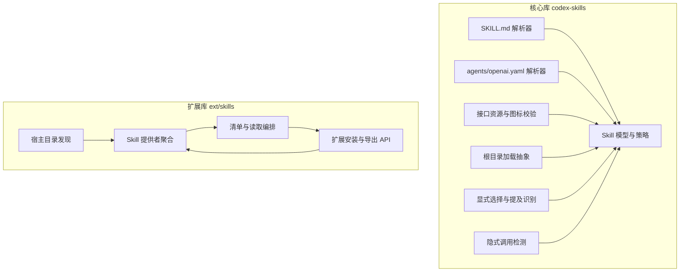
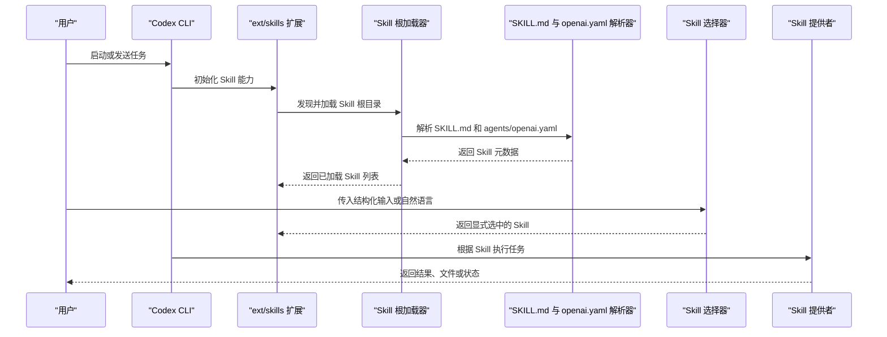
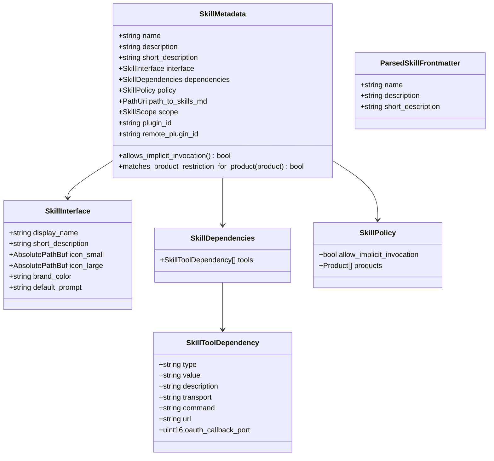
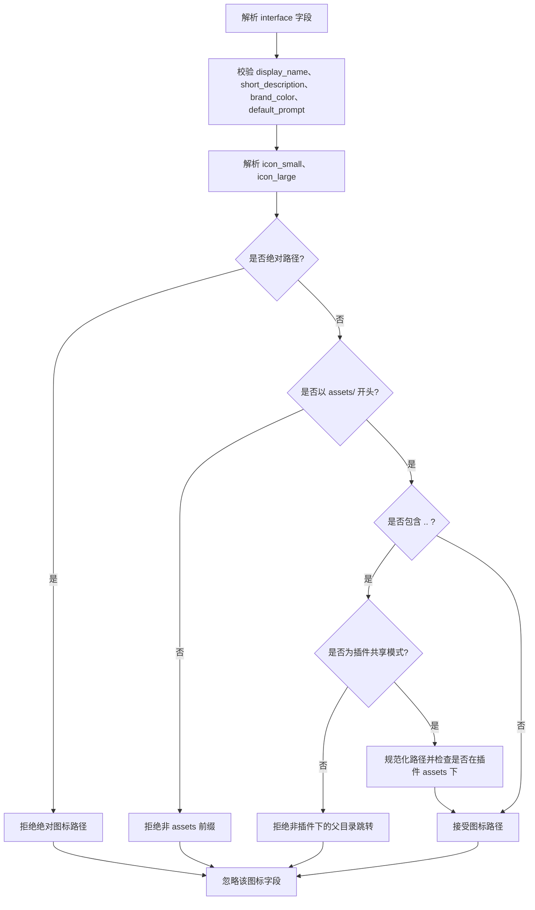
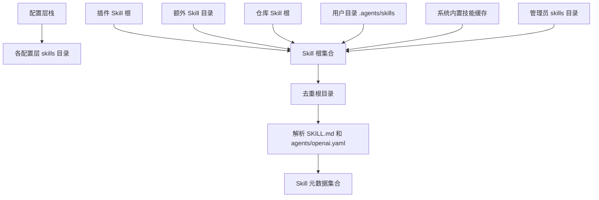
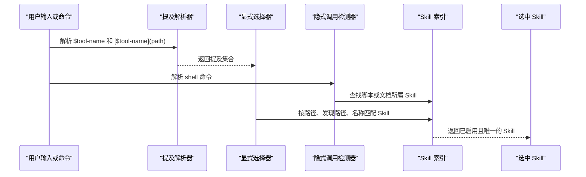
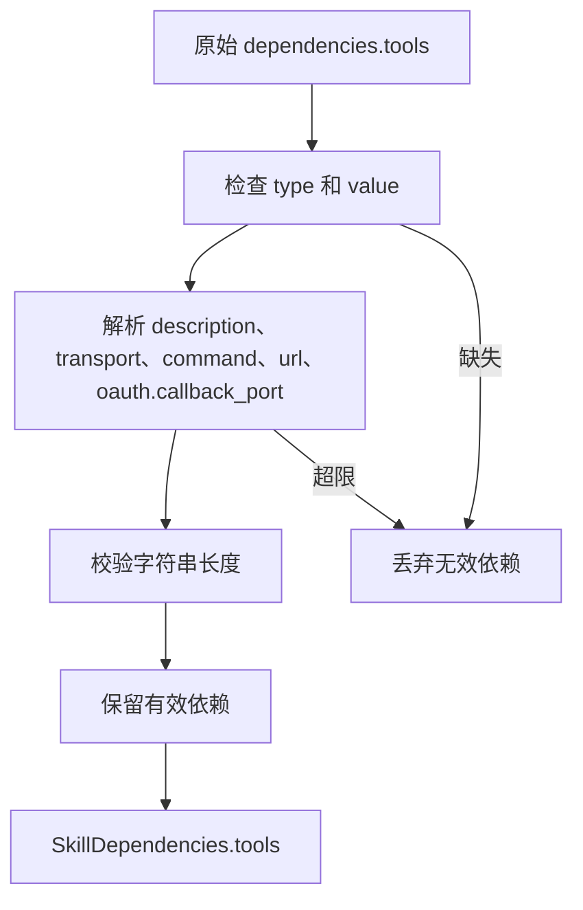
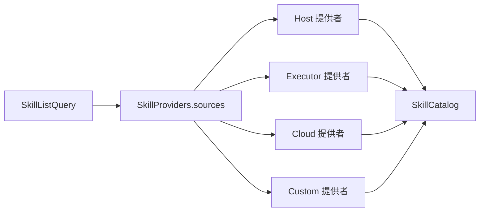
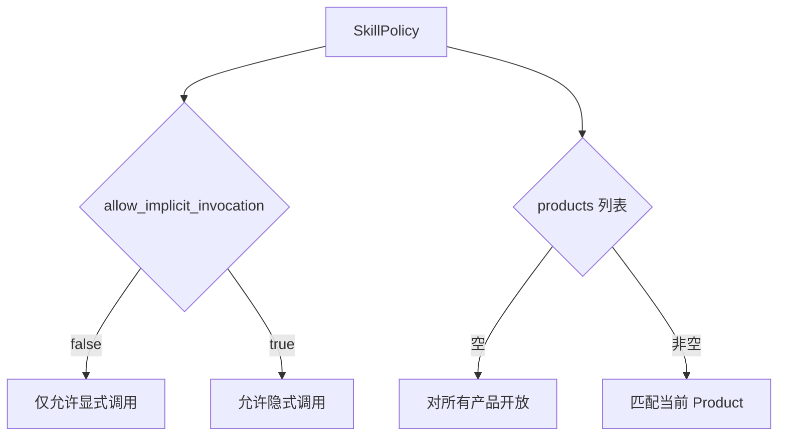

# Skill 系统

<cite>
**本文引用的文件**   
- [codex-rs/skills/src/lib.rs](file://codex-rs/skills/src/lib.rs)
- [codex-rs/skills/src/model.rs](file://codex-rs/skills/src/model.rs)
- [codex-rs/skills/src/metadata.rs](file://codex-rs/skills/src/metadata.rs)
- [codex-rs/skills/src/parser.rs](file://codex-rs/skills/src/parser.rs)
- [codex-rs/skills/src/loading.rs](file://codex-rs/skills/src/loading.rs)
- [codex-rs/skills/src/interface.rs](file://codex-rs/skills/src/interface.rs)
- [codex-rs/skills/src/selection.rs](file://codex-rs/skills/src/selection.rs)
- [codex-rs/skills/src/mentions.rs](file://codex-rs/skills/src/mentions.rs)
- [codex-rs/skills/src/invocation.rs](file://codex-rs/skills/src/invocation.rs)
- [codex-rs/ext/skills/src/lib.rs](file://codex-rs/ext/skills/src/lib.rs)
- [codex-rs/ext/skills/src/host_roots.rs](file://codex-rs/ext/skills/src/host_roots.rs)
- [codex-rs/ext/skills/src/sources.rs](file://codex-rs/ext/skills/src/sources.rs)
- [codex-rs/skills/src/assets/samples/imagegen/SKILL.md](file://codex-rs/skills/src/assets/samples/imagegen/SKILL.md)
- [codex-rs/skills/src/assets/samples/imagegen/agents/openai.yaml](file://codex-rs/skills/src/assets/samples/imagegen/agents/openai.yaml)
- [codex-rs/skills/src/assets/samples/skill-creator/SKILL.md](file://codex-rs/skills/src/assets/samples/skill-creator/SKILL.md)
- [docs/skills.md](file://docs/skills.md)
</cite>

## 目录
1. [简介](#简介)
2. [项目结构](#项目结构)
3. [核心组件](#核心组件)
4. [架构总览](#架构总览)
5. [详细组件分析](#详细组件分析)
6. [依赖与集成分析](#依赖与集成分析)
7. [性能与缓存特性](#性能与缓存特性)
8. [开发指南](#开发指南)
9. [安全策略与权限控制](#安全策略与权限控制)
10. [故障排查](#故障排查)
11. [结论](#结论)

## 简介
Codex CLI 的 Skill 系统为智能体提供“可发现、可配置、可执行”的任务能力。一个 Skill 通常由以下部分组成：
- `SKILL.md`：Skill 的名称、描述和指令入口。
- `agents/openai.yaml`：可选的界面元数据、调用策略和工具依赖。
- `scripts/`：可选的可执行脚本，用于稳定、重复或复杂的工作流。
- `references/`：按需加载的参考文档。
- `assets/`：生成输出时使用的资源，例如图标、模板等。

Skill 可以在用户目录、仓库目录、插件目录、系统内置目录以及远程环境中被发现；可以被显式选择，也可以在满足条件时被自动触发。Skill 还支持产品限制、隐式调用开关、工具依赖声明和安全策略。

官方文档说明当前仓库中的 Skills 文档是外部链接入口，实际实现位于 Rust 代码库中。

**章节来源**
- [docs/skills.md:1-3](file://docs/skills.md#L1-L3)

## 项目结构
Skill 系统分为两个主要层次：
- `codex-rs/skills`：Skill 的核心抽象、解析、模型、选择、引用识别和隐式调用检测。
- `codex-rs/ext/skills`：扩展层，负责将 Skill 能力暴露给宿主环境、执行环境和云端，管理 Skill 提供者、目录发现、清单合并、调用流程和遥测。

**图表来源**
- [codex-rs/skills/src/lib.rs:1-217](file://codex-rs/skills/src/lib.rs#L1-L217)
- [codex-rs/ext/skills/src/lib.rs:1-69](file://codex-rs/ext/skills/src/lib.rs#L1-L69)
- [codex-rs/ext/skills/src/host_roots.rs:1-200](file://codex-rs/ext/skills/src/host_roots.rs#L1-L200)
- [codex-rs/ext/skills/src/sources.rs:1-200](file://codex-rs/ext/skills/src/sources.rs#L1-L200)

**章节来源**
- [codex-rs/skills/src/lib.rs:1-217](file://codex-rs/skills/src/lib.rs#L1-L217)
- [codex-rs/ext/skills/src/lib.rs:1-69](file://codex-rs/ext/skills/src/lib.rs#L1-L69)

## 核心组件
- **Skill 模型**：定义 Skill 名称、描述、短描述、接口信息、依赖、策略、路径、作用域和插件标识。
- **前端元数据解析器**：从 `SKILL.md` 的 YAML frontmatter 提取 name、description、short-description，并做长度和必填字段校验。
- **接口元数据解析器**：从 `agents/openai.yaml` 解析 display_name、short_description、图标路径、品牌色、默认提示词、策略和工具依赖。
- **Skill 选择器**：从结构化输入和文本中提取 `$skill-name` 或资源链接形式的提及，并结合已加载 Skill 列表进行匹配。
- **隐式调用检测器**：从命令中识别对 Skill 内脚本或文档的访问，从而推断该命令属于哪个 Skill。
- **根目录加载抽象**：定义 Skill 根目录快照、错误、异步加载请求和加载器 trait，使不同来源的 Skill 可以统一加载。
- **宿主目录发现**：根据配置层、仓库标记、插件根和用户目录计算 Skill 根目录集合。
- **Skill 提供者聚合**：统一管理 host、executor、cloud 等来源的 Skill 列表和读取操作。

**章节来源**
- [codex-rs/skills/src/model.rs:1-113](file://codex-rs/skills/src/model.rs#L1-L113)
- [codex-rs/skills/src/parser.rs:1-200](file://codex-rs/skills/src/parser.rs#L1-L200)
- [codex-rs/skills/src/metadata.rs:1-164](file://codex-rs/skills/src/metadata.rs#L1-L164)
- [codex-rs/skills/src/selection.rs:1-200](file://codex-rs/skills/src/selection.rs#L1-L200)
- [codex-rs/skills/src/invocation.rs:1-160](file://codex-rs/skills/src/invocation.rs#L1-L160)
- [codex-rs/skills/src/loading.rs:1-120](file://codex-rs/skills/src/loading.rs#L1-L120)
- [codex-rs/ext/skills/src/host_roots.rs:1-200](file://codex-rs/ext/skills/src/host_roots.rs#L1-L200)
- [codex-rs/ext/skills/src/sources.rs:1-200](file://codex-rs/ext/skills/src/sources.rs#L1-L200)

## 架构总览
Skill 系统的生命周期可以分为五个阶段：
1. **安装与嵌入**：系统内置 Skill 被打包进二进制，并在启动时按指纹决定是否写入用户目录缓存。
2. **根目录发现**：从配置层、插件、额外目录、仓库标记、用户目录和系统目录收集 Skill 根目录。
3. **解析与建模**：解析 `SKILL.md` 和 `agents/openai.yaml`，生成 Skill 元数据和策略。
4. **选择与激活**：从用户输入中解析显式 Skill 引用，或从 Shell 命令中推断隐式 Skill 访问。
5. **执行与结果处理**：通过宿主、执行环境或云提供者执行 Skill，返回结构化结果。

**图表来源**
- [codex-rs/skills/src/lib.rs:1-217](file://codex-rs/skills/src/lib.rs#L1-L217)
- [codex-rs/ext/skills/src/lib.rs:1-69](file://codex-rs/ext/skills/src/lib.rs#L1-L69)
- [codex-rs/ext/skills/src/host_roots.rs:1-200](file://codex-rs/ext/skills/src/host_roots.rs#L1-L200)
- [codex-rs/skills/src/selection.rs:1-200](file://codex-rs/skills/src/selection.rs#L1-L200)
- [codex-rs/skills/src/invocation.rs:1-160](file://codex-rs/skills/src/invocation.rs#L1-L160)

## 详细组件分析

### Skill 定义格式与元数据结构
Skill 的定义主要由两部分组成：
- `SKILL.md` 的 frontmatter：定义 Skill 的基本身份。
- `agents/openai.yaml`：定义界面显示、调用策略和工具依赖。

`SKILL.md` 必须包含 name 和 description；short-description 可选。name 最多 64 个字符，description 不能为空。解析器还会尝试修复部分第三方 Skill 中常见的标量值问题，例如未加引号且包含冒号的描述。

`agents/openai.yaml` 支持：
- interface：display_name、short_description、icon_small、icon_large、brand_color、default_prompt。
- dependencies.tools：type、value、description、transport、command、url、oauth.callback_port。
- policy：allow_implicit_invocation、products。

**图表来源**
- [codex-rs/skills/src/model.rs:1-113](file://codex-rs/skills/src/model.rs#L1-L113)
- [codex-rs/skills/src/metadata.rs:1-164](file://codex-rs/skills/src/metadata.rs#L1-L164)
- [codex-rs/skills/src/parser.rs:1-200](file://codex-rs/skills/src/parser.rs#L1-L200)
- [codex-rs/skills/src/interface.rs:1-200](file://codex-rs/skills/src/interface.rs#L1-L200)

**章节来源**
- [codex-rs/skills/src/parser.rs:1-200](file://codex-rs/skills/src/parser.rs#L1-L200)
- [codex-rs/skills/src/metadata.rs:1-164](file://codex-rs/skills/src/metadata.rs#L1-L164)
- [codex-rs/skills/src/model.rs:1-113](file://codex-rs/skills/src/model.rs#L1-L113)

### Skill 接口规范与资源校验
`agents/openai.yaml` 的 interface 字段主要用于界面展示：
- display_name：Skill 在 UI 中的显示名称。
- short_description：简短描述。
- icon_small、icon_large：图标路径，必须是相对 assets 目录的路径。
- brand_color：颜色值，必须符合 `#RRGGBB` 格式。
- default_prompt：Skill 的默认提示词。

图标路径校验规则：
- 不允许绝对路径。
- 必须以 `assets/` 开头。
- 如果包含 `..`，只有在插件共享资源模式下才允许，并且最终路径必须落在插件的 `assets/` 下。
- 颜色字符串必须非空且符合十六进制颜色格式。

**图表来源**
- [codex-rs/skills/src/interface.rs:1-200](file://codex-rs/skills/src/interface.rs#L1-L200)

**章节来源**
- [codex-rs/skills/src/interface.rs:1-200](file://codex-rs/skills/src/interface.rs#L1-L200)

### Skill 的发现机制与加载过程
Skill 根目录发现顺序由扩展层决定，主要包括：
- 配置层导出的 skills 目录。
- 插件 Skill 根。
- 额外配置的 Skill 目录。
- 仓库内的 `.agents` 或配置标记发现的 Skill。
- 用户目录中的 `.agents/skills`。
- 系统内置 Skill 缓存目录。
- 管理员级别 system 配置目录。

这些根目录会被去重，并按固定优先级组织。每个根目录会进一步解析 `SKILL.md` 和 `agents/openai.yaml`，得到 `SkillMetadata`。

**图表来源**
- [codex-rs/ext/skills/src/host_roots.rs:1-200](file://codex-rs/ext/skills/src/host_roots.rs#L1-L200)
- [codex-rs/skills/src/loading.rs:1-120](file://codex-rs/skills/src/loading.rs#L1-L120)

**章节来源**
- [codex-rs/ext/skills/src/host_roots.rs:1-200](file://codex-rs/ext/skills/src/host_roots.rs#L1-L200)
- [codex-rs/skills/src/loading.rs:1-120](file://codex-rs/skills/src/loading.rs#L1-L120)

### Skill 的选择机制与调用方式
Skill 可以通过两种方式被激活：
1. **显式选择**：用户输入中包含结构化 Skill 选择，或者文本中出现 `$skill-name`、`[$skill-name](path)` 等形式。
2. **隐式调用**：Shell 命令中运行了 Skill 目录下的脚本，或读取了 Skill 文档。

显式选择会优先匹配精确路径或逻辑发现路径；当名称唯一且不与其他工具冲突时，普通名称也可以匹配。

隐式调用会先识别常见脚本解释器和脚本扩展名，再向上查找 Skill 根目录；对于读文档命令，会从工作目录解析目标路径并匹配 Skill。

**图表来源**
- [codex-rs/skills/src/selection.rs:1-200](file://codex-rs/skills/src/selection.rs#L1-L200)
- [codex-rs/skills/src/mentions.rs:1-200](file://codex-rs/skills/src/mentions.rs#L1-L200)
- [codex-rs/skills/src/invocation.rs:1-160](file://codex-rs/skills/src/invocation.rs#L1-L160)

**章节来源**
- [codex-rs/skills/src/selection.rs:1-200](file://codex-rs/skills/src/selection.rs#L1-L200)
- [codex-rs/skills/src/mentions.rs:1-200](file://codex-rs/skills/src/mentions.rs#L1-L200)
- [codex-rs/skills/src/invocation.rs:1-160](file://codex-rs/skills/src/invocation.rs#L1-L160)

### 系统内置 Skill 与用户自定义 Skill 的管理
系统内置 Skill 随二进制发布，安装在 `CODEX_HOME/skills/.system` 目录下。每次启动时，系统会比较内置 Skill 内容的指纹与缓存中的标记文件；只有指纹变化时才重新写入，避免不必要的磁盘操作。

用户自定义 Skill 通常位于：
- 用户配置层的 `skills` 目录。
- 用户主目录下的 `.agents/skills`。
- 仓库中的 `.agents` 或配置标记指定的目录。
- 插件提供的 Skill 根。
- 管理员或企业策略注入的目录。

系统内置 Skill 和用户自定义 Skill 的区别主要体现在作用域和来源：系统 Skill 通常是只读分发内容，用户 Skill 是可编辑能力，插件 Skill 可携带额外资源和配置。

**章节来源**
- [codex-rs/skills/src/lib.rs:1-217](file://codex-rs/skills/src/lib.rs#L1-L217)
- [codex-rs/ext/skills/src/host_roots.rs:1-200](file://codex-rs/ext/skills/src/host_roots.rs#L1-L200)

### 具体 Skill 示例分析

#### 图像生成 Skill
图像生成 Skill 展示了完整 Skill 结构：
- `SKILL.md` 定义了顶层模式、决策树、保存策略、用例分类和提示词模板。
- `agents/openai.yaml` 提供界面显示名称、短描述、图标和默认提示词。
- `scripts/` 提供命令行回退流程。
- `references/` 存放 CLI 文档、网络配置、API 文档和提示词样例。

这个 Skill 强调优先使用内置 image_gen 工具，仅在用户明确要求或内置工具不可用时才切换到脚本模式。

**章节来源**
- [codex-rs/skills/src/assets/samples/imagegen/SKILL.md:1-200](file://codex-rs/skills/src/assets/samples/imagegen/SKILL.md#L1-L200)
- [codex-rs/skills/src/assets/samples/imagegen/agents/openai.yaml:1-6](file://codex-rs/skills/src/assets/samples/imagegen/agents/openai.yaml#L1-L6)

#### Skill 创建器 Skill
Skill 创建器 Skill 本身也是一个 Skill，用于帮助用户创建或更新 Skill。它说明了：
- Skill 目录结构。
- `SKILL.md` 的职责。
- `agents/openai.yaml` 的作用。
- scripts、references、assets 的使用场景。
- 如何保持隐式调用默认开启，除非用户明确要求仅显式调用。

这可以作为用户编写新 Skill 的权威参考。

**章节来源**
- [codex-rs/skills/src/assets/samples/skill-creator/SKILL.md:1-200](file://codex-rs/skills/src/assets/samples/skill-creator/SKILL.md#L1-L200)

## 依赖与集成分析

### Skill 工具依赖
Skill 可以通过 `dependencies.tools` 声明外部工具依赖。每条依赖包含：
- type：依赖类型。
- value：依赖值。
- description：人类可读说明。
- transport：传输方式。
- command：命令。
- url：URL。
- oauth.callback_port：OAuth 回调端口。

解析时会过滤缺少必需字段、字段为空或超过最大长度的依赖项，并记录警告日志。

**图表来源**
- [codex-rs/skills/src/metadata.rs:1-164](file://codex-rs/skills/src/metadata.rs#L1-L164)

**章节来源**
- [codex-rs/skills/src/metadata.rs:1-164](file://codex-rs/skills/src/metadata.rs#L1-L164)

### Skill 提供者与清单聚合
扩展层通过 `SkillProviders` 聚合多个 Skill 来源：
- host：宿主机 Skill。
- executor：执行环境 Skill。
- cloud：云端 Skill。
- custom：自定义来源。

每个来源根据查询条件决定是否参与列表、读取或 MCP 资源转发。

**图表来源**
- [codex-rs/ext/skills/src/sources.rs:1-200](file://codex-rs/ext/skills/src/sources.rs#L1-L200)

**章节来源**
- [codex-rs/ext/skills/src/sources.rs:1-200](file://codex-rs/ext/skills/src/sources.rs#L1-L200)

### 调用链路与上下文
扩展层导出了许多关键类型，包括：
- HostSkillsService：宿主 Skill 服务。
- HostSkillsRequest / HostSkillsLoadInput：加载请求和输入。
- HostSkillsSnapshot：快照。
- SkillProvider / ExecutorSkillProvider / FrozenCloudSkillProvider / HostSkillProvider：Skill 提供者接口。
- EnvironmentSkillRequirements：环境 Skill 要求。
- detect_implicit_skill_invocation：扩展层隐式调用检测。
- record_plugin_turn_usage：插件轮次使用遥测。

这表明 Skill 系统不仅是本地文件解析，还深度集成到宿主进程、执行环境、遥测和插件生态中。

**章节来源**
- [codex-rs/ext/skills/src/lib.rs:1-69](file://codex-rs/ext/skills/src/lib.rs#L1-L69)

## 性能与缓存特性
Skill 系统有多处优化和缓存设计：

1. **系统内置 Skill 指纹缓存**
   - 使用内存中的嵌入目录计算指纹。
   - 将指纹写入 `CODEX_HOME/skills/.system` 下的标记文件。
   - 下次启动时比较标记文件和嵌入目录指纹，命中则跳过写入。

2. **Skill 根目录快照缓存**
   - `SkillRootSnapshotCache` 允许调用方拥有缓存所有权。
   - `SkillRootSnapshots` 提供共享访问，相等性和哈希基于缓存对象指针，便于作为其他缓存的键。

3. **提及解析复杂度**
   - 显式 Skill 选择的时间复杂度约为 `O(T + (N_s + N_t) * S)`，空间复杂度约为 `O(S + M)`，其中 S 是 Skill 数量，T 是文本长度，Ns 是结构化 Skill 输入数量，Nt 是文本输入数量，M 是单次文本中解析出的提及数量。

4. **并发与异步**
   - 宿主目录发现和提供者列表操作使用异步 Future。
   - 空远程根目录缓存带有代数和 watch 通道，避免重复探测。

**章节来源**
- [codex-rs/skills/src/lib.rs:1-217](file://codex-rs/skills/src/lib.rs#L1-L217)
- [codex-rs/skills/src/loading.rs:1-120](file://codex-rs/skills/src/loading.rs#L1-L120)
- [codex-rs/skills/src/selection.rs:1-200](file://codex-rs/skills/src/selection.rs#L1-L200)
- [codex-rs/ext/skills/src/host_roots.rs:1-200](file://codex-rs/ext/skills/src/host_roots.rs#L1-L200)

## 开发指南

### 创建 Skill 的步骤
1. 在合适位置创建 Skill 目录，例如 `CODEX_HOME/skills/<skill-name>`。
2. 创建 `SKILL.md`，包含 YAML frontmatter 和 Markdown 正文。
3. 如需界面显示或策略控制，创建 `agents/openai.yaml`。
4. 如需脚本化流程，创建 `scripts/` 下的可执行脚本。
5. 如需按需参考文档，创建 `references/`。
6. 如需生成输出资源，创建 `assets/`。
7. 测试 Skill 是否能被正确发现、选择和调用。

推荐参考仓库自带的 skill-creator Skill，它提供了命名约定、目录结构和策略设置的最佳实践。

**章节来源**
- [codex-rs/skills/src/assets/samples/skill-creator/SKILL.md:1-200](file://codex-rs/skills/src/assets/samples/skill-creator/SKILL.md#L1-L200)

### Skill 模板建议
- 小型 Skill：只需 `SKILL.md`，必要时添加 `agents/openai.yaml`。
- 中等 Skill：增加 `references/`，把详细说明拆成独立文档。
- 复杂 Skill：增加 `scripts/` 和 `assets/`，并把交互分支写入 `SKILL.md` 的决策树。
- 多模式 Skill：在 `SKILL.md` 中说明模式选择条件，把每种模式的细节放入对应 reference。

### 参数传递与结果处理
Skill 的参数传递主要通过以下方式：
- 用户输入中的结构化 Skill 选择。
- 文本中的 `$skill-name` 或 `[$skill-name](resource path)`。
- `SKILL.md` 正文中对工具和参数的指导。
- `agents/openai.yaml` 的 default_prompt。
- `dependencies.tools` 的外部工具依赖。

结果处理主要由上层执行框架完成；Skill 本身更多承担“决策与引导”职责，而不是直接替代整个执行管线。

**章节来源**
- [codex-rs/skills/src/selection.rs:1-200](file://codex-rs/skills/src/selection.rs#L1-L200)
- [codex-rs/skills/src/metadata.rs:1-164](file://codex-rs/skills/src/metadata.rs#L1-L164)

## 安全策略与权限控制

### 隐式调用策略
`policy.allow_implicit_invocation` 控制 Skill 是否可以被自动发现和使用。默认允许隐式调用；若设置为 false，则只能显式选择该 Skill。

### 产品限制
`policy.products` 配合当前 Product 决定 Skill 是否适用于当前产品。如果策略为空，则默认对所有产品开放。

### 图标路径安全
- 不允许绝对路径。
- 不允许不在 `assets/` 下的路径。
- 父目录跳转只能在插件共享资源模式下使用，且必须最终落在插件 `assets/` 下。
- 颜色字段必须严格符合 `#RRGGBB`。

### 依赖字段安全
- type 和 value 是必需字段。
- 所有字符串字段都有最大长度限制。
- 空字段或缺失字段会被忽略并记录警告。

**图表来源**
- [codex-rs/skills/src/model.rs:1-113](file://codex-rs/skills/src/model.rs#L1-L113)
- [codex-rs/skills/src/metadata.rs:1-164](file://codex-rs/skills/src/metadata.rs#L1-L164)

**章节来源**
- [codex-rs/skills/src/model.rs:1-113](file://codex-rs/skills/src/model.rs#L1-L113)
- [codex-rs/skills/src/metadata.rs:1-164](file://codex-rs/skills/src/metadata.rs#L1-L164)
- [codex-rs/skills/src/interface.rs:1-200](file://codex-rs/skills/src/interface.rs#L1-L200)

## 故障排查

### 常见问题
- **Skill 未被发现**
  - 检查 Skill 是否放在正确的根目录。
  - 检查配置层是否启用了对应目录。
  - 检查是否存在重复根目录导致被去重。

- **Skill 无法被隐式调用**
  - 检查 `agents/openai.yaml` 中是否设置了 `allow_implicit_invocation: false`。
  - 检查命令是否确实运行了 Skill 下的脚本，或读取了 Skill 文档。

- **图标不生效**
  - 检查图标路径是否以 `assets/` 开头。
  - 检查是否使用了绝对路径。
  - 检查是否在不允许的情况下使用了 `..`。
  - 检查 brand_color 是否符合 `#RRGGBB`。

- **依赖被忽略**
  - 检查 type 和 value 是否都存在。
  - 检查字符串字段是否超长或为空。
  - 检查 yaml 中是否有拼写错误。

- **System 内置 Skill 未更新**
  - 检查 `CODEX_HOME/skills/.system` 的标记文件是否与嵌入 Skill 指纹一致。
  - 如果修改了内置 Skill，需要确保部署版本更新了嵌入目录。

**章节来源**
- [codex-rs/skills/src/lib.rs:1-217](file://codex-rs/skills/src/lib.rs#L1-L217)
- [codex-rs/skills/src/interface.rs:1-200](file://codex-rs/skills/src/interface.rs#L1-L200)
- [codex-rs/skills/src/metadata.rs:1-164](file://codex-rs/skills/src/metadata.rs#L1-L164)
- [codex-rs/skills/src/invocation.rs:1-160](file://codex-rs/skills/src/invocation.rs#L1-L160)
- [codex-rs/ext/skills/src/host_roots.rs:1-200](file://codex-rs/ext/skills/src/host_roots.rs#L1-L200)

## 结论
Codex CLI 的 Skill 系统是一个分层清晰、可扩展的能力体系。它以 `SKILL.md` 和 `agents/openai.yaml` 为核心契约，结合宿主目录发现、提供者聚合、显式选择和隐式调用检测，让 Skill 既能被模型理解，也能被 CLI、TUI、执行环境和云端协调使用。

对于开发者而言，最关键的实践是：
- 用简洁准确的 name 和 description 帮助系统正确路由。
- 把复杂流程拆成 SKILL.md 决策树和 references。
- 只在必要时使用 scripts 和 dependencies。
- 明确是否需要允许隐式调用。
- 严格遵守图标路径、颜色值和依赖字段的校验规则。
- 利用系统内置 Skill 和用户自定义 Skill 的分层机制，区分只读分发能力和可编辑扩展能力。