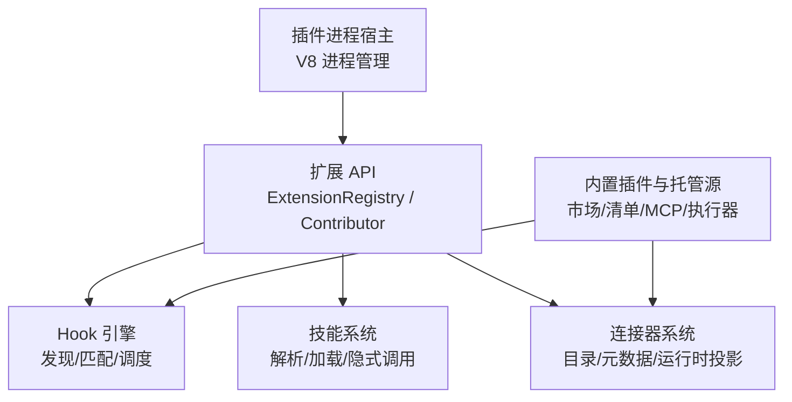
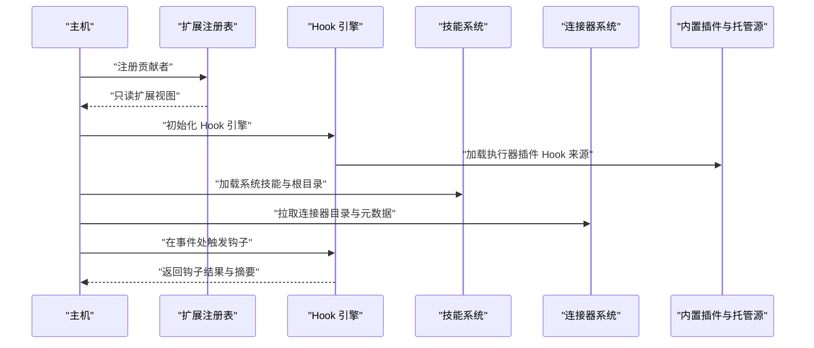
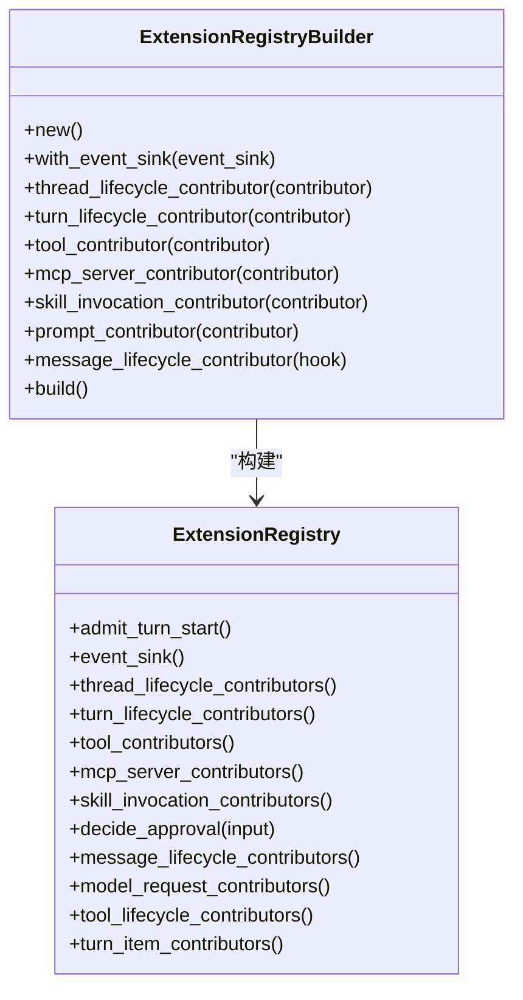
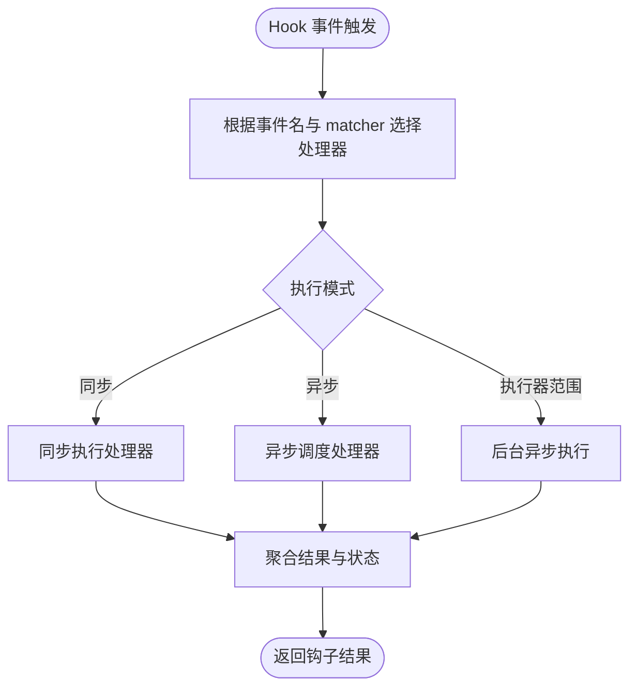
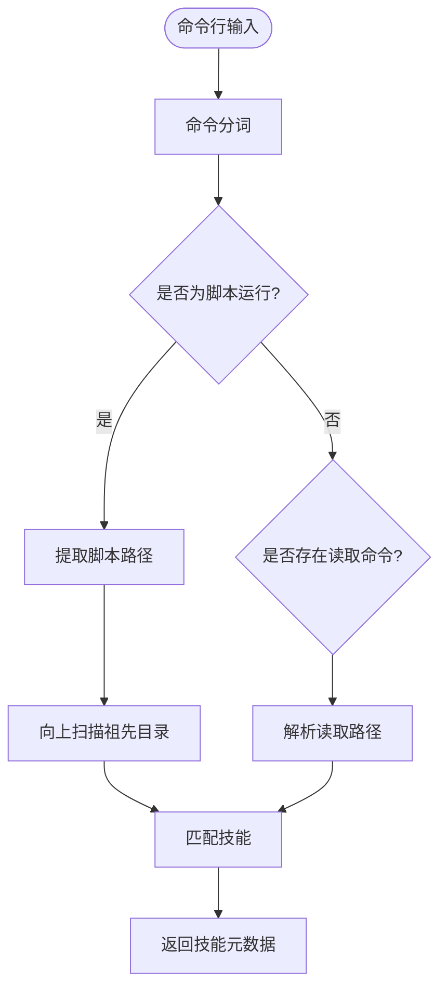
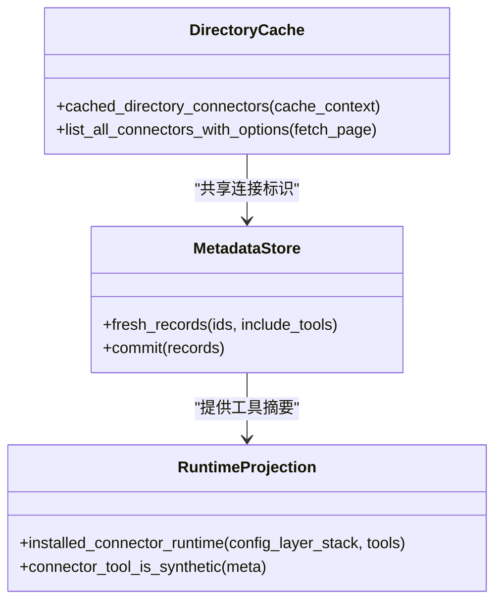
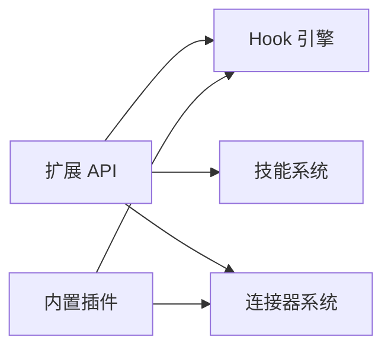

# 扩展架构

<cite>
**本文引用的文件**   
- [extension-api/lib.rs](file://codex-rs/ext/extension-api/src/lib.rs)
- [extension-api/registry.rs](file://codex-rs/ext/extension-api/src/registry.rs)
- [extension-api/contributors.rs](file://codex-rs/ext/extension-api/src/contributors.rs)
- [hooks/lib.rs](file://codex-rs/hooks/src/lib.rs)
- [hooks/engine/mod.rs](file://codex-rs/hooks/src/engine/mod.rs)
- [hooks/engine/discovery.rs](file://codex-rs/hooks/src/engine/discovery.rs)
- [hooks/engine/dispatcher.rs](file://codex-rs/hooks/src/engine/dispatcher.rs)
- [hooks/registry.rs](file://codex-rs/hooks/src/registry.rs)
- [skills/lib.rs](file://codex-rs/skills/src/lib.rs)
- [skills/loading.rs](file://codex-rs/skills/src/loading.rs)
- [skills/model.rs](file://codex-rs/skills/src/model.rs)
- [skills/invocation.rs](file://codex-rs/skills/src/invocation.rs)
- [connectors/lib.rs](file://codex-rs/connectors/src/lib.rs)
- [connectors/metadata_store.rs](file://codex-rs/connectors/src/metadata_store.rs)
- [connectors/runtime_projection.rs](file://codex-rs/connectors/src/runtime_projection.rs)
- [core-plugins/lib.rs](file://codex-rs/core-plugins/src/lib.rs)
- [plugin-host/lib.rs](file://codex-rs/plugin-host/src/lib.rs)
- [docs/skills.md](file://docs/skills.md)
</cite>

## 目录
1. [引言](#引言)
2. [项目结构](#项目结构)
3. [核心组件](#核心组件)
4. [架构总览](#架构总览)
5. [详细组件分析](#详细组件分析)
6. [依赖关系分析](#依赖关系分析)
7. [性能考虑](#性能考虑)
8. [故障排查指南](#故障排查指南)
9. [结论](#结论)
10. [附录：扩展开发参考](#附录扩展开发参考)

## 引言
Codex CLI 的扩展体系围绕四个层次构建：
- 扩展点与贡献者模型：通过 `ExtensionRegistry` 和各类 Contributor trait 暴露生命周期、工具、消息、会话、技能等扩展点。
- Hook 系统：从配置发现命令或 MCP 钩子，在会话、工具调用、模型请求、中断等时机执行用户、项目、插件或执行器范围的钩子。
- Skill 系统：以 `SKILL.md` 为核心的可发现技能定义，支持隐式脚本读取、显式引用、策略过滤与产品限制。
- Connector 系统：将外部应用作为运行时工具投影到 Codex，提供目录缓存、元数据缓存、工具可见性与策略评估。

本文面向希望为 Codex 编写插件、Hook、Skill 或 Connector 的开发者，从代码级实现出发，解释设计模式、生命周期、注册方式、执行时机以及调试与部署实践。

## 项目结构
Codex 扩展相关的主要 Rust crate 分布如下：
- `codex-rs/ext/extension-api`：扩展 API，定义贡献者 trait、注册表、事件与工具能力。
- `codex-rs/hooks`：Hook 声明、发现、匹配、调度与执行引擎。
- `codex-rs/skills`：技能定义解析、加载、提及识别与隐式调用检测。
- `codex-rs/connectors`：连接器目录、运行时工具投影、元数据缓存与应用工具策略。
- `codex-rs/core-plugins`：内置插件市场、插件清单、MCP 路由、执行器插件 Hook 来源等。
- `codex-rs/plugin-host`：V8 插件进程的 IPC 封装与进程生命周期管理。

**图表来源**
- [extension-api/lib.rs:1-137](file://codex-rs/ext/extension-api/src/lib.rs#L1-L137)
- [hooks/lib.rs:1-139](file://codex-rs/hooks/src/lib.rs#L1-L139)
- [skills/lib.rs:1-200](file://codex-rs/skills/src/lib.rs#L1-L200)
- [connectors/lib.rs:1-200](file://codex-rs/connectors/src/lib.rs#L1-L200)
- [core-plugins/lib.rs:1-136](file://codex-rs/core-plugins/src/lib.rs#L1-L136)
- [plugin-host/lib.rs:1-14](file://codex-rs/plugin-host/src/lib.rs#L1-L14)

**章节来源**
- [extension-api/lib.rs:1-137](file://codex-rs/ext/extension-api/src/lib.rs#L1-L137)
- [hooks/lib.rs:1-139](file://codex-rs/hooks/src/lib.rs#L1-L139)
- [skills/lib.rs:1-200](file://codex-rs/skills/src/lib.rs#L1-L200)
- [connectors/lib.rs:1-200](file://codex-rs/connectors/src/lib.rs#L1-L200)
- [core-plugins/lib.rs:1-136](file://codex-rs/core-plugins/src/lib.rs#L1-L136)
- [plugin-host/lib.rs:1-14](file://codex-rs/plugin-host/src/lib.rs#L1-L14)

## 核心组件
### 扩展 API 与贡献者
扩展 API 暴露了统一的注册表和大量 Contributor trait，用于向 Codex 注入能力：
- 线程生命周期：`ThreadLifecycleContributor`
- 轮次生命周期：`TurnLifecycleContributor`
- 工具生命周期：`ToolLifecycleContributor`
- 提示词上下文：`ContextContributor`
- MCP 服务器与选中插件：`McpServerContributor`
- 技能调用：`SkillInvocationContributor`
- 模型请求拦截：`ModelRequestContributor`
- 直接消息观察：`MessageLifecycleContributor`
- 审批审查：`ApprovalReviewContributor`
- 其他：配置贡献、Token 用量、轮次输入、响应项注入、用户指令等。

这些贡献者在启动时通过 `ExtensionRegistryBuilder` 注册，随后由主机消费 `ExtensionRegistry` 提供的只读视图。

**章节来源**
- [extension-api/lib.rs:1-137](file://codex-rs/ext/extension-api/src/lib.rs#L1-L137)
- [extension-api/contributors.rs:1-200](file://codex-rs/ext/extension-api/src/contributors.rs#L1-L200)

### Hook 引擎
Hook 系统负责：
- 从配置层、JSON/TOML、插件清单和执行器插件来源发现 Handler。
- 根据事件名与 matcher 选择匹配的钩子。
- 按同步/异步模式执行命令或 MCP Tool。
- 输出结构化结果、摘要、状态与错误。

关键类型包括 `Hooks`、`ClaudeHooksEngine`、`ConfiguredHandler`、`HookListEntry` 以及各事件模块。

**章节来源**
- [hooks/lib.rs:1-139](file://codex-rs/hooks/src/lib.rs#L1-L139)
- [hooks/engine/mod.rs:1-200](file://codex-rs/hooks/src/engine/mod.rs#L1-L200)
- [hooks/engine/mod.rs:201-571](file://codex-rs/hooks/src/engine/mod.rs#L201-L571)

### Skill 系统
Skill 是包含 `SKILL.md` 的目录资源，支持：
- 元数据解析与策略控制。
- 系统内嵌技能的安装与指纹缓存。
- 根路径加载、快照缓存与产品限制。
- 隐式调用检测：命令行中运行脚本或读取文档时自动关联技能。

**章节来源**
- [skills/lib.rs:1-200](file://codex-rs/skills/src/lib.rs#L1-L200)
- [skills/loading.rs:1-120](file://codex-rs/skills/src/loading.rs#L1-L120)
- [skills/model.rs:1-113](file://codex-rs/skills/src/model.rs#L1-L113)
- [skills/invocation.rs:1-160](file://codex-rs/skills/src/invocation.rs#L1-L160)

### Connector 系统
Connector 将外部应用映射为运行时工具：
- 目录列表缓存与分页拉取。
- 应用元数据与工具摘要缓存。
- 运行时工具投影到已安装连接器。
- 应用工具策略评估。

**章节来源**
- [connectors/lib.rs:1-200](file://codex-rs/connectors/src/lib.rs#L1-L200)
- [connectors/metadata_store.rs:1-144](file://codex-rs/connectors/src/metadata_store.rs#L1-L144)
- [connectors/runtime_projection.rs:1-103](file://codex-rs/connectors/src/runtime_projection.rs#L1-L103)

### 插件宿主
插件宿主封装 V8 插件进程的边界、协议帧、退出状态与实例上限，用于 UI 插件或相关扩展的进程隔离。

**章节来源**
- [plugin-host/lib.rs:1-14](file://codex-rs/plugin-host/src/lib.rs#L1-L14)

## 架构总览
Codex 扩展架构采用“注册表 + 贡献者 + 引擎”的分层设计：
- 扩展 API 定义贡献者接口，并由 `ExtensionRegistry` 统一持有。
- Hook 引擎从多层配置与插件来源发现处理器，并在特定事件上调度。
- Skill 系统提供技能发现、解析与隐式调用推断。
- Connector 系统将外部应用投影为工具，并通过策略与缓存优化显示与调用。
- 内置插件模块提供市场、清单、远程仓库、执行器插件 Hook 来源等基础设施。

**图表来源**
- [extension-api/registry.rs:1-200](file://codex-rs/ext/extension-api/src/registry.rs#L1-L200)
- [hooks/engine/mod.rs:201-571](file://codex-rs/hooks/src/engine/mod.rs#L201-L571)
- [skills/lib.rs:1-200](file://codex-rs/skills/src/lib.rs#L1-L200)
- [connectors/lib.rs:1-200](file://codex-rs/connectors/src/lib.rs#L1-L200)
- [core-plugins/lib.rs:1-136](file://codex-rs/core-plugins/src/lib.rs#L1-L136)

## 详细组件分析

### 扩展注册表与贡献者生命周期
`ExtensionRegistryBuilder` 提供链式注册方法，例如注册线程生命周期、轮次生命周期、工具、MCP、技能调用、提示词上下文等贡献者；`build()` 后得到不可变的 `ExtensionRegistry`，供运行时查询。

注册顺序重要：
- 多个同类贡献者按注册顺序遍历。
- 审批决策使用“首个声称决定”的策略。
- 某些贡献者（如 MCP 服务器）同名覆盖前值，需要实现者保证唯一性。

**图表来源**
- [extension-api/registry.rs:1-200](file://codex-rs/ext/extension-api/src/registry.rs#L1-L200)
- [extension-api/registry.rs:201-312](file://codex-rs/ext/extension-api/src/registry.rs#L201-L312)

**章节来源**
- [extension-api/registry.rs:1-312](file://codex-rs/ext/extension-api/src/registry.rs#L1-L312)
- [extension-api/contributors.rs:1-200](file://codex-rs/ext/extension-api/src/contributors.rs#L1-L200)

### Hook 机制工作原理
#### 钩子类型与来源
Hook 处理器可以是：
- 命令处理器：本地 shell 命令或 MCP Tool。
- 来源包括：用户、项目、系统、托管、插件、云要求、遗留配置等。
- 执行模式：同步或异步；只有同步钩子能施加控制效果。

#### 发现流程
Hook 发现会：
- 从配置层堆栈加载 TOML/JSON 钩子。
- 合并托管要求与允许策略。
- 校验必需托管钩子是否加载成功。
- 生成 `HookListEntry` 与警告信息。

#### 匹配与调度
调度器根据事件名与 matcher 筛选处理器，并按以下规则执行：
- 同步处理器阻塞等待完成。
- 异步处理器加入并发集合。
- 执行器范围处理器在必要时异步后台执行。
- 汇总结果并排序，记录停止或阻塞信号。

**图表来源**
- [hooks/engine/dispatcher.rs:1-200](file://codex-rs/hooks/src/engine/dispatcher.rs#L1-L200)
- [hooks/engine/mod.rs:201-571](file://codex-rs/hooks/src/engine/mod.rs#L201-L571)

#### 执行时机
Hook 事件包括：
- 模型请求前后
- 工具调用前后
- 权限请求
- 压缩前后
- 会话开始/结束
- 用户提示提交
- 子代理开始/停止
- 停止与中断

**章节来源**
- [hooks/lib.rs:1-139](file://codex-rs/hooks/src/lib.rs#L1-L139)
- [hooks/engine/discovery.rs:1-200](file://codex-rs/hooks/src/engine/discovery.rs#L1-L200)
- [hooks/engine/dispatcher.rs:1-200](file://codex-rs/hooks/src/engine/dispatcher.rs#L1-L200)
- [hooks/engine/mod.rs:201-571](file://codex-rs/hooks/src/engine/mod.rs#L201-L571)

### Skill 系统架构
#### 技能定义
技能以 `SKILL.md` 为核心，附带元数据、策略、依赖与界面信息。策略可控制隐式调用与产品限制。

#### 发现机制
系统技能在安装时写入 CODEX_HOME 的技能目录，并使用指纹与标记文件避免重复写入。普通技能根可通过加载器解析，支持快照缓存。

#### 执行流程
隐式调用检测基于命令分词与路径解析：
- 识别常见脚本运行器与扩展名。
- 对读取命令进行解析，定位文档路径。
- 向上查找祖先目录匹配技能脚本目录。
- 最终返回匹配到的技能。

**图表来源**
- [skills/invocation.rs:1-160](file://codex-rs/skills/src/invocation.rs#L1-L160)
- [skills/model.rs:1-113](file://codex-rs/skills/src/model.rs#L1-L113)

**章节来源**
- [skills/lib.rs:1-200](file://codex-rs/skills/src/lib.rs#L1-L200)
- [skills/loading.rs:1-120](file://codex-rs/skills/src/loading.rs#L1-L120)
- [skills/model.rs:1-113](file://codex-rs/skills/src/model.rs#L1-L113)
- [skills/invocation.rs:1-160](file://codex-rs/skills/src/invocation.rs#L1-L160)

### Connector 设计模式
#### 目录与元数据缓存
连接器目录通过内存与磁盘两级缓存减少网络请求；元数据缓存按后端基础 URL、账户身份与工作区分类分区，具有过期时间。

#### 运行时投影
原始运行时工具被投影为连接器行，结合应用工具策略计算 enabled/callable 状态。合成工具会被跳过。

**图表来源**
- [connectors/lib.rs:1-200](file://codex-rs/connectors/src/lib.rs#L1-L200)
- [connectors/metadata_store.rs:1-144](file://codex-rs/connectors/src/metadata_store.rs#L1-L144)
- [connectors/runtime_projection.rs:1-103](file://codex-rs/connectors/src/runtime_projection.rs#L1-L103)

**章节来源**
- [connectors/lib.rs:1-200](file://codex-rs/connectors/src/lib.rs#L1-L200)
- [connectors/metadata_store.rs:1-144](file://codex-rs/connectors/src/metadata_store.rs#L1-L144)
- [connectors/runtime_projection.rs:1-103](file://codex-rs/connectors/src/runtime_projection.rs#L1-L103)

### 扩展点设计与最佳实践
- 注册顺序敏感：审批决策、提示词上下文、MCP 服务器等同名覆盖需明确策略。
- 异步优先：长耗时逻辑应使用异步贡献者或异步 Hook，避免阻塞主循环。
- 安全边界：Hook 处理器应避免暴露控制器拥有的转录路径，尤其是环境来源。
- 策略一致性：Connector 工具可见性与启用状态应由策略评估器统一判断。
- 可观测性：利用 Hook 摘要、日志与指标反馈钩子执行状态。

[本节为概念性指导，不直接分析具体文件]

## 依赖关系分析
扩展架构的依赖关系如下：
- 扩展 API 被 Hook、Skill、Connector 共同依赖，用于贡献者与工具能力。
- Hook 引擎依赖配置层与插件来源，并输出结构化事件。
- Skill 系统依赖协议中的产品类型与策略枚举。
- Connector 系统依赖配置层的应用工具策略。
- 内置插件提供执行器 Hook 来源与市场能力。

**图表来源**
- [extension-api/lib.rs:1-137](file://codex-rs/ext/extension-api/src/lib.rs#L1-L137)
- [hooks/engine/mod.rs:1-200](file://codex-rs/hooks/src/engine/mod.rs#L1-L200)
- [skills/loading.rs:1-120](file://codex-rs/skills/src/loading.rs#L1-L120)
- [connectors/runtime_projection.rs:1-103](file://codex-rs/connectors/src/runtime_projection.rs#L1-L103)
- [core-plugins/lib.rs:1-136](file://codex-rs/core-plugins/src/lib.rs#L1-L136)

**章节来源**
- [extension-api/lib.rs:1-137](file://codex-rs/ext/extension-api/src/lib.rs#L1-L137)
- [hooks/engine/mod.rs:1-200](file://codex-rs/hooks/src/engine/mod.rs#L1-L200)
- [skills/loading.rs:1-120](file://codex-rs/skills/src/loading.rs#L1-L120)
- [connectors/runtime_projection.rs:1-103](file://codex-rs/connectors/src/runtime_projection.rs#L1-L103)
- [core-plugins/lib.rs:1-136](file://codex-rs/core-plugins/src/lib.rs#L1-L136)

## 性能考虑
- Hook 调度使用并发集合处理异步处理器，避免同步阻塞。
- 执行器范围 Hook 单独调度，不影响公共摘要与阻塞状态。
- Connector 目录与元数据使用进程级缓存与 TTL，降低重复请求。
- Skill 加载支持快照缓存，避免重复解析。
- 系统技能安装使用指纹比较，跳过无变化场景。

[本节为通用性能建议，不直接分析具体文件]

## 故障排查指南
- Hook 必需托管钩子加载失败会阻止会话启动，检查托管要求与加载警告。
- Hook 匹配器为空时仅对部分事件有意义，注意事件语义差异。
- Connector 元数据刷新可能延迟生效，确认缓存作用域与过期时间。
- Skill 隐式调用未命中，检查命令分词、脚本运行器与扩展名匹配。
- 扩展贡献者未生效，确认注册顺序与同名覆盖策略。

**章节来源**
- [hooks/engine/discovery.rs:1-200](file://codex-rs/hooks/src/engine/discovery.rs#L1-L200)
- [hooks/engine/dispatcher.rs:1-200](file://codex-rs/hooks/src/engine/dispatcher.rs#L1-L200)
- [connectors/metadata_store.rs:1-144](file://codex-rs/connectors/src/metadata_store.rs#L1-L144)
- [skills/invocation.rs:1-160](file://codex-rs/skills/src/invocation.rs#L1-L160)

## 结论
Codex 扩展架构通过清晰的贡献者模型、强大的 Hook 引擎、灵活的 Skill 系统与稳健的 Connector 投影，提供了多层次的扩展能力。开发者可在会话、轮次、工具、提示词、技能与外部系统集成等方面按需扩展，同时受益于缓存、策略与安全边界。建议在扩展实现中遵循注册顺序、异步优先与策略一致性的最佳实践，并结合 Hook 摘要与日志进行可观测性建设。

[本节为总结性内容，不直接分析具体文件]

## 附录：扩展开发参考

### 扩展开发指南
- 使用 `ExtensionRegistryBuilder` 注册贡献者，确保名称唯一且顺序可控。
- 长耗时操作放入异步贡献者或异步 Hook。
- 对于外部集成，优先实现 Connector 工具投影，配合策略评估。
- 对于文档与脚本增强，优先实现 Skill 并提供策略控制。
- 使用内置插件能力加载执行器 Hook 来源，避免用户可见钩子混淆。

[本节为通用开发指导，不直接分析具体文件]

### API 参考要点
- 扩展 API：贡献者 trait、注册表、事件与工具能力。
- Hook：事件名、处理器类型、匹配器、执行模式与结果摘要。
- Skill：元数据、策略、依赖、界面与隐式调用。
- Connector：目录缓存、元数据缓存、运行时投影与策略评估。
- 插件宿主：进程参数、就绪帧、实例上限与退出状态。

**章节来源**
- [extension-api/lib.rs:1-137](file://codex-rs/ext/extension-api/src/lib.rs#L1-L137)
- [hooks/lib.rs:1-139](file://codex-rs/hooks/src/lib.rs#L1-L139)
- [skills/model.rs:1-113](file://codex-rs/skills/src/model.rs#L1-L113)
- [connectors/lib.rs:1-200](file://codex-rs/connectors/src/lib.rs#L1-L200)
- [plugin-host/lib.rs:1-14](file://codex-rs/plugin-host/src/lib.rs#L1-L14)

### 部署方式
- 技能：将 `SKILL.md` 放在目标技能目录，或通过系统技能安装机制部署。
- Hook：在用户或项目配置中添加 JSON/TOML 钩子，或使用托管要求与插件来源。
- Connector：从目录服务拉取连接器并缓存元数据，策略由应用工具策略评估器决定。
- 插件：通过内置插件管理与市场机制安装，或通过执行器插件 Hook 来源注入。

**章节来源**
- [skills/lib.rs:1-200](file://codex-rs/skills/src/lib.rs#L1-L200)
- [hooks/engine/discovery.rs:1-200](file://codex-rs/hooks/src/engine/discovery.rs#L1-L200)
- [connectors/lib.rs:1-200](file://codex-rs/connectors/src/lib.rs#L1-L200)
- [core-plugins/lib.rs:1-136](file://codex-rs/core-plugins/src/lib.rs#L1-L136)

### 调试技巧
- 使用 Hook 预览与摘要查看即将执行的钩子与状态。
- 检查 Hook 警告与必需托管钩子错误。
- 查看 Connector 目录与元数据缓存命中情况。
- 使用 Skill 隐式访问检测辅助诊断命令与路径匹配问题。
- 关注扩展贡献者的注册顺序与同名覆盖行为。

**章节来源**
- [hooks/engine/mod.rs:201-571](file://codex-rs/hooks/src/engine/mod.rs#L201-L571)
- [hooks/engine/discovery.rs:1-200](file://codex-rs/hooks/src/engine/discovery.rs#L1-L200)
- [connectors/metadata_store.rs:1-144](file://codex-rs/connectors/src/metadata_store.rs#L1-L144)
- [skills/invocation.rs:1-160](file://codex-rs/skills/src/invocation.rs#L1-L160)

### 示例与说明
- 技能官方文档链接指向开发者站点，便于了解 SKILL.md 规范与示例。
- 技能示例目录位于 skills 资产中，可作为实现参考。

**章节来源**
- [docs/skills.md:1-3](file://docs/skills.md#L1-L3)
- [skills/lib.rs:1-200](file://codex-rs/skills/src/lib.rs#L1-L200)