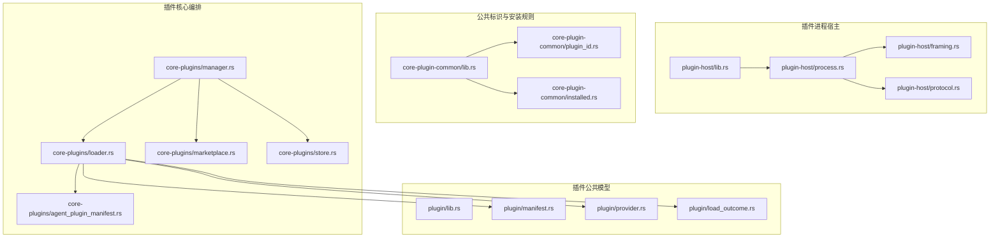
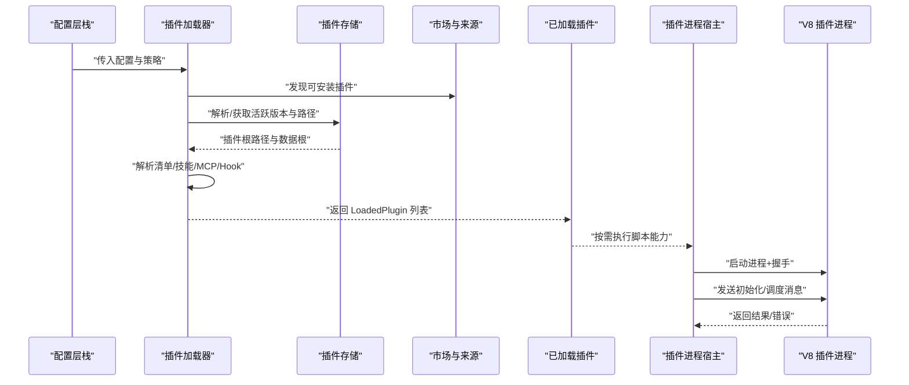
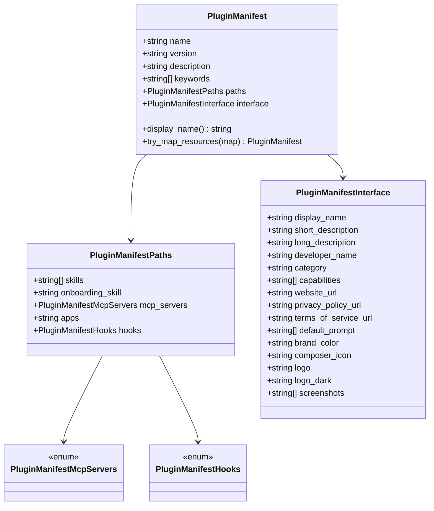
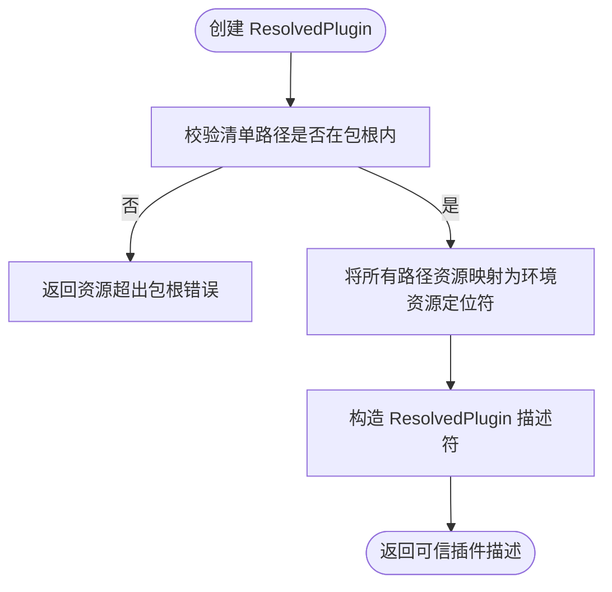
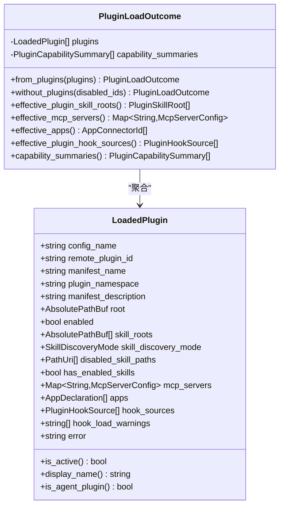
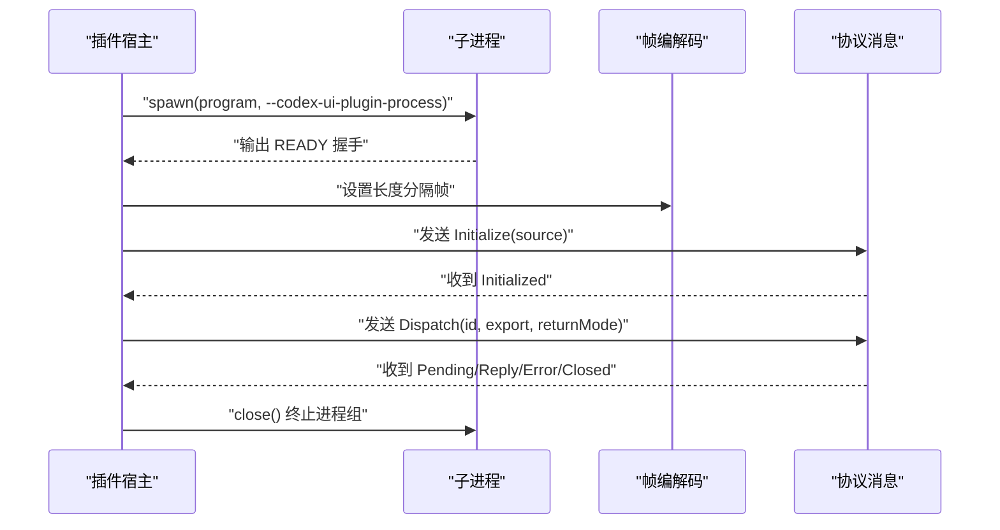
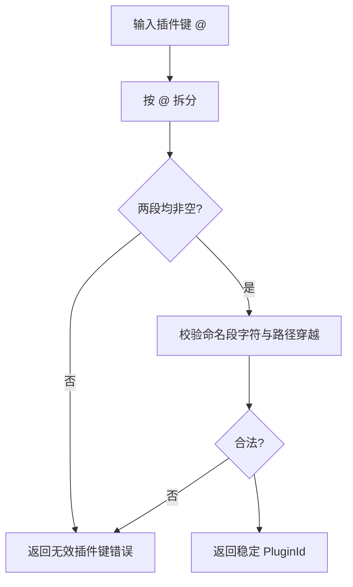
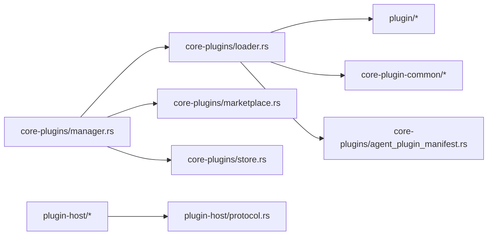
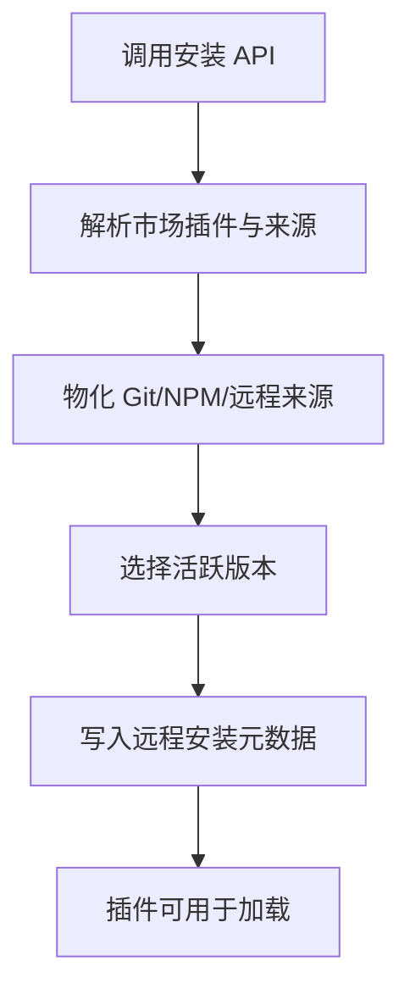

# 插件系统

<cite>
**本文引用的文件**   
- [codex-rs/plugin/src/lib.rs](file://codex-rs/plugin/src/lib.rs)
- [codex-rs/plugin/src/manifest.rs](file://codex-rs/plugin/src/manifest.rs)
- [codex-rs/plugin/src/provider.rs](file://codex-rs/plugin/src/provider.rs)
- [codex-rs/plugin/src/load_outcome.rs](file://codex-rs/plugin/src/load_outcome.rs)
- [codex-rs/plugin-host/src/lib.rs](file://codex-rs/plugin-host/src/lib.rs)
- [codex-rs/plugin-host/src/process.rs](file://codex-rs/plugin-host/src/process.rs)
- [codex-rs/plugin-host/src/framing.rs](file://codex-rs/plugin-host/src/framing.rs)
- [codex-rs/plugin-host/src/protocol.rs](file://codex-rs/plugin-host/src/protocol.rs)
- [codex-rs/core-plugin-common/src/lib.rs](file://codex-rs/core-plugin-common/src/lib.rs)
- [codex-rs/core-plugin-common/src/plugin_id.rs](file://codex-rs/core-plugin-common/src/plugin_id.rs)
- [codex-rs/core-plugin-common/src/identity.rs](file://codex-rs/core-plugin-common/src/identity.rs)
- [codex-rs/core-plugin-common/src/installed.rs](file://codex-rs/core-plugin-common/src/installed.rs)
- [codex-rs/core-plugins/src/loader.rs](file://codex-rs/core-plugins/src/loader.rs)
- [codex-rs/core-plugins/src/manager.rs](file://codex-rs/core-plugins/src/manager.rs)
- [codex-rs/core-plugins/src/marketplace.rs](file://codex-rs/core-plugins/src/marketplace.rs)
- [codex-rs/core-plugins/src/store.rs](file://codex-rs/core-plugins/src/store.rs)
- [codex-rs/core-plugins/src/agent_plugin_manifest.rs](file://codex-rs/core-plugins/src/agent_plugin_manifest.rs)
</cite>

## 目录
1. [简介](#简介)
2. [项目结构](#项目结构)
3. [核心组件](#核心组件)
4. [架构总览](#架构总览)
5. [详细组件分析](#详细组件分析)
6. [依赖关系分析](#依赖关系分析)
7. [性能与并发特性](#性能与并发特性)
8. [安装、卸载、更新与启用流程](#安装卸载更新与启用流程)
9. [插件开发指南与最佳实践](#插件开发指南与最佳实践)
10. [安全模型与沙箱隔离](#安全模型与沙箱隔离)
11. [故障排查](#故障排查)
12. [结论](#结论)

## 简介
Codex CLI 的插件系统围绕“声明式清单 + 能力发现 + 受控执行”的设计展开。它支持三类主要扩展点：技能、MCP 服务器和内置应用连接器，同时提供 Hook 机制用于在任务生命周期中注入行为。插件既可以是本地目录，也可以来自 Git/NPM 市场或远程服务；运行时通过进程隔离执行脚本类能力，并通过严格的消息协议限制通信资源。

本文件从架构、数据模型、加载与注册、安装管理、执行边界和安全控制等维度，完整梳理插件系统的实现与使用方式。

## 项目结构
插件相关代码主要分布在以下模块：
- `codex-rs/plugin`：插件通用模型、清单抽象、已解析插件描述、加载结果与遥测摘要。
- `codex-rs/plugin-host`：独立 V8 插件进程的宿主，负责启动、握手、帧编码、错误收集与进程组清理。
- `codex-rs/core-plugin-common`：跨模块共享的插件标识、身份与安装元数据规则。
- `codex-rs/core-plugins`：插件市场、存储、加载、配置层合并、能力聚合与 UI/TUI 集成逻辑。

**图表来源** 
- [codex-rs/plugin/src/lib.rs:1-97](file://codex-rs/plugin/src/lib.rs#L1-L97)
- [codex-rs/plugin/src/manifest.rs:1-194](file://codex-rs/plugin/src/manifest.rs#L1-L194)
- [codex-rs/plugin/src/provider.rs:1-108](file://codex-rs/plugin/src/provider.rs#L1-L108)
- [codex-rs/plugin/src/load_outcome.rs:1-277](file://codex-rs/plugin/src/load_outcome.rs#L1-L277)
- [codex-rs/plugin-host/src/lib.rs:1-14](file://codex-rs/plugin-host/src/lib.rs#L1-L14)
- [codex-rs/plugin-host/src/process.rs:1-281](file://codex-rs/plugin-host/src/process.rs#L1-L281)
- [codex-rs/plugin-host/src/framing.rs:1-13](file://codex-rs/plugin-host/src/framing.rs#L1-L13)
- [codex-rs/plugin-host/src/protocol.rs:1-88](file://codex-rs/plugin-host/src/protocol.rs#L1-L88)
- [codex-rs/core-plugin-common/src/lib.rs:1-7](file://codex-rs/core-plugin-common/src/lib.rs#L1-L7)
- [codex-rs/core-plugin-common/src/plugin_id.rs:1-83](file://codex-rs/core-plugin-common/src/plugin_id.rs#L1-L83)
- [codex-rs/core-plugin-common/src/installed.rs:1-88](file://codex-rs/core-plugin-common/src/installed.rs#L1-L88)
- [codex-rs/core-plugins/src/loader.rs:1-200](file://codex-rs/core-plugins/src/loader.rs#L1-L200)
- [codex-rs/core-plugins/src/manager.rs:1-200](file://codex-rs/core-plugins/src/manager.rs#L1-L200)
- [codex-rs/core-plugins/src/marketplace.rs:1-200](file://codex-rs/core-plugins/src/marketplace.rs#L1-L200)
- [codex-rs/core-plugins/src/store.rs:1-200](file://codex-rs/core-plugins/src/store.rs#L1-L200)
- [codex-rs/core-plugins/src/agent_plugin_manifest.rs:1-200](file://codex-rs/core-plugins/src/agent_plugin_manifest.rs#L1-L200)

**章节来源**
- [codex-rs/plugin/src/lib.rs:1-97](file://codex-rs/plugin/src/lib.rs#L1-L97)
- [codex-rs/core-plugins/src/loader.rs:1-200](file://codex-rs/core-plugins/src/loader.rs#L1-L200)

## 核心组件
- 插件公共模型与能力摘要：定义插件名称、版本、描述、技能路径、MCP 服务器、应用连接器、Hook 源与能力摘要。
- 清单模型：参数化资源位置，支持路径映射、内嵌或引用 MCP/Hook 定义，并提供面向界面显示的元数据。
- 已解析插件：将清单中的路径绑定到具体环境 ID 与根 URI，并校验资源是否位于包根内部。
- 加载结果：聚合启用的技能、MCP 服务器、应用连接器、Hook 源及警告，生成对上层可用的能力摘要。
- 插件进程宿主：启动子进程、长度分隔帧编解码、握手、关闭诊断收集、进程组终止。
- 公共标识与安装规则：解析 `<plugin>@<marketplace>` 格式、校验命名段、选择活跃版本、读取远程安装元数据。
- 核心编排：从配置层栈合并插件、发现市场、下载/缓存、解析清单、构建 LoadedPlugin、生成能力汇总。

**章节来源**
- [codex-rs/plugin/src/lib.rs:1-97](file://codex-rs/plugin/src/lib.rs#L1-L97)
- [codex-rs/plugin/src/manifest.rs:1-194](file://codex-rs/plugin/src/manifest.rs#L1-L194)
- [codex-rs/plugin/src/provider.rs:1-108](file://codex-rs/plugin/src/provider.rs#L1-L108)
- [codex-rs/plugin/src/load_outcome.rs:1-277](file://codex-rs/plugin/src/load_outcome.rs#L1-L277)
- [codex-rs/core-plugin-common/src/plugin_id.rs:1-83](file://codex-rs/core-plugin-common/src/plugin_id.rs#L1-L83)
- [codex-rs/core-plugin-common/src/installed.rs:1-88](file://codex-rs/core-plugin-common/src/installed.rs#L1-L88)
- [codex-rs/core-plugins/src/loader.rs:1-200](file://codex-rs/core-plugins/src/loader.rs#L1-L200)

## 架构总览
插件系统分为三层：
1. 配置与市场层：根据配置层栈和市场源确定要加载的插件集合，包括本地、Git、NPM 与远程安装。
2. 解析与加载层：解析清单、技能、MCP 与 Hook，构造 `LoadedPlugin`，并生成能力摘要。
3. 执行层：对脚本类能力通过独立 V8 进程执行，使用长度分隔 JSON 消息协议，限制帧大小、内存、挂起请求与执行轮次。

**图表来源**
- [codex-rs/core-plugins/src/loader.rs:1-200](file://codex-rs/core-plugins/src/loader.rs#L1-L200)
- [codex-rs/core-plugins/src/store.rs:1-200](file://codex-rs/core-plugins/src/store.rs#L1-L200)
- [codex-rs/core-plugins/src/marketplace.rs:1-200](file://codex-rs/core-plugins/src/marketplace.rs#L1-L200)
- [codex-rs/plugin-host/src/process.rs:1-281](file://codex-rs/plugin-host/src/process.rs#L1-L281)

**章节来源**
- [codex-rs/core-plugins/src/loader.rs:1-200](file://codex-rs/core-plugins/src/loader.rs#L1-L200)
- [codex-rs/plugin-host/src/process.rs:1-281](file://codex-rs/plugin-host/src/process.rs#L1-L281)

## 详细组件分析

### 插件清单与能力声明
清单是插件的权威描述，包含：
- 基本信息：名称、可选版本、描述、关键词。
- 资源路径：技能目录、入门技能、MCP 服务器、应用连接器、Hook。
- 接口显示字段：显示名、短/长描述、开发者、分类、网站、隐私政策、默认提示、品牌色、图标、Logo、截图等。
- 资源映射：清单支持把路径型资源映射为带环境权威的资源定位符，避免暴露任意文件系统路径。

**图表来源**
- [codex-rs/plugin/src/manifest.rs:1-194](file://codex-rs/plugin/src/manifest.rs#L1-L194)

**章节来源**
- [codex-rs/plugin/src/manifest.rs:1-194](file://codex-rs/plugin/src/manifest.rs#L1-L194)

### 已解析插件与资源权威绑定
`ResolvedPlugin` 将清单中的路径绑定到具体环境 ID 与根 URI，并拒绝包根外的资源。这确保外部来源提供的清单不会访问宿主机任意路径。

**图表来源**
- [codex-rs/plugin/src/provider.rs:1-108](file://codex-rs/plugin/src/provider.rs#L1-L108)

**章节来源**
- [codex-rs/plugin/src/provider.rs:1-108](file://codex-rs/plugin/src/provider.rs#L1-L108)

### 加载结果与能力摘要
`LoadedPlugin` 聚合一个插件的所有能力：
- 配置名、远程插件 ID、清单名、命名空间、描述。
- 根路径、是否启用、技能根、技能发现模式、禁用技能路径。
- 已启用技能标志、MCP 服务器映射、应用连接器、Hook 源与 Hook 加载警告。
- 最终由 `PluginLoadOutcome` 聚合所有插件，计算有效技能根、MCP 服务器、应用连接器与 Hook 源，并生成能力摘要。

**图表来源**
- [codex-rs/plugin/src/load_outcome.rs:1-277](file://codex-rs/plugin/src/load_outcome.rs#L1-L277)

**章节来源**
- [codex-rs/plugin/src/load_outcome.rs:1-277](file://codex-rs/plugin/src/load_outcome.rs#L1-L277)

### 插件进程宿主与执行协议
插件宿主负责：
- 启动 V8 子进程，传递 `--codex-ui-plugin-process` 参数。
- 等待固定握手字节完成初始化。
- 使用长度分隔帧编解码，限制最大帧大小。
- 通过窄 ABI 协议发送 `Initialize`、`Dispatch`、`Close` 消息，接收 `Initialized`、`Pending`、`Reply`、`Error`、`Closed`。
- 捕获最多 16 KiB 的 stderr 尾部作为诊断，并在关闭时终止进程组。

**图表来源**
- [codex-rs/plugin-host/src/lib.rs:1-14](file://codex-rs/plugin-host/src/lib.rs#L1-L14)
- [codex-rs/plugin-host/src/process.rs:1-281](file://codex-rs/plugin-host/src/process.rs#L1-L281)
- [codex-rs/plugin-host/src/framing.rs:1-13](file://codex-rs/plugin-host/src/framing.rs#L1-L13)
- [codex-rs/plugin-host/src/protocol.rs:1-88](file://codex-rs/plugin-host/src/protocol.rs#L1-L88)

**章节来源**
- [codex-rs/plugin-host/src/lib.rs:1-14](file://codex-rs/plugin-host/src/lib.rs#L1-L14)
- [codex-rs/plugin-host/src/process.rs:1-281](file://codex-rs/plugin-host/src/process.rs#L1-L281)
- [codex-rs/plugin-host/src/framing.rs:1-13](file://codex-rs/plugin-host/src/framing.rs#L1-L13)
- [codex-rs/plugin-host/src/protocol.rs:1-88](file://codex-rs/plugin-host/src/protocol.rs#L1-L88)

### 插件标识、身份与安装规则
- 插件键格式为 `<plugin>@<marketplace>`，解析时会校验两个段是否为空、是否允许字符集，以及是否包含路径穿越片段。
- 安装版本选择会扫描插件基础目录下的版本号目录，按语义版本排序；若存在 `local`，则优先激活 `local`，否则选择最新版本。
- 远程插件安装元数据记录远程插件 ID，用于关联云端与本地安装。

**图表来源**
- [codex-rs/core-plugin-common/src/plugin_id.rs:1-83](file://codex-rs/core-plugin-common/src/plugin_id.rs#L1-L83)

**章节来源**
- [codex-rs/core-plugin-common/src/plugin_id.rs:1-83](file://codex-rs/core-plugin-common/src/plugin_id.rs#L1-L83)
- [codex-rs/core-plugin-common/src/installed.rs:1-88](file://codex-rs/core-plugin-common/src/installed.rs#L1-L88)

### Agent 插件清单解析
Agent 插件清单采用 `plugin.json`，支持 `$schema`、`name`、`version`、`description`、`author`、`homepage`、`repository`、`license`、`keywords`、`extensions`。Codex 扩展命名空间 `com.openai` 可补充额外能力；若未提供扩展，可使用 overlay 内容增强清单。解析过程会忽略未知字段，并对类型错误给出兼容性错误。

**章节来源**
- [codex-rs/core-plugins/src/agent_plugin_manifest.rs:1-200](file://codex-rs/core-plugins/src/agent_plugin_manifest.rs#L1-L200)

## 依赖关系分析
- `core-plugins/loader.rs` 是插件加载的核心入口，消费配置层栈、市场、存储与能力发现，产出 `LoadedPlugin`。
- `core-plugins/manager.rs` 暴露高层安装、启用、刷新、指标与 UI 集成 API。
- `core-plugins/marketplace.rs` 处理市场清单、插件源、安装策略与认证策略。
- `core-plugins/store.rs` 维护插件缓存目录、数据目录、活跃版本与远程安装元数据。
- `plugin-*` 模块提供稳定的公共模型与进程边界。

**图表来源**
- [codex-rs/core-plugins/src/manager.rs:1-200](file://codex-rs/core-plugins/src/manager.rs#L1-L200)
- [codex-rs/core-plugins/src/loader.rs:1-200](file://codex-rs/core-plugins/src/loader.rs#L1-L200)
- [codex-rs/core-plugins/src/marketplace.rs:1-200](file://codex-rs/core-plugins/src/marketplace.rs#L1-L200)
- [codex-rs/core-plugins/src/store.rs:1-200](file://codex-rs/core-plugins/src/store.rs#L1-L200)
- [codex-rs/plugin-host/src/protocol.rs:1-88](file://codex-rs/plugin-host/src/protocol.rs#L1-L88)

**章节来源**
- [codex-rs/core-plugins/src/manager.rs:1-200](file://codex-rs/core-plugins/src/manager.rs#L1-L200)
- [codex-rs/core-plugins/src/loader.rs:1-200](file://codex-rs/core-plugins/src/loader.rs#L1-L200)

## 性能与并发特性
- 插件加载并发：加载器限制最大并发插件加载数，以重叠文件系统与技能加载，但按配置名顺序消费，保证重复项优先级与 Hook 警告顺序稳定。
- 插件进程实例上限：插件宿主定义最大实例数，防止过多子进程消耗资源。
- 帧大小与消息限制：长度分隔帧最大 1 MiB；单次脚本源码、结果、方法名、待处理承诺、并发轮次均有明确上限。
- 诊断缓冲：stderr 只保留最后 16 KiB，避免不可信日志阻塞管道。
- 去重与排序：有效技能根会去重并按路径排序，确保能力发现稳定。

**章节来源**
- [codex-rs/core-plugins/src/loader.rs:1-200](file://codex-rs/core-plugins/src/loader.rs#L1-L200)
- [codex-rs/plugin-host/src/lib.rs:1-14](file://codex-rs/plugin-host/src/lib.rs#L1-L14)
- [codex-rs/plugin-host/src/framing.rs:1-13](file://codex-rs/plugin-host/src/framing.rs#L1-L13)
- [codex-rs/plugin-host/src/protocol.rs:1-88](file://codex-rs/plugin-host/src/protocol.rs#L1-L88)
- [codex-rs/plugin/src/load_outcome.rs:1-277](file://codex-rs/plugin/src/load_outcome.rs#L1-L277)

## 安装、卸载、更新与启用流程

### 插件发现与依赖解析
- 市场发现：支持本地、Git、NPM 多种来源；每个来源携带安装策略与认证策略。
- 清单解析：解析插件清单、技能、MCP、Hook 与应用连接器；对 Agent 插件清单进行 schema 校验与扩展覆盖。
- 依赖解析：通过配置层栈合并用户配置与远程安装插件，统一决定插件是否启用。

**章节来源**
- [codex-rs/core-plugins/src/marketplace.rs:1-200](file://codex-rs/core-plugins/src/marketplace.rs#L1-L200)
- [codex-rs/core-plugins/src/agent_plugin_manifest.rs:1-200](file://codex-rs/core-plugins/src/agent_plugin_manifest.rs#L1-L200)
- [codex-rs/core-plugins/src/loader.rs:1-200](file://codex-rs/core-plugins/src/loader.rs#L1-L200)

### 安装与存储布局
- 缓存目录：插件安装在 Codex home 下的 `plugins/cache`，数据目录为 `plugins/data`。
- 活跃版本：每个插件基础目录下按版本命名；`local` 优先，否则选择最新语义版本。
- 远程元数据：远程插件安装后写入 `.codex-remote-plugin-install.json`，保存远程插件 ID 与 schema 版本。

**图表来源**
- [codex-rs/core-plugins/src/store.rs:1-200](file://codex-rs/core-plugins/src/store.rs#L1-L200)
- [codex-rs/core-plugin-common/src/installed.rs:1-88](file://codex-rs/core-plugin-common/src/installed.rs#L1-L88)

**章节来源**
- [codex-rs/core-plugins/src/store.rs:1-200](file://codex-rs/core-plugins/src/store.rs#L1-L200)
- [codex-rs/core-plugin-common/src/installed.rs:1-88](file://codex-rs/core-plugin-common/src/installed.rs#L1-L88)

### 启用、禁用与重新加载
- 全局策略：配置层栈可决定某个插件是否被允许启用。
- 运行时禁用：可通过 `without_plugins` 将匹配插件标记为非活动，但仍保留加载元数据。
- 重新加载：管理器支持刷新缓存、重新同步市场与重新加载插件，使 UI 与工具发现保持一致。

**章节来源**
- [codex-rs/core-plugins/src/loader.rs:1-200](file://codex-rs/core-plugins/src/loader.rs#L1-L200)
- [codex-rs/plugin/src/load_outcome.rs:1-277](file://codex-rs/plugin/src/load_outcome.rs#L1-L277)

## 插件开发指南与最佳实践

### 插件目录结构与清单
- 基本清单：至少包含 `name`，推荐包含 `version`、`description`、`keywords`。
- 技能目录：默认技能目录为 `skills`；可通过清单指定其他路径。
- MCP 服务器：通过 `.mcp.json` 或清单对象声明；支持嵌入或引用。
- Hook：通过 `hooks/hooks.json` 或清单内嵌声明。
- Agent 插件：使用 `plugin.json` 与 `$schema`，遵循支持的 schema URI，并使用 `extensions.com.openai` 扩展 Codex 能力。

最佳实践：
- 使用稳定且唯一的插件名与 market 名。
- 明确列出能力与依赖，避免隐式全局状态。
- 对外部资源使用相对路径，并通过清单映射避免路径穿越。
- 对敏感信息不要硬编码，应通过 MCP 或配置注入。

**章节来源**
- [codex-rs/plugin/src/manifest.rs:1-194](file://codex-rs/plugin/src/manifest.rs#L1-L194)
- [codex-rs/core-plugins/src/agent_plugin_manifest.rs:1-200](file://codex-rs/core-plugins/src/agent_plugin_manifest.rs#L1-L200)

### 自定义工具与命令
- 技能：通过技能目录暴露结构化能力；技能发现模式支持递归或直接子目录。
- MCP 服务器：通过 MCP 配置暴露工具；插件加载器会合并各插件的 MCP 服务器映射，后者可覆盖前者。
- Hook：在任务生命周期钩子中注入逻辑，例如准备、清理、审计等。

**章节来源**
- [codex-rs/core-plugins/src/loader.rs:1-200](file://codex-rs/core-plugins/src/loader.rs#L1-L200)
- [codex-rs/plugin/src/load_outcome.rs:1-277](file://codex-rs/plugin/src/load_outcome.rs#L1-L277)

### 配置扩展
- 插件可声明应用连接器，供上层路由与能力发现。
- 插件可声明默认提示、品牌色与界面图标，提升 UI 体验。
- 插件可暴露能力标签，便于筛选与推荐。

**章节来源**
- [codex-rs/plugin/src/manifest.rs:1-194](file://codex-rs/plugin/src/manifest.rs#L1-L194)
- [codex-rs/plugin/src/lib.rs:1-97](file://codex-rs/plugin/src/lib.rs#L1-L97)

## 安全模型与沙箱隔离

### 进程隔离
- 插件脚本运行在独立的 V8 子进程中，由插件宿主统一管理。
- 子进程使用独立标准输入输出管道，并通过长度分隔帧传输消息。
- 握手失败或异常退出时，宿主会终止进程组并收集 stderr 尾部。

**章节来源**
- [codex-rs/plugin-host/src/process.rs:1-281](file://codex-rs/plugin-host/src/process.rs#L1-L281)

### 协议与资源限制
- 帧大小上限：1 MiB。
- 源码上限：128 KiB。
- 结果上限：64 KiB。
- 方法名上限：1 KiB。
- 待处理承诺上限：1024。
- 并发轮次上限：8。
- 脚本错误文本上限：16 KiB。

这些限制防止恶意或低质量插件耗尽内存、阻塞 I/O 或制造大量挂起请求。

**章节来源**
- [codex-rs/plugin-host/src/framing.rs:1-13](file://codex-rs/plugin-host/src/framing.rs#L1-L13)
- [codex-rs/plugin-host/src/protocol.rs:1-88](file://codex-rs/plugin-host/src/protocol.rs#L1-L88)

### 权限与资源路径控制
- 已解析插件强制校验资源路径必须在包根之下。
- 插件标识与市场名禁止路径穿越字符。
- 安装版本选择仅接受合法的语义版本或 `local`。
- 远程插件安装元数据有 schema 版本校验与空值校验。

**章节来源**
- [codex-rs/plugin/src/provider.rs:1-108](file://codex-rs/plugin/src/provider.rs#L1-L108)
- [codex-rs/core-plugin-common/src/plugin_id.rs:1-83](file://codex-rs/core-plugin-common/src/plugin_id.rs#L1-L83)
- [codex-rs/core-plugin-common/src/installed.rs:1-88](file://codex-rs/core-plugin-common/src/installed.rs#L1-L88)

## 故障排查
常见症状与对应检查点：
- 插件无法加载：查看 `LoadedPlugin.error`，确认清单路径、技能路径、MCP 与 Hook 是否有效。
- 插件被禁用：检查配置层栈与全局策略，确认插件未被标记为禁用。
- 脚本执行失败：检查插件进程握手与协议错误码，查看 stderr 尾部诊断。
- 版本不生效：确认插件基础目录下是否存在合法版本目录，是否有 `local`。
- 远程插件不一致：检查 `.codex-remote-plugin-install.json` 内容与 schema 版本。

建议排障步骤：
1. 打印 `PluginLoadOutcome.capability_summaries()`，确认能力摘要是否符合预期。
2. 检查 `effective_mcp_servers()` 与 `effective_plugin_hook_sources()` 是否包含所需条目。
3. 若涉及脚本能力，检查 `PluginProcessError` 与 `PluginExit.stderr_tail`。
4. 验证清单与 Agent 插件 schema 是否正确。

**章节来源**
- [codex-rs/plugin/src/load_outcome.rs:1-277](file://codex-rs/plugin/src/load_outcome.rs#L1-L277)
- [codex-rs/plugin-host/src/process.rs:1-281](file://codex-rs/plugin-host/src/process.rs#L1-L281)
- [codex-rs/core-plugins/src/agent_plugin_manifest.rs:1-200](file://codex-rs/core-plugins/src/agent_plugin_manifest.rs#L1-L200)

## 结论
Codex CLI 的插件系统以清单为中心，通过严格的资源绑定、进程隔离与协议限制，提供可扩展的工具、命令与配置能力。其优势在于：
- 清晰的职责分层：配置与市场、解析与加载、执行与安全边界分离。
- 强大的能力聚合：技能、MCP、Hook 与应用连接器统一纳入能力摘要。
- 可控的安装与版本管理：支持多来源、语义版本与 `local` 优先。
- 安全的执行模型：进程隔离、帧与消息大小限制、路径与标识校验。

对于插件开发者，建议始终遵循清单规范、最小权限原则与明确的依赖声明；对于使用者，应关注配置策略、能力摘要与进程诊断，以便快速定位问题。