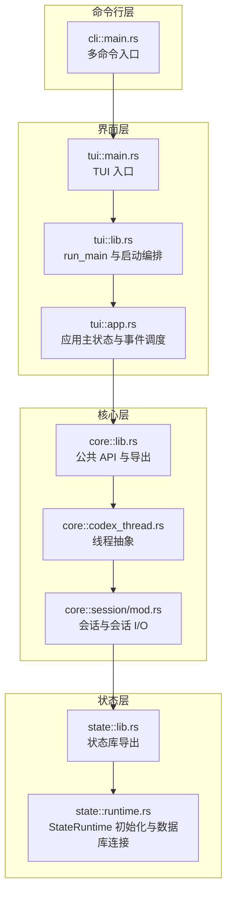
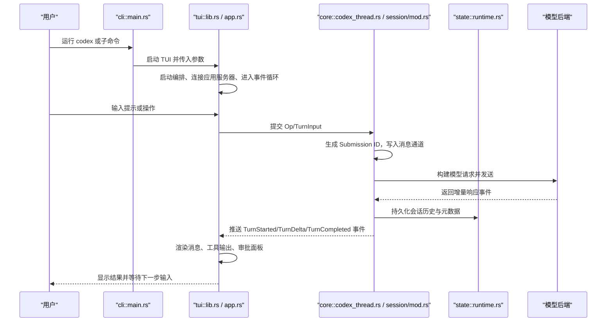
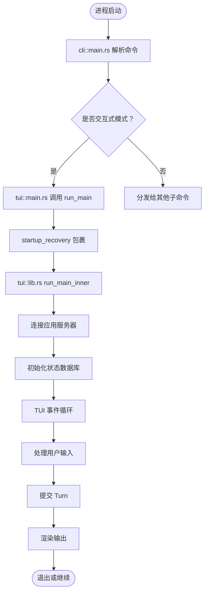
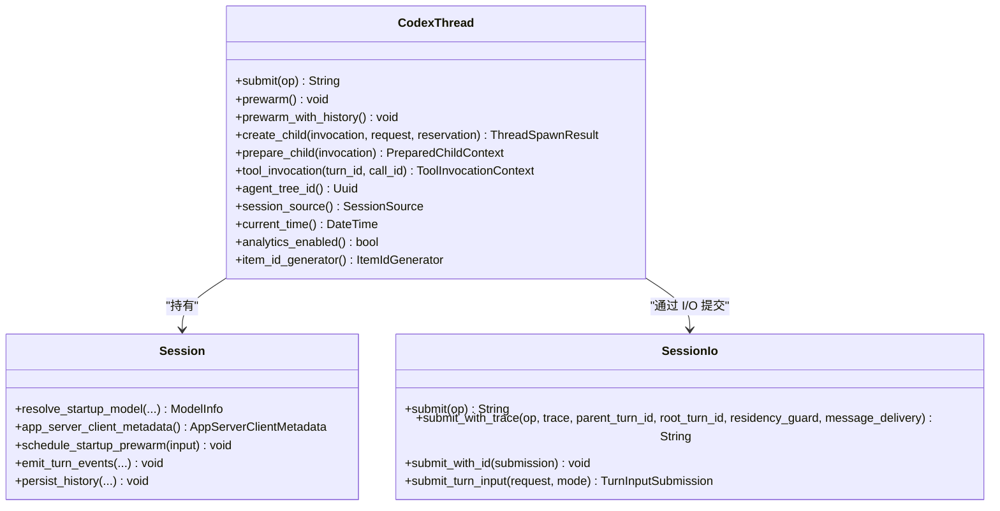
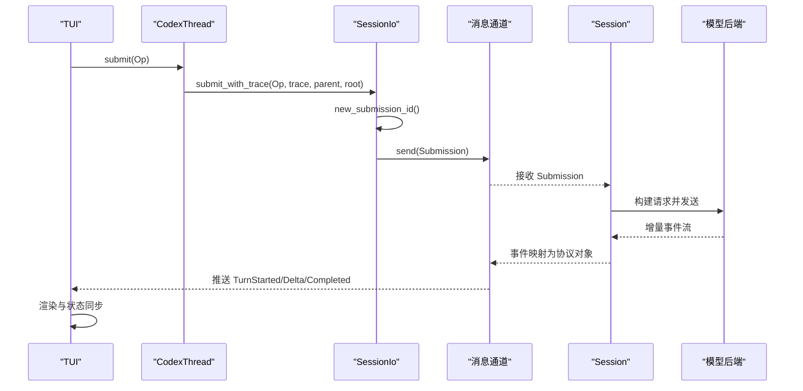
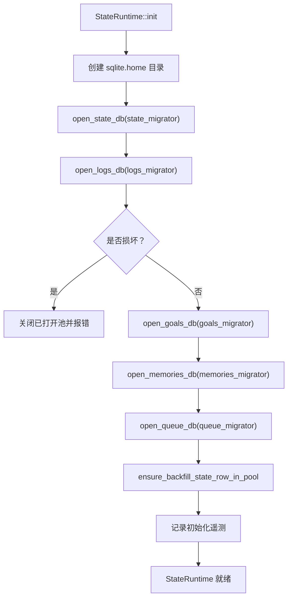
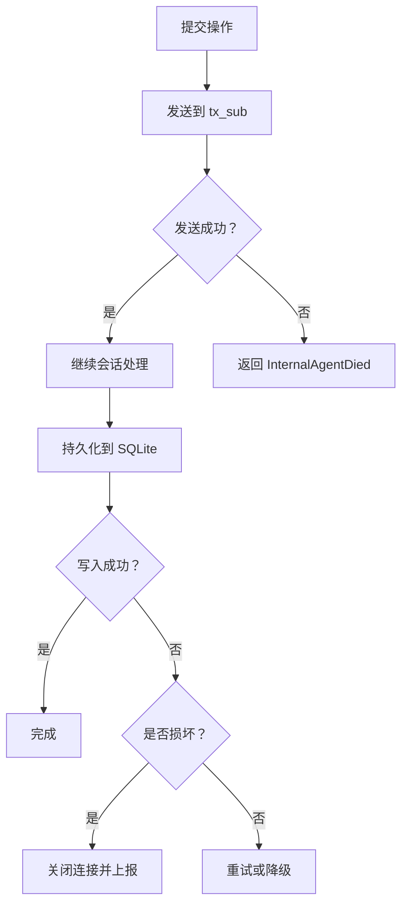
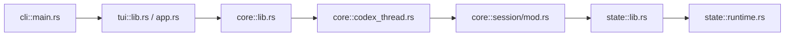
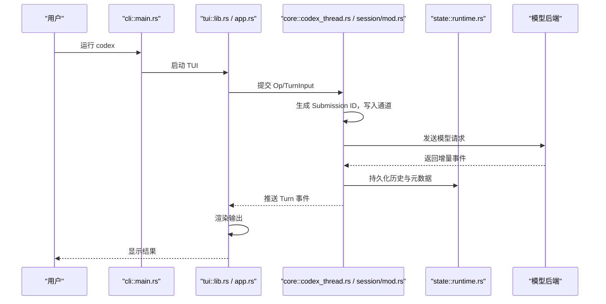
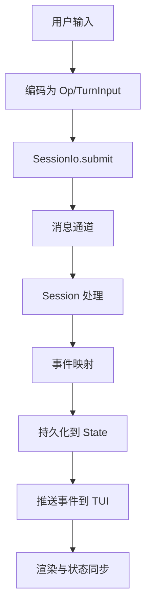

# 数据流图

<cite>
**本文引用的文件**   
- [codex-rs/cli/src/main.rs](file://codex-rs/cli/src/main.rs)
- [codex-rs/tui/src/main.rs](file://codex-rs/tui/src/main.rs)
- [codex-rs/tui/src/lib.rs](file://codex-rs/tui/src/lib.rs)
- [codex-rs/tui/src/app.rs](file://codex-rs/tui/src/app.rs)
- [codex-rs/core/src/lib.rs](file://codex-rs/core/src/lib.rs)
- [codex-rs/core/src/codex_thread.rs](file://codex-rs/core/src/codex_thread.rs)
- [codex-rs/core/src/session/mod.rs](file://codex-rs/core/src/session/mod.rs)
- [codex-rs/state/src/lib.rs](file://codex-rs/state/src/lib.rs)
- [codex-rs/state/src/runtime.rs](file://codex-rs/state/src/runtime.rs)
</cite>

## 目录
1. [引言](#引言)
2. [项目结构](#项目结构)
3. [核心组件](#核心组件)
4. [架构总览](#架构总览)
5. [详细组件分析](#详细组件分析)
6. [依赖关系分析](#依赖关系分析)
7. [性能考虑](#性能考虑)
8. [故障排查指南](#故障排查指南)
9. [结论](#结论)
10. [附录：关键时序与流程图](#附录关键时序与流程图)

## 引言
本文面向 Codex CLI 的数据流视角，覆盖从用户输入到模型响应的完整路径，包括命令行解析、TUI 应用主循环、核心会话与会话 I/O、线程级编排、异步消息通道、持久化状态读写、错误处理与重试机制。重点绘制以下图表：
- 系统架构图：展示 CLI、TUI、Core、State、外部后端之间的职责边界。
- 端到端序列图：从用户提交到模型返回的关键调用链。
- 异步消息流程图：展示事件驱动架构中的消息路由、状态同步和渲染更新。
- 持久化写入流程图：说明会话历史、配置信息和缓存数据的存储策略。
- 错误处理与重试流程图：涵盖网络失败、SQLite 损坏、队列满等场景。

## 项目结构
Codex CLI 工程由多个 Rust crate 组成，本次文档聚焦以下四个关键 crate：
- codex-cli：顶层多命令入口，负责子命令分发、参数合并、CLI 选项与 TUI 启动。
- codex-tui：终端界面层，包含应用主循环、事件总线、会话管理、渲染逻辑。
- codex-core：核心业务层，封装线程、会话、模型请求、工具执行、实时对话和历史压缩。
- codex-state：本地 SQLite 状态存储，提供会话元数据、日志、目标、记忆、队列等持久化能力。

**图示来源**
- [codex-rs/cli/src/main.rs:1-200](file://codex-rs/cli/src/main.rs#L1-L200)
- [codex-rs/tui/src/main.rs:1-59](file://codex-rs/tui/src/main.rs#L1-L59)
- [codex-rs/tui/src/lib.rs:1191-1235](file://codex-rs/tui/src/lib.rs#L1191-L1235)
- [codex-rs/tui/src/app.rs:1-120](file://codex-rs/tui/src/app.rs#L1-L120)
- [codex-rs/core/src/lib.rs:1-120](file://codex-rs/core/src/lib.rs#L1-L120)
- [codex-rs/core/src/codex_thread.rs:1-120](file://codex-rs/core/src/codex_thread.rs#L1-L120)
- [codex-rs/core/src/session/mod.rs:1-120](file://codex-rs/core/src/session/mod.rs#L1-L120)
- [codex-rs/state/src/lib.rs:1-80](file://codex-rs/state/src/lib.rs#L1-L80)
- [codex-rs/state/src/runtime.rs:1-120](file://codex-rs/state/src/runtime.rs#L1-L120)

**章节来源**
- [codex-rs/cli/src/main.rs:1-200](file://codex-rs/cli/src/main.rs#L1-L200)
- [codex-rs/tui/src/main.rs:1-59](file://codex-rs/tui/src/main.rs#L1-L59)
- [codex-rs/tui/src/lib.rs:1191-1235](file://codex-rs/tui/src/lib.rs#L1191-L1235)
- [codex-rs/tui/src/app.rs:1-120](file://codex-rs/tui/src/app.rs#L1-L120)
- [codex-rs/core/src/lib.rs:1-120](file://codex-rs/core/src/lib.rs#L1-L120)
- [codex-rs/state/src/lib.rs:1-80](file://codex-rs/state/src/lib.rs#L1-L80)

## 核心组件
- 命令行入口：
  - cli::main.rs 定义 MultitoolCli，将交互模式默认转发给 TUI，并统一管理登录、插件、MCP、诊断等子命令。
- TUI 入口与主循环：
  - tui::main.rs 解析顶层 CLI，调用 run_main；tui::lib.rs 的 run_main 负责恢复/错误处理、启动编排、应用服务器连接、TUI 主循环。
- 应用状态与事件调度：
  - tui::app.rs 持有 App 主状态，组合聊天控件、会话状态、模型目录、工作区、权限、插件、遥测等子系统，并通过事件派发协调各模块。
- 核心线程与会话：
  - core::codex_thread.rs 暴露 CodexThread，封装会话引用、I/O、线程设置快照、预热、子线程创建、工具调用上下文等。
  - core::session/mod.rs 实现 Session 与 SessionIo，承载 turn 提交、消息通道、事件映射、历史持久化、工具执行、安全策略等。
- 状态持久化：
  - state::lib.rs 导出 StateRuntime、LogDb、ThreadMetadata、QueueStore 等类型。
  - state::runtime.rs 实现 StateRuntime::init，打开多个 SQLite 数据库（状态、日志、目标、记忆、队列），执行迁移与回填，并提供幂等清理与回滚。

**章节来源**
- [codex-rs/cli/src/main.rs:1-200](file://codex-rs/cli/src/main.rs#L1-L200)
- [codex-rs/tui/src/main.rs:1-59](file://codex-rs/tui/src/main.rs#L1-L59)
- [codex-rs/tui/src/lib.rs:1191-1235](file://codex-rs/tui/src/lib.rs#L1191-L1235)
- [codex-rs/tui/src/app.rs:1-120](file://codex-rs/tui/src/app.rs#L1-L120)
- [codex-rs/core/src/codex_thread.rs:1-120](file://codex-rs/core/src/codex_thread.rs#L1-L120)
- [codex-rs/core/src/session/mod.rs:1-120](file://codex-rs/core/src/session/mod.rs#L1-L120)
- [codex-rs/state/src/lib.rs:1-80](file://codex-rs/state/src/lib.rs#L1-L80)
- [codex-rs/state/src/runtime.rs:1-120](file://codex-rs/state/src/runtime.rs#L1-L120)

## 架构总览
下图展示从用户输入到模型响应的分层协作关系。CLI 仅做命令分发；TUI 负责交互与状态机；Core 负责线程与模型请求；State 负责本地持久化。

**图示来源**
- [codex-rs/cli/src/main.rs:1-200](file://codex-rs/cli/src/main.rs#L1-L200)
- [codex-rs/tui/src/lib.rs:1191-1235](file://codex-rs/tui/src/lib.rs#L1191-L1235)
- [codex-rs/tui/src/app.rs:1-120](file://codex-rs/tui/src/app.rs#L1-L120)
- [codex-rs/core/src/codex_thread.rs:250-320](file://codex-rs/core/src/codex_thread.rs#L250-L320)
- [codex-rs/core/src/session/mod.rs:1149-1220](file://codex-rs/core/src/session/mod.rs#L1149-L1220)
- [codex-rs/state/src/runtime.rs:116-240](file://codex-rs/state/src/runtime.rs#L116-L240)

## 详细组件分析

### 命令行与 TUI 启动链路
- cli::main.rs 作为多命令入口，使用 clap 解析参数，若无交互子命令则把参数传递给 TUI。它同时集成登录、插件、MCP、诊断、沙箱、远程控制等命令，使 CLI 成为统一入口。
- tui::main.rs 通过 arg0_dispatch_or_else 进行平台相关的路径分发，解析顶层 CLI 后调用 run_main。run_main 包装在 startup_recovery 中，确保异常时恢复终端状态。
- tui::lib.rs 的 run_main 是 TUI 的主入口：
  - 初始化系统动画、panic 钩子、颜色支持。
  - 启动 startup_orchestration::run_main_inner，完成后端选择、应用服务器连接、状态数据库初始化、TUI 主循环。
  - 对致命错误进行终端恢复，并按 ExitReason 决定退出码与提示输出。

**图示来源**
- [codex-rs/cli/src/main.rs:1-200](file://codex-rs/cli/src/main.rs#L1-L200)
- [codex-rs/tui/src/main.rs:1-59](file://codex-rs/tui/src/main.rs#L1-L59)
- [codex-rs/tui/src/lib.rs:1191-1235](file://codex-rs/tui/src/lib.rs#L1191-L1235)

**章节来源**
- [codex-rs/cli/src/main.rs:1-200](file://codex-rs/cli/src/main.rs#L1-L200)
- [codex-rs/tui/src/main.rs:1-59](file://codex-rs/tui/src/main.rs#L1-L59)
- [codex-rs/tui/src/lib.rs:1191-1235](file://codex-rs/tui/src/lib.rs#L1191-L1235)

### 核心线程与会话数据流
- CodexThread 代表一次线程生命周期，内部持有 Arc<Session> 和 SessionIo。对外暴露 submit、prewarm、create_child、tool_invocation 等方法，作为 Core 层的统一入口。
- SessionIo 是会话 I/O 抽象：
  - submit 将 Op 转换为 Submission，分配唯一 ID，并发送到 tx_sub 通道。
  - submit_with_trace 支持携带 W3cTraceContext、父 turn 与根 turn 标识，用于分布式追踪。
  - submit_turn_input 以有序方式提交 TurnInputRequest，并在会话循环中路由决策后返回 TurnInputSubmission。
- Session 负责更复杂的编排：
  - 管理模型预热、上下文构建、工具调用、安全策略、权限评估、历史压缩、实时对话、遥测与日志。
  - 将事件映射为协议对象，推送到 UI 或应用服务器。

**图示来源**
- [codex-rs/core/src/codex_thread.rs:1-120](file://codex-rs/core/src/codex_thread.rs#L1-L120)
- [codex-rs/core/src/codex_thread.rs:250-320](file://codex-rs/core/src/codex_thread.rs#L250-L320)
- [codex-rs/core/src/session/mod.rs:602-700](file://codex-rs/core/src/session/mod.rs#L602-L700)
- [codex-rs/core/src/session/mod.rs:1149-1220](file://codex-rs/core/src/session/mod.rs#L1149-L1220)

**章节来源**
- [codex-rs/core/src/codex_thread.rs:1-120](file://codex-rs/core/src/codex_thread.rs#L1-L120)
- [codex-rs/core/src/codex_thread.rs:250-320](file://codex-rs/core/src/codex_thread.rs#L250-L320)
- [codex-rs/core/src/session/mod.rs:602-700](file://codex-rs/core/src/session/mod.rs#L602-L700)
- [codex-rs/core/src/session/mod.rs:1149-1220](file://codex-rs/core/src/session/mod.rs#L1149-L1220)

### 异步消息传递与事件驱动架构
- 会话 I/O 通过 tokio::sync 通道（如 mpsc、oneshot）实现异步消息传递。
- 提交流程：
  - 上层调用 CodexThread.submit，内部转为 SessionIo.submit_with_trace。
  - SessionIo 构造 Submission，分配 id，并发送到 tx_sub。
  - 如果 trace 为空，自动填充当前 span 的 W3cTraceContext。
  - 若 tx_sub 发送失败，视为内部代理死亡，返回 InternalAgentDied。
- 事件驱动：
  - Session 内部维护事件流，将模型响应、工具调用、审批、权限变更等事件映射为协议对象。
  - TUI 订阅这些事件，更新聊天窗口、底部面板、审批弹窗、进度条等视图。

**图示来源**
- [codex-rs/core/src/codex_thread.rs:250-320](file://codex-rs/core/src/codex_thread.rs#L250-L320)
- [codex-rs/core/src/session/mod.rs:1149-1220](file://codex-rs/core/src/session/mod.rs#L1149-L1220)

**章节来源**
- [codex-rs/core/src/codex_thread.rs:250-320](file://codex-rs/core/src/codex_thread.rs#L250-L320)
- [codex-rs/core/src/session/mod.rs:1149-1220](file://codex-rs/core/src/session/mod.rs#L1149-L1220)

### 持久化数据的读写流程
StateRuntime 是本地状态的核心运行时，负责打开多个 SQLite 数据库：
- 状态数据库：保存项目、线程元数据、滚动状态、任务队列等。
- 日志数据库：独立文件以减少锁竞争，按分区大小与行数限制（例如 10 MiB、1000 行）进行批处理。
- 目标数据库：保存目标与审计记录。
- 记忆数据库：保存记忆条目及版本信息。
- 队列数据库：保存排队项与任务状态。

初始化过程：
- 创建 sqlite.home 目录。
- 分别打开 state/logs/goals/memories/queue 数据库，执行对应迁移器。
- 遇到损坏错误时关闭已打开的连接，避免资源泄漏。
- 回填 backfill_state_row，记录初始化遥测指标。

**图示来源**
- [codex-rs/state/src/runtime.rs:116-240](file://codex-rs/state/src/runtime.rs#L116-L240)

**章节来源**
- [codex-rs/state/src/lib.rs:1-80](file://codex-rs/state/src/lib.rs#L1-L80)
- [codex-rs/state/src/runtime.rs:116-240](file://codex-rs/state/src/runtime.rs#L116-L240)

### 错误处理与重试机制
- 会话 I/O 错误：
  - 当 tx_sub 发送失败时，SessionIo 返回 InternalAgentDied，表示内部代理已死，调用方应终止或重建会话。
- SQLite 错误：
  - StateRuntime 在 open_logs_db 等阶段检测 is_sqlite_corruption_error，一旦检测到损坏，立即关闭已打开的连接并返回错误，防止后续写操作造成更大破坏。
  - runtime.rs 暴露 sqlite_error_detail_is_lock、sqlite_integrity_check 等辅助函数，供上层判断锁冲突与完整性。
- 队列与日志写入：
  - state::lib.rs 定义了 LOG_WRITE_METRIC、LOG_QUEUE_DROPPED_METRIC 等指标，用于监控日志写入失败、队列丢弃情况。
  - log partition 大小与行数限制（10 MiB、1000 行）有助于降低锁竞争与单次写入压力。

**图示来源**
- [codex-rs/core/src/session/mod.rs:1149-1220](file://codex-rs/core/src/session/mod.rs#L1149-L1220)
- [codex-rs/state/src/runtime.rs:116-240](file://codex-rs/state/src/runtime.rs#L116-L240)
- [codex-rs/state/src/lib.rs:1-80](file://codex-rs/state/src/lib.rs#L1-L80)

**章节来源**
- [codex-rs/core/src/session/mod.rs:1149-1220](file://codex-rs/core/src/session/mod.rs#L1149-L1220)
- [codex-rs/state/src/runtime.rs:116-240](file://codex-rs/state/src/runtime.rs#L116-L240)
- [codex-rs/state/src/lib.rs:1-80](file://codex-rs/state/src/lib.rs#L1-L80)

## 依赖关系分析
- CLI 依赖 TUI：
  - cli::main.rs 将交互模式转发给 TUI，并复用通用 CLI 选项与特征开关。
- TUI 依赖 Core：
  - tui::app.rs 与 tui::lib.rs 使用 Core 提供的线程、会话、模型目录、权限、遥测等能力。
- Core 依赖 State：
  - session/mod.rs 与 codex_thread.rs 通过 thread_store、rollout 等模块与 state 交互，持久化历史与元数据。
- State 依赖 SQLite：
  - runtime.rs 使用 sqlx 连接多个 SQLite 数据库，并执行迁移与回填。

**图示来源**
- [codex-rs/cli/src/main.rs:1-200](file://codex-rs/cli/src/main.rs#L1-L200)
- [codex-rs/tui/src/lib.rs:1191-1235](file://codex-rs/tui/src/lib.rs#L1191-L1235)
- [codex-rs/tui/src/app.rs:1-120](file://codex-rs/tui/src/app.rs#L1-L120)
- [codex-rs/core/src/lib.rs:1-120](file://codex-rs/core/src/lib.rs#L1-L120)
- [codex-rs/core/src/codex_thread.rs:1-120](file://codex-rs/core/src/codex_thread.rs#L1-L120)
- [codex-rs/core/src/session/mod.rs:1-120](file://codex-rs/core/src/session/mod.rs#L1-L120)
- [codex-rs/state/src/lib.rs:1-80](file://codex-rs/state/src/lib.rs#L1-L80)
- [codex-rs/state/src/runtime.rs:1-120](file://codex-rs/state/src/runtime.rs#L1-L120)

**章节来源**
- [codex-rs/cli/src/main.rs:1-200](file://codex-rs/cli/src/main.rs#L1-L200)
- [codex-rs/tui/src/lib.rs:1191-1235](file://codex-rs/tui/src/lib.rs#L1191-L1235)
- [codex-rs/core/src/lib.rs:1-120](file://codex-rs/core/src/lib.rs#L1-L120)
- [codex-rs/state/src/lib.rs:1-80](file://codex-rs/state/src/lib.rs#L1-L80)

## 性能考虑
- 异步消息通道：
  - 使用 tokio 的 mpsc/oneshot 通道解耦 UI 与 Core，避免阻塞渲染线程。
  - 注意通道容量与背压，防止大量未消费事件导致内存增长。
- SQLite 分库与分区：
  - logs 独立数据库减少与状态数据库的锁竞争。
  - 每个分区上限 10 MiB、1000 行，降低单条写入的锁持有时间。
- 预热与缓存：
  - CodexThread.prewarm 与 prewarm_with_history 提前预热模型响应，缩短首次交互延迟。
- 遥测与指标：
  - state::lib.rs 定义了大量 DB 指标（初始化耗时、写入计数、丢弃计数等），便于定位瓶颈。

[本节为通用指导，不直接分析具体文件]

## 故障排查指南
- TUI 启动失败：
  - 检查 panic 钩子是否正确安装，确认终端恢复逻辑在 fatal 退出时生效。
  - 查看 run_main 的错误分支，确认是否因 startup_draft 取消或网络问题导致退出。
- 会话提交失败：
  - 若收到 InternalAgentDied，检查 Session 循环是否仍在运行，必要时重建会话。
  - 检查 tx_sub 是否被上游关闭，或是否存在背压导致事件堆积。
- SQLite 损坏或锁冲突：
  - 使用 sqlite_error_detail_is_lock 与 sqlite_integrity_check 判断锁冲突与完整性。
  - 若检测到损坏，关闭所有连接并尝试恢复备份（backup_runtime_db_for_fresh_start）。
- 日志写入失败：
  - 关注 LOG_WRITE_METRIC、LOG_QUEUE_DROPPED_METRIC 指标，排查写入失败原因与队列丢弃频率。
  - 调整分区大小与行数限制，或优化批量写入策略。

**章节来源**
- [codex-rs/tui/src/lib.rs:1191-1235](file://codex-rs/tui/src/lib.rs#L1191-L1235)
- [codex-rs/core/src/session/mod.rs:1149-1220](file://codex-rs/core/src/session/mod.rs#L1149-L1220)
- [codex-rs/state/src/runtime.rs:116-240](file://codex-rs/state/src/runtime.rs#L116-L240)
- [codex-rs/state/src/lib.rs:1-80](file://codex-rs/state/src/lib.rs#L1-L80)

## 结论
Codex CLI 的数据流遵循清晰的层次化架构：CLI 负责命令分发，TUI 负责交互与状态机，Core 负责线程与会话编排，State 负责本地持久化。异步消息通道与事件驱动机制使 UI 与 Core 解耦，提升可维护性与扩展性。SQLite 的分库与分区策略降低了锁竞争，配合遥测指标帮助定位性能瓶颈。错误处理与重试机制确保了系统的健壮性。

[本节为总结，不直接分析具体文件]

## 附录：关键时序与流程图

### 端到端序列图：用户输入到模型响应

**图示来源**
- [codex-rs/cli/src/main.rs:1-200](file://codex-rs/cli/src/main.rs#L1-L200)
- [codex-rs/tui/src/lib.rs:1191-1235](file://codex-rs/tui/src/lib.rs#L1191-L1235)
- [codex-rs/core/src/codex_thread.rs:250-320](file://codex-rs/core/src/codex_thread.rs#L250-L320)
- [codex-rs/core/src/session/mod.rs:1149-1220](file://codex-rs/core/src/session/mod.rs#L1149-L1220)
- [codex-rs/state/src/runtime.rs:116-240](file://codex-rs/state/src/runtime.rs#L116-L240)

### 异步消息流程图：事件驱动与状态同步

**图示来源**
- [codex-rs/core/src/session/mod.rs:1149-1220](file://codex-rs/core/src/session/mod.rs#L1149-L1220)
- [codex-rs/state/src/runtime.rs:116-240](file://codex-rs/state/src/runtime.rs#L116-L240)