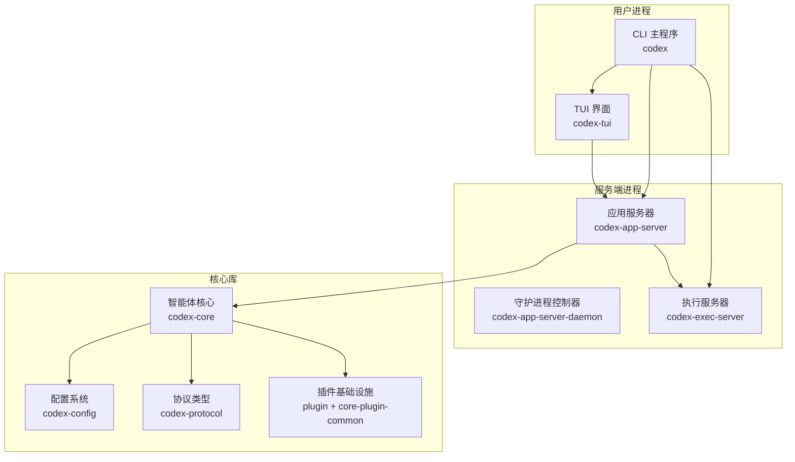
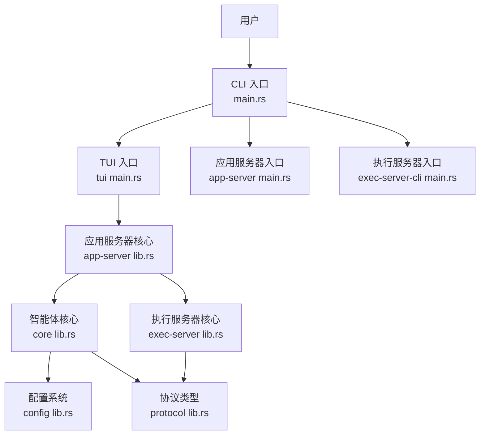
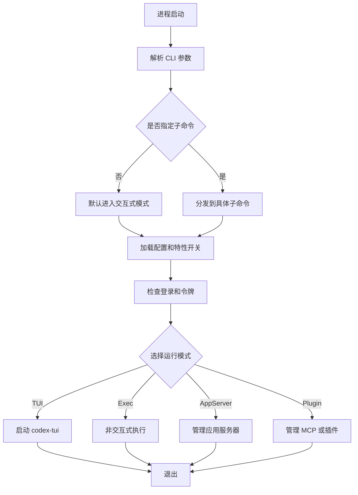
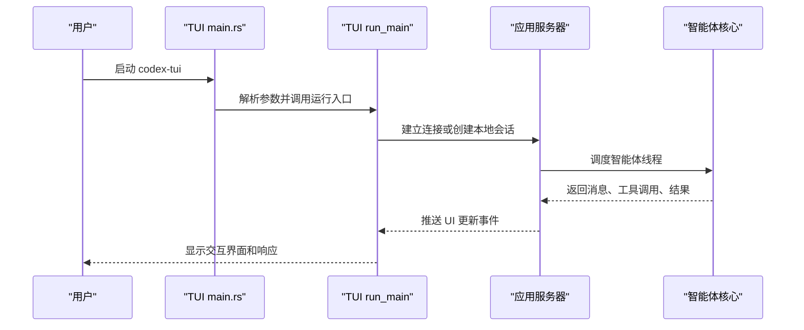
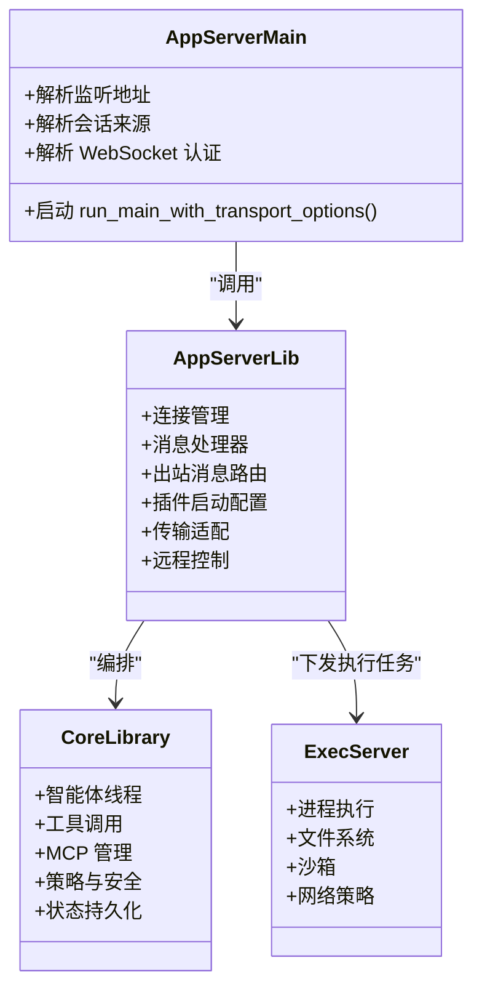
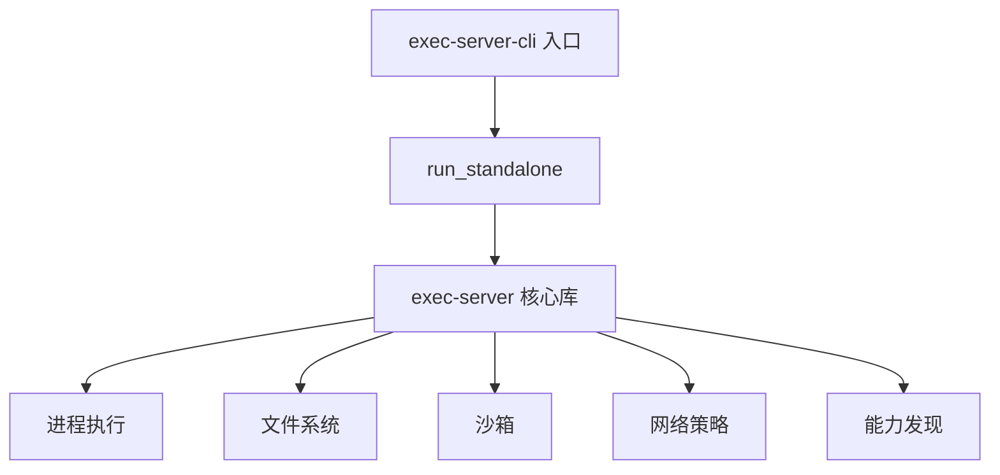
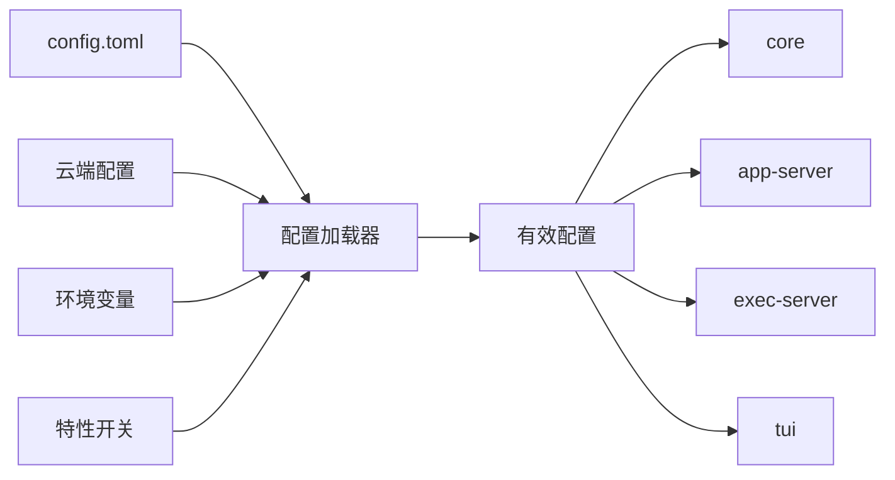
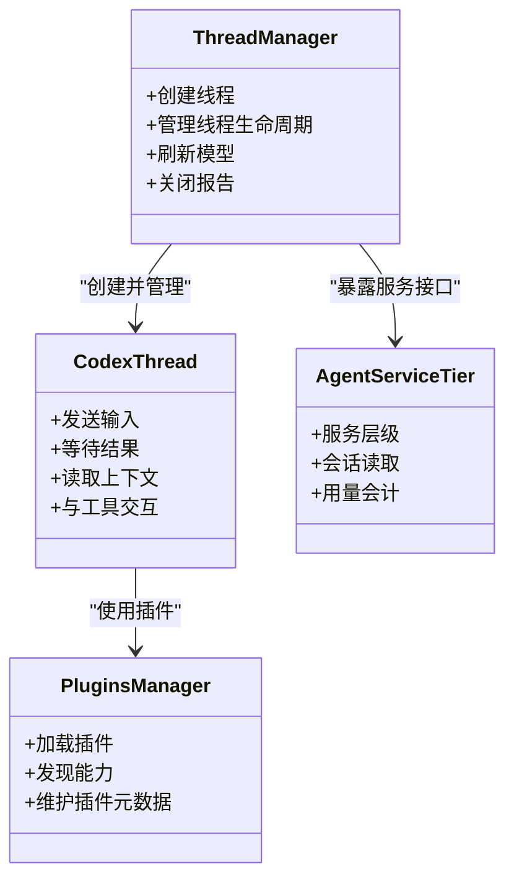
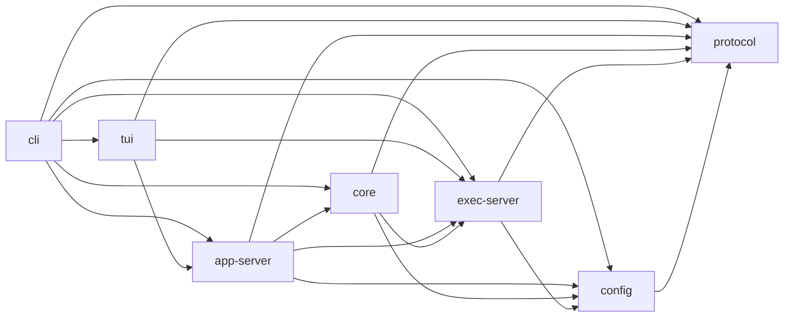

# 架构总览

<cite>
**本文引用的文件**   
- [codex-rs/cli/src/main.rs](file://codex-rs/cli/src/main.rs)
- [codex-rs/cli/Cargo.toml](file://codex-rs/cli/Cargo.toml)
- [codex-rs/tui/src/main.rs](file://codex-rs/tui/src/main.rs)
- [codex-rs/tui/Cargo.toml](file://codex-rs/tui/Cargo.toml)
- [codex-rs/app-server/src/main.rs](file://codex-rs/app-server/src/main.rs)
- [codex-rs/app-server/src/lib.rs](file://codex-rs/app-server/src/lib.rs)
- [codex-rs/app-server/Cargo.toml](file://codex-rs/app-server/Cargo.toml)
- [codex-rs/app-server-daemon/Cargo.toml](file://codex-rs/app-server-daemon/Cargo.toml)
- [codex-rs/exec-server/src/lib.rs](file://codex-rs/exec-server/src/lib.rs)
- [codex-rs/exec-server/Cargo.toml](file://codex-rs/exec-server/Cargo.toml)
- [codex-rs/exec-server-cli/src/main.rs](file://codex-rs/exec-server-cli/src/main.rs)
- [codex-rs/config/src/lib.rs](file://codex-rs/config/src/lib.rs)
- [codex-rs/config/Cargo.toml](file://codex-rs/config/Cargo.toml)
- [codex-rs/core/src/lib.rs](file://codex-rs/core/src/lib.rs)
- [codex-rs/core/Cargo.toml](file://codex-rs/core/Cargo.toml)
- [codex-rs/protocol/src/lib.rs](file://codex-rs/protocol/src/lib.rs)
- [codex-rs/plugin/Cargo.toml](file://codex-rs/plugin/Cargo.toml)
- [codex-rs/core-plugin-common/Cargo.toml](file://codex-rs/core-plugin-common/Cargo.toml)
- [codex-rs/ext/extension-api/Cargo.toml](file://codex-rs/ext/extension-api/Cargo.toml)
</cite>

## 目录
1. [引言](#引言)
2. [项目结构](#项目结构)
3. [核心组件](#核心组件)
4. [架构总览](#架构总览)
5. [详细组件分析](#详细组件分析)
6. [依赖关系分析](#依赖关系分析)
7. [性能与可观测性](#性能与可观测性)
8. [故障排查指南](#故障排查指南)
9. [结论](#结论)

## 引言
Codex CLI 是一个以 Rust 为主、多进程协作的命令行智能体系统。它同时提供交互式终端界面和非交互式执行模式，并支持长期运行的应用服务器、独立执行服务器、插件扩展以及多种外部模型与服务集成。整体设计采用分层架构：

- **CLI 层**：负责用户输入、子命令分发、配置加载、登录状态、TUI 启动和后台服务管理。
- **Core 层**：实现智能体核心逻辑，包括会话线程、工具调用、MCP 集成、沙箱、策略、提示词、模型选择、状态持久化等。
- **服务层**：通过 `app-server` 暴露 JSON-RPC/WebSocket/HTTP 接口，并通过 `exec-server` 隔离执行代码和文件系统操作。
- **配置系统**：统一解析 `config.toml`、云端配置、环境变量、特性开关、权限策略和安全限制。
- **插件架构**：通过插件元数据、扩展 API、能力发现机制，允许动态加载技能、连接器、MCP 服务和业务扩展。

本架构文档面向希望理解 Codex CLI 整体设计、进程间通信、数据流、扩展点和安全边界的开发者。

## 项目结构
仓库根目录包含多个子系统，核心实现集中在 `codex-rs` 下。关键目录与职责如下：

| 目录 | 主要职责 |
|---|---|
| `codex-rs/cli` | 主 CLI 入口、子命令、登录、诊断、插件管理、非交互式执行入口 |
| `codex-rs/tui` | 交互式终端界面，基于 `ratatui`，连接应用服务器或本地代理 |
| `codex-rs/app-server` | 长驻应用服务器，提供 WebSocket/HTTP/stdio 接入，编排智能体和插件 |
| `codex-rs/app-server-daemon` | 应用服务器守护进程生命周期管理、远程控制和 Unix Domain Socket 控制通道 |
| `codex-rs/exec-server` | 执行服务器，负责沙箱、文件系统、进程执行、网络策略和远程执行环境 |
| `codex-rs/exec-server-cli` | 独立执行服务器二进制入口 |
| `codex-rs/core` | 智能体核心库，包括会话、工具、MCP、提示词、策略、状态和线程管理 |
| `codex-rs/config` | 配置加载、合并、校验、云配置、权限策略和类型定义 |
| `codex-rs/protocol` | 跨模块共享协议类型，如会话 ID、工具名、权限、MCP 策略、错误信息 |
| `codex-rs/plugin` / `core-plugin-common` / `ext/extension-api` | 插件元数据、通用插件类型和扩展能力边界 |

**图表来源**  
- [codex-rs/cli/Cargo.toml:1-152](file://codex-rs/cli/Cargo.toml#L1-L152)  
- [codex-rs/tui/Cargo.toml:1-196](file://codex-rs/tui/Cargo.toml#L1-L196)  
- [codex-rs/app-server/Cargo.toml:1-171](file://codex-rs/app-server/Cargo.toml#L1-L171)  
- [codex-rs/exec-server/Cargo.toml:1-115](file://codex-rs/exec-server/Cargo.toml#L1-L115)  
- [codex-rs/core/Cargo.toml:1-193](file://codex-rs/core/Cargo.toml#L1-L193)  
- [codex-rs/config/Cargo.toml:1-79](file://codex-rs/config/Cargo.toml#L1-L79)

**章节来源**  
- [codex-rs/cli/Cargo.toml:1-152](file://codex-rs/cli/Cargo.toml#L1-L152)  
- [codex-rs/tui/Cargo.toml:1-196](file://codex-rs/tui/Cargo.toml#L1-L196)  
- [codex-rs/app-server/Cargo.toml:1-171](file://codex-rs/app-server/Cargo.toml#L1-L171)  
- [codex-rs/exec-server/Cargo.toml:1-115](file://codex-rs/exec-server/Cargo.toml#L1-L115)  
- [codex-rs/core/Cargo.toml:1-193](file://codex-rs/core/Cargo.toml#L1-L193)  
- [codex-rs/config/Cargo.toml:1-79](file://codex-rs/config/Cargo.toml#L1-L79)

## 核心组件
Codex CLI 的核心由五个层次组成：

1. **CLI 入口**：解析参数、选择子命令、初始化日志、加载配置、触发登录、启动 TUI 或执行命令。
2. **TUI 界面**：提供交互式会话、消息展示、工具调用反馈、实时事件渲染。
3. **应用服务器**：作为中央协调者，处理客户端请求、调度智能体线程、管理插件、持久化会话、转发执行任务。
4. **执行服务器**：隔离执行代码、管理沙箱、运行命令、访问文件和网络，并向应用服务器上报状态。
5. **配置系统**：提供统一的配置加载、合并、校验、策略约束和云端配置同步。

这些组件通过协议、异步任务和进程间通信组合在一起，形成从用户输入到模型响应的完整链路。

**章节来源**  
- [codex-rs/cli/src/main.rs:1-200](file://codex-rs/cli/src/main.rs#L1-L200)  
- [codex-rs/tui/src/main.rs:1-59](file://codex-rs/tui/src/main.rs#L1-L59)  
- [codex-rs/app-server/src/main.rs:1-172](file://codex-rs/app-server/src/main.rs#L1-L172)  
- [codex-rs/exec-server/src/lib.rs:1-200](file://codex-rs/exec-server/src/lib.rs#L1-L200)  
- [codex-rs/config/src/lib.rs:1-200](file://codex-rs/config/src/lib.rs#L1-L200)

## 架构总览
Codex 的整体架构可以理解为“前端交互层 + 中央服务层 + 执行隔离层 + 核心智能体层”。

**图表来源**  
- [codex-rs/cli/src/main.rs:1-200](file://codex-rs/cli/src/main.rs#L1-L200)  
- [codex-rs/tui/src/main.rs:1-59](file://codex-rs/tui/src/main.rs#L1-L59)  
- [codex-rs/app-server/src/main.rs:1-172](file://codex-rs/app-server/src/main.rs#L1-L172)  
- [codex-rs/exec-server-cli/src/main.rs:1-14](file://codex-rs/exec-server-cli/src/main.rs#L1-L14)  
- [codex-rs/app-server/src/lib.rs:1-200](file://codex-rs/app-server/src/lib.rs#L1-L200)  
- [codex-rs/core/src/lib.rs:1-250](file://codex-rs/core/src/lib.rs#L1-L250)  
- [codex-rs/exec-server/src/lib.rs:1-200](file://codex-rs/exec-server/src/lib.rs#L1-L200)  
- [codex-rs/config/src/lib.rs:1-200](file://codex-rs/config/src/lib.rs#L1-L200)  
- [codex-rs/protocol/src/lib.rs:1-65](file://codex-rs/protocol/src/lib.rs#L1-L65)

### 分层职责表

| 层级 | 主要模块 | 职责 |
|---|---|---|
| CLI 层 | `cli` | 参数解析、子命令分发、登录、诊断、TUI 启动、后台服务控制 |
| 交互层 | `tui` | 终端 UI、消息渲染、用户输入、实时事件显示 |
| 服务层 | `app-server`、`app-server-daemon` | 连接管理、JSON-RPC/WebSocket 路由、智能体编排、插件加载、会话持久化 |
| 执行层 | `exec-server` | 进程执行、文件系统访问、沙箱隔离、网络策略、能力发现 |
| 核心层 | `core` | 会话线程、工具调用、MCP、提示词、模型选择、安全策略、状态管理 |
| 配置层 | `config` | 配置加载、合并、校验、权限策略、云端配置、类型系统 |
| 协议层 | `protocol` | 会话 ID、工具名、权限、MCP 策略、错误、模型信息、沙箱类型 |

## 详细组件分析

### CLI 入口组件
CLI 是用户与整个系统的唯一入口。它使用 clap 解析多级子命令，并根据是否传入交互参数决定启动 TUI、执行命令、管理登录、调试诊断或操作应用服务器。

关键点：

- CLI 包定义了 `codex` 和 `logs_client` 两个二进制目标。
- CLI 依赖大量内部 crate，包括 `app-server`、`app-server-daemon`、`core`、`tui`、`exec-server`、`login`、`mcp`、`state`、`history`、`models-manager` 等。
- CLI 不直接实现智能体逻辑，而是组装配置、认证、模型、会话和 TUI。
- CLI 支持远程连接选项、功能开关、配置文件覆盖和平台相关逻辑。

**图表来源**  
- [codex-rs/cli/src/main.rs:1-200](file://codex-rs/cli/src/main.rs#L1-L200)  
- [codex-rs/cli/Cargo.toml:1-152](file://codex-rs/cli/Cargo.toml#L1-L152)

**章节来源**  
- [codex-rs/cli/src/main.rs:1-200](file://codex-rs/cli/src/main.rs#L1-L200)  
- [codex-rs/cli/Cargo.toml:1-152](file://codex-rs/cli/Cargo.toml#L1-L152)

### TUI 界面组件
TUI 是独立的 Rust 二进制，也提供库接口。它负责：

- 解析 TUI 专用参数。
- 初始化构建信息和 arg0 分发。
- 调用 `run_main` 启动界面主循环。
- 根据退出原因输出最终消息并设置退出码。

TUI 依赖 `codex-app-server-client`、`codex-exec-server`、`codex-config`、`codex-protocol`、`ratatui`、`crossterm` 等，说明它既可能通过应用服务器间接调用智能体，也可能直接驱动执行环境。

**图表来源**  
- [codex-rs/tui/src/main.rs:1-59](file://codex-rs/tui/src/main.rs#L1-L59)  
- [codex-rs/tui/Cargo.toml:1-196](file://codex-rs/tui/Cargo.toml#L1-L196)

**章节来源**  
- [codex-rs/tui/src/main.rs:1-59](file://codex-rs/tui/src/main.rs#L1-L59)  
- [codex-rs/tui/Cargo.toml:1-196](file://codex-rs/tui/Cargo.toml#L1-L196)

### 应用服务器组件
应用服务器是 Codex 的中央服务进程。它提供：

- 多种传输方式：stdio、Unix Domain Socket、WebSocket、HTTP。
- 连接管理和出站消息队列。
- JSON-RPC 消息处理和请求路由。
- 智能体线程调度、插件加载、会话持久化和遥测。
- 远程控制和受管守护进程模式。

应用服务器的 `main.rs` 解析监听地址、会话来源、WebSocket 认证、严格配置模式和远程控制模式，然后调用 `run_main_with_transport_options` 启动运行时。

**图表来源**  
- [codex-rs/app-server/src/main.rs:1-172](file://codex-rs/app-server/src/main.rs#L1-L172)  
- [codex-rs/app-server/src/lib.rs:1-200](file://codex-rs/app-server/src/lib.rs#L1-L200)  
- [codex-rs/core/src/lib.rs:1-250](file://codex-rs/core/src/lib.rs#L1-L250)  
- [codex-rs/exec-server/src/lib.rs:1-200](file://codex-rs/exec-server/src/lib.rs#L1-L200)

**章节来源**  
- [codex-rs/app-server/src/main.rs:1-172](file://codex-rs/app-server/src/main.rs#L1-L172)  
- [codex-rs/app-server/src/lib.rs:1-200](file://codex-rs/app-server/src/lib.rs#L1-L200)  
- [codex-rs/app-server/Cargo.toml:1-171](file://codex-rs/app-server/Cargo.toml#L1-L171)

### 执行服务器组件
执行服务器是隔离执行环境的后端。它暴露的能力包括：

- 进程执行与事件流。
- 文件系统抽象和沙箱文件访问。
- 能力发现 v1/v2。
- 远程执行环境注册和连接。
- 噪声通道、RPC、遥测和网络策略决策。

独立执行服务器入口 `exec-server-cli` 仅做最小初始化，然后委托给 `codex_exec_server_cli::run_standalone()`。

**图表来源**  
- [codex-rs/exec-server-cli/src/main.rs:1-14](file://codex-rs/exec-server-cli/src/main.rs#L1-L14)  
- [codex-rs/exec-server/src/lib.rs:1-200](file://codex-rs/exec-server/src/lib.rs#L1-L200)  
- [codex-rs/exec-server/Cargo.toml:1-115](file://codex-rs/exec-server/Cargo.toml#L1-L115)

**章节来源**  
- [codex-rs/exec-server-cli/src/main.rs:1-14](file://codex-rs/exec-server-cli/src/main.rs#L1-L14)  
- [codex-rs/exec-server/src/lib.rs:1-200](file://codex-rs/exec-server/src/lib.rs#L1-L200)  
- [codex-rs/exec-server/Cargo.toml:1-115](file://codex-rs/exec-server/Cargo.toml#L1-L115)

### 配置系统组件
配置系统是 Codex 的基础设施之一，负责：

- 加载 `config.toml`、云端配置、环境变量和特性开关。
- 提供丰富的类型定义，包括网络策略、MCP 策略、权限、钩子、技能、模型提供者等。
- 生成配置 schema，支持严格配置校验。
- 为其他模块提供公共配置导出类型。

`config` 模块导出了大量类型，例如 `CloudConfigBundle`、`NetworkRequirementsToml`、`McpServerConfig`、`GuardianPolicyLoader`、`HooksToml`、`SkillsConfig` 等，表明配置不仅是静态字段，更是系统策略和能力声明的中心。

**图表来源**  
- [codex-rs/config/src/lib.rs:1-200](file://codex-rs/config/src/lib.rs#L1-L200)  
- [codex-rs/config/Cargo.toml:1-79](file://codex-rs/config/Cargo.toml#L1-L79)

**章节来源**  
- [codex-rs/config/src/lib.rs:1-200](file://codex-rs/config/src/lib.rs#L1-L200)  
- [codex-rs/config/Cargo.toml:1-79](file://codex-rs/config/Cargo.toml#L1-L79)

### 智能体核心组件
`codex-core` 是系统最复杂的库，集中了智能体的大部分行为：

- 暴露 `CodexThread`、`AgentInfo`、`AgentControl`、`AgentInput`、`AgentTurnOutcome` 等核心 API。
- 管理线程生命周期、上下文、历史、工具调用、MCP、技能、钩子、记忆、状态数据库。
- 提供 `ThreadManager`、`build_models_manager`、`plugins_manager_for_config` 等工厂方法。
- 与 `exec-server`、`mcp`、`tools`、`prompts`、`state`、`sandboxing`、`guardian`、`hooks`、`skills` 等模块紧密耦合。

**图表来源**  
- [codex-rs/core/src/lib.rs:1-250](file://codex-rs/core/src/lib.rs#L1-L250)  
- [codex-rs/core/Cargo.toml:1-193](file://codex-rs/core/Cargo.toml#L1-L193)

**章节来源**  
- [codex-rs/core/src/lib.rs:1-250](file://codex-rs/core/src/lib.rs#L1-L250)  
- [codex-rs/core/Cargo.toml:1-193](file://codex-rs/core/Cargo.toml#L1-L193)

### 协议与类型边界
`codex-protocol` 提供跨模块共享的类型，避免模块间直接耦合实现细节。它包含：

- 会话 ID、线程 ID、工具名、上下文窗口 ID。
- 权限、网络策略、MCP 策略、沙箱类型。
- 用户输入、工具调用、实时事件、模型信息。
- 错误信息、审核格式、计划工具、记忆引用。

这使得 CLI、TUI、app-server、core、exec-server 可以通过稳定类型进行通信，而不必共享内部实现。

**章节来源**  
- [codex-rs/protocol/src/lib.rs:1-65](file://codex-rs/protocol/src/lib.rs#L1-L65)

## 依赖关系分析
从 Cargo 依赖可以看出各组件之间的耦合方向：

- `cli` 是最上层聚合模块，依赖几乎所有重要子系统。
- `tui` 依赖 app-server 客户端、exec-server、配置、协议和 UI 框架。
- `app-server` 依赖 core、exec-server、协议、配置、插件、状态、历史、遥测和传输层。
- `core` 依赖 exec-server、protocol、config、mcp、tools、skills、sandboxing、state 等。
- `exec-server` 依赖 protocol、config、sandboxing、file-system、shell-command、network-proxy、otel 等。
- `config` 依赖 protocol、http-client、model-provider-info、features、execpolicy 等。

**图表来源**  
- [codex-rs/cli/Cargo.toml:1-152](file://codex-rs/cli/Cargo.toml#L1-L152)  
- [codex-rs/tui/Cargo.toml:1-196](file://codex-rs/tui/Cargo.toml#L1-L196)  
- [codex-rs/app-server/Cargo.toml:1-171](file://codex-rs/app-server/Cargo.toml#L1-L171)  
- [codex-rs/core/Cargo.toml:1-193](file://codex-rs/core/Cargo.toml#L1-L193)  
- [codex-rs/exec-server/Cargo.toml:1-115](file://codex-rs/exec-server/Cargo.toml#L1-L115)  
- [codex-rs/config/Cargo.toml:1-79](file://codex-rs/config/Cargo.toml#L1-L79)

**章节来源**  
- [codex-rs/cli/Cargo.toml:1-152](file://codex-rs/cli/Cargo.toml#L1-L152)  
- [codex-rs/tui/Cargo.toml:1-196](file://codex-rs/tui/Cargo.toml#L1-L196)  
- [codex-rs/app-server/Cargo.toml:1-171](file://codex-rs/app-server/Cargo.toml#L1-L171)  
- [codex-rs/core/Cargo.toml:1-193](file://codex-rs/core/Cargo.toml#L1-L193)  
- [codex-rs/exec-server/Cargo.toml:1-115](file://codex-rs/exec-server/Cargo.toml#L1-L115)  
- [codex-rs/config/Cargo.toml:1-79](file://codex-rs/config/Cargo.toml#L1-L79)

## 性能与可观测性
系统在设计上考虑了异步性能、内存分配、遥测和调试：

| 方面 | 实现方式 | 说明 |
|---|---|---|
| 异步运行时 | `tokio`、`tokio-util`、`futures` | 所有主要组件都基于 Tokio 异步运行时 |
| 内存分配 | `tikv-jemallocator` | 在 Linux musl 目标上启用 jemalloc |
| 日志与追踪 | `tracing`、`tracing-subscriber`、`opentelemetry` | 应用服务器和核心模块均启用遥测 |
| I/O 并发 | `axum`、`hyper-util`、`tokio-tungstenite` | HTTP、WebSocket、stdio、Unix Domain Socket 均由异步 I/O 驱动 |
| 输出缓冲 | 出站消息队列和分离的写入任务 | 应用服务器将慢写入与请求处理分离 |
| 构建优化 | Bazel、Rust workspace、条件编译 | 大型仓库通过 Bazel 和条件依赖减少无关编译成本 |

## 故障排查指南
常见问题可从组件边界入手：

1. **CLI 无法启动或参数解析失败**  
   - 检查是否传入了冲突的子命令。
   - 检查 `config.toml` 是否存在未知字段，必要时启用严格配置模式。
   - 查看 CLI 是否成功加载登录状态和模型列表。

2. **TUI 无响应或连接失败**  
   - 确认应用服务器是否已启动。
   - 检查 WebSocket 或本地传输是否被防火墙或权限阻止。
   - 查看 TUI 退出原因是否为致命错误。

3. **应用服务器无法接收消息**  
   - 检查监听地址是否正确。
   - 检查 WebSocket 认证配置。
   - 查看出站消息队列是否阻塞。

4. **执行服务器执行失败**  
   - 检查沙箱权限、文件系统路径、网络策略。
   - 查看能力发现是否成功。
   - 检查远程执行环境是否可用。

5. **配置异常**  
   - 检查 `config.toml`、环境变量、云端配置层。
   - 使用配置诊断功能查看合并后的有效配置。
   - 检查权限策略是否拒绝某项工具或网络访问。

**章节来源**  
- [codex-rs/cli/src/main.rs:1-200](file://codex-rs/cli/src/main.rs#L1-L200)  
- [codex-rs/tui/src/main.rs:1-59](file://codex-rs/tui/src/main.rs#L1-L59)  
- [codex-rs/app-server/src/main.rs:1-172](file://codex-rs/app-server/src/main.rs#L1-L172)  
- [codex-rs/exec-server/src/lib.rs:1-200](file://codex-rs/exec-server/src/lib.rs#L1-L200)  
- [codex-rs/config/src/lib.rs:1-200](file://codex-rs/config/src/lib.rs#L1-L200)

## 结论
Codex CLI 的架构围绕“用户交互、中央服务、执行隔离、核心智能体、统一配置”五个维度展开。CLI 负责入口，TUI 负责交互，应用服务器负责编排，执行服务器负责隔离，核心库负责智能体行为，配置系统负责全局策略。通过 `protocol` 类型、异步运行时和多种传输协议，系统实现了可扩展、可观测、可隔离的智能体执行环境。

对于开发者而言，修改交互行为应优先关注 `cli` 和 `tui`；修改智能体行为应关注 `core`；修改外部接入方式应关注 `app-server` 的传输层；修改执行行为应关注 `exec-server`；修改权限、模型、MCP、技能等行为应关注 `config` 和 `protocol`。