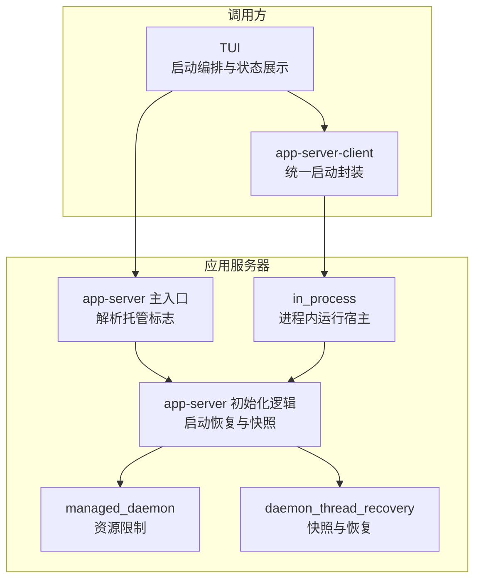
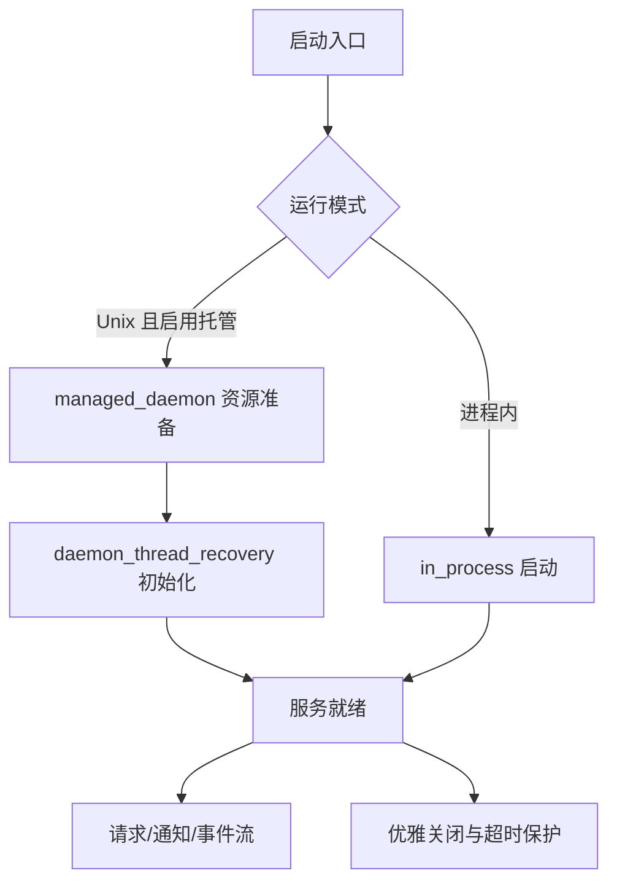
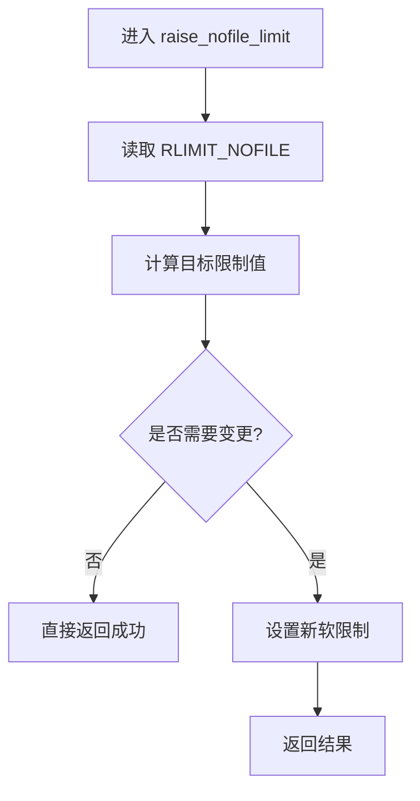
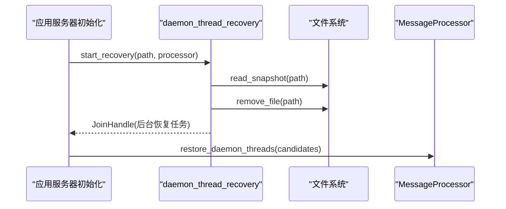
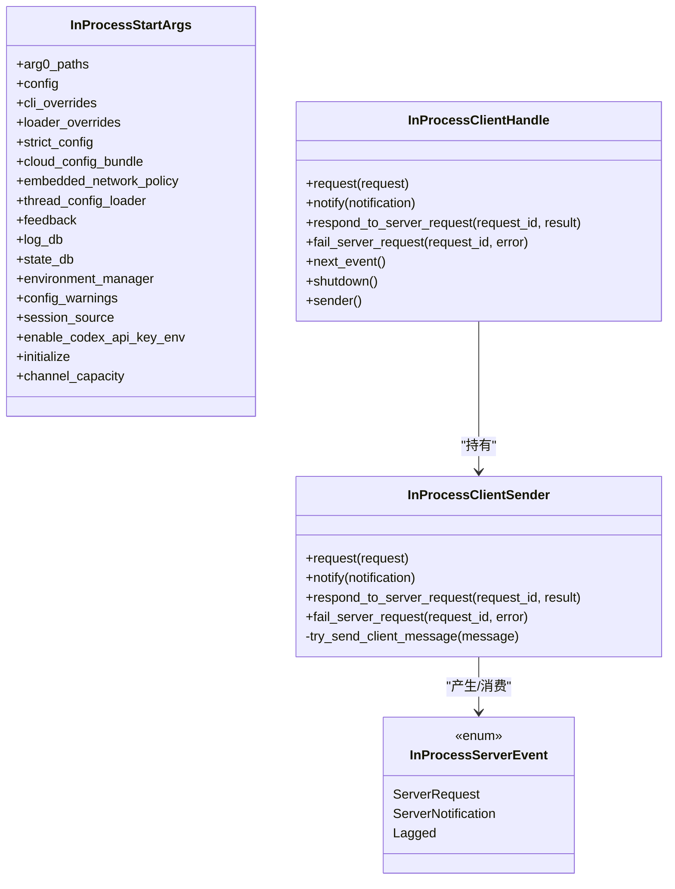
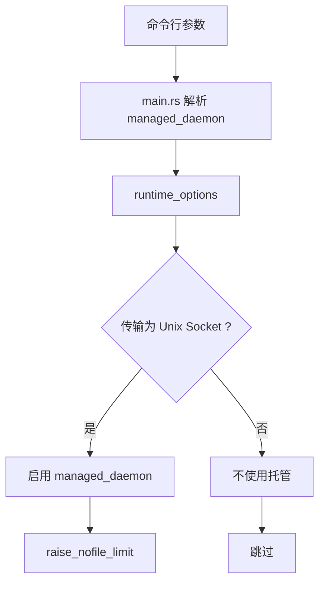
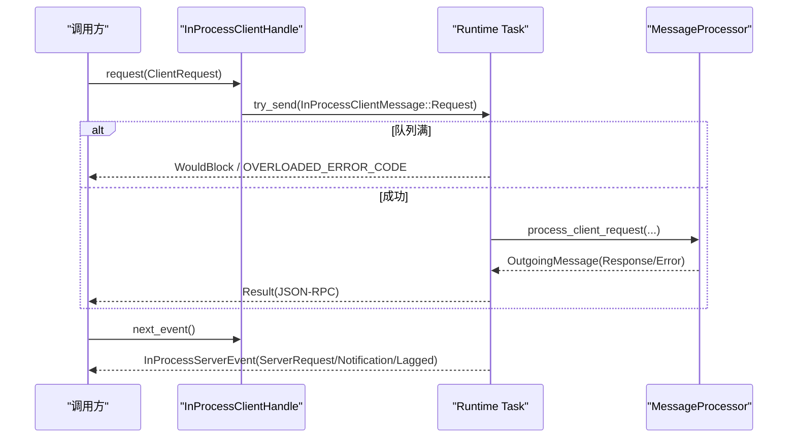
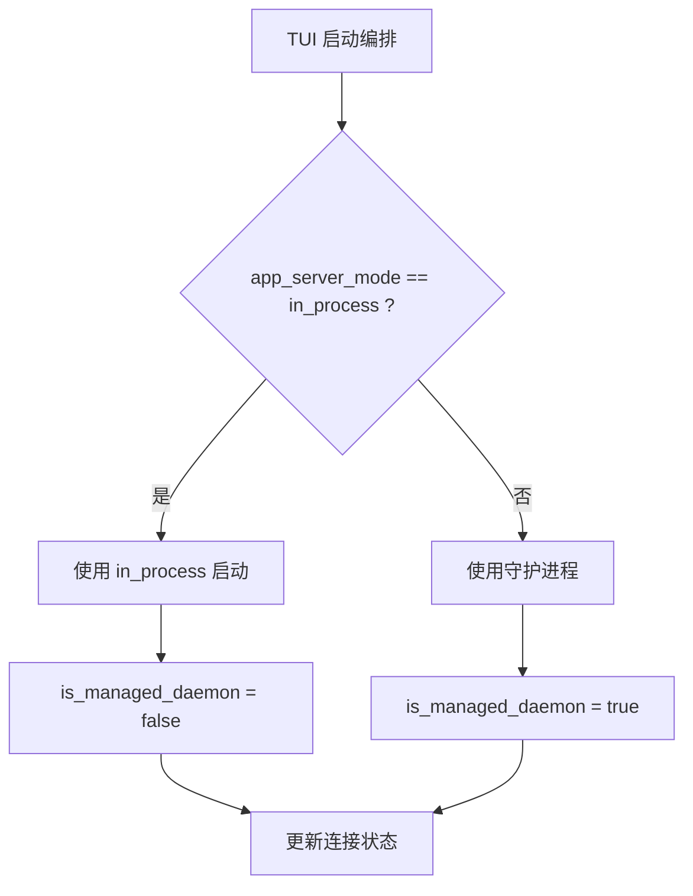
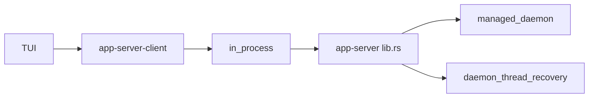

# 守护进程管理

<cite>
**本文引用的文件**
- [app-server/src/lib.rs](file://codex-rs/app-server/src/lib.rs)
- [app-server/src/managed_daemon.rs](file://codex-rs/app-server/src/managed_daemon.rs)
- [app-server/src/daemon_thread_recovery.rs](file://codex-rs/app-server/src/daemon_thread_recovery.rs)
- [app-server/src/in_process.rs](file://codex-rs/app-server/src/in_process.rs)
- [app-server/src/main.rs](file://codex-rs/app-server/src/main.rs)
- [app-server-client/src/lib.rs](file://codex-rs/app-server-client/src/lib.rs)
- [tui/src/startup_orchestration.rs](file://codex-rs/tui/src/startup_orchestration.rs)
- [tui/src/app/startup.rs](file://codex-rs/tui/src/app/startup.rs)
- [tui/src/app/daemon_menu.rs](file://codex-rs/tui/src/app/daemon_menu.rs)
- [tui/src/status/remote_connection.rs](file://codex-rs/tui/src/status/remote_connection.rs)
</cite>

## 目录
1. [引言](#引言)
2. [项目结构](#项目结构)
3. [核心组件](#核心组件)
4. [架构总览](#架构总览)
5. [详细组件分析](#详细组件分析)
6. [依赖关系分析](#依赖关系分析)
7. [性能与资源限制](#性能与资源限制)
8. [故障恢复与健壮性](#故障恢复与健壮性)
9. [监控与排障指南](#监控与排障指南)
10. [结论](#结论)

## 引言
本文面向守护进程管理系统，重点解释以下能力：
- managed_daemon 子进程管理机制、启动参数配置、资源限制与环境隔离。
- in_process 模式下的进程内执行方式、通道背压、事件流与生命周期。
- daemon_thread_recovery 的线程快照、冷恢复与运行时所有权策略。
- 进程间通信、信号处理、异常捕获与自动重启的健康检查思路。
- 外部进程管理与远程任务执行的实践建议。
- 进程监控、性能分析与故障恢复的最佳实践。

本仓库中的守护进程相关实现主要位于 Rust 代码库中，尤其是 app-server 及其上层 TUI、客户端封装模块。

## 项目结构
围绕守护进程管理的核心源码分布如下：
- app-server：守护进程主体、受管守护进程资源调整、进程内运行宿主、线程恢复、主入口。
- app-server-client：为嵌入方提供统一的 in_process 启动 API。
- tui：终端界面根据是否托管守护进程选择不同的启动和恢复路径。

图表来源
- [app-server/src/main.rs:79-110](file://codex-rs/app-server/src/main.rs#L79-L110)
- [app-server/src/lib.rs:495-540](file://codex-rs/app-server/src/lib.rs#L495-L540)
- [app-server/src/lib.rs:1019-1123](file://codex-rs/app-server/src/lib.rs#L1019-L1123)
- [app-server/src/managed_daemon.rs:1-26](file://codex-rs/app-server/src/managed_daemon.rs#L1-L26)
- [app-server/src/daemon_thread_recovery.rs:1-50](file://codex-rs/app-server/src/daemon_thread_recovery.rs#L1-L50)
- [app-server/src/in_process.rs:1-120](file://codex-rs/app-server/src/in_process.rs#L1-L120)

章节来源
- [app-server/src/main.rs:79-110](file://codex-rs/app-server/src/main.rs#L79-L110)
- [app-server/src/lib.rs:495-540](file://codex-rs/app-server/src/lib.rs#L495-L540)

## 核心组件
- managed_daemon：在 Unix 下提升文件描述符限制，确保守护进程具备足够的并发句柄容量。
- daemon_thread_recovery：保存并恢复根线程 ID，通过内部恢复路径重建运行时，不影响已加载的运行实例。
- in_process：以 Tokio 任务承载 MessageProcessor 与出站路由，用有界通道替代 socket/stdio，保持协议一致。
- app-server-client：对 in_process 的封装，暴露统一的启动、请求、通知与关闭接口。
- TUI：根据 is_managed_daemon 决定使用本地托管守护进程还是进程内模式，并在恢复流程中提示用户。

章节来源
- [app-server/src/managed_daemon.rs:1-26](file://codex-rs/app-server/src/managed_daemon.rs#L1-L26)
- [app-server/src/daemon_thread_recovery.rs:1-50](file://codex-rs/app-server/src/daemon_thread_recovery.rs#L1-L50)
- [app-server/src/in_process.rs:1-120](file://codex-rs/app-server/src/in_process.rs#L1-L120)
- [app-server-client/src/lib.rs:7-51](file://codex-rs/app-server-client/src/lib.rs#L7-L51)
- [tui/src/status/remote_connection.rs:13-20](file://codex-rs/tui/src/status/remote_connection.rs#L13-L20)

## 架构总览
守护进程的两种运行形态如下：
- 受管守护进程（managed_daemon）：作为独立进程运行，启用文件描述符等系统级资源限制，并通过 daemon_thread_recovery 进行线程快照与恢复。
- 进程内模式（in_process）：将 app-server 逻辑运行在当前进程 Tokio 任务中，通过内存通道完成请求与事件分发，避免进程边界开销。

图表来源
- [app-server/src/lib.rs:537-540](file://codex-rs/app-server/src/lib.rs#L537-L540)
- [app-server/src/in_process.rs:1-120](file://codex-rs/app-server/src/in_process.rs#L1-L120)
- [app-server/src/daemon_thread_recovery.rs:1-50](file://codex-rs/app-server/src/daemon_thread_recovery.rs#L1-L50)

## 详细组件分析

### managed_daemon：子进程资源与生命周期
- 目标：为 Unix 守护进程提升 NOFILE 限制，保障高并发连接和文件句柄需求。
- 行为：读取当前软硬限制，取安全上限后设置软限制；若无需变更则直接返回成功。
- 触发点：当传输类型为 Unix Socket 且 runtime_options.managed_daemon 为真时启用。

图表来源
- [app-server/src/managed_daemon.rs:1-26](file://codex-rs/app-server/src/managed_daemon.rs#L1-L26)
- [app-server/src/lib.rs:537-540](file://codex-rs/app-server/src/lib.rs#L537-L540)

章节来源
- [app-server/src/managed_daemon.rs:1-26](file://codex-rs/app-server/src/managed_daemon.rs#L1-L26)
- [app-server/src/lib.rs:537-540](file://codex-rs/app-server/src/lib.rs#L537-L540)

### daemon_thread_recovery：线程快照与恢复
- 快照写入：在专用线程中异步写快照文件，失败时尝试清理陈旧快照文件，避免阻塞 Tokio blocking pool。
- 恢复启动：启动前读取快照，删除快照文件，随后后台恢复守护进程线程；已加载的运行时仍由当前客户端拥有。
- 就绪语义：恢复走正常冷恢复路径，不延迟服务就绪。

图表来源
- [app-server/src/daemon_thread_recovery.rs:1-50](file://codex-rs/app-server/src/daemon_thread_recovery.rs#L1-L50)
- [app-server/src/lib.rs:1072-1102](file://codex-rs/app-server/src/lib.rs#L1072-L1102)

章节来源
- [app-server/src/daemon_thread_recovery.rs:1-50](file://codex-rs/app-server/src/daemon_thread_recovery.rs#L1-L50)
- [app-server/src/lib.rs:1019-1123](file://codex-rs/app-server/src/lib.rs#L1019-L1123)

### in_process：进程内执行模型
- 设计目标：复用现有 MessageProcessor 与出站路由，但将传输替换为有界内存通道，保持协议一致性，避免进程边界。
- 生命周期：start 内部完成 initialize/initialized 握手，返回 InProcessClientHandle；shutdown 带超时保护，中止未完成的后台任务。
- 背压策略：
  - 提交请求使用 try_send，满队列时返回 WouldBlock；
  - 事件扇出在饱和时丢弃通知；
  - 服务端请求不会静默放弃，无法入队会返回过载或内部错误，避免审批流挂起。
- 关键数据结构与职责：
  - InProcessStartArgs：传入配置、网络策略、日志与状态数据库、会话源、通道容量等。
  - InProcessClientHandle：对外提供 request、notify、respond_to_server_request、fail_server_request、next_event、shutdown。
  - InProcessClientSender：内部消息发送器，封装 try_send 错误映射。
  - InProcessServerEvent：服务端请求、通知、滞后标记。
- 出站路由：run_outbound_router 负责将 OutgoingEnvelope 路由到已连接的出站连接，支持显式 shutdown。

图表来源
- [app-server/src/in_process.rs:120-200](file://codex-rs/app-server/src/in_process.rs#L120-L200)
- [app-server/src/in_process.rs:201-450](file://codex-rs/app-server/src/in_process.rs#L201-L450)
- [app-server/src/in_process.rs:450-750](file://codex-rs/app-server/src/in_process.rs#L450-L750)
- [app-server/src/in_process.rs:750-1100](file://codex-rs/app-server/src/in_process.rs#L750-L1100)

章节来源
- [app-server/src/in_process.rs:1-120](file://codex-rs/app-server/src/in_process.rs#L1-L120)
- [app-server/src/in_process.rs:120-200](file://codex-rs/app-server/src/in_process.rs#L120-L200)
- [app-server/src/in_process.rs:201-450](file://codex-rs/app-server/src/in_process.rs#L201-L450)
- [app-server/src/in_process.rs:450-750](file://codex-rs/app-server/src/in_process.rs#L450-L750)
- [app-server/src/in_process.rs:750-1100](file://codex-rs/app-server/src/in_process.rs#L750-L1100)

### 启动参数配置与环境隔离
- 托管标志：main.rs 暴露 managed_daemon 参数，供上层 CLI 传递。
- 传输选择：lib.rs 根据传输类型与 runtime_options.managed_daemon 决定是否启用托管模式。
- 环境隔离：in_process 通过 EmbeddedNetworkPolicy 与独立的配置层、会话源控制网络访问与上下文；同时支持 SQLite 日志与状态库共享给嵌入式消费者。

图表来源
- [app-server/src/main.rs:79-110](file://codex-rs/app-server/src/main.rs#L79-L110)
- [app-server/src/lib.rs:537-540](file://codex-rs/app-server/src/lib.rs#L537-L540)
- [app-server/src/managed_daemon.rs:1-26](file://codex-rs/app-server/src/managed_daemon.rs#L1-L26)

章节来源
- [app-server/src/main.rs:79-110](file://codex-rs/app-server/src/main.rs#L79-L110)
- [app-server/src/lib.rs:537-540](file://codex-rs/app-server/src/lib.rs#L537-L540)

### 进程间通信、信号处理与异常捕获
- 进程内通信：InProcessClientHandle 通过 mpsc 通道与 Tokio 任务交互；事件流通过 event_rx 拉取；请求响应通过 oneshot 返回。
- 背压与丢包：
  - 请求入队失败返回 WouldBlock 或 JSON-RPC 过载错误；
  - 通知入队失败记录警告并丢弃；
  - 服务端请求入队失败会回传错误，避免审批卡死。
- 异常捕获与关闭：
  - shutdown 先释放事件接收者，再等待完成；
  - 处理器与出站路由器分别带超时，超时后中止任务；
  - 取消所有挂起的请求，清理出站发送者引用。
- 信号处理：守护进程本身未在此处直接注册系统信号；TUI 层会根据连接状态与 managed_daemon 标志显示可重启选项，具体信号派发由更上层或操作系统进程管理器负责。

图表来源
- [app-server/src/in_process.rs:201-450](file://codex-rs/app-server/src/in_process.rs#L201-L450)
- [app-server/src/in_process.rs:450-750](file://codex-rs/app-server/src/in_process.rs#L450-L750)
- [app-server/src/in_process.rs:750-1100](file://codex-rs/app-server/src/in_process.rs#L750-L1100)

章节来源
- [app-server/src/in_process.rs:201-450](file://codex-rs/app-server/src/in_process.rs#L201-L450)
- [app-server/src/in_process.rs:450-750](file://codex-rs/app-server/src/in_process.rs#L450-L750)
- [app-server/src/in_process.rs:750-1100](file://codex-rs/app-server/src/in_process.rs#L750-L1100)

### 外部进程管理与远程任务执行
- 外部进程管理：进程内模式通过 EnvironmentManager 与 core 执行子系统协调外部工具；出站路由负责转发进程输出与退出事件。
- 远程任务执行：TUI 或 exec 客户端可通过 app-server-client 发起线程创建、工具调用等操作；in_process 将这些请求投递给 MessageProcessor，由后端统一管理。
- 最佳实践：
  - 使用 InProcessClientHandle.request 发起任务，并确保唯一 RequestId；
  - 使用 respond_to_server_request 或 fail_server_request 处理服务端请求，防止审批流阻塞；
  - 通过 next_event 消费 ServerNotification 与 ServerRequest，及时处理 ProcessOutputDelta、ProcessExited、TurnCompleted 等事件。

章节来源
- [app-server/src/in_process.rs:1-120](file://codex-rs/app-server/src/in_process.rs#L1-L120)
- [app-server/src/in_process.rs:450-750](file://codex-rs/app-server/src/in_process.rs#L450-L750)

### TUI 中的托管与非托管分支
- TUI 启动编排根据 app_server_mode 是否为 in_process 选择不同路径；
- remote_connection 维护 is_managed_daemon 标志，用于 UI 决策与恢复菜单显示；
- daemon_menu 在必要时校验 managed_daemon 状态，决定是否允许重启等操作。

图表来源
- [tui/src/startup_orchestration.rs:616-658](file://codex-rs/tui/src/startup_orchestration.rs#L616-L658)
- [tui/src/startup_orchestration.rs:804-804](file://codex-rs/tui/src/startup_orchestration.rs#L804-L804)
- [tui/src/startup_orchestration.rs:1024-1024](file://codex-rs/tui/src/startup_orchestration.rs#L1024-L1024)
- [tui/src/status/remote_connection.rs:13-20](file://codex-rs/tui/src/status/remote_connection.rs#L13-L20)
- [tui/src/app/startup.rs:464-464](file://codex-rs/tui/src/app/startup.rs#L464-L464)
- [tui/src/app/daemon_menu.rs:29-37](file://codex-rs/tui/src/app/daemon_menu.rs#L29-L37)

章节来源
- [tui/src/startup_orchestration.rs:616-658](file://codex-rs/tui/src/startup_orchestration.rs#L616-L658)
- [tui/src/status/remote_connection.rs:13-20](file://codex-rs/tui/src/status/remote_connection.rs#L13-L20)
- [tui/src/app/daemon_menu.rs:29-37](file://codex-rs/tui/src/app/daemon_menu.rs#L29-L37)

## 依赖关系分析
- app-server-client 依赖 app-server 的 in_process 模块，暴露统一的启动 API。
- TUI 依赖 app-server-client 或直接与 app-server 交互，依据 is_managed_daemon 调整行为。
- lib.rs 在托管模式下串联 managed_daemon、daemon_thread_recovery 与 MessageProcessor。

图表来源
- [app-server-client/src/lib.rs:7-51](file://codex-rs/app-server-client/src/lib.rs#L7-L51)
- [app-server/src/lib.rs:495-540](file://codex-rs/app-server/src/lib.rs#L495-L540)
- [app-server/src/in_process.rs:1-120](file://codex-rs/app-server/src/in_process.rs#L1-L120)

章节来源
- [app-server-client/src/lib.rs:7-51](file://codex-rs/app-server-client/src/lib.rs#L7-L51)
- [app-server/src/lib.rs:495-540](file://codex-rs/app-server/src/lib.rs#L495-L540)

## 性能与资源限制
- 通道容量：in_process 使用 channel_capacity 控制请求、通知与出站消息缓冲；默认值为 CHANNEL_CAPACITY，且会被 clamp 至至少 1。
- 背压与丢弃：在高负载下，通知可能丢弃，请求可能返回过载错误；这是有意设计以避免长时间阻塞审批流。
- 关闭超时：shutdown 对处理器与出站路由器分别设置超时，防止僵尸任务；analytics flush 也带预算时间。
- 资源限制：managed_daemon 提高 NOFILE 限制，降低因文件描述符耗尽导致的连接失败风险。

章节来源
- [app-server/src/in_process.rs:120-200](file://codex-rs/app-server/src/in_process.rs#L120-L200)
- [app-server/src/in_process.rs:450-750](file://codex-rs/app-server/src/in_process.rs#L450-L750)
- [app-server/src/in_process.rs:750-1100](file://codex-rs/app-server/src/in_process.rs#L750-L1100)
- [app-server/src/managed_daemon.rs:1-26](file://codex-rs/app-server/src/managed_daemon.rs#L1-L26)

## 故障恢复与健壮性
- 快照恢复：daemon_thread_recovery 在启动前读取快照，删除快照文件后后台恢复守护进程线程；失败时清理陈旧快照，避免影响后续启动。
- 进程内健壮性：
  - 重复 RequestId 会返回 INVALID_REQUEST，避免路由歧义；
  - 服务端请求无法入队时立即报错，避免审批卡死；
  - shutdown 确保清理所有挂起请求与出站发送者，防止泄漏。
- 自动重启与健康检查：
  - 代码未在此处实现周期性健康检查或自动重启循环；
  - 通常由外层进程管理器（systemd、容器编排或 TUI 操作）负责重启；
  - TUI 可根据 is_managed_daemon 提供手动重启选项。

章节来源
- [app-server/src/daemon_thread_recovery.rs:1-50](file://codex-rs/app-server/src/daemon_thread_recovery.rs#L1-L50)
- [app-server/src/in_process.rs:201-450](file://codex-rs/app-server/src/in_process.rs#L201-L450)
- [app-server/src/in_process.rs:450-750](file://codex-rs/app-server/src/in_process.rs#L450-L750)
- [app-server/src/in_process.rs:750-1100](file://codex-rs/app-server/src/in_process.rs#L750-L1100)
- [tui/src/app/daemon_menu.rs:29-37](file://codex-rs/tui/src/app/daemon_menu.rs#L29-L37)

## 监控与排障指南
- 监控要点：
  - 观察 InProcessServerEvent 中的 Lagged 标记，判断事件消费是否落后；
  - 关注 ProcessOutputDelta、ProcessExited、TurnCompleted 等通知，定位外部进程执行状态；
  - 在托管模式下确认 NOFILE 限制是否生效，避免连接瓶颈。
- 常见问题：
  - 请求被拒绝或卡住：检查是否使用了重复 RequestId；确认服务端请求已通过 respond_to_server_request 或 fail_server_request 处理；
  - 通知丢失：在高负载下可能被丢弃，需提升 channel_capacity 或优化消费者速率；
  - 关闭缓慢：shutdown 超时会中止任务，检查是否存在未释放的出站发送者或长耗时任务。
- 诊断建议：
  - 使用 app-server-client 的统一 API 包装请求与事件消费；
  - 结合 TUI 的连接状态与 is_managed_daemon 标志，判断当前运行模式；
  - 对于托管守护进程，检查快照文件是否存在与可读，确保恢复路径正确。

章节来源
- [app-server/src/in_process.rs:120-200](file://codex-rs/app-server/src/in_process.rs#L120-L200)
- [app-server/src/in_process.rs:450-750](file://codex-rs/app-server/src/in_process.rs#L450-L750)
- [app-server/src/in_process.rs:750-1100](file://codex-rs/app-server/src/in_process.rs#L750-L1100)
- [app-server-client/src/lib.rs:7-51](file://codex-rs/app-server-client/src/lib.rs#L7-L51)
- [tui/src/status/remote_connection.rs:13-20](file://codex-rs/tui/src/status/remote_connection.rs#L13-L20)

## 结论
本守护进程管理系统通过 managed_daemon 与 in_process 两种模式，兼顾了系统资源与执行效率。managed_daemon 聚焦于 Unix 资源限制，daemon_thread_recovery 提供冷恢复能力；in_process 则以内存通道维持协议一致性并简化嵌入场景。TUI 与 app-server-client 在上层提供清晰的启动与恢复体验。在生产环境中，应结合外层进程管理器实现健康检查与自动重启，并持续监控通道背压、事件消费与外部进程状态，以确保系统的稳健性与可观测性。