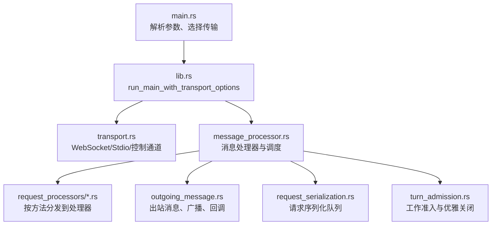
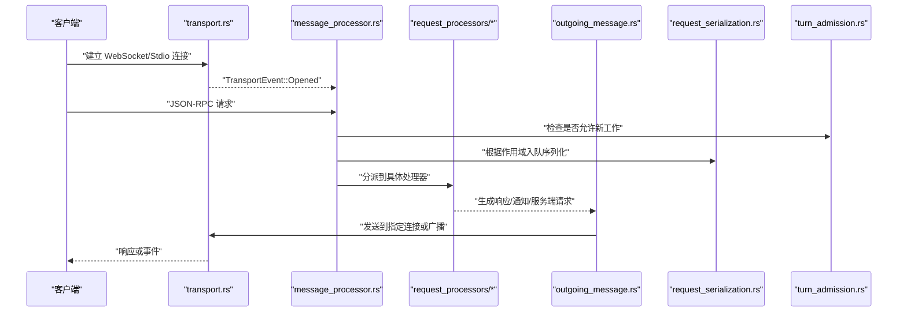
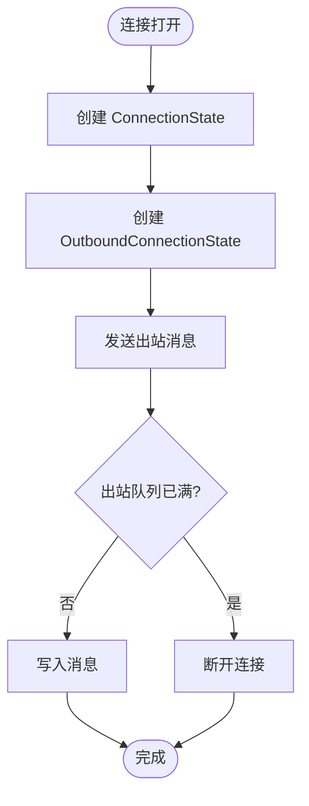
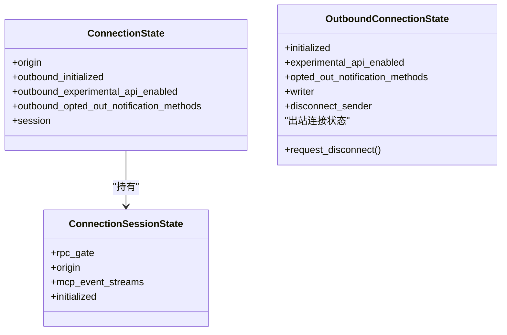
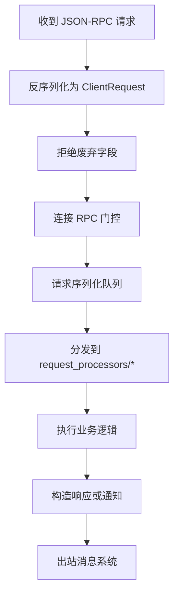
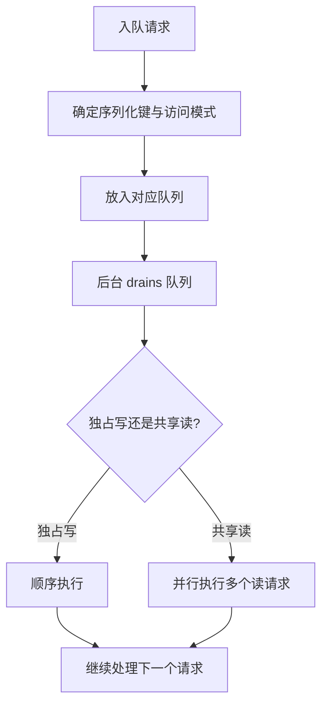
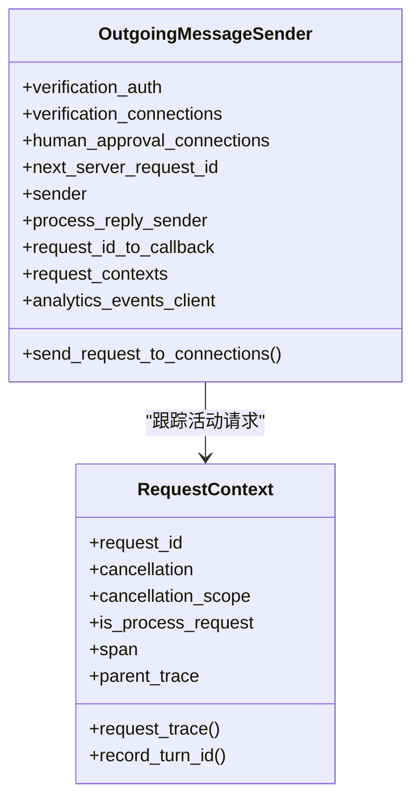
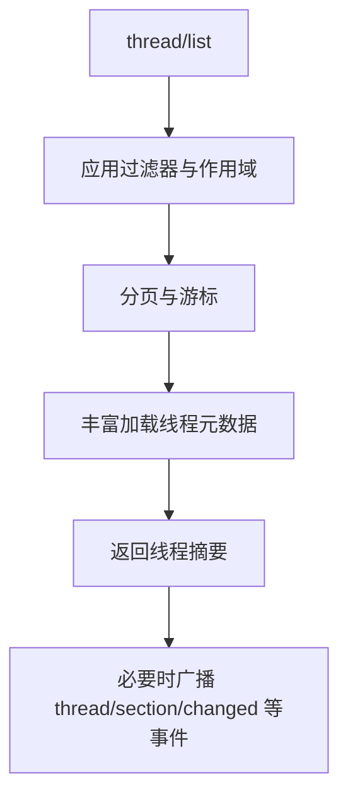
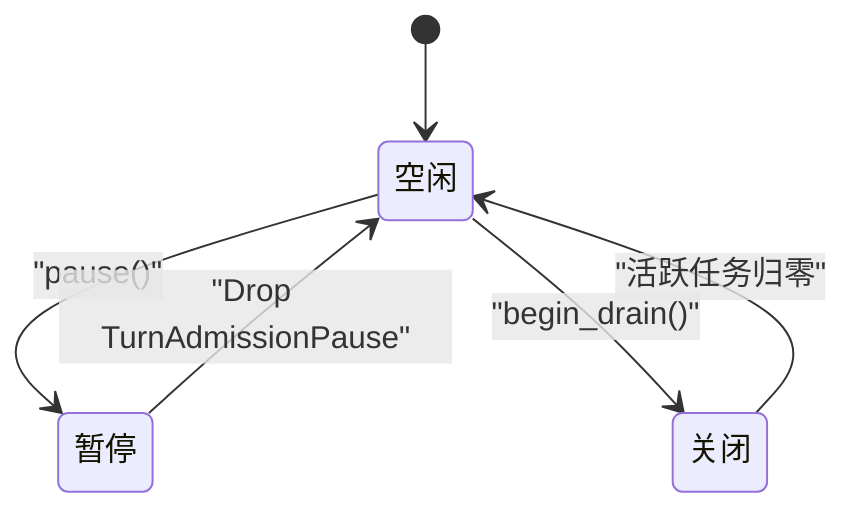

# 应用服务器

<cite>
**本文引用的文件**
- [main.rs](file://codex-rs/app-server/src/main.rs)
- [lib.rs](file://codex-rs/app-server/src/lib.rs)
- [transport.rs](file://codex-rs/app-server/src/transport.rs)
- [message_processor.rs](file://codex-rs/app-server/src/message_processor.rs)
- [outgoing_message.rs](file://codex-rs/app-server/src/outgoing_message.rs)
- [request_serialization.rs](file://codex-rs/app-server/src/request_serialization.rs)
- [request_processors.rs](file://codex-rs/app-server/src/request_processors.rs)
- [thread_processor.rs](file://codex-rs/app-server/src/request_processors/thread_processor.rs)
- [turn_admission.rs](file://codex-rs/app-server/src/turn_admission.rs)
- [Cargo.toml](file://codex-rs/app-server/Cargo.toml)
- [README.md](file://codex-rs/app-server/README.md)
</cite>

## 目录
1. [引言](#引言)
2. [项目结构](#项目结构)
3. [核心组件](#核心组件)
4. [架构总览](#架构总览)
5. [详细组件分析](#详细组件分析)
6. [依赖关系分析](#依赖关系分析)
7. [性能与并发特性](#性能与并发特性)
8. [故障排查指南](#故障排查指南)
9. [部署、调优与安全最佳实践](#部署调优与安全最佳实践)
10. [结论](#结论)

## 引言
应用服务器是 Codex CLI 的 HTTP/gRPC/WebSocket 服务层，负责接收客户端请求、认证连接、路由消息、执行业务处理器、管理线程与会话状态，并向客户端广播事件。它同时提供进程内可嵌入运行能力，既能作为独立二进制运行，也能被 TUI 或执行运行时宿主集成。

该文档聚焦以下目标：
- 解释 WebSocket 连接生命周期、认证与安全策略
- 说明消息处理流程、任务队列与序列化机制
- 梳理请求处理器体系与线程管理
- 给出启动、连接处理与响应发送的实践路径
- 总结配置、日志、监控与扩展点
- 提供部署、性能调优和安全加固建议

## 项目结构
应用服务器以 `app-server` crate 为核心，暴露二进制 `codex-app-server` 和库 `codex_app_server`。顶层入口在 `src/main.rs`，核心组装逻辑在 `src/lib.rs`，传输层在 `src/transport.rs`，消息处理在 `src/message_processor.rs`，出站消息与回调在 `src/outgoing_message.rs`，请求序列化在 `src/request_serialization.rs`，具体业务处理器位于 `src/request_processors/`。

**图示来源**
- [main.rs:1-172](file://codex-rs/app-server/src/main.rs#L1-L172)
- [lib.rs:201-500](file://codex-rs/app-server/src/lib.rs#L201-L500)
- [transport.rs:1-249](file://codex-rs/app-server/src/transport.rs#L1-L249)
- [message_processor.rs:1-200](file://codex-rs/app-server/src/message_processor.rs#L1-L200)
- [outgoing_message.rs:1-200](file://codex-rs/app-server/src/outgoing_message.rs#L1-L200)
- [request_serialization.rs:1-200](file://codex-rs/app-server/src/request_serialization.rs#L1-L200)
- [turn_admission.rs:1-125](file://codex-rs/app-server/src/turn_admission.rs#L1-L125)

**章节来源**
- [Cargo.toml:1-171](file://codex-rs/app-server/Cargo.toml#L1-L171)

## 核心组件
- **主程序与运行时选项**
  - 命令行参数通过 clap 解析，支持监听地址、会话来源、WebSocket 认证参数、严格配置模式等。
  - 构建 `AppServerRuntimeOptions`，注入云技能快照、代码模式传输、插件启动行为、远程控制启动模式、受管守护进程标志等。
  - 调用 `run_main_with_transport_options` 完成基础设施初始化并返回退出码。

- **传输层**
  - 抽象为 `AppServerTransport`，支持 stdio、Unix Socket、WebSocket 以及关闭监听。
  - 维护连接状态、出站通道、通知过滤、断开控制令牌。
  - 负责广播消息、慢连接保护、实验性 API 字段裁剪。

- **消息处理器**
  - 集中注册各领域处理器：账户、应用、目录、命令执行、配置、环境、反馈、文件系统、Git、初始化、市场、MCP、插件、进程执行、项目、远程管理、搜索、线程、轮次、Windows 沙箱等。
  - 维护连接会话状态、模型刷新工作器、技能观察器、遥测与指标。

- **出站消息系统**
  - 统一封装请求、响应、服务端通知和服务端请求。
  - 管理活动请求上下文、取消令牌、追踪上下文、遥测指标。
  - 提供线程级发送器，用于向特定线程关联的连接集合发送消息。

- **请求序列化队列**
  - 基于全局键、线程键、进程键等维度串行化访问。
  - 支持独占写与共享读，批量并行读取，等待时释放已断开连接。

- **工作准入与优雅关闭**
  - 控制新轮次进入，支持暂停与工作区切换。
  - 与信号处理协作，进入 drain 阶段后拒绝新工作，等待活跃任务结束。

**章节来源**
- [main.rs:1-172](file://codex-rs/app-server/src/main.rs#L1-L172)
- [lib.rs:201-500](file://codex-rs/app-server/src/lib.rs#L201-L500)
- [transport.rs:1-249](file://codex-rs/app-server/src/transport.rs#L1-L249)
- [message_processor.rs:1-200](file://codex-rs/app-server/src/message_processor.rs#L1-L200)
- [outgoing_message.rs:1-200](file://codex-rs/app-server/src/outgoing_message.rs#L1-L200)
- [request_serialization.rs:1-200](file://codex-rs/app-server/src/request_serialization.rs#L1-L200)
- [turn_admission.rs:1-125](file://codex-rs/app-server/src/turn_admission.rs#L1-L125)

## 架构总览
应用服务器采用“传输接入 + 消息处理 + 出站路由”的分层架构。传输层负责协议适配与连接管理；消息处理器负责鉴权、反序列化、方法分发与错误包装；出站模块负责异步写入、去重、广播与回调匹配；业务处理器通过 `request_processors` 实现细粒度职责。

**图示来源**
- [transport.rs:1-249](file://codex-rs/app-server/src/transport.rs#L1-L249)
- [message_processor.rs:1-200](file://codex-rs/app-server/src/message_processor.rs#L1-L200)
- [outgoing_message.rs:1-200](file://codex-rs/app-server/src/outgoing_message.rs#L1-L200)
- [request_serialization.rs:1-200](file://codex-rs/app-server/src/request_serialization.rs#L1-L200)
- [turn_admission.rs:1-125](file://codex-rs/app-server/src/turn_admission.rs#L1-L125)

## 详细组件分析

### 传输层与连接管理
- 支持的监听 URL 包括 `stdio://`、`unix://`、`unix://PATH`、`ws://IP:PORT`、`off`。
- 连接状态包含来源、出站初始化标志、实验性 API 开关、通知排除集合和会话状态。
- 出站连接状态保存 writer 通道、初始化标志、实验性 API 开关、通知排除集合和断开取消令牌。
- 慢连接保护：当出站队列满或通道关闭时，直接断开连接，避免阻塞整体服务。
- 广播过滤：仅对已初始化且未显式排除的方法进行广播；实验性通知需客户端启用实验性 API。

**图示来源**
- [transport.rs:1-249](file://codex-rs/app-server/src/transport.rs#L1-L249)

**章节来源**
- [transport.rs:1-249](file://codex-rs/app-server/src/transport.rs#L1-L249)

### 认证与安全策略
- 支持通过 `WebsocketAuthArgs` 配置 WebSocket 认证设置，并在运行时转换为 `WebsocketAuthSettings`。
- 连接会话中的 RPC 门控会附加认证信息，用于后续请求授权。
- 实验性 API 需要客户端在初始化中启用相应能力；未启用的客户端会被过滤掉实验性通知和方法字段。
- 安全相关能力包括用户验证、权限校验、执行策略警告、沙箱模式与外部认证适配器。

**图示来源**
- [transport.rs:1-249](file://codex-rs/app-server/src/transport.rs#L1-L249)
- [message_processor.rs:1-200](file://codex-rs/app-server/src/message_processor.rs#L1-L200)

**章节来源**
- [main.rs:1-172](file://codex-rs/app-server/src/main.rs#L1-L172)
- [transport.rs:1-249](file://codex-rs/app-server/src/transport.rs#L1-L249)
- [message_processor.rs:1-200](file://codex-rs/app-server/src/message_processor.rs#L1-L200)

### 消息处理与请求路由
- 消息处理器聚合所有领域处理器，负责 JSON-RPC 反序列化、废弃字段拒绝、错误编码、遥测与指标。
- 每个处理器对应一组 API 方法，例如线程、轮次、配置、Git、MCP、市场、插件、进程执行、Windows 沙箱等。
- 请求上下文携带取消令牌、追踪 Span、父级 W3C Trace Context、是否为进程请求等信息，用于跨组件协作。

**图示来源**
- [message_processor.rs:1-200](file://codex-rs/app-server/src/message_processor.rs#L1-L200)
- [request_processors.rs:1-200](file://codex-rs/app-server/src/request_processors.rs#L1-L200)
- [outgoing_message.rs:1-200](file://codex-rs/app-server/src/outgoing_message.rs#L1-L200)

**章节来源**
- [message_processor.rs:1-200](file://codex-rs/app-server/src/message_processor.rs#L1-L200)
- [request_processors.rs:1-200](file://codex-rs/app-server/src/request_processors.rs#L1-L200)

### 请求序列化与并发控制
- 队列键支持全局、线程、线程路径、命令执行进程、通用进程、模糊文件搜索会话、文件系统监视、MCP OAuth 等范围。
- 访问模式分为独占写和共享读；独占写顺序执行，共享读可批量并行。
- 队列在空闲时自动清理；连接关闭的请求会在队列中丢弃，避免挂起。
- 指标 `app.requests.queued` 跟踪排队中的请求数量。

**图示来源**
- [request_serialization.rs:1-200](file://codex-rs/app-server/src/request_serialization.rs#L1-L200)
- [request_serialization.rs:201-400](file://codex-rs/app-server/src/request_serialization.rs#L201-L400)

**章节来源**
- [request_serialization.rs:1-200](file://codex-rs/app-server/src/request_serialization.rs#L1-L200)
- [request_serialization.rs:201-400](file://codex-rs/app-server/src/request_serialization.rs#L201-L400)

### 出站消息与回调管理
- 出站消息类型包括请求、响应、服务端通知和服务端请求。
- 活动请求上下文维护请求 ID、取消范围、Span、W3C Trace Context、遥测指标。
- 回调映射将服务端请求响应回原始请求方，并支持人类审批、用户验证、线程范围等场景。
- 线程级发送器用于向特定线程关联的连接集合发送消息，便于线程状态更新和事件广播。

**图示来源**
- [outgoing_message.rs:1-200](file://codex-rs/app-server/src/outgoing_message.rs#L1-L200)

**章节来源**
- [outgoing_message.rs:1-200](file://codex-rs/app-server/src/outgoing_message.rs#L1-L200)

### 线程处理器与生命周期
- 线程处理器承担线程列表、筛选、分页、归档、恢复、分支、摘要、记忆、部分、输入、目标、队列、读取状态等大量功能。
- 支持本地历史账户作用域、排除 ID 列表、数据库只读查询、部分移动广播、读取状态变更通知。
- 线程恢复涉及持久化设置、工作区根、模型与推理强度、权限配置、沙箱策略等多维合并。
- 线程状态变更通过出站广播同步给客户端，支持订阅与取消订阅。

**图示来源**
- [thread_processor.rs:1-300](file://codex-rs/app-server/src/request_processors/thread_processor.rs#L1-L300)

**章节来源**
- [thread_processor.rs:1-300](file://codex-rs/app-server/src/request_processors/thread_processor.rs#L1-L300)

### 工作准入与优雅关闭
- 工作准入器记录关闭、暂停和活跃计数，并通过 watch 通道广播活跃任务数。
- 暂停用于工作区切换前的同步，等待活跃任务归零。
- 优雅关闭接受 SIGTERM/SIGHUP/Ctrl+C，开始 drain 后拒绝新工作，直到无活跃轮次和准入请求。
- 第二次强制信号会跳过等待，直接触发重启。

**图示来源**
- [turn_admission.rs:1-125](file://codex-rs/app-server/src/turn_admission.rs#L1-L125)

**章节来源**
- [turn_admission.rs:1-125](file://codex-rs/app-server/src/turn_admission.rs#L1-L125)

## 依赖关系分析
应用服务器依赖众多内部 crate，涵盖核心逻辑、配置、网络代理、连接器、执行服务器、遥测、状态存储、线程存储、工具、MCP、模型提供者、反馈、滚动发布、沙箱等。

```mermaid
graph TB
    App["codex-app-server"] --> Core["codex-core"]
    App --> Config["codex-config"]
    App --> Exec["codex-exec-server"]
    App --> Protocol["codex-protocol"]
    App --> TransportProto["codex-app-server-protocol"]
    App --> TransportLib["codex-app-server-transport"]
    App --> Analytics["codex-analytics"]
    App --> Otel["codex-otel"]
    App --> Login["codex-login"]
    App --> State["codex-state"]
    App --> ThreadStore["codex-thread-store"]
    App --> Sandbox["codex-sandboxing"]
    App --> MCP["codex-mcp"]
    App --> Feedback["codex-feedback"]
```

**图示来源**
- [Cargo.toml:1-171](file://codex-rs/app-server/Cargo.toml#L1-L171)

**章节来源**
- [Cargo.toml:1-171](file://codex-rs/app-server/Cargo.toml#L1-L171)

## 性能与并发特性
- **多任务循环**：处理器循环处理入站请求，出站循环负责慢 I/O 写入，两者通过控制事件解耦。
- **异步写入**：出站消息通过 mpsc 通道排队，避免阻塞请求处理。
- **慢连接保护**：队列满或通道关闭时主动断开，防止拖垮整体吞吐。
- **共享读并行**：序列化队列对共享读请求批量并行执行，提升读多写少场景吞吐。
- **指标与遥测**：活动请求、排队请求、Gauge 指标与 OpenTelemetry 追踪贯穿请求生命周期。
- **内存分配器**：Linux musl x86_64/aarch64 目标默认使用 jemalloc，有助于降低碎片与提升性能。

**章节来源**
- [lib.rs:201-500](file://codex-rs/app-server/src/lib.rs#L201-L500)
- [outgoing_message.rs:1-200](file://codex-rs/app-server/src/outgoing_message.rs#L1-L200)
- [request_serialization.rs:201-400](file://codex-rs/app-server/src/request_serialization.rs#L201-L400)
- [Cargo.toml:1-171](file://codex-rs/app-server/Cargo.toml#L1-L171)

## 故障排查指南
- **配置加载错误**
  - 配置错误会转换为 `ConfigWarningNotification`，包含路径与行号范围，便于定位问题配置段。
- **执行策略警告**
  - 自定义执行策略解析失败会产生警告，包含策略文件位置与范围。
- **项目配置禁用**
  - 未信任项目的本地配置、钩子与执行策略会被禁用，但技能仍加载；会输出受影响文件夹列表。
- **SQLite 恢复警告**
  - 本地数据库重建会发出告警，提示客户端注意状态一致性。
- **关闭拒绝新工作**
  - 优雅关闭期间，新请求可能返回 `-32600`，原因标识为 `serverShuttingDown`。
- **线程读取状态冲突**
  - 并发编辑读取状态会返回 `-32600`，数据中包含当前读取状态，客户端应刷新而非盲目重试。

**章节来源**
- [lib.rs:201-500](file://codex-rs/app-server/src/lib.rs#L201-L500)
- [README.md:1-951](file://codex-rs/app-server/README.md#L1-L951)

## 部署、调优与安全最佳实践

### 启动与监听
- 通过 `--listen` 指定监听地址：
  - `stdio://`：标准输入输出，适合进程内或管道通信。
  - `unix://` 或 `unix://PATH`：Unix 域套接字，适合本机高吞吐。
  - `ws://IP:PORT`：WebSocket，适合浏览器或远程客户端。
  - `off`：不启动网络监听。
- 通过 `--session-source` 设置会话来源，影响产品限制与元数据。
- 通过 `--strict-config` 启用严格配置模式，拒绝未知字段。

**章节来源**
- [main.rs:1-172](file://codex-rs/app-server/src/main.rs#L1-L172)

### 连接与认证
- 使用 `WebsocketAuthArgs` 配置 WebSocket 认证策略，如令牌校验、来源白名单等。
- 客户端应在初始化中启用实验性 API，才能接收实验性通知或使用实验性功能。
- 对敏感操作启用用户验证流程，确保交互式确认。

**章节来源**
- [main.rs:1-172](file://codex-rs/app-server/src/main.rs#L1-L172)
- [transport.rs:1-249](file://codex-rs/app-server/src/transport.rs#L1-L249)

### 日志与监控
- 日志格式可通过环境变量 `LOG_FORMAT` 设置为 `json`，便于结构化采集。
- 使用 tracing 与 tracing-subscriber 输出带 Span 的日志。
- 遥测通过 OpenTelemetry 集成，服务名固定为 `codex-app-server`。
- 指标包括活动请求、排队请求、出站请求等 Gauge。

**章节来源**
- [lib.rs:201-500](file://codex-rs/app-server/src/lib.rs#L201-L500)
- [outgoing_message.rs:1-200](file://codex-rs/app-server/src/outgoing_message.rs#L1-L200)

### 性能调优
- 在高负载场景优先使用 Unix 域套接字或 WebSocket 长连接。
- 合理设置客户端通知过滤，减少不必要的广播开销。
- 利用共享读并行提升读多写少场景吞吐量。
- Linux musl 目标启用 jemalloc 以提升内存性能。
- 关注 `app.requests.in_flight` 与 `app.requests.queued` 指标，识别瓶颈。

**章节来源**
- [transport.rs:1-249](file://codex-rs/app-server/src/transport.rs#L1-L249)
- [request_serialization.rs:201-400](file://codex-rs/app-server/src/request_serialization.rs#L201-L400)
- [Cargo.toml:1-171](file://codex-rs/app-server/Cargo.toml#L1-L171)

### 安全加固
- 启用 WebSocket 认证，限制来源与凭据有效性。
- 对实验性 API 进行最小权限启用，避免非预期能力暴露。
- 使用用户验证与人类审批流程，阻断高风险操作。
- 配置执行策略与沙箱模式，限制进程执行与文件访问范围。
- 定期审查配置加载警告与执行策略解析错误，修复不安全配置。

**章节来源**
- [main.rs:1-172](file://codex-rs/app-server/src/main.rs#L1-L172)
- [lib.rs:201-500](file://codex-rs/app-server/src/lib.rs#L201-L500)

## 结论
Codex 应用服务器通过清晰的传输层、消息处理器与出站系统，实现了可扩展、可观测、可治理的服务层架构。其连接管理、认证机制、请求序列化与工作准入共同保障了高并发下的稳定性与安全性。线程处理器覆盖完整的对话生命周期，配合丰富的扩展点与外部集成，使其既可作为独立服务运行，也可无缝嵌入宿主进程。生产部署时应重点关注认证、日志、遥测、指标与配置安全，并根据负载特征选择合适的传输方式与并发策略。