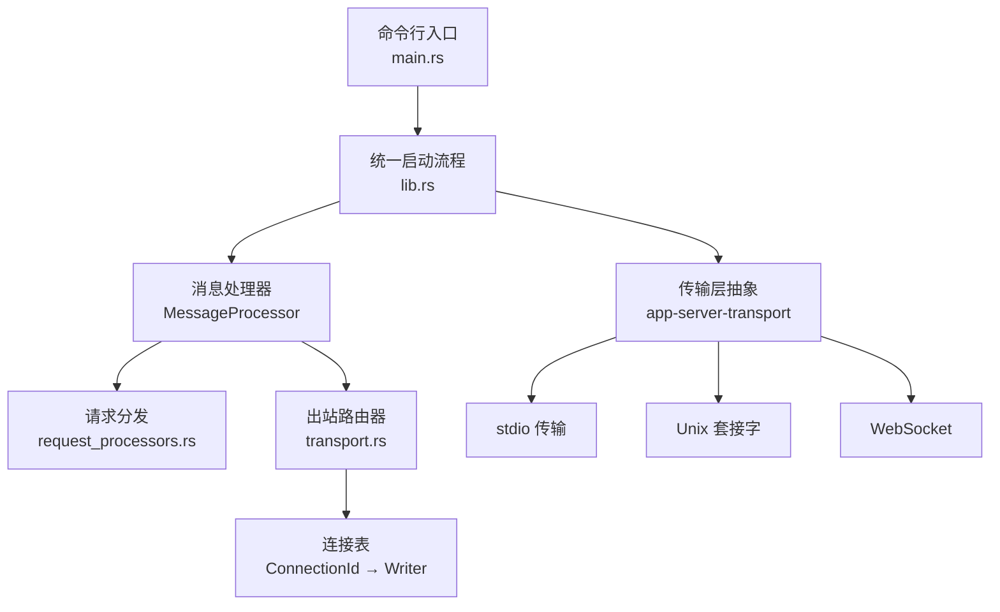
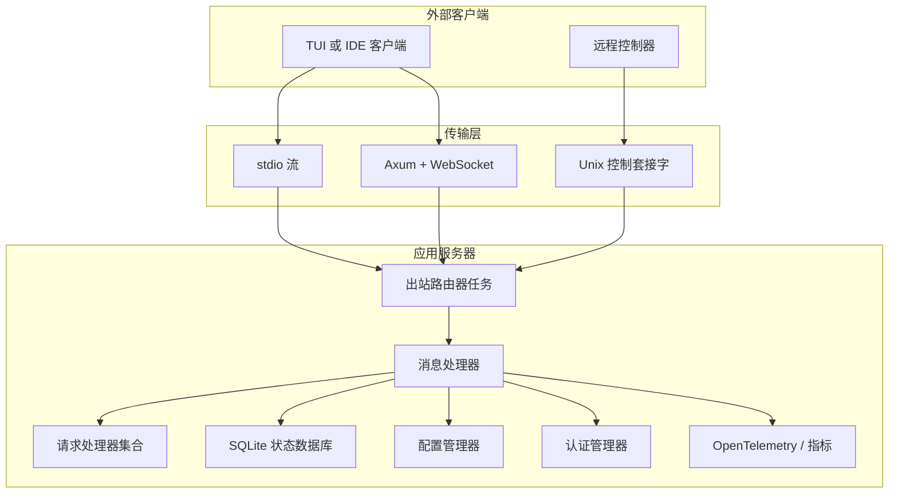
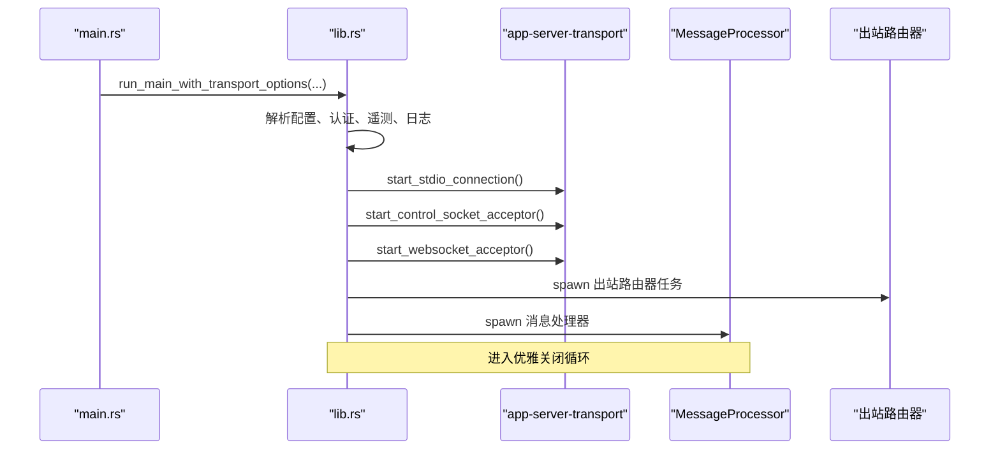
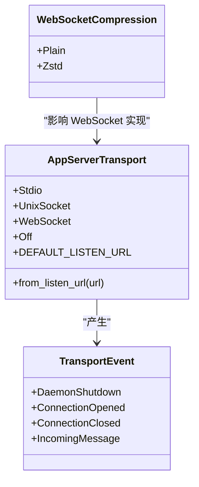
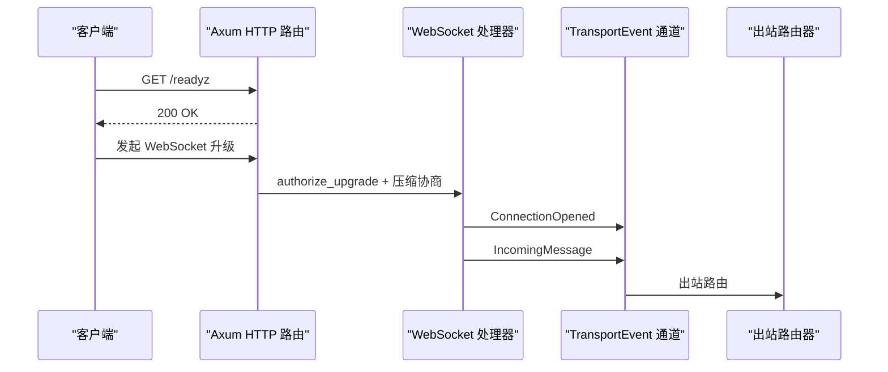
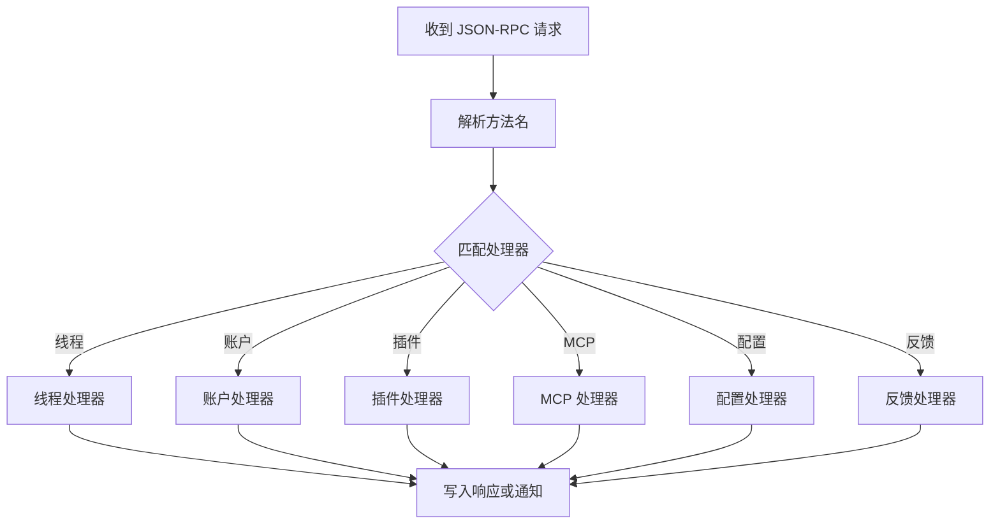
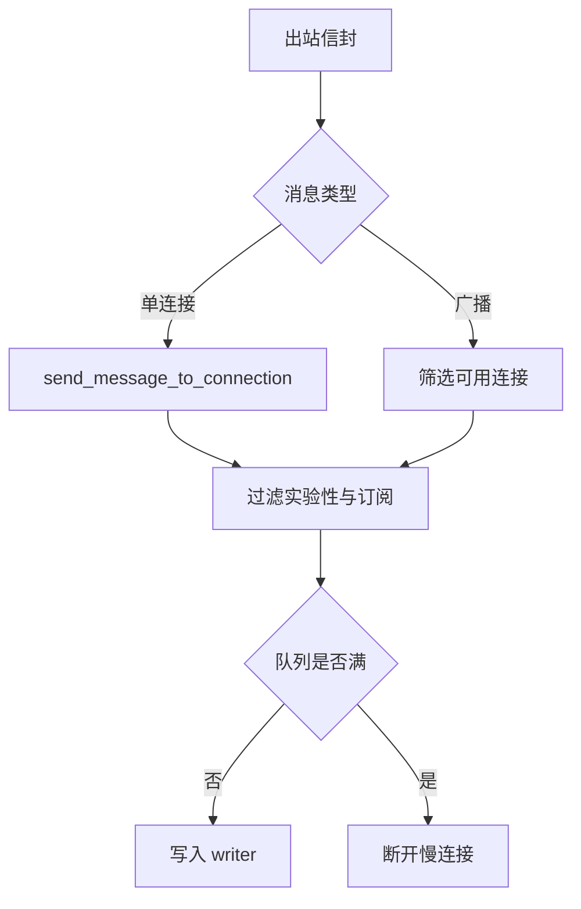
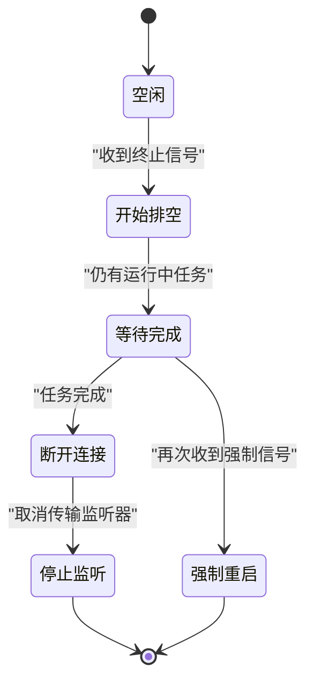
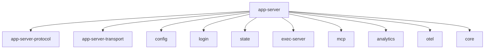

# 服务器架构设计

<cite>
**本文引用的文件**
- [main.rs](file://codex-rs/app-server/src/main.rs)
- [lib.rs](file://codex-rs/app-server/src/lib.rs)
- [transport.rs](file://codex-rs/app-server/src/transport.rs)
- [Cargo.toml](file://codex-rs/app-server/Cargo.toml)
- [README.md](file://codex-rs/app-server/README.md)
- [transport_mod.rs](file://codex-rs/app-server-transport/src/transport/mod.rs)
- [websocket.rs](file://codex-rs/app-server-transport/src/transport/websocket.rs)
- [app_server_transport_lib.rs](file://codex-rs/app-server-transport/src/lib.rs)
- [request_processors.rs](file://codex-rs/app-server/src/request_processors.rs)
</cite>

## 目录
1. [引言](#引言)
2. [项目结构](#项目结构)
3. [核心组件](#核心组件)
4. [架构总览](#架构总览)
5. [详细组件分析](#详细组件分析)
6. [依赖关系分析](#依赖关系分析)
7. [性能与扩展性](#性能与扩展性)
8. [故障排查指南](#故障排查指南)
9. [结论](#结论)

## 引言
本文面向应用服务器的整体架构，重点解释 `app-server` 的模块化设计、传输层抽象、请求路由机制、启动与生命周期管理、优雅关闭策略，以及 HTTP、gRPC、WebSocket 三类传输协议在系统中的统一接入方式。同时给出配置和启动示例、外部基础设施集成点，并提供扩展与调优建议。

`app-server` 是 Codex 生态中的进程内或守护式服务端，负责接收客户端 JSON-RPC 请求，将其分发到线程、账户、插件、MCP、配置、反馈等处理器，并通过统一的出站通道将响应和通知写回不同传输层。其运行时由主入口解析参数、加载配置、初始化遥测、建立传输监听器、启动消息处理器和出站路由器任务组成。

**章节来源**
- [README.md:1-200](file://codex-rs/app-server/README.md#L1-L200)

## 项目结构
`app-server` 是一个 Rust crate，提供可执行二进制、库接口和多个内部模块：

| 路径 | 职责 |
|---|---|
| `src/main.rs` | 命令行入口、参数解析、传输类型选择、调用统一启动函数 |
| `src/lib.rs` | 主启动流程、运行时选项、优雅关闭、出站路由器、事件循环、处理器装配 |
| `src/transport.rs` | 对 `app-server-transport` 的重导出、连接状态、出站消息过滤与广播路由 |
| `src/request_processors.rs` | JSON-RPC 请求分发、方法注册、业务处理器依赖 |
| `codex-rs/app-server-transport/...` | 传输抽象：stdio、Unix Socket、WebSocket、远程控制控制面 |

**图示来源**
- [main.rs:1-172](file://codex-rs/app-server/src/main.rs#L1-L172)
- [lib.rs:512-893](file://codex-rs/app-server/src/lib.rs#L512-L893)
- [transport.rs:1-249](file://codex-rs/app-server/src/transport.rs#L1-L249)
- [request_processors.rs:1-200](file://codex-rs/app-server/src/request_processors.rs#L1-L200)
- [transport_mod.rs:1-200](file://codex-rs/app-server-transport/src/transport/mod.rs#L1-L200)
- [websocket.rs:1-200](file://codex-rs/app-server-transport/src/transport/websocket.rs#L1-L200)

**章节来源**
- [Cargo.toml:1-171](file://codex-rs/app-server/Cargo.toml#L1-L171)
- [main.rs:1-172](file://codex-rs/app-server/src/main.rs#L1-L172)
- [lib.rs:1-200](file://codex-rs/app-server/src/lib.rs#L1-L200)
- [transport.rs:1-249](file://codex-rs/app-server/src/transport.rs#L1-L249)

## 核心组件
- **主入口与参数解析**：`main.rs` 使用 clap 解析 `--listen`、`--session-source`、认证参数、远程控制和受管守护模式等选项，并调用 `run_main_with_transport_options`。
- **统一启动流程**：`lib.rs` 中的 `run_main_with_transport_options` 完成配置加载、环境管理、遥测初始化、SQLite 状态数据库初始化、传输监听、远程控制、出站路由器、消息处理器和优雅关闭循环。
- **传输层抽象**：`app-server-transport` 暴露 `AppServerTransport` 枚举及 stdio、Unix Socket、WebSocket 三种实现；`app-server` 的 `transport.rs` 仅重导出公共能力，并封装连接级出站状态。
- **请求路由**：`request_processors.rs` 集中处理 JSON-RPC 请求到具体业务处理器，如线程、账户、插件、MCP、市场、配置、反馈等。
- **出站路由与广播**：`transport.rs` 维护连接表，按连接过滤实验性字段和通知订阅，支持单连接发送和广播。
- **生命周期与优雅关闭**：`lib.rs` 定义 `ShutdownState`、信号处理、drain 逻辑、强制重启、快照保存和连接断开。

**章节来源**
- [main.rs:18-172](file://codex-rs/app-server/src/main.rs#L18-L172)
- [lib.rs:512-893](file://codex-rs/app-server/src/lib.rs#L512-L893)
- [transport.rs:1-249](file://codex-rs/app-server/src/transport.rs#L1-L249)
- [request_processors.rs:1-200](file://codex-rs/app-server/src/request_processors.rs#L1-L200)
- [transport_mod.rs:120-200](file://codex-rs/app-server-transport/src/transport/mod.rs#L120-L200)

## 架构总览
应用服务器采用“多传输接入 + 统一 JSON-RPC 处理 + 异步出站路由”的分层架构：

**图示来源**
- [main.rs:60-172](file://codex-rs/app-server/src/main.rs#L60-L172)
- [lib.rs:512-893](file://codex-rs/app-server/src/lib.rs#L512-L893)
- [transport_mod.rs:120-200](file://codex-rs/app-server-transport/src/transport/mod.rs#L120-L200)
- [websocket.rs:120-200](file://codex-rs/app-server-transport/src/transport/websocket.rs#L120-L200)

### 启动流程
1. 解析命令行参数。
2. 根据 `--listen` 构造 `AppServerTransport`。
3. 调用 `run_main_with_transport_options`。
4. 初始化云技能提供者、运行环境、配置管理器、认证管理器、遥测、日志。
5. 初始化 SQLite 状态数据库，收集配置警告。
6. 根据传输类型启动 stdio、Unix Socket 或 WebSocket 监听器。
7. 启动远程控制接受器。
8. 启动出站路由器任务。
9. 启动消息处理器和优雅关闭循环。

**图示来源**
- [main.rs:60-172](file://codex-rs/app-server/src/main.rs#L60-L172)
- [lib.rs:512-893](file://codex-rs/app-server/src/lib.rs#L512-L893)
- [transport_mod.rs:120-200](file://codex-rs/app-server-transport/src/transport/mod.rs#L120-L200)
- [websocket.rs:160-200](file://codex-rs/app-server-transport/src/transport/websocket.rs#L160-L200)

**章节来源**
- [main.rs:60-172](file://codex-rs/app-server/src/main.rs#L60-L172)
- [lib.rs:512-893](file://codex-rs/app-server/src/lib.rs#L512-L893)

## 详细组件分析

### 主进程管理与统一启动
`main.rs` 主要负责：
- 全局分配器选择（Linux musl）。
- 调试环境变量控制受管配置加载。
- 通过 clap 解析 `cloud_skills_snapshot`、`listen`、`session-source`、`auth`、`strict-config`、`remote-control`、`managed-daemon`。
- 设置 `RemoteControlStartupMode`。
- 调用 `run_main_with_transport_options` 并处理强制退出。

`lib.rs` 的 `run_main_with_transport_options` 是核心编排函数：
- 构建云技能提供者。
- 判断是否处于受管守护模式。
- 创建传输事件通道、出站消息通道、出站控制通道。
- 加载配置、验证执行策略、初始化认证和环境管理器。
- 初始化 OpenTelemetry、日志层、诊断日志。
- 根据传输类型启动监听器。
- 启动远程控制、指标采集、遥测重载。
- 启动出站路由器任务和消息处理器。
- 进入优雅关闭循环。

**章节来源**
- [main.rs:18-172](file://codex-rs/app-server/src/main.rs#L18-L172)
- [lib.rs:512-893](file://codex-rs/app-server/src/lib.rs#L512-L893)

### 传输层抽象与三种协议
传输层抽象位于 `app-server-transport`，`app-server` 的 `transport.rs` 仅做重导出和连接级出站封装。

#### 统一传输枚举
`AppServerTransport` 支持：
- `Stdio`：标准输入输出流，适合嵌入场景。
- `UnixSocket`：本地控制套接字，适合守护进程。
- `WebSocket`：基于 Axum 和 Tungstenite 的 WebSocket，支持健康检查、可选压缩和认证。
- `Off`：不启动任何网络监听。

**图示来源**
- [transport_mod.rs:120-200](file://codex-rs/app-server-transport/src/transport/mod.rs#L120-L200)
- [app_server_transport_lib.rs:1-54](file://codex-rs/app-server-transport/src/lib.rs#L1-L54)

#### HTTP、gRPC、WebSocket 的统一接入方式
- **HTTP**：WebSocket 监听器使用 Axum 注册 `/readyz`、`/healthz`，并将非 WebSocket 请求降级为通用处理器；同时拒绝携带 `Origin` 头的请求。
- **WebSocket**：Axum 升级后拆分流，交由 `run_websocket_connection` 处理；支持 zstd 压缩协商。
- **gRPC**：`app-server` 本身不直接暴露 gRPC 服务；gRPC 以代码模式宿主会话提供者的形式被消费，例如远程代码模式宿主通过 gRPC 地址访问。

**图示来源**
- [websocket.rs:120-200](file://codex-rs/app-server-transport/src/transport/websocket.rs#L120-L200)
- [transport_mod.rs:120-200](file://codex-rs/app-server-transport/src/transport/mod.rs#L120-L200)

**章节来源**
- [transport_mod.rs:120-200](file://codex-rs/app-server-transport/src/transport/mod.rs#L120-L200)
- [websocket.rs:1-200](file://codex-rs/app-server-transport/src/transport/websocket.rs#L1-L200)
- [app_server_transport_lib.rs:1-54](file://codex-rs/app-server-transport/src/lib.rs#L1-L54)

### 请求路由机制
请求路由集中在 `request_processors.rs`。该模块导入大量协议类型，表明它负责将 JSON-RPC 方法映射到业务处理器，例如：
- 账户相关：登录、令牌用量、速率限制重置。
- 线程相关：线程列表、归档、读取、目标、摘要、恢复。
- 插件与市场：插件安装、卸载、市场操作。
- MCP：工具调用、资源读取、OAuth 登录。
- 配置与环境：配置写入、环境信息、权限档案。
- 反馈与遥测：反馈上传、滚动历史。

**图示来源**
- [request_processors.rs:1-200](file://codex-rs/app-server/src/request_processors.rs#L1-L200)

**章节来源**
- [request_processors.rs:1-200](file://codex-rs/app-server/src/request_processors.rs#L1-L200)

### 出站路由与连接状态管理
`transport.rs` 维护两类状态：
- `ConnectionState`：入站侧连接上下文，包括来源、认证、RPC 门控、会话状态。
- `OutboundConnectionState`：出站侧连接上下文，包括 writer、初始化标志、实验性 API 开关、通知订阅、断连令牌。

出站路由逻辑：
- 单连接发送时，若队列满则断开慢连接。
- 广播时只向已初始化且未订阅排除的通知目标发送。
- 实验性 API 未启用时，剥离命令执行审批请求中的实验性字段。

**图示来源**
- [transport.rs:1-249](file://codex-rs/app-server/src/transport.rs#L1-L249)

**章节来源**
- [transport.rs:1-249](file://codex-rs/app-server/src/transport.rs#L1-L249)

### 生命周期管理与优雅关闭
优雅关闭由 `ShutdownState` 驱动：
- 首次收到终止信号后进入 drain 模式，拒绝新工作。
- 等待运行中的 assistant turn 和活跃准入请求归零。
- 第二次强制信号触发强制重启。
- 在受管守护模式下保存线程快照。
- 取消传输监听器，断开所有出站 WebSocket 连接。

**图示来源**
- [lib.rs:201-500](file://codex-rs/app-server/src/lib.rs#L201-L500)
- [lib.rs:901-1222](file://codex-rs/app-server/src/lib.rs#L901-L1222)

**章节来源**
- [lib.rs:201-500](file://codex-rs/app-server/src/lib.rs#L201-L500)
- [lib.rs:901-1222](file://codex-rs/app-server/src/lib.rs#L901-L1222)

### 配置与启动示例
以下示例说明如何配置和启动不同类型的服务器实例。注意：示例描述的是行为，而非直接粘贴源码。

| 场景 | 启动方式 | 说明 |
|---|---|---|
| 默认 stdio 模式 | 不传 `--listen` | 适用于 IDE 或 TUI 嵌入场景 |
| Unix Socket 模式 | `--listen unix://` 或 `--listen unix://PATH` | 守护进程本地控制面；默认路径位于 `CODEX_HOME` 的控制套接字目录 |
| WebSocket 模式 | `--listen ws://IP:PORT` | 需要配置 WebSocket 认证，非回环地址必须启用认证 |
| 关闭监听 | `--listen off` | 仅用于测试或特殊嵌入式场景 |
| 严格配置 | `--strict-config` | 配置文件存在未知字段时报错 |
| 远程控件 | `--remote-control` | 显式启用远程控件，需满足需求策略和状态数据库可用性 |
| 受管守护 | `--managed-daemon` | 配合 Unix Socket 启用线程恢复和文件描述符提升 |

**章节来源**
- [main.rs:20-60](file://codex-rs/app-server/src/main.rs#L20-L60)
- [transport_mod.rs:120-200](file://codex-rs/app-server-transport/src/transport/mod.rs#L120-L200)
- [websocket.rs:160-200](file://codex-rs/app-server-transport/src/transport/websocket.rs#L160-L200)

## 依赖关系分析
`app-server` 依赖众多内部 crate，体现其作为聚合型服务端的角色：

| 依赖类别 | 代表依赖 | 作用 |
|---|---|---|
| 传输与网络 | `axum`、`tokio`、`tokio-util` | HTTP、WebSocket、异步运行时 |
| 协议模型 | `codex-app-server-protocol` | JSON-RPC 消息、请求、通知、响应类型 |
| 配置与身份 | `codex-config`、`codex-login`、`codex-websocket-auth` | 配置加载、认证、WebSocket 鉴权 |
| 状态与存储 | `codex-state`、`codex-thread-store`、`codex-history-notes-extension` | SQLite 状态、线程持久化、历史记录 |
| 执行与沙箱 | `codex-exec-server`、`codex-sandboxing` | 命令执行、沙箱隔离 |
| 可扩展性 | `codex-plugin`、`codex-mcp`、`codex-hooks` | 插件系统、MCP、钩子 |
| 遥测与分析 | `codex-analytics`、`codex-otel` | 指标、追踪、日志 |
| 业务域 | `codex-core`、`codex-model-provider`、`codex-tools` | 核心业务、模型提供、工具链 |

**图示来源**
- [Cargo.toml:20-171](file://codex-rs/app-server/Cargo.toml#L20-L171)

**章节来源**
- [Cargo.toml:20-171](file://codex-rs/app-server/Cargo.toml#L20-L171)

## 性能与扩展性

### 性能特征
- **通道容量**：传输层使用固定容量的有界通道平衡吞吐与内存占用，默认容量为 128。
- **WebSocket 出站容量更大**：WebSocket 出站通道容量大于内部通道，允许短暂延迟但避免阻塞正常输出。
- **过载保护**：当入站事件通道满时，返回 JSON-RPC 过载错误，而不是无限堆积。
- **慢连接保护**：出站队列满时主动断开慢连接，防止广播风暴。
- **日志与遥测**：支持结构化日志、SQLx span 抑制、OpenTelemetry 指标与追踪。

### 调优建议
- **WebSocket 压缩**：通过特性开关启用 zstd 压缩，减少带宽占用，但会增加 CPU 开销。
- **遥测与日志**：在生产环境中合理设置 `RUST_LOG` 和 `LOG_FORMAT=json`，避免过多 span 事件阻塞 I/O。
- **文件描述符限制**：受管守护模式尝试提升 `nofile` 限制，确保高并发连接。
- **严格配置**：CI 或预发布阶段开启 `--strict-config`，尽早发现配置问题。
- **远程控件策略**：确保 managed requirements 允许远程控件，否则显式启用会失败。

**章节来源**
- [transport_mod.rs:1-120](file://codex-rs/app-server-transport/src/transport/mod.rs#L1-L120)
- [websocket.rs:1-120](file://codex-rs/app-server-transport/src/transport/websocket.rs#L1-L120)
- [lib.rs:512-893](file://codex-rs/app-server/src/lib.rs#L512-L893)

### 扩展指南
- **新增传输实现**：在 `app-server-transport` 中新增传输类型，并在 `lib.rs` 中按现有模式启动 acceptor。
- **新增请求处理器**：在 `request_processors.rs` 中添加方法分支，并复用现有协议类型。
- **新增出站过滤规则**：在 `transport.rs` 的出站消息过滤逻辑中添加条件，控制实验性字段和通知订阅。
- **新增遥测维度**：通过 `otel_reloader` 和 `analytics_events_client` 注入新的指标或追踪标签。
- **新增插件能力**：通过 `codex-plugin` 和 `codex-mcp` 扩展功能，并在启动阶段按需启用。

**章节来源**
- [transport.rs:1-249](file://codex-rs/app-server/src/transport.rs#L1-L249)
- [request_processors.rs:1-200](file://codex-rs/app-server/src/request_processors.rs#L1-L200)
- [lib.rs:512-893](file://codex-rs/app-server/src/lib.rs#L512-L893)

## 故障排查指南

### 常见问题与定位
| 现象 | 可能原因 | 排查步骤 |
|---|---|---|
| WebSocket 无法在非回环地址启动 | 未配置认证 | 检查 `--ws-auth capability-token` 或 `signed-bearer-token` |
| 启动后无监听端口 | 使用了 `off` 或未配置传输且远程控件禁用 | 检查 `--listen` 和远程控件策略 |
| 客户端收到过载错误 | 入站通道已满 | 降低请求频率或检查处理器瓶颈 |
| 连接被断开 | 出站队列满或客户端过慢 | 检查客户端处理能力 |
| 配置加载失败 | 配置格式错误或字段未知 | 开启 `--strict-config` 查看详细信息 |
| 远程控件不可用 | 状态数据库不可用或被需求策略禁用 | 检查 SQLite 状态数据库和需求配置 |

### 日志与诊断
- 使用 `RUST_LOG` 控制日志级别。
- 使用 `LOG_FORMAT=json` 获取结构化日志。
- 关注配置警告通知，尤其是 SQL 恢复、执行策略解析失败和项目配置禁用。
- 使用 `/readyz` 和 `/healthz` 检查 WebSocket 监听器存活。

**章节来源**
- [lib.rs:201-500](file://codex-rs/app-server/src/lib.rs#L201-L500)
- [websocket.rs:120-200](file://codex-rs/app-server-transport/src/transport/websocket.rs#L120-L200)
- [README.md:1-200](file://codex-rs/app-server/README.md#L1-L200)

## 结论
`app-server` 通过统一的传输抽象、清晰的启动编排、稳健的出站路由和完善的优雅关闭机制，提供了可扩展、可观测、可运维的应用服务器。其设计将 HTTP、WebSocket 和 gRPC 相关能力解耦：HTTP 和 WebSocket 由 Axum 与 Tungstenite 实现，gRPC 则以远端代码模式宿主的形态被消费。扩展方向主要集中在新增传输实现、请求处理器、出站过滤规则和遥测维度。生产部署时应重视认证、遥测、日志、过载保护和配置校验，以获得稳定和高性能的服务器体验。