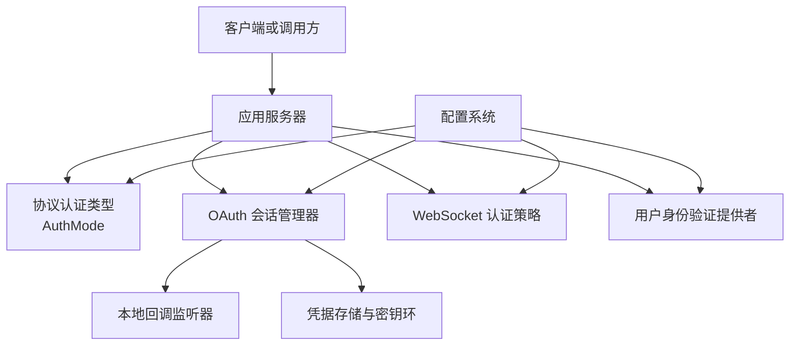
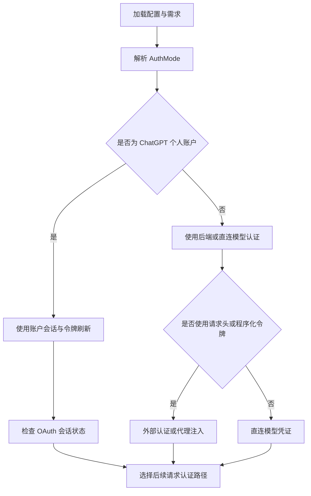
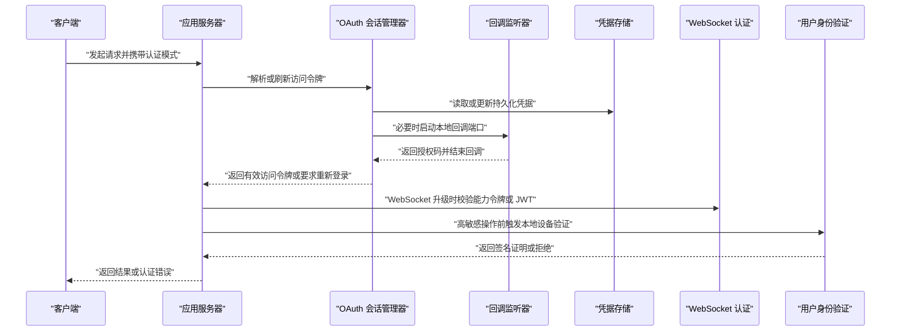
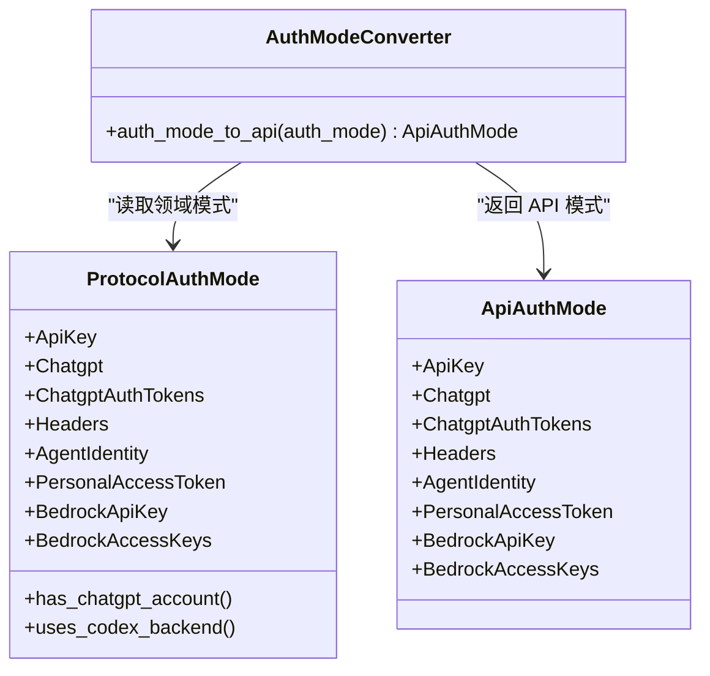
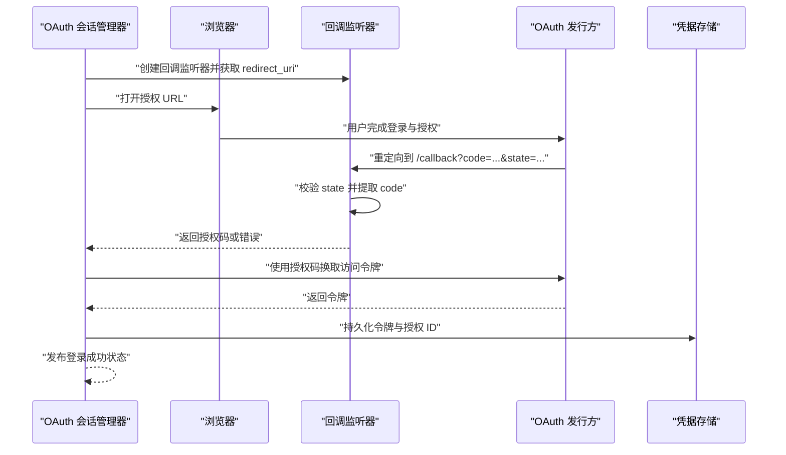
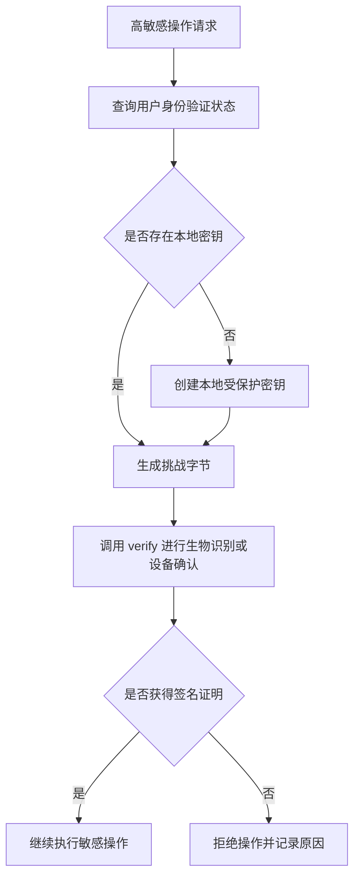
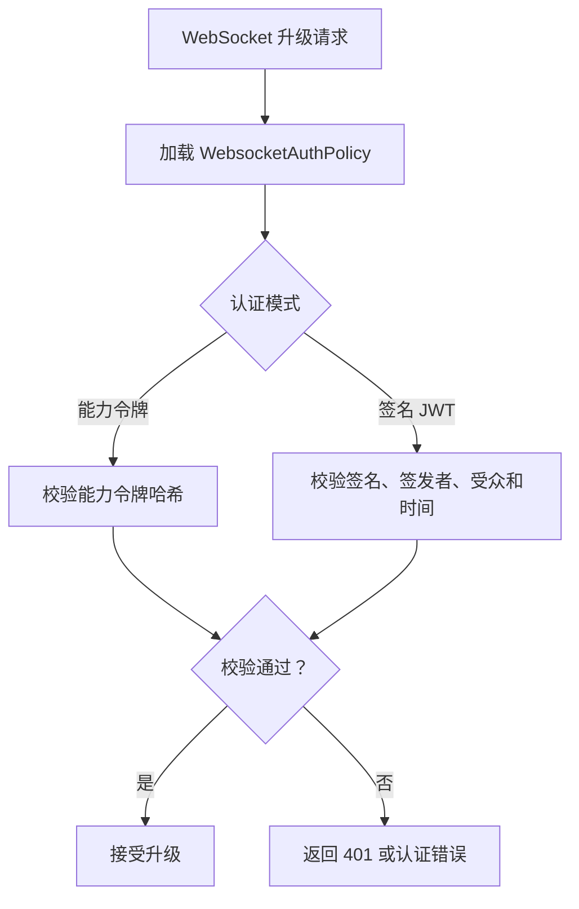
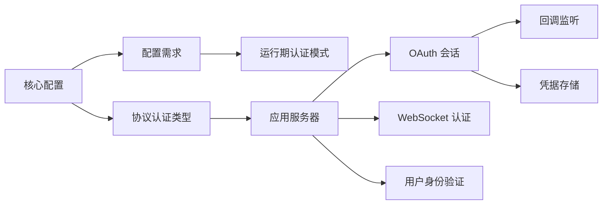
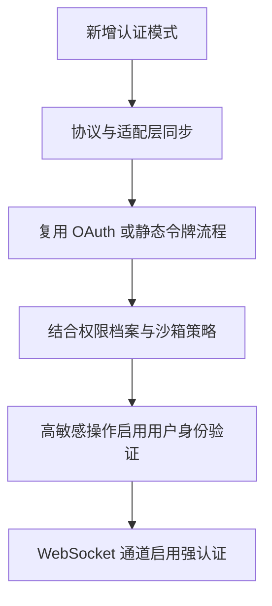

# 认证与授权

<cite>
**本文引用的文件**   
- [auth_mode.rs](file://codex-rs/app-server/src/auth_mode.rs)
- [auth.rs（协议层）](file://codex-rs/protocol/src/auth.rs)
- [common.rs（应用服务器协议）](file://codex-rs/app-server-protocol/src/protocol/common.rs)
- [oauth_session_callback.rs](file://codex-rs/login/src/oauth_session_callback.rs)
- [oauth_session_login.rs](file://codex-rs/login/src/oauth_session_login.rs)
- [oauth_session.rs](file://codex-rs/login/src/oauth_session.rs)
- [source.rs](file://codex-rs/login/src/auth/source.rs)
- [lib.rs（用户身份验证库）](file://codex-rs/user-verification/src/lib.rs)
- [lib.rs（WebSocket 认证）](file://codex-rs/websocket-auth/src/lib.rs)
- [config_requirements.rs](file://codex-rs/config/src/config_requirements.rs)
- [mod.rs（核心配置）](file://codex-rs/core/src/config/mod.rs)
- [authentication.md](file://docs/authentication.md)
</cite>

## 目录
1. [引言](#引言)
2. [项目结构中的认证相关模块](#项目结构中的认证相关模块)
3. [认证模式总览](#认证模式总览)
4. [架构概览](#架构概览)
5. [详细组件分析](#详细组件分析)
6. [依赖关系分析](#依赖关系分析)
7. [性能与安全特性](#性能与安全特性)
8. [常见认证问题排查](#常见认证问题排查)
9. [安全最佳实践与加固建议](#安全最佳实践与加固建议)
10. [结论](#结论)

## 引言
本文件聚焦 Codex 代码库中的认证与授权体系，围绕以下目标展开：
- 解释 `auth_mode` 的所有配置选项及其在本地认证、ChatGPT 账户认证和企业级程序化认证之间的切换机制。
- 说明外部认证集成路径，包括网关 OAuth 会话、回调处理、令牌刷新和状态广播。
- 解释 `user_verification` 的本地设备凭据和用户身份验证流程。
- 梳理 WebSocket 认证、能力令牌与签名 JWT 的使用方式。
- 给出实现自定义认证策略和权限检查的思路，并总结令牌管理、审计日志和安全加固建议。

该仓库将认证职责拆分为多个 crate：协议层定义认证枚举，登录模块负责 OAuth 会话与凭据持久化，用户身份验证模块提供本地生物识别或硬件凭据抽象，WebSocket 认证模块保护进程内通信通道。

**章节来源**
- [authentication.md:1-3](file://docs/authentication.md#L1-L3)

## 项目结构中的认证相关模块
从仓库结构看，认证与授权并非单一模块，而是贯穿多个子系统：

| 模块 | 主要职责 | 关键文件 |
|---|---|---|
| 协议层认证类型 | 定义 `AuthMode`、计划类型及工具方法 | [auth.rs（协议层）](file://codex-rs/protocol/src/auth.rs)、[common.rs（应用服务器协议）](file://codex-rs/app-server-protocol/src/protocol/common.rs) |
| 应用服务器适配 | 将领域认证模式转换为 API 协议类型 | [auth_mode.rs](file://codex-rs/app-server/src/auth_mode.rs) |
| 登录与 OAuth 会话 | 浏览器登录、设备码、回调监听、令牌刷新、状态通知 | [oauth_session.rs](file://codex-rs/login/src/oauth_session.rs)、[oauth_session_callback.rs](file://codex-rs/login/src/oauth_session_callback.rs)、[oauth_session_login.rs](file://codex-rs/login/src/oauth_session_login.rs) |
| 认证源比较 | 判断前后两次认证是否属于同一运行时会话 | [source.rs](file://codex-rs/login/src/auth/source.rs) |
| 用户身份验证 | 本地设备密钥、挑战签名、平台提供者抽象 | [lib.rs（用户身份验证库）](file://codex-rs/user-verification/src/lib.rs) |
| WebSocket 认证 | 能力令牌与签名 JWT 的升级请求鉴权 | [lib.rs（WebSocket 认证）](file://codex-rs/websocket-auth/src/lib.rs) |
| 配置与需求 | 运行期认证模式、企业托管策略、权限与功能开关 | [config_requirements.rs](file://codex-rs/config/src/config_requirements.rs)、[mod.rs（核心配置）](file://codex-rs/core/src/config/mod.rs) |

**图示来源**
- [auth.rs（协议层）:1-60](file://codex-rs/protocol/src/auth.rs#L1-L60)
- [oauth_session.rs:1-120](file://codex-rs/login/src/oauth_session.rs#L1-L120)
- [oauth_session_callback.rs:1-116](file://codex-rs/login/src/oauth_session_callback.rs#L1-L116)
- [lib.rs（WebSocket 认证）:1-120](file://codex-rs/websocket-auth/src/lib.rs#L1-L120)
- [lib.rs（用户身份验证库）:1-91](file://codex-rs/user-verification/src/lib.rs#L1-L91)
- [config_requirements.rs:959-1000](file://codex-rs/config/src/config_requirements.rs#L959-L1000)

**章节来源**
- [auth_mode.rs:1-21](file://codex-rs/app-server/src/auth_mode.rs#L1-L21)
- [auth.rs（协议层）:1-60](file://codex-rs/protocol/src/auth.rs#L1-L60)
- [common.rs（应用服务器协议）:1-80](file://codex-rs/app-server-protocol/src/protocol/common.rs#L1-L80)
- [oauth_session.rs:1-120](file://codex-rs/login/src/oauth_session.rs#L1-L120)
- [oauth_session_callback.rs:1-116](file://codex-rs/login/src/oauth_session_callback.rs#L1-L116)
- [oauth_session_login.rs:1-120](file://codex-rs/login/src/oauth_session_login.rs#L1-L120)
- [source.rs:1-94](file://codex-rs/login/src/auth/source.rs#L1-L94)
- [lib.rs（用户身份验证库）:1-91](file://codex-rs/user-verification/src/lib.rs#L1-L91)
- [lib.rs（WebSocket 认证）:1-120](file://codex-rs/websocket-auth/src/lib.rs#L1-L120)
- [config_requirements.rs:959-1000](file://codex-rs/config/src/config_requirements.rs#L959-L1000)

## 认证模式总览
`AuthMode` 是认证体系的中心枚举，既出现在协议层，也出现在应用服务器协议中；应用服务器通过显式转换函数将其映射到 API 侧类型，避免协议所有权泄漏。

### 支持的认证模式
| 模式 | 含义 | 是否代表 ChatGPT 个人账户 | 是否使用 Codex 后端服务 |
|---|---|---:|---:|
| `api_key` | 由调用方提供并由 Codex 存储的 OpenAI API Key | 否 | 否 |
| `chatgpt` | 由 Codex 管理的 ChatGPT OAuth，令牌持久化并自动刷新 | 是 | 是 |
| `chatgptAuthTokens` | 外部宿主应用直接提供 ChatGPT 认证令牌，刷新由外部处理 | 是 | 是 |
| `headers` | 以请求头形式传递后端认证信息 | 否 | 是 |
| `agentIdentity` | 基于已注册 Agent Identity 的程序化认证 | 否 | 是 |
| `personalAccessToken` | 基于个人访问令牌的程序化认证 | 是 | 是 |
| `bedrockApiKey` | Amazon Bedrock 的 bearer token，由 Codex 管理 | 否 | 否 |
| `bedrockAccessKeys` | Amazon Bedrock AWS 访问密钥，由 Codex 管理 | 否 | 否 |

这些行为由两个关键方法决定：
- `has_chatgpt_account`：用于判断当前认证是否绑定 ChatGPT 个人账户。
- `uses_codex_backend`：用于判断请求是否走 Codex 后端而非直连模型接口。

**章节来源**
- [auth.rs（协议层）:1-60](file://codex-rs/protocol/src/auth.rs#L1-L60)
- [common.rs（应用服务器协议）:1-80](file://codex-rs/app-server-protocol/src/protocol/common.rs#L1-L80)
- [auth_mode.rs:1-21](file://codex-rs/app-server/src/auth_mode.rs#L1-L21)

### 认证模式切换机制
认证模式切换不是简单“热插拔”，它涉及：
1. **配置层**：由 `RuntimeAuthMode`、`FeatureRequirementsToml.runtime_auth_mode` 等配置项参与最终策略。
2. **协议层**：客户端与服务端通过统一的 `AuthMode` 枚举协商。
3. **登录态**：OAuth 会话状态、账号 ID、ChatGPT 用户标识共同决定是否可以复用现有会话。
4. **执行上下文**：某些模式（如 `headers`、`agentIdentity`、`personalAccessToken`）更适合自动化、服务端或工作负载场景。

**图示来源**
- [auth.rs（协议层）:1-60](file://codex-rs/protocol/src/auth.rs#L1-L60)
- [oauth_session.rs:1-120](file://codex-rs/login/src/oauth_session.rs#L1-L120)
- [source.rs:1-94](file://codex-rs/login/src/auth/source.rs#L1-L94)
- [config_requirements.rs:959-1000](file://codex-rs/config/src/config_requirements.rs#L959-L1000)

**章节来源**
- [auth.rs（协议层）:1-60](file://codex-rs/protocol/src/auth.rs#L1-L60)
- [common.rs（应用服务器协议）:1-80](file://codex-rs/app-server-protocol/src/protocol/common.rs#L1-L80)
- [config_requirements.rs:959-1000](file://codex-rs/config/src/config_requirements.rs#L959-L1000)

## 架构概览
Codex 的认证架构可理解为四层：

| 层级 | 组件 | 责任 |
|---|---|---|
| 配置与策略层 | `ConfigRequirements`、`FeatureRequirementsToml`、核心配置 | 决定允许哪些登录方式、运行时认证模式和受管策略 |
| 协议与模式层 | `AuthMode`、`PlanType`、`KnownPlan` | 统一描述认证模式、订阅计划及企业计划语义 |
| 会话与会话状态层 | `OAuthSessionManager`、`OAuthLoginControl`、状态广播 | 管理浏览器登录、设备码、回调、令牌刷新和状态同步 |
| 通道与设备层 | WebSocket 认证、用户身份验证 | 保护进程间通信，并在需要时要求本地设备确认 |

**图示来源**
- [oauth_session.rs:1-200](file://codex-rs/login/src/oauth_session.rs#L1-L200)
- [oauth_session_callback.rs:1-116](file://codex-rs/login/src/oauth_session_callback.rs#L1-L116)
- [oauth_session_login.rs:1-120](file://codex-rs/login/src/oauth_session_login.rs#L1-L120)
- [lib.rs（WebSocket 认证）:1-120](file://codex-rs/websocket-auth/src/lib.rs#L1-L120)
- [lib.rs（用户身份验证库）:1-91](file://codex-rs/user-verification/src/lib.rs#L1-L91)

## 详细组件分析

### 认证模式与协议转换
应用服务器不直接持有领域层的 `AuthMode`，而是通过 `auth_mode_to_api` 将其转换为 API 协议类型。这种设计保证：
- 领域层与应用服务器协议解耦。
- Rust orphan rules 要求显式转换而非隐式 `From`。
- API 侧可以独立演进自己的认证模式表示。

**图示来源**
- [auth_mode.rs:1-21](file://codex-rs/app-server/src/auth_mode.rs#L1-L21)
- [auth.rs（协议层）:1-60](file://codex-rs/protocol/src/auth.rs#L1-L60)
- [common.rs（应用服务器协议）:1-80](file://codex-rs/app-server-protocol/src/protocol/common.rs#L1-L80)

**章节来源**
- [auth_mode.rs:1-21](file://codex-rs/app-server/src/auth_mode.rs#L1-L21)
- [auth.rs（协议层）:1-60](file://codex-rs/protocol/src/auth.rs#L1-L60)
- [common.rs（应用服务器协议）:1-80](file://codex-rs/app-server-protocol/src/protocol/common.rs#L1-L80)

### 外部认证集成：网关 OAuth 会话与回调
OAuth 会话管理是外部认证的核心。`OAuthSessionManager` 负责：
- 创建不带重定向、不带请求日志的专用 HTTP 客户端。
- 管理缓存令牌、待持久化令牌和恢复失败后的登录要求。
- 控制是否允许交互式浏览器登录。
- 发布登录状态变化，供 UI 或其他组件订阅。

回调监听器负责：
- 绑定本地回环地址。
- 解析 `/callback` 路径。
- 校验 state 参数。
- 返回成功页面或错误响应。
- 设置最长 10 分钟等待时间。

**图示来源**
- [oauth_session_login.rs:1-120](file://codex-rs/login/src/oauth_session_login.rs#L1-L120)
- [oauth_session_callback.rs:1-116](file://codex-rs/login/src/oauth_session_callback.rs#L1-L116)
- [oauth_session.rs:1-200](file://codex-rs/login/src/oauth_session.rs#L1-L200)

**章节来源**
- [oauth_session.rs:1-200](file://codex-rs/login/src/oauth_session.rs#L1-L200)
- [oauth_session_callback.rs:1-116](file://codex-rs/login/src/oauth_session_callback.rs#L1-L116)
- [oauth_session_login.rs:1-200](file://codex-rs/login/src/oauth_session_login.rs#L1-L200)

### 用户身份验证流程
`user_verification` 模块提供的是本地设备层面的身份验证抽象，而不是网络认证。其核心是 `UserVerificationProvider` trait：
- `status`：查询本地设备是否就绪。
- `ensure_key`：如果不存在本地凭据，则创建受保护密钥。
- `delete`：删除本地密钥。
- `verify`：对用户发起的挑战进行签名，输出 `UserVerificationProof`。

平台支持方面：
- macOS 提供原生实现。
- 非 macOS 平台返回不支持的实现。
- `platform_supported()` 与 `device_supported()` 分别表示构建是否包含原生提供者和设备是否可用。

**图示来源**
- [lib.rs（用户身份验证库）:1-91](file://codex-rs/user-verification/src/lib.rs#L1-L91)

**章节来源**
- [lib.rs（用户身份验证库）:1-91](file://codex-rs/user-verification/src/lib.rs#L1-L91)

### WebSocket 认证与会话管理
WebSocket 认证模块保护 app-server 与 exec-server 的 WebSocket 升级请求，支持两种模式：
- `capability-token`：通过文件或 SHA-256 值校验能力令牌。
- `signed-bearer-token`：校验签名 JWT，支持 issuer、audience 和时钟偏差限制。

关键配置项包括：
- `ws_auth`
- `ws_token_file`
- `ws_token_sha256`
- `ws_shared_secret_file`
- `ws_issuer`
- `ws_audience`
- `ws_max_clock_skew_seconds`

默认策略允许未认证连接，但每个监听器可根据绑定地址决定是否强制认证。

**图示来源**
- [lib.rs（WebSocket 认证）:1-200](file://codex-rs/websocket-auth/src/lib.rs#L1-L200)

**章节来源**
- [lib.rs（WebSocket 认证）:1-200](file://codex-rs/websocket-auth/src/lib.rs#L1-L200)

### 认证源比较与会话连续性
`same_source` 用于判断前后两次 `CodexAuth` 是否属于同一运行时会话。它会比较：
- API 认证模式
- 账号 ID
- ChatGPT 用户 ID
- Workload Identity subject
- Agent Identity 记录
- OAuth 令牌中的 source 声明

这确保：
- 不同认证模式不会误复用旧会话。
- 不同账号不会混用。
- OAuth 会话可以作为连续性提示，但不是本地授权依据。

**章节来源**
- [source.rs:1-94](file://codex-rs/login/src/auth/source.rs#L1-L94)

### 配置与企业级认证集成
企业级认证不仅体现在 `AuthMode`，还体现在配置需求层：
- `FeatureRequirementsToml.runtime_auth_mode` 暴露运行期认证模式。
- `RequirementSource` 支持企业托管来源、MDM、系统 requirements TOML 等多层来源。
- 核心配置加载过程整合权限档案、沙箱策略、网络代理、插件、市场目录和运行期能力。

这意味着企业环境可以通过集中策略覆盖客户端行为，例如限制允许的登录方式、启用或禁用特定功能、强制企业托管认证配置。

**章节来源**
- [config_requirements.rs:1-200](file://codex-rs/config/src/config_requirements.rs#L1-L200)
- [config_requirements.rs:959-1000](file://codex-rs/config/src/config_requirements.rs#L959-L1000)
- [mod.rs（核心配置）:1-120](file://codex-rs/core/src/config/mod.rs#L1-L120)

## 依赖关系分析

**图示来源**
- [mod.rs（核心配置）:1-120](file://codex-rs/core/src/config/mod.rs#L1-L120)
- [config_requirements.rs:959-1000](file://codex-rs/config/src/config_requirements.rs#L959-L1000)
- [auth.rs（协议层）:1-60](file://codex-rs/protocol/src/auth.rs#L1-L60)
- [oauth_session.rs:1-200](file://codex-rs/login/src/oauth_session.rs#L1-L200)
- [oauth_session_callback.rs:1-116](file://codex-rs/login/src/oauth_session_callback.rs#L1-L116)
- [lib.rs（WebSocket 认证）:1-200](file://codex-rs/websocket-auth/src/lib.rs#L1-L200)
- [lib.rs（用户身份验证库）:1-91](file://codex-rs/user-verification/src/lib.rs#L1-L91)

**章节来源**
- [config_requirements.rs:959-1000](file://codex-rs/config/src/config_requirements.rs#L959-L1000)
- [auth.rs（协议层）:1-60](file://codex-rs/protocol/src/auth.rs#L1-L60)
- [oauth_session.rs:1-200](file://codex-rs/login/src/oauth_session.rs#L1-L200)
- [lib.rs（WebSocket 认证）:1-200](file://codex-rs/websocket-auth/src/lib.rs#L1-L200)
- [lib.rs（用户身份验证库）:1-91](file://codex-rs/user-verification/src/lib.rs#L1-L91)

## 性能与安全特性

### 性能特性
- OAuth HTTP 客户端禁止重定向且关闭请求日志，减少认证路径的额外开销。
- 回调监听使用一次性通道，收到授权码后立即退出循环。
- 登录状态变更通过广播通道发布，容量为 16，避免阻塞主流程。
- 令牌缓存保留旋转后的旧凭据，以便重试时对比并避免覆盖新凭据。

### 安全特性
- 回调监听仅绑定本地回环地址，降低远程利用风险。
- OAuth 回调校验 `state`，防止 CSRF 类攻击。
- WebSocket 认证支持能力令牌和签名 JWT，避免明文共享密钥直接硬编码。
- JWT 校验支持 issuer、audience 和最大时钟偏差。
- 用户身份验证将本地设备签名与网络认证分离，避免把设备凭据当作网络授权凭证。
- 认证源比较强调“连续性提示”，明确不授予本地权限。

**章节来源**
- [oauth_session.rs:1-200](file://codex-rs/login/src/oauth_session.rs#L1-L200)
- [oauth_session_callback.rs:1-116](file://codex-rs/login/src/oauth_session_callback.rs#L1-L116)
- [lib.rs（WebSocket 认证）:1-200](file://codex-rs/websocket-auth/src/lib.rs#L1-L200)
- [source.rs:1-94](file://codex-rs/login/src/auth/source.rs#L1-L94)

## 常见认证问题排查

| 问题 | 可能原因 | 排查与修复建议 |
|---|---|---|
| 浏览器登录超时 | 回调监听未绑定成功、浏览器未跳转、MFA 耗时过长 | 检查回调地址、本地端口占用、OAuth 发行方回调配置；确认 10 分钟内完成登录 |
| OAuth state 不匹配 | 回调被拦截、重复刷新、并发登录 | 检查是否出现多个登录会话；确保每次授权请求使用唯一 state |
| 授权被拒绝 | 用户在发行方页面拒绝授权 | 查看回调错误类型；引导用户重新登录 |
| 缺少授权码 | 回调 URL 被篡改或未携带 `code` | 检查发行方回调配置，确认 `/callback` 路径正确 |
| WebSocket 连接被拒绝 | 未配置能力令牌或 JWT 校验失败 | 核对 `ws_auth`、令牌文件或 SHA-256、JWT issuer/audience 和时钟偏差 |
| 用户身份验证不可用 | 非 macOS 平台或设备不支持 | 使用 `platform_supported()` 与 `device_supported()` 检测；降级或提示用户 |
| 会话无法复用 | 认证模式、账号 ID 或 OAuth source 发生变化 | 检查 `same_source` 比较条件；确认没有切换账号或认证模式 |

**章节来源**
- [oauth_session_callback.rs:1-116](file://codex-rs/login/src/oauth_session_callback.rs#L1-L116)
- [oauth_session.rs:1-200](file://codex-rs/login/src/oauth_session.rs#L1-L200)
- [lib.rs（WebSocket 认证）:1-200](file://codex-rs/websocket-auth/src/lib.rs#L1-L200)
- [lib.rs（用户身份验证库）:1-91](file://codex-rs/user-verification/src/lib.rs#L1-L91)
- [source.rs:1-94](file://codex-rs/login/src/auth/source.rs#L1-L94)

## 安全最佳实践与加固建议

### 认证策略选择
- 个人开发建议使用 `chatgpt`，让 Codex 管理令牌生命周期。
- 外部应用集成建议使用 `chatgptAuthTokens`，但必须由宿主应用负责刷新。
- 自动化或服务端场景建议使用 `agentIdentity` 或 `personalAccessToken`。
- 直连模型场景可使用 `api_key`、`bedrockApiKey` 或 `bedrockAccessKeys`。
- 企业代理或网关注入认证时使用 `headers`。

### 令牌管理
- 不要将能力令牌或 JWT 密钥写入版本控制。
- 优先使用文件路径或 SHA-256 摘要传入，而不是明文字符串。
- 对 OAuth 刷新失败的场景，应区分“需要重新登录”和“可重试”。
- 对失败的访问令牌，使用 `refresh_access_token` 并限制重试次数。

### 审计与日志
- 认证模块本身会避免在 OAuth HTTP 客户端上记录请求日志。
- 企业环境应结合外部日志系统记录登录尝试、认证模式变化和会话失效事件。
- 用户身份验证失败应记录失败原因，但不泄露生物识别细节。

### 自定义认证策略示例思路
由于仓库未提供完整的第三方认证扩展点示例，这里给出基于现有结构的实现思路：

1. **定义新的认证模式**  
   在协议层增加 `AuthMode` 变体，并确保应用服务器协议和应用服务器适配逻辑同步转换。

2. **接入外部认证提供者**  
   - 若使用 OAuth，复用 `OAuthSessionManager` 的流程，但替换发行方、客户端 ID 和回调处理。
   - 若使用静态令牌，通过 `headers` 或 `personalAccessToken` 注入。

3. **实现权限检查**  
   - 使用 `PermissionProfile`、`SandboxPolicy` 和 `ResidencyRequirement` 等配置结构约束资源访问。
   - 在高敏感操作中引入 `UserVerificationProvider.verify` 作为第二因素。

4. **集成 WebSocket 通道安全**  
   - 在部署环境中启用 `signed-bearer-token`，并要求 issuer 与 audience。
   - 对内部服务使用 `capability-token`，并通过 CI/CD 注入 SHA-256。

**图示来源**
- [auth.rs（协议层）:1-60](file://codex-rs/protocol/src/auth.rs#L1-L60)
- [common.rs（应用服务器协议）:1-80](file://codex-rs/app-server-protocol/src/protocol/common.rs#L1-L80)
- [auth_mode.rs:1-21](file://codex-rs/app-server/src/auth_mode.rs#L1-L21)
- [oauth_session.rs:1-200](file://codex-rs/login/src/oauth_session.rs#L1-L200)
- [lib.rs（用户身份验证库）:1-91](file://codex-rs/user-verification/src/lib.rs#L1-L91)
- [lib.rs（WebSocket 认证）:1-200](file://codex-rs/websocket-auth/src/lib.rs#L1-L200)

**章节来源**
- [auth.rs（协议层）:1-60](file://codex-rs/protocol/src/auth.rs#L1-L60)
- [common.rs（应用服务器协议）:1-80](file://codex-rs/app-server-protocol/src/protocol/common.rs#L1-L80)
- [auth_mode.rs:1-21](file://codex-rs/app-server/src/auth_mode.rs#L1-L21)
- [oauth_session.rs:1-200](file://codex-rs/login/src/oauth_session.rs#L1-L200)
- [lib.rs（用户身份验证库）:1-91](file://codex-rs/user-verification/src/lib.rs#L1-L91)
- [lib.rs（WebSocket 认证）:1-200](file://codex-rs/websocket-auth/src/lib.rs#L1-L200)

## 结论
Codex 的认证与授权体系围绕 `AuthMode` 展开，同时覆盖了个人 ChatGPT 账户、外部应用令牌、企业程序化认证、直连模型凭证以及本地设备身份验证。OAuth 会话模块提供了完整的浏览器登录、回调处理和令牌刷新能力；WebSocket 认证模块保护进程内通信；用户身份验证模块提供本地生物识别或硬件凭据抽象；配置系统则支持企业托管策略和多来源约束。

在实际部署中，推荐根据角色选择合适认证模式：个人用户使用 `chatgpt`，自动化系统使用 `agentIdentity` 或 `personalAccessToken`，企业代理使用 `headers`，并配合 WebSocket 强认证和用户身份验证保护高敏感操作。安全加固的重点在于最小化令牌暴露、严格校验回调与 JWT、限制会话复用范围，并结合外部审计系统记录认证事件。