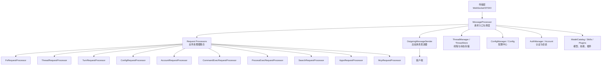
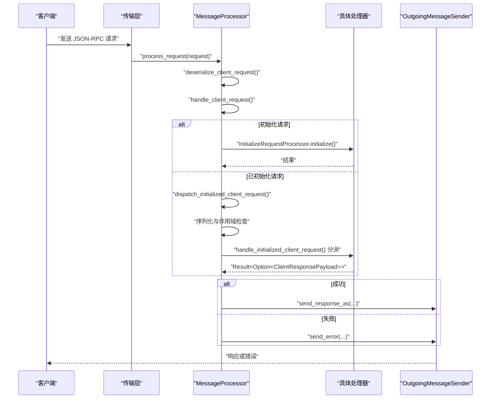
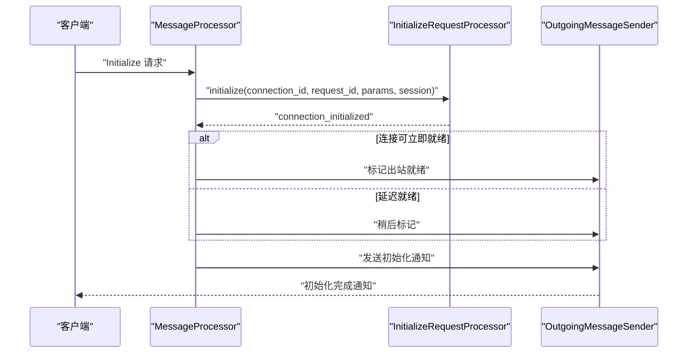
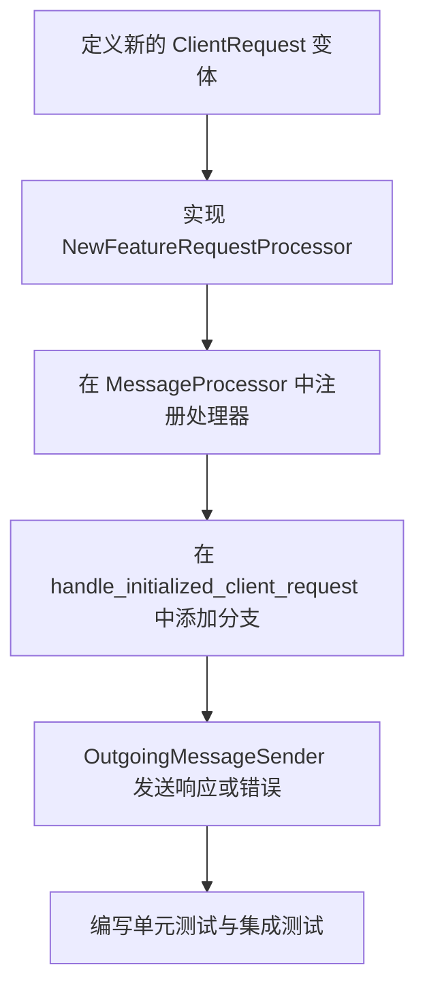

# 请求处理系统

<cite>
**本文引用的文件**
- [message_processor.rs](file://codex-rs/app-server/src/message_processor.rs)
- [request_processors.rs](file://codex-rs/app-server/src/request_processors.rs)
- [outgoing_message.rs](file://codex-rs/app-server/src/outgoing_message.rs)
- [initialize_processor.rs](file://codex-rs/app-server/src/request_processors/initialize_processor.rs)
- [config_processor.rs](file://codex-rs/app-server/src/request_processors/config_processor.rs)
- [fs_processor.rs](file://codex-rs/app-server/src/request_processors/fs_processor.rs)
- [thread_processor.rs](file://codex-rs/app-server/src/request_processors/thread_processor.rs)
- [turn_processor.rs](file://codex-rs/app-server/src/request_processors/turn_processor.rs)
- [account_processor.rs](file://codex-rs/app-server/src/request_processors/account_processor.rs)
- [process_exec_processor.rs](file://codex-rs/app-server/src/request_processors/process_exec_processor.rs)
- [command_exec_processor.rs](file://codex-rs/app-server/src/request_processors/command_exec_processor.rs)
- [search.rs](file://codex-rs/app-server/src/request_processors/search.rs)
- [apps_processor.rs](file://codex-rs/app-server/src/request_processors/apps_processor.rs)
- [mcp_event_stream.rs](file://codex-rs/app-server/src/request_processors/mcp_event_stream.rs)
- [app_server_tracing.rs](file://codex-rs/app-server/src/app_server_tracing.rs)
</cite>

## 目录
1. [简介](#简介)
2. [项目结构](#项目结构)
3. [核心组件](#核心组件)
4. [架构总览](#架构总览)
5. [详细组件分析](#详细组件分析)
6. [依赖关系分析](#依赖关系分析)
7. [性能与并发特性](#性能与并发特性)
8. [错误处理、重试与生命周期](#错误处理重试与生命周期)
9. [扩展指南：新增处理器与自定义消息类型](#扩展指南新增处理器与自定义消息类型)
10. [监控与调试技巧](#监控与调试技巧)
11. [故障排查](#故障排查)
12. [结论](#结论)

## 简介
本文件为应用服务器“请求处理系统”的技术文档，聚焦以下目标：
- 解释 `MessageProcessor` 的完整请求流程：解析、验证、路由、序列化、执行业务处理器、发送响应。
- 梳理 `request_processors` 模块中的主要处理器：线程、回合、配置、文件系统、账户、命令执行、进程执行、搜索、应用、MCP 等。
- 说明 `outgoing_message` 的消息格式定义、请求上下文与出站消息发送机制。
- 提供添加新请求处理器和处理自定义消息类型的实践路径。
- 总结请求生命周期、错误处理、连接关闭、重试与恢复策略。
- 给出性能优化建议、监控指标与调试技巧。

## 项目结构
请求处理系统位于 `codex-rs/app-server/src` 下，关键位置如下：
- `message_processor.rs`：请求入口、全局调度、初始化、连接会话状态管理、统一错误投递。
- `request_processors.rs`：业务处理器实现汇总，包含线程、回合、配置、文件系统、账户、MCP、插件、市场、搜索、命令执行、进程执行、Windows 沙箱等。
- `outgoing_message.rs`：出站消息通道、请求上下文、连接级请求标识、消息序列化与发送。
- `request_processors/*`：各业务处理器的细分模块。
- `app_server_tracing.rs`：请求追踪上下文构建。



**图表来源**
- [message_processor.rs:1-200](file://codex-rs/app-server/src/message_processor.rs#L1-L200)
- [message_processor.rs:559-990](file://codex-rs/app-server/src/message_processor.rs#L559-L990)
- [request_processors.rs:1-200](file://codex-rs/app-server/src/request_processors.rs#L1-L200)

**章节来源**
- [message_processor.rs:1-200](file://codex-rs/app-server/src/message_processor.rs#L1-L200)
- [request_processors.rs:1-200](file://codex-rs/app-server/src/request_processors.rs#L1-L200)

## 核心组件
### MessageProcessor
`MessageProcessor` 是应用服务器的中央调度器，负责：
- 构造并持有所有请求处理器实例。
- 接收 JSON-RPC 请求，解析为 `ClientRequest`。
- 校验方法名、参数和实验性 API 权限。
- 将请求分发到对应处理器。
- 通过 `OutgoingMessageSender` 发送成功响应或错误。
- 维护连接会话状态、RPC 门控、MCP 事件流、线程监听、工作负载控制等。

关键点：
- 入口方法包括 `process_request`（JSON-RPC）、`process_client_request`（内嵌调用）、`process_notification`、`process_response`、`process_error`。
- 已初始化请求走 `dispatch_initialized_client_request`，未初始化直接返回错误。
- 支持按作用域串行化请求，避免并发冲突。
- 对线程和回合相关操作进行准入控制（`TurnAdmission`）。

**章节来源**
- [message_processor.rs:1-200](file://codex-rs/app-server/src/message_processor.rs#L1-L200)
- [message_processor.rs:559-990](file://codex-rs/app-server/src/message_processor.rs#L559-L990)

### OutgoingMessageSender 与 RequestContext
- `OutgoingMessageSender` 负责向客户端发送响应、错误、通知、取消信号。
- `RequestContext` 封装请求 ID、方法名、追踪跨度、W3C Trace Context、取消令牌。
- 每个请求会注册上下文，以便在异步链路中携带元信息。

**章节来源**
- [message_processor.rs:1-120](file://codex-rs/app-server/src/message_processor.rs#L1-L120)
- [outgoing_message.rs:1-120](file://codex-rs/app-server/src/outgoing_message.rs#L1-L120)

## 架构总览
下图展示从传输层到业务处理器再到出站消息的整体流程。



**图表来源**
- [message_processor.rs:559-990](file://codex-rs/app-server/src/message_processor.rs#L559-L990)
- [message_processor.rs:991-1500](file://codex-rs/app-server/src/message_processor.rs#L991-L1500)
- [message_processor.rs:1342-1692](file://codex-rs/app-server/src/message_processor.rs#L1342-L1692)
- [message_processor.rs:1692-2036](file://codex-rs/app-server/src/message_processor.rs#L1692-L2036)
- [message_processor.rs:2036-2070](file://codex-rs/app-server/src/message_processor.rs#L2036-L2070)

## 详细组件分析

### MessageProcessor 请求生命周期
`MessageProcessor` 的请求生命周期分为几个阶段：
1. **解析**：`deserialize_client_request` 将 JSON-RPC 转换为 `ClientRequest`，并拒绝废弃字段。
2. **初始化校验**：如果是 `Initialize`，则交给 `InitializeRequestProcessor`；否则要求连接已初始化。
3. **实验性 API 校验**：若客户端未启用实验性 API，且请求需要该能力，则返回错误。
4. **准入控制**：对线程和回合类请求尝试获取 `TurnAdmission`，部分请求在序列化后重新检查。
5. **序列化与作用域**：根据 `serialization_scope` 决定是否需要串行化队列。
6. **分派**：进入 `handle_initialized_client_request`，按枚举分支调用对应处理器。
7. **响应/错误**：通过 `OutgoingMessageSender` 发送响应或错误。

```mermaid
flowchart TD
    Start(["收到请求"]) --> Parse["解析 JSON-RPC 为 ClientRequest"]
    Parse --> IsInit{"是否 Initialize?"}
    IsInit -->|是| Init["InitializeRequestProcessor.initialize()"]
    IsInit -->|否| CheckReady{"连接已初始化?"}
    CheckReady -->|否| ErrNotInit["返回未初始化错误"]
    CheckReady -->|是| CheckExp["实验性 API 校验"]
    CheckExp --> Admit["准入控制 TurnAdmission"]
    Admit --> Serialize{"是否需序列化?"}
    Serialize -->|是| Queue["进入 RequestSerializationQueues"]
    Serialize -->|否| Dispatch["直接分派"]
    Queue --> Dispatch
    Dispatch --> Handle["handle_initialized_client_request()"]
    Handle --> Result{"处理器返回结果"}
    Result -->|Ok(Some)| SendResp["OutgoingMessageSender.send_response_as()"]
    Result -->|Ok(None)| Done["无响应内容"]
    Result -->|Err| SendErr["OutgoingMessageSender.send_error()"]
    SendResp --> End(["结束"])
    SendErr --> End
    Done --> End
```

**图表来源**
- [message_processor.rs:559-990](file://codex-rs/app-server/src/message_processor.rs#L559-L990)
- [message_processor.rs:991-1500](file://codex-rs/app-server/src/message_processor.rs#L991-L1500)
- [message_processor.rs:1342-1692](file://codex-rs/app-server/src/message_processor.rs#L1342-L1692)

**章节来源**
- [message_processor.rs:559-990](file://codex-rs/app-server/src/message_processor.rs#L559-L990)
- [message_processor.rs:991-1500](file://codex-rs/app-server/src/message_processor.rs#L991-L1500)
- [message_processor.rs:1342-1692](file://codex-rs/app-server/src/message_processor.rs#L1342-L1692)
- [message_processor.rs:1692-2036](file://codex-rs/app-server/src/message_processor.rs#L1692-L2036)
- [message_processor.rs:2036-2070](file://codex-rs/app-server/src/message_processor.rs#L2036-L2070)

### 请求处理器分类与职责
- **线程处理器（ThreadRequestProcessor）**：创建、恢复、分叉、归档、删除、搜索、读取、列表、设置、附件、片段、记忆、压缩、后台终端、时间线等。
- **回合处理器（TurnRequestProcessor）**：启动回合、引导审查、注入项、转向、设置更新、中断、实时语音/文本/音频输入输出。
- **配置处理器（ConfigRequestProcessor）**：读取配置、写入值、批量写入、模型提供者列表与配置、功能需求、实验性功能开关。
- **文件系统处理器（FsRequestProcessor）**：读文件、写文件、创建目录、获取元数据、读目录、删除、复制、监听与取消监听。
- **账户处理器（AccountRequestProcessor）**：登录、登出、会话列表与切换、安全设置、速率限制、额度使用、Gateway OAuth。
- **命令执行处理器（CommandExecRequestProcessor）**：一次性命令执行、命令写入、调整大小、终止。
- **进程执行处理器（ProcessExecRequestProcessor）**：进程启动、写入标准输入、杀死进程、调整 PTY。
- **搜索处理器（SearchRequestProcessor）**：模糊文件搜索及会话控制。
- **应用处理器（AppsRequestProcessor）**：应用列表、安装状态、读取应用信息。
- **MCP 处理器（McpRequestProcessor）**：OAuth 登录、刷新、状态列表、资源读取、工具调用、事件流。
- **其他处理器**：Git、市场、插件、远程操控、Windows 沙箱、反馈、外部代理配置、环境管理等。

**章节来源**
- [request_processors.rs:1-200](file://codex-rs/app-server/src/request_processors.rs#L1-L200)
- [request_processors.rs:201-501](file://codex-rs/app-server/src/request_processors.rs#L201-L501)
- [fs_processor.rs:1-120](file://codex-rs/app-server/src/request_processors/fs_processor.rs#L1-L120)
- [config_processor.rs:1-120](file://codex-rs/app-server/src/request_processors/config_processor.rs#L1-L120)
- [thread_processor.rs:1-120](file://codex-rs/app-server/src/request_processors/thread_processor.rs#L1-L120)
- [turn_processor.rs:1-120](file://codex-rs/app-server/src/request_processors/turn_processor.rs#L1-L120)
- [account_processor.rs:1-120](file://codex-rs/app-server/src/request_processors/account_processor.rs#L1-L120)
- [process_exec_processor.rs:1-120](file://codex-rs/app-server/src/request_processors/process_exec_processor.rs#L1-L120)
- [command_exec_processor.rs:1-120](file://codex-rs/app-server/src/request_processors/command_exec_processor.rs#L1-L120)
- [search.rs:1-120](file://codex-rs/app-server/src/request_processors/search.rs#L1-L120)
- [apps_processor.rs:1-120](file://codex-rs/app-server/src/request_processors/apps_processor.rs#L1-L120)
- [mcp_event_stream.rs:1-120](file://codex-rs/app-server/src/request_processors/mcp_event_stream.rs#L1-L120)

### 出站消息与序列化机制
`OutgoingMessageSender` 提供以下关键能力：
- 发送响应：`send_response_as`、`send_response_as_checked`。
- 发送错误：`send_error`。
- 发送通知：如配置警告、账号变更、线程状态等。
- 取消请求：如用户验证、线程采样等。
- 连接级状态：连接打开、关闭、用户验证连接断开。
- 请求上下文注册：用于跨异步边界传递请求追踪信息。

典型序列化路径：
- 处理器返回 `ClientResponsePayload` 或 `Option<ClientResponsePayload>`。
- `MessageProcessor` 根据结果调用 `OutgoingMessageSender`。
- 对于需要校验的请求，使用 `send_response_as_checked` 以确保一致性。

**章节来源**
- [outgoing_message.rs:1-120](file://codex-rs/app-server/src/outgoing_message.rs#L1-L120)
- [message_processor.rs:1342-1692](file://codex-rs/app-server/src/message_processor.rs#L1342-L1692)
- [message_processor.rs:2036-2070](file://codex-rs/app-server/src/message_processor.rs#L2036-L2070)

### 初始化流程与连接就绪
`InitializeRequestProcessor` 负责连接初始化：
- 校验客户端能力。
- 记录客户端名称、版本、实验性 API 状态。
- 决定是否立即标记出站就绪（由调用方决定）。
- 初始化完成后，`MessageProcessor` 发送连接级通知。



**图表来源**
- [message_processor.rs:991-1500](file://codex-rs/app-server/src/message_processor.rs#L991-L1500)
- [initialize_processor.rs:1-120](file://codex-rs/app-server/src/request_processors/initialize_processor.rs#L1-L120)

**章节来源**
- [message_processor.rs:991-1500](file://codex-rs/app-server/src/message_processor.rs#L991-L1500)
- [initialize_processor.rs:1-120](file://codex-rs/app-server/src/request_processors/initialize_processor.rs#L1-L120)

## 依赖关系分析
- `MessageProcessor` 依赖所有 `*RequestProcessor` 实例，并通过枚举匹配进行路由。
- 处理器之间通常不直接耦合，而是通过共享服务：`ThreadManager`、`ConfigManager`、`AuthManager`、`OutgoingMessageSender`、`SkillsWatcher`、`ModelCatalog` 等。
- 某些处理器会回调 `MessageProcessor` 的能力，例如取消用户验证、取消线程采样。
- `RequestSerializationQueues` 基于连接和作用域对请求进行串行化，避免竞态条件。

```mermaid
classDiagram
    class MessageProcessor {
        +process_request(...)
        +process_client_request(...)
        +process_notification(...)
        +process_response(...)
        +process_error(...)
        -handle_client_request(...)
        -dispatch_initialized_client_request(...)
        -handle_initialized_client_request(...)
    }

    class FsRequestProcessor {
        +read_file(...)
        +write_file(...)
        +create_directory(...)
        +get_metadata(...)
        +read_directory(...)
        +remove(...)
        +copy(...)
        +watch(...)
        +unwatch(...)
    }

    class ConfigRequestProcessor {
        +read(...)
        +value_write(...)
        +batch_write(...)
        +model_provider_list(...)
        +model_provider_config_write(...)
        +experimental_feature_enablement_set(...)
    }

    class ThreadRequestProcessor {
        +thread_start(...)
        +thread_resume(...)
        +thread_fork(...)
        +thread_archive(...)
        +thread_delete(...)
        +thread_search(...)
        +thread_read(...)
        +thread_unsubscribe(...)
    }

    class TurnRequestProcessor {
        +turn_start(...)
        +review_start(...)
        +thread_inject_items(...)
        +turn_steer(...)
        +turn_settings_update(...)
        +turn_interrupt(...)
        +thread_realtime_start(...)
    }

    class AccountRequestProcessor {
        +login_account(...)
        +logout_account(...)
        +list_account_sessions(...)
        +switch_account_session(...)
        +gateway_oauth_login(...)
    }

    class CommandExecRequestProcessor {
        +one_off_command_exec(...)
        +command_exec_write(...)
        +command_exec_resize(...)
        +command_exec_terminate(...)
    }

    class ProcessExecRequestProcessor {
        +process_spawn(...)
        +process_write_stdin(...)
        +process_kill(...)
        +process_resize_pty(...)
    }

    class SearchRequestProcessor {
        +fuzzy_file_search(...)
        +fuzzy_file_search_session_start_response(...)
        +fuzzy_file_search_session_update_response(...)
        +fuzzy_file_search_session_stop(...)
    }

    MessageProcessor --> FsRequestProcessor : "路由 fs_*"
    MessageProcessor --> ConfigRequestProcessor : "路由 config_*"
    MessageProcessor --> ThreadRequestProcessor : "路由 thread_*"
    MessageProcessor --> TurnRequestProcessor : "路由 turn_*"
    MessageProcessor --> AccountRequestProcessor : "路由 account_*"
    MessageProcessor --> CommandExecRequestProcessor : "路由 command_exec_*"
    MessageProcessor --> ProcessExecRequestProcessor : "路由 process_*"
    MessageProcessor --> SearchRequestProcessor : "路由 fuzzy_file_search_*"
```



**图表来源**
- [message_processor.rs:1342-1692](file://codex-rs/app-server/src/message_processor.rs#L1342-L1692)
- [message_processor.rs:1692-2036](file://codex-rs/app-server/src/message_processor.rs#L1692-L2036)
- [request_processors.rs:1-200](file://codex-rs/app-server/src/request_processors.rs#L1-L200)

**章节来源**
- [message_processor.rs:1342-1692](file://codex-rs/app-server/src/message_processor.rs#L1342-L1692)
- [message_processor.rs:1692-2036](file://codex-rs/app-server/src/message_processor.rs#L1692-L2036)
- [request_processors.rs:1-200](file://codex-rs/app-server/src/request_processors.rs#L1-L200)

## 性能与并发特性
- **串行化队列**：`RequestSerializationQueues` 按连接和作用域串行化请求，减少竞争条件。
- **准入控制**：`TurnAdmission` 限制并发线程/回合数量，避免过载。
- **异步 I/O**：大多数处理器使用 `async` 函数，结合 Tokio 运行时。
- **大任务隔离**：某些耗时操作通过 `Box::pin` 包裹，避免阻塞共享调度栈。
- **连接门控**：`ConnectionRpcGate` 确保连接关闭时不再接受新的 RPC。
- **后台任务**：模型刷新、技能监视、轮次成本统计等作为独立 worker。

建议：
- 对高吞吐场景优先使用作用域串行化。
- 对长时间运行的操作尽量异步化并尽早释放锁。
- 合理设置 `TurnAdmission` 容量，防止雪崩。

**章节来源**
- [message_processor.rs:559-990](file://codex-rs/app-server/src/message_processor.rs#L559-L990)
- [message_processor.rs:991-1500](file://codex-rs/app-server/src/message_processor.rs#L991-L1500)
- [message_processor.rs:1342-1692](file://codex-rs/app-server/src/message_processor.rs#L1342-L1692)

## 错误处理、重试与生命周期
### 错误处理
- 解析错误：`deserialize_client_request` 失败时返回无效请求错误。
- 未初始化：未通过初始化即处理业务请求时返回“未初始化”。
- 实验性 API：未启用但需要时返回缺少实验性能力的错误。
- 处理器错误：处理器返回 `JSONRPCErrorError`，由 `OutgoingMessageSender.send_error` 发送。
- 连接关闭：清理 RPC 门控、MCP 事件流、文件系统监听、命令执行、进程执行、线程监听等。

### 重试机制
- 代码中没有通用的自动重试逻辑。
- 某些操作（如恢复守护进程线程）在失败时记录警告日志，但不重试。
- 建议在调用方实现业务级重试策略，例如对网络错误进行指数退避。

### 生命周期
- 连接建立：`process_request` 接收请求。
- 初始化：`InitializeRequestProcessor.initialize`。
- 已初始化请求：`dispatch_initialized_client_request`。
- 连接关闭：`connection_closed` 清理资源。
- 守护进程恢复：`daemon_recovery_snapshot` 与 `restore_daemon_threads`。

**章节来源**
- [message_processor.rs:1-200](file://codex-rs/app-server/src/message_processor.rs#L1-L200)
- [message_processor.rs:991-1500](file://codex-rs/app-server/src/message_processor.rs#L991-L1500)
- [message_processor.rs:1342-1692](file://codex-rs/app-server/src/message_processor.rs#L1342-L1692)
- [message_processor.rs:1692-2036](file://codex-rs/app-server/src/message_processor.rs#L1692-L2036)
- [message_processor.rs:2036-2070](file://codex-rs/app-server/src/message_processor.rs#L2036-L2070)

## 扩展指南：新增处理器与自定义消息类型
### 步骤一：定义新的请求方法
在协议层定义新的 `ClientRequest` 变体，例如 `NewFeatureRequest`，并实现其参数、响应和序列化逻辑。

### 步骤二：实现业务处理器
新建 `new_feature_processor.rs`，实现：
- 参数校验。
- 业务逻辑调用。
- 返回 `ClientResponsePayload` 或 `None`。

### 步骤三：在 MessageProcessor 中注册处理器
在 `MessageProcessor::new` 中构造处理器实例并保存为成员变量。

### 步骤四：在路由表中添加分支
在 `handle_initialized_client_request` 中添加对新 `ClientRequest` 的匹配分支，调用新处理器。

### 步骤五：发送响应或错误
处理器返回结果后，由 `MessageProcessor` 通过 `OutgoingMessageSender` 发送响应或错误。



**图表来源**
- [message_processor.rs:1342-1692](file://codex-rs/app-server/src/message_processor.rs#L1342-L1692)
- [message_processor.rs:1692-2036](file://codex-rs/app-server/src/message_processor.rs#L1692-L2036)
- [message_processor.rs:2036-2070](file://codex-rs/app-server/src/message_processor.rs#L2036-L2070)

**章节来源**
- [message_processor.rs:1342-1692](file://codex-rs/app-server/src/message_processor.rs#L1342-L1692)
- [message_processor.rs:1692-2036](file://codex-rs/app-server/src/message_processor.rs#L1692-L2036)
- [message_processor.rs:2036-2070](file://codex-rs/app-server/src/message_processor.rs#L2036-L2070)

## 监控与调试技巧
- **请求追踪**：使用 `app_server_tracing` 为每个请求创建跨度，便于链路追踪。
- **日志级别**：通过 tracing 的 trace/info/warn/error 级别观察请求、错误和超时。
- **连接诊断**：使用 `ServerDiagnostics` 获取服务器运行状态。
- **线程与回合监控**：订阅运行中的助手回合计数、线程状态变化。
- **MCP 事件流**：通过 `McpEventStreams` 监控事件订阅与激活状态。
- **性能瓶颈**：关注串行化队列长度、准入控制拒绝次数、后台任务状态。

**章节来源**
- [message_processor.rs:559-990](file://codex-rs/app-server/src/message_processor.rs#L559-L990)
- [message_processor.rs:991-1500](file://codex-rs/app-server/src/message_processor.rs#L991-L1500)
- [message_processor.rs:1342-1692](file://codex-rs/app-server/src/message_processor.rs#L1342-L1692)
- [app_server_tracing.rs:1-120](file://codex-rs/app-server/src/app_server_tracing.rs#L1-L120)

## 故障排查
常见问题与建议：
- **请求未初始化**：确认客户端先发送 `Initialize` 并等待初始化完成。
- **实验性 API 不可用**：确认客户端启用了相应实验性功能。
- **连接关闭后仍收到请求**：检查 `ConnectionRpcGate` 是否已关闭，以及连接清理逻辑是否触发。
- **处理器返回错误**：查看 `OutgoingMessageSender.send_error` 的错误码与消息。
- **MCP 事件流未激活**：确认 `McpEventStreams.start` 与 `wait_for_activation` 的流程正确。
- **线程恢复失败**：查看守护进程恢复日志，必要时手动重试恢复。

**章节来源**
- [message_processor.rs:991-1500](file://codex-rs/app-server/src/message_processor.rs#L991-L1500)
- [message_processor.rs:1342-1692](file://codex-rs/app-server/src/message_processor.rs#L1342-L1692)
- [message_processor.rs:1692-2036](file://codex-rs/app-server/src/message_processor.rs#L1692-L2036)

## 结论
请求处理系统以 `MessageProcessor` 为中心，围绕 `request_processors` 模块的职责分离设计，配合 `outgoing_message` 的统一出站通道，实现了清晰、可扩展、可观测的请求处理架构。通过串行化队列、准入控制和连接门控，系统在并发与稳定性方面具备良好基础。扩展新处理器与消息类型只需遵循协议定义、处理器实现、注册与路由四个步骤，即可无缝接入现有体系。