# 连接管理

<cite>
**本文引用的文件**   
- [app-server/src/transport.rs](file://codex-rs/app-server/src/transport.rs)
- [app-server/src/connection_cleanup.rs](file://codex-rs/app-server/src/connection_cleanup.rs)
- [app-server/src/connection_rpc_gate.rs](file://codex-rs/app-server/src/connection_rpc_gate.rs)
- [app-server/src/lib.rs](file://codex-rs/app-server/src/lib.rs)
- [app-server-transport/src/transport/mod.rs](file://codex-rs/app-server-transport/src/transport/mod.rs)
- [app-server-transport/src/transport/websocket.rs](file://codex-rs/app-server-transport/src/transport/websocket.rs)
- [app-server-transport/src/lib.rs](file://codex-rs/app-server-transport/src/lib.rs)
</cite>

## 目录
1. [简介](#简介)
2. [项目结构与定位](#项目结构与定位)
3. [核心组件](#核心组件)
4. [架构总览](#架构总览)
5. [详细组件分析](#详细组件分析)
6. [依赖关系分析](#依赖关系分析)
7. [性能与容量特性](#性能与容量特性)
8. [故障排查指南](#故障排查指南)
9. [结论](#结论)

## 简介
本文围绕连接管理系统，系统化说明 WebSocket、HTTP 长轮询和 gRPC 三类传输的抽象与实现，重点解释：
- 连接的建立、维护与断开流程；
- 连接状态、出站消息广播与单播路由；
- 连接清理任务池 `ConnectionCleanupTasks`；
- RPC 访问门控 `ConnectionRpcGate`；
- 传输层事件模型、过载保护与序列化错误处理；
- WebSocket 压缩、心跳 Ping/Pong 与连接保活策略；
- 超时控制、资源泄漏防护、监控与排障建议。

本说明以代码仓库中的 Rust 模块为依据，面向需要理解服务端连接生命周期、消息路由和资源管理的开发者与维护者。

## 项目结构与定位
连接管理涉及两个主要模块：
- `app-server-transport`：定义传输抽象、事件模型、WebSocket 接入器、压缩编解码、出站消息队列等基础设施；
- `app-server`：基于 transport 的事件循环、连接状态表、出站广播路由、连接清理与 RPC 门控。

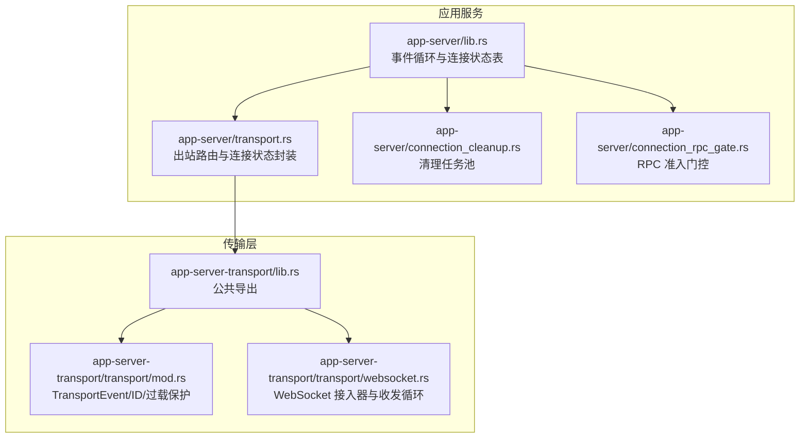

**图表来源**
- [app-server/src/lib.rs:964-1400](file://codex-rs/app-server/src/lib.rs#L964-L1400)
- [app-server/src/transport.rs:1-249](file://codex-rs/app-server/src/transport.rs#L1-L249)
- [app-server-transport/src/lib.rs:1-54](file://codex-rs/app-server-transport/src/lib.rs#L1-L54)
- [app-server-transport/src/transport/mod.rs:1-200](file://codex-rs/app-server-transport/src/transport/mod.rs#L1-L200)
- [app-server-transport/src/transport/websocket.rs:1-200](file://codex-rs/app-server-transport/src/transport/websocket.rs#L1-L200)

**章节来源**
- [app-server/src/lib.rs:964-1400](file://codex-rs/app-server/src/lib.rs#L964-L1400)
- [app-server/src/transport.rs:1-249](file://codex-rs/app-server/src/transport.rs#L1-L249)
- [app-server-transport/src/lib.rs:1-54](file://codex-rs/app-server-transport/src/lib.rs#L1-L54)

## 核心组件
- **TransportEvent 事件模型**：统一表示连接打开、关闭、入站消息和守护进程控制信号。
- **AppServerTransport 传输枚举**：支持 stdio、Unix Socket、WebSocket 与关闭模式。
- **OutboundConnectionState 出站连接状态**：封装出站发送通道、初始化标记、实验 API 开关、通知白名单和主动断开令牌。
- **ConnectionRpcGate RPC 门控**：按连接维度控制新请求准入与已启动任务优雅退出。
- **ConnectionCleanupTasks 清理任务池**：集中管理异步清理任务的生命周期与结果日志。
- **WebSocket 接入器**：负责握手、鉴权、压缩协商、Ping/Pong 处理、双向收发循环与连接断开上报。

**章节来源**
- [app-server-transport/src/transport/mod.rs:1-200](file://codex-rs/app-server-transport/src/transport/mod.rs#L1-L200)
- [app-server-transport/src/transport/websocket.rs:1-200](file://codex-rs/app-server-transport/src/transport/websocket.rs#L1-L200)
- [app-server/src/transport.rs:1-200](file://codex-rs/app-server/src/transport.rs#L1-L200)
- [app-server/src/connection_rpc_gate.rs:1-200](file://codex-rs/app-server/src/connection_rpc_gate.rs#L1-L200)
- [app-server/src/connection_cleanup.rs:1-49](file://codex-rs/app-server/src/connection_cleanup.rs#L1-L49)

## 架构总览
连接系统采用“事件驱动 + 出站缓冲”的架构：
- 传输层将网络 I/O 转换为统一的 `TransportEvent`；
- 应用层维护连接映射，接收事件并执行业务逻辑；
- 业务侧通过出站路由把消息投递到指定连接或广播给所有已初始化连接；
- 连接关闭时触发清理任务，释放资源并记录清理结果。

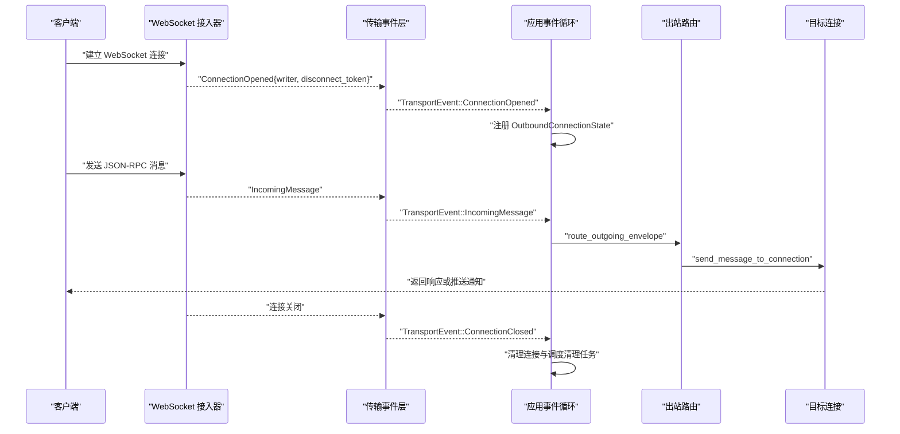

**图表来源**
- [app-server-transport/src/transport/websocket.rs:201-482](file://codex-rs/app-server-transport/src/transport/websocket.rs#L201-L482)
- [app-server-transport/src/transport/mod.rs:201-450](file://codex-rs/app-server-transport/src/transport/mod.rs#L201-L450)
- [app-server/src/transport.rs:201-249](file://codex-rs/app-server/src/transport.rs#L201-L249)
- [app-server/src/lib.rs:964-1400](file://codex-rs/app-server/src/lib.rs#L964-L1400)

## 详细组件分析

### 传输层协议抽象与具体实现
`AppServerTransport` 是传输配置的枚举，支持：
- `Stdio`：标准输入输出；
- `UnixSocket { socket_path }`：本地 Unix Socket；
- `WebSocket { bind_address }`：监听 WebSocket；
- `Off`：禁用传输。

解析规则包括默认地址、Unix Socket 路径、WebSocket 地址格式校验，以及 `off` 关闭模式。该抽象让上层在配置阶段选择传输类型，并在运行时由对应 acceptor 启动。

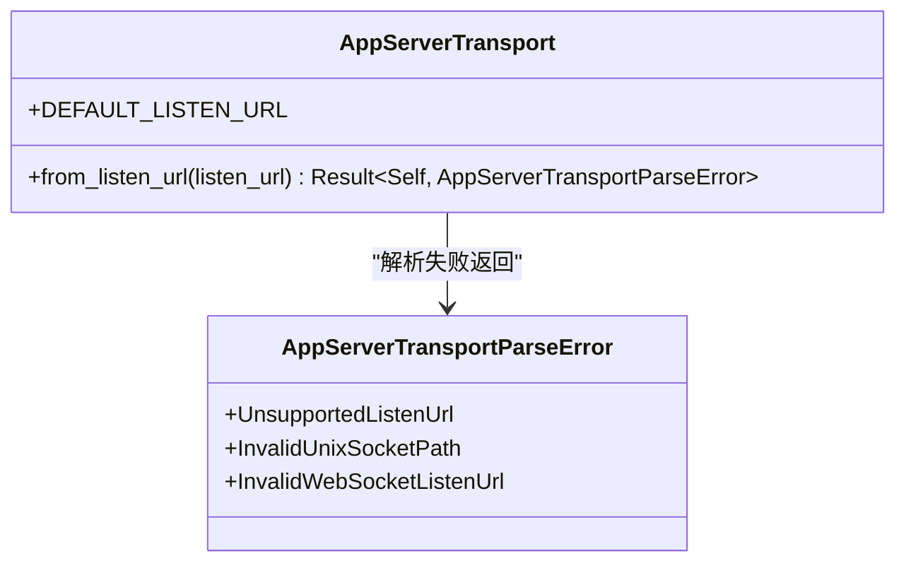

**图表来源**
- [app-server-transport/src/transport/mod.rs:1-200](file://codex-rs/app-server-transport/src/transport/mod.rs#L1-L200)

#### WebSocket 接入器
WebSocket 接入器承担以下职责：
- 绑定 TCP 监听器；
- 拒绝携带 `Origin` 头的请求，防止跨域误用；
- 使用 `WebsocketAuthPolicy` 进行升级前鉴权；
- 协商 zstd 压缩；
- 拆分读写流，分别运行出站写入循环与入站读取循环；
- 连接任意一侧结束后取消另一端并上报 `ConnectionClosed`。

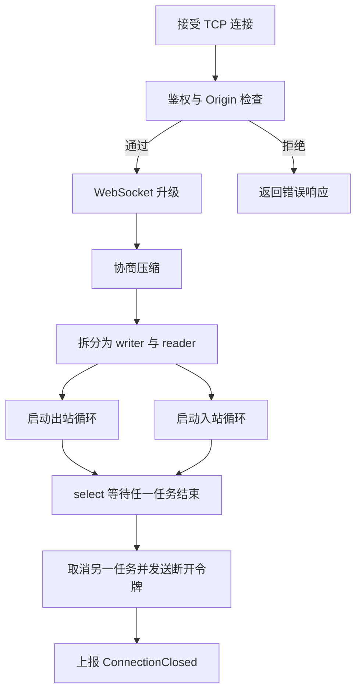

**图表来源**
- [app-server-transport/src/transport/websocket.rs:1-200](file://codex-rs/app-server-transport/src/transport/websocket.rs#L1-L200)
- [app-server-transport/src/transport/websocket.rs:201-482](file://codex-rs/app-server-transport/src/transport/websocket.rs#L201-L482)

#### HTTP 长轮询与 gRPC 的定位
当前代码中并未出现显式的 HTTP 长轮询或 gRPC 接入器实现。`AppServerTransport` 明确支持的传输为 `stdio`、`unix_socket`、`websocket` 与 `off`。因此，对于“HTTP 长轮询”和“gRPC”，应视为尚未在本仓库中实现的扩展点：若未来引入，可在 `AppServerTransport` 上增加枚举分支，并通过新的 acceptor 对接相同的事件模型 `TransportEvent`，复用出站路由与连接状态管理。

**章节来源**
- [app-server-transport/src/transport/mod.rs:1-200](file://codex-rs/app-server-transport/src/transport/mod.rs#L1-L200)
- [app-server-transport/src/transport/websocket.rs:1-200](file://codex-rs/app-server-transport/src/transport/websocket.rs#L1-L200)

### 连接建立、维护与断开流程

#### 连接建立
- WebSocket 接入器完成鉴权与压缩协商后，创建唯一 `ConnectionId`；
- 向传输事件通道发送 `TransportEvent::ConnectionOpened`，包含出站 writer、可选的断开令牌；
- 应用层收到事件后，构造 `OutboundConnectionState` 并加入连接映射；
- `ConnectionSessionState` 内嵌 `ConnectionRpcGate`，用于后续 RPC 准入控制。

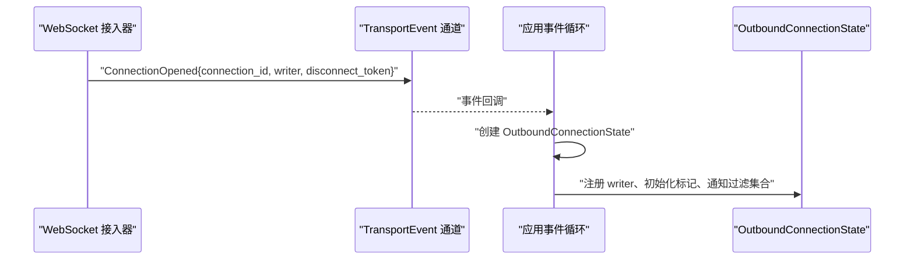

**图表来源**
- [app-server-transport/src/transport/websocket.rs:201-482](file://codex-rs/app-server-transport/src/transport/websocket.rs#L201-L482)
- [app-server/src/transport.rs:1-200](file://codex-rs/app-server/src/transport.rs#L1-L200)

#### 连接维护
- 入站消息经反序列化为 `JSONRPCMessage` 后，通过 `enqueue_incoming_message` 进入应用事件通道；
- 出站消息通过 `route_outgoing_envelope` 分发到单个连接或广播；
- 出站写通道满时，连接被判定为慢连接并断开；
- WebSocket 层内部维护 Ping/Pong 处理：收到 Ping 时回 Pong，Pong 仅消费不转发业务逻辑。

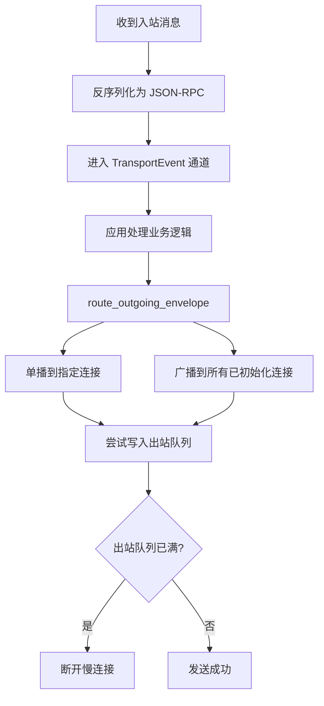

**图表来源**
- [app-server-transport/src/transport/mod.rs:201-450](file://codex-rs/app-server-transport/src/transport/mod.rs#L201-L450)
- [app-server/src/transport.rs:201-249](file://codex-rs/app-server/src/transport.rs#L201-L249)

#### 连接断开
- WebSocket 任一方向任务结束，均会取消另一方向任务；
- 随后发送 `TransportEvent::ConnectionClosed`；
- 应用层移除连接状态，并调度清理任务；
- 清理任务完成后记录非取消类错误日志。

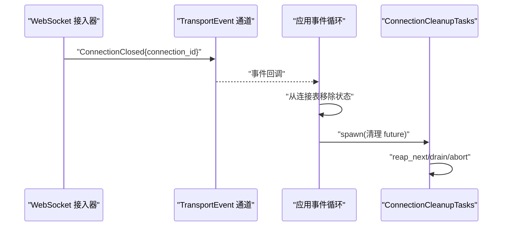

**图表来源**
- [app-server-transport/src/transport/websocket.rs:201-482](file://codex-rs/app-server-transport/src/transport/websocket.rs#L201-L482)
- [app-server/src/connection_cleanup.rs:1-49](file://codex-rs/app-server/src/connection_cleanup.rs#L1-L49)

**章节来源**
- [app-server-transport/src/transport/websocket.rs:201-482](file://codex-rs/app-server-transport/src/transport/websocket.rs#L201-L482)
- [app-server/src/transport.rs:201-249](file://codex-rs/app-server/src/transport.rs#L201-L249)
- [app-server/src/connection_cleanup.rs:1-49](file://codex-rs/app-server/src/connection_cleanup.rs#L1-L49)

### 出站消息广播与单播
`route_outgoing_envelope` 根据信封类型决定路由策略：
- `ToConnection`：发送到指定连接；
- `Broadcast`：筛选所有已初始化且未退订的通知目标，批量投递。

过滤规则包括：
- 实验性通知需启用实验 API；
- 连接可声明退订特定通知方法；
- 慢连接出站队列满时直接断开，避免背压扩散。

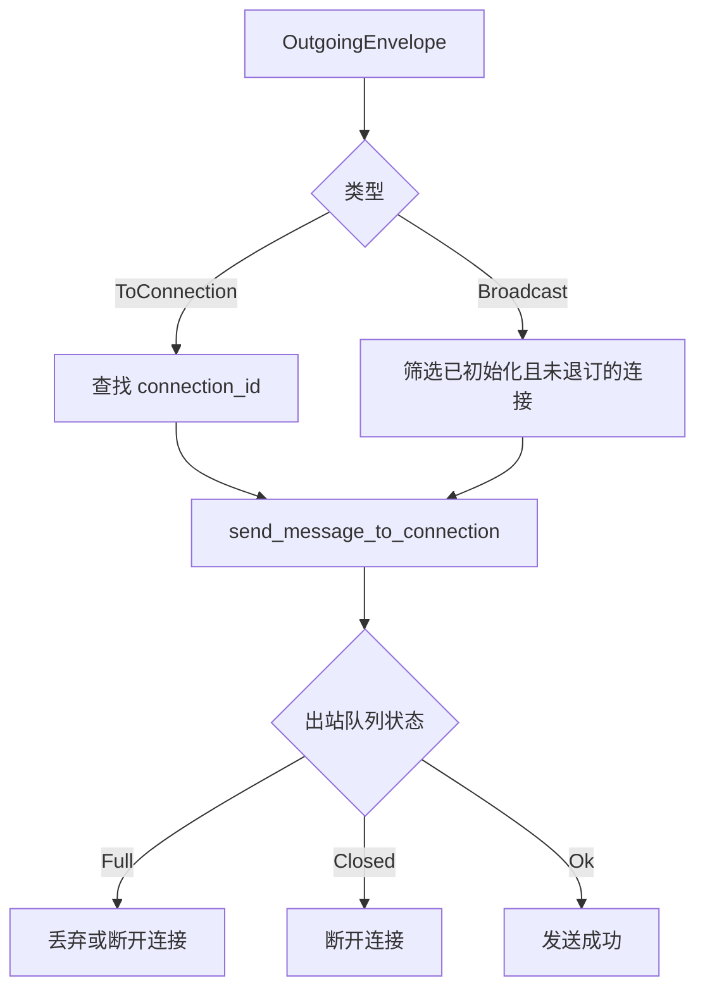

**图表来源**
- [app-server/src/transport.rs:201-249](file://codex-rs/app-server/src/transport.rs#L201-L249)

**章节来源**
- [app-server/src/transport.rs:201-249](file://codex-rs/app-server/src/transport.rs#L201-L249)

### 连接清理机制 `ConnectionCleanupTasks`
清理任务池提供四个关键能力：
- `spawn`：提交异步清理任务；
- `reap_next`：等待并记录下一个清理结果；
- `drain`：阻塞直到全部清理完成；
- `abort`：终止所有未完成清理任务。

清理结果中非取消类错误会被记录为警告，帮助定位清理逻辑异常。

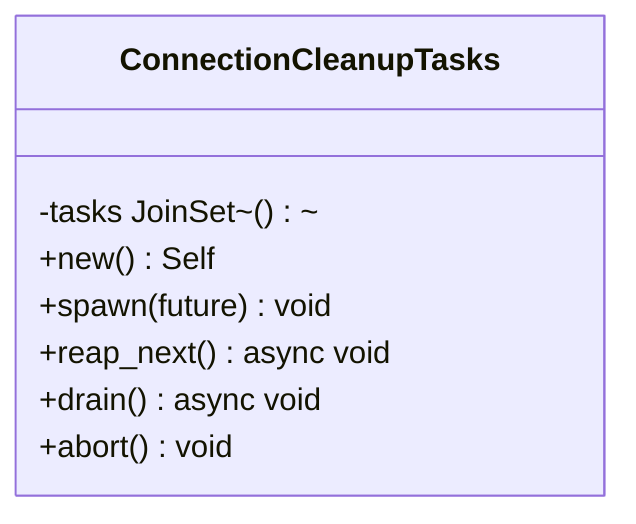

**图表来源**
- [app-server/src/connection_cleanup.rs:1-49](file://codex-rs/app-server/src/connection_cleanup.rs#L1-L49)

**章节来源**
- [app-server/src/connection_cleanup.rs:1-49](file://codex-rs/app-server/src/connection_cleanup.rs#L1-L49)

### RPC 访问控制 `ConnectionRpcGate`
`ConnectionRpcGate` 是每连接维度的 RPC 准入门控：
- `run`：仅在门控开启且连接未关闭时执行 future；
- `close`：停止接受新任务并关闭任务追踪器；
- `shutdown`：关闭并等待已启动任务完成；
- `is_closed`：判断是否已关闭或认证所有权已变更。

该机制确保认证信息变化时，新请求不再启动，而已启动任务可继续完成清理工作。

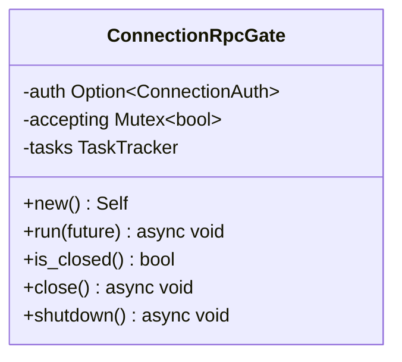

**图表来源**
- [app-server/src/connection_rpc_gate.rs:1-200](file://codex-rs/app-server/src/connection_rpc_gate.rs#L1-L200)

**章节来源**
- [app-server/src/connection_rpc_gate.rs:1-200](file://codex-rs/app-server/src/connection_rpc_gate.rs#L1-L200)

### WebSocket 心跳与自动重连
当前 WebSocket 实现具备心跳相关行为：
- 入站循环收到 `Ping` 时立即回复 `Pong`；
- 入站/出站任一任务结束都会取消另一方，从而实现连接失效的快速检测；
- 出站循环在断开令牌取消后立即退出。

但仓库中未发现显式的自动重连策略。自动重连通常应由客户端或上层会话管理器负责，服务端仅提供连接状态事件供上层决策。

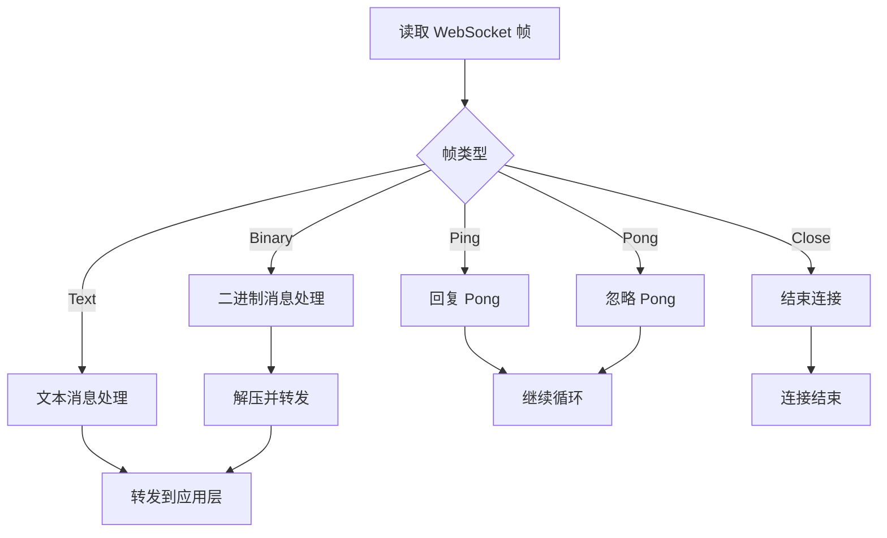

**图表来源**
- [app-server-transport/src/transport/websocket.rs:201-482](file://codex-rs/app-server-transport/src/transport/websocket.rs#L201-L482)

**章节来源**
- [app-server-transport/src/transport/websocket.rs:201-482](file://codex-rs/app-server-transport/src/transport/websocket.rs#L201-L482)

### 连接状态管理与超时控制
- 出站队列满时，`send_message_to_connection` 会断开慢连接；
- 入站队列满时，请求类消息会返回过载错误，响应类消息则等待而非丢弃；
- WebSocket 出站通道容量较大，以容纳正常交互突发；
- 应用层在连接关闭后调度清理任务，避免资源泄漏。

这些机制共同构成超时与背压防护，而不是传统的固定心跳超时；心跳更多用于快速发现对端断开。

**章节来源**
- [app-server/src/transport.rs:1-200](file://codex-rs/app-server/src/transport.rs#L1-L200)
- [app-server-transport/src/transport/mod.rs:201-450](file://codex-rs/app-server-transport/src/transport/mod.rs#L201-L450)
- [app-server-transport/src/transport/websocket.rs:201-482](file://codex-rs/app-server-transport/src/transport/websocket.rs#L201-L482)

### 连接事件与广播消息的处理示例

下面给出典型调用链的参考路径，便于在现有代码基础上扩展连接事件处理和广播逻辑：

- 接入 WebSocket 并上报连接打开：
  - [WebSocket 接入器连接生命周期](file://codex-rs/app-server-transport/src/transport/websocket.rs#L201-L482)
- 应用层接收 `TransportEvent::ConnectionOpened` 并注册出站连接：
  - [应用事件循环连接注册](file://codex-rs/app-server/src/lib.rs#L964-L1400)
- 出站消息路由与广播：
  - [出站路由函数](file://codex-rs/app-server/src/transport.rs#L201-L249)
- 入站消息入队与过载保护：
  - [入站消息入队逻辑](file://codex-rs/app-server-transport/src/transport/mod.rs#L201-L450)
- 连接关闭与清理任务：
  - [连接清理任务池](file://codex-rs/app-server/src/connection_cleanup.rs#L1-L49)
  - [连接关闭事件上报](file://codex-rs/app-server-transport/src/transport/websocket.rs#L201-L482)

**章节来源**
- [app-server-transport/src/transport/websocket.rs:201-482](file://codex-rs/app-server-transport/src/transport/websocket.rs#L201-L482)
- [app-server/src/lib.rs:964-1400](file://codex-rs/app-server/src/lib.rs#L964-L1400)
- [app-server/src/transport.rs:201-249](file://codex-rs/app-server/src/transport.rs#L201-L249)
- [app-server-transport/src/transport/mod.rs:201-450](file://codex-rs/app-server-transport/src/transport/mod.rs#L201-L450)
- [app-server/src/connection_cleanup.rs:1-49](file://codex-rs/app-server/src/connection_cleanup.rs#L1-L49)

## 依赖关系分析

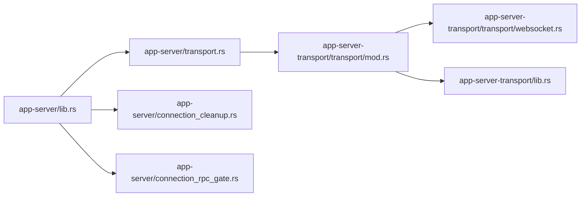

**图表来源**
- [app-server/src/lib.rs:964-1400](file://codex-rs/app-server/src/lib.rs#L964-L1400)
- [app-server/src/transport.rs:1-249](file://codex-rs/app-server/src/transport.rs#L1-L249)
- [app-server-transport/src/transport/mod.rs:1-200](file://codex-rs/app-server-transport/src/transport/mod.rs#L1-L200)
- [app-server-transport/src/transport/websocket.rs:1-200](file://codex-rs/app-server-transport/src/transport/websocket.rs#L1-L200)
- [app-server-transport/src/lib.rs:1-54](file://codex-rs/app-server-transport/src/lib.rs#L1-L54)

**章节来源**
- [app-server/src/lib.rs:964-1400](file://codex-rs/app-server/src/lib.rs#L964-L1400)
- [app-server/src/transport.rs:1-249](file://codex-rs/app-server/src/transport.rs#L1-L249)
- [app-server-transport/src/transport/mod.rs:1-200](file://codex-rs/app-server-transport/src/transport/mod.rs#L1-L200)
- [app-server-transport/src/transport/websocket.rs:1-200](file://codex-rs/app-server-transport/src/transport/websocket.rs#L1-L200)
- [app-server-transport/src/lib.rs:1-54](file://codex-rs/app-server-transport/src/lib.rs#L1-L54)

## 性能与容量特性
- 通用入站/出站通道容量为 `CHANNEL_CAPACITY`，适合交互式 CLI 场景；
- WebSocket 出站通道容量显著更大，用于吸收正常消息突发；
- 入站队列满时，请求类消息返回过载错误码，避免无限堆积；
- 出站队列满时断开慢连接，防止背压扩散；
- WebSocket 压缩可减小带宽占用，但压缩失败会断开连接；
- 广播消息会为每个目标连接复制消息对象，需注意广播频率与消息体积。

[本节为通用性能讨论，不直接分析具体文件]

## 故障排查指南

### 常见问题与定位思路
- **连接无法建立**
  - 检查 WebSocket 监听地址是否正确；
  - 非本地监听必须配置 WebSocket 鉴权；
  - 确认请求未携带 `Origin` 头而被拒绝。
  - 参考：[WebSocket 接入器启动与鉴权](file://codex-rs/app-server-transport/src/transport/websocket.rs#L1-L200)

- **消息丢失或延迟**
  - 查看入站队列是否频繁满载，触发过载错误；
  - 检查出站队列是否因慢连接而断开；
  - 关注广播是否过于频繁或消息过大。
  - 参考：[入站消息入队与过载保护](file://codex-rs/app-server-transport/src/transport/mod.rs#L201-L450)、[出站路由与慢连接断开](file://codex-rs/app-server/src/transport.rs#L201-L249)

- **连接长时间存在但无活动**
  - WebSocket 层依赖 Ping/Pong 与任务结束来检测连接状态；
  - 若对端不响应 Ping，连接仍可能保持，直到读写出错或被上层关闭；
  - 如需严格心跳超时，应在上层会话层实现。
  - 参考：[WebSocket 入站循环与 Ping/Pong](file://codex-rs/app-server-transport/src/transport/websocket.rs#L201-L482)

- **连接关闭后资源未释放**
  - 确认连接关闭事件是否被应用层处理；
  - 检查清理任务是否正常 spawn、drain 或 abort；
  - 关注清理任务非取消类错误日志。
  - 参考：[连接清理任务池](file://codex-rs/app-server/src/connection_cleanup.rs#L1-L49)

- **RPC 权限变更后仍有旧任务运行**
  - 新请求会被门控拒绝；
  - 已启动任务会继续执行直至完成；
  - 可通过 `shutdown` 等待已启动任务结束。
  - 参考：[RPC 门控行为](file://codex-rs/app-server/src/connection_rpc_gate.rs#L1-L200)

**章节来源**
- [app-server-transport/src/transport/websocket.rs:1-200](file://codex-rs/app-server-transport/src/transport/websocket.rs#L1-L200)
- [app-server-transport/src/transport/websocket.rs:201-482](file://codex-rs/app-server-transport/src/transport/websocket.rs#L201-L482)
- [app-server-transport/src/transport/mod.rs:201-450](file://codex-rs/app-server-transport/src/transport/mod.rs#L201-L450)
- [app-server/src/transport.rs:201-249](file://codex-rs/app-server/src/transport.rs#L201-L249)
- [app-server/src/connection_cleanup.rs:1-49](file://codex-rs/app-server/src/connection_cleanup.rs#L1-L49)
- [app-server/src/connection_rpc_gate.rs:1-200](file://codex-rs/app-server/src/connection_rpc_gate.rs#L1-L200)

## 结论
连接管理系统通过 `TransportEvent` 将不同传输接入统一为事件流，结合出站消息路由、连接状态表和清理任务池，实现了可扩展的连接生命周期管理。WebSocket 接入器承担了鉴权、压缩、心跳与连接保活的核心职责；RPC 门控保障了认证变更时的安全过渡；过载保护与慢连接断开机制提升了整体稳定性。当前仓库未实现 HTTP 长轮询与 gRPC 接入器，但传输抽象为未来扩展提供了清晰边界。若需更强的心跳超时或自动重连语义，建议在上层会话管理中补充相应策略。