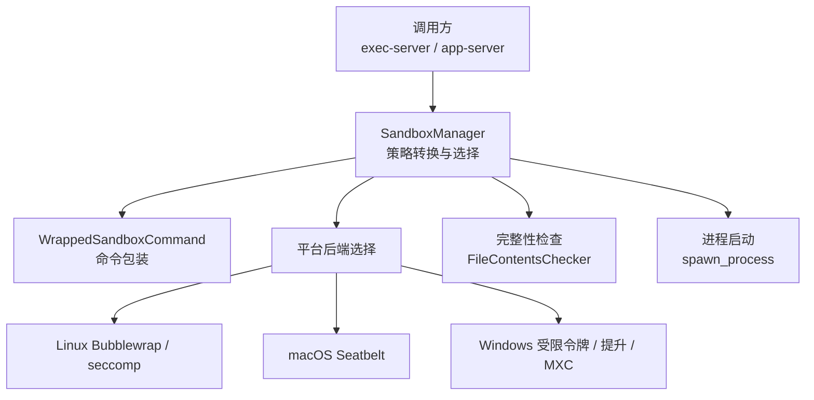
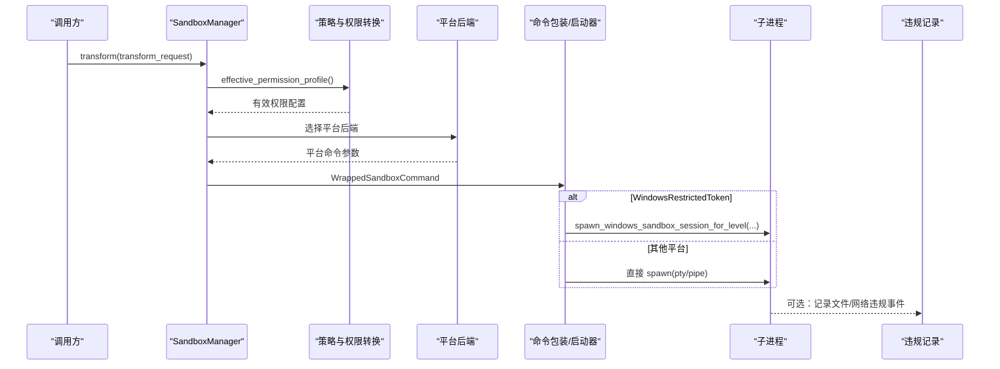
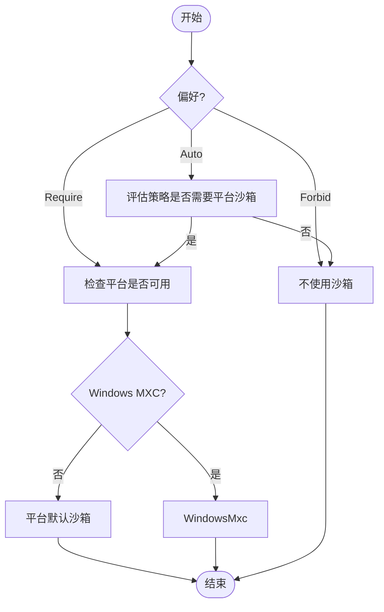
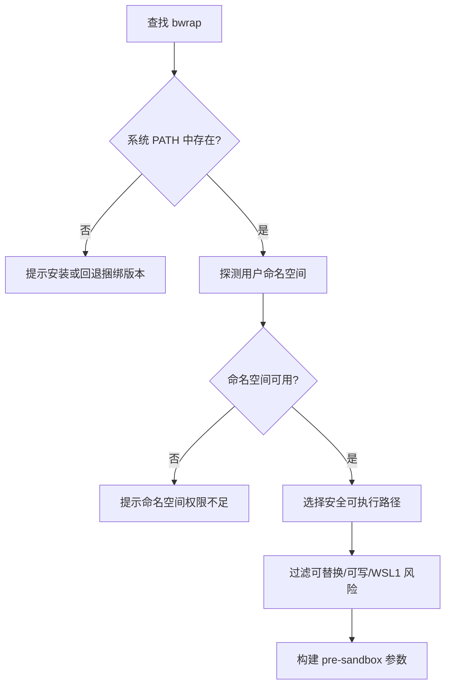
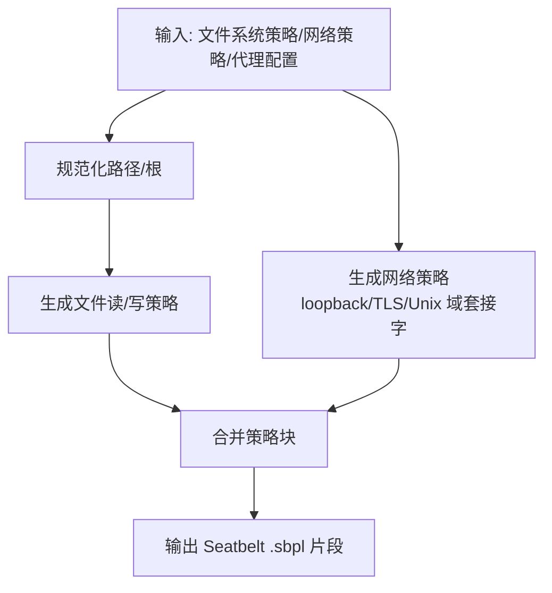
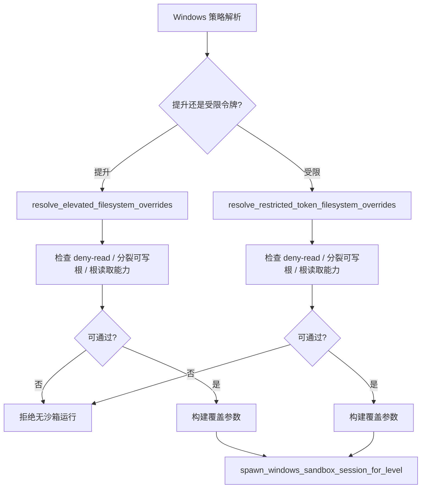
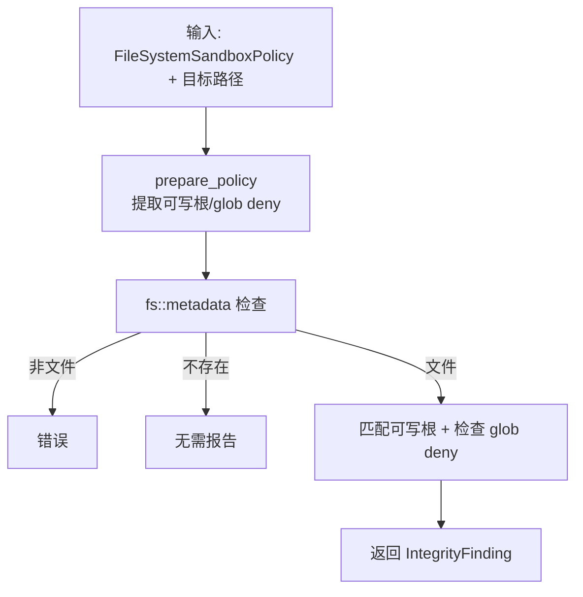
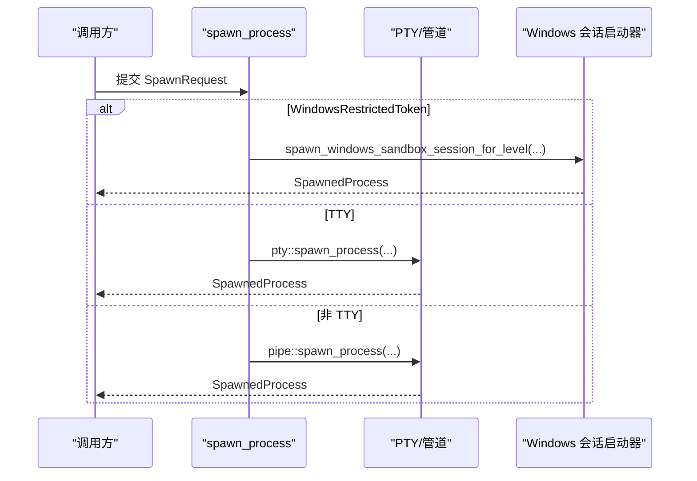
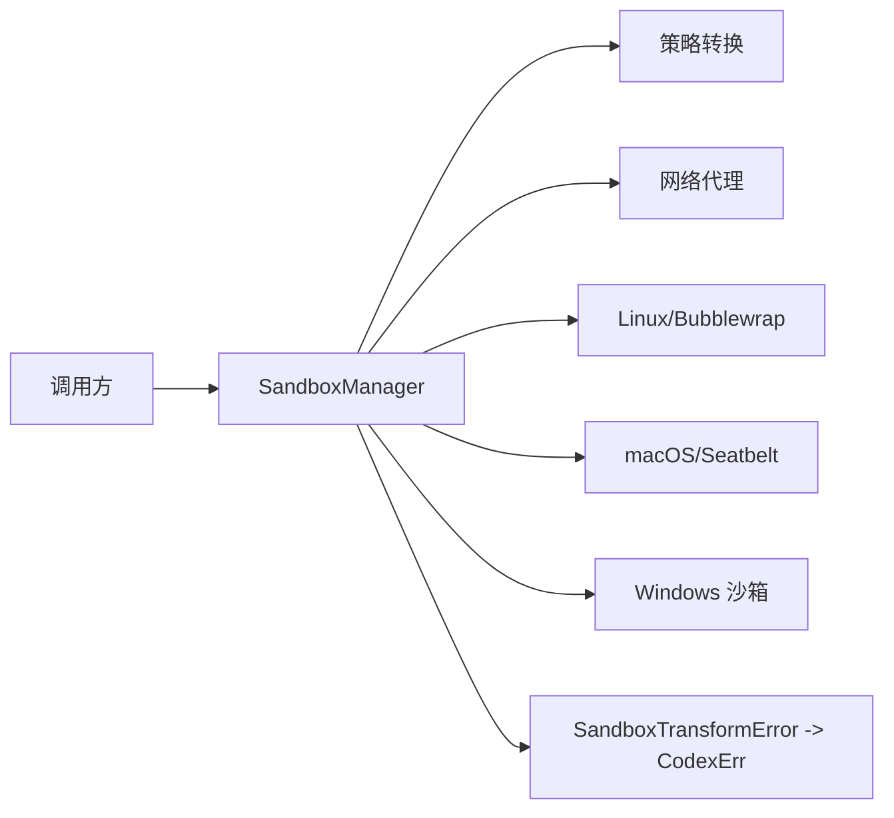

# 安全沙箱

<cite>
**本文引用的文件**   
- [lib.rs](file://codex-rs/sandboxing/src/lib.rs)
- [manager.rs](file://codex-rs/sandboxing/src/manager.rs)
- [launch.rs](file://codex-rs/sandboxing/src/launch.rs)
- [spawn.rs](file://codex-rs/sandboxing/src/spawn.rs)
- [bwrap.rs](file://codex-rs/sandboxing/src/bwrap.rs)
- [seatbelt.rs](file://codex-rs/sandboxing/src/seatbelt.rs)
- [windows.rs](file://codex-rs/sandboxing/src/windows.rs)
- [contents.rs](file://codex-rs/sandboxing/src/sandbox_integrity/contents.rs)
- [policy.rs](file://codex-rs/sandboxing/src/sandbox_integrity/policy.rs)
- [finding.rs](file://codex-rs/sandboxing/src/sandbox_integrity/finding.rs)
- [sandbox.md](file://docs/sandbox.md)
</cite>

## 目录
1. [简介](#简介)
2. [项目结构](#项目结构)
3. [核心组件](#核心组件)
4. [架构总览](#架构总览)
5. [详细组件分析](#详细组件分析)
6. [依赖关系分析](#依赖关系分析)
7. [性能与资源限制](#性能与资源限制)
8. [故障排查指南](#故障排查指南)
9. [结论](#结论)
10. [附录：配置、威胁模型与应急响应](#附录配置威胁模型与应急响应)

## 简介
本文件面向执行服务器中的“安全沙箱”机制，系统性说明其完整性检查、平台实现（Linux Bubblewrap、macOS Seatbelt、Windows）、沙箱选择策略、进程隔离、文件系统保护、网络访问控制、启动流程、资源限制与安全策略应用。文档同时给出可操作的安全配置建议、威胁模型和应急响应方案，帮助运维、开发和安全审计人员在不深入源码的情况下理解并正确部署该能力。

仓库顶层的沙箱文档仅指向外部安全页面；具体实现位于 `codex-rs/sandboxing` 及平台相关模块中。

**章节来源**
- [sandbox.md:1-3](file://docs/sandbox.md#L1-L3)

## 项目结构
安全沙箱由统一的抽象层与多平台后端组成：
- 统一抽象层：负责策略转换、命令包装、平台选择、错误映射、完整性检查与进程启动。
- Linux 后端：基于 Bubblewrap 与 seccomp/Landlock 能力，负责用户命名空间、文件系统绑定与网络代理注入。
- macOS 后端：基于 Seatbelt (`sandbox-exec`)，生成 `.sbpl` 策略，处理文件读写根、Unix 域套接字与受限网络。
- Windows 后端：支持受限令牌会话、提升权限后端以及 MXC 模式，结合工作区 ACL、防火墙与进程环境隔离。

**图表来源**
- [manager.rs:1-200](file://codex-rs/sandboxing/src/manager.rs#L1-L200)
- [launch.rs:1-106](file://codex-rs/sandboxing/src/launch.rs#L1-L106)
- [spawn.rs:1-142](file://codex-rs/sandboxing/src/spawn.rs#L1-L142)
- [bwrap.rs:1-200](file://codex-rs/sandboxing/src/bwrap.rs#L1-L200)
- [seatbelt.rs:1-200](file://codex-rs/sandboxing/src/seatbelt.rs#L1-L200)
- [windows.rs:1-200](file://codex-rs/sandboxing/src/windows.rs#L1-L200)
- [contents.rs:1-99](file://codex-rs/sandboxing/src/sandbox_integrity/contents.rs#L1-L99)

**章节来源**
- [lib.rs:1-110](file://codex-rs/sandboxing/src/lib.rs#L1-L110)
- [manager.rs:1-200](file://codex-rs/sandboxing/src/manager.rs#L1-L200)

## 核心组件
- SandboxManager：集中管理沙箱选择、权限策略有效化、网络代理注入、平台命令构造与错误类型映射。
- WrappedSandboxCommand：封装已准备的平台命令，区分直接命令行参数与需要特定会话启动器的情形。
- spawn_process：根据所选沙箱类型分派到原生 PTY/管道或 Windows 会话启动器。
- bwrap：Linux Bubblewrap 可执行查找、用户命名空间探测、WSL1 检测与替换风险路径过滤。
- seatbelt：macOS Seatbelt 策略生成，包括文件读/写根、Unix 域套接字、出站/入站网络、TLS 信任端点等。
- windows：Windows 文件系统覆盖解析，分为提升后端与受限令牌后端，并对策略能力进行兼容性校验。
- sandbox_integrity：对受控依赖的“内容完整性”进行检查，识别可写入目标及其写入根。

**章节来源**
- [manager.rs:1-200](file://codex-rs/sandboxing/src/manager.rs#L1-L200)
- [launch.rs:1-106](file://codex-rs/sandboxing/src/launch.rs#L1-L106)
- [spawn.rs:1-142](file://codex-rs/sandboxing/src/spawn.rs#L1-L142)
- [bwrap.rs:1-200](file://codex-rs/sandboxing/src/bwrap.rs#L1-L200)
- [seatbelt.rs:1-200](file://codex-rs/sandboxing/src/seatbelt.rs#L1-L200)
- [windows.rs:1-200](file://codex-rs/sandboxing/src/windows.rs#L1-L200)
- [contents.rs:1-99](file://codex-rs/sandboxing/src/sandbox_integrity/contents.rs#L1-L99)

## 架构总览
沙箱在“请求准备—策略转换—平台构建—进程启动—监控与违规记录”这条主链路上运行。

**图表来源**
- [manager.rs:201-558](file://codex-rs/sandboxing/src/manager.rs#L201-L558)
- [spawn.rs:1-142](file://codex-rs/sandboxing/src/spawn.rs#L1-L142)
- [lib.rs:1-110](file://codex-rs/sandboxing/src/lib.rs#L1-L110)

**章节来源**
- [manager.rs:201-558](file://codex-rs/sandboxing/src/manager.rs#L201-L558)
- [spawn.rs:1-142](file://codex-rs/sandboxing/src/spawn.rs#L1-L142)

## 详细组件分析

### 沙箱选择与策略决策
- 平台默认选择：
  - macOS → macOSSeatbelt
  - Linux → LinuxSeccomp
  - Windows → WindowsRestrictedToken（需显式启用）
- 用户偏好：Auto/Require/Forbid 三种模式，Auto 会根据文件系统与网络策略决定是否必须使用平台沙箱。
- 特殊分支：WindowsMxc 会优先返回 MXC 后端；若不可用则失败。
- 托管网络要求：当强制托管网络且未提供本地代理时，部分后端拒绝继续。

**图表来源**
- [manager.rs:1-200](file://codex-rs/sandboxing/src/manager.rs#L1-L200)
- [manager.rs:201-558](file://codex-rs/sandboxing/src/manager.rs#L201-L558)

**章节来源**
- [manager.rs:1-200](file://codex-rs/sandboxing/src/manager.rs#L1-L200)
- [manager.rs:201-558](file://codex-rs/sandboxing/src/manager.rs#L201-L558)

### Linux Bubblewrap 与 seccomp/Landlock
- Bubblewrap 可执行发现：
  - 先尝试系统 PATH 中的 `bwrap`，并进行用户命名空间可用性探测。
  - 对 WSL1 给出明确不支持警告。
  - 对可被当前用户修改或替换的路径进行严格过滤，避免安装目录劫持。
- 预沙箱执行路径筛选：
  - 依据文件系统策略判断全磁盘写权限与可写根。
  - 排除当前工作目录下、可被替换、存在符号链接风险的候选。
- 用户命名空间探测：
  - 通过最小化的 bubblewrap 测试命令与超时轮询判断内核命名空间能力。
- 托管网络：
  - 将代理端口与 Unix 域套接字允许列表注入环境变量，供后续网络代理使用。

**图表来源**
- [bwrap.rs:1-200](file://codex-rs/sandboxing/src/bwrap.rs#L1-L200)
- [bwrap.rs:201-369](file://codex-rs/sandboxing/src/bwrap.rs#L201-L369)

**章节来源**
- [bwrap.rs:1-200](file://codex-rs/sandboxing/src/bwrap.rs#L1-L200)
- [bwrap.rs:201-369](file://codex-rs/sandboxing/src/bwrap.rs#L201-L369)

### macOS Seatbelt 策略生成
- 固定可信入口：仅使用 `/usr/bin/sandbox-exec`，防止 PATH 注入。
- 文件访问：
  - 生成可读根与可写根，支持精确文件与目录匹配。
  - 对可写根添加“禁止删除目录锚点”规则，防止边界被破坏。
  - 支持排除子路径与受保护元数据名称的正则过滤。
  - 对 CODEX_HOME 下的符号链接可配置放宽，但明确声明安全风险。
- 网络访问：
  - 从托管网络上下文或环境变量解析代理地址与端口。
  - 支持允许本地绑定、仅允许 loopback 出站、按需开启 TLS 信任服务。
  - 支持 Unix 域套接字白名单或“全部允许”。
- 策略合并：
  - 基础策略 + 网络策略 + 偏好策略 + 只读平台默认策略组合输出。

**图表来源**
- [seatbelt.rs:1-200](file://codex-rs/sandboxing/src/seatbelt.rs#L1-L200)
- [seatbelt.rs:201-592](file://codex-rs/sandboxing/src/seatbelt.rs#L201-L592)

**章节来源**
- [seatbelt.rs:1-200](file://codex-rs/sandboxing/src/seatbelt.rs#L1-L200)
- [seatbelt.rs:201-592](file://codex-rs/sandboxing/src/seatbelt.rs#L201-L592)

### Windows 沙箱与文件系统覆盖
- 后端选择：
  - 提升后端：用于更严格的 ACL、额外 deny-read/deny-write 与平台默认根注入。
  - 受限令牌后端：仅能承载有限能力；当策略需要直接运行时强制执行、deny-read、分裂可写根不兼容等情况时，会拒绝以无沙箱方式运行。
- 文件系统覆盖解析：
  - 比较“遗留可写根”与“分裂可写根”，计算差异 deny-write 路径。
  - 若需要 deny-read，则必须由提升后端承载。
  - 对重复打开的可写后代、根读取能力等进行防御性检查。
- 进程启动：
  - WindowsRestrictedToken 必须走专用会话启动器，不能直接转换为普通 Command。
  - 通过 `spawn_windows_sandbox_session_for_level` 传入权限配置、工作区、代理 SID、TTY 等参数。

**图表来源**
- [windows.rs:1-200](file://codex-rs/sandboxing/src/windows.rs#L1-L200)
- [windows.rs:201-410](file://codex-rs/sandboxing/src/windows.rs#L201-L410)
- [spawn.rs:1-142](file://codex-rs/sandboxing/src/spawn.rs#L1-L142)

**章节来源**
- [windows.rs:1-200](file://codex-rs/sandboxing/src/windows.rs#L1-L200)
- [windows.rs:201-410](file://codex-rs/sandboxing/src/windows.rs#L201-L410)
- [spawn.rs:1-142](file://codex-rs/sandboxing/src/spawn.rs#L1-L142)

### 完整性检查：受控依赖内容防护
- FileContentsChecker 针对“现有文件内容”进行校验：
  - 将策略中的可写根与 glob deny 规则准备好。
  - 对目标文件进行存在性与类型检查。
  - 若 glob deny 命中，则视为不受保护。
  - 否则统计匹配的写入根集合，并返回完整性发现。
- 典型用途：确认构建产物、缓存或第三方二进制未被意外写入。

**图表来源**
- [contents.rs:1-99](file://codex-rs/sandboxing/src/sandbox_integrity/contents.rs#L1-L99)
- [policy.rs:1-31](file://codex-rs/sandboxing/src/sandbox_integrity/policy.rs#L1-L31)
- [finding.rs:1-18](file://codex-rs/sandboxing/src/sandbox_integrity/finding.rs#L1-L18)

**章节来源**
- [contents.rs:1-99](file://codex-rs/sandboxing/src/sandbox_integrity/contents.rs#L1-L99)
- [policy.rs:1-31](file://codex-rs/sandboxing/src/sandbox_integrity/policy.rs#L1-L31)
- [finding.rs:1-18](file://codex-rs/sandboxing/src/sandbox_integrity/finding.rs#L1-L18)

### 进程启动与终端交互
- 通用启动：
  - TTY 模式：通过 PTY 启动，并在完成后响应终端查询。
  - 非 TTY：使用管道或关闭 stdin 的管道启动。
- Windows 专用：
  - 当选择 WindowsRestrictedToken 时，必须使用会话启动器，否则会报错。
  - 所有与 Windows 沙箱相关的参数（工作区、代理 SID、读写覆盖、TTY、stdin 等）均通过请求对象传递。

**图表来源**
- [spawn.rs:1-142](file://codex-rs/sandboxing/src/spawn.rs#L1-L142)
- [launch.rs:1-106](file://codex-rs/sandboxing/src/launch.rs#L1-L106)

**章节来源**
- [spawn.rs:1-142](file://codex-rs/sandboxing/src/spawn.rs#L1-L142)
- [launch.rs:1-106](file://codex-rs/sandboxing/src/launch.rs#L1-L106)

## 依赖关系分析
- 上层调用方（exec-server/app-server）负责组装 `SandboxTransformRequest` 与 `SpawnRequest`，并将 URI 与路径分离，仅在宿主侧转换为原生路径。
- SandboxManager 依赖：
  - 策略转换：`effective_permission_profile`、`should_require_platform_sandbox`。
  - 网络代理：ManagedNetworkSandboxContext、NetworkProxy。
  - 平台后端：Bubblewrap、Seatbelt、Windows 沙箱库。
- 错误映射：`SandboxTransformError` 统一映射为 `CodexErr`，便于上游处理。

**图表来源**
- [lib.rs:1-110](file://codex-rs/sandboxing/src/lib.rs#L1-L110)
- [manager.rs:1-200](file://codex-rs/sandboxing/src/manager.rs#L1-L200)

**章节来源**
- [lib.rs:1-110](file://codex-rs/sandboxing/src/lib.rs#L1-L110)
- [manager.rs:1-200](file://codex-rs/sandboxing/src/manager.rs#L1-L200)

## 性能与资源限制
- Bubblewrap 探测采用短超时与轮询，避免长时间阻塞。
- Seatbelt 策略生成基于内存拼接，避免额外进程开销；实际资源限制由操作系统内核与 `sandbox-exec` 承担。
- Windows 受限令牌后端在无法承载某些策略时会拒绝运行，从而避免回退到无保护路径带来的性能与安全权衡问题。
- 完整性检查仅对已有文件进行扫描与策略匹配，复杂度主要取决于策略条目数量与文件系统元数据读取成本。

[本节为通用指导，不涉及具体代码行]

## 故障排查指南
- Linux Bubblewrap 不可用或用户命名空间失败：
  - 检查是否存在系统 PATH 中的 `bwrap`。
  - 检查内核是否允许创建用户命名空间。
  - WSL1 环境下不支持 Bubblewrap，应切换到 WSL2。
- macOS Seatbelt 策略失败：
  - 确认使用的是 `/usr/bin/sandbox-exec`。
  - 检查代理 URL 环境变量是否有效。
  - 检查可写根是否包含不允许的符号链接组件，必要时调整 `allow_symlinked_codex_home`。
- Windows 沙箱准备失败：
  - 托管网络在受限令牌模式下不可用，需使用提升后端。
  - 当策略包含 deny-read、分裂可写根不兼容或需要直接运行时强制执行时，受限令牌后端会拒绝运行。
- 完整性检查告警：
  - 目标文件存在于某个可写根下，或被 glob deny 规则判定不受保护。
  - 检查策略是否正确标记了可写根与排除项。

**章节来源**
- [bwrap.rs:1-200](file://codex-rs/sandboxing/src/bwrap.rs#L1-L200)
- [seatbelt.rs:1-200](file://codex-rs/sandboxing/src/seatbelt.rs#L1-L200)
- [windows.rs:1-200](file://codex-rs/sandboxing/src/windows.rs#L1-L200)
- [windows.rs:201-410](file://codex-rs/sandboxing/src/windows.rs#L201-L410)
- [contents.rs:1-99](file://codex-rs/sandboxing/src/sandbox_integrity/contents.rs#L1-L99)

## 结论
该安全沙箱通过统一策略抽象与平台后端解耦，实现了跨 Linux、macOS 与 Windows 的一致执行隔离。其关键特性包括：
- 策略驱动的沙箱选择与降级控制。
- 对可执行路径替换、符号链接、命名空间权限等常见攻击面的防御。
- 精细的文件系统读写根与 Unix 域套接字控制。
- 对托管网络代理的强约束与 loopback 出站控制。
- 完整性检查确保受控依赖未被意外篡改。

在生产环境中，建议始终启用平台沙箱，配合最小权限策略、托管网络与完整性检查，形成纵深防御体系。

[本节为总结性内容，不涉及具体代码行]

## 附录：配置、威胁模型与应急响应

### 安全配置指南
- Linux：
  - 安装 Bubblewrap，并确保当前用户具备创建用户命名空间的权限。
  - 在 WSL1 上禁用 Bubblewrap 沙箱，改用 WSL2。
  - 保持系统 PATH 中 `bwrap` 路径稳定，避免被恶意替换。
- macOS：
  - 保留 `/usr/bin/sandbox-exec` 的原生路径。
  - 谨慎设置 `allow_symlinked_codex_home`，仅在你完全信任 CODEX_HOME 符号链接目标时使用。
  - 配置代理 URL 环境变量以启用受限网络策略。
- Windows：
  - 如需托管网络，请启用提升后端。
  - 避免在受限令牌后端下使用 deny-read、分裂可写根或不兼容的写入 carveout。
  - 检查工作区 ACL 与防火墙规则是否与沙箱策略一致。

[本节为通用指导，不涉及具体代码行]

### 威胁模型
- 路径劫持：通过 PATH 或工作目录替换危险可执行文件。已通过 Bubblewrap 可执行选择规则缓解。
- 符号链接逃逸：绕过文件根限制。Seatbelt 对可写根符号链接采取严格策略，并提供可控放宽选项。
- 命名空间逃逸：内核或容器逃逸。Bubblewrap 依赖内核命名空间能力，并提供探测与失败提示。
- 网络越权：代理泄露或出站任意连接。Seatbelt 与 Linux 后端对 loopback 与 Unix 域套接字进行白名单控制。
- 特权提升：Windows 受限令牌无法承载复杂策略时，应使用提升后端，而非回退到无沙箱运行。

[本节为通用指导，不涉及具体代码行]

### 应急响应方案
- 发现完整性告警：
  - 立即停止受影响任务。
  - 收集目标文件哈希、策略快照与可写根清单。
  - 审计最近一次写入来源，定位可能泄露或误配的策略。
- 平台沙箱不可用：
  - Linux：修复 Bubblewrap 安装或内核命名空间配置。
  - macOS：恢复 `/usr/bin/sandbox-exec` 原始版本，清理异常 PATH。
  - Windows：切换至提升后端或修正策略使其适配受限令牌后端。
- 网络异常：
  - 检查代理 URL 环境变量与托管网络上下文。
  - 审查 Unix 域套接字白名单，缩小允许范围。
  - 在 macOS 上确认 TLS 信任端点是否被正确注入。

[本节为通用指导，不涉及具体代码行]