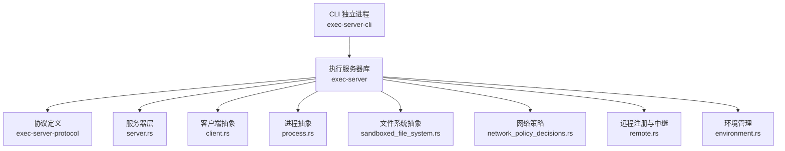
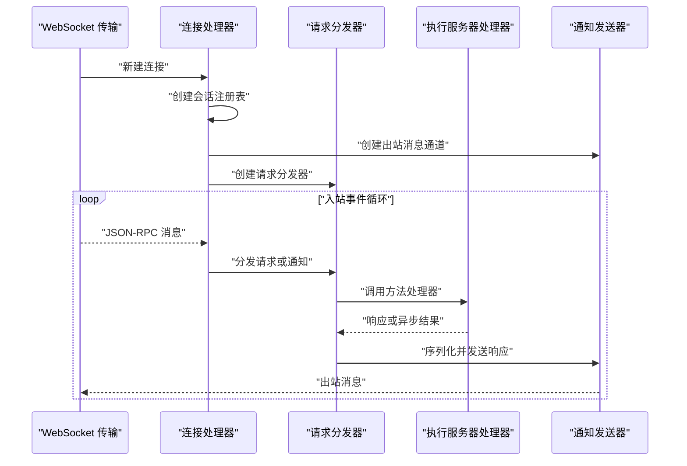
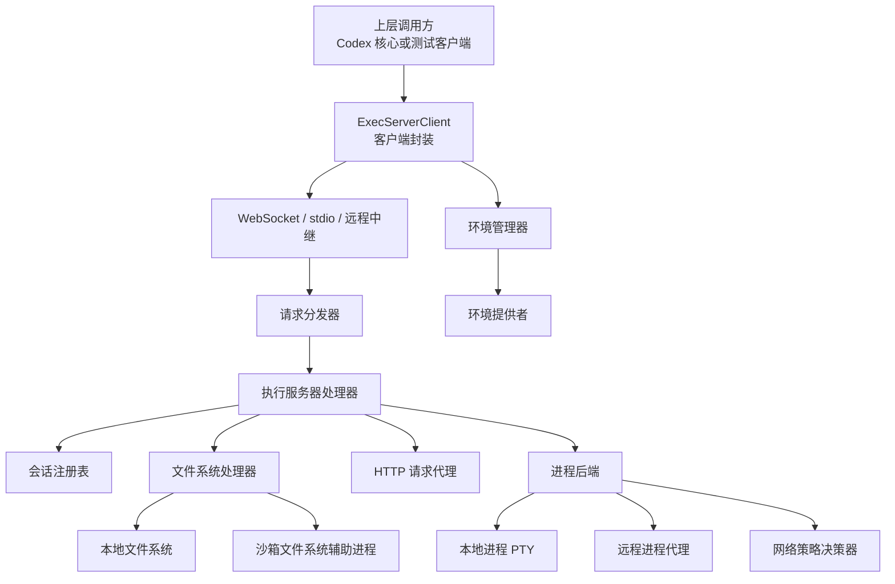
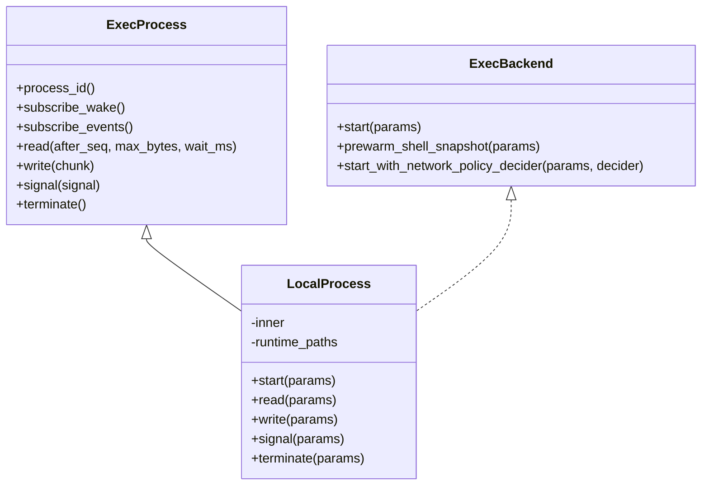
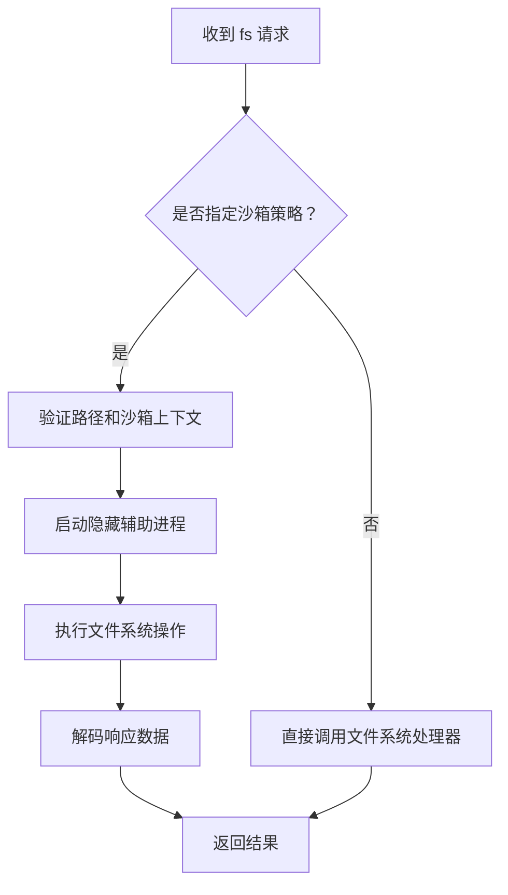
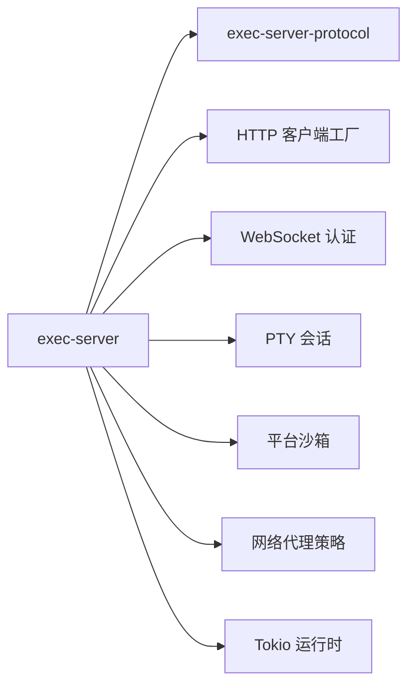
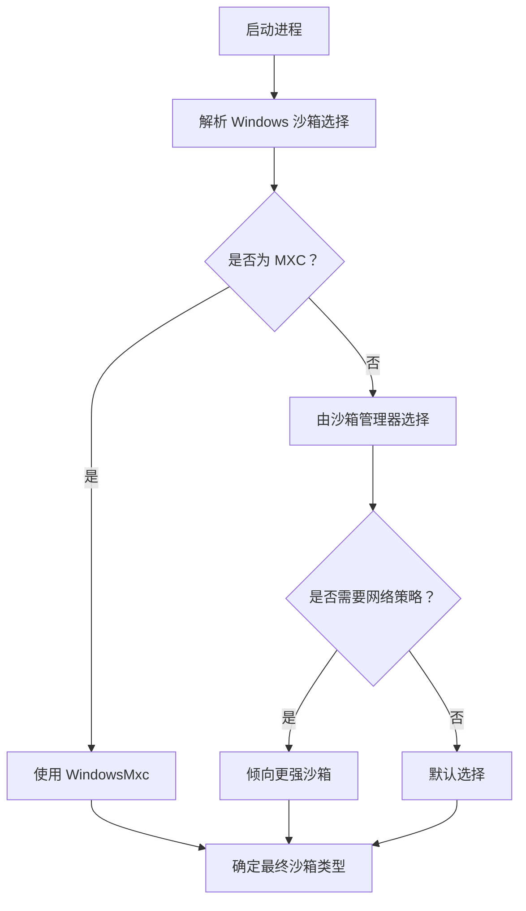
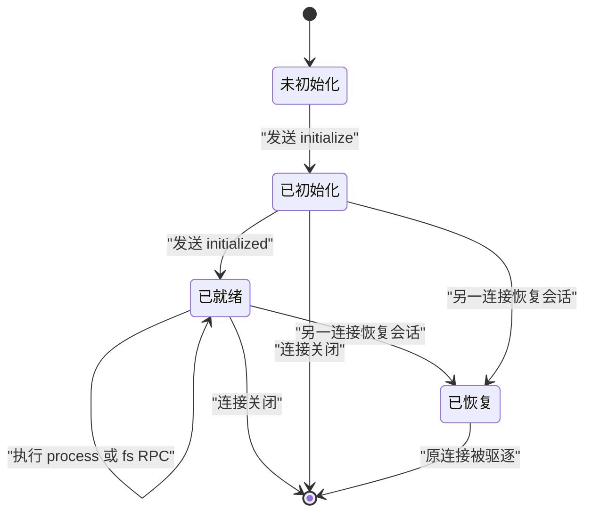
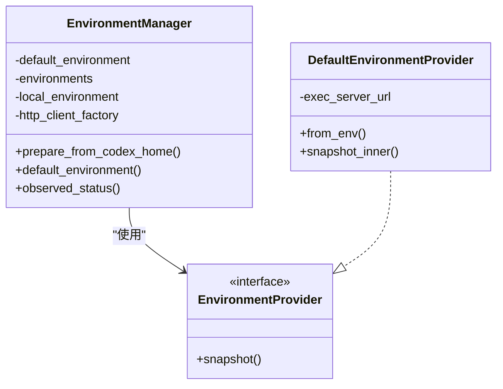
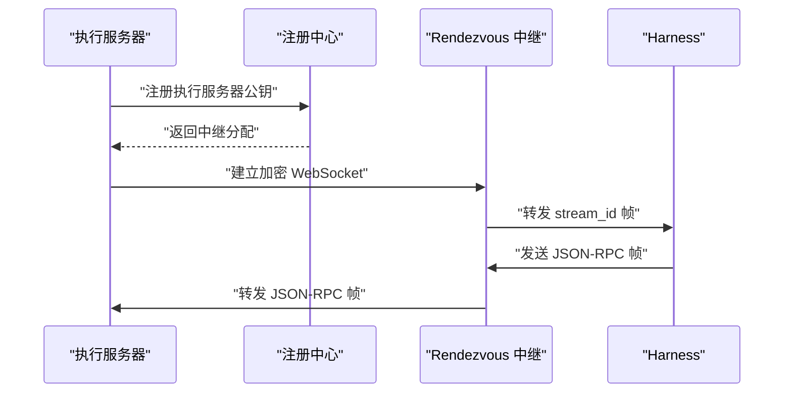

# 执行服务器

<cite>
**本文引用的文件**   
- [exec-server README](file://codex-rs/exec-server/README.md)
- [exec-server 库入口](file://codex-rs/exec-server/src/lib.rs)
- [执行服务器启动入口](file://codex-rs/exec-server/src/server.rs)
- [连接处理器](file://codex-rs/exec-server/src/server/processor.rs)
- [执行服务器处理器](file://codex-rs/exec-server/src/server/handler.rs)
- [请求分发器](file://codex-rs/exec-server/src/server/request_dispatcher.rs)
- [协议定义入口](file://codex-rs/exec-server-protocol/src/lib.rs)
- [CLI 独立进程入口](file://codex-rs/exec-server-cli/src/main.rs)
- [客户端实现](file://codex-rs/exec-server/src/client.rs)
- [环境管理器](file://codex-rs/exec-server/src/environment.rs)
- [本地进程实现](file://codex-rs/exec-server/src/local_process.rs)
- [进程抽象](file://codex-rs/exec-server/src/process.rs)
- [沙箱文件系统](file://codex-rs/exec-server/src/sandboxed_file_system.rs)
- [网络策略决策器](file://codex-rs/exec-server/src/network_policy_decisions.rs)
- [沙箱选择逻辑](file://codex-rs/exec-server/src/sandbox_selection.rs)
- [远程注册与中继](file://codex-rs/exec-server/src/remote.rs)
- [环境提供者接口](file://codex-rs/exec-server/src/environment_provider.rs)
</cite>

## 目录

1. [简介](#简介)
2. [项目结构](#项目结构)
3. [核心组件](#核心组件)
4. [架构总览](#架构总览)
5. [详细组件分析](#详细组件分析)
6. [依赖关系分析](#依赖关系分析)
7. [性能与资源限制](#性能与资源限制)
8. [安全与沙箱隔离](#安全与沙箱隔离)
9. [通信协议与会话生命周期](#通信协议与会话生命周期)
10. [远程执行与环境配置](#远程执行与环境配置)
11. [错误处理与可观测性](#错误处理与可观测性)
12. [故障排查指南](#故障排查指南)
13. [结论](#结论)

## 简介

`exec-server` 是 Codex CLI 执行环境的后端组件，负责通过 JSON-RPC 暴露受控的进程管理和文件系统能力。它既可作为 `codex exec-server` 子命令嵌入到主程序，也可作为独立可执行文件运行。其核心职责包括：

- 维护 WebSocket 或标准输入输出传输上的 JSON-RPC 会话。
- 在会话内启动、读取、写入、终止受管进程。
- 提供只读或受限写入的文件系统访问，支持隐藏辅助进程和平台沙箱。
- 管理本地执行环境和远程执行环境。
- 执行网络策略决策、能力发现、遥测指标和分布式追踪。
- 在远程模式下向环境注册中心登记执行服务器，并通过 Noise 中继建立加密通道。

从代码组织看，该仓库将协议类型放在 `exec-server-protocol`，执行服务器运行时逻辑放在 `exec-server`，命令行启动逻辑放在 `exec-server-cli`。上层核心组件通过 `ExecServerClient` 与执行服务器交互，而不是直接操作底层进程或文件句柄。

**章节来源**
- [exec-server README:1-573](file://codex-rs/exec-server/README.md#L1-L573)
- [exec-server 库入口:1-200](file://codex-rs/exec-server/src/lib.rs#L1-L200)

## 项目结构

执行服务器相关代码主要分布在三个 Rust crate 中：

| 路径 | 职责 |
|---|---|
| `codex-rs/exec-server-protocol` | 共享协议类型、RPC 方法名、能力模型和环境配置结构 |
| `codex-rs/exec-server` | 服务器实现、连接处理、进程管理、文件系统、网络策略、远程中继 |
| `codex-rs/exec-server-cli` | 独立可执行文件的启动、参数解析、认证和遥测初始化 |

**图表来源**
- [CLI 独立进程入口:1-14](file://codex-rs/exec-server-cli/src/main.rs#L1-L14)
- [执行服务器启动入口:1-119](file://codex-rs/exec-server/src/server.rs#L1-L119)
- [协议定义入口:1-13](file://codex-rs/exec-server-protocol/src/lib.rs#L1-L13)
- [执行服务器处理器:1-200](file://codex-rs/exec-server/src/server/handler.rs#L1-L200)
- [本地进程实现:1-200](file://codex-rs/exec-server/src/local_process.rs#L1-L200)
- [沙箱文件系统:1-200](file://codex-rs/exec-server/src/sandboxed_file_system.rs#L1-L200)
- [网络策略决策器:1-97](file://codex-rs/exec-server/src/network_policy_decisions.rs#L1-L97)
- [远程注册与中继:1-200](file://codex-rs/exec-server/src/remote.rs#L1-L200)
- [环境管理器:1-200](file://codex-rs/exec-server/src/environment.rs#L1-L200)

**章节来源**
- [exec-server 库入口:1-200](file://codex-rs/exec-server/src/lib.rs#L1-L200)
- [协议定义入口:1-13](file://codex-rs/exec-server-protocol/src/lib.rs#L1-L13)

## 核心组件

### 服务器启动与传输层

`run_main` 是最常用的同步式启动函数，它接收监听地址、运行时路径、HTTP 客户端工厂并启动 WebSocket 传输。更完整的 `run_main_with_telemetry` 允许注入遥测对象、请求分发模式和 WebSocket 认证设置。

关键行为：

- 强制初始化构建标识信息，以便环境元数据中的 `providerId` 可用于兼容性判断。
- 调用传输层启动 WebSocket 监听或标准输入输出模式。
- 使用 OpenTelemetry 命名根 Span 为 `codex.exec_server`。
- 默认使用内联请求分发模式；可通过配置启用并发请求。

**章节来源**
- [执行服务器启动入口:1-119](file://codex-rs/exec-server/src/server.rs#L1-L119)

### 连接处理器

每个 WebSocket 连接由 `ConnectionProcessor` 管理。它在首次创建时预加载能力位置，并为每个连接分配会话注册表、通知发送器和 HTTP 客户端。

连接处理流程要点：

- 为出站消息创建独立任务，避免序列化失败阻塞入站事件。
- 维护一个 `RequestDispatcher`，负责路由、调度、超时和遥测。
- 支持普通连接和远程中继连接。
- 连接断开时中止请求任务并清理会话。

**图表来源**
- [连接处理器:1-200](file://codex-rs/exec-server/src/server/processor.rs#L1-L200)
- [请求分发器:1-200](file://codex-rs/exec-server/src/server/request_dispatcher.rs#L1-L200)
- [执行服务器处理器:1-200](file://codex-rs/exec-server/src/server/handler.rs#L1-L200)

**章节来源**
- [连接处理器:1-200](file://codex-rs/exec-server/src/server/processor.rs#L1-L200)

### 执行服务器处理器

`ExecServerHandler` 是 RPC 方法的统一入口。它维护：

- 当前会话句柄。
- 能力管理器。
- 文件系统处理器。
- HTTP 客户端。
- 初始化状态标志。
- 活跃 HTTP 响应体流集合。
- 后台任务取消令牌和跟踪器。

所有需要业务能力的 RPC 都通过 `require_initialized_for` 检查：必须先收到 `initialize`，再收到 `initialized`，并且会话仍附着在当前连接上。

**章节来源**
- [执行服务器处理器:1-550](file://codex-rs/exec-server/src/server/handler.rs#L1-L550)

### 请求分发器

`RequestDispatcher` 控制请求是否按顺序串行执行，还是允许多个请求并行处理。

- 默认模式为内联串行。
- 可选并发模式通过信号量限制普通请求数量。
- 健康检查和清理类方法走专用控制通道，避免被普通请求阻塞。
- 握手完成前不启用并发，确保会话状态一致。
- 未实现的 RPC 方法返回“尚未实现”的错误。
- 异常响应、连接断开和队列耗时都会记录遥测指标。

**章节来源**
- [请求分发器:1-395](file://codex-rs/exec-server/src/server/request_dispatcher.rs#L1-L395)

## 架构总览

执行服务器整体采用分层设计：

**图表来源**
- [客户端实现:1-250](file://codex-rs/exec-server/src/client.rs#L1-L250)
- [执行服务器处理器:1-550](file://codex-rs/exec-server/src/server/handler.rs#L1-L550)
- [本地进程实现:1-200](file://codex-rs/exec-server/src/local_process.rs#L1-L200)
- [沙箱文件系统:1-200](file://codex-rs/exec-server/src/sandboxed_file_system.rs#L1-L200)
- [网络策略决策器:1-97](file://codex-rs/exec-server/src/network_policy_decisions.rs#L1-L97)
- [环境提供者接口:1-150](file://codex-rs/exec-server/src/environment_provider.rs#L1-L150)

## 详细组件分析

### 进程管理

进程管理以抽象方式组织。`process.rs` 定义了 `ExecProcess` 和 `ExecBackend` 接口，`local_process.rs` 提供本地 PTY 实现，`remote_process.rs` 提供远程代理实现。

`LocalProcess` 的关键特性：

- 使用 PTY 会话管理交互式终端和非交互式管道。
- 维护每进程的退出码、序列号、输出缓冲区和事件日志。
- 支持 `read`、`write`、`signal`、`terminate`。
- 支持 stdin 写入去重，防止重连后重复写入相同字节。
- 支持 PTY 输出、stdout、stderr 三类流。
- 对已退出进程保留有限时间，便于最后一条读取恢复沙箱拒绝状态。
- 集成网络策略代理，将进程的网络请求交由策略控制器决策。
- 在 Unix 下支持 shell 快照预取。

**图表来源**
- [进程抽象:1-250](file://codex-rs/exec-server/src/process.rs#L1-L250)
- [本地进程实现:1-200](file://codex-rs/exec-server/src/local_process.rs#L1-L200)

**章节来源**
- [进程抽象:1-250](file://codex-rs/exec-server/src/process.rs#L1-L250)
- [本地进程实现:1-200](file://codex-rs/exec-server/src/local_process.rs#L1-L200)

### 文件系统访问

文件系统访问分为两类：

1. 常规文件系统 RPC：通过 `FileSystemHandler` 调用底层实现。
2. 沙箱文件系统：当请求包含 `ReadOnly` 或 `WorkspaceWrite` 策略时，通过隐藏辅助进程执行，以降低执行服务器的权限风险。

`sandboxed_file_system.rs` 的行为特点：

- 打开文件前先执行完整性检查。
- 使用 base64 传输二进制数据块。
- 支持 `open`、`readBlock`、`writeBlock`、`close`、`readFile`、`writeFile`、`createDirectory`、`getMetadata`、`canonicalize`、`readDirectory`、`walk`、`remove`、`copy`。
- 能力发现也通过沙箱辅助进程执行。
- 原生绝对路径字符串不被接受，必须使用 `file:` URI。

**图表来源**
- [沙箱文件系统:1-200](file://codex-rs/exec-server/src/sandboxed_file_system.rs#L1-L200)

**章节来源**
- [沙箱文件系统:1-200](file://codex-rs/exec-server/src/sandboxed_file_system.rs#L1-L200)

### 网络策略控制

网络策略控制位于 `network_policy_decisions.rs`。当进程发起网络请求时，执行服务器会构造策略请求，并通过 RPC 向上层控制器查询允许、拒绝或询问。

策略决策器的约束：

- 主机名不能为空、不能超过最大长度、不能包含控制字符或空白字符。
- 如果控制器不可用，则拒绝请求。
- 如果控制器超时或被进程关闭取消，则拒绝请求。
- 返回原因也必须经过长度和控制字符校验。
- 支持 HTTP、HTTPS CONNECT、SOCKS5 TCP、SOCKS5 UDP。

**图表来源**
- [网络策略决策器:1-97](file://codex-rs/exec-server/src/network_policy_decisions.rs#L1-L97)

**章节来源**
- [网络策略决策器:1-97](file://codex-rs/exec-server/src/network_policy_decisions.rs#L1-L97)

### 能力发现机制

能力发现用于让执行服务器扫描插件、技能和其他可发现能力根。`handler.rs` 同时支持旧版能力根发现和 v2 能力发现：

- 旧版：通过 `discover_capability_roots` 返回能力根列表。
- v2：通过 `discover_capabilities_v2` 调用 `CapabilityManager`，并在连接启动时预加载全局能力位置。
- 沙箱能力发现通过 `SandboxedFileSystem` 在隐藏辅助进程中执行。

**章节来源**
- [执行服务器处理器:201-550](file://codex-rs/exec-server/src/server/handler.rs#L201-L550)
- [沙箱文件系统:1-200](file://codex-rs/exec-server/src/sandboxed_file_system.rs#L1-L200)

## 依赖关系分析

执行服务器对外暴露的主要依赖包括：

- `codex_exec_server_protocol`：协议类型和 RPC 常量。
- `codex_http_client`：HTTP 客户端工厂、代理策略和路由感知客户端。
- `codex_websocket_auth`：WebSocket 连接级认证。
- `codex_utils_pty`：PTY 进程会话。
- `codex_sandboxing`：平台沙箱类型和检测。
- `codex_network_proxy`：网络策略决策接口和审计。
- `tokio` 生态：异步任务、通道、信号量和监控。

**图表来源**
- [exec-server 库入口:1-200](file://codex-rs/exec-server/src/lib.rs#L1-L200)
- [协议定义入口:1-13](file://codex-rs/exec-server-protocol/src/lib.rs#L1-L13)

**章节来源**
- [exec-server 库入口:1-200](file://codex-rs/exec-server/src/lib.rs#L1-L200)

## 性能与资源限制

执行服务器在多处设置了显式上限，以防止内存膨胀、JSON 解码压力和无界输出积压：

| 限制项 | 含义 |
|---|---|
| 入站请求限制 | 跨传输的统一入站消息限制 |
| 进程事件通道容量 | 每个进程的事件缓冲区大小 |
| 进程保留输出字节数 | 单进程保留的输出总量 |
| 进程保留输出事件数 | 防止大量微小事件撑爆历史 |
| 已接受的 stdin 写入 ID 缓存 | 防止重连后重复写入 |
| HTTP 响应体队列字节数 | 大响应体流的内存上限 |
| 并发请求数 | 可选并发模式下的请求信号量 |
| 控制通道与普通通道分离 | 健康检查和清理不会被普通请求阻塞 |

建议：

- 生产环境中根据工作负载开启并发请求，但保持控制通道优先。
- 对高输出进程使用分页读取或事件订阅，避免长期持有完整输出。
- 对长连接 HTTP 响应体使用流式消费，不要一次性累积整个响应体。
- 对远程执行环境注意会话恢复时的输出保留窗口。

**章节来源**
- [连接处理器:1-200](file://codex-rs/exec-server/src/server/processor.rs#L1-L200)
- [请求分发器:201-395](file://codex-rs/exec-server/src/server/request_dispatcher.rs#L201-L395)
- [本地进程实现:1-200](file://codex-rs/exec-server/src/local_process.rs#L1-L200)
- [客户端实现:1-250](file://codex-rs/exec-server/src/client.rs#L1-L250)

## 安全与沙箱隔离

执行服务器的安全模型围绕三层展开：

1. **传输认证**：WebSocket 连接支持能力令牌、签名 bearer token、认证文件等。
2. **进程沙箱**：通过 `codex_sandboxing` 选择 Linux seccomp、macOS Seatbelt、Windows 受限令牌或 MXC。
3. **文件系统沙箱**：敏感操作通过隐藏辅助进程执行，并执行完整性检查。

沙箱选择逻辑：

- Windows 可选择禁用、受限令牌、提升权限或 MXC。
- MXC 需要执行服务器报告对应能力。
- 若进程需要网络策略控制，会影响初始沙箱选择。
- 远程 MXC 沙箱需要执行服务器更新支持。

**图表来源**
- [沙箱选择逻辑:1-46](file://codex-rs/exec-server/src/sandbox_selection.rs#L1-L46)

**章节来源**
- [exec-server README:1-200](file://codex-rs/exec-server/README.md#L1-L200)
- [沙箱选择逻辑:1-46](file://codex-rs/exec-server/src/sandbox_selection.rs#L1-L46)
- [沙箱文件系统:1-200](file://codex-rs/exec-server/src/sandboxed_file_system.rs#L1-L200)

## 通信协议与会话生命周期

执行服务器使用 `codex-exec-server-protocol` 定义的 JSON-RPC 信封。协议模块导出能力、环境配置、网络策略、进程 ID 和 RPC 类型。

会话生命周期如下：

**图表来源**
- [执行服务器处理器:1-200](file://codex-rs/exec-server/src/server/handler.rs#L1-L200)
- [请求分发器:1-200](file://codex-rs/exec-server/src/server/request_dispatcher.rs#L1-L200)

### 典型 API 流程

以下流程描述如何启动执行服务器、提交执行任务并获取结果。为避免泄露实现细节，这里给出步骤说明而非具体源码片段。

1. 启动执行服务器：
   - 调用 `run_main` 或 `run_main_with_telemetry`。
   - 传入监听地址、运行时路径、HTTP 客户端工厂。
   - 可选配置并发请求数和 WebSocket 认证。

2. 客户端连接并初始化：
   - 建立 WebSocket 连接。
   - 发送 `initialize`，携带客户端名称。
   - 收到包含会话 ID 和环境信息的响应。
   - 发送 `initialized` 通知。

3. 启动进程：
   - 调用 `process/start`，传入进程 ID、命令数组、工作目录、环境变量、TTY 标志和管道 stdin 标志。
   - 服务端返回进程 ID。

4. 读取输出：
   - 使用 `process/read` 拉取缓冲输出。
   - 或使用 `process/output` 通知流式消费。

5. 写入输入：
   - 仅 TTY 进程或启用 `pipeStdin` 的非 TTY 进程允许写入。
   - 写入内容以 base64 编码。

6. 终止进程：
   - 调用 `process/terminate`。
   - 随后可能收到 `process/exited` 和 `process/closed`。

**章节来源**
- [exec-server README:201-573](file://codex-rs/exec-server/README.md#L201-L573)
- [协议定义入口:1-13](file://codex-rs/exec-server-protocol/src/lib.rs#L1-L13)

## 远程执行与环境配置

### 环境管理器

`EnvironmentManager` 是执行环境和文件系统环境的统一注册表。它支持：

- 本地执行环境。
- 远程执行环境。
- 通过 `CODEX_EXEC_SERVER_URL` 的遗留行为。
- 通过 `environments.toml` 的多环境配置。
- 连接状态观察：就绪、恢复中、断开。
- 延迟连接的远端环境。

**图表来源**
- [环境管理器:1-200](file://codex-rs/exec-server/src/environment.rs#L1-L200)
- [环境提供者接口:1-150](file://codex-rs/exec-server/src/environment_provider.rs#L1-L150)

**章节来源**
- [环境管理器:1-200](file://codex-rs/exec-server/src/environment.rs#L1-L200)
- [环境提供者接口:1-150](file://codex-rs/exec-server/src/environment_provider.rs#L1-L150)

### 远程注册与中继

远程模式下，执行服务器会：

1. 生成 Noise 身份和公钥。
2. 向环境注册中心注册执行服务器。
3. 获得 rendezvous 分配。
4. 重新连接到服务提供的 rendezvous WebSocket。
5. 通过 `RelayMessageFrame` 中继 harness 与环境之间的 JSON-RPC 流。

Wire 格式包括：

- 版本、流 ID、traceparent、tracestate。
- 握手、数据、确认帧、恢复、重置、心跳。
- 分段序列号和确认位集。
- 载荷为握手字节或加密数据记录。

**图表来源**
- [远程注册与中继:1-200](file://codex-rs/exec-server/src/remote.rs#L1-L200)
- [exec-server README:201-573](file://codex-rs/exec-server/README.md#L201-L573)

**章节来源**
- [remote.rs:1-200](file://codex-rs/exec-server/src/remote.rs#L1-L200)
- [exec-server README:201-573](file://codex-rs/exec-server/README.md#L201-L573)

## 错误处理与可观测性

### JSON-RPC 错误

执行服务器返回标准 JSON-RPC 错误：

| 错误码 | 含义 |
|---|---|
| `-32600` | 无效请求 |
| `-32602` | 无效参数 |
| `-32603` | 内部错误 |

常见错误场景包括：

- 未知方法。
- 参数格式错误。
- 空命令数组。
- 重复进程 ID。
- 对未知进程写入。
- 对非 TTY 进程写入。
- 沙箱拒绝的文件系统操作。
- 会话已被其他连接恢复。

### 可观测性

执行服务器使用 tracing 和 OpenTelemetry：

- 根 Span 名称为 `codex.exec_server`。
- 远程注册 Span 名称为 `codex.exec_server.remote.register`。
- 能力发现 Span 名称为 `capability_roots.discover_v1`。
- 请求队列完成时间和请求完成时间会被记录。
- 连接开始、断开、恢复、重连等状态有对应遥测。

**章节来源**
- [exec-server README:450-573](file://codex-rs/exec-server/README.md#L450-L573)
- [执行服务器启动入口:1-119](file://codex-rs/exec-server/src/server.rs#L1-L119)
- [远程注册与中继:1-200](file://codex-rs/exec-server/src/remote.rs#L1-L200)

## 故障排查指南

### 无法启动执行服务器

可能原因：

- 监听地址无效。
- 标准输入输出模式未正确配置。
- WebSocket 认证配置冲突。
- HTTP 客户端工厂未提供。

排查步骤：

1. 检查监听 URL 是否合法。
2. 如果是远程模式，检查注册中心 URL 是否 HTTPS 或环回地址。
3. 检查是否缺少必要的认证凭据。
4. 查看根 Span 是否成功创建。

**章节来源**
- [执行服务器启动入口:1-119](file://codex-rs/exec-server/src/server.rs#L1-L119)
- [exec-server README:1-200](file://codex-rs/exec-server/README.md#L1-L200)

### 进程无法启动或立即退出

可能原因：

- 命令数组为空。
- 工作目录无效。
- 环境变量过大或包含非法值。
- 沙箱拒绝执行。
- 网络策略拒绝所需工具的网络访问。

排查步骤：

1. 检查 `process/start` 参数。
2. 检查进程输出和退出通知。
3. 检查 `sandboxDenied` 字段。
4. 检查网络策略决策是否返回拒绝。
5. 对 PTY 进程确认是否启用了正确的 stdin 模式。

**章节来源**
- [exec-server README:201-450](file://codex-rs/exec-server/README.md#L201-L450)
- [本地进程实现:1-200](file://codex-rs/exec-server/src/local_process.rs#L1-L200)
- [网络策略决策器:1-97](file://codex-rs/exec-server/src/network_policy_decisions.rs#L1-L97)

### 文件系统操作被拒绝

可能原因：

- 使用了原生绝对路径而非 `file:` URI。
- 沙箱策略不允许目标路径。
- 辅助进程启动失败。
- 完整性检查失败。

排查步骤：

1. 将所有路径转换为 `file:` URI。
2. 检查沙箱策略是否为只读或工作区写入。
3. 检查辅助进程是否存在且可执行。
4. 检查平台沙箱是否满足要求。

**章节来源**
- [exec-server README:350-450](file://codex-rs/exec-server/README.md#L350-L450)
- [沙箱文件系统:1-200](file://codex-rs/exec-server/src/sandboxed_file_system.rs#L1-L200)

### 远程执行无法连接

可能原因：

- 注册中心不可达。
- 认证凭据过期或缺失。
- 中继 WebSocket 握手失败。
- 直连模式配置错误。
- 网络代理或 TLS 配置异常。

排查步骤：

1. 检查注册中心 URL。
2. 检查 `CODEX_API_KEY`、Agent Identity JWT 或噪声中继凭据。
3. 检查重试退避和 409 冲突语义。
4. 区分 Noise 中继与直连模式。
5. 查看远程注册遥测和连接诊断。

**章节来源**
- [exec-server README:1-200](file://codex-rs/exec-server/README.md#L1-L200)
- [remote.rs:1-200](file://codex-rs/exec-server/src/remote.rs#L1-L200)

## 结论

`exec-server` 是一个以 JSON-RPC 为核心的执行环境服务器。它将进程管理、文件系统访问、网络策略、能力发现、会话恢复和远程中继整合在一个可插拔的 Rust 架构中。对于使用者而言，最关键的边界是：

- 所有进程和文件访问都必须通过执行服务器暴露的 RPC。
- 所有敏感文件系统操作都应优先使用沙箱策略。
- 所有远程执行都应通过注册中心和加密中继。
- 所有网络访问都应通过策略控制器。
- 所有生产部署都应启用传输认证、TLS、遥测和适当的资源限制。

对于扩展者而言，最关键的扩展点是：

- 通过 `ExecServerClient` 接入执行服务器。
- 通过 `EnvironmentProvider` 注入新环境来源。
- 通过 `ExecBackend` 扩展进程后端。
- 通过 `ExecutorFileSystem` 扩展文件系统后端。
- 通过 `NetworkPolicyDecider` 扩展网络策略决策。