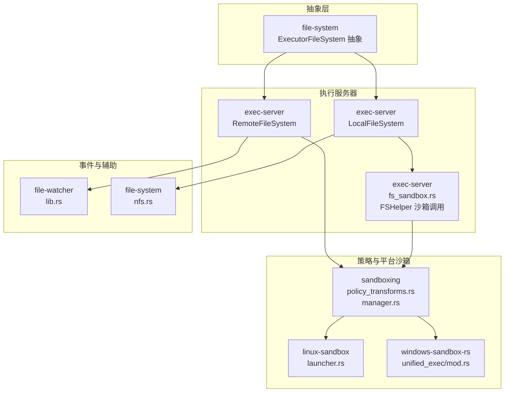
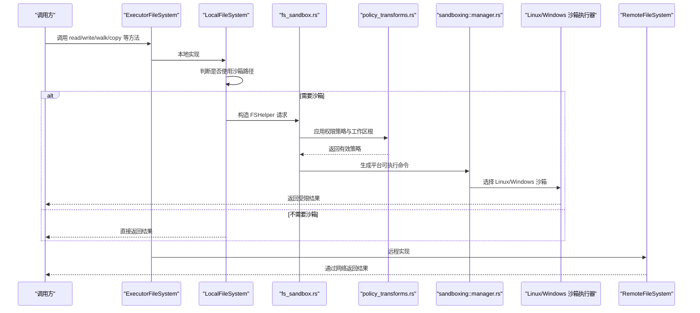
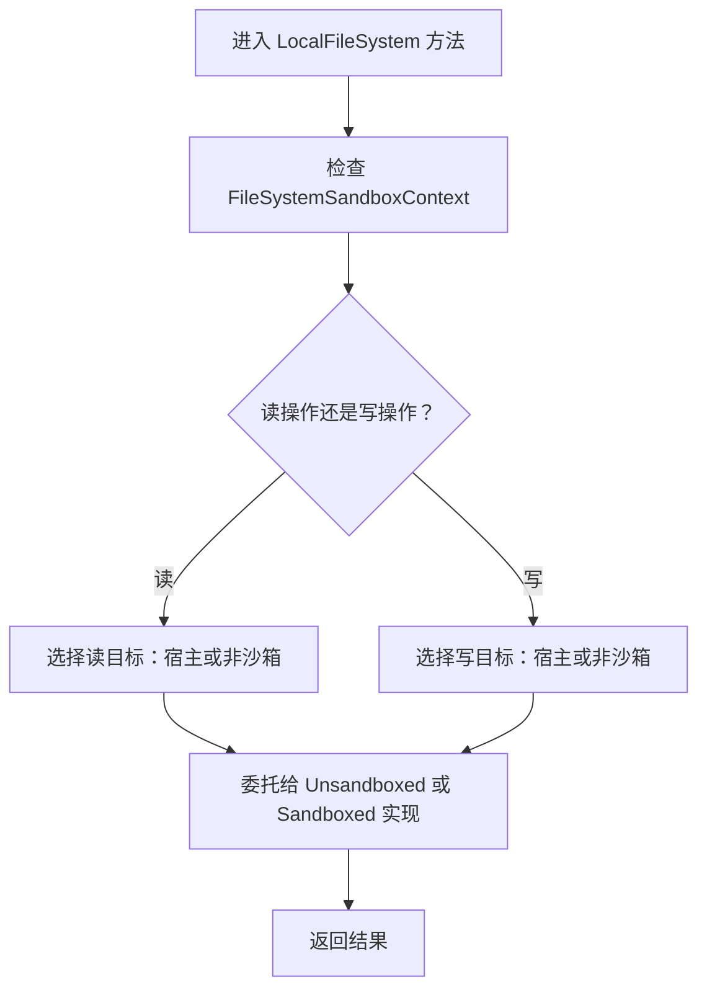
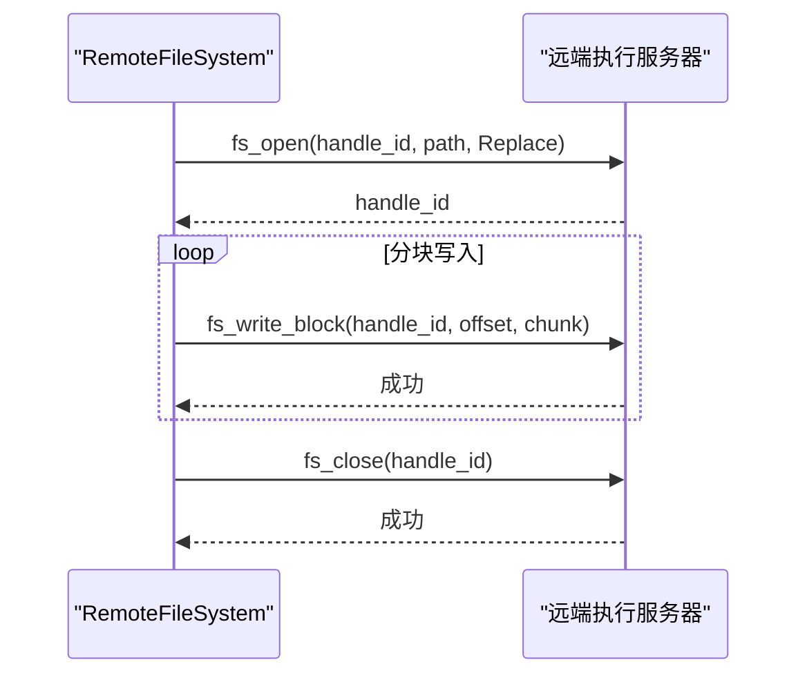
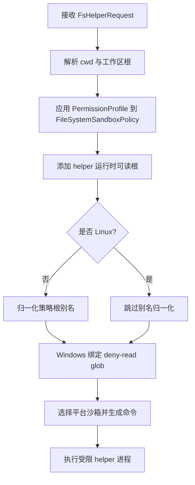
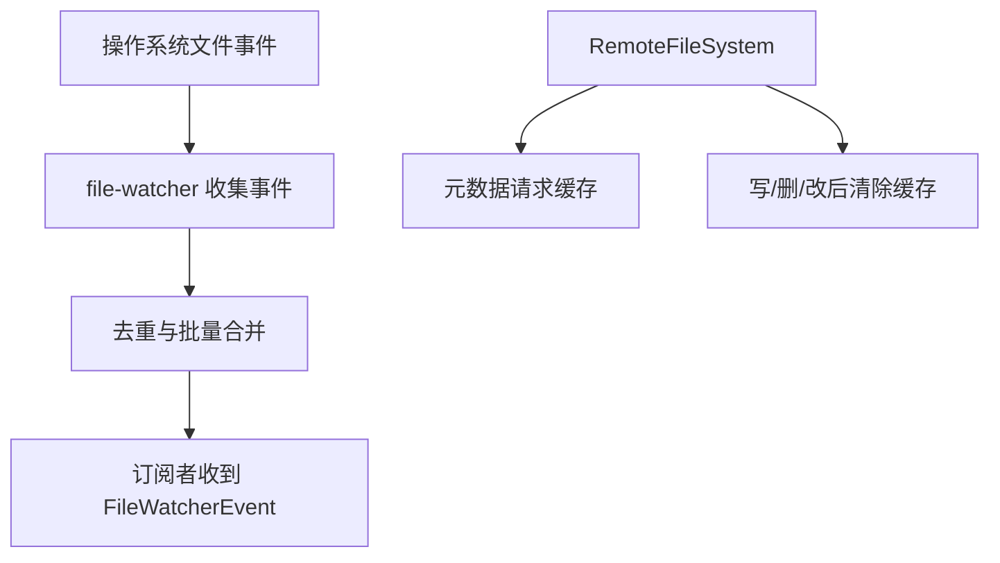
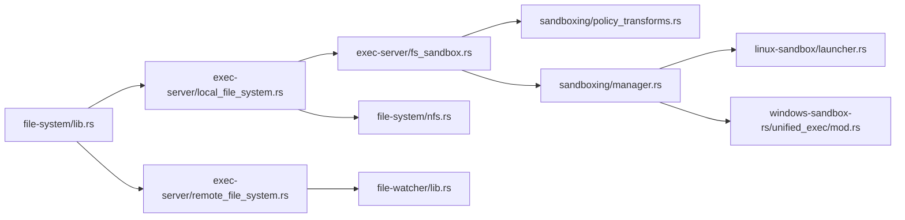
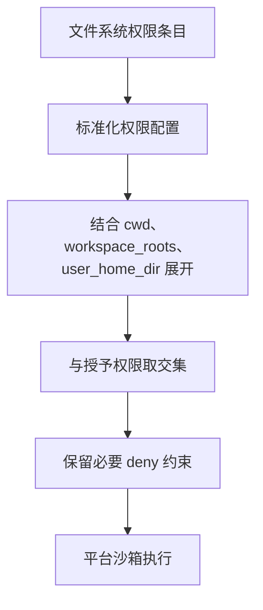

# 文件系统

<cite>
**本文引用的文件**   
- [codex-rs/file-system/src/lib.rs](file://codex-rs/file-system/src/lib.rs)
- [codex-rs/exec-server/src/local_file_system.rs](file://codex-rs/exec-server/src/local_file_system.rs)
- [codex-rs/exec-server/src/remote_file_system.rs](file://codex-rs/exec-server/src/remote_file_system.rs)
- [codex-rs/exec-server/src/fs_sandbox.rs](file://codex-rs/exec-server/src/fs_sandbox.rs)
- [codex-rs/sandboxing/src/policy_transforms.rs](file://codex-rs/sandboxing/src/policy_transforms.rs)
- [codex-rs/sandboxing/src/manager.rs](file://codex-rs/sandboxing/src/manager.rs)
- [codex-rs/linux-sandbox/src/launcher.rs](file://codex-rs/linux-sandbox/src/launcher.rs)
- [codex-rs/windows-sandbox-rs/src/unified_exec/mod.rs](file://codex-rs/windows-sandbox-rs/src/unified_exec/mod.rs)
- [codex-rs/file-watcher/src/lib.rs](file://codex-rs/file-watcher/src/lib.rs)
- [codex-rs/file-system/src/nfs.rs](file://codex-rs/file-system/src/nfs.rs)
</cite>

## 目录
1. [引言](#引言)
2. [项目结构](#项目结构)
3. [核心组件](#核心组件)
4. [架构总览](#架构总览)
5. [详细组件分析](#详细组件分析)
6. [依赖关系分析](#依赖关系分析)
7. [性能与容量限制](#性能与容量限制)
8. [安全配置与访问策略](#安全配置与访问策略)
9. [故障排查指南](#故障排查指南)
10. [结论](#结论)

## 引言
本文件围绕执行服务器的“文件系统功能”进行系统化文档说明。重点包括：
- 本地文件系统与远程文件系统的实现差异、路径映射和权限控制。
- 沙箱化文件操作、路径验证与安全机制。
- 大文件传输、流式读写以及断点续传支持现状。
- 文件监听、变更通知与缓存策略。
- 安全配置、性能优化与错误处理最佳实践。

该能力横跨多个模块：`file-system` 抽象、`exec-server` 的本地与远程实现、`sandboxing` 的策略转换与平台沙箱、`linux-sandbox`/`windows-sandbox-rs` 的平台执行器，以及 `file-watcher` 的事件监听。

## 项目结构
从仓库角度看，文件系统相关代码主要分布在以下模块：

图表来源
- [codex-rs/file-system/src/lib.rs:600-747](file://codex-rs/file-system/src/lib.rs#L600-L747)
- [codex-rs/exec-server/src/local_file_system.rs:1-200](file://codex-rs/exec-server/src/local_file_system.rs#L1-L200)
- [codex-rs/exec-server/src/remote_file_system.rs:1-200](file://codex-rs/exec-server/src/remote_file_system.rs#L1-L200)
- [codex-rs/exec-server/src/fs_sandbox.rs:1-200](file://codex-rs/exec-server/src/fs_sandbox.rs#L1-L200)
- [codex-rs/sandboxing/src/policy_transforms.rs:1-200](file://codex-rs/sandboxing/src/policy_transforms.rs#L1-L200)
- [codex-rs/sandboxing/src/manager.rs:1-200](file://codex-rs/sandboxing/src/manager.rs#L1-L200)
- [codex-rs/linux-sandbox/src/launcher.rs:1-200](file://codex-rs/linux-sandbox/src/launcher.rs#L1-L200)
- [codex-rs/windows-sandbox-rs/src/unified_exec/mod.rs:1-189](file://codex-rs/windows-sandbox-rs/src/unified_exec/mod.rs#L1-L189)
- [codex-rs/file-watcher/src/lib.rs:1-200](file://codex-rs/file-watcher/src/lib.rs#L1-L200)
- [codex-rs/file-system/src/nfs.rs:1-16](file://codex-rs/file-system/src/nfs.rs#L1-L16)

章节来源
- [codex-rs/file-system/src/lib.rs:1-200](file://codex-rs/file-system/src/lib.rs#L1-L200)
- [codex-rs/exec-server/src/local_file_system.rs:1-200](file://codex-rs/exec-server/src/local_file_system.rs#L1-L200)
- [codex-rs/exec-server/src/remote_file_system.rs:1-200](file://codex-rs/exec-server/src/remote_file_system.rs#L1-L200)
- [codex-rs/sandboxing/src/policy_transforms.rs:1-200](file://codex-rs/sandboxing/src/policy_transforms.rs#L1-L200)
- [codex-rs/sandboxing/src/manager.rs:1-200](file://codex-rs/sandboxing/src/manager.rs#L1-L200)

## 核心组件
### ExecutorFileSystem 抽象
`ExecutorFileSystem` 是本地与远程文件系统的统一接口，定义了对路径规范化、文件读取、流式读取、流式写入、元数据查询、目录遍历、递归遍历、删除、复制等操作。它还提供可选的文件系统观察能力，用于检测缺失或存在的路径变化。

关键设计要点：
- 所有方法都接受 `PathUri` 作为跨平台路径表示，并可选择传入 `FileSystemSandboxContext` 来决定是否走沙箱路径。
- 流式读写使用字节块大小常量：
  - 读流块上限：`FILE_READ_CHUNK_SIZE`
  - 写流块上限：`FILE_WRITE_CHUNK_SIZE`
- 递归遍历有严格边界：最大深度、最大目录数、最大条目数、响应大小预算等，避免无限遍历和内存膨胀。
- 默认实现提供文本读取、未支持的流写入等回退行为。

章节来源
- [codex-rs/file-system/src/lib.rs:1-200](file://codex-rs/file-system/src/lib.rs#L1-L200)
- [codex-rs/file-system/src/lib.rs:600-747](file://codex-rs/file-system/src/lib.rs#L600-L747)

### LocalFileSystem
`LocalFileSystem` 是执行服务器上的本地文件系统实现，内部组合了“非沙箱路径”和“沙箱路径”两个子实现：
- 非沙箱直接访问宿主本地文件系统。
- 沙箱路径通过 `SandboxedFileSystem` 将请求转发到受控环境（例如 Linux 下的 fs_helper）。

路由逻辑：
- 读操作根据上下文决定从宿主直接读还是从沙箱内读取。
- 写操作根据上下文决定写入宿主还是写入沙箱。
- 所有入口都会先对传入的沙箱上下文做宿主路径校验，防止越权。

章节来源
- [codex-rs/exec-server/src/local_file_system.rs:1-200](file://codex-rs/exec-server/src/local_file_system.rs#L1-L200)
- [codex-rs/exec-server/src/local_file_system.rs:200-600](file://codex-rs/exec-server/src/local_file_system.rs#L200-L600)

### RemoteFileSystem
`RemoteFileSystem` 是对远端执行服务器的代理实现。它将本地调用转换为 RPC 协议请求，例如：
- 文件规范化和读取
- 目录列表与递归遍历
- 元数据查询
- 文件删除与复制
- 文件打开、分块写入、关闭句柄

特性：
- 元数据请求在客户端内部做短暂共享去重，减少重复 RPC。
- 流式写入支持两种模式：
  - 远端不支持时，先将输入缓冲为完整字节再一次性写入。
  - 远端支持时，按打开句柄、发送分块、关闭句柄的方式流式写入。
- 所有失败路径会映射为统一的 I/O 错误类型。

章节来源
- [codex-rs/exec-server/src/remote_file_system.rs:1-200](file://codex-rs/exec-server/src/remote_file_system.rs#L1-L200)
- [codex-rs/exec-server/src/remote_file_system.rs:200-500](file://codex-rs/exec-server/src/remote_file_system.rs#L200-L500)

### FSHelper 沙箱调用
`fs_sandbox.rs` 负责把文件系统请求封装成对受信任 helper 进程的调用。其职责包括：
- 构建 helper 命令与参数。
- 应用工作区根目录、额外可读根目录、平台默认规则。
- 选择具体平台沙箱类型，并通过 `SandboxManager` 生成可直接执行的命令。
- 在非 Linux 平台上对策略中的别名进行归一化。
- 在 Windows 上绑定基于当前工作目录的 deny-read glob 规则。

章节来源
- [codex-rs/exec-server/src/fs_sandbox.rs:1-200](file://codex-rs/exec-server/src/fs_sandbox.rs#L1-L200)

### 策略转换与权限模型
`sandboxing::policy_transforms` 提供权限模型的标准化、合并、交集计算、上下文展开等逻辑。关键点：
- 支持 glob 模式权限，但仅允许 deny-read 类型的 glob 权限。
- 可将 `~` 和用户主目录、工作区根、特殊路径（如根目录、临时目录）展开为实际路径。
- 计算“请求权限”和“授予权限”的交集，保留必要的 deny 约束。
- 对 Windows 根目录、POSIX `/tmp` 等特殊路径有额外保护。
- 支持限制 glob 扫描深度，避免权限匹配时的无限递归。

章节来源
- [codex-rs/sandboxing/src/policy_transforms.rs:1-200](file://codex-rs/sandboxing/src/policy_transforms.rs#L1-L200)
- [codex-rs/sandboxing/src/policy_transforms.rs:200-450](file://codex-rs/sandboxing/src/policy_transforms.rs#L200-L450)

### 平台沙箱选择与执行
`sandboxing::manager` 负责：
- 根据平台选择可用沙箱类型。
- 准备可执行命令、工作目录、环境变量、网络策略。
- 将高层 `PermissionProfile` 转换为平台可理解的策略。

Linux 平台通过 `linux-sandbox::launcher` 管理 bubblewrap：
- 优先使用系统提供的 bubblewrap。
- 若不支持某些特性，则自动转换旧版 fd mount 参数。
- 要求可信的内部沙箱阶段才能使用 fd-backed 挂载。

Windows 平台通过 `windows-sandbox-rs::unified_exec` 统一管理 elevated 与 legacy 后端：
- elevated 模式支持托管网络和更严格的 ACL。
- legacy 模式不强制托管网络时可用。

章节来源
- [codex-rs/sandboxing/src/manager.rs:1-200](file://codex-rs/sandboxing/src/manager.rs#L1-L200)
- [codex-rs/linux-sandbox/src/launcher.rs:1-200](file://codex-rs/linux-sandbox/src/launcher.rs#L1-L200)
- [codex-rs/windows-sandbox-rs/src/unified_exec/mod.rs:1-189](file://codex-rs/windows-sandbox-rs/src/unified_exec/mod.rs#L1-L189)

## 架构总览
下图展示一次典型文件系统操作的端到端流程，包括本地与远程分支、沙箱决策和策略转换。

图表来源
- [codex-rs/exec-server/src/local_file_system.rs:1-200](file://codex-rs/exec-server/src/local_file_system.rs#L1-L200)
- [codex-rs/exec-server/src/fs_sandbox.rs:1-200](file://codex-rs/exec-server/src/fs_sandbox.rs#L1-L200)
- [codex-rs/sandboxing/src/policy_transforms.rs:1-200](file://codex-rs/sandboxing/src/policy_transforms.rs#L1-L200)
- [codex-rs/sandboxing/src/manager.rs:1-200](file://codex-rs/sandboxing/src/manager.rs#L1-L200)
- [codex-rs/exec-server/src/remote_file_system.rs:1-200](file://codex-rs/exec-server/src/remote_file_system.rs#L1-L200)

## 详细组件分析

### 本地文件系统实现
`LocalFileSystem` 的核心职责是：
- 统一入口：将 `ExecutorFileSystem` 的方法委托给内部实现。
- 沙箱选择：根据 `FileSystemSandboxContext` 决定读路径和写路径。
- 路径校验：对所有带沙箱上下文的请求，先校验宿主路径合法性。
- 流式写入：逐块写入并 flush，保证每个块大小合法且累计长度不溢出。

图表来源
- [codex-rs/exec-server/src/local_file_system.rs:1-200](file://codex-rs/exec-server/src/local_file_system.rs#L1-L200)
- [codex-rs/exec-server/src/local_file_system.rs:200-600](file://codex-rs/exec-server/src/local_file_system.rs#L200-L600)

章节来源
- [codex-rs/exec-server/src/local_file_system.rs:1-200](file://codex-rs/exec-server/src/local_file_system.rs#L1-L200)
- [codex-rs/exec-server/src/local_file_system.rs:200-600](file://codex-rs/exec-server/src/local_file_system.rs#L200-L600)

### 远程文件系统实现
`RemoteFileSystem` 将文件系统操作映射为远端协议请求：
- 读文件：返回 base64 编码内容。
- 流式读：通过专用流通道传输。
- 元数据：包含是否目录、是否文件、是否符号链接、大小和时间戳。
- 流式写：
  - 如果远端不支持流式写，则缓冲整个输入后使用普通写。
  - 如果支持流式写，则打开句柄、循环发送分块、最后关闭句柄。
  - 写过程中对每个 chunk 的大小做严格校验。
  - 取消语义是尽力而为，不能保证已打开句柄一定被清理。

图表来源
- [codex-rs/exec-server/src/remote_file_system.rs:200-500](file://codex-rs/exec-server/src/remote_file_system.rs#L200-L500)

章节来源
- [codex-rs/exec-server/src/remote_file_system.rs:1-200](file://codex-rs/exec-server/src/remote_file_system.rs#L1-L200)
- [codex-rs/exec-server/src/remote_file_system.rs:200-500](file://codex-rs/exec-server/src/remote_file_system.rs#L200-L500)

### 沙箱化文件操作
沙箱化文件操作由 `fs_sandbox.rs` 启动一个受控进程来执行真实文件系统操作，从而隔离权限、路径和网络。

关键步骤：
1. 解析当前工作目录和工作区根目录。
2. 将 `FileSystemSandboxContext` 转换为运行时权限策略。
3. 添加 helper 所需的可读根目录。
4. 在非 Linux 平台上对策略中的别名做归一化。
5. 在 Windows 上绑定 deny-read glob 规则。
6. 通过 `SandboxManager` 选择具体平台沙箱并生成可直接执行的命令。

图表来源
- [codex-rs/exec-server/src/fs_sandbox.rs:1-200](file://codex-rs/exec-server/src/fs_sandbox.rs#L1-L200)
- [codex-rs/sandboxing/src/manager.rs:1-200](file://codex-rs/sandboxing/src/manager.rs#L1-L200)

章节来源
- [codex-rs/exec-server/src/fs_sandbox.rs:1-200](file://codex-rs/exec-server/src/fs_sandbox.rs#L1-L200)
- [codex-rs/sandboxing/src/manager.rs:1-200](file://codex-rs/sandboxing/src/manager.rs#L1-L200)

### 路径映射与权限控制
路径映射主要发生在策略层：
- 相对路径、用户主目录、工作区根、特殊路径会被展开为实际 `PathUri`。
- 权限匹配时会考虑当前工作目录、路径约定（POSIX/Windows）、deny 规则覆盖。
- glob 模式仅在 deny-read 场景下允许，并且可通过扫描深度限制降低风险。

权限控制的关键规则：
- 只允许 granted 中能被 requested 覆盖的读权限。
- 对 POSIX `/tmp` 和 Windows 根目录有特殊处理。
- deny 规则可以约束允许的 grant，即使 grant 更宽也不能绕过 deny。

章节来源
- [codex-rs/sandboxing/src/policy_transforms.rs:1-200](file://codex-rs/sandboxing/src/policy_transforms.rs#L1-L200)
- [codex-rs/sandboxing/src/policy_transforms.rs:200-450](file://codex-rs/sandboxing/src/policy_transforms.rs#L200-L450)

### 大文件传输、流式读写与断点续传
- 大文件读取：通过 `read_file_stream` 返回字节流，每块不超过 `FILE_READ_CHUNK_SIZE`。
- 大文件写入：
  - 本地实现逐块写入并 flush。
  - 远程实现支持 open + write_block + close 的分块写入；不支持时降级为整块写入。
- 断点续传：
  - 远程分块写入包含 `offset` 字段，具备断点续传的协议基础。
  - 但上层没有提供“上次写入位置”的状态持久化或重试恢复逻辑，因此断点续传目前更多是协议能力而非完整业务功能。

章节来源
- [codex-rs/file-system/src/lib.rs:1-200](file://codex-rs/file-system/src/lib.rs#L1-L200)
- [codex-rs/exec-server/src/remote_file_system.rs:200-500](file://codex-rs/exec-server/src/remote_file_system.rs#L200-L500)

### 文件监听、变更通知与缓存策略
- `file-watcher` 提供基于 OS watcher 的文件变更监听，并将同一订阅者的变更路径去重、排序后批量通知。
- `RemoteFileSystem` 对元数据请求做短暂共享去重，避免短时间内重复 RPC。
- 文件变更后，远程实现会清除相关元数据缓存，确保后续查询获取最新状态。

图表来源
- [codex-rs/file-watcher/src/lib.rs:1-200](file://codex-rs/file-watcher/src/lib.rs#L1-L200)
- [codex-rs/exec-server/src/remote_file_system.rs:1-200](file://codex-rs/exec-server/src/remote_file_system.rs#L1-L200)

章节来源
- [codex-rs/file-watcher/src/lib.rs:1-200](file://codex-rs/file-watcher/src/lib.rs#L1-L200)
- [codex-rs/exec-server/src/remote_file_system.rs:1-200](file://codex-rs/exec-server/src/remote_file_system.rs#L1-L200)

## 依赖关系分析

图表来源
- [codex-rs/file-system/src/lib.rs:600-747](file://codex-rs/file-system/src/lib.rs#L600-L747)
- [codex-rs/exec-server/src/local_file_system.rs:1-200](file://codex-rs/exec-server/src/local_file_system.rs#L1-L200)
- [codex-rs/exec-server/src/remote_file_system.rs:1-200](file://codex-rs/exec-server/src/remote_file_system.rs#L1-L200)
- [codex-rs/exec-server/src/fs_sandbox.rs:1-200](file://codex-rs/exec-server/src/fs_sandbox.rs#L1-L200)
- [codex-rs/sandboxing/src/policy_transforms.rs:1-200](file://codex-rs/sandboxing/src/policy_transforms.rs#L1-L200)
- [codex-rs/sandboxing/src/manager.rs:1-200](file://codex-rs/sandboxing/src/manager.rs#L1-L200)
- [codex-rs/linux-sandbox/src/launcher.rs:1-200](file://codex-rs/linux-sandbox/src/launcher.rs#L1-L200)
- [codex-rs/windows-sandbox-rs/src/unified_exec/mod.rs:1-189](file://codex-rs/windows-sandbox-rs/src/unified_exec/mod.rs#L1-L189)
- [codex-rs/file-watcher/src/lib.rs:1-200](file://codex-rs/file-watcher/src/lib.rs#L1-L200)
- [codex-rs/file-system/src/nfs.rs:1-16](file://codex-rs/file-system/src/nfs.rs#L1-L16)

章节来源
- [codex-rs/file-system/src/lib.rs:600-747](file://codex-rs/file-system/src/lib.rs#L600-L747)
- [codex-rs/exec-server/src/local_file_system.rs:1-200](file://codex-rs/exec-server/src/local_file_system.rs#L1-L200)
- [codex-rs/exec-server/src/remote_file_system.rs:1-200](file://codex-rs/exec-server/src/remote_file_system.rs#L1-L200)
- [codex-rs/exec-server/src/fs_sandbox.rs:1-200](file://codex-rs/exec-server/src/fs_sandbox.rs#L1-L200)
- [codex-rs/sandboxing/src/policy_transforms.rs:1-200](file://codex-rs/sandboxing/src/policy_transforms.rs#L1-L200)
- [codex-rs/sandboxing/src/manager.rs:1-200](file://codex-rs/sandboxing/src/manager.rs#L1-L200)

## 性能与容量限制
### 流式读写
- 单次流块大小限制为 `FILE_WRITE_CHUNK_SIZE`，本地和远程实现都会校验。
- 本地流式写入会在每次写后 flush，确保数据落盘顺序与调用顺序一致。
- 远程流式写入在未启用流式能力时会将全部输入缓冲后再写入，可能增加内存占用。

### 目录遍历
- 最大递归深度：`MAX_WALK_DEPTH`
- 最大目录数量：`MAX_WALK_DIRECTORIES`
- 最大目录条目数量：`MAX_WALK_ENTRIES`
- 最大响应字节预算：`MAX_WALK_RESPONSE_BYTES`
- 每个条目或错误会占用固定预算开销，避免单个条目撑爆响应。

### 元数据缓存
- 远程实现会对无沙箱、跟随符号链接的元数据请求做短暂共享，减少重复 RPC。
- 任何写、删、复制、创建目录等操作后会清除相关缓存。

章节来源
- [codex-rs/file-system/src/lib.rs:1-200](file://codex-rs/file-system/src/lib.rs#L1-L200)
- [codex-rs/exec-server/src/remote_file_system.rs:1-200](file://codex-rs/exec-server/src/remote_file_system.rs#L1-L200)
- [codex-rs/exec-server/src/remote_file_system.rs:200-500](file://codex-rs/exec-server/src/remote_file_system.rs#L200-L500)

## 安全配置与访问策略

### 路径验证与安全检查
- 所有带沙箱上下文的文件系统操作都会先校验宿主路径，避免将不受信任路径误判为宿主机路径。
- 路径统一使用 `PathUri`，并在策略层进行路径约定校验，防止 Windows 与 POSIX 路径混用导致的安全问题。
- 符号链接行为可由选项控制，例如 `follow_symlinks`。

### 权限策略
- 支持按路径、glob、特殊路径配置读、写、拒绝三种模式。
- 请求权限与授予权限取交集，deny 规则始终具有约束力。
- glob 扫描深度可被限制，避免恶意 pattern 导致策略匹配爆炸。
- 特殊路径如根目录、临时目录、项目根目录有明确语义。

### 平台沙箱
- Linux：优先使用系统 bubblewrap，必要时回退到内置版本；对 fd-backed 挂载有额外验证。
- Windows：elevated 模式提供更强的 ACL 和托管网络支持；legacy 模式适用于不需要托管网络的场景。
- 沙箱选择由 `SandboxManager` 根据平台能力和策略决定。

### NFS 处理
- Linux 上可检测路径是否在 NFS 上，用于特殊处理；其他平台保持默认行为。

图表来源
- [codex-rs/sandboxing/src/policy_transforms.rs:1-200](file://codex-rs/sandboxing/src/policy_transforms.rs#L1-L200)
- [codex-rs/sandboxing/src/policy_transforms.rs:200-450](file://codex-rs/sandboxing/src/policy_transforms.rs#L200-L450)
- [codex-rs/file-system/src/nfs.rs:1-16](file://codex-rs/file-system/src/nfs.rs#L1-L16)

章节来源
- [codex-rs/sandboxing/src/policy_transforms.rs:1-200](file://codex-rs/sandboxing/src/policy_transforms.rs#L1-L200)
- [codex-rs/sandboxing/src/policy_transforms.rs:200-450](file://codex-rs/sandboxing/src/policy_transforms.rs#L200-L450)
- [codex-rs/file-system/src/nfs.rs:1-16](file://codex-rs/file-system/src/nfs.rs#L1-L16)

## 故障排查指南

### 常见错误与定位
- 流式写入块大小非法：
  - 原因：chunk 长度为 0 或超过 `FILE_WRITE_CHUNK_SIZE`。
  - 定位：本地与远程实现均对 chunk 长度做校验。
- 流式写入偏移溢出：
  - 原因：累计写入长度溢出 u64。
  - 定位：本地和远程实现都会在累加前检查溢出。
- 远端不支持流式写入：
  - 现象：远程实现会缓冲全部内容后使用普通写接口。
  - 影响：大文件可能占用较多内存。
- 沙箱路径不可用：
  - 现象：本地文件系统尝试使用沙箱路径但运行时路径未配置。
  - 定位：检查是否启用了沙箱化文件系统。
- 策略路径与当前工作目录不一致：
  - 现象：权限路径无法匹配 executor cwd。
  - 定位：检查 permission profile 中的路径是否与 cwd 约定一致。
- 元数据缓存未失效：
  - 现象：修改文件后仍读到旧元数据。
  - 定位：确认是否触发了写、删、复制、创建目录等缓存失效操作。

### 建议的诊断步骤
1. 确认使用的是本地文件系统还是远程文件系统。
2. 检查是否启用了沙箱化文件操作。
3. 查看权限策略中是否包含目标路径或 glob。
4. 对于大文件，优先使用流式 API，并确认远端支持流式写入。
5. 对于目录遍历，检查 walk 选项中的深度、目录数和条目数限制。
6. 对于文件监听，确认订阅路径是否存在，以及 OS watcher 是否正常工作。

章节来源
- [codex-rs/exec-server/src/local_file_system.rs:200-600](file://codex-rs/exec-server/src/local_file_system.rs#L200-L600)
- [codex-rs/exec-server/src/remote_file_system.rs:200-500](file://codex-rs/exec-server/src/remote_file_system.rs#L200-L500)
- [codex-rs/sandboxing/src/policy_transforms.rs:1-200](file://codex-rs/sandboxing/src/policy_transforms.rs#L1-L200)
- [codex-rs/file-watcher/src/lib.rs:1-200](file://codex-rs/file-watcher/src/lib.rs#L1-L200)

## 结论
执行服务器的文件系统能力以 `ExecutorFileSystem` 为核心抽象，向上提供统一的本地与远程文件操作接口，向下通过策略转换和平台沙箱实现安全的权限控制与路径隔离。本地实现适合高性能宿主访问，远程实现适合跨进程或跨机器的受控访问；两者都支持流式读写，但断点续传目前主要是协议层面的能力。权限模型支持路径、glob 和特殊路径，并结合工作区根、用户主目录和 cwd 进行上下文展开。在安全性方面，Linux 使用 bubblewrap，Windows 使用 elevated 或 legacy 沙箱后端；在性能方面，目录遍历、流式块大小、元数据缓存都有明确限制和优化。