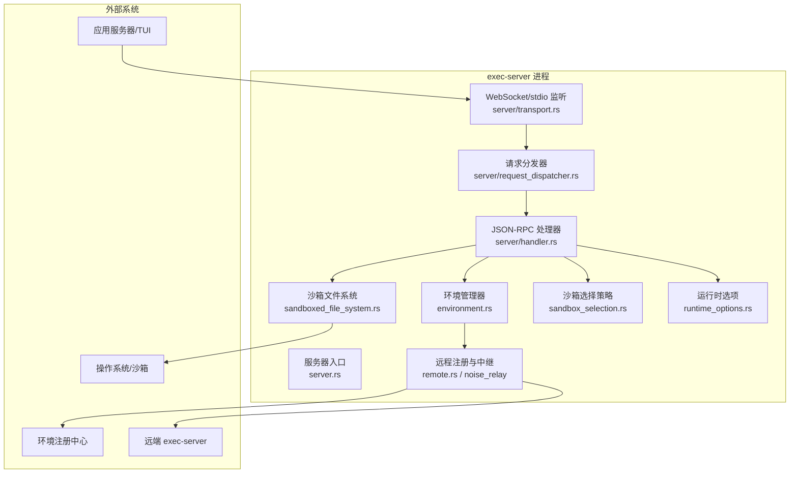
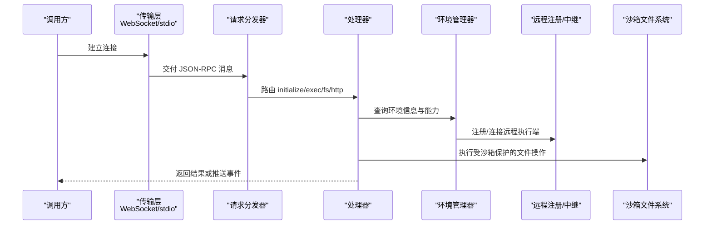
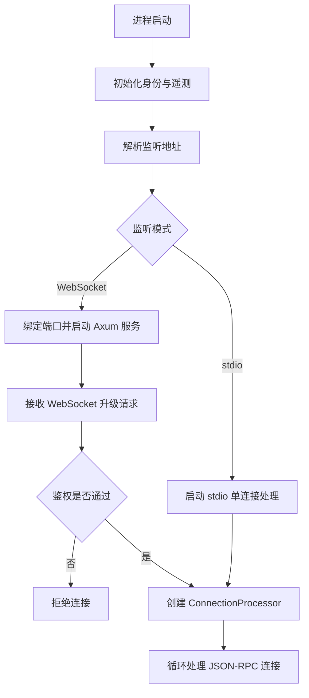
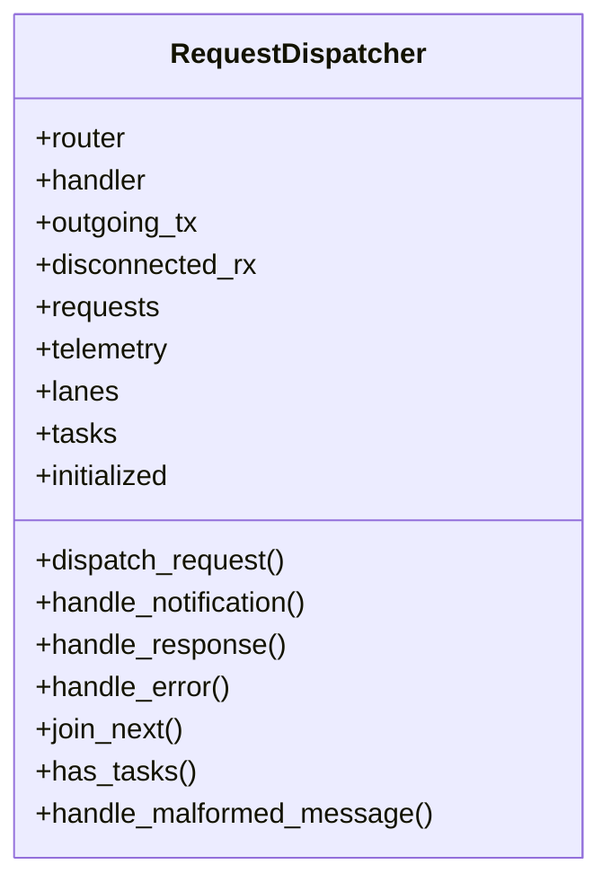
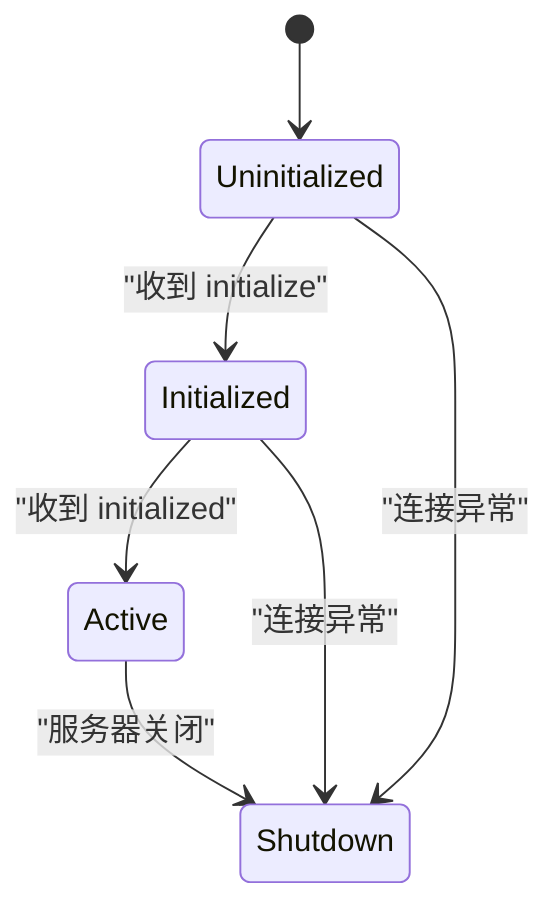
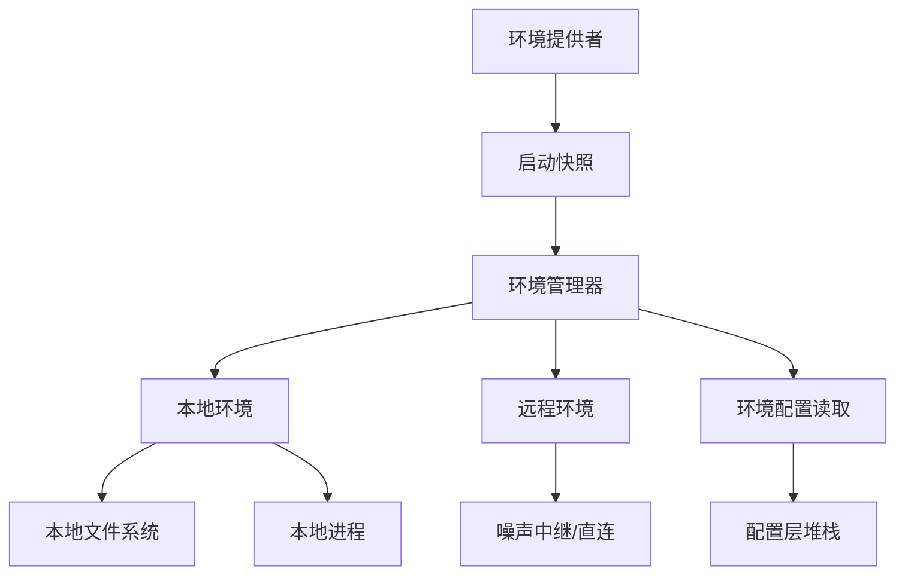
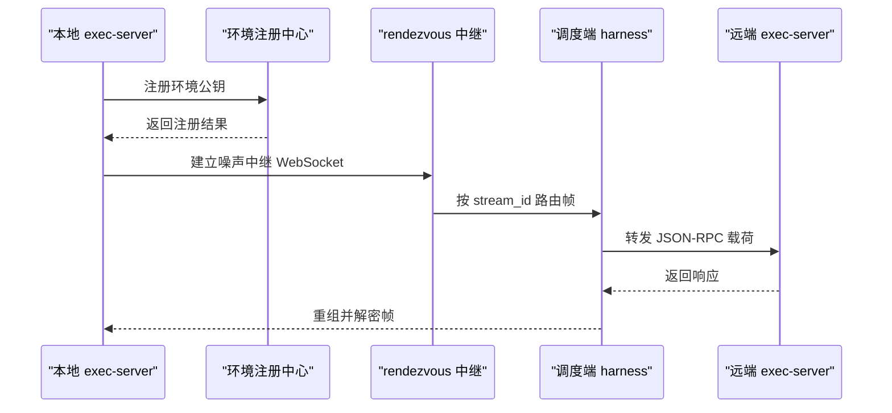
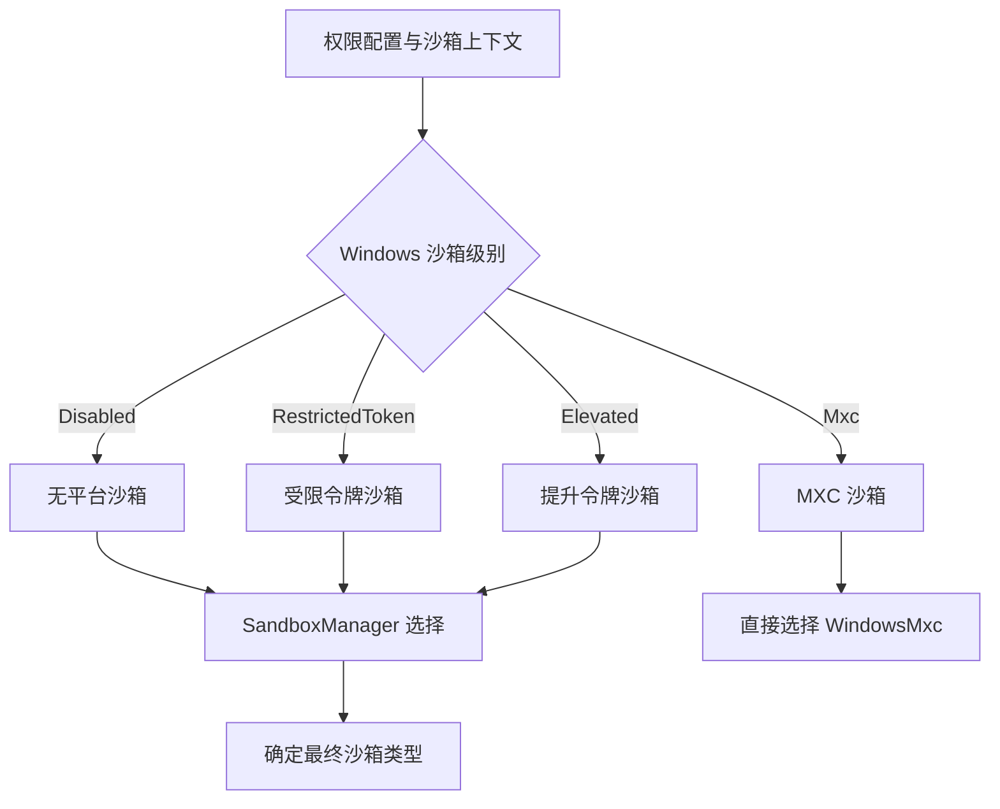
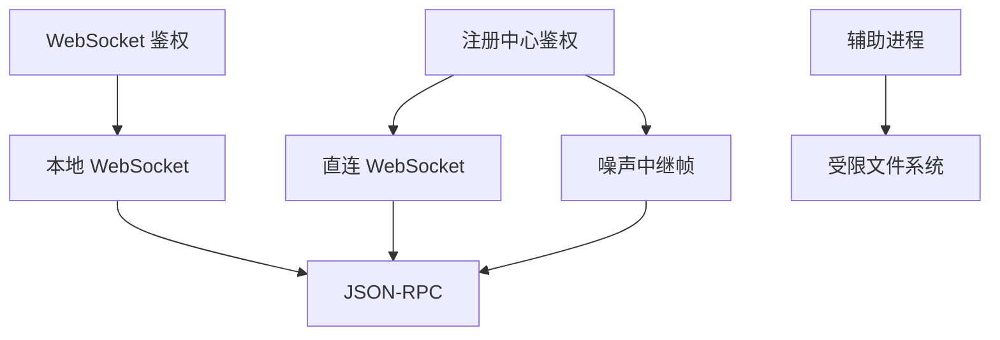
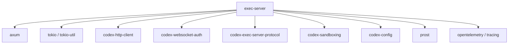

# 架构设计

<cite>
**本文引用的文件**   
- [exec-server/README.md](file://codex-rs/exec-server/README.md)
- [Cargo.toml](file://codex-rs/exec-server/Cargo.toml)
- [lib.rs](file://codex-rs/exec-server/src/lib.rs)
- [server.rs](file://codex-rs/exec-server/src/server.rs)
- [transport.rs](file://codex-rs/exec-server/src/server/transport.rs)
- [request_dispatcher.rs](file://codex-rs/exec-server/src/server/request_dispatcher.rs)
- [handler.rs](file://codex-rs/exec-server/src/server/handler.rs)
- [environment_bootstrap.rs](file://codex-rs/exec-server/src/environment_bootstrap.rs)
- [environment_provider.rs](file://codex-rs/exec-server/src/environment_provider.rs)
- [environment.rs](file://codex-rs/exec-server/src/environment.rs)
- [remote.rs](file://codex-rs/exec-server/src/remote.rs)
- [forward.rs](file://codex-rs/exec-server/src/forward.rs)
- [noise_relay/mod.rs](file://codex-rs/exec-server/src/noise_relay/mod.rs)
- [sandbox_selection.rs](file://codex-rs/exec-server/src/sandbox_selection.rs)
- [sandboxed_file_system.rs](file://codex-rs/exec-server/src/sandboxed_file_system.rs)
- [runtime_options.rs](file://codex-rs/exec-server/src/runtime_options.rs)
- [environment_config.rs](file://codex-rs/exec-server/src/environment_config.rs)
</cite>

## 目录
1. [引言](#引言)
2. [项目结构](#项目结构)
3. [核心组件](#核心组件)
4. [架构总览](#架构总览)
5. [详细组件分析](#详细组件分析)
6. [依赖关系分析](#依赖关系分析)
7. [性能与并发特性](#性能与并发特性)
8. [故障排查指南](#故障排查指南)
9. [结论](#结论)
10. [附录：配置与启动示例](#附录配置与启动示例)

## 引言
exec-server 是 Codex 执行侧的独立 Rust 服务，负责以进程级隔离的方式执行子任务、访问沙箱文件系统、发现能力根，并通过 JSON-RPC 与上层应用服务器交互。它同时支持本地运行和远程注册模式：本地模式下直接监听 WebSocket 或 stdio；远程模式下通过噪声中继或直连协议向环境注册中心注册自身，再由调度端建立加密流通道转发 RPC。

该文档面向需要理解 exec-server 整体架构、通信协议、能力发现、沙箱选择、远程执行与安全隔离的读者，从高层到代码层逐步展开，并给出架构图、流程图与配置建议。

## 项目结构
exec-server 仓库位于 `codex-rs/exec-server`，其源码按职责划分为若干目录：

- `src/server`：HTTP/WebSocket 监听、连接处理器、请求分发器、会话注册表、文件系统与进程处理器。
- `src/remote`：远程注册、认证、重连退避、直连传输与连接诊断。
- `src/noise_relay`：噪声中继帧格式、消息分片、有序密文与流处理。
- `src/environment*`：环境管理、提供者、快照、TOML 配置读取与环境信息。
- `src/discoverV2`：v2 能力发现管理器与位置候选。
- `src/client*`：客户端 API、HTTP 客户端、遥测与入站请求限流。
- `src/*fs*`、`process_sandbox.rs`、`sandboxed_file_system.rs`：受沙箱保护的文件系统访问与路径规范化。
- `sandbox_integrity`：平台完整性校验与辅助程序。
- `proto`：gRPC/Relay 消息的 protobuf 定义。

**图表来源**
- [server.rs:1-119](file://codex-rs/exec-server/src/server.rs#L1-L119)
- [transport.rs:1-274](file://codex-rs/exec-server/src/server/transport.rs#L1-L274)
- [request_dispatcher.rs:1-200](file://codex-rs/exec-server/src/server/request_dispatcher.rs#L1-L200)
- [handler.rs:1-200](file://codex-rs/exec-server/src/server/handler.rs#L1-L200)
- [environment.rs:1-200](file://codex-rs/exec-server/src/environment.rs#L1-L200)
- [remote.rs:1-200](file://codex-rs/exec-server/src/remote.rs#L1-L200)
- [sandboxed_file_system.rs:1-200](file://codex-rs/exec-server/src/sandboxed_file_system.rs#L1-L200)
- [sandbox_selection.rs:1-46](file://codex-rs/exec-server/src/sandbox_selection.rs#L1-L46)
- [runtime_options.rs:1-82](file://codex-rs/exec-server/src/runtime_options.rs#L1-L82)

**章节来源**
- [exec-server/README.md:1-200](file://codex-rs/exec-server/README.md#L1-L200)
- [Cargo.toml:1-115](file://codex-rs/exec-server/Cargo.toml#L1-L115)

## 核心组件
- **服务器入口与遥测封装**：`server.rs` 提供 `run_main` 与带遥测的 `run_main_with_telemetry`，统一初始化身份并提供根 span。
- **传输层**：`server/transport.rs` 解析监听地址（WebSocket 或 stdio），启动 Axum 路由、可选鉴权中间件，并将升级后的连接交给 `ConnectionProcessor`。
- **请求分发器**：`server/request_dispatcher.rs` 实现 JSON-RPC 路由、通知处理、响应完成回调、并发控制与错误回送。
- **处理器与会话**：`server/handler.rs` 维护会话生命周期、初始化阶段、执行调用、文件系统与 HTTP 代理、能力发现与遥测注册。
- **环境与提供者**：`environment_provider.rs` 暴露环境启动快照；`environment.rs` 组合本地/远程环境、状态观察与能力发现；`environment_bootstrap.rs` 将噪声中继配置或快照转换为可构建的管理器。
- **远程执行**：`remote.rs` 负责注册、重连、噪声中继与直连传输；`forward.rs` 将已认证中继流转发给独立目的端 exec-server；`noise_relay/mod.rs` 定义 WebSocket 限制与序列号约束。
- **沙箱与文件系统**：`sandbox_selection.rs` 根据权限配置与上下文选择沙箱类型；`sandboxed_file_system.rs` 通过辅助进程在受限环境中执行能力发现、路径规范化和文件操作。
- **运行时选项**：`runtime_options.rs` 固化可信启动路径、PID 命名空间策略、代理私有 IP 转发与 MXC 偏好。

**章节来源**
- [server.rs:1-119](file://codex-rs/exec-server/src/server.rs#L1-L119)
- [transport.rs:1-274](file://codex-rs/exec-server/src/server/transport.rs#L1-L274)
- [request_dispatcher.rs:1-200](file://codex-rs/exec-server/src/server/request_dispatcher.rs#L1-L200)
- [handler.rs:1-200](file://codex-rs/exec-server/src/server/handler.rs#L1-L200)
- [environment_provider.rs:1-200](file://codex-rs/exec-server/src/environment_provider.rs#L1-L200)
- [environment_bootstrap.rs:1-66](file://codex-rs/exec-server/src/environment_bootstrap.rs#L1-L66)
- [environment.rs:1-200](file://codex-rs/exec-server/src/environment.rs#L1-L200)
- [remote.rs:1-200](file://codex-rs/exec-server/src/remote.rs#L1-L200)
- [forward.rs:1-195](file://codex-rs/exec-server/src/forward.rs#L1-L195)
- [noise_relay/mod.rs:1-35](file://codex-rs/exec-server/src/noise_relay/mod.rs#L1-L35)
- [sandbox_selection.rs:1-46](file://codex-rs/exec-server/src/sandbox_selection.rs#L1-L46)
- [sandboxed_file_system.rs:1-200](file://codex-rs/exec-server/src/sandboxed_file_system.rs#L1-L200)
- [runtime_options.rs:1-82](file://codex-rs/exec-server/src/runtime_options.rs#L1-L82)

## 架构总览
exec-server 的整体运行分为三条主线：

1. **本地服务模式**：解析监听地址，启动 WebSocket 或 stdio 监听；每个连接进入 `ConnectionProcessor`，再经分发器路由到处理器；处理器通过环境管理器获取本地或远程执行能力。
2. **远程注册模式**：生成噪声公钥并向注册中心登记，获得 rendezvous 分配；随后建立噪声中继或直连 WebSocket，按 stream_id 复用多个虚拟会话。
3. **能力发现与配置读取**：通过 v1/v2 能力发现接口和环境配置读取接口，聚合插件、技能、MCP 服务器等扩展点。

**图表来源**
- [transport.rs:1-274](file://codex-rs/exec-server/src/server/transport.rs#L1-L274)
- [request_dispatcher.rs:1-200](file://codex-rs/exec-server/src/server/request_dispatcher.rs#L1-L200)
- [handler.rs:1-200](file://codex-rs/exec-server/src/server/handler.rs#L1-L200)
- [environment.rs:1-200](file://codex-rs/exec-server/src/environment.rs#L1-L200)
- [remote.rs:1-200](file://codex-rs/exec-server/src/remote.rs#L1-L200)
- [sandboxed_file_system.rs:1-200](file://codex-rs/exec-server/src/sandboxed_file_system.rs#L1-L200)

## 详细组件分析

### 主服务器启动流程
服务器入口封装了身份初始化与传输层启动。默认监听地址为本地 WebSocket，也可配置为 stdio。WebSocket 监听使用 Axum 提供 `/readyz` 就绪端点和通用 WebSocket 升级端点，并在升级前执行可选鉴权。

**图表来源**
- [server.rs:1-119](file://codex-rs/exec-server/src/server.rs#L1-L119)
- [transport.rs:1-274](file://codex-rs/exec-server/src/server/transport.rs#L1-L274)

**章节来源**
- [server.rs:1-119](file://codex-rs/exec-server/src/server.rs#L1-L119)
- [transport.rs:1-274](file://codex-rs/exec-server/src/server/transport.rs#L1-L274)

### 请求分发机制
请求分发器维护 JSON-RPC 路由器、出站消息通道、断开观察器和任务集合。它支持两种分发模式：内联模式和并发模式。并发模式下通过信号量限制普通请求与控制请求的并行度。未识别的方法会返回“尚未实现”的错误；未知通知会关闭连接；请求完成后通过请求 ID 完成等待者。

**图表来源**
- [request_dispatcher.rs:1-200](file://codex-rs/exec-server/src/server/request_dispatcher.rs#L1-L200)

**章节来源**
- [request_dispatcher.rs:1-200](file://codex-rs/exec-server/src/server/request_dispatcher.rs#L1-L200)

### 处理器与会话生命周期
处理器维护会话注册表、能力管理器、通知发送器、文件系统处理器、HTTP 客户端和初始化状态。典型生命周期如下：

1. 客户端发送 `initialize`，处理器附加会话并返回 `session_id` 和本地环境信息。
2. 客户端发送 `initialized` 通知，处理器标记连接已初始化。
3. 后续 `exec`、文件系统、HTTP 代理等方法在会话已初始化且附加的状态下执行。
4. 服务端主动关闭时，取消后台任务、等待结束、关闭文件系统处理器并分离会话。

**图表来源**
- [handler.rs:1-200](file://codex-rs/exec-server/src/server/handler.rs#L1-L200)

**章节来源**
- [handler.rs:1-200](file://codex-rs/exec-server/src/server/handler.rs#L1-L200)

### 环境与能力发现
环境管理器提供本地与远程环境的统一视图。默认提供者基于环境变量或 `CODEX_EXEC_SERVER_URL` 生成快照；当存在远程环境时，默认环境设为远程，否则默认为本地。管理器还支持从 `environments.toml` 准备环境，以及观察连接状态而不触发连接。

能力发现通过 v1 与 v2 两个版本：

- v1：通过协议中的能力根发现方法列出插件与技能文件。
- v2：由 `discoverV2` 模块管理能力位置候选、能力发现缓存与观察者。

环境配置读取则基于 `environment_config.rs`，加载 `config.toml` 及需求层，并按当前工作目录与主机名投影，最终返回合并后的配置层堆栈。

**图表来源**
- [environment_provider.rs:1-200](file://codex-rs/exec-server/src/environment_provider.rs#L1-L200)
- [environment.rs:1-200](file://codex-rs/exec-server/src/environment.rs#L1-L200)
- [environment_config.rs:1-200](file://codex-rs/exec-server/src/environment_config.rs#L1-L200)

**章节来源**
- [environment_provider.rs:1-200](file://codex-rs/exec-server/src/environment_provider.rs#L1-L200)
- [environment.rs:1-200](file://codex-rs/exec-server/src/environment.rs#L1-L200)
- [environment_bootstrap.rs:1-66](file://codex-rs/exec-server/src/environment_bootstrap.rs#L1-L66)
- [environment_config.rs:1-200](file://codex-rs/exec-server/src/environment_config.rs#L1-L200)

### 远程执行与中继
远程模式的核心是注册与中继：

- 注册：向环境注册中心提交安全配置文件与执行器公钥，取得注册标识与连接参数。
- 中继：通过噪声中继协议将 JSON-RPC 消息封装为二进制帧，按 stream_id 多路复用，并使用序号、确认位集进行可靠性保障。
- 直连：可选直连传输，使用 AWS SigV4 签名或通过 Agent Identity JWT 进行注册与握手。
- 转发：forwarder 对已认证的中继流建立独立 WebSocket 连接，不解析 RPC，仅透传载荷。

**图表来源**
- [remote.rs:1-200](file://codex-rs/exec-server/src/remote.rs#L1-L200)
- [noise_relay/mod.rs:1-35](file://codex-rs/exec-server/src/noise_relay/mod.rs#L1-L35)
- [forward.rs:1-195](file://codex-rs/exec-server/src/forward.rs#L1-L195)
- [exec-server/README.md:1-200](file://codex-rs/exec-server/README.md#L1-L200)

**章节来源**
- [remote.rs:1-200](file://codex-rs/exec-server/src/remote.rs#L1-L200)
- [forward.rs:1-195](file://codex-rs/exec-server/src/forward.rs#L1-L195)
- [noise_relay/mod.rs:1-35](file://codex-rs/exec-server/src/noise_relay/mod.rs#L1-L35)
- [exec-server/README.md:1-200](file://codex-rs/exec-server/README.md#L1-L200)

### 沙箱选择与隔离
沙箱选择策略依据权限配置、Windows 沙箱级别与是否有托管网络需求决定初始沙箱类型：

- 禁用：不使用平台沙箱。
- 受限令牌或提升令牌：选择 Windows 受限令牌沙箱。
- MXC：直接选择 Windows MXC 沙箱，前提是远端执行器支持该能力。
- Linux/macOS：通过 `SandboxManager` 选择更合适的平台沙箱类型。

文件系统访问通过 `SandboxedFileSystem` 在受限辅助进程中执行，避免执行器进程直接读写宿主敏感路径。

**图表来源**
- [sandbox_selection.rs:1-46](file://codex-rs/exec-server/src/sandbox_selection.rs#L1-L46)
- [sandboxed_file_system.rs:1-200](file://codex-rs/exec-server/src/sandboxed_file_system.rs#L1-L200)

**章节来源**
- [sandbox_selection.rs:1-46](file://codex-rs/exec-server/src/sandbox_selection.rs#L1-L46)
- [sandboxed_file_system.rs:1-200](file://codex-rs/exec-server/src/sandboxed_file_system.rs#L1-L200)

### 进程间通信与安全隔离
exec-server 作为独立进程，主要使用以下通信方式：

- **WebSocket JSON-RPC**：本地监听与远程直连模式使用文本或二进制 WebSocket 消息承载 JSON-RPC。
- **噪声中继二进制帧**：远程模式使用噪声中继协议，消息被分片、编号、确认并重试，确保跨 rendezvous 的可靠传输。
- **辅助进程**：文件系统操作、能力发现、平台完整性检查通过辅助进程执行，以减少执行器进程的权限面。
- **鉴权**：WebSocket 升级时可启用基于令牌的鉴权；远程注册支持多种认证模式，包括代理凭据、ChatGPT 令牌与 Agent Identity。

**图表来源**
- [transport.rs:1-274](file://codex-rs/exec-server/src/server/transport.rs#L1-L274)
- [remote.rs:1-200](file://codex-rs/exec-server/src/remote.rs#L1-L200)
- [noise_relay/mod.rs:1-35](file://codex-rs/exec-server/src/noise_relay/mod.rs#L1-L35)
- [sandboxed_file_system.rs:1-200](file://codex-rs/exec-server/src/sandboxed_file_system.rs#L1-L200)

**章节来源**
- [transport.rs:1-274](file://codex-rs/exec-server/src/server/transport.rs#L1-L274)
- [remote.rs:1-200](file://codex-rs/exec-server/src/remote.rs#L1-L200)
- [noise_relay/mod.rs:1-35](file://codex-rs/exec-server/src/noise_relay/mod.rs#L1-L35)
- [sandboxed_file_system.rs:1-200](file://codex-rs/exec-server/src/sandboxed_file_system.rs#L1-L200)

### 监控指标与遥测
服务器入口提供带 OpenTelemetry 的根 span，名称固定为内部 span。请求分发器记录请求队列耗时、方法名与延迟偏移；远程注册完成时会统计成功/失败与耗时；连接生命周期通过遥测对象跟踪连接类型与指标。

**章节来源**
- [server.rs:1-119](file://codex-rs/exec-server/src/server.rs#L1-L119)
- [request_dispatcher.rs:1-200](file://codex-rs/exec-server/src/server/request_dispatcher.rs#L1-L200)
- [remote.rs:1-200](file://codex-rs/exec-server/src/remote.rs#L1-L200)

## 依赖关系分析
exec-server 的主要依赖包括：

- **Axum**：WebSocket 与 HTTP 路由。
- **tokio/tokio-util**：异步运行时、任务与 I/O。
- **codex-http-client**：HTTP 客户端工厂与路由感知客户端池。
- **codex-websocket-auth**：WebSocket 升级鉴权。
- **codex-exec-server-protocol**：JSON-RPC 消息与协议类型。
- **codex-sandboxing**：平台沙箱管理与类型选择。
- **codex-config**：配置层加载与 TOML 合并。
- **prost**：protobuf 解码用于噪声中继帧。
- **opentelemetry/tracing**：分布式追踪与日志。

**图表来源**
- [Cargo.toml:1-115](file://codex-rs/exec-server/Cargo.toml#L1-L115)

**章节来源**
- [Cargo.toml:1-115](file://codex-rs/exec-server/Cargo.toml#L1-L115)

## 性能与并发特性
- **WebSocket 分片**：forwarder 将大消息拆分为不超过 8 MiB 的 WebSocket frame，避免超出远端限制。
- **噪声中继消息大小**：噪声中继 WebSocket 的最大消息与帧大小限制为 256 KiB，防止内存膨胀。
- **请求并发控制**：分发器支持并发请求上限，普通请求与控制请求分别限速。
- **任务清理**：处理器关闭时等待后台任务结束，避免泄漏。
- **只读优化**：本地文件系统在多处使用只读模式减少写入风险。

**章节来源**
- [forward.rs:1-195](file://codex-rs/exec-server/src/forward.rs#L1-L195)
- [noise_relay/mod.rs:1-35](file://codex-rs/exec-server/src/noise_relay/mod.rs#L1-L35)
- [request_dispatcher.rs:1-200](file://codex-rs/exec-server/src/server/request_dispatcher.rs#L1-L200)
- [handler.rs:1-200](file://codex-rs/exec-server/src/server/handler.rs#L1-L200)

## 故障排查指南
常见问题与定位要点：

- **WebSocket 连接被拒绝**：检查是否携带 `Origin` 头，exec-server 会拒绝带 Origin 的请求；确认鉴权设置是否正确。
- **远程注册失败**：检查注册 URL、认证凭据、AWS SigV4 参数或 Agent Identity 配置；关注 409 冲突与 4xx 非重试错误的区别。
- **中继断连**：检查 rendezvous 分配的 stream_id、ack 与 seq 是否连续；确认两端都实现了分段重组与重复抑制。
- **能力发现超时**：检查 executor-local 配置加载是否成功，MCP 服务器是否满足需求条件。
- **沙箱无法打开文件**：确认路径是否为原生路径，平台沙箱是否可用，辅助进程是否正常退出。

**章节来源**
- [transport.rs:1-274](file://codex-rs/exec-server/src/server/transport.rs#L1-L274)
- [remote.rs:1-200](file://codex-rs/exec-server/src/remote.rs#L1-L200)
- [environment_config.rs:1-200](file://codex-rs/exec-server/src/environment_config.rs#L1-L200)
- [sandboxed_file_system.rs:1-200](file://codex-rs/exec-server/src/sandboxed_file_system.rs#L1-L200)

## 结论
exec-server 采用清晰的层次化架构：传输层负责 WebSocket/stdio 接入，请求分发层负责 JSON-RPC 路由与并发控制，处理器负责会话与业务逻辑，环境管理器抽象本地与远程执行后端，远程模块负责注册、中继与重连，沙箱模块保证文件系统和进程的安全隔离。通过能力发现与环境配置读取，exec-server 能够动态扩展工具链与 MCP 能力，并以遥测和指标支撑生产运维。

## 附录：配置与启动示例

### 启动参数与监听地址
- **WebSocket 监听**：`ws://IP:PORT`，例如 `ws://127.0.0.1:0`。
- **stdio 模式**：`stdio`，适合管道式集成。
- **远程模式**：`--remote URL --environment-id ID [--name NAME]`。
- **转发模式**：`forward --connect ws://HOST:PORT --remote URL --environment-id ID`。

**章节来源**
- [exec-server/README.md:1-200](file://codex-rs/exec-server/README.md#L1-L200)

### 环境变量
- `CODEX_EXEC_SERVER_URL`：指定远程执行器 URL，设置为 `none` 可禁用环境访问。
- `CODEX_EXEC_SERVER_NOISE_REGISTRY_URL`：噪声中继注册中心 URL。
- `CODEX_EXEC_SERVER_NOISE_ENVIRONMENT_ID`：噪声中继环境 ID。
- `CODEX_EXEC_SERVER_NOISE_CHATGPT_ACCOUNT_ID`：ChatGPT 账户标识。
- `CODEX_EXEC_SERVER_EXIT_ON_STDIN_CLOSE`：stdin 关闭时退出 exec-server。

**章节来源**
- [lib.rs:1-200](file://codex-rs/exec-server/src/lib.rs#L1-L200)
- [environment.rs:1-200](file://codex-rs/exec-server/src/environment.rs#L1-L200)

### 远程注册与认证
- 使用 `--registration-bearer-stdin` 一次性写入注册凭据。
- 使用 `--executor-credential-stdin` 轮换执行器凭据。
- 使用 `CODEX_API_KEY` 作为注册请求的 Bearer Token。
- AWS 场景：`--aws-sigv4 --aws-profile PROFILE --aws-region REGION --aws-service SERVICE`。
- Agent Identity：`--use-agent-identity-auth`，从 `CODEX_ACCESS_TOKEN` 派生请求头。

**章节来源**
- [exec-server/README.md:1-200](file://codex-rs/exec-server/README.md#L1-L200)
- [remote.rs:1-200](file://codex-rs/exec-server/src/remote.rs#L1-L200)

### 资源限制与安全建议
- 使用 TLS/WSS 暴露远程连接。
- 启用 WebSocket 升级鉴权，避免匿名访问。
- 限制最大消息与帧大小，避免内存滥用。
- 通过沙箱选择策略禁止不受信任的沙箱级别。
- 使用可信启动路径，避免请求配置改变 PID 隔离策略。

**章节来源**
- [noise_relay/mod.rs:1-35](file://codex-rs/exec-server/src/noise_relay/mod.rs#L1-L35)
- [sandbox_selection.rs:1-46](file://codex-rs/exec-server/src/sandbox_selection.rs#L1-L46)
- [runtime_options.rs:1-82](file://codex-rs/exec-server/src/runtime_options.rs#L1-L82)