# 环境管理

<cite>
**本文引用的文件**   
- [exec-server README](file://codex-rs/exec-server/README.md)
- [Cargo.toml](file://codex-rs/exec-server/Cargo.toml)
- [lib.rs](file://codex-rs/exec-server/src/lib.rs)
- [environment.rs](file://codex-rs/exec-server/src/environment.rs)
- [environment_bootstrap.rs](file://codex-rs/exec-server/src/environment_bootstrap.rs)
- [environment_provider.rs](file://codex-rs/exec-server/src/environment_provider.rs)
- [environment_toml.rs](file://codex-rs/exec-server/src/environment_toml.rs)
- [connect_options.rs](file://codex-rs/exec-server/src/environment/connect_options.rs)
- [discovery_v2.rs](file://codex-rs/exec-server/src/environment/discovery_v2.rs)
- [environment_config.rs](file://codex-rs/exec-server/src/environment_config.rs)
- [runtime_options.rs](file://codex-rs/exec-server/src/runtime_options.rs)
- [server/handler.rs](file://codex-rs/exec-server/src/server/handler.rs)
- [environment_registry.rs](file://codex-rs/exec-server/src/environment_registry.rs)
</cite>

## 目录
1. [引言](#引言)
2. [项目结构](#项目结构)
3. [核心组件](#核心组件)
4. [架构总览](#架构总览)
5. [详细组件分析](#详细组件分析)
6. [依赖关系分析](#依赖关系分析)
7. [性能与行为特性](#性能与行为特性)
8. [安全与隔离](#安全与隔离)
9. [配置示例与最佳实践](#配置示例与最佳实践)
10. [故障排除指南](#故障排除指南)
11. [结论](#结论)

## 引言
本文件面向执行服务器的环境管理系统，聚焦以下目标：
- 解释环境配置的加载、解析和校验流程。
- 说明环境变量注入、运行时选项管理与多环境选择机制。
- 梳理从启动到连接的环境引导流程、远程注册与会话初始化。
- 描述环境切换、能力发现、配置读取以及错误恢复策略。
- 给出可操作的配置模板、安全约束与性能优化建议，并提供排错路径。

该系统由 `codex-exec-server` 提供，既可作为库被上层集成，也暴露 `codex exec-server` 与独立 `codex-exec-server` 二进制。它负责传输、协议、文件系统与进程处理器，并通过本地或远程后端抽象出统一的执行与文件访问接口。

**章节来源**
- [exec-server README:1-200](file://codex-rs/exec-server/README.md#L1-L200)

## 项目结构
执行服务器相关的环境管理代码集中在 `codex-rs/exec-server/src` 下，与环境相关的核心模块如下：
- `environment.rs`：环境管理器、环境实体、连接状态、能力发现入口。
- `environment_bootstrap.rs`：在确定默认环境后构建管理器，区分噪声（Noise）远程模式与快照模式。
- `environment_provider.rs`：提供者抽象与默认实现，基于 `CODEX_EXEC_SERVER_URL` 生成启动快照。
- `environment_toml.rs`：从 `environments.toml` 解析多个环境条目、校验并生成快照。
- `environment/connect_options.rs`：远程 WebSocket 连接选项与头部白名单校验。
- `environment/discovery_v2.rs`：V2 能力发现版本判断与调用封装。
- `environment_config.rs`：通过远端会话读取 executor-local 的 MCP 配置与需求层。
- `runtime_options.rs`：执行器本地可信启动路径与安全选项。
- `server/handler.rs`：RPC 处理入口，包含初始化、会话附加、执行等生命周期控制。
- `environment_registry.rs`：与外部环境注册表交互的请求响应模型。

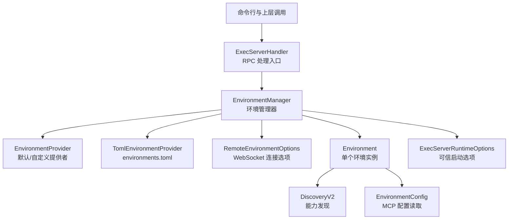

**图示来源**
- [server/handler.rs:1-120](file://codex-rs/exec-server/src/server/handler.rs#L1-L120)
- [environment.rs:1-120](file://codex-rs/exec-server/src/environment.rs#L1-L120)
- [environment_provider.rs:1-120](file://codex-rs/exec-server/src/environment_provider.rs#L1-L120)
- [environment_toml.rs:1-120](file://codex-rs/exec-server/src/environment_toml.rs#L1-L120)
- [connect_options.rs:1-116](file://codex-rs/exec-server/src/environment/connect_options.rs#L1-L116)
- [discovery_v2.rs:1-62](file://codex-rs/exec-server/src/environment/discovery_v2.rs#L1-L62)
- [environment_config.rs:1-120](file://codex-rs/exec-server/src/environment_config.rs#L1-L120)
- [runtime_options.rs:1-82](file://codex-rs/exec-server/src/runtime_options.rs#L1-L82)

**章节来源**
- [Cargo.toml:1-115](file://codex-rs/exec-server/Cargo.toml#L1-L115)

## 核心组件
- 环境管理器 `EnvironmentManager`：维护默认环境、本地环境与远程环境的注册表，协调 HTTP 客户端工厂、本地运行路径和环境对象。
- 环境提供者 `EnvironmentProvider`：返回启动快照，决定可用环境列表、默认环境和是否包含本地环境。
- TOML 环境提供者：从 `CODEx_HOME/environments.toml` 解析环境条目，支持 URL、程序+参数、环境变量和工作目录。
- 远程连接选项 `RemoteEnvironmentOptions`：对 WebSocket URL、超时与请求头进行严格校验，确保敏感头不被篡改。
- 环境实例 `Environment`：封装本地或远程执行/文件后端，暴露能力发现、配置读取、状态查询等方法。
- 预准备管理器 `PreparedEnvironmentManager`：在决定默认环境后再构造管理器，避免过早建立远程连接。
- 运行时选项 `ExecServerRuntimeOptions`：保存可信启动路径、Linux PID 命名空间策略、代理私有 IP 路由和沙箱偏好。
- RPC 处理器 `ExecServerHandler`：统一处理初始化、会话附加、执行、文件操作等请求，串联环境管理与后端。

**章节来源**
- [environment.rs:1-200](file://codex-rs/exec-server/src/environment.rs#L1-L200)
- [environment_provider.rs:1-200](file://codex-rs/exec-server/src/environment_provider.rs#L1-L200)
- [environment_toml.rs:1-200](file://codex-rs/exec-server/src/environment_toml.rs#L1-L200)
- [connect_options.rs:1-116](file://codex-rs/exec-server/src/environment/connect_options.rs#L1-L116)
- [environment_bootstrap.rs:1-66](file://codex-rs/exec-server/src/environment_bootstrap.rs#L1-L66)
- [runtime_options.rs:1-82](file://codex-rs/exec-server/src/runtime_options.rs#L1-L82)
- [server/handler.rs:1-120](file://codex-rs/exec-server/src/server/handler.rs#L1-L120)

## 架构总览
下图展示环境管理在整体生命周期中的位置：命令行或上层调用进入 RPC 处理器；处理器先完成初始化与会话附加，再通过环境管理器获取目标环境；环境管理器根据提供者快照决定是否使用本地环境或远程环境；远程环境通过连接选项建立 WebSocket，随后进行能力发现与配置读取。

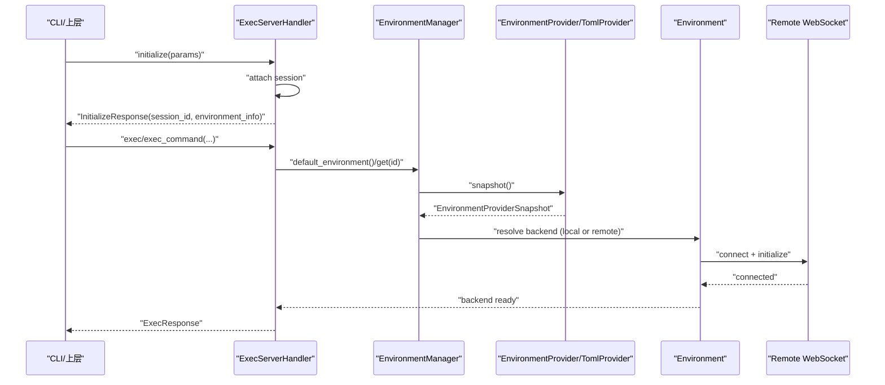

**图示来源**
- [server/handler.rs:80-200](file://codex-rs/exec-server/src/server/handler.rs#L80-L200)
- [environment.rs:120-250](file://codex-rs/exec-server/src/environment.rs#L120-L250)
- [environment_provider.rs:80-160](file://codex-rs/exec-server/src/environment_provider.rs#L80-L160)
- [environment_toml.rs:120-220](file://codex-rs/exec-server/src/environment_toml.rs#L120-L220)

## 详细组件分析

### 环境管理器与环境选择
- `EnvironmentManager` 持有默认环境 ID、本地环境引用、HTTP 客户端工厂和所有已注册环境。
- 默认构造函数保留 `CODEX_EXEC_SERVER_URL` 的历史行为；当设置为 `none` 时禁用环境访问。
- 管理器支持从提供者快照构建，从而先解析配置再决定是否需要远程连接。
- 环境状态包括已连接、恢复中、未连接三类，便于上层观察而不触发重连。

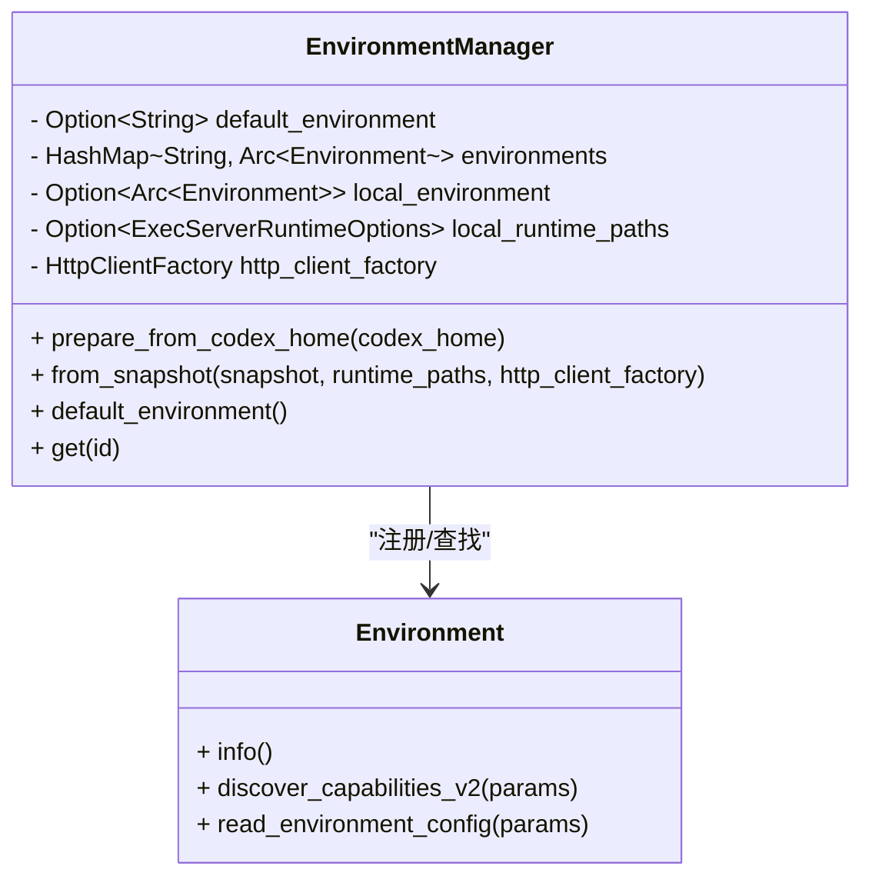

**图示来源**
- [environment.rs:1-200](file://codex-rs/exec-server/src/environment.rs#L1-L200)

**章节来源**
- [environment.rs:1-200](file://codex-rs/exec-server/src/environment.rs#L1-L200)

### 环境提供者与快照
- `EnvironmentProvider` 是抽象接口，返回异步快照 `EnvironmentProviderSnapshot`。
- 默认提供者 `DefaultEnvironmentProvider` 从 `CODEX_EXEC_SERVER_URL` 解析：
  - 空值或缺失：默认启用本地环境。
  - 值为 `none`：禁用环境访问且不包含本地环境。
  - 其他值：作为远程 WebSocket URL，默认选中远程环境。
- `normalize_exec_server_url` 将 `none`、空值和正常 URL 归一化。

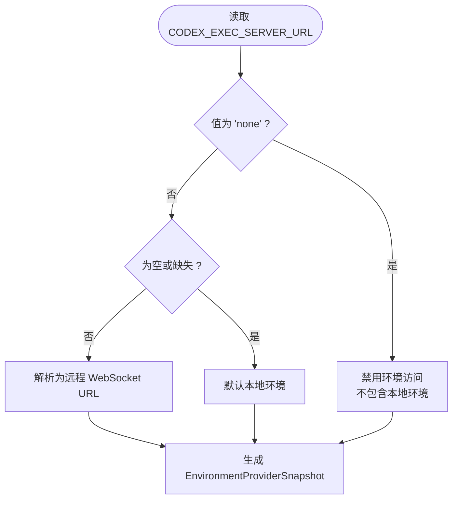

**图示来源**
- [environment_provider.rs:80-160](file://codex-rs/exec-server/src/environment_provider.rs#L80-L160)

**章节来源**
- [environment_provider.rs:1-200](file://codex-rs/exec-server/src/environment_provider.rs#L1-L200)

### TOML 多环境配置
`environments.toml` 支持以下字段：
- `default`：指定默认环境 ID。
- `include_local`：是否包含本地环境。
- `environments[]`：每个条目定义一个环境：
  - `id`：唯一标识。
  - `skills`：该环境的受限技能配置。
  - `url`：远程 WebSocket URL。
  - `auth_bearer_token`：Bearer 令牌，仅与 `url` 一起使用。
  - `program`、`args`、`env`、`cwd`：本地子进程模式的可执行程序与启动参数。
  - `connect_timeout_sec`、`initialize_timeout_sec`：连接与初始化超时。

关键校验规则：
- 重复 ID 报错。
- 若存在 `args`、`env`、`cwd`，则必须提供 `program`。
- `auth_bearer_token`、连接超时必须与 `url` 同时出现。
- 默认环境 ID 必须在可用环境中存在，且受 `include_local` 影响。

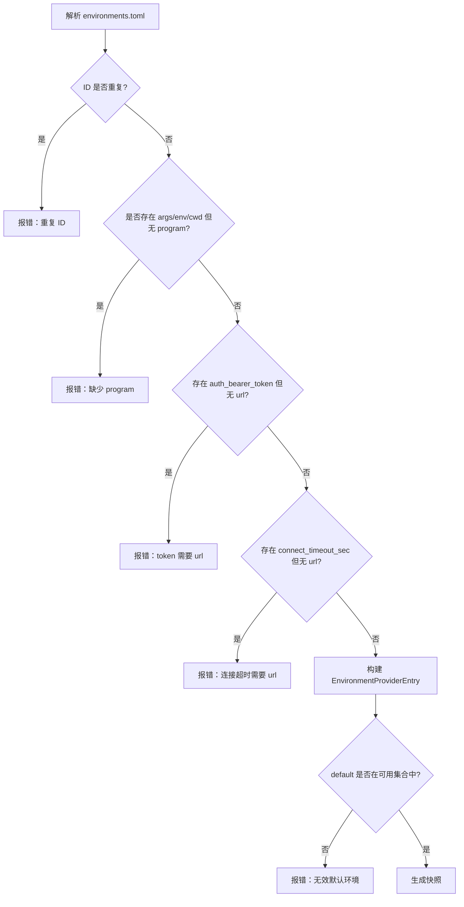

**图示来源**
- [environment_toml.rs:1-220](file://codex-rs/exec-server/src/environment_toml.rs#L1-L220)

**章节来源**
- [environment_toml.rs:1-200](file://codex-rs/exec-server/src/environment_toml.rs#L1-L200)

### 远程连接选项与安全
`RemoteEnvironmentOptions.into_transport_params()` 对 WebSocket 连接进行严格限制：
- 不允许使用“禁用”URL。
- 非回环地址必须使用 `wss://`。
- 禁止覆盖连接关键字段，如 `connection`、`content-length`、`host`、`transfer-encoding`、`upgrade` 及 `sec-websocket-*` 前缀。
- 重复头部、非法头部名或非法值都会报错。
- 所有自定义头部均标记为敏感。

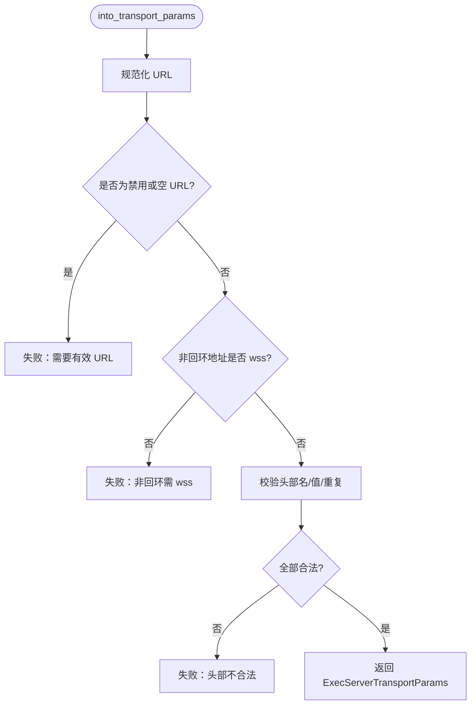

**图示来源**
- [connect_options.rs:1-116](file://codex-rs/exec-server/src/environment/connect_options.rs#L1-L116)

**章节来源**
- [connect_options.rs:1-116](file://codex-rs/exec-server/src/environment/connect_options.rs#L1-L116)

### 能力发现 V2
`Environment.discover_capabilities_v2`：
- 仅远程环境支持。
- 检查远端构建版本是否满足最低稳定版本。
- 若选择 MXC 沙箱，会验证远端能力是否允许。
- 封装重试与恢复逻辑，保持会话 ID 一致。

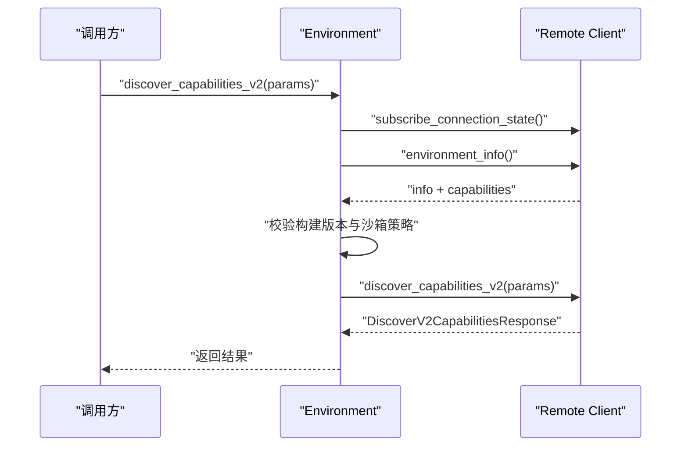

**图示来源**
- [discovery_v2.rs:1-62](file://codex-rs/exec-server/src/environment/discovery_v2.rs#L1-L62)

**章节来源**
- [discovery_v2.rs:1-62](file://codex-rs/exec-server/src/environment/discovery_v2.rs#L1-L62)

### 配置读取与 MCP 发现
`Environment.discover_http_mcp_servers`：
- 通过远端会话读取 executor-local 的 MCP 配置。
- 如果远端不支持 `environment_config_read` 能力，直接返回空列表。
- 读取配置层和需求层，按主机名合并需求，过滤掉不符合需求的服务器。
- 若远端未启用 `http_header_env_vars`，则移除需要 `bearer_token_env_var` 的配置项。

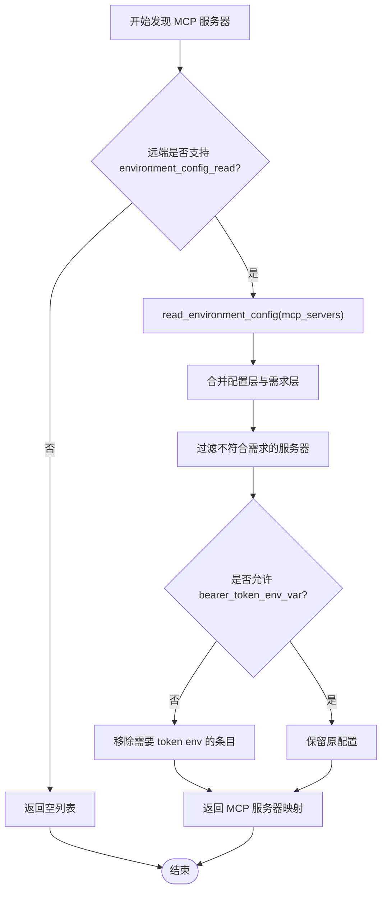

**图示来源**
- [environment_config.rs:60-160](file://codex-rs/exec-server/src/environment_config.rs#L60-L160)

**章节来源**
- [environment_config.rs:1-200](file://codex-rs/exec-server/src/environment_config.rs#L1-L200)

### 运行时选项与可信启动
`ExecServerRuntimeOptions` 保存执行器创建时确定的可信路径与策略：
- `codex_self_exe`：用于隐藏辅助模式的稳定路径。
- `codex_linux_sandbox_exe`：Linux 沙箱重新进入时的别名路径。
- `linux_sandbox_pid_namespace`：PID 命名空间策略，不可由请求或仓库配置更改。
- `proxy_private_ips_via_upstream`：是否通过上游代理访问私有 IP。
- `prefer_mxc`：仅来自 CLI 标志的沙箱偏好。
- macOS 上可选 `allowed_symlinked_codex_home`：用户配置中对可写根符号链接的检查豁免。

这些选项在构建管理器或处理器时传入，后续执行与文件操作应遵循其约束。

**章节来源**
- [runtime_options.rs:1-82](file://codex-rs/exec-server/src/runtime_options.rs#L1-L82)

### 环境引导与初始化流程
引导流程分为两阶段：
1. 预准备阶段：通过噪声（Noise）远程配置或提供者快照确定默认环境，但不立即建立连接。
2. 构建阶段：根据出站 HTTP 策略构建 `EnvironmentManager`，并在需要时启动远程连接。

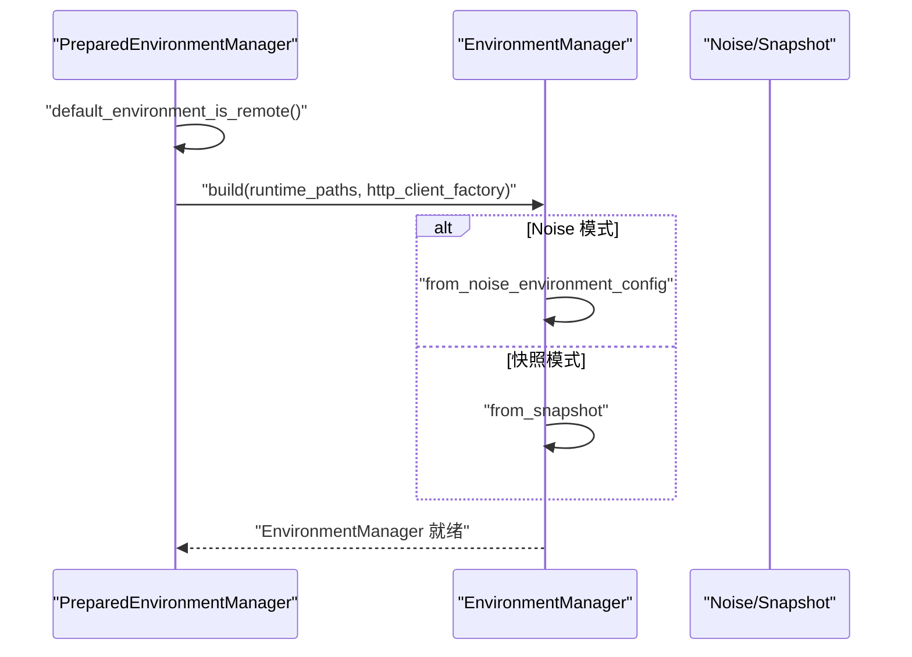

**图示来源**
- [environment_bootstrap.rs:1-66](file://codex-rs/exec-server/src/environment_bootstrap.rs#L1-L66)
- [environment.rs:180-260](file://codex-rs/exec-server/src/environment.rs#L180-L260)

**章节来源**
- [environment_bootstrap.rs:1-66](file://codex-rs/exec-server/src/environment_bootstrap.rs#L1-L66)

### RPC 初始化与会话
`ExecServerHandler.initialize`：
- 同一连接只允许一次 `initialize`。
- 通过 `SessionRegistry.attach` 附加会话，携带运行时路径。
- 成功后设置当前会话并返回 `session_id` 与 `environment_info`。
- `initialized` 通知必须在 `initialize` 之后发送，否则报错。

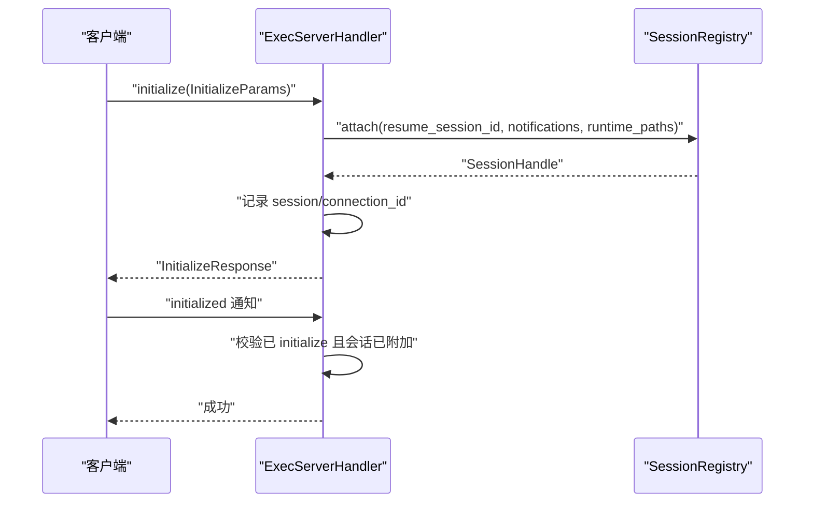

**图示来源**
- [server/handler.rs:120-220](file://codex-rs/exec-server/src/server/handler.rs#L120-L220)

**章节来源**
- [server/handler.rs:1-220](file://codex-rs/exec-server/src/server/handler.rs#L1-L220)

### 环境注册表契约
`environment_registry.rs` 定义了与外部环境注册表交互的数据结构：
- 执行器注册请求与响应，包含安全档案、公钥、环境 ID、URL 和注册 ID。
- 连接器密钥授权与验证请求/响应。
- 响应中的 URL 和授权信息在调试输出中被脱敏。

**章节来源**
- [environment_registry.rs:1-68](file://codex-rs/exec-server/src/environment_registry.rs#L1-L68)

## 依赖关系分析
执行服务器的 Cargo 依赖表明环境管理涉及网络、配置、沙箱、遥测和工具链：
- 网络与传输：`axum`、`tokio-tungstenite`、`tokio-util`、`http`、`url`。
- 配置与序列化：`toml`、`serde`、`serde_json`。
- 配置加载：`codex-config`。
- 沙箱：`codex-sandboxing`、平台相关 `codex-linux-sandbox`、`codex-mxc-sandbox`。
- 工具与路径：`codex-utils-absolute-path`、`codex-utils-home-dir`、`codex-utils-path-uri`。
- 协议与 API：`codex-exec-server-protocol`、`codex-api`、`codex-protocol`。
- 遥测：`opentelemetry`、`tracing`。

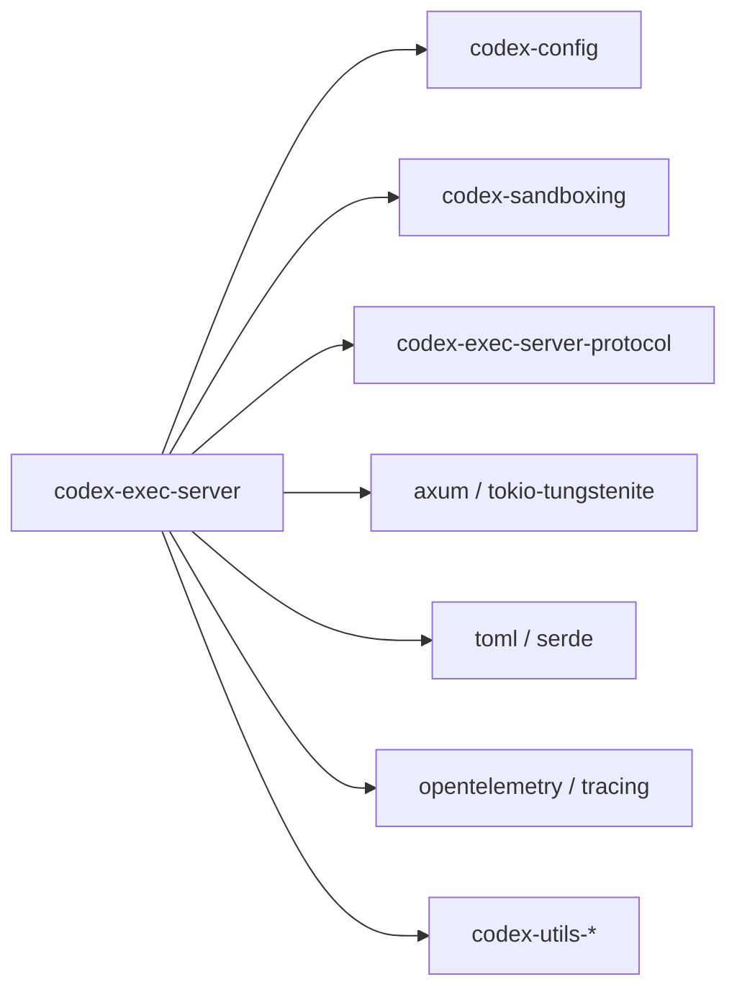

**图示来源**
- [Cargo.toml:1-115](file://codex-rs/exec-server/Cargo.toml#L1-L115)

**章节来源**
- [Cargo.toml:1-115](file://codex-rs/exec-server/Cargo.toml#L1-L115)

## 性能与行为特性
- 延迟连接：远程环境可在选择后才连接，避免不必要的启动开销。
- 连接状态观察：`EnvironmentObservedStatus` 提供 Ready、Pending、Disconnected 三种状态，计算状态不会触发重连。
- 超时控制：连接与初始化分别支持超时配置，TOML 与连接选项均可设置。
- 能力发现缓存与恢复：V2 能力发现封装了连接恢复，保证会话 ID 一致性。
- 配置读取超时：MCP 发现调用有 10 秒超时保护，避免阻塞。

[本节为通用指导，不直接分析具体文件]

## 安全与隔离
- 环境变量注入：执行命令时会注入线程 ID 与工具调用 ID 等元数据标签；这些标签用于关联而非授权，下游可修改或删除。
- 远程认证：WebSocket 直连支持能力令牌、签名承载令牌、认证文件；远程访问建议使用 TLS 或受保护的传输。
- 头部白名单：自定义 WebSocket 头部必须通过严格校验，禁止覆盖底层连接关键字段。
- 沙箱策略：PID 命名空间策略来自可信启动，不可由请求或仓库配置修改。
- 私有 IP 代理：可通过运行时选项控制私有 IP 是否经上游代理访问。
- 敏感信息脱敏：Bearer 令牌、URL、授权信息等会在诊断输出中脱敏。

**章节来源**
- [exec-server README:1-120](file://codex-rs/exec-server/README.md#L1-L120)
- [connect_options.rs:1-116](file://codex-rs/exec-server/src/environment/connect_options.rs#L1-L116)
- [runtime_options.rs:1-82](file://codex-rs/exec-server/src/runtime_options.rs#L1-L82)
- [environment_registry.rs:1-68](file://codex-rs/exec-server/src/environment_registry.rs#L1-L68)

## 配置示例与最佳实践

### 使用环境变量快速配置
- 设置 `CODEX_EXEC_SERVER_URL=ws://localhost:PORT` 使用本地远程环境。
- 设置 `CODEX_EXEC_SERVER_URL=none` 禁用环境访问，仅保留本地能力或完全关闭。
- 使用 `CODEX_API_KEY` 作为远程注册的凭据。

**章节来源**
- [exec-server README:1-120](file://codex-rs/exec-server/README.md#L1-L120)
- [environment_provider.rs:80-160](file://codex-rs/exec-server/src/environment_provider.rs#L80-L160)

### 使用 `environments.toml` 配置多环境
推荐结构：
- 顶层 `default` 指定默认环境。
- `include_local` 控制是否包含本地环境。
- `environments[]` 中定义多个环境，优先使用 `url` 配合 `auth_bearer_token`，或使用 `program`+`args`+`env`+`cwd` 本地模式。

注意事项：
- 确保 `id` 唯一。
- 若使用 `args`、`env`、`cwd`，必须提供 `program`。
- `auth_bearer_token` 与连接超时必须与 `url` 一起出现。
- 非回环地址使用 `wss://`。

**章节来源**
- [environment_toml.rs:1-220](file://codex-rs/exec-server/src/environment_toml.rs#L1-L220)
- [connect_options.rs:1-116](file://codex-rs/exec-server/src/environment/connect_options.rs#L1-L116)

### 管理运行时选项
- 通过 `ExecServerRuntimeOptions::new` 或 `from_optional_paths` 创建可信启动选项。
- 使用 `with_linux_sandbox_pid_namespace` 设置 PID 命名空间策略。
- 使用 `with_proxy_private_ips_via_upstream` 控制私有 IP 代理。
- macOS 上可使用 `with_allowed_symlinked_codex_home` 配置符号链接豁免。

**章节来源**
- [runtime_options.rs:1-82](file://codex-rs/exec-server/src/runtime_options.rs#L1-L82)

### 环境切换与选择
- 默认环境可由 `EnvironmentProvider` 快照决定。
- `EnvironmentManager.default_environment()` 返回默认环境 ID。
- 通过 `EnvironmentManager.get(id)` 获取指定环境。
- 若默认环境为远程，预准备管理器会识别并优先使用远程连接。

**章节来源**
- [environment.rs:120-220](file://codex-rs/exec-server/src/environment.rs#L120-L220)
- [environment_bootstrap.rs:1-66](file://codex-rs/exec-server/src/environment_bootstrap.rs#L1-L66)

## 故障排除指南

### 无法连接到远程环境
可能原因：
- URL 格式错误或使用了非 `wss://` 的非回环地址。
- 自定义头部被拒绝，例如覆盖了 `host`、`upgrade` 或 `sec-websocket-*`。
- 认证令牌缺失或传输不安全。
- 注册表握手返回 408、429、5xx，系统会退避重试；409 冲突会刷新注册。

排查步骤：
1. 确认 `CODEX_EXEC_SERVER_URL` 或 `environments.toml` 中的 `url` 正确。
2. 检查 `auth_bearer_token` 是否与 `url` 一起配置。
3. 确认远程地址为 `wss://` 或回环地址。
4. 查看日志中注册与会话初始化错误。

**章节来源**
- [connect_options.rs:1-116](file://codex-rs/exec-server/src/environment/connect_options.rs#L1-L116)
- [exec-server README:120-200](file://codex-rs/exec-server/README.md#L120-L200)

### MCP 配置读取失败
可能原因：
- 远端不支持 `environment_config_read` 能力。
- 配置层或需求层 TOML 解析失败。
- 服务器条目缺少 `url` 或不符合需求。
- 超时超过 10 秒。

排查步骤：
1. 检查远端能力是否支持配置读取。
2. 确认 executor-local 配置路径与需求路径有效。
3. 核对 MCP 服务器条目是否符合需求与头部策略。
4. 观察超时日志。

**章节来源**
- [environment_config.rs:60-160](file://codex-rs/exec-server/src/environment_config.rs#L60-L160)

### 环境初始化失败
可能原因：
- 同一连接多次发送 `initialize`。
- 会话尚未附加就收到 `initialized` 通知。
- 会话附加失败导致初始化请求被重置。

排查步骤：
1. 确保每个连接只调用一次 `initialize`。
2. 在 `initialize` 成功后再发送 `initialized`。
3. 检查会话附加错误与日志。

**章节来源**
- [server/handler.rs:120-220](file://codex-rs/exec-server/src/server/handler.rs#L120-L220)

### 多环境配置校验错误
可能原因：
- 环境 ID 重复。
- 存在 `args`、`env`、`cwd` 但未提供 `program`。
- 存在 `auth_bearer_token` 或连接超时而没有 `url`。
- 默认环境 ID 不在可用集合中。

排查步骤：
1. 检查 `environments.toml` 中 `id` 的唯一性。
2. 补充 `program` 或在本地模式下删除 `args`、`env`、`cwd`。
3. 将 `auth_bearer_token` 与连接超时与 `url` 配对。
4. 修正 `default` 指向已定义的环境 ID。

**章节来源**
- [environment_toml.rs:1-220](file://codex-rs/exec-server/src/environment_toml.rs#L1-L220)

## 结论
执行服务器的环境管理系统通过提供者快照、TOML 配置、运行时选项和 RPC 生命周期共同实现多环境支持、安全连接、配置读取与能力发现。最佳实践包括：
- 使用环境变量或 `environments.toml` 明确默认环境与可用环境。
- 远程连接始终使用 `wss://`，并对头部进行最小化与白名单校验。
- 将可信启动选项与请求策略分离，避免下游篡改安全策略。
- 利用 V2 能力发现与配置读取增强可观测性与灵活性。
- 针对连接、配置与初始化错误，按照上述排错指南逐步定位问题。

[本节为总结性内容，不直接分析具体文件]