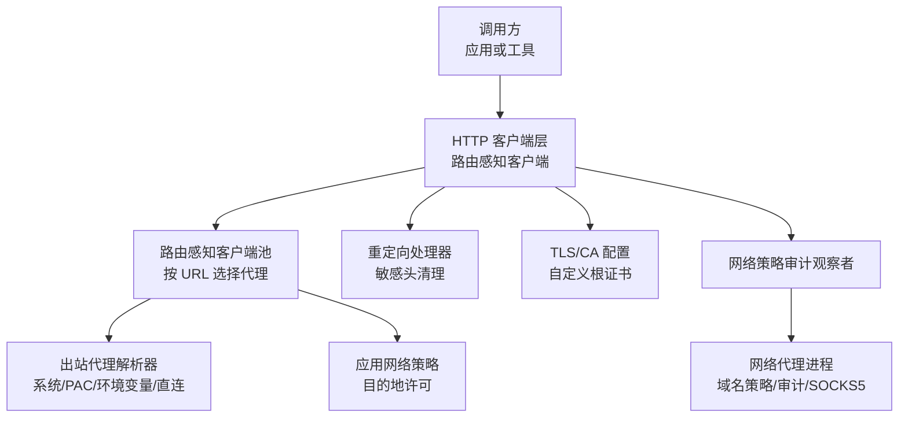
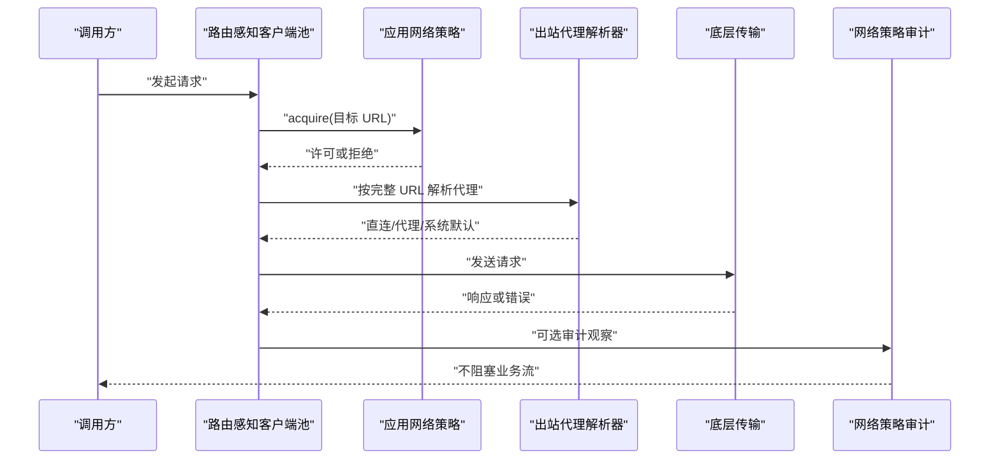
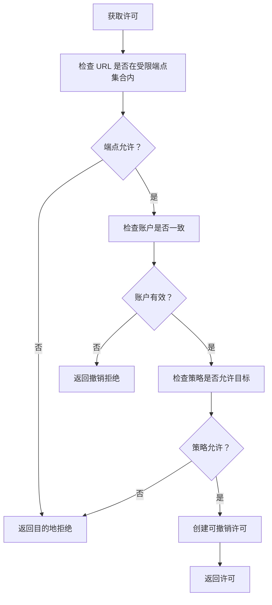
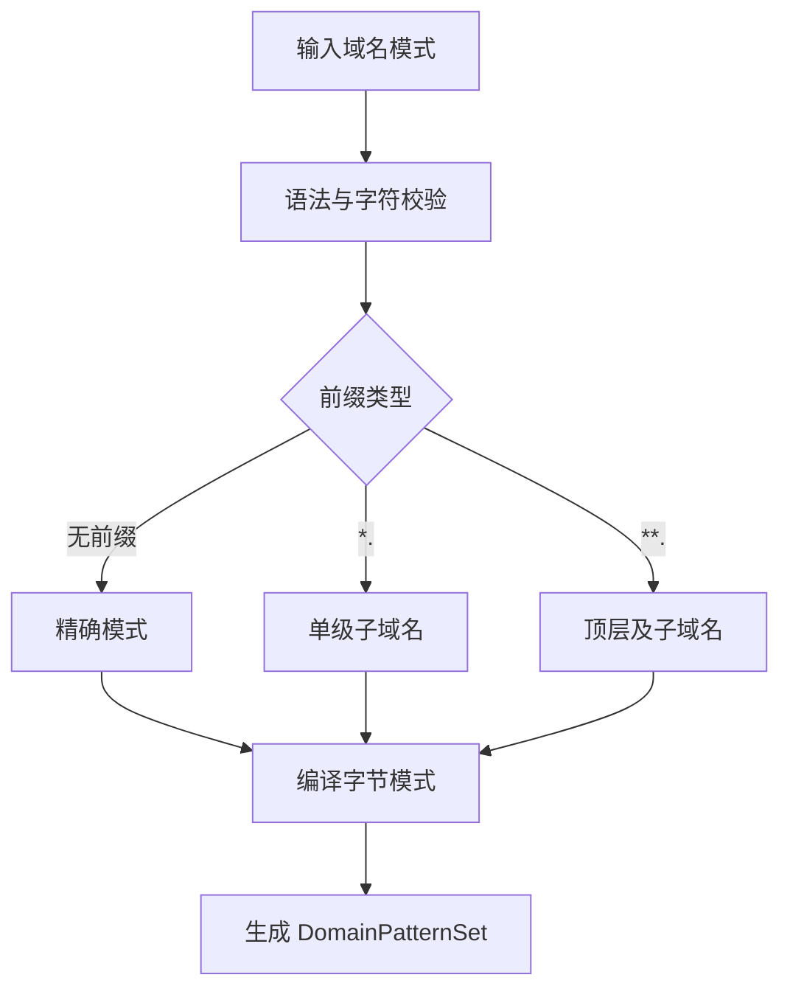
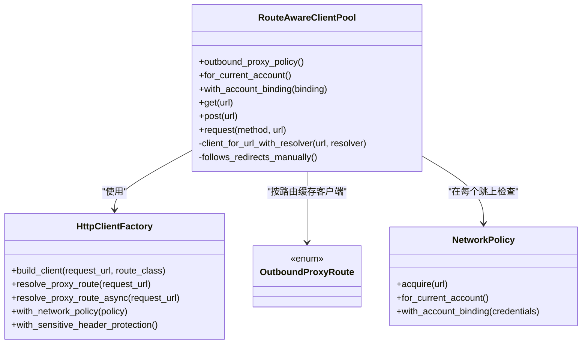
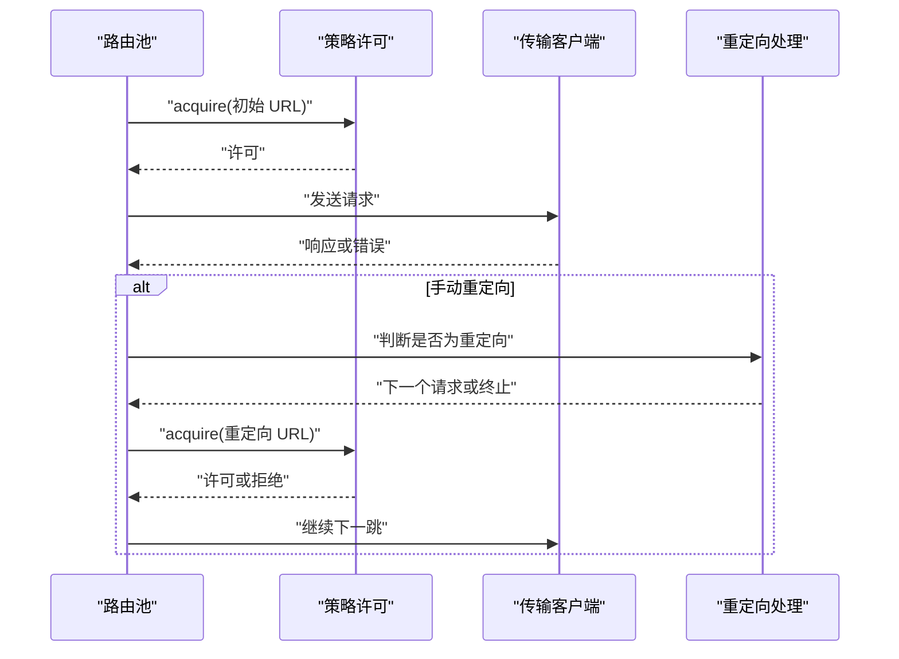
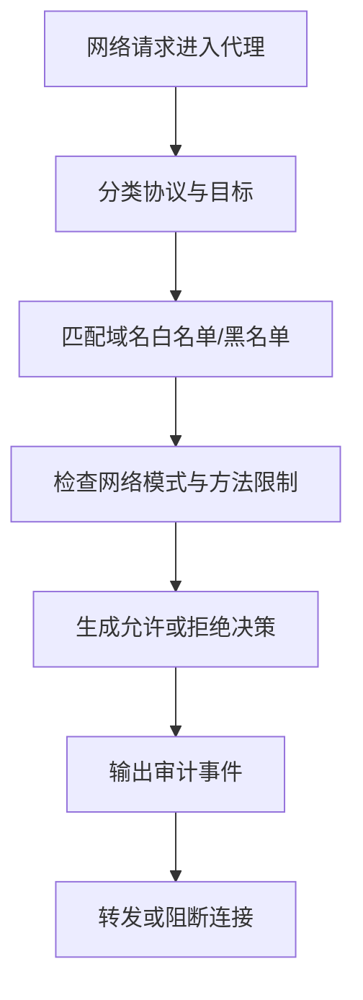
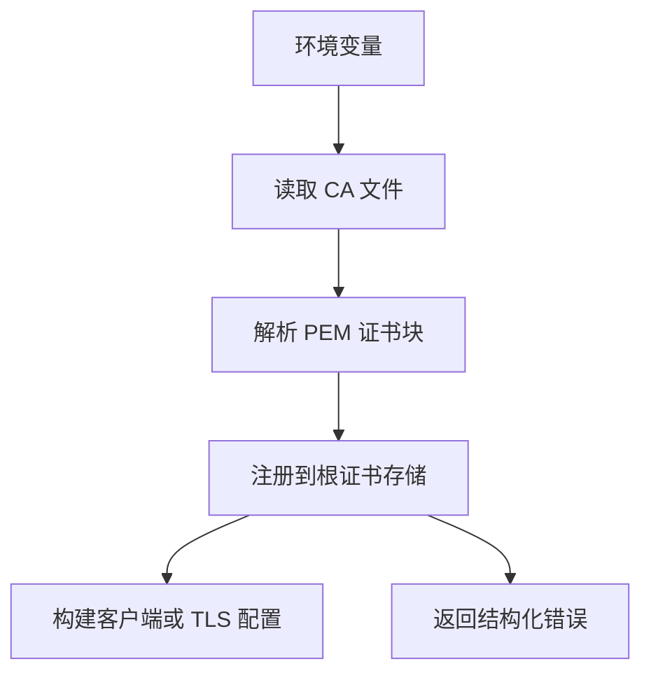
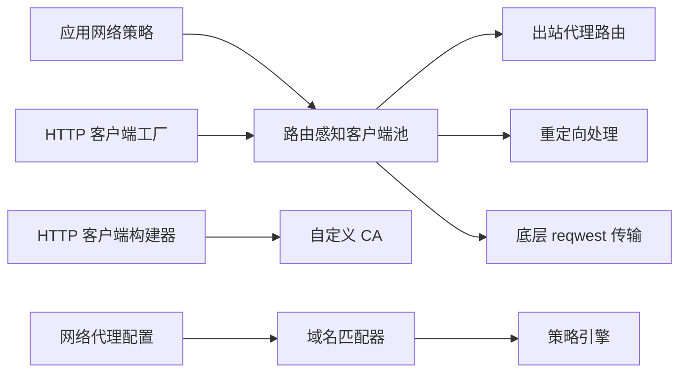

# 网络策略

<cite>
**本文引用的文件**   
- [http-client/src/network_policy.rs](file://codex-rs/http-client/src/network_policy.rs)
- [http-client/src/outbound_proxy.rs](file://codex-rs/http-client/src/outbound_proxy.rs)
- [http-client/src/route_aware_client_pool.rs](file://codex-rs/http-client/src/route_aware_client_pool.rs)
- [http-client/src/route_aware_client_pool/execution.rs](file://codex-rs/http-client/src/route_aware_client_pool/execution.rs)
- [http-client/src/route_aware_redirect.rs](file://codex-rs/http-client/src/route_aware_redirect.rs)
- [http-client/src/client_builder.rs](file://codex-rs/http-client/src/client_builder.rs)
- [http-client/src/custom_ca.rs](file://codex-rs/http-client/src/custom_ca.rs)
- [http-client/src/client.rs](file://codex-rs/http-client/src/client.rs)
- [protocol/src/network_policy.rs](file://codex-rs/protocol/src/network_policy.rs)
- [network-proxy/src/network_policy.rs](file://codex-rs/network-proxy/src/network_policy.rs)
- [network-proxy/src/config.rs](file://codex-rs/network-proxy/src/config.rs)
- [network-proxy/src/domain_matcher.rs](file://codex-rs/network-proxy/src/domain_matcher.rs)
- [network-proxy/src/policy.rs](file://codex-rs/network-proxy/src/policy.rs)
</cite>

## 目录
1. [引言](#引言)
2. [项目结构](#项目结构)
3. [核心组件](#核心组件)
4. [架构总览](#架构总览)
5. [详细组件分析](#详细组件分析)
6. [依赖关系分析](#依赖关系分析)
7. [性能考虑](#性能考虑)
8. [故障诊断指南](#故障诊断指南)
9. [结论](#结论)
10. [附录：配置与示例路径](#附录配置与示例路径)

## 引言
本文面向执行服务器的网络策略控制，重点解释以下能力：
- 应用级网络访问控制策略、URL 白名单和域名过滤。
- HTTP 客户端的“路由感知”能力：按完整目标 URL 选择代理或直连，并在每次重定向时重新评估。
- 请求拦截、响应处理、敏感头处理和跨域安全规则。
- 网络安全审计、流量监控和违规检测。
- 代理支持（系统代理、PAC/WPAD、环境变量代理）、证书管理与连接池。
- 安全最佳实践、性能调优与故障诊断方法。

本仓库将网络策略拆成两层：
- **运行时 HTTP 客户端层**：负责构建受策略约束的 HTTP 客户端、解析出站代理、限制目标地址、跟踪重定向并记录日志。
- **网络代理与策略决策层**：负责域名白名单/黑名单、协议模式限制、MITM 开关、审计事件输出以及策略决策数据结构。

## 项目结构
相关代码主要分布在三个 Rust crate 中：
- `codex-rs/http-client`：HTTP 客户端、策略许可、出站代理路由、重定向处理、TLS/CA 配置。
- `codex-rs/network-proxy`：网络代理进程的配置、域名匹配、策略决策、审计事件、SOCKS5/TCP/UDP 等。
- `codex-rs/protocol`：与外部子系统共享的网络策略决策消息模型。

**图示来源**
- [http-client/src/route_aware_client_pool.rs:1-60](file://codex-rs/http-client/src/route_aware_client_pool.rs#L1-L60)
- [http-client/src/outbound_proxy.rs:1-60](file://codex-rs/http-client/src/outbound_proxy.rs#L1-L60)
- [http-client/src/route_aware_redirect.rs:1-40](file://codex-rs/http-client/src/route_aware_redirect.rs#L1-L40)
- [http-client/src/custom_ca.rs:1-40](file://codex-rs/http-client/src/custom_ca.rs#L1-L40)
- [network-proxy/src/network_policy.rs:1-40](file://codex-rs/network-proxy/src/network_policy.rs#L1-L40)

**章节来源**
- [http-client/src/lib.rs:1-60](file://codex-rs/http-client/src/lib.rs#L1-L60)
- [network-proxy/src/lib.rs:1-40](file://codex-rs/network-proxy/src/lib.rs#L1-L40)

## 核心组件
本节从职责边界说明关键对象。

| 组件 | 主要职责 | 关键行为 |
|---|---|---|
| `NetworkPolicy` / `NetworkPolicyController` | 管理应用级目的地策略，发放可撤销的访问许可 | 允许 HTTPS/WSS；精确主机白名单；账户绑定；撤销并发任务；不可管理的只读策略。 |
| `OutboundProxyPolicy` / `HttpClientFactory` | 定义出站代理策略并解析具体路由 | 支持 `ReqwestDefault` 和 `RespectSystemProxy`；缓存系统代理决策；环境代理回退。 |
| `RouteAwareClientPool` | 为每个请求 URL 选择路由、复用连接、处理重定向和 TLS 回退 | 首次请求前检查策略；每次重定向重新解析代理；按路由缓存传输客户端。 |
| `route_aware_redirect` | 在重定向边界实现安全语义 | 删除跨源授权头；防止 Referer 泄漏；限制最大跳转次数。 |
| `custom_ca` | 统一企业 CA 根证书加载 | 读取环境变量中的 PEM bundle；失败时返回结构化错误；同时支持 reqwest 和 rustls。 |
| `NetworkDomainPermissions` / `DomainPatternSet` | 配置并匹配域名白名单/黑名单 | 支持精确域名、单级通配符 `*.example.com`、多级通配符 `**.example.com`；禁止无界全局 `*` 黑名单。 |
| `NetworkProxyConfig` | 代理进程配置入口 | 启用代理、SOCKS5、MITM、域名策略、Unix Socket 策略、凭证代理等。 |
| `NetworkPolicyAuditEvent` | 记录最终策略决策 | 包含时间戳、作用域、决策、来源、协议、主机、端口、方法、是否覆盖等。 |

**章节来源**
- [http-client/src/network_policy.rs:1-120](file://codex-rs/http-client/src/network_policy.rs#L1-L120)
- [http-client/src/outbound_proxy.rs:1-120](file://codex-rs/http-client/src/outbound_proxy.rs#L1-L120)
- [http-client/src/route_aware_client_pool.rs:1-80](file://codex-rs/http-client/src/route_aware_client_pool.rs#L1-L80)
- [http-client/src/route_aware_redirect.rs:1-40](file://codex-rs/http-client/src/route_aware_redirect.rs#L1-L40)
- [http-client/src/custom_ca.rs:1-40](file://codex-rs/http-client/src/custom_ca.rs#L1-L40)
- [network-proxy/src/config.rs:1-120](file://codex-rs/network-proxy/src/config.rs#L1-L120)
- [network-proxy/src/domain_matcher.rs:1-40](file://codex-rs/network-proxy/src/domain_matcher.rs#L1-L40)
- [network-proxy/src/network_policy.rs:1-60](file://codex-rs/network-proxy/src/network_policy.rs#L1-L60)

## 架构总览
下图展示一次典型网络请求如何被策略、代理和审计共同约束：

**图示来源**
- [http-client/src/route_aware_client_pool/execution.rs:38-90](file://codex-rs/http-client/src/route_aware_client_pool/execution.rs#L38-L90)
- [http-client/src/outbound_proxy.rs:240-340](file://codex-rs/http-client/src/outbound_proxy.rs#L240-L340)
- [network-proxy/src/network_policy.rs:1-60](file://codex-rs/network-proxy/src/network_policy.rs#L1-L60)

## 详细组件分析

### 应用级网络访问控制策略
`DestinationPolicy` 是当前生效的应用目的地策略，分为两种：
- `Unrestricted`：不限制目标。
- `Restricted { allowed_hosts }`：仅允许 HTTPS 和 WSS 到已归一化的精确主机名。

策略通过 `NetworkPolicyController` 发布，并通过 `NetworkPolicy` 提供只读观察端。它维护：
- 当前策略。
- 版本号与账户标识。
- 所有活跃许可的弱引用。
- 变更通知通道。

关键流程如下：

**图示来源**
- [http-client/src/network_policy.rs:1-120](file://codex-rs/http-client/src/network_policy.rs#L1-L120)
- [http-client/src/network_policy.rs:201-387](file://codex-rs/http-client/src/network_policy.rs#L201-L387)

#### 许可撤销与并发安全
`NetworkPermit` 持有可观察的撤销信号。执行过程使用异步选择器：
- 如果任务被撤销，立即返回撤销错误。
- 否则等待业务操作完成。

这确保“旧请求不能被新策略授权”，也保证“策略撤销能中断仍在进行的响应或流式连接”。

**章节来源**
- [http-client/src/network_policy.rs:120-200](file://codex-rs/http-client/src/network_policy.rs#L120-L200)
- [http-client/src/network_policy.rs:300-387](file://codex-rs/http-client/src/network_policy.rs#L300-L387)

#### 配置方式参考
- 使用未托管策略：[构造路径](file://codex-rs/http-client/src/network_policy.rs#L201-L220)。
- 将策略绑定到当前账户：[绑定账户](file://codex-rs/http-client/src/network_policy.rs#L220-L260)。
- 通过控制器发布策略：[发布策略](file://codex-rs/http-client/src/network_policy.rs#L80-L120)。
- 在请求前申请许可：[获取许可](file://codex-rs/http-client/src/route_aware_client_pool/execution.rs#L60-L90)。

### URL 白名单与域名过滤机制
HTTP 客户端层的 URL 白名单更严格：它限制的是完整的 `Url`，而不是域名。  
网络代理层的域名过滤则基于模式匹配：

| 配置类型 | 含义 | 示例 |
|---|---|---|
| 精确域名 | 只匹配该域名 | `example.com` |
| 子域名通配符 | 匹配任意一级子域名，不匹配顶层 | `*.example.com` |
| 多层通配符 | 匹配顶层及任意层级子域名 | `**.example.com` |
| IPv6 字面量 | 支持带端口的 IPv6 字面量模式 | `[::1]:443` |
| IP 字面量 | 直接匹配数值地址 | `127.0.0.1` |

`DomainPatternSet` 在构造时校验模式语法，并展开候选匹配项。它明确不支持无界的黑名单全局通配符 `*`，以避免意外放开整个互联网。

**图示来源**
- [network-proxy/src/domain_matcher.rs:1-120](file://codex-rs/network-proxy/src/domain_matcher.rs#L1-L120)
- [network-proxy/src/domain_matcher.rs:120-200](file://codex-rs/network-proxy/src/domain_matcher.rs#L120-L200)

#### 白名单与黑名单优先级
- 重复条目保留最后一条。
- 允许和拒绝冲突时，拒绝优先。
- 保存的规则会经过编译验证；无效 denylist 不会破坏有效 allowlist。

**章节来源**
- [network-proxy/src/config.rs:200-360](file://codex-rs/network-proxy/src/config.rs#L200-L360)
- [network-proxy/src/domain_matcher.rs:1-120](file://codex-rs/network-proxy/src/domain_matcher.rs#L1-L120)
- [network-proxy/src/policy.rs:160-220](file://codex-rs/network-proxy/src/policy.rs#L160-L220)

### HTTP 客户端的路由感知能力
HTTP 客户端不是简单地将一个固定代理绑定到所有请求。`RouteAwareClientPool` 的职责是：
1. 根据完整请求 URL 解析出站代理。
2. 按路由复用底层 `reqwest::Client`。
3. 对每个重定向目标重新解析代理。
4. 在需要时手动跟随重定向，以维持策略和敏感头安全。

**图示来源**
- [http-client/src/route_aware_client_pool.rs:1-120](file://codex-rs/http-client/src/route_aware_client_pool.rs#L1-L120)
- [http-client/src/outbound_proxy.rs:200-340](file://codex-rs/http-client/src/outbound_proxy.rs#L200-L340)
- [http-client/src/network_policy.rs:1-120](file://codex-rs/http-client/src/network_policy.rs#L1-L120)

#### 代理解析顺序
当策略为 `RespectSystemProxy` 时：
1. 尝试系统代理或 PAC/WPAD。
2. 若系统代理不可用，回退到环境变量代理。
3. 最终回退到直连。
4. 结果会被进程级缓存，避免频繁调用平台 API。

当策略为 `ReqwestDefault` 时：
- 直接交给底层传输处理代理逻辑。

**章节来源**
- [http-client/src/outbound_proxy.rs:200-420](file://codex-rs/http-client/src/outbound_proxy.rs#L200-L420)
- [http-client/src/outbound_proxy.rs:420-633](file://codex-rs/http-client/src/outbound_proxy.rs#L420-L633)

### 请求拦截与响应处理
请求生命周期由 `RouteAwareClientPool::send` 驱动：
- 在发送前申请策略许可。
- 按 URL 解析代理。
- 组装请求、应用默认头、设置剩余超时。
- 发送请求。
- 处理 Windows 代理认证挑战。
- 在 TLS 握手失败时尝试 rustls 回退。
- 如需要，手动处理重定向。

**图示来源**
- [http-client/src/route_aware_client_pool/execution.rs:38-160](file://codex-rs/http-client/src/route_aware_client_pool/execution.rs#L38-L160)
- [http-client/src/route_aware_redirect.rs:1-120](file://codex-rs/http-client/src/route_aware_redirect.rs#L1-L120)

#### 重定向安全规则
- 最多允许 10 次重定向。
- 跨源重定向时移除 `Authorization`、`Cookie`、`Proxy-Authorization`、`WWW-Authenticate` 等敏感头。
- 如果启用了敏感头保护，还会移除其他标记为敏感的头部。
- `Referer` 会在跨源时去掉路径和查询参数，HTTPS 降级到 HTTP 时不发送 `Referer`。
- POST 在某些重定向状态码下会转换为 GET 并丢弃请求体。

**章节来源**
- [http-client/src/route_aware_redirect.rs:1-159](file://codex-rs/http-client/src/route_aware_redirect.rs#L1-L159)

### 网络安全审计、流量监控与违规检测
网络代理层定义了统一的审计事件模型。每条决策都会记录：
- 时间戳。
- 作用域：域名或非域名。
- 决策：允许或拒绝。
- 来源：基线策略、模式守卫、代理状态、决策器。
- 协议：HTTP、HTTPS CONNECT、SOCKS5 TCP、SOCKS5 UDP。
- 主机、端口、方法、客户端地址。
- 是否策略覆盖。

**图示来源**
- [network-proxy/src/network_policy.rs:1-120](file://codex-rs/network-proxy/src/network_policy.rs#L1-L120)
- [network-proxy/src/config.rs:420-500](file://codex-rs/network-proxy/src/config.rs#L420-L500)

#### 与上层协议的交互
上层协议层还定义了网络策略决策载荷，用于将决策结果序列化给外部子系统：
- 决策值。
- 决策来源。
- 协议类型。
- 主机、端口、原因。

**章节来源**
- [protocol/src/network_policy.rs:1-22](file://codex-rs/protocol/src/network_policy.rs#L1-L22)
- [network-proxy/src/network_policy.rs:1-120](file://codex-rs/network-proxy/src/network_policy.rs#L1-L120)

### 代理支持与证书管理
#### 代理支持
- 系统代理：macOS 和 Windows 有平台特定实现；其他平台视为不可用并回退。
- 环境变量代理：`HTTP_PROXY`、`HTTPS_PROXY`、`ALL_PROXY`、`NO_PROXY`。
- WebSocket 代理：`ws`/`wss` 映射到 `http`/`https` 进行系统代理决策。
- 代理结果缓存：成功和失败的决策分别使用不同 TTL 和最大条目数。

#### 证书管理
- 自定义 CA 通过环境变量 `CODEX_CA_CERTIFICATE` 或 `SSL_CERT_FILE` 指定。
- PEM bundle 支持多证书块，并兼容常见 OpenSSL 变体。
- 失败时返回结构化错误，区分读取失败、无效文件、注册失败和客户端构建失败。
- 支持 reqwest 和 rustls 两条路径，便于后续扩展到 WebSocket 或其他 TLS 场景。

**图示来源**
- [http-client/src/custom_ca.rs:1-120](file://codex-rs/http-client/src/custom_ca.rs#L1-L120)
- [http-client/src/custom_ca.rs:120-200](file://codex-rs/http-client/src/custom_ca.rs#L120-L200)

**章节来源**
- [http-client/src/outbound_proxy.rs:240-633](file://codex-rs/http-client/src/outbound_proxy.rs#L240-L633)
- [http-client/src/custom_ca.rs:1-200](file://codex-rs/http-client/src/custom_ca.rs#L1-L200)

### 连接池与超时
- 路由感知客户端池按 `OutboundProxyRoute` 缓存传输客户端。
- 默认最多缓存 16 个路由，超出后驱逐最早插入的路由。
- 可通过 `without_pool_idle_timeout` 禁用空闲连接超时，适合长连接或 gRPC 场景。
- 连接建立超时单独配置，不影响整体请求超时。
- 在重试 rustls 时，rustls 客户端也按路由缓存，减少重复构建成本。

**章节来源**
- [http-client/src/route_aware_client_pool.rs:1-120](file://codex-rs/http-client/src/route_aware_client_pool.rs#L1-L120)
- [http-client/src/client_builder.rs:360-464](file://codex-rs/http-client/src/client_builder.rs#L360-L464)

## 依赖关系分析

**图示来源**
- [http-client/src/network_policy.rs:1-120](file://codex-rs/http-client/src/network_policy.rs#L1-L120)
- [http-client/src/route_aware_client_pool.rs:1-120](file://codex-rs/http-client/src/route_aware_client_pool.rs#L1-L120)
- [http-client/src/outbound_proxy.rs:200-340](file://codex-rs/http-client/src/outbound_proxy.rs#L200-L340)
- [http-client/src/client_builder.rs:1-60](file://codex-rs/http-client/src/client_builder.rs#L1-L60)
- [network-proxy/src/config.rs:1-120](file://codex-rs/network-proxy/src/config.rs#L1-L120)
- [network-proxy/src/domain_matcher.rs:1-80](file://codex-rs/network-proxy/src/domain_matcher.rs#L1-L80)

### 耦合与内聚
- `RouteAwareClientPool` 耦合了策略、代理、重定向和传输，但这是有意为之：它保证了“每个 URL 跳都重新评估策略和代理”。
- `HttpClientFactory` 聚合出站代理策略、敏感头保护和网络策略，作为客户端构建的统一入口。
- `NetworkPolicy` 与 `NetworkPolicyController` 分离读写侧，避免写入者泄露给只读消费者。
- 域名匹配与策略配置解耦：配置模块负责持久化和合并，匹配模块负责模式编译和匹配。

### 外部依赖
- `reqwest`：HTTP 传输。
- `tokio`：异步运行时、watch 通道、超时。
- `url`：URL 解析与规范化。
- `rustls`：可选 TLS 后端。
- `tracing` 和 OpenTelemetry：日志和遥测。

**章节来源**
- [http-client/src/route_aware_client_pool.rs:120-240](file://codex-rs/http-client/src/route_aware_client_pool.rs#L120-L240)
- [http-client/src/outbound_proxy.rs:633-904](file://codex-rs/http-client/src/outbound_proxy.rs#L633-L904)
- [network-proxy/src/config.rs:360-500](file://codex-rs/network-proxy/src/config.rs#L360-L500)

## 性能考虑
- **代理解析缓存**：系统代理决策结果会被缓存，降低平台 API 调用频率。
- **路由级客户端缓存**：相同代理路由复用底层连接，减少握手开销。
- **TLS 回退缓存**：rustls 客户端按路由缓存，避免重复构建。
- **连接池空闲超时**：对于高频短连接，保持默认空闲超时有助于释放资源；对于长连接或 gRPC，应显式禁用。
- **重定向限制**：默认最多 10 次重定向，防止恶意循环重定向消耗资源。
- **异步阻塞隔离**：macOS 和 Windows 的系统代理解析在后台阻塞任务中进行，避免阻塞 Tokio worker。

**章节来源**
- [http-client/src/outbound_proxy.rs:200-340](file://codex-rs/http-client/src/outbound_proxy.rs#L200-L340)
- [http-client/src/route_aware_client_pool.rs:120-240](file://codex-rs/http-client/src/route_aware_client_pool.rs#L120-L240)
- [http-client/src/client_builder.rs:360-464](file://codex-rs/http-client/src/client_builder.rs#L360-L464)

## 故障诊断指南

### 常见问题分类
| 现象 | 可能原因 | 建议排查步骤 |
|---|---|---|
| 请求被拒绝 | 应用策略不允许目标主机；URL 不在白名单；账户变更导致许可撤销 | 检查 `DestinationPolicy` 和 `allowed_hosts`；确认是否使用了 `restrict_to_endpoints`；确认账户绑定。 |
| 代理解析失败 | 系统代理不可用；PAC 脚本不可达；环境变量代理格式错误 | 查看 `BuildRouteAwareHttpClientError::InvalidProxyConfig`；检查 `HTTP_PROXY`、`HTTPS_PROXY`、`ALL_PROXY`、`NO_PROXY`。 |
| TLS 握手失败 | 企业 CA 未正确配置；证书链不完整；代理 MITM 证书问题 | 检查 `CODEX_CA_CERTIFICATE` 或 `SSL_CERT_FILE`；确认 PEM 中包含 `CERTIFICATE` 块。 |
| 重定向后丢失凭据 | 跨源重定向清除了敏感头 | 确认上游服务是否期望携带 `Authorization` 或 `Cookie`；调整服务端避免跨域重定向。 |
| 连接超时 | 代理不可达；DNS 解析慢；连接建立超时过短 | 检查代理可达性；适当增大连接超时；区分连接超时和请求超时。 |
| 策略审计显示拒绝 | 域名黑名单命中；网络模式限制方法；决策器主动拒绝 | 查看 `NetworkPolicyAuditEvent` 的原因字段和来源。 |

### 调试建议
- 使用不带请求日志的客户端构造方式，避免 URL 或响应头泄露敏感信息。
- 使用 `failure_class()` 将错误分类为代理不可用、连接超时、代理认证、TLS 错误等。
- 在迁移到路由感知客户端时，先保留原有代理行为，再逐步启用系统代理和敏感头保护。
- 对自定义 CA，优先验证 PEM 文件是否可读、可解析，再验证客户端是否能构建。

**章节来源**
- [http-client/src/route_aware_client_pool.rs:80-200](file://codex-rs/http-client/src/route_aware_client_pool.rs#L80-L200)
- [http-client/src/client_builder.rs:200-360](file://codex-rs/http-client/src/client_builder.rs#L200-L360)
- [http-client/src/custom_ca.rs:120-200](file://codex-rs/http-client/src/custom_ca.rs#L120-L200)
- [network-proxy/src/network_policy.rs:1-120](file://codex-rs/network-proxy/src/network_policy.rs#L1-L120)

## 结论
该项目的网络策略体系将“应用目的地控制”和“代理/域名策略”分层设计：
- HTTP 客户端层确保每个请求和重定向都经过策略许可，并按完整 URL 选择代理。
- 网络代理层提供域名白名单/黑名单、协议模式控制、MITM 和审计输出。
- 两者通过清晰的数据结构和错误分类协作，既能满足企业安全需求，又能保留足够的可观测性和可运维性。

生产部署时应优先使用 `HttpClientFactory` 和 `RouteAwareClientPool`，避免绕过策略直接构造底层客户端；同时配合环境变量、域名策略和自定义 CA 配置，形成端到端的网络访问控制闭环。

## 附录：配置与示例路径

### 配置网络策略
- 声明目的地策略：[目的地策略定义](file://codex-rs/http-client/src/network_policy.rs#L1-L60)。
- 发布策略：[控制器发布](file://codex-rs/http-client/src/network_policy.rs#L80-L120)。
- 将策略注入客户端工厂：[注入网络策略](file://codex-rs/http-client/src/outbound_proxy.rs#L220-L260)。
- 构建策略感知的客户端：[构建客户端](file://codex-rs/http-client/src/client_builder.rs#L60-L120)。

### 处理网络请求
- 创建路由感知客户端：[客户端池构造](file://codex-rs/http-client/src/route_aware_client_pool.rs#L120-L200)。
- 发起请求：[请求构造入口](file://codex-rs/http-client/src/route_aware_client_pool.rs#L320-L380)。
- 执行请求：[执行流程](file://codex-rs/http-client/src/route_aware_client_pool/execution.rs#L38-L90)。
- 处理重定向：[重定向处理](file://codex-rs/http-client/src/route_aware_client_pool/execution.rs#L90-L160)。

### 监控网络活动
- 定义审计观察者类型：[审计事件结构](file://codex-rs/network-proxy/src/network_policy.rs#L1-L60)。
- 输出策略决策事件：[审计常量与事件](file://codex-rs/network-proxy/src/network_policy.rs#L1-L40)。
- 与协议层交互：[策略决策载荷](file://codex-rs/protocol/src/network_policy.rs#L1-L22)。

### 代理与证书
- 选择出站代理策略：[代理策略枚举](file://codex-rs/http-client/src/outbound_proxy.rs#L100-L160)。
- 解析代理路由：[代理解析](file://codex-rs/http-client/src/outbound_proxy.rs#L240-L340)。
- 配置自定义 CA：[CA 构建入口](file://codex-rs/http-client/src/custom_ca.rs#L120-L200)。
- 配置连接池与超时：[客户端构建器](file://codex-rs/http-client/src/client_builder.rs#L360-L464)。

### 域名过滤
- 配置域名权限：[域名权限配置](file://codex-rs/network-proxy/src/config.rs#L1-L120)。
- 应用允许的域名列表：[允许域名提取](file://codex-rs/network-proxy/src/config.rs#L260-L320)。
- 应用拒绝的域名列表：[拒绝域名提取](file://codex-rs/network-proxy/src/config.rs#L320-L360)。
- 域名模式匹配：[域名匹配器](file://codex-rs/network-proxy/src/domain_matcher.rs#L1-L120)。
- 模式编译与比较：[策略编译](file://codex-rs/network-proxy/src/policy.rs#L160-L220)。