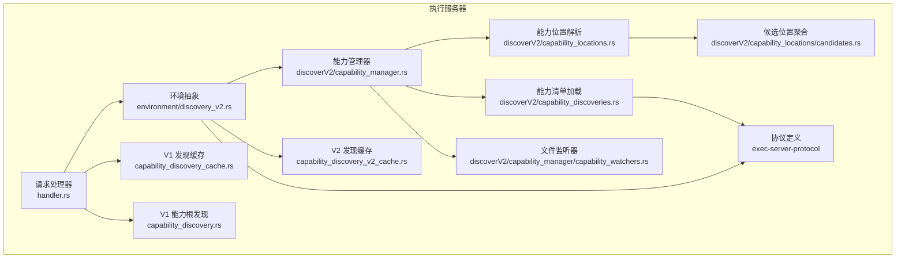
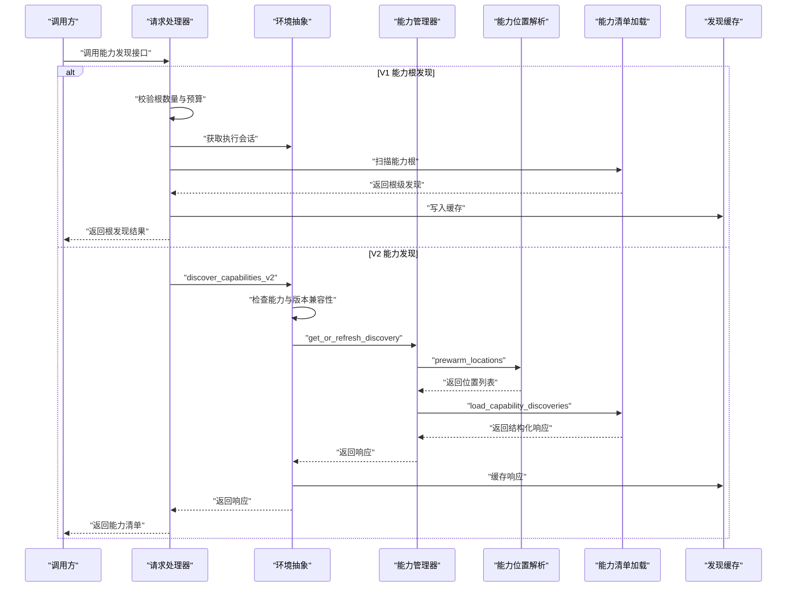
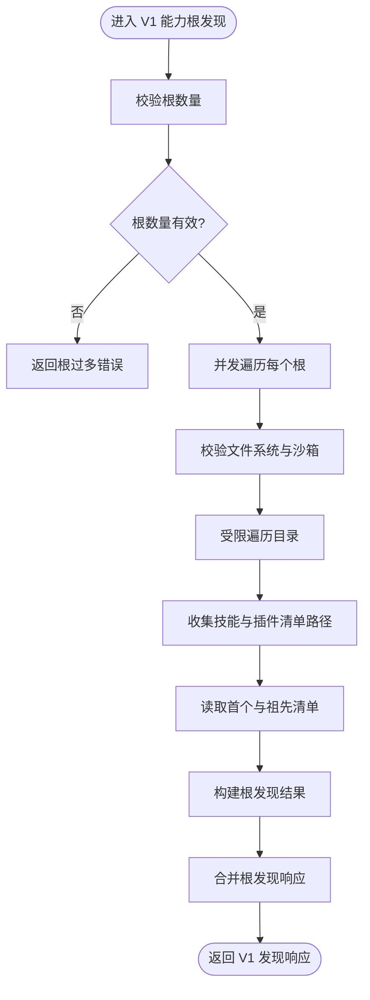
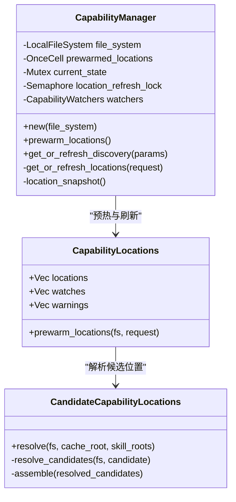
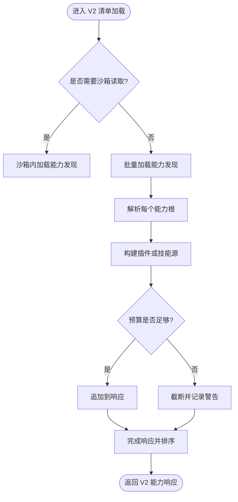
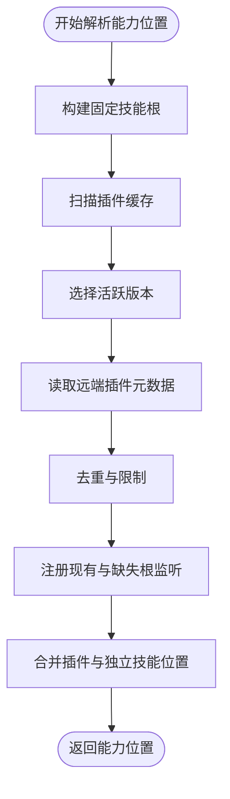
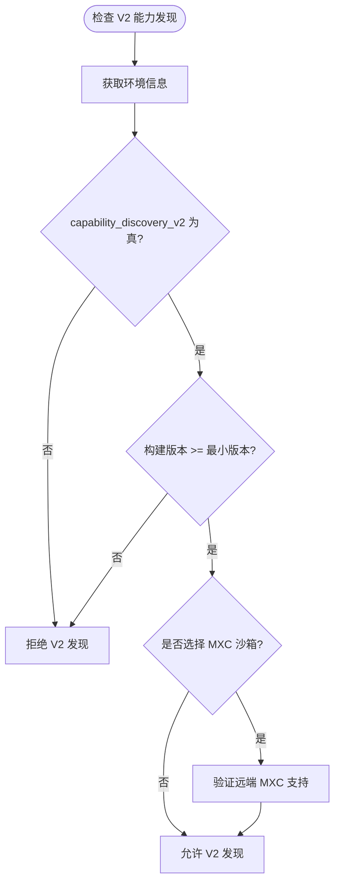
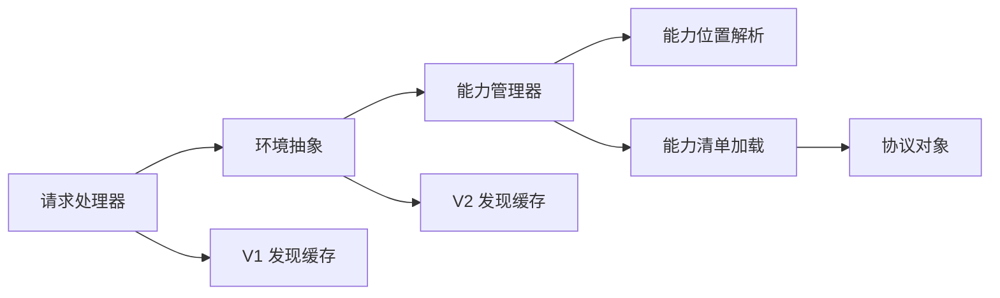
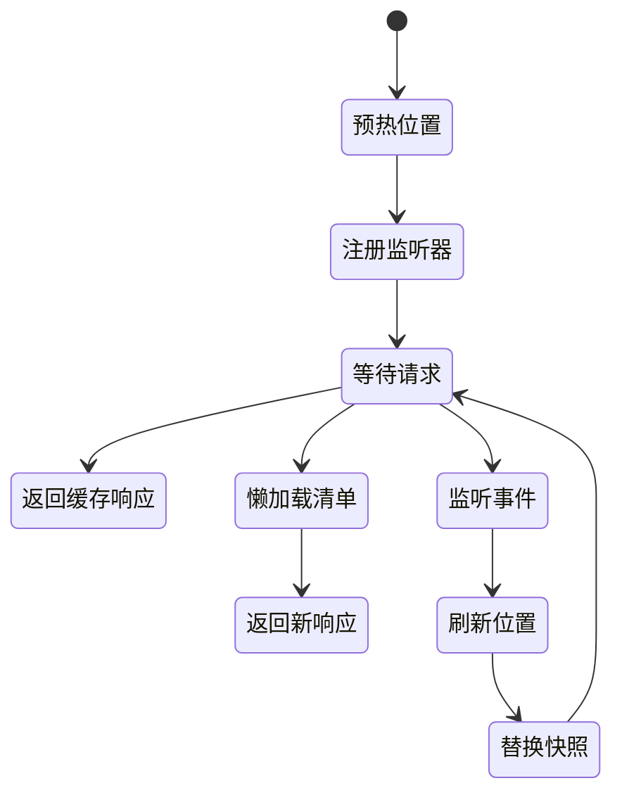
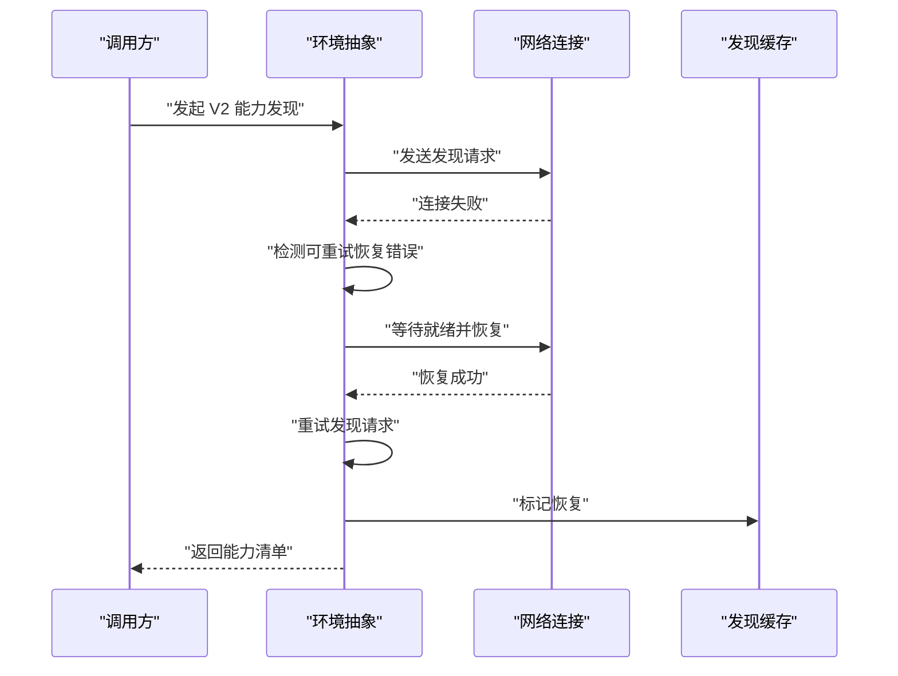

# 能力发现

<cite>
**本文引用的文件**
- [capability_discovery.rs](file://codex-rs/exec-server/src/capability_discovery.rs)
- [capability_discovery_cache.rs](file://codex-rs/exec-server/src/capability_discovery_cache.rs)
- [capability_discovery_v2_cache.rs](file://codex-rs/exec-server/src/capability_discovery_v2_cache.rs)
- [capabilities.rs](file://codex-rs/exec-server-protocol/src/capabilities.rs)
- [protocol.rs](file://codex-rs/exec-server-protocol/src/protocol.rs)
- [mod.rs](file://codex-rs/exec-server/src/discoverV2/mod.rs)
- [capability_manager.rs](file://codex-rs/exec-server/src/discoverV2/capability_manager.rs)
- [capability_watchers.rs](file://codex-rs/exec-server/src/discoverV2/capability_manager/capability_watchers.rs)
- [capability_locations.rs](file://codex-rs/exec-server/src/discoverV2/capability_locations.rs)
- [candidates.rs](file://codex-rs/exec-server/src/discoverV2/capability_locations/candidates.rs)
- [capability_discoveries.rs](file://codex-rs/exec-server/src/discoverV2/capability_discoveries.rs)
- [discovery_v2.rs](file://codex-rs/exec-server/src/environment/discovery_v2.rs)
- [discovery_recovery.rs](file://codex-rs/exec-server/src/environment/discovery_recovery.rs)
- [handler.rs](file://codex-rs/exec-server/src/server/handler.rs)
</cite>

## 目录
1. [引言](#引言)
2. [项目结构](#项目结构)
3. [核心组件](#核心组件)
4. [架构总览](#架构总览)
5. [详细组件分析](#详细组件分析)
6. [依赖关系分析](#依赖关系分析)
7. [性能与缓存策略](#性能与缓存策略)
8. [生命周期、热更新与故障恢复](#生命周期热更新与故障恢复)
9. [扩展开发指南](#扩展开发指南)
10. [排错指南](#排错指南)
11. [结论](#结论)

## 引言
本文围绕执行服务器的“能力发现”机制，系统性说明 V1 与 V2 版本的能力发现协议差异、能力位置解析、依赖关系管理、版本兼容性检查、缓存策略、性能优化、调试方法以及扩展实践。重点覆盖：
- V1：按选定的能力根进行文件系统扫描，返回插件清单和技能文件。
- V2：以预热的固定位置为基础，结合沙箱上下文生成结构化能力响应，支持全局位置监听、会话级缓存与连接恢复重试。
- 两类发现均具备严格的预算限制、错误分类、可恢复性标记，并向调用方暴露“已恢复”信号以便下游投影失效刷新。

## 项目结构
能力发现在执行服务器中分为两条路径：
- V1 能力根发现：位于 `exec-server` 的顶层能力发现模块，负责扫描用户或编排器传入的能力根目录。
- V2 能力发现：位于 `discoverV2` 子系统，由 `CapabilityManager` 管理预热位置、监听器和沙箱缓存，并通过 `Environment.discover_capabilities_v2` 暴露远程能力发现接口。

**图表来源**
- [handler.rs:1-220](file://codex-rs/exec-server/src/server/handler.rs#L1-L220)
- [discovery_v2.rs:1-62](file://codex-rs/exec-server/src/environment/discovery_v2.rs#L1-L62)
- [capability_manager.rs:1-179](file://codex-rs/exec-server/src/discoverV2/capability_manager.rs#L1-L179)
- [capability_locations.rs:1-219](file://codex-rs/exec-server/src/discoverV2/capability_locations.rs#L1-L219)
- [candidates.rs:1-125](file://codex-rs/exec-server/src/discoverV2/capability_locations/candidates.rs#L1-L125)
- [capability_discoveries.rs:1-200](file://codex-rs/exec-server/src/discoverV2/capability_discoveries.rs#L1-L200)
- [capability_watchers.rs:1-142](file://codex-rs/exec-server/src/discoverV2/capability_manager/capability_watchers.rs#L1-L142)
- [capability_discovery_v2_cache.rs:1-121](file://codex-rs/exec-server/src/capability_discovery_v2_cache.rs#L1-L121)
- [capability_discovery_cache.rs:1-200](file://codex-rs/exec-server/src/capability_discovery_cache.rs#L1-L200)
- [capabilities.rs:1-130](file://codex-rs/exec-server-protocol/src/capabilities.rs#L1-L130)
- [protocol.rs:1-260](file://codex-rs/exec-server-protocol/src/protocol.rs#L1-L260)

**章节来源**
- [mod.rs:1-6](file://codex-rs/exec-server/src/discoverV2/mod.rs#L1-L6)

## 核心组件
- **V1 能力根发现**：对调用方提供的根目录进行受限遍历，识别技能文件和插件命名空间清单，返回每个根的发现结果。
- **V1 发现缓存**：按执行会话、能力根和沙箱上下文缓存成功或非可重试失败；在并发命中时复用结果并报告恢复。
- **V2 能力管理器**：预热固定能力位置，注册文件监听，维护当前状态快照，并按沙箱上下文懒加载能力清单。
- **V2 能力位置解析**：从 Codex Home、用户目录、系统技能根和插件缓存目录解析能力位置，聚合为有序且受限的位置列表。
- **V2 能力清单加载**：复用 V1 的根发现逻辑，将插件和独立技能合并为结构化响应，并进行响应大小与条目数量限制。
- **V2 发现缓存**：按环境、执行会话、请求参数缓存完整响应，使用一次性单元避免重复计算，并在可重试失败后标记恢复。
- **环境与协议**：通过 `EnvironmentInfo.capabilities.capability_discovery_v2` 与构建版本判断是否支持 V2；V2 发现方法名为 `capabilities/discoverV2`。

**章节来源**
- [capability_discovery.rs:1-200](file://codex-rs/exec-server/src/capability_discovery.rs#L1-L200)
- [capability_discovery_cache.rs:1-200](file://codex-rs/exec-server/src/capability_discovery_cache.rs#L1-L200)
- [capability_manager.rs:1-179](file://codex-rs/exec-server/src/discoverV2/capability_manager.rs#L1-L179)
- [capability_locations.rs:1-219](file://codex-rs/exec-server/src/discoverV2/capability_locations.rs#L1-L219)
- [capability_discoveries.rs:1-200](file://codex-rs/exec-server/src/discoverV2/capability_discoveries.rs#L1-L200)
- [capability_discovery_v2_cache.rs:1-121](file://codex-rs/exec-server/src/capability_discovery_v2_cache.rs#L1-L121)
- [capabilities.rs:1-130](file://codex-rs/exec-server-protocol/src/capabilities.rs#L1-L130)
- [protocol.rs:1-260](file://codex-rs/exec-server-protocol/src/protocol.rs#L1-L260)

## 架构总览
V1 与 V2 能力发现在服务端的不同职责如下：
- V1 是“根驱动”的扫描：上层决定能力根，执行服务器负责安全、有界地读取文件系统。
- V2 是“位置驱动”的结构化发现：服务端先解析固定位置，再根据沙箱上下文选择本地或沙箱内加载，最后返回插件与技能的元数据摘要。

**图表来源**
- [handler.rs:1-220](file://codex-rs/exec-server/src/server/handler.rs#L1-L220)
- [discovery_v2.rs:1-62](file://codex-rs/exec-server/src/environment/discovery_v2.rs#L1-L62)
- [capability_manager.rs:1-179](file://codex-rs/exec-server/src/discoverV2/capability_manager.rs#L1-L179)
- [capability_locations.rs:1-219](file://codex-rs/exec-server/src/discoverV2/capability_locations.rs#L1-L219)
- [capability_discoveries.rs:1-200](file://codex-rs/exec-server/src/discoverV2/capability_discoveries.rs#L1-L200)
- [capability_discovery_v2_cache.rs:1-121](file://codex-rs/exec-server/src/capability_discovery_v2_cache.rs#L1-L121)

## 详细组件分析

### V1 能力根发现
V1 的核心目标是把“文件系统昂贵的扫描”从产品解析与策略层剥离出来，专注以下职责：
- 限制单次请求的最大根数。
- 对每个根进行深度、目录数和条目数受限的遍历。
- 识别技能文件与插件命名空间清单。
- 读取首个插件清单及最近祖先清单，用于继承命名空间。
- 返回每个根的技能、插件命名空间、警告和错误。

关键约束包括最大根数、最大扫描深度、最大目录数、最大条目数、单文件字节数与打包预算。并发根扫描采用缓冲并发上限。

**图表来源**
- [capability_discovery.rs:1-200](file://codex-rs/exec-server/src/capability_discovery.rs#L1-L200)

**章节来源**
- [capability_discovery.rs:1-200](file://codex-rs/exec-server/src/capability_discovery.rs#L1-L200)

### V2 能力管理器与位置解析
V2 能力管理器负责：
- 首次初始化时预热固定能力位置。
- 注册全局文件监听器，延迟节流刷新。
- 维护当前状态快照，隔离正在进行的加载。
- 按沙箱上下文懒加载能力清单，并缓存沙箱发现结果。
- 当监听器注册失败时回退到每次请求重新加载。

能力位置解析负责：
- 从 Codex Home 的 skills 目录、用户 home 的 agents/skills 目录、系统 skills 目录与插件缓存目录解析能力位置。
- 去重、排序并限制位置总数。
- 为现有根和缺失根都注册监听，以便目录创建后触发刷新。

**图表来源**
- [capability_manager.rs:1-179](file://codex-rs/exec-server/src/discoverV2/capability_manager.rs#L1-L179)
- [capability_locations.rs:1-219](file://codex-rs/exec-server/src/discoverV2/capability_locations.rs#L1-L219)
- [candidates.rs:1-125](file://codex-rs/exec-server/src/discoverV2/capability_locations/candidates.rs#L1-L125)

**章节来源**
- [capability_manager.rs:1-179](file://codex-rs/exec-server/src/discoverV2/capability_manager.rs#L1-L179)
- [capability_locations.rs:1-219](file://codex-rs/exec-server/src/discoverV2/capability_locations.rs#L1-L219)
- [candidates.rs:1-125](file://codex-rs/exec-server/src/discoverV2/capability_locations/candidates.rs#L1-L125)

### V2 能力清单加载
V2 的清单加载复用 V1 的根发现能力，但在此基础上：
- 将插件与其包含的技能合并为一个 `ExecutorPlugin`。
- 为独立技能附加 `SkillDiscoveryRoot`，保留独立能力搜索根。
- 解析技能前置元数据，提取名称、描述、依赖与策略。
- 若插件声明 MCP 配置但未返回内容，则记录警告。
- 对响应进行能力数量、JSON 字节大小和警告条数限制。
- 最终对插件按 ID 与根路径排序，确保稳定输出。

**图表来源**
- [capability_discoveries.rs:1-200](file://codex-rs/exec-server/src/discoverV2/capability_discoveries.rs#L1-L200)
- [capability_discoveries.rs:200-470](file://codex-rs/exec-server/src/discoverV2/capability_discoveries.rs#L200-L470)

**章节来源**
- [capability_discoveries.rs:1-200](file://codex-rs/exec-server/src/discoverV2/capability_discoveries.rs#L1-L200)
- [capability_discoveries.rs:200-470](file://codex-rs/exec-server/src/discoverV2/capability_discoveries.rs#L200-L470)

### V1 与 V2 协议差异
| 维度 | V1 | V2 |
|---|---|---|
| 入口方法 | `capabilityRoots/discoverV1` | `capabilities/discoverV2` |
| 输入模型 | 一组能力根请求，含 id、路径、可选沙箱 | 工作目录与可选沙箱上下文 |
| 输出模型 | 每个根的技能、插件命名空间、警告与错误 | 插件列表、技能列表与警告 |
| 位置来源 | 调用方指定 | 服务端预热固定位置 |
| 沙箱处理 | 根级沙箱校验与遍历 | 按沙箱上下文选择本地或沙箱内加载 |
| 缓存粒度 | 根、沙箱、执行会话 | 环境、执行会话、请求 |
| 热更新 | 无全局位置监听 | 基于全局位置监听器的延迟刷新 |
| 版本兼容 | 不依赖 executor 能力标志 | 需要 `capability_discovery_v2` 与最低构建版本 |
| 恢复语义 | 错误分类为可重试/不可重试 | 相同分类，并在恢复后上报信号 |

**章节来源**
- [protocol.rs:1-260](file://codex-rs/exec-server-protocol/src/protocol.rs#L1-L260)
- [capabilities.rs:1-130](file://codex-rs/exec-server-protocol/src/capabilities.rs#L1-L130)
- [discovery_v2.rs:1-62](file://codex-rs/exec-server/src/environment/discovery_v2.rs#L1-L62)

### 能力位置解析与依赖关系
能力位置解析流程：
1. 构造固定技能根：Codex Home skills、用户 agents/skills、系统 skills。
2. 扫描插件缓存目录，枚举包名与市场分区，选择活跃版本。
3. 读取远程插件安装元数据，得到远端插件 ID。
4. 去重并限制位置数量，为现有与缺失根注册监听。
5. 将插件位置与独立技能位置合并为有序列表。

依赖关系体现在：
- 插件能力可能包含多个技能。
- 技能可以声明依赖与策略，供上游策略层评估。
- 插件与技能共享同一个能力发现预算与警告限制。

**图表来源**
- [capability_locations.rs:1-219](file://codex-rs/exec-server/src/discoverV2/capability_locations.rs#L1-L219)
- [candidates.rs:1-125](file://codex-rs/exec-server/src/discoverV2/capability_locations/candidates.rs#L1-L125)

**章节来源**
- [capability_locations.rs:1-219](file://codex-rs/exec-server/src/discoverV2/capability_locations.rs#L1-L219)
- [candidates.rs:1-125](file://codex-rs/exec-server/src/discoverV2/capability_locations/candidates.rs#L1-L125)

### 版本兼容性检查
V2 能力发现的可用性取决于两个条件：
- 远端执行环境的 `EnvironmentCapabilities.capability_discovery_v2` 为真。
- 执行器构建版本不低于最小兼容版本。

此外，当请求使用 MXC Windows 沙箱时，还需验证远端会话是否允许该后端。

**图表来源**
- [discovery_v2.rs:1-62](file://codex-rs/exec-server/src/environment/discovery_v2.rs#L1-L62)
- [protocol.rs:1-260](file://codex-rs/exec-server-protocol/src/protocol.rs#L1-L260)

**章节来源**
- [discovery_v2.rs:1-62](file://codex-rs/exec-server/src/environment/discovery_v2.rs#L1-L62)

## 依赖关系分析
能力发现涉及以下主要依赖链：
- 请求处理器接收能力发现请求。
- 环境抽象封装远端客户端、连接状态与恢复逻辑。
- 能力管理器协调位置预热、监听与清单加载。
- 位置解析依赖文件系统、插件缓存与系统配置。
- 清单加载复用 V1 根发现，并最终序列化到协议对象。
- 缓存层按不同粒度存储成功或非可重试失败结果。

**图表来源**
- [handler.rs:1-220](file://codex-rs/exec-server/src/server/handler.rs#L1-L220)
- [discovery_v2.rs:1-62](file://codex-rs/exec-server/src/environment/discovery_v2.rs#L1-L62)
- [capability_manager.rs:1-179](file://codex-rs/exec-server/src/discoverV2/capability_manager.rs#L1-L179)
- [capability_locations.rs:1-219](file://codex-rs/exec-server/src/discoverV2/capability_locations.rs#L1-L219)
- [capability_discoveries.rs:1-200](file://codex-rs/exec-server/src/discoverV2/capability_discoveries.rs#L1-L200)
- [capability_discovery_v2_cache.rs:1-121](file://codex-rs/exec-server/src/capability_discovery_v2_cache.rs#L1-L121)
- [capability_discovery_cache.rs:1-200](file://codex-rs/exec-server/src/capability_discovery_cache.rs#L1-L200)

**章节来源**
- [handler.rs:1-220](file://codex-rs/exec-server/src/server/handler.rs#L1-L220)
- [discovery_v2.rs:1-62](file://codex-rs/exec-server/src/environment/discovery_v2.rs#L1-L62)
- [capability_manager.rs:1-179](file://codex-rs/exec-server/src/discoverV2/capability_manager.rs#L1-L179)
- [capability_discoveries.rs:1-200](file://codex-rs/exec-server/src/discoverV2/capability_discoveries.rs#L1-L200)
- [capability_discovery_cache.rs:1-200](file://codex-rs/exec-server/src/capability_discovery_cache.rs#L1-L200)
- [capability_discovery_v2_cache.rs:1-121](file://codex-rs/exec-server/src/capability_discovery_v2_cache.rs#L1-L121)

## 性能与缓存策略
### 预算与限制
- V1 根发现限制单次请求根数、扫描深度、目录数、条目数、文件大小与打包预算。
- V2 清单加载限制响应能力数量、JSON 字节大小与警告条数，并在超限时插入限制警告。
- 能力位置解析限制位置总数，并对缓存遍历设置目录与条目上限。

### 并发控制
- V1 根发现使用缓冲并发扫描根。
- V2 清单加载复用 V1 并发上限，保持位置顺序。
- 能力管理器使用信号量保证位置刷新串行化。

### 缓存设计
- V1 缓存键包含选定能力根、沙箱上下文、弱引用环境与会话 ID。成功与非可重试失败被缓存；可重试失败不被缓存。
- V2 缓存键包含环境、执行会话与完整请求；使用一次性单元避免重复计算，并使用 FIFO 淘汰最旧上下文。
- 两者都暴露“取回恢复标志”的方法，让依赖方感知之前失败的能力发现已恢复。

### 性能建议
- 优先使用 V2，减少调用方传递能力根的成本。
- 合理设置工作目录与沙箱上下文，避免频繁变更导致缓存失效。
- 监控响应大小与能力数量，避免超大插件或技能集合导致截断。
- 关注位置监听器是否可用；不可用时自动降级为无缓存发现。

**章节来源**
- [capability_discovery.rs:1-200](file://codex-rs/exec-server/src/capability_discovery.rs#L1-L200)
- [capability_discoveries.rs:200-470](file://codex-rs/exec-server/src/discoverV2/capability_discoveries.rs#L200-L470)
- [capability_locations.rs:1-219](file://codex-rs/exec-server/src/discoverV2/capability_locations.rs#L1-L219)
- [capability_discovery_cache.rs:1-200](file://codex-rs/exec-server/src/capability_discovery_cache.rs#L1-L200)
- [capability_discovery_v2_cache.rs:1-121](file://codex-rs/exec-server/src/capability_discovery_v2_cache.rs#L1-L121)

## 生命周期、热更新与故障恢复

### 生命周期
1. 服务启动后，`CapabilityManager` 首次预热固定能力位置。
2. 若文件监听器可用，则注册所有现有与缺失根监听。
3. 收到 V2 能力发现请求时，优先复用已有沙箱缓存；否则懒加载清单。
4. 监听器事件节流触发位置刷新，替换当前状态快照。
5. 调用方可通过缓存接口观察“已恢复”信号，用于下游投影失效。

**图表来源**
- [capability_manager.rs:1-179](file://codex-rs/exec-server/src/discoverV2/capability_manager.rs#L1-L179)
- [capability_watchers.rs:1-142](file://codex-rs/exec-server/src/discoverV2/capability_manager/capability_watchers.rs#L1-L142)

### 热更新
- 监听器订阅全局位置变化，节流刷新位置。
- 刷新失败时保留上一个完整快照，并将状态标记为脏，下次请求重试。
- 监听器注册失败时，每次请求直接重新加载，避免部分缓存污染。

### 故障恢复
- V2 发现通过连接状态订阅与就绪检查结果，在网络恢复后最多重试一次。
- 缓存层区分可重试与不可重试错误；可重试失败不写入稳定缓存，并在恢复后标记。
- 恢复信号向依赖方暴露，使 MCP 投影等组件能够主动失效并刷新。

**图表来源**
- [discovery_recovery.rs:1-49](file://codex-rs/exec-server/src/environment/discovery_recovery.rs#L1-L49)
- [capability_discovery_v2_cache.rs:1-121](file://codex-rs/exec-server/src/capability_discovery_v2_cache.rs#L1-L121)

**章节来源**
- [capability_manager.rs:1-179](file://codex-rs/exec-server/src/discoverV2/capability_manager.rs#L1-L179)
- [capability_watchers.rs:1-142](file://codex-rs/exec-server/src/discoverV2/capability_manager/capability_watchers.rs#L1-L142)
- [discovery_recovery.rs:1-49](file://codex-rs/exec-server/src/environment/discovery_recovery.rs#L1-L49)
- [capability_discovery_v2_cache.rs:1-121](file://codex-rs/exec-server/src/capability_discovery_v2_cache.rs#L1-L121)

## 扩展开发指南

### 如何注册自定义能力
- 如果是插件能力，应在插件根下放置受支持的插件清单文件，并提供 MCP 配置或 Apps 配置。
- 如果是独立技能，应遵循 SKILL.md 结构与前置元数据约定，并将其放在 Codex Home skills、用户 agents/skills 或系统 skills 目录中。
- V2 会自动从固定位置解析能力；若使用 V1，需在调用方选择能力根并传入沙箱上下文。

### 如何查询可用能力
- 使用 V2 能力发现接口，传入工作目录与可选沙箱上下文。
- 若需兼容旧执行器，应先检查 `capability_discovery_v2` 能力标志与构建版本。
- 使用 V1 能力根发现接口，传入一组能力根；注意根数量限制与预算。

### 如何处理能力变更
- 使用 V2 时，依赖服务端位置监听器进行热更新；监听器失败时每次请求会重新加载。
- 使用缓存接口观察“已恢复”标志，并在下游投影中触发失效刷新。
- 监控响应中的警告，特别是位置未解析、清单不可读、MCP/Apps 配置缺失与响应大小限制。

### 最佳实践
- 优先使用 V2，减少调用方负担并提升稳定性。
- 将大型插件拆分为小插件，避免单个插件技能过多导致截断。
- 明确技能依赖与策略，便于上游策略层做启用与权限控制。
- 避免频繁变更工作目录与沙箱上下文，降低缓存失效成本。
- 在生产环境中确认文件监听器可用，以获得稳定的热更新体验。

**章节来源**
- [capability_discoveries.rs:200-470](file://codex-rs/exec-server/src/discoverV2/capability_discoveries.rs#L200-L470)
- [capability_locations.rs:1-219](file://codex-rs/exec-server/src/discoverV2/capability_locations.rs#L1-L219)
- [discovery_v2.rs:1-62](file://codex-rs/exec-server/src/environment/discovery_v2.rs#L1-L62)
- [capability_discovery_v2_cache.rs:1-121](file://codex-rs/exec-server/src/capability_discovery_v2_cache.rs#L1-L121)

## 排错指南
常见问题与定位方法：
- **V2 不可用**：检查远端执行环境的 `capability_discovery_v2` 标志与构建版本。
- **MXC 沙箱失败**：检查远端会话是否允许 MXC Windows 沙箱。
- **能力位置不完整**：查看位置解析警告，确认插件缓存与技能根是否可达。
- **清单缺失或无效**：查看插件清单与 MCP/Apps 配置警告，确认清单可读且字段正确。
- **响应被截断**：检查能力数量、JSON 大小与警告数量限制，考虑拆分插件或减少技能数量。
- **缓存未命中**：检查工作目录、沙箱上下文与执行会话是否发生变化。
- **热更新未生效**：确认文件监听器是否可用；不可用时会降级为每次请求重新加载。
- **连接恢复后仍失败**：检查恢复后的重试结果，以及是否为不可重试错误。

**章节来源**
- [discovery_v2.rs:1-62](file://codex-rs/exec-server/src/environment/discovery_v2.rs#L1-L62)
- [capability_locations.rs:1-219](file://codex-rs/exec-server/src/discoverV2/capability_locations.rs#L1-L219)
- [capability_discoveries.rs:200-470](file://codex-rs/exec-server/src/discoverV2/capability_discoveries.rs#L200-L470)
- [capability_discovery_cache.rs:1-200](file://codex-rs/exec-server/src/capability_discovery_cache.rs#L1-L200)
- [capability_discovery_v2_cache.rs:1-121](file://codex-rs/exec-server/src/capability_discovery_v2_cache.rs#L1-L121)
- [capability_watchers.rs:1-142](file://codex-rs/exec-server/src/discoverV2/capability_manager/capability_watchers.rs#L1-L142)

## 结论
V1 与 V2 能力发现分别适用于不同场景：V1 适合调用方显式控制能力根的场景；V2 更适合服务端统一管理固定位置、提供热更新与健壮缓存的场景。二者都强调预算控制、错误分类与可恢复性。扩展开发者应优先使用 V2，遵循插件与技能规范，并通过缓存恢复信号与警告信息构建可靠的下游能力投影。