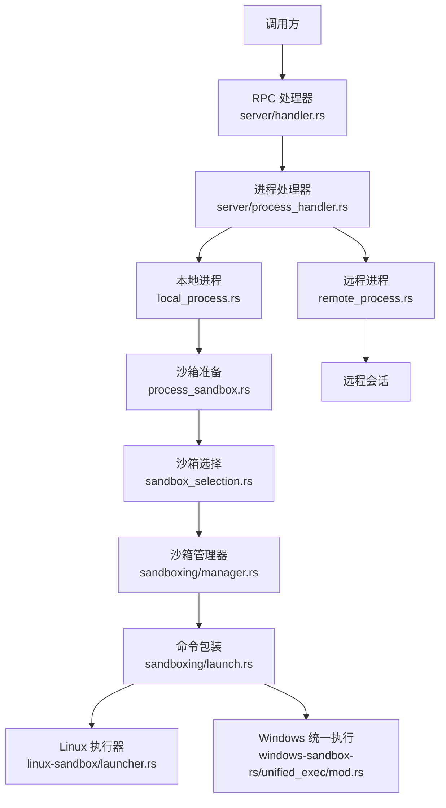
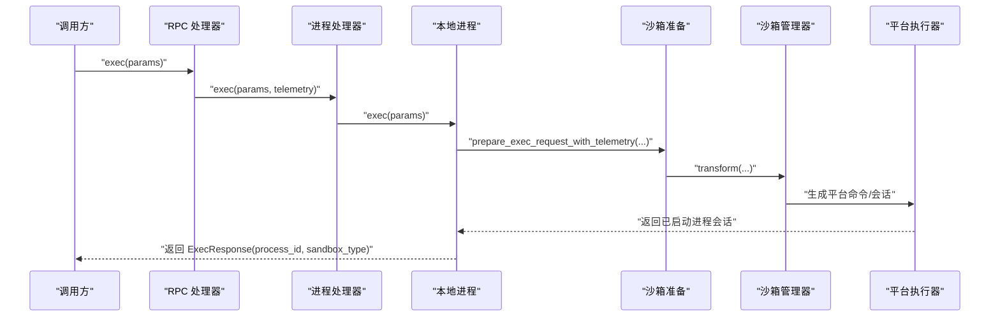
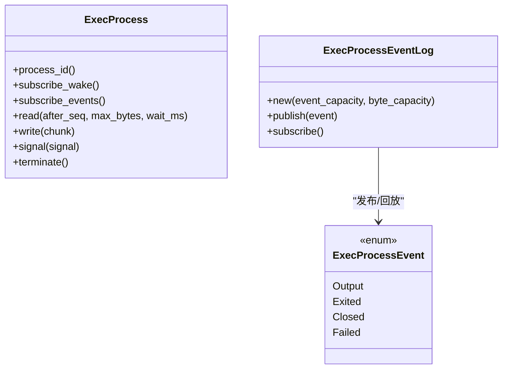
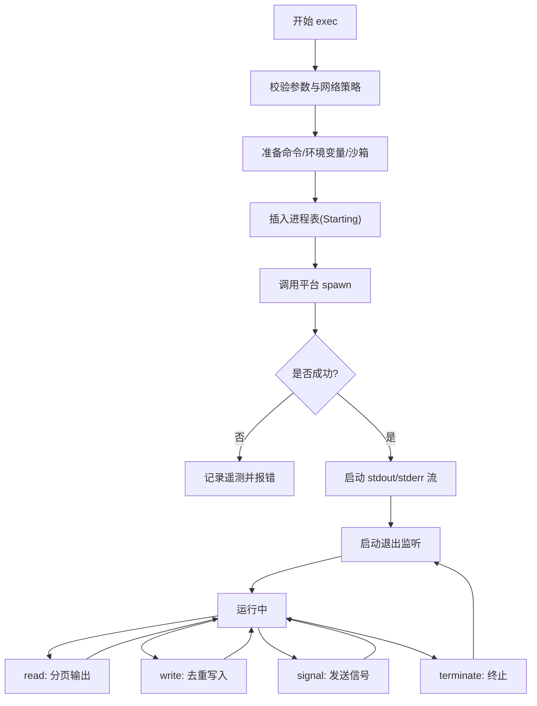
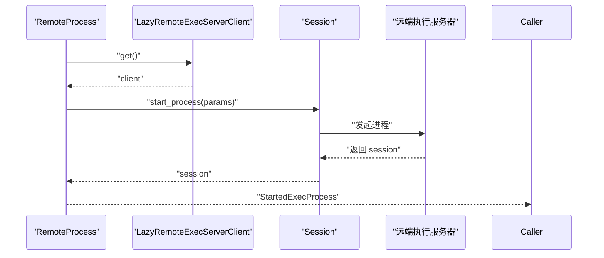
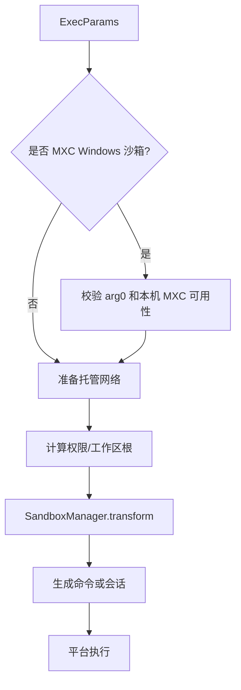
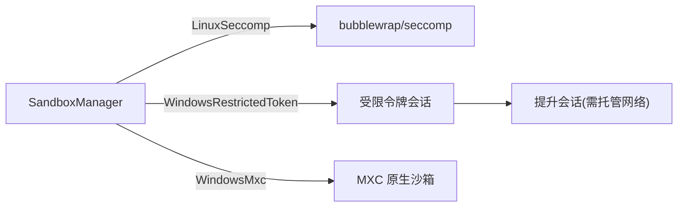
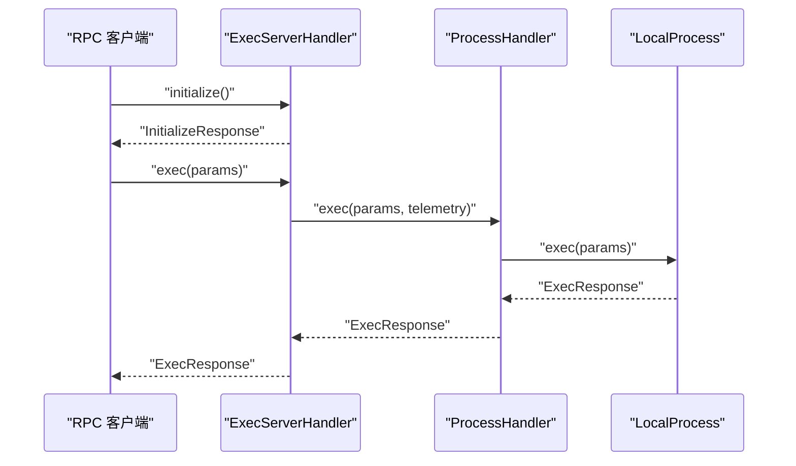
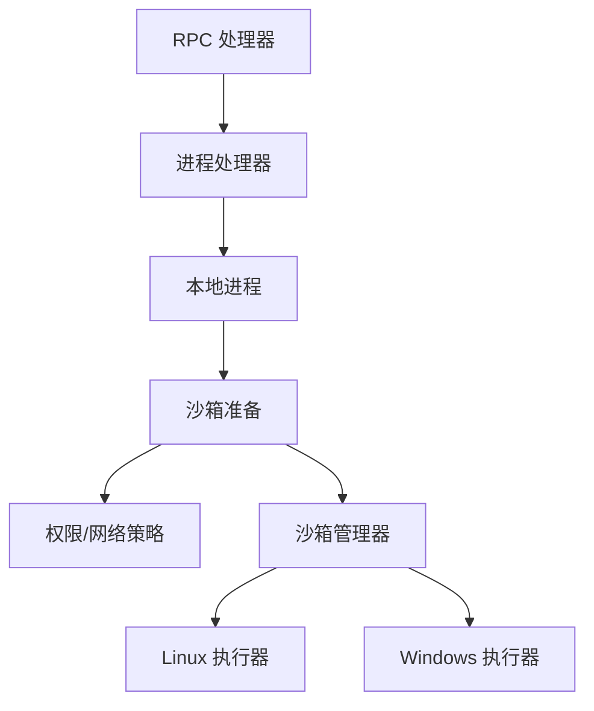

# 进程管理

<cite>
**本文引用的文件**   
- [exec-server/src/lib.rs](file://codex-rs/exec-server/src/lib.rs)
- [exec-server/src/server/handler.rs](file://codex-rs/exec-server/src/server/handler.rs)
- [exec-server/src/server/process_handler.rs](file://codex-rs/exec-server/src/server/process_handler.rs)
- [exec-server/src/local_process.rs](file://codex-rs/exec-server/src/local_process.rs)
- [exec-server/src/remote_process.rs](file://codex-rs/exec-server/src/remote_process.rs)
- [exec-server/src/process.rs](file://codex-rs/exec-server/src/process.rs)
- [exec-server/src/process_sandbox.rs](file://codex-rs/exec-server/src/process_sandbox.rs)
- [exec-server/src/sandbox_selection.rs](file://codex-rs/exec-server/src/sandbox_selection.rs)
- [exec-server/src/environment.rs](file://codex-rs/exec-server/src/environment.rs)
- [exec-server/src/process_telemetry.rs](file://codex-rs/exec-server/src/process_telemetry.rs)
- [sandboxing/src/manager.rs](file://codex-rs/sandboxing/src/manager.rs)
- [sandboxing/src/launch.rs](file://codex-rs/sandboxing/src/launch.rs)
- [linux-sandbox/src/launcher.rs](file://codex-rs/linux-sandbox/src/launcher.rs)
- [windows-sandbox-rs/src/unified_exec/mod.rs](file://codex-rs/windows-sandbox-rs/src/unified_exec/mod.rs)
</cite>

## 目录
1. [简介](#简介)
2. [项目结构](#项目结构)
3. [核心组件](#核心组件)
4. [架构总览](#架构总览)
5. [详细组件分析](#详细组件分析)
6. [依赖关系分析](#依赖关系分析)
7. [性能与资源限制](#性能与资源限制)
8. [故障排查指南](#故障排查指南)
9. [结论](#结论)

## 简介
本文聚焦执行服务器的进程管理能力，系统说明本地进程与远程进程的创建、监控、终止机制；解释进程生命周期、资源限制、超时控制、沙箱隔离、权限控制、文件系统访问限制；并给出启动进程、获取输出流、处理退出的实践路径。文档同时覆盖进程间通信、信号处理、环境变量继承、网络代理策略、性能优化建议、故障排查方法与监控指标配置。

## 项目结构
执行服务器将“进程抽象”“本地实现”“远程实现”“沙箱准备”“平台执行器”分层组织：

- 抽象层
  - `process.rs`：定义进程句柄、事件日志、后端接口。
- 执行层
  - `local_process.rs`：本地进程创建、标准 I/O 流式处理、退出监听、输入去重、信号与终止。
  - `remote_process.rs`：通过远程会话转发进程命令、读、写、信号、终止。
- 沙箱与权限
  - `process_sandbox.rs`：准备受控网络、权限、工作区根、Windows/Mac/Linux 沙箱参数。
  - `sandbox_selection.rs`：根据权限和运行时能力选择具体沙箱类型。
  - `sandboxing/src/manager.rs`、`sandboxing/src/launch.rs`：统一转换请求为平台可执行的命令或会话。
  - `linux-sandbox/src/launcher.rs`：Linux 下 bubblewrap/seccomp 执行桥。
  - `windows-sandbox-rs/src/unified_exec/mod.rs`：Windows 受限令牌/提升会话统一入口。
- 服务接入
  - `server/handler.rs`、`server/process_handler.rs`：RPC 处理器映射到本地/远程进程。
  - `environment.rs`：环境注册、本地/远端执行后端选择。
  - `lib.rs`：对外导出进程相关公共类型。

**图表来源**
- [exec-server/src/server/handler.rs:200-270](file://codex-rs/exec-server/src/server/handler.rs#L200-L270)
- [exec-server/src/server/process_handler.rs:1-81](file://codex-rs/exec-server/src/server/process_handler.rs#L1-L81)
- [exec-server/src/local_process.rs:200-420](file://codex-rs/exec-server/src/local_process.rs#L200-L420)
- [exec-server/src/remote_process.rs:1-137](file://codex-rs/exec-server/src/remote_process.rs#L1-L137)
- [exec-server/src/process_sandbox.rs:200-489](file://codex-rs/exec-server/src/process_sandbox.rs#L200-L489)
- [exec-server/src/sandbox_selection.rs:1-46](file://codex-rs/exec-server/src/sandbox_selection.rs#L1-L46)
- [sandboxing/src/manager.rs:200-500](file://codex-rs/sandboxing/src/manager.rs#L200-L500)
- [sandboxing/src/launch.rs:1-106](file://codex-rs/sandboxing/src/launch.rs#L1-L106)
- [linux-sandbox/src/launcher.rs:1-200](file://codex-rs/linux-sandbox/src/launcher.rs#L1-L200)
- [windows-sandbox-rs/src/unified_exec/mod.rs:1-189](file://codex-rs/windows-sandbox-rs/src/unified_exec/mod.rs#L1-L189)

**章节来源**
- [exec-server/src/lib.rs:1-120](file://codex-rs/exec-server/src/lib.rs#L1-L120)

## 核心组件
- 进程抽象
  - `StartedExecProcess`：封装实际进程句柄与沙箱类型。
  - `ExecProcess`：统一进程操作接口，包括 ID、唤醒通知、事件订阅、读取输出、写入标准输入、发送信号、终止。
  - `ExecBackend`：启动进程的后端抽象，支持本地与远程两种实现，并预留网络策略决策扩展点。
- 本地进程
  - `LocalProcess`：维护进程表、输出缓存、事件日志、遥测、网络代理句柄、Unix shell 快照缓存。
  - `RunningProcess`：表示运行中的子进程会话、TTY/管道模式、已接受 stdin 写 ID 集合、输出序列号、退出码、通知器等。
- 远程进程
  - `RemoteProcess`：延迟连接远程执行服务器，发起进程、转发读写信号终止。
  - `RemoteExecProcess`：基于远程会话的进程句柄。
- 沙箱与权限
  - `PreparedExecRequest`：准备后的命令、工作目录、环境变量、arg0、沙箱类型、网络代理句柄、Windows 沙箱附加信息。
  - `select_sandbox`：根据权限、Windows 沙箱选择、托管网络需求决定最终沙箱类型。
  - `prepare_managed_network`：构建网络代理状态、可选策略决策器和审计观察者、凭据掩码处理。
- 平台执行
  - `SandboxManager::transform`：将逻辑请求转换为平台命令或会话。
  - Linux：bubblewrap + seccomp。
  - Windows：受限令牌或提升会话统一执行。

**章节来源**
- [exec-server/src/process.rs:1-317](file://codex-rs/exec-server/src/process.rs#L1-L317)
- [exec-server/src/local_process.rs:1-220](file://codex-rs/exec-server/src/local_process.rs#L1-L220)
- [exec-server/src/remote_process.rs:1-137](file://codex-rs/exec-server/src/remote_process.rs#L1-L137)
- [exec-server/src/process_sandbox.rs:1-200](file://codex-rs/exec-server/src/process_sandbox.rs#L1-L200)
- [exec-server/src/sandbox_selection.rs:1-46](file://codex-rs/exec-server/src/sandbox_selection.rs#L1-L46)
- [sandboxing/src/manager.rs:1-200](file://codex-rs/sandboxing/src/manager.rs#L1-L200)

## 架构总览
执行服务器提供统一的进程管理 API，底层由本地或远程后端实现。本地后端负责真正创建子进程，应用沙箱、权限和网络策略，并将标准输出/错误/伪终端数据以增量事件和分页读取两种方式暴露给上层。远程后端则将进程操作委托给远端执行服务器，自身只维护会话。

**图表来源**
- [exec-server/src/server/handler.rs:200-270](file://codex-rs/exec-server/src/server/handler.rs#L200-L270)
- [exec-server/src/server/process_handler.rs:1-81](file://codex-rs/exec-server/src/server/process_handler.rs#L1-L81)
- [exec-server/src/local_process.rs:200-420](file://codex-rs/exec-server/src/local_process.rs#L200-L420)
- [exec-server/src/process_sandbox.rs:200-489](file://codex-rs/exec-server/src/process_sandbox.rs#L200-L489)
- [sandboxing/src/manager.rs:200-500](file://codex-rs/sandboxing/src/manager.rs#L200-L500)

## 详细组件分析

### 进程抽象与事件模型
- `ExecProcess` 提供：
  - `process_id`：进程标识符。
  - `subscribe_wake`：当有新输出或状态变化时通知。
  - `subscribe_events`：推送式事件流，包含输出、退出、关闭、失败。
  - `read`：拉取式分页输出，支持按序列号、最大字节数和等待时间。
  - `write`：向子进程标准输入写入。
  - `signal`：发送信号。
  - `terminate`：终止进程。
- `ExecProcessEventLog` 是带容量限制的广播历史：
  - 按事件数量和保留字节数双阈值淘汰旧事件。
  - 新订阅者先回放历史，再消费实时事件。
  - `Failed` 事件不携带序列号，因为它是客户端侧传输失败合成事件。

**图表来源**
- [exec-server/src/process.rs:1-317](file://codex-rs/exec-server/src/process.rs#L1-L317)

**章节来源**
- [exec-server/src/process.rs:1-317](file://codex-rs/exec-server/src/process.rs#L1-L317)

### 本地进程生命周期
本地进程的生命周期分为四个阶段：

1. **准备阶段**
   - 校验网络策略决策超时是否为非零。
   - 校验启用回调时的进程 ID 长度限制。
   - 构造网络策略决策器与审计观察者。
   - 调用 `prepare_exec_request_with_telemetry` 准备命令、工作目录、环境变量、沙箱类型和网络代理。
   - Unix 上可预生成 shell 快照，并在后续继承文件描述符。

2. **启动阶段**
   - 在进程表中插入“正在启动”条目，避免重复进程 ID。
   - 调用 `codex_sandboxing::spawn_process` 真正创建子进程。
   - 启动两个输出流协程分别处理 stdout/stderr 或 PTY。
   - 启动退出监听协程，记录遥测并清理资源。

3. **运行阶段**
   - `read`：从内部缓冲队列中筛选 `after_seq` 之后的片段，按 `max_bytes` 截断，支持 `wait_ms` 轮询等待。
   - `write`：对同一进程的标准输入写进行 `write_id` 去重，防止重连重试导致重复写入。
   - `signal`：将协议信号映射为 PTY 信号。
   - `terminate`：取消网络策略守护任务，标记终止，调用会话终止。

4. **结束阶段**
   - 输出流结束后触发关闭事件。
   - 退出协程发出 `Exited` 与 `Closed` 事件。
   - 从进程表移除或保留退出态（测试场景保留更短）。

**图表来源**
- [exec-server/src/local_process.rs:200-420](file://codex-rs/exec-server/src/local_process.rs#L200-L420)
- [exec-server/src/local_process.rs:600-1071](file://codex-rs/exec-server/src/local_process.rs#L600-L1071)

**章节来源**
- [exec-server/src/local_process.rs:200-420](file://codex-rs/exec-server/src/local_process.rs#L200-L420)
- [exec-server/src/local_process.rs:600-1071](file://codex-rs/exec-server/src/local_process.rs#L600-L1071)

### 远程进程生命周期
远程进程不直接创建子进程，而是通过远程会话完成：

- 启动：`RemoteProcess.start` 获取远程客户端会话，调用 `start_process`，并把远端返回的沙箱类型映射为本地枚举。
- 操作：`read`、`write`、`signal`、`terminate` 均转发到远端会话。
- 资源释放：`Drop` 时取消控制器侧网络策略决策，并异步注销会话。

**图表来源**
- [exec-server/src/remote_process.rs:1-137](file://codex-rs/exec-server/src/remote_process.rs#L1-L137)

**章节来源**
- [exec-server/src/remote_process.rs:1-137](file://codex-rs/exec-server/src/remote_process.rs#L1-L137)

### 沙箱隔离、权限控制与文件系统访问
沙箱准备流程由 `process_sandbox.rs` 主导：

- 若未配置沙箱上下文，则返回无沙箱执行。
- 若指定 MXC Windows 沙箱，要求本机具备原生 MXC 能力，且不允许自定义 `argv0`。
- 解析工作目录与工作区根，校验 Path URI 有效性。
- 若启用托管网络，则注入可信 CA bundle 可读根。
- Unix 上将权限转换为运行时文件系统与网络策略，并追加辅助程序可读路径。
- 使用 `SandboxManager.transform` 生成最终命令或会话。
- 对于 Windows 受限令牌沙箱，进一步准备权限档案、工作区根、代理强制标志、SID 限制、代理设置模式和文件系统覆盖。

**图表来源**
- [exec-server/src/process_sandbox.rs:200-489](file://codex-rs/exec-server/src/process_sandbox.rs#L200-L489)
- [sandboxing/src/manager.rs:200-500](file://codex-rs/sandboxing/src/manager.rs#L200-L500)

**章节来源**
- [exec-server/src/process_sandbox.rs:200-489](file://codex-rs/exec-server/src/process_sandbox.rs#L200-L489)
- [sandboxing/src/manager.rs:200-500](file://codex-rs/sandboxing/src/manager.rs#L200-L500)

### 平台执行器：Linux 与 Windows
- Linux
  - 通过 bubblewrap 和 seccomp 组合执行。
  - launcher 自动检测系统 bubblewrap 或内置版本，并对旧版 fd mount 参数做兼容转换。
  - 支持 argv0 透传和只读 fd 挂载验证。
- Windows
  - 统一执行模块根据 `WindowsSandboxLevel` 选择 legacy 受限令牌或 elevated 提升会话。
  - 提升会话需要托管网络支持；legacy 会话不支持托管网络强制。
  - 支持 TTY、stdin 打开、读取/写入根覆盖、拒绝路径覆盖等。

**图表来源**
- [linux-sandbox/src/launcher.rs:1-200](file://codex-rs/linux-sandbox/src/launcher.rs#L1-L200)
- [windows-sandbox-rs/src/unified_exec/mod.rs:1-189](file://codex-rs/windows-sandbox-rs/src/unified_exec/mod.rs#L1-L189)
- [sandboxing/src/manager.rs:200-500](file://codex-rs/sandboxing/src/manager.rs#L200-L500)

**章节来源**
- [linux-sandbox/src/launcher.rs:1-200](file://codex-rs/linux-sandbox/src/launcher.rs#L1-L200)
- [windows-sandbox-rs/src/unified_exec/mod.rs:1-189](file://codex-rs/windows-sandbox-rs/src/unified_exec/mod.rs#L1-L189)

### RPC 处理器与服务接入
- `ExecServerHandler`：初始化会话、路由 exec/read/write/signal/terminate 等 RPC。
- `ProcessHandler`：封装 `LocalProcess`，统一调用生命周期方法。
- `EnvironmentManager`：管理本地与远程执行环境，默认保留 `CODEX_EXEC_SERVER_URL` 行为。

**图表来源**
- [exec-server/src/server/handler.rs:1-200](file://codex-rs/exec-server/src/server/handler.rs#L1-L200)
- [exec-server/src/server/handler.rs:200-400](file://codex-rs/exec-server/src/server/handler.rs#L200-L400)
- [exec-server/src/server/process_handler.rs:1-81](file://codex-rs/exec-server/src/server/process_handler.rs#L1-L81)

**章节来源**
- [exec-server/src/server/handler.rs:1-200](file://codex-rs/exec-server/src/server/handler.rs#L1-L200)
- [exec-server/src/server/handler.rs:200-400](file://codex-rs/exec-server/src/server/handler.rs#L200-L400)
- [exec-server/src/server/process_handler.rs:1-81](file://codex-rs/exec-server/src/server/process_handler.rs#L1-L81)
- [exec-server/src/environment.rs:1-200](file://codex-rs/exec-server/src/environment.rs#L1-L200)

## 依赖关系分析
- 高层 RPC 处理器依赖进程处理器。
- 进程处理器依赖本地进程实现。
- 本地进程依赖沙箱准备模块与平台执行器。
- 沙箱准备依赖权限模型、网络代理、工作区根解析。
- 平台执行器依赖 Linux bubblewrap 或 Windows 统一执行模块。

**图表来源**
- [exec-server/src/server/handler.rs:200-400](file://codex-rs/exec-server/src/server/handler.rs#L200-L400)
- [exec-server/src/server/process_handler.rs:1-81](file://codex-rs/exec-server/src/server/process_handler.rs#L1-L81)
- [exec-server/src/local_process.rs:200-420](file://codex-rs/exec-server/src/local_process.rs#L200-L420)
- [exec-server/src/process_sandbox.rs:200-489](file://codex-rs/exec-server/src/process_sandbox.rs#L200-L489)
- [sandboxing/src/manager.rs:200-500](file://codex-rs/sandboxing/src/manager.rs#L200-L500)

**章节来源**
- [exec-server/src/server/handler.rs:200-400](file://codex-rs/exec-server/src/server/handler.rs#L200-L400)
- [exec-server/src/local_process.rs:200-420](file://codex-rs/exec-server/src/local_process.rs#L200-L420)
- [exec-server/src/process_sandbox.rs:200-489](file://codex-rs/exec-server/src/process_sandbox.rs#L200-L489)
- [sandboxing/src/manager.rs:200-500](file://codex-rs/sandboxing/src/manager.rs#L200-L500)

## 性能与资源限制
- 输出缓存
  - 每进程最多保留约 1MB 输出字节和固定数量的输出片段，超出后淘汰最早片段。
  - 这保证长时间运行的进程不会无限增长内存。
- 事件回放
  - 事件日志按事件数量和保留字节数双阈值限制，避免大量小事件和大块输出造成积压。
- 输入去重
  - 每进程维护已接受的 stdin 写 ID 集合，支持重连重试而不重复写入。
- 通知通道
  - 通知通道与进程事件通道采用有界容量，避免背压阻塞。
- 网络策略
  - 网络策略决策超时必须非零；启用回调时进程 ID 必须非空且不超过上限。
  - 托管网络可启用凭据掩码，必要时恢复并禁用代理凭据，避免敏感信息泄露。
- 遥测
  - 进程启动、失败、退出、沙箱拒绝等关键事件附带 trace/span/thread/tool_call/executor 字段，便于追踪。

优化建议：
- 合理设置 `max_bytes` 和 `wait_ms`，避免频繁拉取大输出。
- 使用事件订阅 `subscribe_events` 替代高频轮询 `read`，降低 RPC 开销。
- 避免让子进程产生超大单条输出；分片输出可减少回溯成本。
- 谨慎开启托管网络凭据掩码，确保 shell 启动脚本兼容性。
- 使用 `prewarm_shell_snapshot` 预热 shell 快照以降低首次执行开销，但不可与托管网络同时使用。

**章节来源**
- [exec-server/src/local_process.rs:1-220](file://codex-rs/exec-server/src/local_process.rs#L1-L220)
- [exec-server/src/local_process.rs:600-1071](file://codex-rs/exec-server/src/local_process.rs#L600-L1071)
- [exec-server/src/process.rs:1-317](file://codex-rs/exec-server/src/process.rs#L1-L317)
- [exec-server/src/process_telemetry.rs:1-82](file://codex-rs/exec-server/src/process_telemetry.rs#L1-L82)

## 故障排查指南
常见问题与定位步骤：

1. **进程无法启动**
   - 检查命令行是否为空、工作目录 URI 是否有效。
   - 检查沙箱意图是否能在当前执行器强制执行。
   - 检查 Windows MXC 是否可用，或 Linux bubblewrap 是否存在。
   - 查看 `process_spawn_failed` 遥测事件。

2. **输出缺失或顺序错乱**
   - 确认使用正确的 `after_seq` 拉取，或使用事件订阅。
   - 检查输出保留阈值是否过小导致早期片段被回收。
   - 注意 `Closed` 事件才表示所有输出流结束。

3. **标准输入写入重复**
   - 确认每次写请求都携带唯一 `write_id`。
   - 检查重连重试是否复用相同 `write_id`，服务端会去重。

4. **信号无效**
   - 仅支持中断类信号映射到 PTY。
   - 进程已退出时信号会被忽略。

5. **终止不生效**
   - 检查是否已经收到退出码。
   - 检查是否启用了网络策略守护任务，终止时应取消该任务。

6. **沙箱拒绝或权限不足**
   - 检查权限策略是否要求平台沙箱而当前执行器不支持。
   - 检查 Windows 托管网络是否要求提升会话。
   - 查看 `sandbox_denied` 与 `codex.exec_server.sandbox_denied` 遥测。

7. **环境变量问题**
   - 使用 `env_policy` 控制继承、排除、包含、设置。
   - 注意非继承变量和特定元数据变量会被过滤或替换。
   - 线程 ID 与工具调用 ID 会通过元数据注入。

8. **远程进程异常**
   - 检查远端会话是否建立成功。
   - 检查远端返回的沙箱类型是否匹配预期。
   - 检查 `Drop` 是否调用了注销与会话取消。

监控指标与日志关键字：
- `codex.exec_server.process_start`
- `codex.exec_server.process_spawn_failed`
- `codex.exec_server.sandbox_denied`
- `codex.exec_server.process_exit`
- 遥测字段：trace/span、conversation.id、tool.call_id、executor.environment_id、executor.registration_id、sandbox.type、process.exit_code、process.termination_requested。

**章节来源**
- [exec-server/src/process_telemetry.rs:1-82](file://codex-rs/exec-server/src/process_telemetry.rs#L1-L82)
- [exec-server/src/local_process.rs:600-1071](file://codex-rs/exec-server/src/local_process.rs#L600-L1071)
- [exec-server/src/process_sandbox.rs:200-489](file://codex-rs/exec-server/src/process_sandbox.rs#L200-L489)
- [exec-server/src/remote_process.rs:1-137](file://codex-rs/exec-server/src/remote_process.rs#L1-L137)

## 结论
执行服务器的进程管理以抽象后端为核心，统一本地与远程进程语义，并通过沙箱管理器将权限、工作区、托管网络策略转化为平台可执行命令或会话。本地实现提供可靠的事件流、输出缓存、输入去重、信号与终止控制；远程实现将复杂操作委托给远端执行服务器。结合明确的遥测与错误分类，运维者可高效定位启动失败、输出丢失、权限拒绝、网络策略异常等问题。在生产环境中，应优先使用事件订阅、合理配置输出保留与网络策略，并结合平台沙箱能力获得最佳安全性与性能平衡。