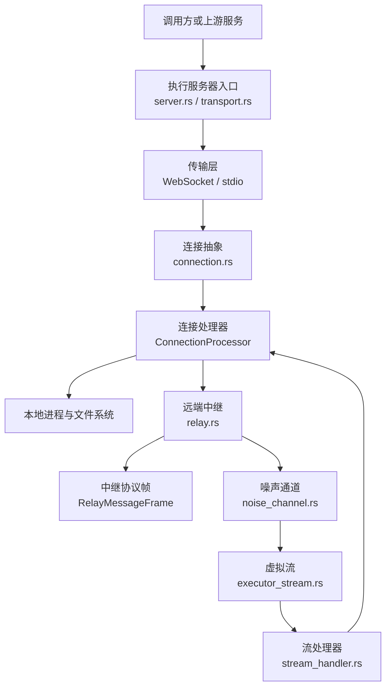
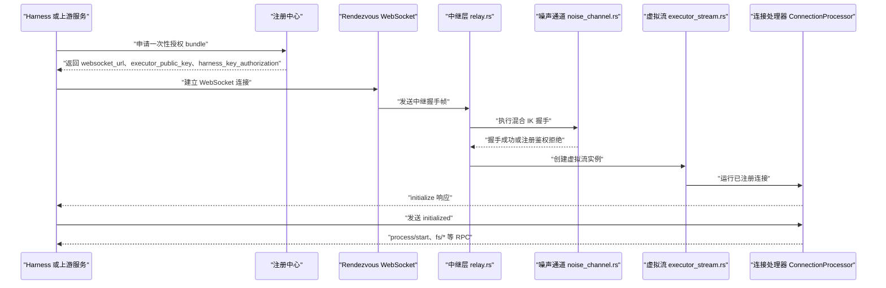
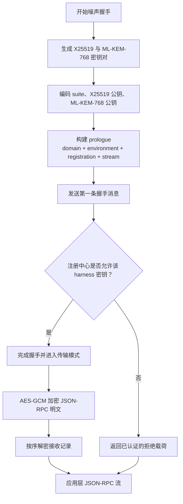
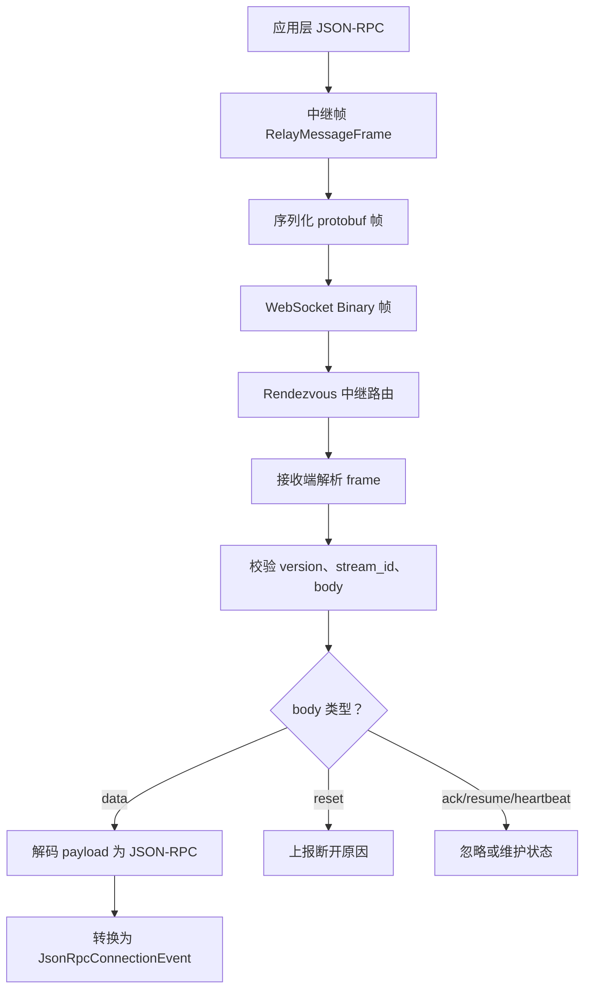
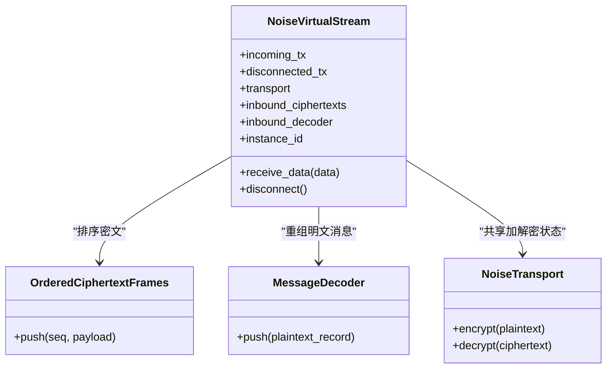
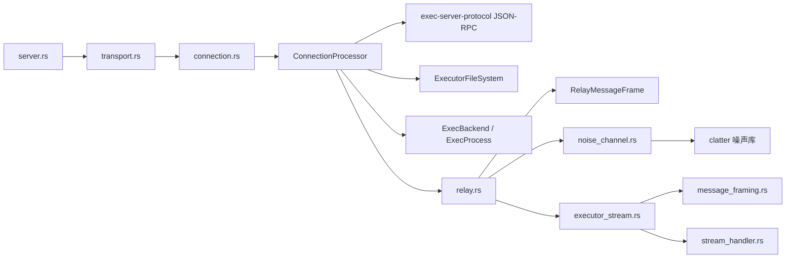
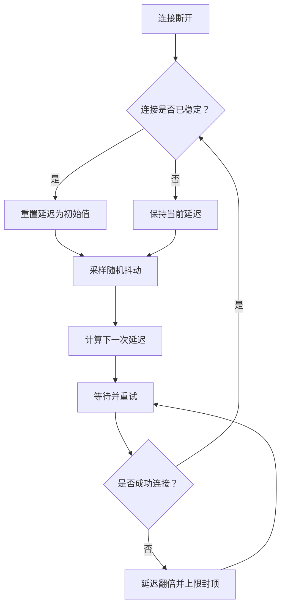

# 远程执行

<cite>
**本文引用的文件**   
- [exec-server/README.md](file://codex-rs/exec-server/README.md)
- [lib.rs](file://codex-rs/exec-server/src/lib.rs)
- [server.rs](file://codex-rs/exec-server/src/server.rs)
- [transport.rs](file://codex-rs/exec-server/src/server/transport.rs)
- [connection.rs](file://codex-rs/exec-server/src/connection.rs)
- [relay.rs](file://codex-rs/exec-server/src/relay.rs)
- [noise_channel.rs](file://codex-rs/exec-server/src/noise_channel.rs)
- [message_framing.rs](file://codex-rs/exec-server/src/noise_relay/message_framing.rs)
- [executor_stream.rs](file://codex-rs/exec-server/src/noise_relay/executor_stream.rs)
- [stream_handler.rs](file://codex-rs/exec-server/src/noise_relay/stream_handler.rs)
- [mod.rs](file://codex-rs/exec-server/src/noise_relay/mod.rs)
- [discovery_v2.rs](file://codex-rs/exec-server/src/environment/discovery_v2.rs)
- [client_api.rs](file://codex-rs/exec-server/src/client_api.rs)
- [reconnect_backoff.rs](file://codex-rs/exec-server/src/remote/reconnect_backoff.rs)
- [connection_diagnostics.rs](file://codex-rs/exec-server/src/remote/connection_diagnostics.rs)
</cite>

## 目录

1. [简介](#简介)
2. [项目结构](#项目结构)
3. [核心组件](#核心组件)
4. [架构总览](#架构总览)
5. [详细组件分析](#详细组件分析)
6. [依赖关系分析](#依赖关系分析)
7. [性能与可靠性](#性能与可靠性)
8. [故障排查指南](#故障排查指南)
9. [部署与安全配置](#部署与安全配置)
10. [结论](#结论)

## 简介

本文围绕 `codex-exec-server` 的远程执行能力展开，重点解释以下主题：

- **噪声通道加密**：基于混合密钥协商的 Noise 握手、会话密钥建立和 AES-GCM 数据记录加密。
- **中继服务与连接管理**：rendezvous WebSocket、虚拟流、流 ID 复用、心跳保活与断线重连。
- **远程连接建立、身份认证与会话管理**：注册凭证、代理密钥校验、`initialize`/`initialized` 生命周期。
- **消息路由、流式传输与断线重连**：JSON-RPC 到中继帧的映射、分片与重组、序列号与确认语义。
- **负载均衡、故障转移与性能监控**：并发请求限制、连接稳定化退避、OpenTelemetry 追踪。
- **部署指南、安全配置与运维最佳实践**：WebSocket 监听、认证、TLS、网络策略与诊断。

`codex-exec-server` 既可作为本地 JSON-RPC 服务器运行，也可通过 rendezvous 注册为远端环境，承载多个虚拟执行会话。

**章节来源**
- [exec-server/README.md:1-50](file://codex-rs/exec-server/README.md#L1-L50)
- [lib.rs:1-50](file://codex-rs/exec-server/src/lib.rs#L1-L50)

## 项目结构

`exec-server` crate 将远程执行拆分为多个职责清晰的模块：

| 模块 | 主要职责 |
|---|---|
| `server` | 启动 HTTP/WebSocket 监听、认证中间件、就绪探针、处理器装配 |
| `connection` | 统一 JSON-RPC 连接抽象、事件模型、stdio 与 WebSocket 适配 |
| `relay` | rendezvous WebSocket 接入、中继帧解析、Keepalive、事件转发 |
| `noise_channel` | Noise 混合 IK 握手、静态密钥对、AES-GCM 传输对象 |
| `noise_relay` | 虚拟流、消息分片、有序密文重组、流处理器接口 |
| `environment` | 远端环境发现、会话元信息、能力探测 |
| `remote` | 重连退避、连接诊断、注册重试等辅助逻辑 |
| `client_api` | 客户端连接参数、Noise rendezvous 授权包、HTTP 能力抽象 |

**图表来源**
- [server.rs:1-119](file://codex-rs/exec-server/src/server.rs#L1-L119)
- [transport.rs:1-120](file://codex-rs/exec-server/src/server/transport.rs#L1-L120)
- [connection.rs:1-60](file://codex-rs/exec-server/src/connection.rs#L1-L60)
- [relay.rs:1-80](file://codex-rs/exec-server/src/relay.rs#L1-L80)
- [noise_channel.rs:1-40](file://codex-rs/exec-server/src/noise_channel.rs#L1-L40)
- [executor_stream.rs:1-40](file://codex-rs/exec-server/src/noise_relay/executor_stream.rs#L1-L40)
- [stream_handler.rs:1-40](file://codex-rs/exec-server/src/noise_relay/stream_handler.rs#L1-L40)

**章节来源**
- [lib.rs:1-50](file://codex-rs/exec-server/src/lib.rs#L1-L50)

## 核心组件

### 服务器入口与传输层

`run_main` 是嵌入模式下的主入口；`run_main_with_telemetry` 暴露更完整的遥测、请求分发模式和 WebSocket 认证配置。它最终调用 `transport::run_transport`，根据监听地址选择 WebSocket 或 stdio。

- WebSocket 模式绑定 TCP 端口，使用 Axum 路由 `/` 进行 WebSocket 升级，并提供 `/readyz` 就绪探针。
- stdio 模式只接受一个连接，并在连接结束后关闭处理器。
- WebSocket 升级前会检查可选的认证策略，并拒绝携带 `Origin` 头的外部浏览器请求。

**章节来源**
- [server.rs:1-119](file://codex-rs/exec-server/src/server.rs#L1-L119)
- [transport.rs:1-120](file://codex-rs/exec-server/src/server/transport.rs#L1-L120)
- [transport.rs:200-274](file://codex-rs/exec-server/src/server/transport.rs#L200-L274)

### 连接抽象与事件模型

`JsonRpcConnection` 统一封装出站通道、入站接收器、断开通知和底层任务句柄。它支持：

- WebSocket 连接
- stdio 子进程管道
- 由中继包装的连接

`JsonRpcConnectionEvent` 将原始 JSON-RPC 消息、排队请求、畸形消息和断开事件标准化。收到请求时会创建 OpenTelemetry span，并将 W3C trace context 注入到 span 中。

**章节来源**
- [connection.rs:1-120](file://codex-rs/exec-server/src/connection.rs#L1-L120)

### 中继与虚拟流

中继负责在受信任的 rendezvous WebSocket 上复用多个执行会话：

- 每个会话有独立的 `stream_id`。
- 上行按序号递增发送中继数据帧。
- 下行先校验版本、流 ID 和 body，再解码 JSON-RPC。
- 心跳使用 WebSocket Ping/Pong，防止长连接被中间设备回收。

虚拟流在噪声通道之上实现应用级分片和重组：

- 每条虚拟流共享同一个 `NoiseTransport`。
- 入站按序列号排序后解密。
- 出站按固定大小的 Noise 明文记录切分，并为每条记录分配单调递增序列号。

**章节来源**
- [relay.rs:1-120](file://codex-rs/exec-server/src/relay.rs#L1-L120)
- [executor_stream.rs:1-60](file://codex-rs/exec-server/src/noise_relay/executor_stream.rs#L1-L60)
- [message_framing.rs:1-80](file://codex-rs/exec-server/src/noise_relay/message_framing.rs#L1-L80)

### 噪声通道加密

噪声通道用于保护 rendezvous 上的应用负载：

- 套件名称固定，包含 X25519 与 ML-KEM-768 两种密钥协商算法。
- 使用 clatter 库实现混合 IK 握手。
- 握手成功后使用 AES-GCM 提供有序传输记录。
- prologue 绑定 environment、executor registration 和 stream_id，避免跨会话混淆。

**章节来源**
- [noise_channel.rs:1-60](file://codex-rs/exec-server/src/noise_channel.rs#L1-L60)
- [noise_channel.rs:201-343](file://codex-rs/exec-server/src/noise_channel.rs#L201-L343)

### 远端环境与能力发现

远端环境通过 `Environment` 抽象统一管理本地或远程执行会话。DiscoveryV2 提供无需激活的能力清单查询，并要求 executor 版本至少为 `0.164.0`。能力发现失败时可结合连接状态恢复机制重试。

**章节来源**
- [discovery_v2.rs:1-62](file://codex-rs/exec-server/src/environment/discovery_v2.rs#L1-L62)

### 客户端连接参数

`ExecServerClientConnectOptions`、`RemoteExecServerConnectArgs`、`NoiseRendezvousConnectBundle` 和 `NoiseRendezvousConnectProvider` 共同描述如何连接到远端执行服务器：

- WebSocket URL 直连
- 通过 registry 获取一次性授权 bundle
- 每次物理连接使用新的 authorization bundle
- 可传入自定义 HTTP client factory

**章节来源**
- [client_api.rs:1-187](file://codex-rs/exec-server/src/client_api.rs#L1-L187)

## 架构总览

下图展示一次典型远端执行的生命周期：上游服务或 harness 通过 rendezvous 建立物理连接，完成噪声握手，然后复用该物理连接承载多个虚拟流。

**图表来源**
- [client_api.rs:40-120](file://codex-rs/exec-server/src/client_api.rs#L40-L120)
- [relay.rs:120-220](file://codex-rs/exec-server/src/relay.rs#L120-L220)
- [noise_channel.rs:60-160](file://codex-rs/exec-server/src/noise_channel.rs#L60-L160)
- [executor_stream.rs:60-140](file://codex-rs/exec-server/src/noise_relay/executor_stream.rs#L60-L140)
- [stream_handler.rs:40-98](file://codex-rs/exec-server/src/noise_relay/stream_handler.rs#L40-L98)

## 详细组件分析

### 噪声通道加密流程

噪声通道是远程执行的安全边界。它不是普通 TLS，而是在应用层对 JSON-RPC 消息再次加密，适合在受控的中继环境中复用长连接。

#### 关键设计要点

| 要素 | 说明 |
|---|---|
| 套件 | `Noise_hybridIK_X25519+MLKEM768_AESGCM_SHA256` |
| 密钥协商 | X25519 + ML-KEM-768 混合密钥封装 |
| 握手模式 | Hybrid IK，服务端持有静态密钥，客户端验证服务端公钥 |
| 数据加密 | AES-GCM 有序传输记录 |
| Prologue | 绑定 domain、environment_id、executor_registration_id、stream_id |
| 错误处理 | 区分密钥生成、公钥无效、消息过大、握手失败、传输失败 |

**图表来源**
- [noise_channel.rs:1-120](file://codex-rs/exec-server/src/noise_channel.rs#L1-L120)
- [noise_channel.rs:201-343](file://codex-rs/exec-server/src/noise_channel.rs#L201-L343)

#### 代码示例路径

- 生成噪声身份：`NoiseChannelIdentity::generate`
- 导出公钥：`NoiseChannelIdentity::public_key`
- 构建 prologue：`noise_channel_prologue(environment_id, executor_registration_id, stream_id)`
- 发起握手：`InitiatorHandshake::start`
- 完成握手：`InitiatorHandshake::finish`
- 接收握手：`PendingResponderHandshake::read_request`
- 完成应答：`PendingResponderHandshake::complete`
- 注册鉴权拒绝：`PendingResponderHandshake::reject_registry_authentication`
- 加解密：`NoiseTransport::encrypt`、`NoiseTransport::decrypt`

**章节来源**
- [noise_channel.rs:1-343](file://codex-rs/exec-server/src/noise_channel.rs#L1-L343)

### 中继协议与消息路由

中继协议定义在 `RelayMessageFrame`，其 wire 格式包含：

| 字段 | 用途 |
|---|---|
| `version` | 中继协议版本，当前为 `1` |
| `stream_id` | 虚拟会话标识，由 harness 生成 UUIDv4 |
| `traceparent` | 可选 W3C trace parent |
| `tracestate` | 可选 W3C vendor state |
| `body` | handshake、data、ack_frame、resume、reset、heartbeat |
| `seq` | data 体中的分段序列号 |
| `segment_index` | 消息内分段索引 |
| `segment_count` | 消息总分段数 |
| `payload` | 握手字节或加密数据记录 |
| `next_seq` | resume 时下一期望序列号 |
| `reason` | reset 原因 |

**图表来源**
- [relay.rs:1-220](file://codex-rs/exec-server/src/relay.rs#L1-L220)

#### 代码示例路径

- 构造数据帧：`RelayMessageFrame::data`
- 构造握手帧：`RelayMessageFrame::handshake`
- 构造重置帧：`RelayMessageFrame::reset`
- 构造恢复帧：`RelayMessageFrame::resume`
- 编码帧：`encode_relay_message_frame`
- 解码帧：`decode_relay_message_frame`
- 从 WebSocket 建立中继连接：`harness_connection_from_websocket`

**章节来源**
- [relay.rs:1-220](file://codex-rs/exec-server/src/relay.rs#L1-L220)

### 虚拟流、分片与断线重连

虚拟流解决两个问题：

1. 单次 Noise 明文记录长度有限，需要把较大的 JSON-RPC 消息切分成多条记录。
2. 网络乱序到达时，需要按序列号重新排序后再解密和重组。

**图表来源**
- [executor_stream.rs:1-120](file://codex-rs/exec-server/src/noise_relay/executor_stream.rs#L1-L120)
- [message_framing.rs:60-159](file://codex-rs/exec-server/src/noise_relay/message_framing.rs#L60-L159)
- [noise_channel.rs:260-343](file://codex-rs/exec-server/src/noise_channel.rs#L260-L343)

#### 代码示例路径

- 创建虚拟流：`spawn_noise_virtual_stream`
- 接收数据：`NoiseVirtualStream::receive_data`
- 断开通知：`NoiseVirtualStream::disconnect`
- 流处理器适配：`NoiseStreamHandler`
- JSON-RPC 分片：`frame_jsonrpc_message`
- 明文记录大小限制：`NOISE_RECORD_PLAINTEXT_LEN`
- 最大 JSON-RPC 消息长度：`MAX_NOISE_JSONRPC_MESSAGE_LEN`

**章节来源**
- [executor_stream.rs:1-195](file://codex-rs/exec-server/src/noise_relay/executor_stream.rs#L1-L195)
- [message_framing.rs:1-159](file://codex-rs/exec-server/src/noise_relay/message_framing.rs#L1-L159)
- [stream_handler.rs:1-98](file://codex-rs/exec-server/src/noise_relay/stream_handler.rs#L1-L98)

### 连接建立与身份认证

远端执行存在多种连接方式：

| 连接方式 | 适用场景 | 认证方式 |
|---|---|---|
| WebSocket 直连 | 本地或可信网络 | 可选 `Authorization: Bearer TOKEN` |
| stdio | 嵌入式执行 | 无连接级认证 |
| Noise rendezvous | 远端环境注册 | registry 授权 + harness 密钥校验 |
| Direct AWS SigV4 | AWS 托管注册中心 | AWS SigV4 签名 |

WebSocket 监听器的认证由 `WebsocketAuthSettings` 控制；未启用认证时仍兼容旧行为。注册模式支持：

- `CODEX_API_KEY`
- stdin 写入的一次性注册凭证
- Agent Identity JWT
- AWS SigV4

**章节来源**
- [exec-server/README.md:1-200](file://codex-rs/exec-server/README.md#L1-L200)
- [transport.rs:120-274](file://codex-rs/exec-server/src/server/transport.rs#L120-L274)
- [client_api.rs:40-120](file://codex-rs/exec-server/src/client_api.rs#L40-L120)

### 会话管理与生命周期

本地执行会话遵循明确的生命周期：

1. 客户端发送 `initialize`。
2. 服务器返回 `sessionId` 和 `environmentInfo`。
3. 客户端发送 `initialized`。
4. 随后调用进程或文件系统 RPC。
5. 连接关闭时终止该连接管理的进程。

远端模式下，会话通过 `stream_id` 在 rendezvous 上复用；物理连接断开后可通过注册刷新重建，但请求重放由目标 session 和输出保留策略决定。

**章节来源**
- [exec-server/README.md:201-260](file://codex-rs/exec-server/README.md#L201-L260)

## 依赖关系分析

**图表来源**
- [server.rs:1-119](file://codex-rs/exec-server/src/server.rs#L1-L119)
- [transport.rs:1-120](file://codex-rs/exec-server/src/server/transport.rs#L1-L120)
- [connection.rs:1-120](file://codex-rs/exec-server/src/connection.rs#L1-L120)
- [relay.rs:1-120](file://codex-rs/exec-server/src/relay.rs#L1-L120)
- [noise_channel.rs:1-60](file://codex-rs/exec-server/src/noise_channel.rs#L1-L60)
- [executor_stream.rs:1-60](file://codex-rs/exec-server/src/noise_relay/executor_stream.rs#L1-L60)
- [message_framing.rs:1-60](file://codex-rs/exec-server/src/noise_relay/message_framing.rs#L1-L60)
- [stream_handler.rs:1-40](file://codex-rs/exec-server/src/noise_relay/stream_handler.rs#L1-L40)

### 耦合与内聚

- `server` 与 `transport` 低耦合：前者负责高层入口，后者负责监听和路由。
- `connection` 抽象屏蔽 WebSocket、stdio 和中继差异，提高处理器复用度。
- `relay` 与 `noise_channel` 解耦：中继只关心帧和事件，不直接处理密钥。
- `noise_relay` 通过 `NoiseStreamHandler` 将虚拟流适配到 `ConnectionProcessor`，便于复用本地连接逻辑。

### 外部依赖

- `clatter`：Noise 混合 IK 握手和 AES-GCM 传输。
- `tokio-tungstenite`：WebSocket 传输。
- `axum`：HTTP/WebSocket 服务器。
- `prost`：中继 protobuf 帧。
- `tracing` / `opentelemetry`：日志与分布式追踪。

**章节来源**
- [lib.rs:1-120](file://codex-rs/exec-server/src/lib.rs#L1-L120)

## 性能与可靠性

### 并发请求

默认串行处理请求；可通过 `--concurrent-requests` 开启并发处理。并发提升吞吐，但会增加内存占用和上下文切换成本。

### 消息大小限制

| 位置 | 限制 |
|---|---|
| 客户端入站 JSON-RPC | `MAX_CLIENT_INBOUND_REQUEST_LEN` |
| 噪声明文记录 | `NOISE_RECORD_PLAINTEXT_LEN` |
| 噪声 JSON-RPC 消息 | `MAX_NOISE_JSONRPC_MESSAGE_LEN` |
| stdio JSON-RPC 单消息 | `MAX_STDIO_JSONRPC_MESSAGE_LEN` |
| 噪声 WebSocket 帧 | `MAX_NOISE_RELAY_WEBSOCKET_MESSAGE_SIZE` |

这些限制防止恶意或异常大消息耗尽内存。

### 心跳与保活

- WebSocket keepalive 间隔在测试环境较短，生产环境较长。
- 中继层向连接发送 Ping，若无法写入则标记断开。
- Pong 超时作为断线原因之一。

### 重连退避

重连退避采用指数退避加随机抖动：

- 初始延迟约 1 秒。
- 最大延迟约 30 秒。
- 稳定连接超过一定时间后回退到初始延迟。
- 每次断开后延迟翻倍，直到上限。

**图表来源**
- [reconnect_backoff.rs:1-42](file://codex-rs/exec-server/src/remote/reconnect_backoff.rs#L1-L42)

**章节来源**
- [exec-server/README.md:201-260](file://codex-rs/exec-server/README.md#L201-L260)
- [message_framing.rs:1-80](file://codex-rs/exec-server/src/noise_relay/message_framing.rs#L1-L80)
- [mod.rs:1-35](file://codex-rs/exec-server/src/noise_relay/mod.rs#L1-L35)
- [connection.rs:1-40](file://codex-rs/exec-server/src/connection.rs#L1-L40)
- [reconnect_backoff.rs:1-42](file://codex-rs/exec-server/src/remote/reconnect_backoff.rs#L1-L42)

## 故障排查指南

### 常见连接失败类型

| 类别 | 含义 | 可能原因 |
|---|---|---|
| `http` | HTTP 握手失败 | 401、403、404、5xx |
| `tls` | TLS 错误 | 证书、SNI、协议版本 |
| `timed_out` | 超时 | 网络不可达或远端无响应 |
| `connection_refused` | 连接被拒绝 | 端口未监听或防火墙拦截 |
| `connection_reset` | 连接重置 | 对端主动断开 |
| `tls_handshake_failed` | TLS 握手失败 | 证书链不完整或根证书缺失 |
| `protocol_error` | 协议错误 | 中继帧格式不正确 |

**章节来源**
- [connection_diagnostics.rs:1-96](file://codex-rs/exec-server/src/remote/connection_diagnostics.rs#L1-L96)

### 调试建议

1. **检查监听地址**  
   WebSocket 监听应使用 `ws://IP:PORT` 或 `stdio`。非法地址会在启动阶段报错。

2. **检查认证头**  
   WebSocket 认证启用后，连接必须携带正确的 bearer token；否则升级失败。

3. **检查 Origin 头**  
   exec-server 默认拒绝带 `Origin` 的请求，避免浏览器误用。

4. **检查 rendezvous 授权**  
   Noise 握手失败时，确认 bundle 是一次性的，且未被其他连接复用。

5. **检查虚拟流实例 ID**  
   同一 `stream_id` 可能被重用，但实例 ID 用于避免陈旧 writer 清理新流。

6. **查看 OpenTelemetry span**  
   请求从接收、排队、执行到响应都有 span；可用于定位慢请求和队列积压。

**章节来源**
- [transport.rs:200-274](file://codex-rs/exec-server/src/server/transport.rs#L200-L274)
- [connection.rs:60-120](file://codex-rs/exec-server/src/connection.rs#L60-L120)
- [executor_stream.rs:40-120](file://codex-rs/exec-server/src/noise_relay/executor_stream.rs#L40-L120)

## 部署与安全配置

### 本地 WebSocket 部署

推荐部署步骤：

1. 绑定仅内部访问的 IP，例如 `ws://127.0.0.1:PORT`。
2. 启用 WebSocket 认证，使用短期令牌。
3. 前置反向代理时启用 TLS，并通过代理进行身份验证。
4. 不要直接暴露给公网浏览器；exec-server 会拒绝带 `Origin` 的请求。
5. 使用 `/readyz` 做健康检查。

**章节来源**
- [transport.rs:1-120](file://codex-rs/exec-server/src/server/transport.rs#L1-L120)
- [transport.rs:200-274](file://codex-rs/exec-server/src/server/transport.rs#L200-L274)

### 远端执行部署

远端执行建议：

1. 使用 HTTPS/WSS，禁止明文注册和通信。
2. 使用 registry 提供的 Noise rendezvous bundle，每次连接一次。
3. 将 executor 密钥与 harness 密钥分离，并由独立于 rendezvous 的权威系统校验。
4. 限制注册凭证的有效期和作用域。
5. 对大型 JSON-RPC 响应启用分页或流式读取。
6. 配置连接池和重连退避，避免雪崩。
7. 监控 WebSocket 断开次数、Pong 超时、队列积压和请求耗时。

**章节来源**
- [exec-server/README.md:1-200](file://codex-rs/exec-server/README.md#L1-L200)
- [client_api.rs:40-120](file://codex-rs/exec-server/src/client_api.rs#L40-L120)
- [reconnect_backoff.rs:1-42](file://codex-rs/exec-server/src/remote/reconnect_backoff.rs#L1-L42)

### 网络安全策略

- 出站私有 IP 可通过上游代理转发，但仍受网络策略约束。
- loopback 始终本地访问。
- 选择上游代理失败不会自动回退直连，而是返回连接错误。
- 沙箱文件系统操作可使用隐藏 helper 进程隔离读写权限。

**章节来源**
- [exec-server/README.md:500-573](file://codex-rs/exec-server/README.md#L500-L573)

## 结论

`codex-exec-server` 的远程执行体系以“传输抽象 + 中继协议 + 噪声通道 + 虚拟流”四层结构组织：

- **传输层**统一 WebSocket 与 stdio。
- **中继层**在 rendezvous 上复用连接并按 stream_id 路由。
- **噪声通道**提供混合密钥协商与应用层加密。
- **虚拟流**保证分片、排序、解密和 JSON-RPC 边界正确。

在生产部署中，应优先关注：

- 使用 TLS 和受保护的注册中心。
- 使用一次性 bundle 和短期凭证。
- 合理设置消息大小、并发数和重连退避。
- 通过 OpenTelemetry 和连接诊断跟踪失败链路。
- 将 exec-server 视为高权限执行节点，严格限制网络、文件和进程能力。