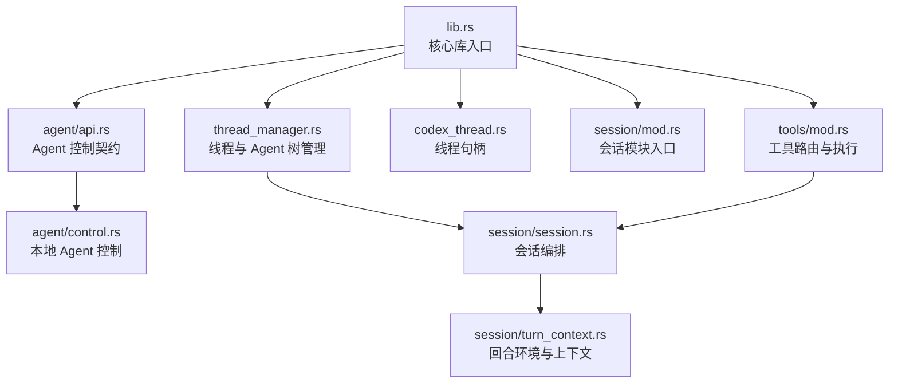
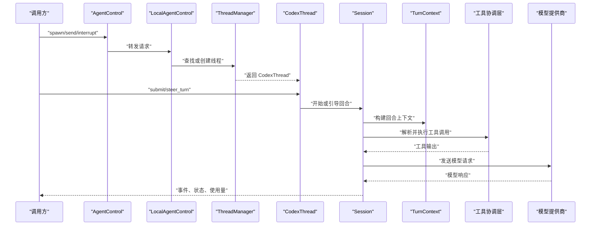
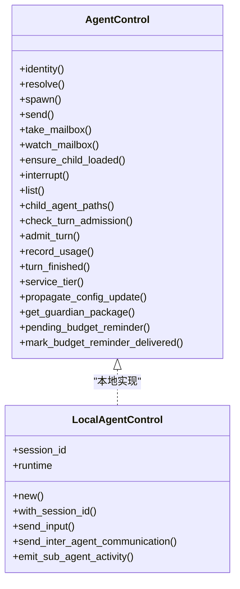
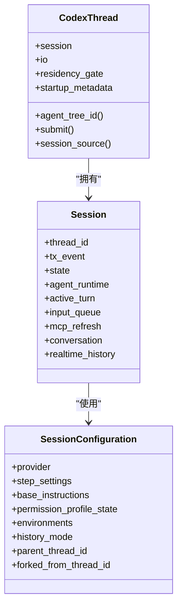
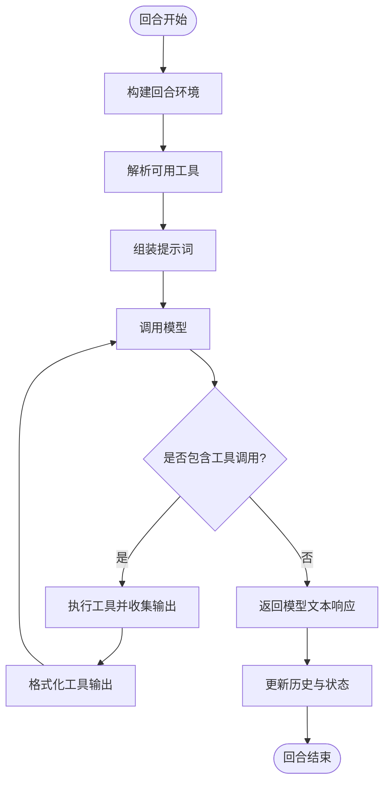
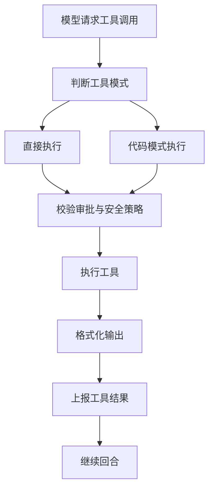
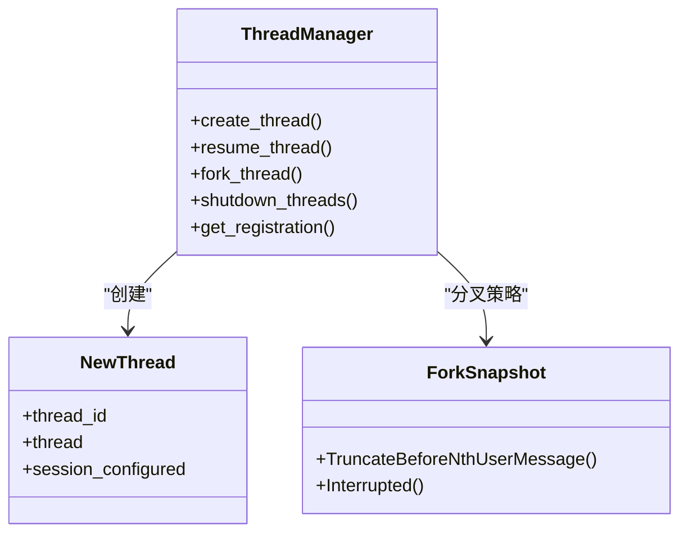
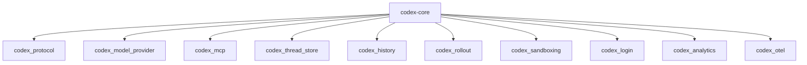

# 智能体核心

<cite>
**本文引用的文件**   
- [lib.rs](file://codex-rs/core/src/lib.rs)
- [Cargo.toml](file://codex-rs/core/Cargo.toml)
- [README.md](file://codex-rs/core/README.md)
- [agent/api.rs](file://codex-rs/core/src/agent/api.rs)
- [agent/control.rs](file://codex-rs/core/src/agent/control.rs)
- [thread_manager.rs](file://codex-rs/core/src/thread_manager.rs)
- [codex_thread.rs](file://codex-rs/core/src/codex_thread.rs)
- [session/mod.rs](file://codex-rs/core/src/session/mod.rs)
- [session/session.rs](file://codex-rs/core/src/session/session.rs)
- [session/turn_context.rs](file://codex-rs/core/src/session/turn_context.rs)
- [tools/mod.rs](file://codex-rs/core/src/tools/mod.rs)
</cite>

## 目录
1. [简介](#简介)
2. [项目结构](#项目结构)
3. [核心组件](#核心组件)
4. [架构总览](#架构总览)
5. [关键组件详细分析](#关键组件详细分析)
6. [依赖关系分析](#依赖关系分析)
7. [性能与扩展性](#性能与扩展性)
8. [故障排查指南](#故障排查指南)
9. [结论](#结论)

## 简介
`codex-core` 是 Codex CLI 的智能体业务逻辑核心。它不直接实现界面，而是为 Rust 侧的多种前端提供统一的 Agent、会话、提示词、工具调用、执行环境和外部系统集成的能力。从高层看，它负责：

- 管理一个或多个 Agent 实例的生命周期（创建、启动、停止、中断、卸载）。
- 维护线程（Thread）和会话（Session）上下文，包括历史、配置快照、权限和环境选择。
- 处理用户输入到模型响应的完整流程，包括消息传递协议、提示词组装、压缩策略和遥测。
- 协调工具调用，包括本地工具、MCP 工具、沙箱执行、审批和安全策略。
- 暴露稳定的公共接口给上层 UI，同时封装底层异步运行时、网络、存储和执行环境。

本仓库采用多 crate 分层组织，`codex-core` 作为聚合层，组合 `session`、`agent`、`tools`、`config`、`mcp`、`exec`、`state` 等子系统，形成可测试、可扩展的智能体运行时。

## 项目结构
`codex-rs/core` 是主库；其入口在 `src/lib.rs`，对外导出 Agent API、线程类型、配置、连接器、MCP、工具、状态、事件和线程管理器。内部主要模块包括：

| 区域 | 职责 |
| --- | --- |
| `agent` | Agent 生命周期、注册、控制、宿主集成、角色、状态、子 Agent 树。 |
| `session` | 单个 Thread 的会话状态、回合（Turn）编排、提示词构建、工具调用、压缩、权限与环境。 |
| `tools` | 工具路由、命名空间、执行、审批、并行调用、MCP 工具暴露。 |
| `thread_manager` | 线程创建、恢复、分叉、共享资源、Agent 树根、模型目录、持久化。 |
| `config` | 配置加载、权限、网络策略、功能开关、凭据刷新。 |
| `mcp` | MCP 服务器管理、预加热、刷新、工具暴露。 |
| `unified_exec` / `exec_env` | 统一执行环境抽象、命令执行、沙箱。 |
| `guardian` / `execpolicy` | 安全策略、Guardian 审查、执行策略。 |
| `codex_thread` | 对外的线程句柄，封装 Session、IO、配置快照和事件流。 |

**图表来源**
- [lib.rs:1-200](file://codex-rs/core/src/lib.rs#L1-L200)
- [agent/api.rs:1-120](file://codex-rs/core/src/agent/api.rs#L1-L120)
- [thread_manager.rs:1-120](file://codex-rs/core/src/thread_manager.rs#L1-L120)
- [codex_thread.rs:1-120](file://codex-rs/core/src/codex_thread.rs#L1-L120)
- [session/mod.rs:1-120](file://codex-rs/core/src/session/mod.rs#L1-L120)
- [session/session.rs:1-120](file://codex-rs/core/src/session/session.rs#L1-L120)
- [session/turn_context.rs:1-120](file://codex-rs/core/src/session/turn_context.rs#L1-L120)
- [tools/mod.rs:1-140](file://codex-rs/core/src/tools/mod.rs#L1-L140)

**章节来源**
- [lib.rs:1-200](file://codex-rs/core/src/lib.rs#L1-L200)
- [Cargo.toml:1-120](file://codex-rs/core/Cargo.toml#L1-L120)
- [README.md:1-128](file://codex-rs/core/README.md#L1-L128)

## 核心组件
本节聚焦与智能体核心最相关的四个层次：

1. **Agent 控制层**：定义跨实现的 Agent 控制契约，统一 spawn、send、interrupt、list、usage 报告。
2. **线程与会话层**：`CodexThread` 是外部可见线程句柄，`Session` 是实际编排器，`TurnContext` 提供回合级环境。
3. **工具协调层**：工具路由、模式决策、执行输出格式化、审批与并行执行。
4. **线程管理器**：负责创建、恢复、分叉线程，以及 Agent 树的根控制和共享资源。

**章节来源**
- [agent/api.rs:1-251](file://codex-rs/core/src/agent/api.rs#L1-L251)
- [codex_thread.rs:1-260](file://codex-rs/core/src/codex_thread.rs#L1-L260)
- [session/session.rs:1-260](file://codex-rs/core/src/session/session.rs#L1-L260)
- [tools/mod.rs:1-140](file://codex-rs/core/src/tools/mod.rs#L1-L140)
- [thread_manager.rs:1-300](file://codex-rs/core/src/thread_manager.rs#L1-L300)

## 架构总览
Codex Core 的核心数据和控制流可以概括为以下路径：

- 上层 UI 通过 `AgentControl` 或 `CodexThread` 发起操作。
- `LocalAgentControl` 将请求分发到具体的 `ThreadManagerState`。
- `ThreadManager` 创建或恢复 `CodexThread`，并初始化 `Session`。
- `Session` 负责回合编排：解析输入、构建提示词、选择模型、调用工具、发送响应、更新历史。
- `TurnContext` 提供当前回合的环境、权限、沙箱、工具清单、MCP 状态。
- 工具执行结果被格式化后回传给模型，并写入历史、遥测和审计。

**图表来源**
- [agent/api.rs:20-180](file://codex-rs/core/src/agent/api.rs#L20-L180)
- [agent/control.rs:60-160](file://codex-rs/core/src/agent/control.rs#L60-L160)
- [thread_manager.rs:100-220](file://codex-rs/core/src/thread_manager.rs#L100-L220)
- [codex_thread.rs:120-260](file://codex-rs/core/src/codex_thread.rs#L120-L260)
- [session/session.rs:1-120](file://codex-rs/core/src/session/session.rs#L1-L120)
- [tools/mod.rs:1-140](file://codex-rs/core/src/tools/mod.rs#L1-L140)

## 关键组件详细分析

### Agent 控制与生命周期
`AgentControl` 是一个与实现解耦的控制契约。它暴露：

- `identity`：会话身份。
- `resolve`：根据调用者上下文解析目标 Agent。
- `spawn`：启动子 Agent，返回 `LiveAgent` 和线程配置快照。
- `send`：向现有 Agent 发送用户输入或 Agent 消息。
- `take_mailbox` / `watch_mailbox`：读取或观察未读 Agent 邮件。
- `ensure_child_loaded`：按需加载已记录子 Agent。
- `interrupt`：中断工作并返回快照。
- `list` / `child_agent_paths`：列出 Agent 和子 Agent。
- `check_turn_admission` / `admit_turn`：容量检查与执行守卫。
- `record_usage` / `turn_finished`：用量统计和完成上报。
- `service_tier` / `propagate_config_update`：服务层级与共享配置传播。
- `get_guardian_package` / `pending_budget_reminder`：Guardian 包与预算提醒。

`LocalAgentControl` 是本地实现，持有 `LocalAgentRuntime`，负责线程查找、容量检查、跨 Agent 通信、活动项广播和历史事件注入。

**图表来源**
- [agent/api.rs:20-251](file://codex-rs/core/src/agent/api.rs#L20-L251)
- [agent/control.rs:60-200](file://codex-rs/core/src/agent/control.rs#L60-L200)

**章节来源**
- [agent/api.rs:1-251](file://codex-rs/core/src/agent/api.rs#L1-L251)
- [agent/control.rs:1-260](file://codex-rs/core/src/agent/control.rs#L1-L260)

### 线程与会话管理
`CodexThread` 是对外的线程句柄，封装了：

- 所属 `Session`。
- `SessionIo`：事件和状态通道。
- 驻留门控：用于线程驻留和驱逐。
- 启动元数据和 rollout 路径。
- 配置快照、权限、环境、协作模式等。

`Session` 是真正的编排器，包含：

- 唯一线程 ID、事件发送器、状态锁。
- Agent 运行服务、结果上报、父观察者通道。
- 实时对话管理器、实时历史、活跃回合、输入队列。
- MCP 预热、刷新、工具审批元数据映射。
- Git 信息增强策略、历史初始化、分叉来源。

`SessionConfiguration` 描述会话级配置，包括模型提供者、步骤设置、开发者指令、基础指令、权限画像、沙箱级别、工作区根、插件禁用列表、来源分类等。

**图表来源**
- [codex_thread.rs:1-260](file://codex-rs/core/src/codex_thread.rs#L1-L260)
- [session/session.rs:1-260](file://codex-rs/core/src/session/session.rs#L1-L260)

**章节来源**
- [codex_thread.rs:1-260](file://codex-rs/core/src/codex_thread.rs#L1-L260)
- [session/session.rs:1-260](file://codex-rs/core/src/session/session.rs#L1-L260)
- [session/mod.rs:1-220](file://codex-rs/core/src/session/mod.rs#L1-L220)

### 回合上下文与消息传递协议
`TurnContext` 表示一次模型回合的执行上下文，包括：

- 回合环境选择、配置来源、环境附件。
- 用户主目录、临时目录缓存。
- Shell 快照任务、构建器和缓存。
- 平台操作系统信息、Shell 策略。

消息传递协议基于 `codex_protocol`，支持：

- `TurnInput`、`TurnStartOptions`、`SteerSubmission`、`SuspendTurnOutcome`。
- 用户输入、Agent 消息、跨 Agent 通信。
- 事件类型如 `ItemStartedEvent`、`ItemCompletedEvent`、`TurnStartedEvent`。
- 历史模式、线程来源、会话来源、追踪上下文。

**图表来源**
- [session/turn_context.rs:1-220](file://codex-rs/core/src/session/turn_context.rs#L1-L220)
- [session/mod.rs:1-220](file://codex-rs/core/src/session/mod.rs#L1-L220)
- [tools/mod.rs:1-140](file://codex-rs/core/src/tools/mod.rs#L1-L140)

**章节来源**
- [session/turn_context.rs:1-220](file://codex-rs/core/src/session/turn_context.rs#L1-L220)
- [session/mod.rs:1-220](file://codex-rs/core/src/session/mod.rs#L1-L220)

### 工具调用协调
`tools/mod.rs` 定义了工具协调的关键职责：

- 工具名称扁平化，兼容命名空间边界。
- 决定工具模式：直接模式、代码模式、仅代码模式。
- 格式化执行输出，包括退出码、耗时、行数截断。
- 暴露工具路由、审批、并行执行、MCP 工具暴露。

**图表来源**
- [tools/mod.rs:1-140](file://codex-rs/core/src/tools/mod.rs#L1-L140)

**章节来源**
- [tools/mod.rs:1-140](file://codex-rs/core/src/tools/mod.rs#L1-L140)

### 线程管理器与 Agent 树
`ThreadManager` 是线程和 Agent 树的中心：

- 创建新线程、恢复旧线程、分叉历史。
- 管理线程 ID 生成器、Agent 控制工厂。
- 处理线程关闭、超时、提交失败。
- 管理 MCP 刷新原因、模型目录、执行策略、扩展注册表。
- 与 `codex_thread_store`、`codex_rollout`、`codex_model_provider` 等交互。

**图表来源**
- [thread_manager.rs:1-300](file://codex-rs/core/src/thread_manager.rs#L1-L300)

**章节来源**
- [thread_manager.rs:1-300](file://codex-rs/core/src/thread_manager.rs#L1-L300)

## 依赖关系分析
`codex-core` 的依赖体现了“业务逻辑聚合层”的特征：

- 与 `codex_protocol` 强耦合，因为所有消息、事件、模型、权限、工具、历史都走协议层。
- 与 `codex_model_provider`、`codex_models_manager` 合作，获取模型信息和目录。
- 与 `codex_mcp`、`codex_rmcp_client` 合作，管理 MCP 工具和远程过程调用。
- 与 `codex_thread_store`、`codex_history`、`codex_rollout` 合作，做历史持久化和状态迁移。
- 与 `codex_sandboxing`、`codex_exec`、`codex_execpolicy` 合作，确保执行安全。
- 与 `codex_login`、`codex_analytics`、`codex_otel` 合作，处理认证、分析和可观测性。

**图表来源**
- [Cargo.toml:20-120](file://codex-rs/core/Cargo.toml#L20-L120)

**章节来源**
- [Cargo.toml:1-193](file://codex-rs/core/Cargo.toml#L1-L193)

## 性能与扩展性
基于源码中的设计，可总结以下性能优化建议和最佳实践：

| 方面 | 建议 |
| --- | --- |
| 并发与异步 | 使用 Tokio 异步运行时，避免阻塞 I/O；利用 `tokio::sync::Mutex`、`RwLock`、`Semaphore`、`CancellationToken` 控制并发和资源释放。 |
| 历史与压缩 | 使用 `compact_*` 模块进行历史压缩、token 预算管理和保留工具输出，避免长会话导致内存膨胀。 |
| MCP 预热 | 使用 `mcp_prewarm_tx` 和 `mcp_prewarm_task` 预热 MCP 工具，减少首次调用延迟。 |
| 工具输出截断 | 使用 `truncate_text`、`formatted_truncate_text` 限制工具输出大小，降低模型输入成本。 |
| 配置刷新 | 使用 `ConfigRefreshOutcome` 区分发布、陈旧和拒绝状态，避免重复刷新。 |
| 容量控制 | 使用 `check_turn_admission` 和 `admit_turn` 控制 Agent 树并发，防止过载。 |
| 沙箱策略 | 根据权限画像计算有效沙箱策略，避免不必要的全局读写。 |
| 可观测性 | 结合 OpenTelemetry 和 analytics 事件，记录线程数、工具调用、模型用量和错误。 |

**章节来源**
- [session/session.rs:1-260](file://codex-rs/core/src/session/session.rs#L1-L260)
- [tools/mod.rs:1-140](file://codex-rs/core/src/tools/mod.rs#L1-L140)
- [codex_thread.rs:1-260](file://codex-rs/core/src/codex_thread.rs#L1-L260)

## 故障排查指南
常见问题与定位方式：

1. **Agent 无法启动或找不到目标**  
   - 检查 `AgentControl::resolve` 是否成功，确认调用者上下文和目标路径。
   - 查看 `LocalAgentControl` 是否能升级 `ThreadManagerState`。
   - 参考 [agent/api.rs:20-120](file://codex-rs/core/src/agent/api.rs#L20-L120)、[agent/control.rs:60-160](file://codex-rs/core/src/agent/control.rs#L60-L160)。

2. **线程提交失败或未被提交**  
   - 检查 `TurnInputSubmission::NotSubmitted` 的原因。
   - 确认 `start_or_steer_turn` 的返回值是 `Started`、`Accepted`、`Steered` 还是 `NotSubmitted`。
   - 参考 [agent/control.rs:80-140](file://codex-rs/core/src/agent/control.rs#L80-L140)。

3. **工具调用无输出或输出过大**  
   - 检查 `format_exec_output_for_model` 的截断策略。
   - 确认工具模式是否正确，是否在代码模式下回退到直接模式。
   - 参考 [tools/mod.rs:60-140](file://codex-rs/core/src/tools/mod.rs#L60-L140)。

4. **会话配置陈旧或被拒绝**  
   - 检查 `ConfigRefreshOutcome` 是否为 `Stale` 或 `Rejected`。
   - 确认权限画像、环境选择和沙箱策略是否一致。
   - 参考 [codex_thread.rs:120-220](file://codex-rs/core/src/codex_thread.rs#L120-L220)。

5. **MCP 工具不可用或刷新缓慢**  
   - 检查 `McpRefreshReason` 和 `mcp_prewarm_task` 状态。
   - 确认是否需要显式刷新或重新连接。
   - 参考 [session/mod.rs:1-220](file://codex-rs/core/src/session/mod.rs#L1-L220)。

**章节来源**
- [agent/api.rs:20-180](file://codex-rs/core/src/agent/api.rs#L20-L180)
- [agent/control.rs:60-200](file://codex-rs/core/src/agent/control.rs#L60-L200)
- [codex_thread.rs:120-260](file://codex-rs/core/src/codex_thread.rs#L120-L260)
- [tools/mod.rs:60-140](file://codex-rs/core/src/tools/mod.rs#L60-L140)
- [session/mod.rs:1-220](file://codex-rs/core/src/session/mod.rs#L1-L220)

## 结论
`codex-core` 是 Codex CLI 智能体能力的核心引擎。它以 `AgentControl` 和 `CodexThread` 为主要入口，以 `Session` 和 `TurnContext` 为核心编排点，以 `tools` 和 `mcp` 为扩展点，以 `thread_manager` 为资源管理中心。通过协议层、配置层、执行层和存储层的协作，它实现了从用户输入到模型响应、从工具调起到沙箱执行、从历史持久化到遥测分析的完整闭环。

对于使用者而言，推荐优先通过 `AgentControl` 管理 Agent 树，通过 `CodexThread` 管理线程会话，并通过 `tools` 和 `mcp` 扩展工具能力。对于开发者而言，应关注容量控制、历史压缩、工具输出截断、权限画像和沙箱策略，以确保系统在长会话和高并发场景下的稳定性与性能。