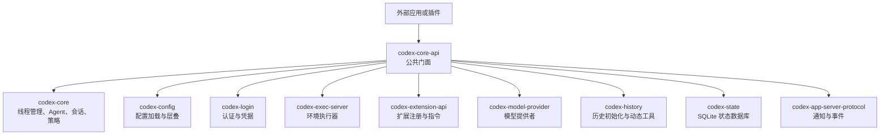
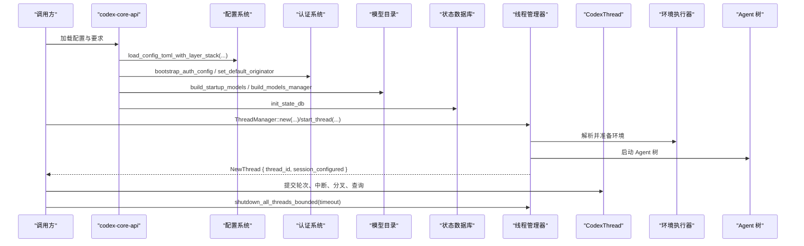
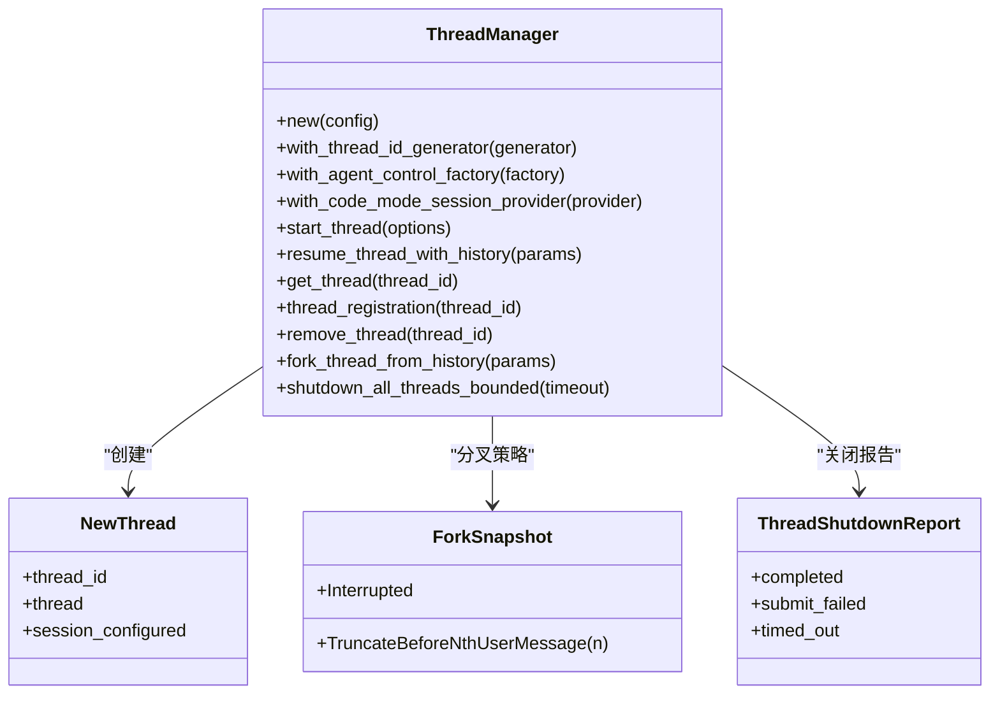
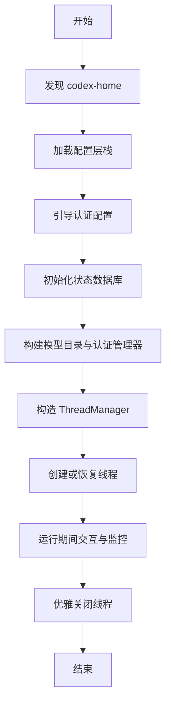

# 核心 API 接口

<cite>
**本文引用的文件**   
- [codex-rs/core-api/Cargo.toml](file://codex-rs/core-api/Cargo.toml)
- [codex-rs/core-api/src/lib.rs](file://codex-rs/core-api/src/lib.rs)
- [codex-rs/core/src/lib.rs](file://codex-rs/core/src/lib.rs)
- [codex-rs/core/src/thread_manager.rs](file://codex-rs/core/src/thread_manager.rs)
</cite>

## 目录
1. [引言](#引言)
2. [项目结构](#项目结构)
3. [核心组件](#核心组件)
4. [架构总览](#架构总览)
5. [详细组件分析](#详细组件分析)
6. [依赖关系与版本兼容性](#依赖关系与版本兼容性)
7. [性能考虑](#性能考虑)
8. [故障排查指南](#故障排查指南)
9. [结论](#结论)

## 引言
本文件为 Codex CLI 的核心 API 接口文档，聚焦于 `codex-core-api` crate 作为公共接口的职责与设计原则。该 crate 不实现具体业务逻辑，而是将 `codex-core`、`codex-config`、`codex-login`、`codex-exec-server`、`codex-extension-api`、`codex-model-provider`、`codex-history`、`codex-state`、`codex-app-server-protocol` 等内部能力重新导出，形成稳定的对外契约。读者可以据此理解：
- 如何初始化配置、认证、模型目录和会话状态数据库；
- 如何通过线程管理 API 创建、恢复、中断、分叉和关闭会话线程；
- 如何接入 Agent 控制、扩展指令、网络策略与环境执行器；
- 异步编程模型、错误处理模式与生命周期管理；
- 与其他组件的依赖边界与版本约束；
- 最佳实践与常见问题解决方案。

## 项目结构
Codex Rust 代码位于 `codex-rs/` 下。本次文档关注以下模块：
- `codex-rs/core-api`：公共门面 crate，集中 re-export 稳定类型与函数；
- `codex-rs/core`：核心运行时，包含线程管理、Agent 控制、会话、工具、MCP、权限策略等；
- 周边 crate：如 `codex-config`、`codex-login`、`codex-exec-server`、`codex-extension-api`、`codex-model-provider`、`codex-history`、`codex-state`、`codex-app-server-protocol` 等，由 `core-api` 暴露给调用方。

图表来源
- [codex-rs/core-api/Cargo.toml:1-34](file://codex-rs/core-api/Cargo.toml#L1-L34)
- [codex-rs/core-api/src/lib.rs:1-162](file://codex-rs/core-api/src/lib.rs#L1-L162)

章节来源
- [codex-rs/core-api/Cargo.toml:1-34](file://codex-rs/core-api/Cargo.toml#L1-L34)
- [codex-rs/core-api/src/lib.rs:1-162](file://codex-rs/core-api/src/lib.rs#L1-L162)

## 核心组件
`codex-core-api` 的核心职责是“稳定对外暴露”：
- 暴露配置相关类型：`ConfigLayerStack`、`ConfigLoadOptions`、`ConfigRequirements`、`ProjectConfig`、`RealtimeAudioConfig`、`RealtimeConfig`、`AuthCredentialsStoreMode`、`History`、`MemoriesConfig`、`OtelConfig`、`TuiKeymap`、`TuiNotificationSettings`、`UriBasedFileOpener` 等；
- 暴露核心运行期对象：`ThreadManager`、`CodexThread`、`NewThread`、`EnvironmentManager`、`McpManager`、`AuthManager`、`SharedModelProvider`、`SharedModelsManager`、`StateDbHandle`、`StartupModels`、`ForkSnapshot`、`StartThreadOptions`、`TurnInput*`、`WithTurnExtensionData`、`AgentTreeShutdown*` 等；
- 暴露协议与事件类型：`ThreadId`、`EventMsg`、`Op`、`AskForApproval`、`SessionConfiguredEvent`、`SessionSource`、`W3cTraceContext`、`PermissionProfile`、`DynamicToolSpec` 等；
- 暴露构建辅助函数：`build_models_manager`、`build_runtime_auth_manager`、`build_startup_models`、`init_state_db`、`local_agent_graph_store_from_state_db`、`find_codex_home`、`load_config_toml_with_layer_stack`、`install_image_generation_extension`、`set_default_originator` 等。

设计原则：
- 最小化对外暴露面：仅 re-export 稳定类型与函数，隐藏内部实现细节；
- 面向组合：通过 `ThreadManager` 统一协调 Agent、环境、模型、历史、扩展、权限策略；
- 面向异步：所有 I/O 与长任务均基于 Tokio 异步运行时；
- 面向可测试性：提供测试钩子与只读快照类型，便于集成测试；
- 向后兼容：对旧名称提供别名（例如 `ConversationManager`、`NewConversation`、`CodexConversation`）并标记为弃用。

章节来源
- [codex-rs/core-api/src/lib.rs:1-162](file://codex-rs/core-api/src/lib.rs#L1-L162)
- [codex-rs/core/src/lib.rs:1-200](file://codex-rs/core/src/lib.rs#L1-L200)
- [codex-rs/core/src/lib.rs:201-298](file://codex-rs/core/src/lib.rs#L201-L298)

## 架构总览
从外部到内部的典型调用路径如下：

图表来源
- [codex-rs/core-api/src/lib.rs:1-162](file://codex-rs/core-api/src/lib.rs#L1-L162)
- [codex-rs/core/src/thread_manager.rs:314-766](file://codex-rs/core/src/thread_manager.rs#L314-L766)
- [codex-rs/core/src/thread_manager.rs:1381-1862](file://codex-rs/core/src/thread_manager.rs#L1381-L1862)

## 详细组件分析

### 线程管理 API：`ThreadManager`
`ThreadManager` 是线程生命周期与调度中心。它负责：
- 创建新线程并返回 `NewThread`；
- 根据历史恢复线程；
- 列出线程、订阅新建事件；
- 中断、移除、分叉线程；
- 在超时范围内优雅关闭全部线程；
- 获取当前线程、按扩展数据访问线程；
- 更新线程元数据、移动线程分区；
- 列举协作模式、模型列表；
- 刷新 MCP 运行时与钩子运行时；
- 提供默认环境请求、模型管理器等基础设施访问。

关键类型与方法（以签名语义说明为主）：
- `ThreadManager::new(config)`：使用配置构造线程管理器；
- `ThreadManager::with_thread_id_generator(...)`：注入线程 ID 生成器；
- `ThreadManager::with_agent_control_factory(...)`：注入 Agent 控制工厂；
- `ThreadManager::with_code_mode_session_provider(...)`：注入代码模式会话提供者；
- `ThreadManager::start_thread(options)`：异步创建线程，返回 `NewThread`；
- `ThreadManager::resume_thread_with_history(...)`：异步恢复已有历史；
- `ThreadManager::get_thread(thread_id)`：异步获取线程引用；
- `ThreadManager::thread_registration(thread_id)`：判断线程注册状态；
- `ThreadManager::remove_thread(thread_id)`：异步移除线程；
- `ThreadManager::fork_thread_from_history(...)`：基于历史分叉线程；
- `ThreadManager::shutdown_all_threads_bounded(timeout)`：带超时的批量关闭。

图表来源
- [codex-rs/core/src/thread_manager.rs:314-766](file://codex-rs/core/src/thread_manager.rs#L314-L766)
- [codex-rs/core/src/thread_manager.rs:1381-1862](file://codex-rs/core/src/thread_manager.rs#L1381-L1862)
- [codex-rs/core/src/thread_manager.rs:1719-1862](file://codex-rs/core/src/thread_manager.rs#L1719-L1862)

章节来源
- [codex-rs/core/src/thread_manager.rs:314-766](file://codex-rs/core/src/thread_manager.rs#L314-L766)
- [codex-rs/core/src/thread_manager.rs:1381-1862](file://codex-rs/core/src/thread_manager.rs#L1381-L1862)
- [codex-rs/core/src/thread_manager.rs:1719-1862](file://codex-rs/core/src/thread_manager.rs#L1719-L1862)

### Agent 操作接口
Agent 子系统通过 `core` 暴露的 Agent API 被 `core-api` 转发。对外可见的能力包括：
- Agent 配置更新、控制、信息、输入与目标；
- Agent 消息、元数据、实时代理句柄；
- 多 Agent 使用提示、子 Agent 启动选项与模式；
- Agent 运行所有权、服务层级、会话读取、准入决策；
- 工具调用上下文、用量会计、转交结果。

这些类型主要用于上层编排 Agent 行为、收集遥测与诊断信息，而不在 `core-api` 中实现。

章节来源
- [codex-rs/core/src/lib.rs:1-200](file://codex-rs/core/src/lib.rs#L1-L200)

### 配置管理接口
配置体系通过 `codex-config` 与 `codex-core/config` 共同提供：
- `ConfigLayerStack`：配置层栈，支持多层叠加；
- `ConfigLoadOptions`、`ConfigRequirements`、`ConfigRequirementsToml`：加载选项与要求；
- `ProjectConfig`、`RealtimeAudioConfig`、`RealtimeConfig`：项目级与实时音频配置；
- `AuthCredentialsStoreMode`、`OAuthCredentialsStoreMode`、`History`、`MemoriesConfig`、`OtelConfig`、`TuiKeymap`、`TuiNotificationSettings`、`UriBasedFileOpener`：用户偏好与安全审计配置；
- `bootstrap_auth_config`、`find_codex_home`、`load_config_toml_with_layer_stack`、`resolve_bootstrap_respect_system_proxy`：引导与解析函数；
- `Constrained`、`ExtraConfig`、`GhostSnapshotConfig`、`MultiAgentV2Config`、`NetworkProxySpec`、`Permissions`、`TerminalResizeReflowConfig`、`ThreadStoreConfig`：核心运行时配置项。

调用方通常先加载配置，再构造 `ThreadManager`，并传递必要的策略与模型信息。

章节来源
- [codex-rs/core-api/src/lib.rs:1-162](file://codex-rs/core-api/src/lib.rs#L1-L162)
- [codex-rs/core/src/lib.rs:1-200](file://codex-rs/core/src/lib.rs#L1-L200)

### 异步编程模型
所有重 I/O 与长任务均基于 Tokio：
- `ThreadManager` 的线程创建、恢复、移除、分叉、关闭均为 `async fn`；
- 模型列表、MCP 刷新、钩子刷新等操作也采用异步接口；
- 事件流与通知通过 `broadcast::Receiver` 与协议事件类型传递；
- 错误统一包装为 `CodexResult`，便于调用方使用 `?` 或匹配错误分支。

最佳实践：
- 始终在 Tokio runtime 中调用异步 API；
- 对可能长时间阻塞的操作设置超时；
- 避免持有 `Arc<CodexThread>` 过久，必要时及时释放；
- 使用 `shutdown_all_threads_bounded` 进行有序关闭。

章节来源
- [codex-rs/core/src/thread_manager.rs:1381-1862](file://codex-rs/core/src/thread_manager.rs#L1381-L1862)

### 错误处理模式
错误主要来源于：
- 配置加载失败；
- 认证与凭据存储异常；
- 模型目录不可用或刷新失败；
- 状态数据库初始化失败；
- 线程创建、恢复、移除失败；
- 环境执行器连接失败；
- MCP 运行时刷新失败；
- Agent 树关闭超时或失败。

建议：
- 使用 `CodexResult` 表达成功与失败；
- 区分可重试错误与不可重试错误；
- 在关闭流程中记录完成、提交失败、超时三类统计；
- 对网络、磁盘、进程资源错误做分级日志与降级策略。

章节来源
- [codex-rs/core/src/thread_manager.rs:1719-1862](file://codex-rs/core/src/thread_manager.rs#L1719-L1862)
- [codex-rs/core-api/src/lib.rs:1-162](file://codex-rs/core-api/src/lib.rs#L1-L162)

### 生命周期管理
典型生命周期如下：
1. 发现 `codex-home`；
2. 加载配置层栈；
3. 引导认证配置；
4. 初始化状态数据库；
5. 构建模型目录与运行时认证管理器；
6. 构造 `ThreadManager`；
7. 创建或恢复线程；
8. 运行期间提交轮次、查询状态、监控事件；
9. 优雅关闭所有线程，收集关闭报告。

图表来源
- [codex-rs/core-api/src/lib.rs:1-162](file://codex-rs/core-api/src/lib.rs#L1-L162)
- [codex-rs/core/src/thread_manager.rs:1381-1862](file://codex-rs/core/src/thread_manager.rs#L1381-L1862)

## 依赖关系与版本兼容性
`codex-core-api` 通过 Cargo workspace 引入多个内部 crate，确保对外暴露的类型来自稳定层：
- `codex-app-server-protocol`：服务端通知与事件映射；
- `codex-arg0`：参数分发；
- `codex-analytics`：分析事件客户端；
- `codex-config`：配置层与类型；
- `codex-core`：核心运行时；
- `codex-extension-api`：扩展注册与指令；
- `codex-home`：用户目录；
- `codex-history`：历史初始化与动态工具；
- `codex-image-generation-extension`：图像生成扩展安装；
- `codex-exec-server`：环境执行器；
- `codex-features`：功能开关；
- `codex-login`：认证；
- `codex-model-provider`：模型提供者；
- `codex-model-provider-info`：内置提供者信息；
- `codex-models-manager`：模型目录管理；
- `codex-protocol`：协议类型、错误与模型响应；
- `codex-state`：SQLite 配置；
- `codex-utils-absolute-path`：绝对路径类型。

版本兼容性要点：
- 所有依赖通过 workspace 管理，版本由顶层 `Cargo.toml` 与工作区规则决定；
- 对外暴露的类型应保持稳定，内部实现变更不应破坏外部调用方；
- 对旧名称使用 `#[deprecated]` 并提供迁移提示；
- 新增能力优先通过扩展点（扩展注册、指令、工具规范）暴露，避免直接修改核心 API。

章节来源
- [codex-rs/core-api/Cargo.toml:1-34](file://codex-rs/core-api/Cargo.toml#L1-L34)
- [codex-rs/core-api/src/lib.rs:1-162](file://codex-rs/core-api/src/lib.rs#L1-L162)
- [codex-rs/core/src/lib.rs:201-298](file://codex-rs/core/src/lib.rs#L201-L298)

## 性能考虑
- 线程管理使用共享状态与广播通道，避免频繁锁竞争；
- 模型目录与运行时认证管理器可复用，减少重复初始化成本；
- MCP 运行时与钩子运行时支持刷新与失效，按需重建；
- 分叉策略支持基于用户消息边界或中断点，避免不必要的数据拷贝；
- 关闭流程支持超时，防止无限等待；
- 日志与追踪建议使用 tracing 栈，避免直接写入标准输出。

[本节为通用指导，不直接分析具体文件]

## 故障排查指南
常见问题与解决思路：
- 配置加载失败：检查配置文件路径、必填字段、权限与格式；
- 认证失败：确认凭据存储后端、OAuth 模式、密钥环后端与默认来源；
- 模型列表为空：检查模型目录初始化、网络代理设置与刷新策略；
- 状态数据库无法打开：检查 SQLite 配置、目录权限与迁移状态；
- 线程创建失败：检查环境执行器连接、Agent 控制工厂与模型选择；
- 线程移除或分叉失败：检查线程是否仍在运行、是否存在并发写入；
- 关闭超时：增加超时时间或排查阻塞的 Agent 与工具调用；
- MCP 刷新失败：检查服务器连通性与证书配置。

章节来源
- [codex-rs/core/src/thread_manager.rs:1719-1862](file://codex-rs/core/src/thread_manager.rs#L1719-L1862)
- [codex-rs/core-api/src/lib.rs:1-162](file://codex-rs/core-api/src/lib.rs#L1-L162)

## 结论
`codex-core-api` 是 Codex CLI 核心能力的稳定门面，它将复杂的内部模块抽象为清晰的对外接口。调用方应以 `ThreadManager` 为中心，结合配置、认证、模型目录、状态数据库与环境执行器，构建完整的会话生命周期。遵循异步编程模型、统一的错误处理模式和优雅的生命周期管理，可以获得更可靠、可观测且易维护的集成方案。