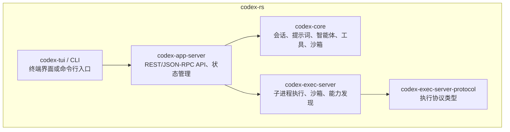
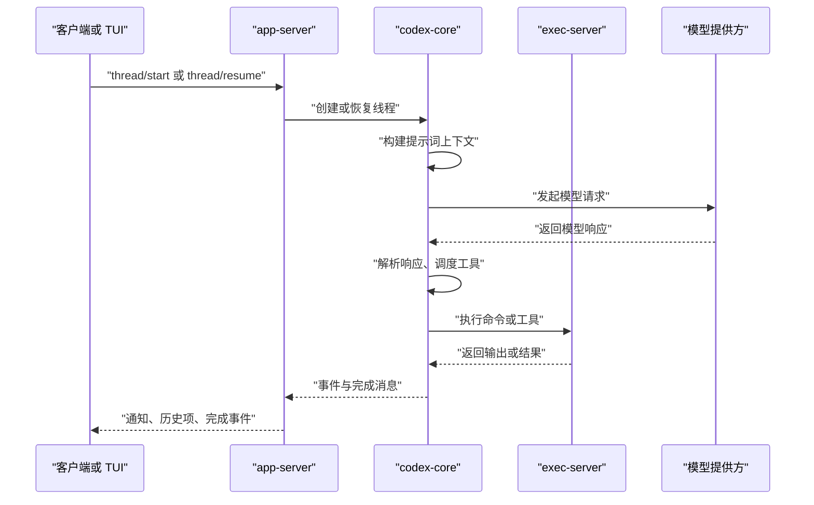
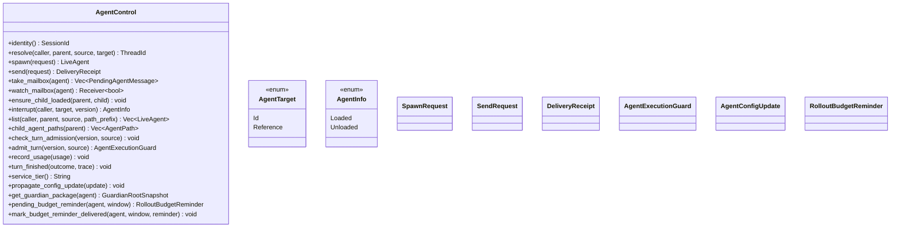
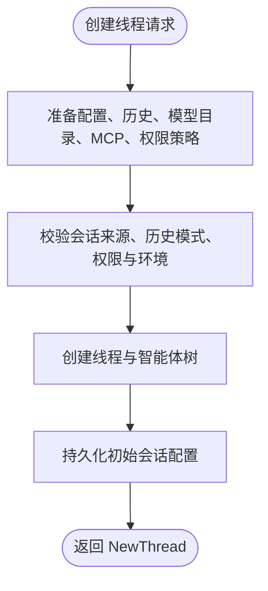
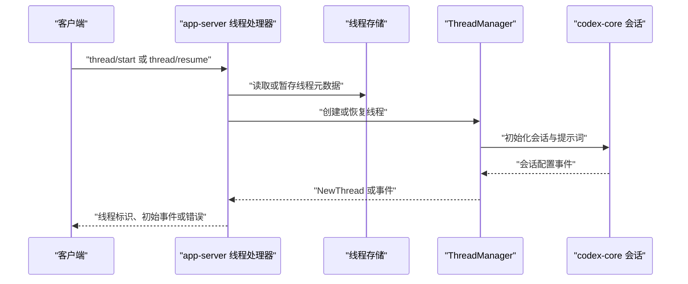
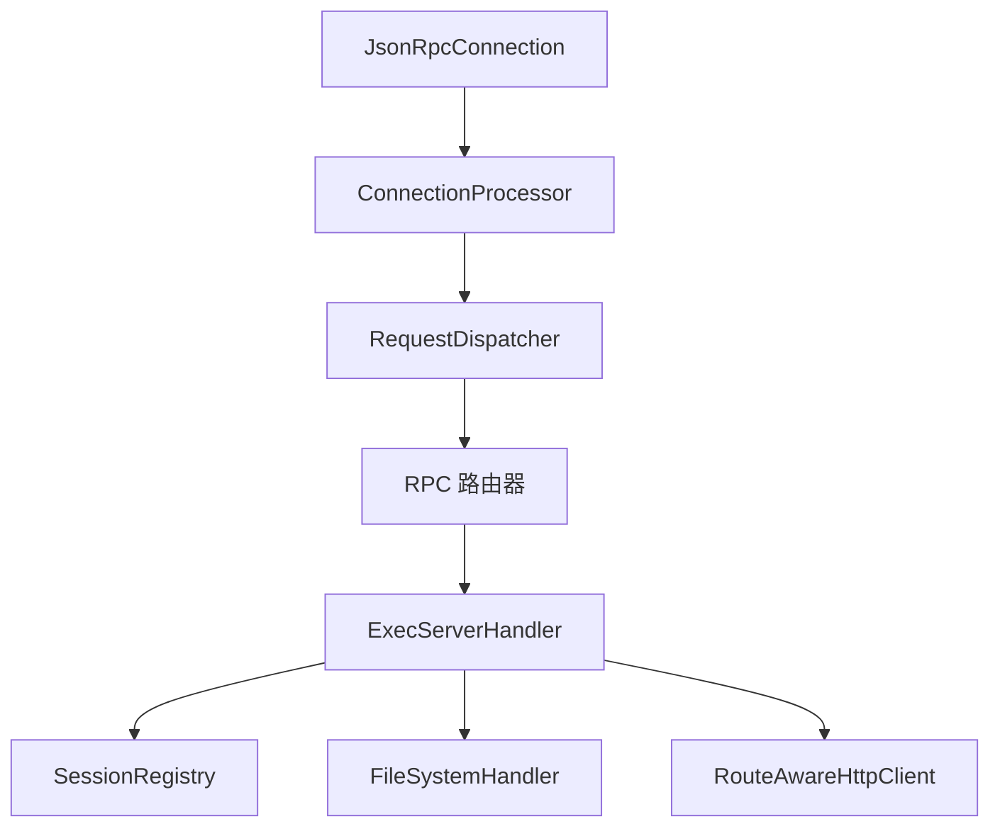
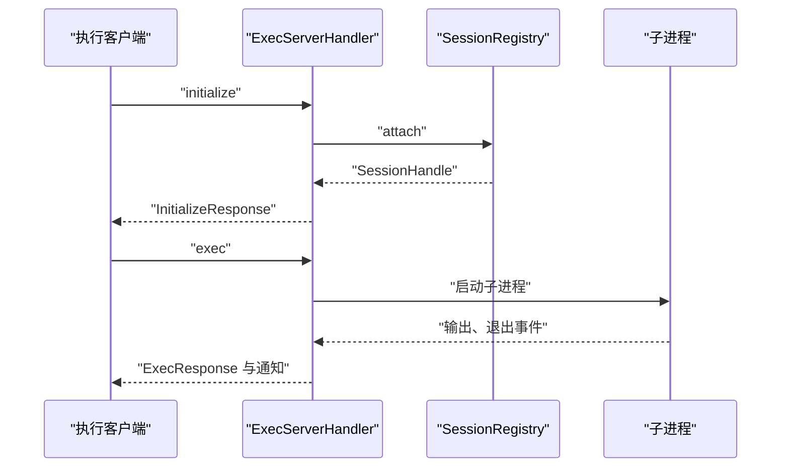
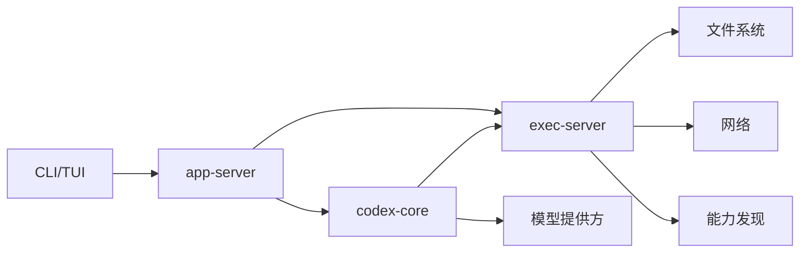
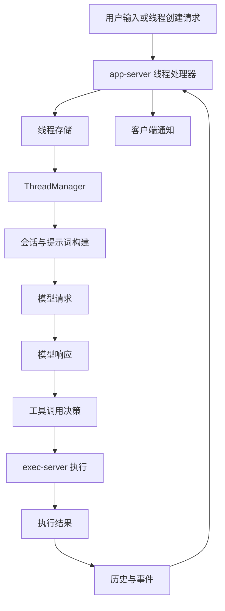

# 核心组件

<cite>
**本文引用的文件**   
- [core/lib.rs](file://codex-rs/core/src/lib.rs)
- [core/agent/api.rs](file://codex-rs/core/src/agent/api.rs)
- [core/thread_manager.rs](file://codex-rs/core/src/thread_manager.rs)
- [core/session/mod.rs](file://codex-rs/core/src/session/mod.rs)
- [app-server/lib.rs](file://codex-rs/app-server/src/lib.rs)
- [app-server/request_processors/thread_processor.rs](file://codex-rs/app-server/src/request_processors/thread_processor.rs)
- [exec-server/lib.rs](file://codex-rs/exec-server/src/lib.rs)
- [exec-server/server/processor.rs](file://codex-rs/exec-server/src/server/processor.rs)
- [exec-server/server/handler.rs](file://codex-rs/exec-server/src/server/handler.rs)
</cite>

## 目录
1. [引言](#引言)
2. [项目结构](#项目结构)
3. [核心组件总览](#核心组件总览)
4. [架构总览](#架构总览)
5. [智能体核心 codex-core](#智能体核心-codex-core)
6. [应用服务器 app-server](#应用服务器-app-server)
7. [执行服务器 exec-server](#执行服务器-exec-server)
8. [依赖关系与数据流](#依赖关系与数据流)
9. [生命周期管理](#生命周期管理)
10. [错误处理策略](#错误处理策略)
11. [性能特性与优化建议](#性能特性与优化建议)
12. [常见问题排查](#常见问题排查)
13. [结论](#结论)

## 引言
Codex CLI 的核心由三个主要 Rust 组件构成：

- **智能体核心 `codex-core`**：实现 Codex 的会话、提示词构建、模型调用编排、多智能体协调、工具与权限控制、沙箱策略等主业务逻辑。
- **应用服务器 `app-server`**：提供面向客户端的 JSON-RPC API，负责线程（会话）生命周期、历史持久化、用户输入路由、配置刷新、遥测和通知分发。
- **执行服务器 `exec-server`**：提供受控子进程执行环境，封装文件系统访问、网络请求、能力发现、远程注册、沙箱完整性校验及传输协议。

本文件聚焦这三个组件的职责边界、关键数据结构、处理流程、生命周期与错误处理，并给出组件间依赖图和数据流图，帮助读者从高层到代码层理解 Codex CLI 的运行方式。

## 项目结构
仓库根下的 `codex-rs` 是 Rust 工作区，本次文档重点涉及以下模块：

**图示来源**
- [core/lib.rs:1-120](file://codex-rs/core/src/lib.rs#L1-L120)
- [app-server/lib.rs:1-120](file://codex-rs/app-server/src/lib.rs#L1-L120)
- [exec-server/lib.rs:1-120](file://codex-rs/exec-server/src/lib.rs#L1-L120)

**章节来源**
- [core/lib.rs:1-120](file://codex-rs/core/src/lib.rs#L1-L120)
- [app-server/lib.rs:1-120](file://codex-rs/app-server/src/lib.rs#L1-L120)
- [exec-server/lib.rs:1-120](file://codex-rs/exec-server/src/lib.rs#L1-L120)

## 核心组件总览

| 组件 | 主要职责 | 关键入口或类型 | 对外暴露的主要能力 |
|---|---|---|---|
| `codex-core` | 会话与线程管理、提示词上下文、模型请求编排、智能体树协调、工具调用、权限与沙箱、压缩与历史 | `ThreadManager`、`AgentControl`、`CodexThread`、`TurnContext` | 创建线程、提交用户输入、订阅事件、获取智能体状态、报告使用量 |
| `app-server` | JSON-RPC 服务、连接路由、线程列表/读取/恢复/分叉、历史分页、诊断、配置刷新、遥测 | `AppServerTransport`、`MessageProcessor`、`thread_processor` | `thread/start`、`thread/resume`、`thread/items/list`、`turn/completed` 等 RPC |
| `exec-server` | 本地/远程执行环境、子进程管理、文件操作、HTTP 代理、能力发现、噪声中继、沙箱完整性 | `ExecServerHandler`、`ConnectionProcessor`、`SessionRegistry` | `initialize`、`exec`、文件系统 RPC、能力发现、环境信息 |

**章节来源**
- [core/lib.rs:1-120](file://codex-rs/core/src/lib.rs#L1-L120)
- [app-server/lib.rs:1-120](file://codex-rs/app-server/src/lib.rs#L1-L120)
- [exec-server/lib.rs:1-120](file://codex-rs/exec-server/src/lib.rs#L1-L120)

## 架构总览

Codex CLI 的典型调用路径如下：

该序列说明：

- `app-server` 不直接实现提示词生成或模型推理，而是通过 `codex-core` 完成核心业务。
- `codex-core` 在需要时通过 `exec-server` 执行命令、读写文件或调用外部工具。
- `exec-server` 通过能力发现和沙箱机制限制可执行范围。
- 模型提供方仅与 `codex-core` 直接交互，`app-server` 和 `exec-server` 不直接调用模型接口。

**图示来源**
- [app-server/request_processors/thread_processor.rs:1-120](file://codex-rs/app-server/src/request_processors/thread_processor.rs#L1-L120)
- [core/thread_manager.rs:250-392](file://codex-rs/core/src/thread_manager.rs#L250-L392)
- [exec-server/server/handler.rs:120-220](file://codex-rs/exec-server/src/server/handler.rs#L120-L220)

## 智能体核心 codex-core

### 职责边界
`codex-core` 是 Codex 的业务中枢，它不负责 HTTP 监听，也不直接实现 WebSocket 接入；它负责：

1. **线程与会话管理**：创建新线程、恢复已有线程、分叉、终止、观察注册状态。
2. **提示词处理**：组装系统指令、开发者指令、仓库上下文、工具说明、MCP 扩展、权限策略和历史摘要。
3. **智能体协调**：支持根线程与工作线程组成的智能体树，包括启动、停止、消息投递、使用量统计。
4. **工具调用协调**：将模型返回的工具调用映射为本地或远程执行任务。
5. **沙箱与权限**：结合配置中的权限策略、网络策略、执行策略选择 Linux、macOS、Windows 上的沙箱行为。

`lib.rs` 明确暴露了线程、智能体、提示词、MCP、沙箱、压缩、遥测等模块，表明它是一个“领域库”，而不是进程入口。

**章节来源**
- [core/lib.rs:1-120](file://codex-rs/core/src/lib.rs#L1-L120)
- [core/README.md:1-128](file://codex-rs/core/README.md#L1-L128)

### 智能体协调接口
`AgentControl` 是智能体树的核心抽象，它把线程、智能体身份、输入投递、中断、使用量记录和生命周期解耦为本地或远端后端都能实现的接口。

该接口的设计要点：

- **延迟加载**：`resolve` 和 `list` 允许按名称或相对路径解析智能体，而不必立即加载完整运行时。
- **交付语义**：`send` 表示接受投递，不是保证下游已消费；最终结果通过 `turn_finished` 上报。
- **容量控制**：`check_turn_admission` 和 `admit_turn` 分离容量检查与运行守卫，避免原子占用导致复杂竞争。
- **预算与审计**：`record_usage` 记录 token 使用，`RolloutBudgetReminder` 用于预算提醒。

**图示来源**
- [core/agent/api.rs:1-200](file://codex-rs/core/src/agent/api.rs#L1-L200)

**章节来源**
- [core/agent/api.rs:1-200](file://codex-rs/core/src/agent/api.rs#L1-L200)

### 线程管理器 ThreadManager
`ThreadManager` 是线程的生命周期中枢。它负责：

- 创建 `NewThread`，包含线程 ID、线程句柄和初始会话配置事件。
- 管理线程注册状态：当前存在、缺失或被替换。
- 控制分叉策略：按用户消息截断、模拟中断或保留已提交历史。
- 组合配置、历史、模型目录、MCP、执行策略、附件存储、权限策略、扩展指令等。
- 暴露 `StartThreadOptions`，让上层决定提示词缓存键、历史模式、会话来源、线程来源、动态工具、环境变量绑定和用户指令。

**图示来源**
- [core/thread_manager.rs:250-392](file://codex-rs/core/src/thread_manager.rs#L250-L392)

**章节来源**
- [core/thread_manager.rs:250-392](file://codex-rs/core/src/thread_manager.rs#L250-L392)

### 会话与提示词处理
`session` 模块是会话状态机、提示词构建、工具执行、历史回放、压缩、实时对话、MCP 集成、权限请求、网络代理等的集中地。它接收来自 `ThreadManager` 的配置和指令，并与模型客户端、执行环境、附件存储、Git 信息、钩子系统等协作。

典型处理流程：

1. 收到用户输入后，构建 `TurnContext`。
2. 渲染系统指令、开发者指令、插件说明、MCP 工具描述。
3. 根据权限策略、沙箱策略、网络策略和模型配置构造模型请求。
4. 调用模型提供方，得到增量响应。
5. 解析响应项：文本、图片、音频、工具调用、人类审批、权限申请等。
6. 对工具调用派发执行任务，可能经过 `exec-server`。
7. 将结果写入历史、内存快照和持久存储。
8. 向 `app-server` 推送事件和完成信号。

**章节来源**
- [core/session/mod.rs:1-260](file://codex-rs/core/src/session/mod.rs#L1-L260)

## 应用服务器 app-server

### 职责边界
`app-server` 是 Codex 的 API 层。它：

- 管理 WebSocket、标准输入输出、远程控制套接字等传输。
- 维护连接状态、出站消息队列、连接清理和守护进程恢复。
- 将 JSON-RPC 请求路由到处理器，例如线程处理器、配置处理器、反馈处理器、MCP 处理器。
- 将 `codex-core` 的线程、事件、历史、遥测暴露给客户端。
- 管理配置层、插件热重载、模型目录刷新、诊断信息和权限策略。

`lib.rs` 中导出了 `AppServerTransport`、启动参数、追踪、遥测、连接状态、出站消息等基础设施，并声明了大量处理器模块。

**章节来源**
- [app-server/lib.rs:1-120](file://codex-rs/app-server/src/lib.rs#L1-L120)

### REST/JSON-RPC API 与服务状态
`app-server` 使用 JSON-RPC 作为主要协议，而不是传统 REST。其常见 API 包括：

| 类别 | 典型方法 | 作用 |
|---|---|---|
| 初始化 | `initialize` | 建立连接、设置功能开关、鉴权上下文 |
| 线程管理 | `thread/list`、`thread/read`、`thread/start`、`thread/resume` | 列出、读取、创建、恢复线程 |
| 历史与项 | `thread/turns/list`、`thread/items/list` | 分页读取历史与模型输出项 |
| 分叉与撤销 | `thread/fork`、`thread/revert` | 复制历史或回滚到指定位置 |
| 轮次处理 | `turn/completed`、`turn/started` | 汇报模型轮次开始与结束 |
| 配置 | `config/update`、`config/reload` | 更新或重载配置 |
| MCP | `mcpToolCall.*`、`mcpServer/*` | 调用 MCP 工具或资源 |
| 诊断 | `diagnostics/*` | 导出诊断信息、日志、快照 |

这些方法由 `request_processors` 下的处理器实现，并由传输层转发到 `message_processor`，再委托给 `ThreadManager` 和其他服务。

**章节来源**
- [app-server/lib.rs:1-120](file://codex-rs/app-server/src/lib.rs#L1-L120)

### 线程处理器
`thread_processor.rs` 是线程相关 API 的实现中心，它处理：

- 线程列表过滤、排除 ID、分页限制。
- 恢复前的元数据暂存与清理。
- 恢复配置差异检测：模型、提供商、服务层级、工作目录、工作空间根、审批策略、沙箱模式、人格、基础指令等。
- 历史模式、附加线程标记、动态工具、MCP 扩展、指标服务名、父跟踪上下文。
- 与 `ThreadStore` 和 `ThreadManager` 协同，完成冷启动、暖恢复、分叉、重放和通知广播。

**图示来源**
- [app-server/request_processors/thread_processor.rs:1-120](file://codex-rs/app-server/src/request_processors/thread_processor.rs#L1-L120)
- [core/thread_manager.rs:250-392](file://codex-rs/core/src/thread_manager.rs#L250-L392)

**章节来源**
- [app-server/request_processors/thread_processor.rs:1-120](file://codex-rs/app-server/src/request_processors/thread_processor.rs#L1-L120)

## 执行服务器 exec-server

### 职责边界
`exec-server` 是一个轻量级 JSON-RPC 执行服务，负责：

- 启动和控制子进程。
- 提供安全的文件系统、目录遍历、文件读写、HTTP 请求代理。
- 发现本地能力和插件、技能文件。
- 管理本地环境与远程环境的连接、注册、重连、认证。
- 实现噪声中继协议、分段可靠传输、心跳、重传和会话恢复。
- 执行沙箱完整性校验，并在 Linux/macOS/Windows 上选择合适后端。

`lib.rs` 暴露了客户端、协议类型、文件系统接口、环境管理器、进程抽象、遥测、沙箱选择和能力发现缓存等。

**章节来源**
- [exec-server/lib.rs:1-120](file://codex-rs/exec-server/src/lib.rs#L1-L120)

### 连接处理器与请求分发
`ConnectionProcessor` 是每个连接的处理器，它：

- 初始化能力管理器并预扫描能力位置。
- 维护会话注册表。
- 维护出站消息通道。
- 使用 `RequestDispatcher` 分发请求、通知、响应和错误。
- 在连接断开、会话被抢占、序列化失败或任务关闭时清理资源。

**图示来源**
- [exec-server/server/processor.rs:1-120](file://codex-rs/exec-server/src/server/processor.rs#L1-L120)
- [exec-server/server/handler.rs:1-120](file://codex-rs/exec-server/src/server/handler.rs#L1-L120)

**章节来源**
- [exec-server/server/processor.rs:1-260](file://codex-rs/exec-server/src/server/processor.rs#L1-L260)

### 处理器与会话
`ExecServerHandler` 持有：

- 会话句柄，表示当前连接是否已附加到某个执行会话。
- 能力管理器，用于发现插件、技能和能力根。
- 文件系统处理器，封装本地文件操作。
- 带路由感知的 HTTP 客户端，用于执行环境中的网络请求。
- 初始化状态标志，确保每个连接只执行一次 `initialize`。
- 后台任务跟踪器，用于优雅关闭。

关键流程：

1. 客户端发送 `initialize`。
2. 服务器校验并附加会话。
3. 返回 `InitializeResponse`，包含会话 ID 和本地环境信息。
4. 后续 `exec`、文件系统 RPC、HTTP 请求等方法要求连接已初始化。
5. 关闭时取消后台任务、关闭文件系统处理器、分离会话。

**图示来源**
- [exec-server/server/handler.rs:120-220](file://codex-rs/exec-server/src/server/handler.rs#L120-L220)

**章节来源**
- [exec-server/server/handler.rs:1-220](file://codex-rs/exec-server/src/server/handler.rs#L1-L220)

## 依赖关系与数据流

### 组件依赖图

- `app-server` 依赖 `codex-core` 完成会话与提示词逻辑。
- `app-server` 也依赖 `exec-server` 执行命令和工具。
- `codex-core` 可间接调用 `exec-server` 完成安全执行。
- `exec-server` 依赖操作系统文件系统、网络栈和能力发现机制。

**图示来源**
- [core/lib.rs:1-120](file://codex-rs/core/src/lib.rs#L1-L120)
- [app-server/lib.rs:1-120](file://codex-rs/app-server/src/lib.rs#L1-L120)
- [exec-server/lib.rs:1-120](file://codex-rs/exec-server/src/lib.rs#L1-L120)

### 线程创建数据流

**图示来源**
- [app-server/request_processors/thread_processor.rs:1-120](file://codex-rs/app-server/src/request_processors/thread_processor.rs#L1-L120)
- [core/thread_manager.rs:250-392](file://codex-rs/core/src/thread_manager.rs#L250-L392)
- [exec-server/server/handler.rs:120-220](file://codex-rs/exec-server/src/server/handler.rs#L120-L220)

## 生命周期管理

### 智能体核心生命周期
`codex-core` 的生命周期围绕 `ThreadManager` 和会话展开：

1. 上层传入配置、历史、模型目录、权限策略、MCP、扩展指令。
2. `ThreadManager` 创建线程并返回 `NewThread`。
3. 会话内部构建提示词、发起模型请求、处理工具调用。
4. 线程完成后进入历史持久化，或继续等待下一轮输入。
5. 线程终止时报告完成、超时或提交失败。

**章节来源**
- [core/thread_manager.rs:250-392](file://codex-rs/core/src/thread_manager.rs#L250-L392)
- [core/session/mod.rs:1-260](file://codex-rs/core/src/session/mod.rs#L1-L260)

### 应用服务器生命周期
`app-server` 的典型生命周期：

1. 初始化追踪、遥测、配置加载、能力注册。
2. 启动 WebSocket 或标准输入输出连接。
3. 接收 JSON-RPC 请求，路由到对应处理器。
4. 对于线程请求，委托 `ThreadManager`。
5. 维护出站消息队列，异步写入连接。
6. 优雅关闭时停止接受新连接、完成或丢弃未完成任务、清理连接。

**章节来源**
- [app-server/lib.rs:1-120](file://codex-rs/app-server/src/lib.rs#L1-L120)

### 执行服务器生命周期
`exec-server` 的连接生命周期：

1. 建立 JSON-RPC 连接。
2. 客户端发送 `initialize`，服务器附加会话并返回环境信息。
3. 客户端发送 `initialized`，标记连接可用。
4. 后续执行、文件操作、HTTP 请求必须满足已初始化且会话有效。
5. 连接断开或会话被抢占时，处理器清理出站通道、任务和处理状态。
6. 服务端关闭时取消后台任务、关闭文件系统处理器、分离会话。

**章节来源**
- [exec-server/server/processor.rs:1-260](file://codex-rs/exec-server/src/server/processor.rs#L1-L260)
- [exec-server/server/handler.rs:1-220](file://codex-rs/exec-server/src/server/handler.rs#L1-L220)

## 错误处理策略

### 智能体核心
- 工具调用失败应区分模型错误、权限拒绝、沙箱拒绝、执行超时和网络异常。
- 智能体中断不应丢失已提交的工具结果，需通过 `turn_finished` 上报最终状态。
- 使用量超预算时应返回预算耗尽语义，而不是简单忽略。

### 应用服务器
- 无效参数、方法不存在、线程不可用应返回明确的 JSON-RPC 错误码和原因。
- 线程恢复失败应区分配置冲突、存储不可用、历史损坏和权限不足。
- 关闭期间拒绝新工作，避免半完成状态。

### 执行服务器
- 非法初始化顺序应报错，例如重复 `initialize` 或先执行后初始化。
- 会话未附加时拒绝执行。
- 出站消息序列化失败应中止该连接的写入循环。
- 连接断开应完成待处理的请求或返回明确错误。

**章节来源**
- [exec-server/server/processor.rs:120-260](file://codex-rs/exec-server/src/server/processor.rs#L120-L260)
- [exec-server/server/handler.rs:120-220](file://codex-rs/exec-server/src/server/handler.rs#L120-L220)

## 性能特性与优化建议

| 维度 | 现状 | 建议 |
|---|---|---|
| 并发模型 | `tokio` 异步运行时、出站消息通道、任务跟踪器 | 避免在热点路径阻塞；保持消息通道容量合理 |
| 历史与提示词 | 会话层负责压缩、上下文窗口和增量历史 | 合理使用分页和历史截断，减少超大提示词 |
| 工具执行 | `exec-server` 独立进程执行 | 复用能力发现缓存，避免频繁扫描 |
| 网络请求 | `exec-server` 使用路由感知 HTTP 客户端 | 启用连接复用、超时控制和重试退避 |
| 遥测与追踪 | 连接、任务、HTTP 和进程层面均有埋点 | 控制采样率，避免高开销链路追踪 |
| 沙箱 | 平台特定沙箱策略 | 只在必要时启用强沙箱，避免过度隔离导致性能下降 |

[本节为通用性能建议，不直接分析具体源码行]

## 常见问题排查

| 现象 | 可能原因 | 排查方向 |
|---|---|---|
| 线程无法恢复 | 历史损坏、存储不可用、配置冲突 | 检查线程存储、恢复配置差异、会话来源 |
| 工具执行失败 | 权限不足、沙箱拒绝、命令不存在 | 查看 `exec-server` 输出、权限策略、沙箱策略 |
| 初始化失败 | 重复初始化、会话未附加、注册失败 | 检查 `initialize` 顺序和会话状态 |
| 客户端收不到通知 | 出站通道断开、连接关闭、序列化失败 | 检查连接状态、出站任务、传输层日志 |
| 模型调用无响应 | 模型提供方超时、token 配额不足、压缩失败 | 检查模型提供方、使用量、提示词大小 |
| 远程执行器连接不稳定 | 注册 URL 失效、认证过期、网络波动 | 检查远程注册、Bearer Token、Noise 中继日志 |

**章节来源**
- [exec-server/server/processor.rs:120-260](file://codex-rs/exec-server/src/server/processor.rs#L120-L260)
- [exec-server/server/handler.rs:120-220](file://codex-rs/exec-server/src/server/handler.rs#L120-L220)

## 结论

Codex CLI 的核心由三层组成：

- `codex-core` 专注领域逻辑：会话、提示词、智能体、工具、权限、沙箱。
- `app-server` 专注 API 与状态：JSON-RPC 路由、线程生命周期、历史持久化、配置刷新、通知分发。
- `exec-server` 专注执行环境：子进程、文件、网络、能力发现、远程注册、沙箱完整性。

三者通过清晰接口协作：`app-server` 调用 `codex-core` 完成智能体任务，`codex-core` 在需要时通过 `exec-server` 执行受限操作。这种分层使 Codex 既能提供丰富的 AI 工作流，又能保证执行安全和可观测性。

[本节为总结性内容，不直接分析具体源码行]