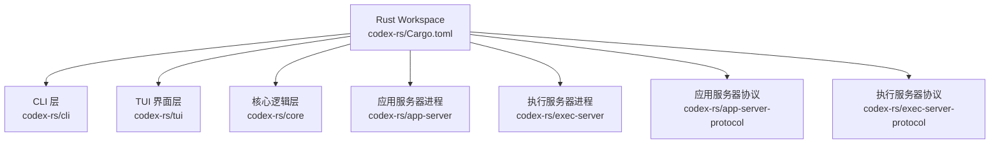
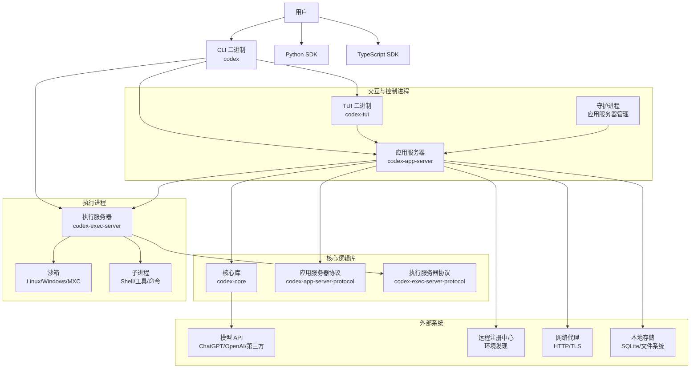
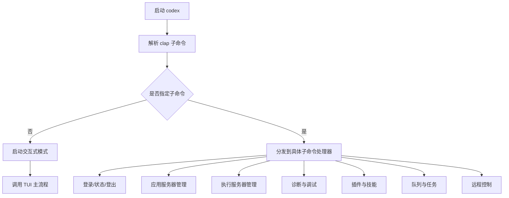
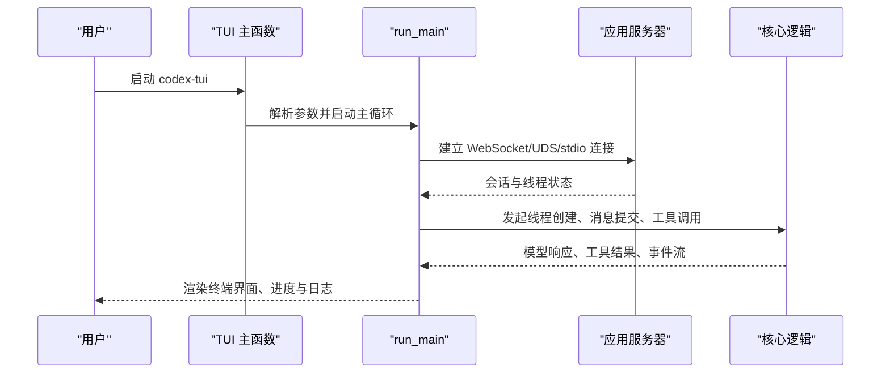
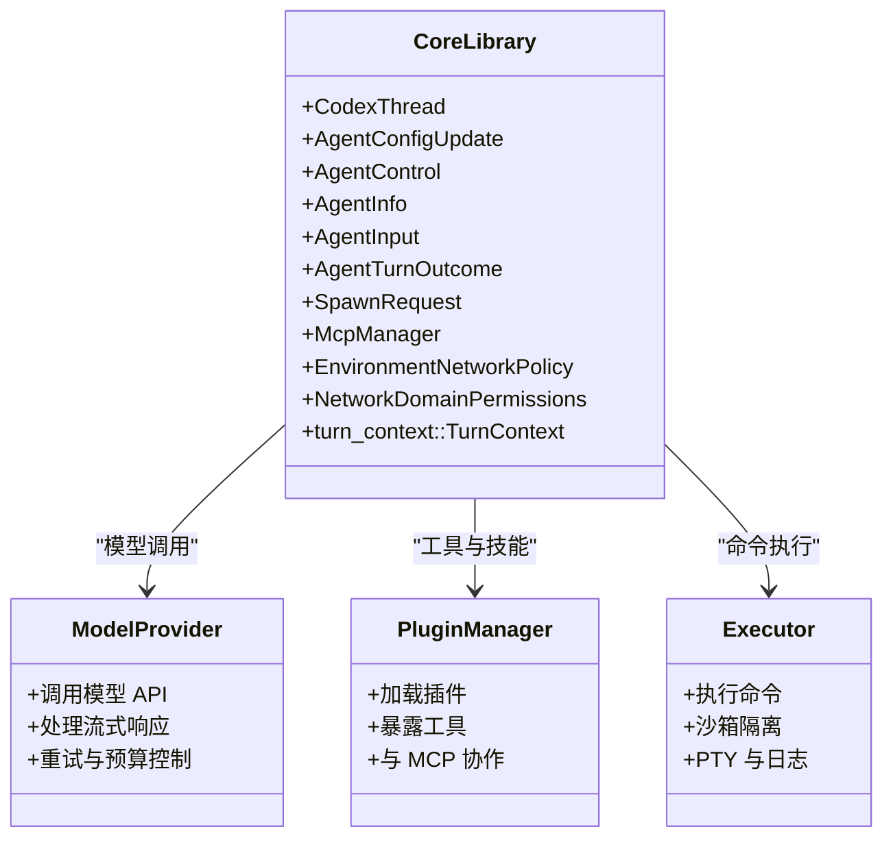
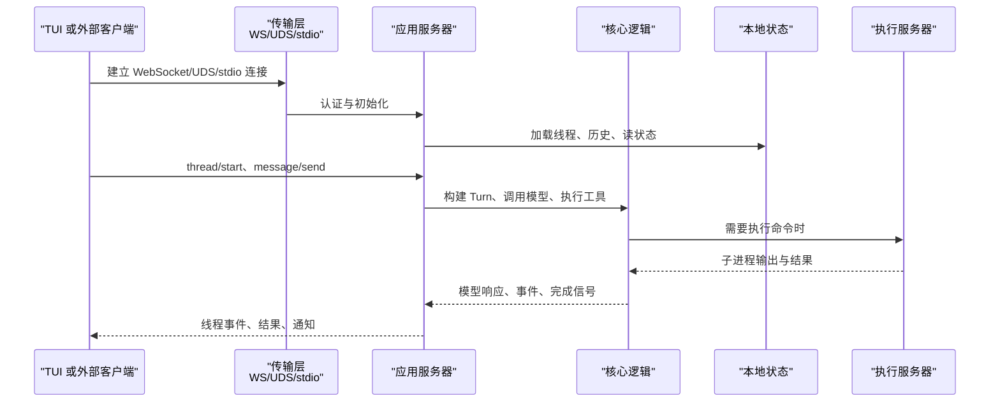
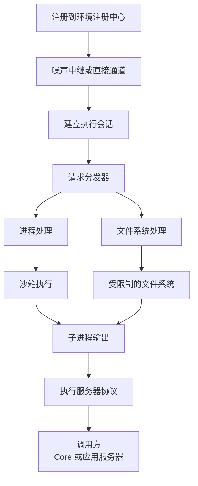
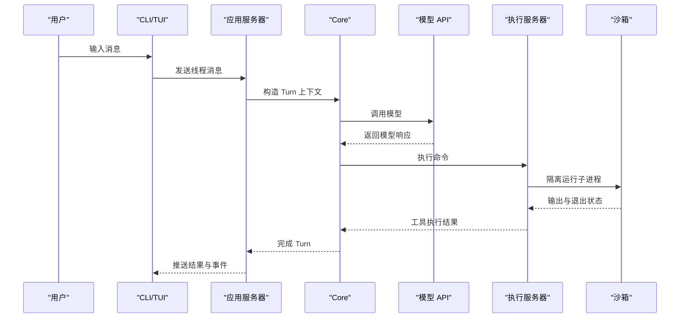
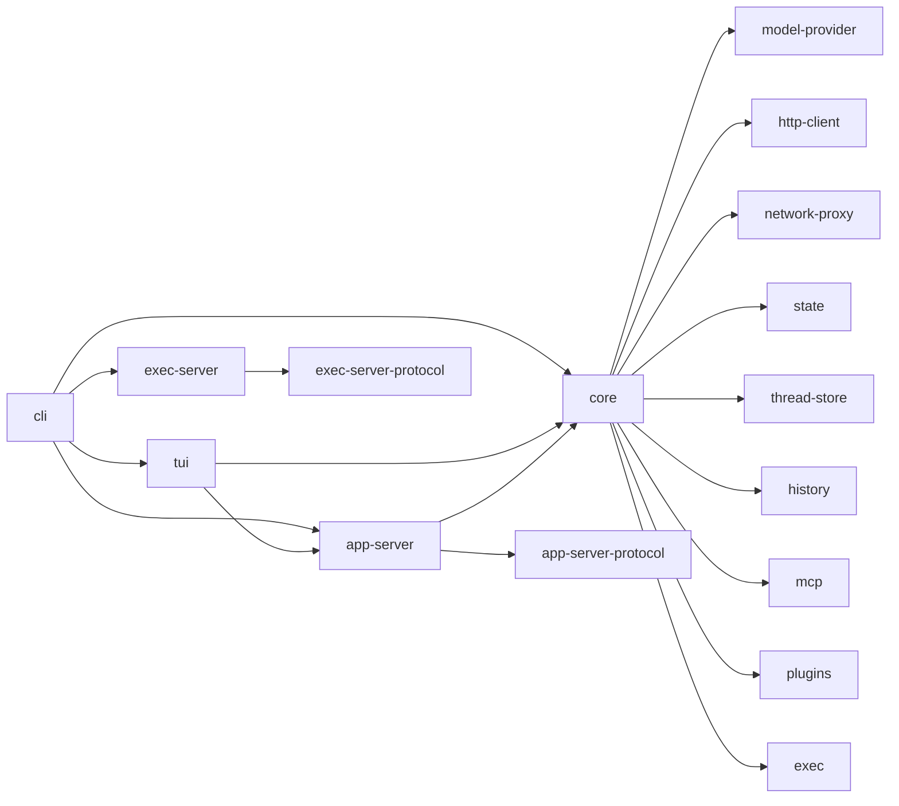

# 系统架构设计

<cite>
**本文引用的文件**   
- [codex-rs/Cargo.toml](file://codex-rs/Cargo.toml)
- [codex-rs/cli/Cargo.toml](file://codex-rs/cli/Cargo.toml)
- [codex-rs/cli/src/main.rs](file://codex-rs/cli/src/main.rs)
- [codex-rs/tui/Cargo.toml](file://codex-rs/tui/Cargo.toml)
- [codex-rs/tui/src/main.rs](file://codex-rs/tui/src/main.rs)
- [codex-rs/core/Cargo.toml](file://codex-rs/core/Cargo.toml)
- [codex-rs/core/src/lib.rs](file://codex-rs/core/src/lib.rs)
- [codex-rs/app-server/Cargo.toml](file://codex-rs/app-server/Cargo.toml)
- [codex-rs/app-server/src/main.rs](file://codex-rs/app-server/src/main.rs)
- [codex-rs/app-server/README.md](file://codex-rs/app-server/README.md)
- [codex-rs/app-server-protocol/Cargo.toml](file://codex-rs/app-server-protocol/Cargo.toml)
- [codex-rs/exec-server/Cargo.toml](file://codex-rs/exec-server/Cargo.toml)
- [codex-rs/exec-server/src/lib.rs](file://codex-rs/exec-server/src/lib.rs)
- [codex-rs/exec-server/README.md](file://codex-rs/exec-server/README.md)
- [codex-rs/exec-server-protocol/Cargo.toml](file://codex-rs/exec-server-protocol/Cargo.toml)
</cite>

## 目录
1. [引言](#引言)
2. [项目结构](#项目结构)
3. [核心组件](#核心组件)
4. [架构总览](#架构总览)
5. [详细组件分析](#详细组件分析)
6. [依赖关系分析](#依赖关系分析)
7. [性能与可靠性考虑](#性能与可靠性考虑)
8. [故障排查指南](#故障排查指南)
9. [结论](#结论)

## 引言
本文面向 Codex CLI 的系统架构设计，聚焦以下目标：
- 说明分层架构：CLI 层负责用户命令解析与分发；Core 层实现智能体核心逻辑；服务层提供应用服务器、执行服务器等独立进程。
- 解释 Rust Crate 模块化组织方式，包括核心模块 `core`、CLI 接口 `cli`、终端界面 `tui`、应用服务器 `app-server`、执行服务器 `exec-server` 及其协议 crate。
- 描述进程间通信模型，涵盖 WebSocket、Unix Domain Socket、远程 Noise 中继、JSON-RPC 和 gRPC 的使用场景。
- 绘制从用户输入到模型调用再到结果返回的数据流向。
- 定义系统边界、外部依赖和技术选型理由。
- 通过架构图展示各组件之间的依赖关系和通信协议。

## 项目结构
Codex CLI 是一个大型 Rust Workspace，所有子模块位于 `codex-rs/` 下。工作区顶层清单声明了主要 Cargo Crate，并统一版本、Rust 版本和许可证策略。关键目录职责如下：

| 路径 | 职责 |
|---|---|
| `codex-rs/cli` | CLI 入口、子命令解析、登录、TUI 启动、应用服务器管理、执行服务器管理、诊断工具等 |
| `codex-rs/tui` | 基于 Ratatui 的交互式终端界面，连接应用服务器或本地核心 |
| `codex-rs/core` | 智能体线程、模型调用、工具链、插件、MCP、沙箱、记忆、历史、状态等核心业务逻辑 |
| `codex-rs/app-server` | 持久化会话、线程生命周期、本地历史、插件调度、模型目录、网络策略、WebSocket/HTTP 服务 |
| `codex-rs/app-server-protocol` | 应用服务器对外 JSON-RPC 协议类型、扩展项、历史记录与 MCP 相关模型 |
| `codex-rs/exec-server` | 独立执行服务器，负责在沙箱中启动和管理子进程、文件系统访问、能力发现、远程注册 |
| `codex-rs/exec-server-protocol` | 执行服务器协议消息、能力快照、路径与安全上下文共享类型 |
| `codex-rs/app-server-daemon` | 应用服务器守护进程、安装更新、后台进程管理与远控 |
| `codex-rs/codex-client` / `codex-api` / `codex-backend-openapi-models` | 后端 API 客户端、OpenAPI 模型及通用 API 抽象 |
| `codex-rs/model-provider` / `codex-models-manager` | 模型提供方抽象、模型目录管理与选择 |
| `codex-rs/http-client` / `codex-network-proxy` | HTTP 客户端、代理和网络策略 |
| `codex-rs/state` / `codex-thread-store` / `codex-history` | 本地 SQLite 状态、线程存储和历史记录 |
| `codex-rs/sandboxing` / `codex-linux-sandbox` / `codex-windows-sandbox` | 跨平台沙箱能力封装 |
| `codex-rs/uds` / `codex-websocket-client` / `codex-websocket-auth` | Unix Domain Socket、WebSocket 客户端与鉴权辅助 |
| `codex-rs/otel` / `codex-tracing-*` | OpenTelemetry 与 tracing 可观测性集成 |
| `sdk/python` / `sdk/typescript` | Python 与 TypeScript SDK，供外部程序以 API 形式使用 Codex |

**图表来源**
- [codex-rs/Cargo.toml:1-120](file://codex-rs/Cargo.toml#L1-L120)

**章节来源**
- [codex-rs/Cargo.toml:1-120](file://codex-rs/Cargo.toml#L1-L120)

## 核心组件
Codex CLI 的核心组件按职责分为四层：

1. **CLI 层**
   - 入口二进制 `codex` 由 `cli` crate 提供，使用 `clap` 解析子命令。
   - 支持登录、状态检查、TUI 启动、应用服务器管理、执行服务器管理、诊断、插件、队列、远程控制和云任务等。
   - 默认无子命令时转发为交互式模式，即启动 TUI。

2. **TUI 层**
   - 独立二进制 `codex-tui`，基于 Ratatui 渲染终端界面。
   - 解析配置覆盖参数后调用 `run_main`，并通过 `arg0_dispatch_or_else` 完成平台特定的 arg0 分发。
   - 通常作为 CLI 的交互前端，也可嵌入其他宿主。

3. **Core 层**
   - 暴露智能体线程、Agent API、Turn 输入输出、模型请求、MCP 管理、插件管理、技能、钩子、Guardian 安全策略、沙箱、网络策略、记忆读写等。
   - 不直接绑定 UI 或网络协议，而是提供可复用的异步运行时逻辑。
   - 被 CLI、TUI、应用服务器以及执行环境共同引用。

4. **服务层**
   - **应用服务器**：暴露 WebSocket/HTTP/stdio 端点，维护线程、历史、插件、模型目录、网络策略、用户验证、遥测等。
   - **执行服务器**：独立进程，负责子进程执行、文件访问、能力发现、远程注册、Noise 中继、沙箱完整性等。
   - **守护进程**：负责应用服务器的安装、升级、后台运行、崩溃恢复与远控。

**章节来源**
- [codex-rs/cli/Cargo.toml:1-152](file://codex-rs/cli/Cargo.toml#L1-L152)
- [codex-rs/tui/Cargo.toml:1-196](file://codex-rs/tui/Cargo.toml#L1-L196)
- [codex-rs/core/Cargo.toml:1-193](file://codex-rs/core/Cargo.toml#L1-L193)
- [codex-rs/app-server/Cargo.toml:1-171](file://codex-rs/app-server/Cargo.toml#L1-L171)
- [codex-rs/exec-server/Cargo.toml:1-115](file://codex-rs/exec-server/Cargo.toml#L1-L115)

## 架构总览
Codex CLI 的整体架构是“多进程 + 多协议”的分层系统：

- **用户侧**：命令行用户通过 `codex` 启动，或通过 Python/TypeScript SDK 调用 API。
- **交互侧**：`codex-tui` 提供交互式界面，向应用服务器发送 JSON-RPC/WebSocket 请求。
- **控制侧**：`codex-app-server` 负责线程生命周期、模型编排、插件与 MCP、本地状态持久化。
- **执行侧**：`codex-exec-server` 隔离执行危险或不可信命令，避免污染主进程。
- **模型侧**：Core 层通过模型提供方抽象调用后端模型，例如 ChatGPT 或其他兼容接口。
- **外部侧**：OpenAI 响应式 API、后端服务、远程注册中心、代理服务和沙箱资源。

**图表来源**
- [codex-rs/cli/src/main.rs:1-120](file://codex-rs/cli/src/main.rs#L1-L120)
- [codex-rs/tui/src/main.rs:1-59](file://codex-rs/tui/src/main.rs#L1-L59)
- [codex-rs/app-server/src/main.rs:1-120](file://codex-rs/app-server/src/main.rs#L1-L120)
- [codex-rs/exec-server/src/lib.rs:1-120](file://codex-rs/exec-server/src/lib.rs#L1-L120)
- [codex-rs/core/src/lib.rs:1-150](file://codex-rs/core/src/lib.rs#L1-L150)

### 分层职责
| 层次 | 主要职责 | 典型技术 |
|---|---|---|
| CLI 层 | 子命令解析、配置加载、进程编排、登录与诊断 | `clap`、`tokio`、`tracing` |
| TUI 层 | 终端渲染、用户事件、对话框、进度与日志 | `ratatui`、`crossterm`、`axum` |
| Core 层 | 智能体线程、模型请求、工具与插件、MCP、安全策略 | `tokio`、`tonic`、`rmcp`、`serde_json` |
| 应用服务器 | WebSocket/HTTP 服务、线程持久化、插件调度、历史 | `axum`、`sqlx`、`tracing-opentelemetry` |
| 执行服务器 | 子进程执行、文件访问、能力发现、远程注册 | `tokio-tungstenite`、`prost`、`rustls` |
| 外部依赖 | 模型 API、远程注册、代理、沙箱、本地数据库 | OpenAI、SQLite、TLS、平台沙箱 |

**章节来源**
- [codex-rs/cli/Cargo.toml:1-152](file://codex-rs/cli/Cargo.toml#L1-L152)
- [codex-rs/tui/Cargo.toml:1-196](file://codex-rs/tui/Cargo.toml#L1-L196)
- [codex-rs/core/Cargo.toml:1-193](file://codex-rs/core/Cargo.toml#L1-L193)
- [codex-rs/app-server/Cargo.toml:1-171](file://codex-rs/app-server/Cargo.toml#L1-L171)
- [codex-rs/exec-server/Cargo.toml:1-115](file://codex-rs/exec-server/Cargo.toml#L1-L115)

## 详细组件分析

### CLI 层：命令解析与进程分发
CLI 是用户进入系统的单一入口。它承担以下职责：
- 使用 `clap` 解析顶层命令和子命令。
- 根据子命令决定行为：登录、查看状态、启动 TUI、启动或管理应用服务器、启动或连接执行服务器、诊断、插件管理、队列、MCP、远程控制和云任务。
- 默认行为是交互式模式，即转发到 TUI。
- 初始化构建信息、特性开关、模型目录、配置覆盖、遥测和日志。
- 对某些平台（如 Linux musl）启用 jemalloc 优化内存分配。

**图表来源**
- [codex-rs/cli/src/main.rs:1-120](file://codex-rs/cli/src/main.rs#L1-L120)
- [codex-rs/cli/Cargo.toml:1-152](file://codex-rs/cli/Cargo.toml#L1-L152)

**章节来源**
- [codex-rs/cli/src/main.rs:1-120](file://codex-rs/cli/src/main.rs#L1-L120)
- [codex-rs/cli/Cargo.toml:1-152](file://codex-rs/cli/Cargo.toml#L1-L152)

### TUI 层：交互式终端界面
TUI 提供独立的终端界面，其入口函数：
- 初始化构建信息。
- 解析配置覆盖参数。
- 调用 `run_main` 启动界面主循环。
- 处理退出原因，将致命错误输出到标准错误，并返回非零退出码。
- 通过 `arg0_dispatch_or_else` 支持平台特定的 arg0 分发路径。

TUI 依赖应用服务器协议、历史、状态、模型目录、MCP、沙箱、终端检测、Otel 遥测等模块，因此它既是交互前端，也是核心逻辑的消费方。

**图表来源**
- [codex-rs/tui/src/main.rs:1-59](file://codex-rs/tui/src/main.rs#L1-L59)
- [codex-rs/tui/Cargo.toml:1-196](file://codex-rs/tui/Cargo.toml#L1-L196)

**章节来源**
- [codex-rs/tui/src/main.rs:1-59](file://codex-rs/tui/src/main.rs#L1-L59)
- [codex-rs/tui/Cargo.toml:1-196](file://codex-rs/tui/Cargo.toml#L1-L196)

### Core 层：智能体核心逻辑
Core 层是 Codex 的业务中枢，暴露的关键能力包括：
- 线程与会话：`CodexThread`、`TurnContext`、`BackgroundTerminalInfo`。
- Agent API：`AgentConfigUpdate`、`AgentControl`、`AgentInfo`、`AgentInput`、`AgentTurnOutcome`、`SpawnRequest`。
- 模型请求：`model_request`、`responses_headers`、`responses_metadata`、重试与压缩。
- MCP 与工具：`McpManager`、`CodexAppsToolsCache`、工具调用模板与权限。
- 插件与技能：插件管理器、连接器、技能加载。
- 安全策略：Guardian、网络策略、沙箱标签、权限决策。
- 执行环境：执行策略、钩子、shell 命令、PTY、日志与遥测。

Core 不直接绑定 UI，也不直接持有网络监听器，而是通过异步 API 被上层消费。

**图表来源**
- [codex-rs/core/src/lib.rs:1-150](file://codex-rs/core/src/lib.rs#L1-L150)
- [codex-rs/core/Cargo.toml:1-193](file://codex-rs/core/Cargo.toml#L1-L193)

**章节来源**
- [codex-rs/core/src/lib.rs:1-150](file://codex-rs/core/src/lib.rs#L1-L150)
- [codex-rs/core/Cargo.toml:1-193](file://codex-rs/core/Cargo.toml#L1-L193)

### 应用服务器：会话、线程与服务端
应用服务器是 Codex 的主要服务端进程，职责包括：
- 暴露传输端点：`stdio://`、`unix://`、`unix://PATH`、`ws://IP:PORT`、`off`。
- 解析配置覆盖、代码模式主机传输、会话来源、WebSocket 鉴权、严格配置模式和远程控制模式。
- 维护线程生命周期、本地历史、用户读状态、模型目录、插件、技能、MCP、Guardian、网络策略、反馈与遥测。
- 提供 JSON-RPC 风格的能力，例如线程列表、搜索、分段移动、关闭拒绝、用户验证取消、Daybreak 初始选择、应用网络策略、MCP UI 信息等。

**图表来源**
- [codex-rs/app-server/src/main.rs:1-120](file://codex-rs/app-server/src/main.rs#L1-L120)
- [codex-rs/app-server/README.md:1-200](file://codex-rs/app-server/README.md#L1-L200)
- [codex-rs/app-server-protocol/Cargo.toml:1-57](file://codex-rs/app-server-protocol/Cargo.toml#L1-L57)

**章节来源**
- [codex-rs/app-server/src/main.rs:1-120](file://codex-rs/app-server/src/main.rs#L1-L120)
- [codex-rs/app-server/README.md:1-200](file://codex-rs/app-server/README.md#L1-L200)
- [codex-rs/app-server/Cargo.toml:1-171](file://codex-rs/app-server/Cargo.toml#L1-L171)
- [codex-rs/app-server-protocol/Cargo.toml:1-57](file://codex-rs/app-server-protocol/Cargo.toml#L1-L57)

### 执行服务器：隔离执行与环境发现
执行服务器是独立进程，核心目标是隔离执行：
- 提供 JSON-RPC 服务，用于启动和控制子进程。
- 支持 WebSocket、远程注册、Noise 中继、Direct 模式、Stdio 多种传输。
- 暴露能力发现、能力缓存、环境变量注入、元数据传播、沙箱选择、文件系统和进程处理。
- 支持远程连接、转发、断线重连、分片可靠传输、序列号与确认机制。
- 在 Windows 上支持 MXC 沙箱，在 Linux/macOS 上支持 Linux Sandbox 或原生沙箱。

**图表来源**
- [codex-rs/exec-server/src/lib.rs:1-120](file://codex-rs/exec-server/src/lib.rs#L1-L120)
- [codex-rs/exec-server/README.md:1-200](file://codex-rs/exec-server/README.md#L1-L200)
- [codex-rs/exec-server-protocol/Cargo.toml:1-31](file://codex-rs/exec-server-protocol/Cargo.toml#L1-L31)

**章节来源**
- [codex-rs/exec-server/src/lib.rs:1-120](file://codex-rs/exec-server/src/lib.rs#L1-L120)
- [codex-rs/exec-server/README.md:1-200](file://codex-rs/exec-server/README.md#L1-L200)
- [codex-rs/exec-server/Cargo.toml:1-115](file://codex-rs/exec-server/Cargo.toml#L1-L115)
- [codex-rs/exec-server-protocol/Cargo.toml:1-31](file://codex-rs/exec-server-protocol/Cargo.toml#L1-L31)

### 数据流向：从用户输入到模型调用
一条典型的用户请求链路如下：

1. 用户在 CLI 或 TUI 中输入消息。
2. CLI/TUI 将请求转换为应用服务器协议。
3. 应用服务器构建线程上下文、准备 Prompt、调用模型。
4. 若需要执行命令，应用服务器通过执行服务器协议调用执行服务器。
5. 执行服务器在沙箱中启动子进程，收集输出并返回。
6. Core 聚合模型响应与工具结果，生成 Turn 完成事件。
7. 应用服务器将事件推送给 TUI 或外部客户端。
8. 状态、历史、遥测和审计记录同步更新。

**图表来源**
- [codex-rs/cli/src/main.rs:1-120](file://codex-rs/cli/src/main.rs#L1-L120)
- [codex-rs/tui/src/main.rs:1-59](file://codex-rs/tui/src/main.rs#L1-L59)
- [codex-rs/app-server/src/main.rs:1-120](file://codex-rs/app-server/src/main.rs#L1-L120)
- [codex-rs/core/src/lib.rs:1-150](file://codex-rs/core/src/lib.rs#L1-L150)
- [codex-rs/exec-server/src/lib.rs:1-120](file://codex-rs/exec-server/src/lib.rs#L1-L120)

**章节来源**
- [codex-rs/cli/src/main.rs:1-120](file://codex-rs/cli/src/main.rs#L1-L120)
- [codex-rs/tui/src/main.rs:1-59](file://codex-rs/tui/src/main.rs#L1-L59)
- [codex-rs/app-server/src/main.rs:1-120](file://codex-rs/app-server/src/main.rs#L1-L120)
- [codex-rs/core/src/lib.rs:1-150](file://codex-rs/core/src/lib.rs#L1-L150)
- [codex-rs/exec-server/src/lib.rs:1-120](file://codex-rs/exec-server/src/lib.rs#L1-L120)

## 依赖关系分析
Codex 的依赖关系可以划分为内部 Crate 依赖、进程内库依赖和外部服务依赖。

**图表来源**
- [codex-rs/cli/Cargo.toml:1-152](file://codex-rs/cli/Cargo.toml#L1-L152)
- [codex-rs/tui/Cargo.toml:1-196](file://codex-rs/tui/Cargo.toml#L1-L196)
- [codex-rs/core/Cargo.toml:1-193](file://codex-rs/core/Cargo.toml#L1-L193)
- [codex-rs/app-server/Cargo.toml:1-171](file://codex-rs/app-server/Cargo.toml#L1-L171)
- [codex-rs/exec-server/Cargo.toml:1-115](file://codex-rs/exec-server/Cargo.toml#L1-L115)

### 耦合性与内聚性
- **高内聚**：每个 Crate 围绕单一职责组织，例如 `exec-server-protocol` 仅定义执行服务器协议类型，`app-server-protocol` 仅定义应用服务器协议类型。
- **低耦合**：Core 不依赖 UI 或网络监听，应用服务器通过协议 Crate 暴露接口，执行服务器通过协议 Crate 暴露能力。
- **进程边界**：CLI/TUI 与应用服务器、执行服务器之间通过进程边界解耦，降低单点故障风险。
- **协议优先**：WebSocket、JSON-RPC、Noise 中继、gRPC 等协议明确划分服务间契约。

**章节来源**
- [codex-rs/cli/Cargo.toml:1-152](file://codex-rs/cli/Cargo.toml#L1-L152)
- [codex-rs/core/Cargo.toml:1-193](file://codex-rs/core/Cargo.toml#L1-L193)
- [codex-rs/app-server/Cargo.toml:1-171](file://codex-rs/app-server/Cargo.toml#L1-L171)
- [codex-rs/exec-server/Cargo.toml:1-115](file://codex-rs/exec-server/Cargo.toml#L1-L115)

## 性能与可靠性考虑
### 技术选型理由
| 技术 | 用途 | 选型理由 |
|---|---|---|
| `tokio` | 异步运行时 | 高性能、生态成熟、适合 I/O 密集和长连接场景 |
| `axum` | HTTP/WebSocket 服务 | 与 Tokio 生态兼容，适合应用服务器和 TUI 内嵌服务 |
| `tonic` | gRPC 支持 | Core 层引入 gRPC 能力，可用于高性能内部服务或远程调用 |
| `tokio-tungstenite` | WebSocket 客户端/服务器 | 适合实时事件、TUI 与应用服务器通信 |
| `sqlx` | 本地数据库 | 编译期 SQL 校验、异步查询、适合本地线程与状态存储 |
| `serde_json` | JSON 序列化 | 应用服务器协议和执行服务器协议均基于 JSON |
| `tracing` / `opentelemetry` | 可观测性 | 统一日志、追踪、指标，便于定位分布式问题 |
| `ratatui` | 终端界面 | 现代 Rust TUI 框架，适合交互式体验 |
| `clap` | 命令行解析 | 功能丰富，支持派生宏和环境变量 |
| `prost` | Protobuf 编解码 | 执行服务器远程中继使用 protobuf 帧格式 |

### 可靠性机制
- 执行服务器支持远程注册、断线重连、分片可靠传输、序列号和确认位。
- 应用服务器提供优雅关闭、读状态冲突、模型提供商要求检查、用户验证取消等健壮性语义。
- Core 层具备模型重试、预算控制、压缩、遥测与调试上下文。
- CLI/TUI 支持颜色输出、终端检测、配置覆盖、诊断报告和退出码分类。

[本节为通用指导，不直接分析具体文件]

## 故障排查指南
常见故障域与定位思路：

| 故障现象 | 可能位置 | 排查建议 |
|---|---|---|
| TUI 无法连接应用服务器 | CLI/TUI、应用服务器传输层 | 检查 `listen` 参数、WebSocket/UDS/stdio 地址、防火墙和代理 |
| 线程创建失败 | 应用服务器、Core、状态存储 | 查看线程列表、本地历史、SQLite 迁移、账号与权限 |
| 模型调用超时 | Core、模型提供方、网络代理 | 检查模型目录、API Key、代理配置、重试与预算 |
| 命令执行被拒绝 | 执行服务器、沙箱、执行策略 | 查看执行策略、沙箱日志、子进程输出、能力发现 |
| 远程执行连接中断 | 执行服务器、注册中心、Noise 中继 | 检查远程 URL、Token、AWS SigV4、直连模式与 TLS |
| 插件或 MCP 工具不可用 | 插件管理器、MCP 服务器 | 查看插件配置、MCP 目录、工具清单与权限 |
| 遥测或日志缺失 | Otel、Tracing、诊断工具 | 检查遥测导出、日志级别、诊断报告与本地保存 |

**章节来源**
- [codex-rs/app-server/README.md:1-200](file://codex-rs/app-server/README.md#L1-L200)
- [codex-rs/exec-server/README.md:1-200](file://codex-rs/exec-server/README.md#L1-L200)

## 结论
Codex CLI 的系统架构以 Rust Workspace 为基础，采用清晰的 CLI 层、Core 层和服务层分工。CLI 负责用户入口与进程编排，TUI 提供交互式界面，Core 封装智能体核心逻辑，应用服务器负责会话、线程、插件、历史和模型编排，执行服务器负责隔离执行与环境发现。进程间通信以 WebSocket、Unix Domain Socket、JSON-RPC、远程 Noise 中继和 gRPC 为主，兼顾本地性能与远程可扩展性。该架构通过协议 Crate 解耦服务契约，通过沙箱与执行策略提升安全性，通过本地状态与遥测提升可观测性，是面向复杂智能体工作流的稳健系统设计。