# MCP 模型上下文协议

<cite>
**本文引用的文件**   
- [lib.rs](file://codex-rs/codex-mcp/src/lib.rs)
- [README.md](file://codex-rs/codex-mcp/README.md)
- [Cargo.toml](file://codex-rs/codex-mcp/Cargo.toml)
- [binding.rs](file://codex-rs/codex-mcp/src/binding.rs)
- [catalog.rs](file://codex-rs/codex-mcp/src/catalog.rs)
- [connection_manager.rs](file://codex-rs/codex-mcp/src/connection_manager.rs)
- [connection_pool.rs](file://codex-rs/codex-mcp/src/connection_pool.rs)
- [rmcp_client.rs](file://codex-rs/codex-mcp/src/rmcp_client.rs)
- [tool_catalog_cache.rs](file://codex-rs/codex-mcp/src/tool_catalog_cache.rs)
- [auth.rs](file://codex-rs/codex-mcp/src/auth.rs)
- [sandbox_executable.rs](file://codex-rs/codex-mcp/src/sandbox_executable.rs)
- [trusted_access.rs](file://codex-rs/codex-mcp/src/trusted_access.rs)
- [resource_client.rs](file://codex-rs/codex-mcp/src/resource_client.rs)
- [mcp/mod.rs](file://codex-rs/codex-mcp/src/mcp/mod.rs)
</cite>

## 目录
1. [简介](#简介)
2. [项目结构](#项目结构)
3. [核心组件](#核心组件)
4. [架构总览](#架构总览)
5. [详细组件分析](#详细组件分析)
6. [依赖关系分析](#依赖关系分析)
7. [性能考量](#性能考量)
8. [故障排查指南](#故障排查指南)
9. [结论](#结论)
10. [附录](#附录)

## 简介
Codex CLI 的 MCP（Model Context Protocol）实现位于 `codex-rs/codex-mcp` crate，负责管理 Codex 与外部 MCP 服务器之间的连接、工具调用、资源访问、事件订阅、认证、权限控制以及沙箱隔离。其核心目标是：
- 为模型提供稳定、可观测、可审计的工具与资源视图；
- 在进程内复用受控的 MCP 客户端连接；
- 将模型可见的工具集合与执行权限绑定到具体调用；
- 通过能力协商、令牌缓存、网络策略和沙箱元数据，保障安全与性能；
- 暴露统一的运行时接口供上层 TUI、Agent 或插件使用。

该 crate 对外暴露的主要概念包括：MCP 运行时、连接管理器、连接池、RMCP 客户端生命周期、工具目录缓存、资源客户端、认证提供者、可信访问上下文、沙箱可执行探测等。

**章节来源**
- [README.md:1-37](file://codex-rs/codex-mcp/README.md#L1-L37)
- [Cargo.toml:1-64](file://codex-rs/codex-mcp/Cargo.toml#L1-L64)

## 项目结构
`codex-mcp` crate 采用按职责分层的组织方式：
- 公共 API 集中在根模块导出；
- 连接管理与聚合逻辑位于 `connection_manager`；
- 进程内连接共享由 `connection_pool` 实现；
- RMCP 客户端启动、初始化、重试与工具发现位于 `rmcp_client`；
- 工具目录缓存位于 `tool_catalog_cache`；
- 认证与令牌解析位于 `auth` 及相关子模块；
- 沙箱与可信访问分别位于 `sandbox_executable`、`sandbox_metadata`、`trusted_access`；
- 资源与事件订阅位于 `resource_client` 与 `event_stream`；
- 配置、目录解析、权限策略位于 `mcp`、`catalog`、`server` 等模块。

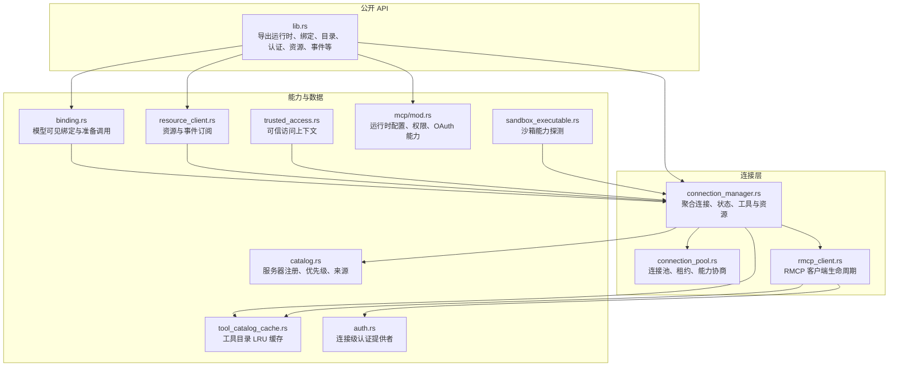

**图表来源**
- [lib.rs:1-154](file://codex-rs/codex-mcp/src/lib.rs#L1-L154)
- [connection_manager.rs:1-200](file://codex-rs/codex-mcp/src/connection_manager.rs#L1-L200)
- [connection_pool.rs:1-200](file://codex-rs/codex-mcp/src/connection_pool.rs#L1-L200)
- [rmcp_client.rs:1-200](file://codex-rs/codex-mcp/src/rmcp_client.rs#L1-L200)
- [catalog.rs:1-200](file://codex-rs/codex-mcp/src/catalog.rs#L1-L200)
- [tool_catalog_cache.rs:1-200](file://codex-rs/codex-mcp/src/tool_catalog_cache.rs#L1-L200)
- [auth.rs:1-118](file://codex-rs/codex-mcp/src/auth.rs#L1-L118)
- [sandbox_executable.rs:1-50](file://codex-rs/codex-mcp/src/sandbox_executable.rs#L1-L50)
- [trusted_access.rs:1-200](file://codex-rs/codex-mcp/src/trusted_access.rs#L1-L200)
- [resource_client.rs:1-200](file://codex-rs/codex-mcp/src/resource_client.rs#L1-L200)
- [mcp/mod.rs:1-200](file://codex-rs/codex-mcp/src/mcp/mod.rs#L1-L200)
- [binding.rs:1-200](file://codex-rs/codex-mcp/src/binding.rs#L1-L200)

**章节来源**
- [lib.rs:1-154](file://codex-rs/codex-mcp/src/lib.rs#L1-L154)
- [Cargo.toml:1-64](file://codex-rs/codex-mcp/Cargo.toml#L1-L64)

## 核心组件
| 组件 | 职责 | 关键行为 |
|---|---|---|
| `McpRuntime` / `McpBinding` | 暴露给上层的 MCP 运行时与不可变工具绑定 | 维护连接集、模型可见工具快照、已准备调用句柄 |
| `McpConnectionSet` | 聚合多个 MCP 服务器连接 | 启动、状态更新、工具与资源聚合、事件通知 |
| `McpConnectionPool` | 进程内连接共享 | 按身份与账号匹配连接、建立会话租约、释放服务端租约 |
| `AsyncManagedClient` / `ManagedClient` | RMCP 客户端封装 | 启动、初始化、能力协商、工具列表、重试与断开恢复 |
| `McpToolCatalogCache` | 工具目录缓存 | LRU、TTL、按环境/认证/协议模式生成键值 |
| `McpAuthProvider` | 连接级认证提供者 | 支持固定凭证与运行时动态令牌 |
| `TrustedAccessContext` | 可信访问上下文 | 注入合规性授权信息到受信任工具调用 |
| `McpResourceClient` / `McpEventStream` | 资源读取与事件订阅 | 分页、模板列表、流式事件、取消与清理 |
| `McpConfig` | 运行时配置 | OAuth、权限、审批、沙箱、Apps 能力、企业 IdP 等 |

**章节来源**
- [lib.rs:1-154](file://codex-rs/codex-mcp/src/lib.rs#L1-L154)
- [binding.rs:1-200](file://codex-rs/codex-mcp/src/binding.rs#L1-L200)
- [connection_manager.rs:1-200](file://codex-rs/codex-mcp/src/connection_manager.rs#L1-L200)
- [connection_pool.rs:1-200](file://codex-rs/codex-mcp/src/connection_pool.rs#L1-L200)
- [rmcp_client.rs:1-200](file://codex-rs/codex-mcp/src/rmcp_client.rs#L1-L200)
- [tool_catalog_cache.rs:1-200](file://codex-rs/codex-mcp/src/tool_catalog_cache.rs#L1-L200)
- [auth.rs:1-118](file://codex-rs/codex-mcp/src/auth.rs#L1-L118)
- [trusted_access.rs:1-200](file://codex-rs/codex-mcp/src/trusted_access.rs#L1-L200)
- [resource_client.rs:1-200](file://codex-rs/codex-mcp/src/resource_client.rs#L1-L200)
- [mcp/mod.rs:1-200](file://codex-rs/codex-mcp/src/mcp/mod.rs#L1-L200)

## 架构总览
MCP 架构分为四层：
1. **顶层接口层**：`McpRuntime`、`McpBinding`、`McpResourceClient` 提供稳定的 Rust API；
2. **连接管理层**：`McpConnectionSet` 协调启动、状态、工具与资源聚合；
3. **传输与客户端层**：`rmcp_client` 管理底层 RMCP 客户端生命周期；
4. **平台与安全层**：认证提供者、可信访问、沙箱探测、目录缓存、权限策略。

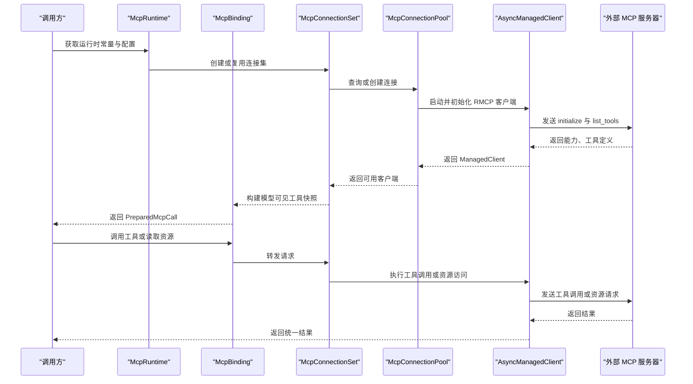

**图表来源**
- [binding.rs:1-200](file://codex-rs/codex-mcp/src/binding.rs#L1-L200)
- [connection_manager.rs:1-200](file://codex-rs/codex-mcp/src/connection_manager.rs#L1-L200)
- [connection_pool.rs:1-200](file://codex-rs/codex-mcp/src/connection_pool.rs#L1-L200)
- [rmcp_client.rs:1-200](file://codex-rs/codex-mcp/src/rmcp_client.rs#L1-L200)

## 详细组件分析

### 连接管理器：启动、状态、工具与资源聚合
连接管理器是 MCP 实现的中心枢纽，负责：
- 管理多个 MCP 服务器的连接生命周期；
- 发布启动状态、失败原因、就绪事件；
- 聚合各服务器的工具与资源；
- 处理模型可见性过滤、权限与审计元数据；
- 与事件流、网络策略、工具目录缓存协作。

关键类型包括连接条目、连接身份、启动超时、诊断指标、错误展示等。它既支持独立私有连接，也支持进程内共享连接。

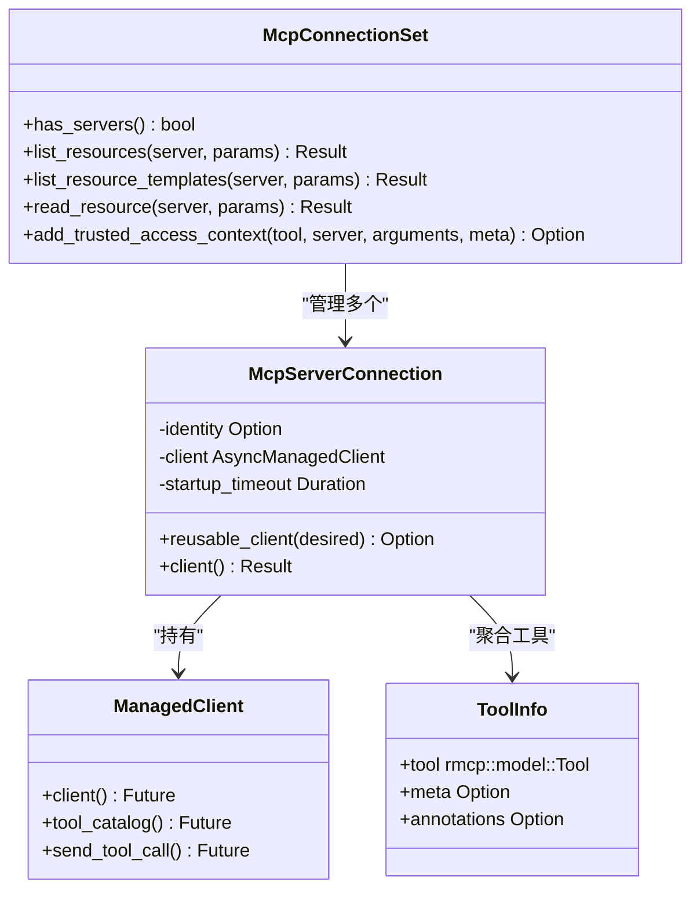

**图表来源**
- [connection_manager.rs:1-200](file://codex-rs/codex-mcp/src/connection_manager.rs#L1-L200)
- [rmcp_client.rs:1-200](file://codex-rs/codex-mcp/src/rmcp_client.rs#L1-L200)
- [binding.rs:1-200](file://codex-rs/codex-mcp/src/binding.rs#L1-L200)

**章节来源**
- [connection_manager.rs:1-200](file://codex-rs/codex-mcp/src/connection_manager.rs#L1-L200)

### 连接池：进程内连接复用与会话租约
连接池的目标是在不破坏 Chat 级所有权的前提下复用本地 stdio 连接的 MCP 客户端。其设计要点如下：
- 使用 `ConnectionKey` 作为共享键，包含服务器名称、连接身份、账户、认证状态、启动超时与目录项限制；
- 使用 `Entry` 表示池内条目，持有运行时句柄、客户端未来、能力、目录快照、取消令牌；
- 使用 `LeaseOwners` 与 `ConnectionLease` 区分“创建者”与“加入者”，每个活跃 Chat 拥有显式租约；
- 对协商成功的 stdio 连接启用 `codex/connection-lease` 能力，并通过自定义释放请求通知远端；
- 工具目录查询对共享连接进行去重，避免不同 Chat 互相阻塞。

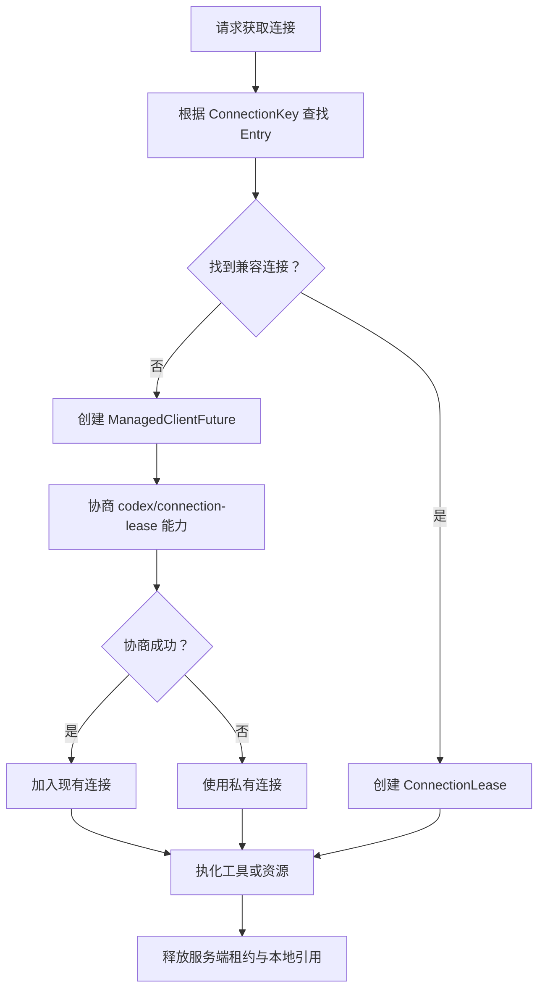

**图表来源**
- [connection_pool.rs:1-200](file://codex-rs/codex-mcp/src/connection_pool.rs#L1-L200)
- [rmcp_client.rs:1-200](file://codex-rs/codex-mcp/src/rmcp_client.rs#L1-L200)

**章节来源**
- [connection_pool.rs:1-200](file://codex-rs/codex-mcp/src/connection_pool.rs#L1-L200)

### RMCP 客户端生命周期：启动、初始化与重试
RMCP 客户端模块负责：
- 构造传输；
- 发送 initialize；
- 列出原始工具；
- 应用每服务器工具过滤器；
- 暴露缓存的 Codex Apps 工具；
- 处理非阻塞 Apps 发现；
- 管理 executor 发现的凭据；
- 实现指数退避重连与启动状态上报。

常量定义了默认启动超时、默认工具超时、工具列表指标、Apps 重连退避区间，以及实验性能力标识。

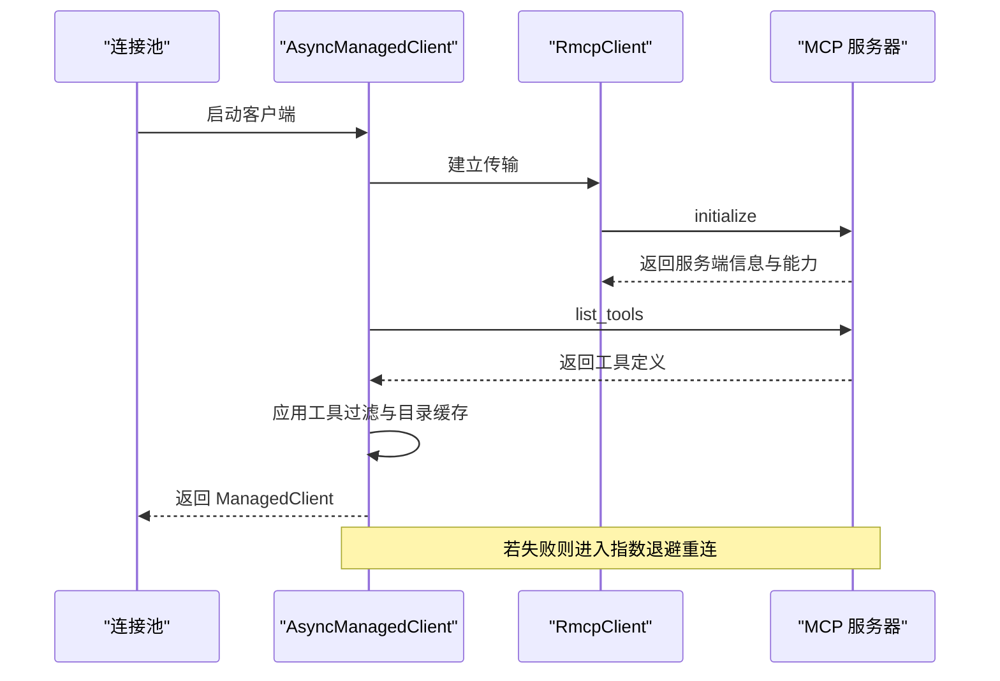

**图表来源**
- [rmcp_client.rs:1-200](file://codex-rs/codex-mcp/src/rmcp_client.rs#L1-L200)
- [connection_pool.rs:1-200](file://codex-rs/codex-mcp/src/connection_pool.rs#L1-L200)

**章节来源**
- [rmcp_client.rs:1-200](file://codex-rs/codex-mcp/src/rmcp_client.rs#L1-L200)

### 工具目录缓存：LRU、TTL 与变更追踪
工具目录缓存用于减少重复的 `list_tools` 开销，同时避免不安全复用：
- 进程级 LRU 缓存，容量与 TTL 可配置；
- 按服务器名、配置、运行时上下文、环境、客户端能力、连接身份组合生成缓存键；
- 支持可选启动宽限期，允许在目录尚未就绪时延迟等待；
- 当服务器声明刷新能力时，需要检查目录修订号是否可追踪；
- 对禁用缓存或过期的目录立即回退到真实查询。

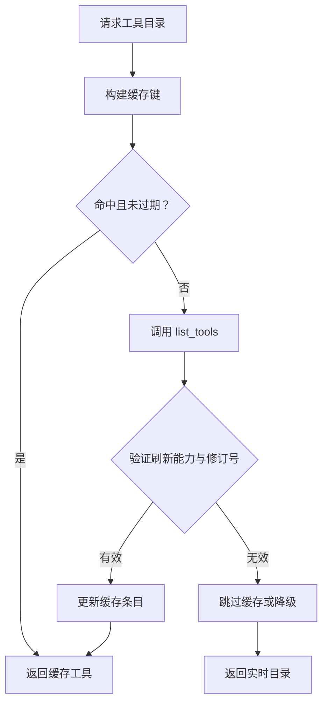

**图表来源**
- [tool_catalog_cache.rs:1-200](file://codex-rs/codex-mcp/src/tool_catalog_cache.rs#L1-L200)
- [rmcp_client.rs:1-200](file://codex-rs/codex-mcp/src/rmcp_client.rs#L1-L200)

**章节来源**
- [tool_catalog_cache.rs:1-200](file://codex-rs/codex-mcp/src/tool_catalog_cache.rs#L1-L200)

### 认证流程、令牌管理与安全策略
认证体系分为连接级认证提供者与运行时令牌解析：
- `McpAuthProvider` 支持固定凭证与运行时动态令牌；
- 运行时模式会校验目标 URL、选择认证策略、绑定 HTTP 客户端工厂；
- 如果运行时认证改变了网络策略，则拒绝复用已有连接；
- OAuth 相关配置、作用域、回调地址、刷新模式由 `mcp/mod.rs` 中的运行时配置统一管理；
- 企业托管认证、EMA、密钥环后端、登录状态均作为运行时参数传入。

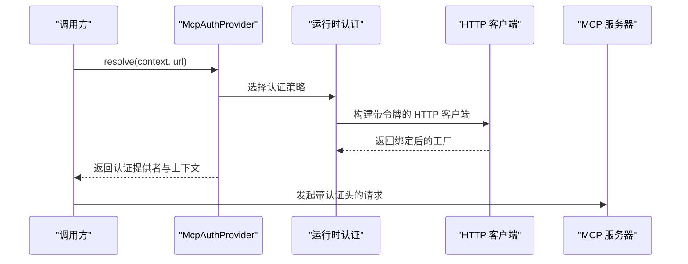

**图表来源**
- [auth.rs:1-118](file://codex-rs/codex-mcp/src/auth.rs#L1-L118)
- [mcp/mod.rs:1-200](file://codex-rs/codex-mcp/src/mcp/mod.rs#L1-L200)

**章节来源**
- [auth.rs:1-118](file://codex-rs/codex-mcp/src/auth.rs#L1-L118)
- [mcp/mod.rs:1-200](file://codex-rs/codex-mcp/src/mcp/mod.rs#L1-L200)

### 沙箱隔离机制与可信访问
沙箱机制通过以下路径实现：
- 运行时配置提供 `codex_self_exe` 与 `codex_linux_sandbox_exe`；
- `sandbox_executable` 以绝对路径探测主机二进制是否支持沙箱状态选项，并使用进程级缓存结果；
- README 明确说明 MCP 服务器可声明 `codex/sandbox-state` 能力，并在 `_meta` 中接收策略值与可选 launcher 路径；
- 可信访问上下文仅在满足严格条件时注入授权元数据，例如插件来源、环境变量、只读提示、零参工具等。

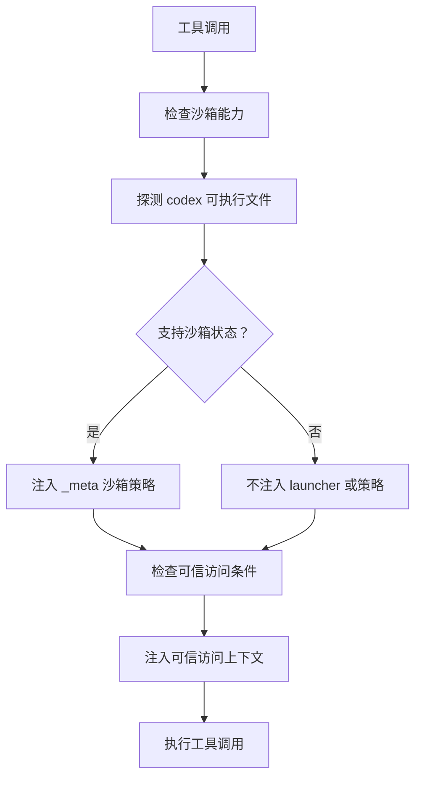

**图表来源**
- [sandbox_executable.rs:1-50](file://codex-rs/codex-mcp/src/sandbox_executable.rs#L1-L50)
- [trusted_access.rs:1-200](file://codex-rs/codex-mcp/src/trusted_access.rs#L1-L200)
- [README.md:1-37](file://codex-rs/codex-mcp/README.md#L1-L37)

**章节来源**
- [sandbox_executable.rs:1-50](file://codex-rs/codex-mcp/src/sandbox_executable.rs#L1-L50)
- [trusted_access.rs:1-200](file://codex-rs/codex-mcp/src/trusted_access.rs#L1-L200)
- [README.md:1-37](file://codex-rs/codex-mcp/README.md#L1-L37)

### 资源访问与事件通知
资源客户端提供：
- 资源分页列表；
- 资源模板列表；
- 资源读取；
- 事件定义与订阅；
- 取消与清理；
- 与运行时和连接集的解耦访问。

事件订阅通过 `McpEventStream` 打开流式请求，在服务器移除或连接关闭时自动取消。

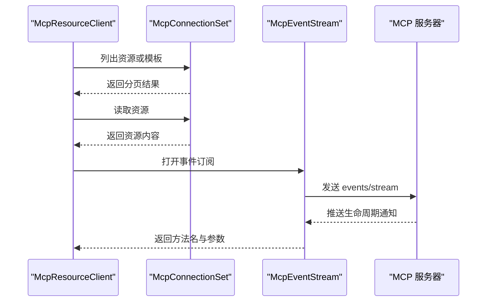

**图表来源**
- [resource_client.rs:1-200](file://codex-rs/codex-mcp/src/resource_client.rs#L1-L200)
- [connection_manager.rs:1-200](file://codex-rs/codex-mcp/src/connection_manager.rs#L1-L200)

**章节来源**
- [resource_client.rs:1-200](file://codex-rs/codex-mcp/src/resource_client.rs#L1-L200)

### 工具目录与权限控制
工具目录解析器负责：
- 从插件、配置、兼容性层、扩展来源注册 MCP 服务器；
- 计算注册优先级与冲突处理方式；
- 区分宿主拥有的 Apps 服务器与执行器发现的环境；
- 保留插件归属信息以便审计；
- 结合 `McpServerPermissions` 决定线程级或文件系统沙箱级权限。

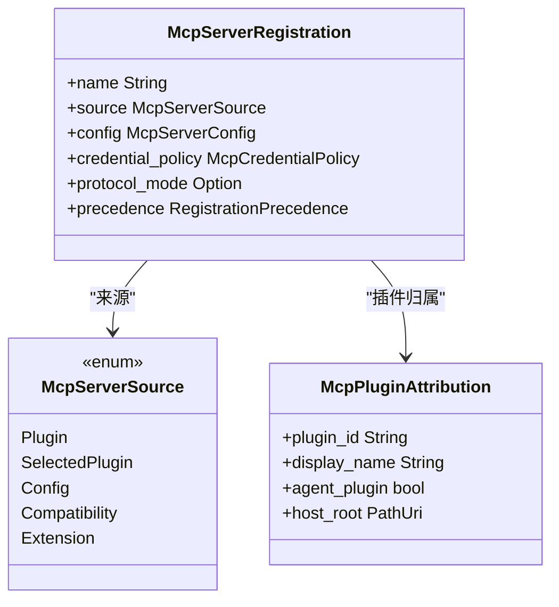

**图表来源**
- [catalog.rs:1-200](file://codex-rs/codex-mcp/src/catalog.rs#L1-L200)

**章节来源**
- [catalog.rs:1-200](file://codex-rs/codex-mcp/src/catalog.rs#L1-L200)

### 模型可见绑定与调用准备
`McpBinding` 将连接集、客户端、配置与模型可见工具快照绑定在一起，并提供：
- 工具清单；
- 工具元数据；
- 准备调用；
- 资源与模板列表；
- 资源读取。

`PreparedMcpCall` 则锁定具体客户端、目录快照、超时与权限主体，确保一次调用不会漂移到其他连接。

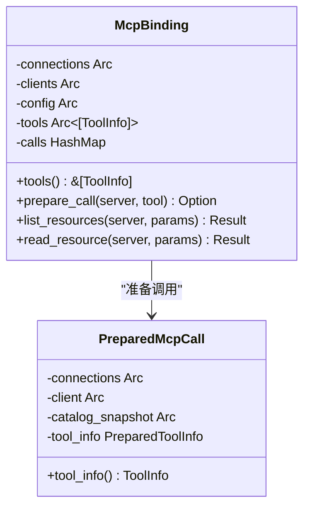

**图表来源**
- [binding.rs:1-200](file://codex-rs/codex-mcp/src/binding.rs#L1-L200)

**章节来源**
- [binding.rs:1-200](file://codex-rs/codex-mcp/src/binding.rs#L1-L200)

## 依赖关系分析
`codex-mcp` crate 依赖多个内部子系统，形成清晰的分层依赖：

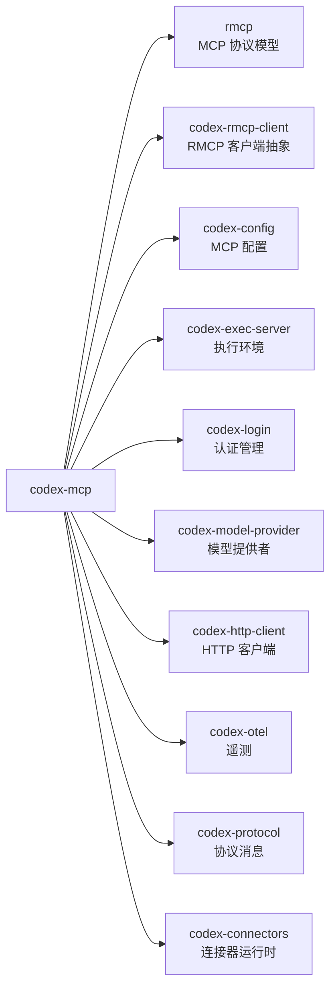

**图表来源**
- [Cargo.toml:1-64](file://codex-rs/codex-mcp/Cargo.toml#L1-L64)

**章节来源**
- [Cargo.toml:1-64](file://codex-rs/codex-mcp/Cargo.toml#L1-L64)

## 性能考量
- **连接复用**：通过 `McpConnectionPool` 复用本地 stdio 连接，减少进程启动与握手成本；
- **工具目录缓存**：`McpToolCatalogCache` 使用 LRU 与 TTL 降低频繁 `list_tools` 的网络与序列化开销；
- **异步与取消**：大量使用 `tokio`、`futures`、`CancellationToken`，避免阻塞与泄漏；
- **指数退避重连**：对 Codex Apps 等非关键服务实现重连退避，防止雪崩；
- **诊断指标**：暴露连接数、工具列表耗时、刷新耗时等指标，便于监控；
- **按需加载**：Apps 工具目录与非关键能力保持非阻塞，避免拖慢主启动路径；
- **最小化共享锁竞争**：将工具目录快照与客户端启动分离，减少 Chat 间互相等待。

[本节为通用性能建议，不直接分析具体代码片段]

## 故障排查指南
常见问题和定位思路：
- **连接无法启动**：检查启动超时、认证是否被拒绝、传输是否可用；查看 `StartupOutcomeError` 及连接诊断指标；
- **工具列表为空**：确认目录缓存是否被禁用、TTL 是否过期、服务器是否返回空列表；
- **OAuth 登录失败**：核对 OAuth 作用域、回调端口、回调 URL、刷新模式与密钥环后端；
- **沙箱能力缺失**：确认 `codex_self_exe` 路径是否正确，是否通过 `supports_sandbox_state` 探测；
- **事件订阅中断**：检查服务器移除信号、连接关闭、取消通知；
- **认证导致连接失效**：运行时认证改变网络策略时会拒绝复用连接，需重建连接。

**章节来源**
- [rmcp_client.rs:1-200](file://codex-rs/codex-mcp/src/rmcp_client.rs#L1-L200)
- [connection_pool.rs:1-200](file://codex-rs/codex-mcp/src/connection_pool.rs#L1-L200)
- [auth.rs:1-118](file://codex-rs/codex-mcp/src/auth.rs#L1-L118)
- [sandbox_executable.rs:1-50](file://codex-rs/codex-mcp/src/sandbox_executable.rs#L1-L50)
- [resource_client.rs:1-200](file://codex-rs/codex-mcp/src/resource_client.rs#L1-L200)

## 结论
Codex CLI 的 MCP 实现以连接管理为核心，围绕连接复用、工具目录缓存、认证提供者、沙箱与可信访问、资源与事件订阅构建了完整的安全可控扩展点。它既满足模型侧工具调用的稳定性需求，也为上游 TUI、Agent、插件提供了清晰的集成边界。对于使用者而言，理解 `McpRuntime`、`McpBinding`、`McpConnectionSet`、`McpConnectionPool`、`AsyncManagedClient`、`McpToolCatalogCache` 之间的关系，是正确使用 MCP 能力的关键。

[本节为总结性内容，不直接分析具体代码片段]

## 附录

### MCP 服务器配置示例
以下字段来自运行时配置结构，可用于描述 MCP 服务器行为：
- `chatgpt_base_url`：ChatGPT 托管 Apps MCP 服务器基地址；
- `apps_mcp_product_sku`：传递给宿主 Apps 服务器的产品 SKU；
- `requires_read_only_mcp_tools`：是否要求服务器端只读过滤；
- `codex_home`：OAuth 状态与 App 工具缓存目录；
- `mcp_enterprise_managed_auth`：企业托管 IdP；
- `mcp_oauth_credentials_store_mode`：OAuth 令牌存储模式；
- `oauth_refresh_mode`：OAuth 刷新所有权；
- `auth_keyring_backend_kind`：密钥环后端；
- `mcp_oauth_callback_port`：本地回调端口；
- `mcp_oauth_callback_url`：回调地址覆盖；
- `optional_mcp_startup_grace`：可选服务器启动宽限期；
- `approval_policy`：工具调用与 elicitation 审批策略；
- `permission_profile`：权限画像；
- `server_permissions`：服务器级权限；
- `codex_self_exe`、`codex_linux_sandbox_exe`：沙箱可执行文件；
- `apps_enabled`、`apps_early_resource_discovery`：Apps 功能开关。

**章节来源**
- [mcp/mod.rs:1-200](file://codex-rs/codex-mcp/src/mcp/mod.rs#L1-L200)

### 客户端集成指南
推荐集成步骤：
1. 构建 `McpConfig`，填入 OAuth、审批、权限、沙箱与 Apps 配置；
2. 通过 `McpRuntime` 初始化连接集；
3. 使用 `McpBinding` 获取模型可见工具清单；
4. 使用 `prepare_call` 绑定具体工具与客户端；
5. 通过 `McpResourceClient` 访问资源与事件；
6. 在 Chat 结束时释放连接租约，避免连接泄漏；
7. 监控连接数、工具列表耗时、刷新耗时等指标。

**章节来源**
- [lib.rs:1-154](file://codex-rs/codex-mcp/src/lib.rs#L1-L154)
- [binding.rs:1-200](file://codex-rs/codex-mcp/src/binding.rs#L1-L200)
- [resource_client.rs:1-200](file://codex-rs/codex-mcp/src/resource_client.rs#L1-L200)