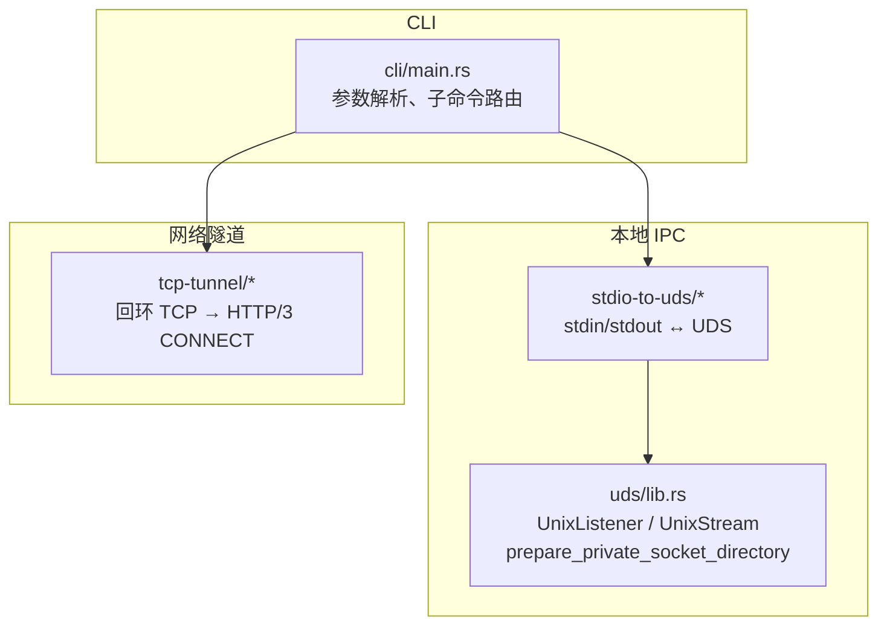
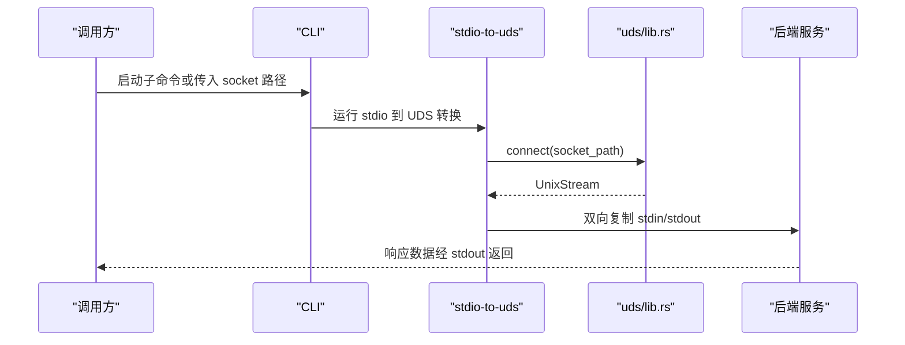
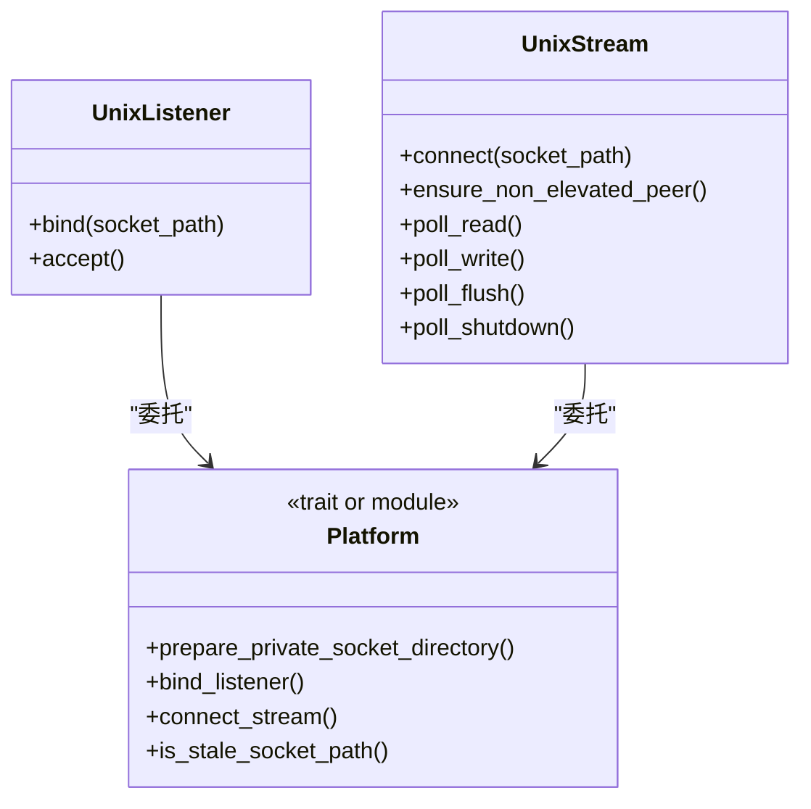
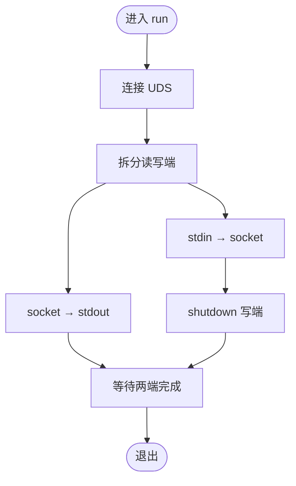
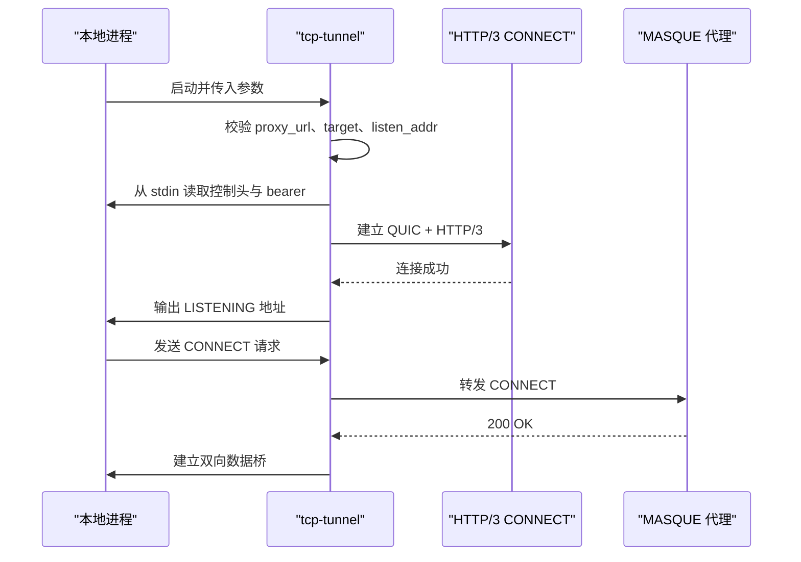
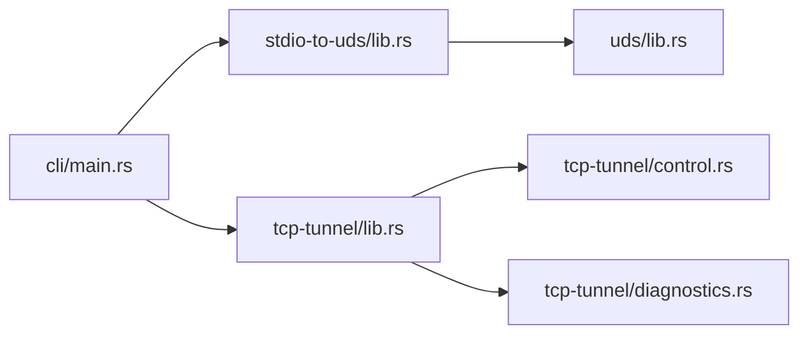

# Unix Domain Socket 通信

<cite>
**本文引用的文件**   
- [uds/lib.rs](file://codex-rs/uds/src/lib.rs)
- [uds/windows_peer.rs](file://codex-rs/uds/src/windows_peer.rs)
- [uds/windows_security.rs](file://codex-rs/uds/src/windows_security.rs)
- [uds/windows_socket_validation.rs](file://codex-rs/uds/src/windows_socket_validation.rs)
- [stdio-to-uds/main.rs](file://codex-rs/stdio-to-uds/src/main.rs)
- [stdio-to-uds/lib.rs](file://codex-rs/stdio-to-uds/src/lib.rs)
- [tcp-tunnel/lib.rs](file://codex-rs/tcp-tunnel/src/lib.rs)
- [tcp-tunnel/control.rs](file://codex-rs/tcp-tunnel/src/control.rs)
- [tcp-tunnel/diagnostics.rs](file://codex-rs/tcp-tunnel/src/diagnostics.rs)
- [cli/main.rs](file://codex-rs/cli/src/main.rs)
- [cli/debug_sandbox.rs](file://codex-rs/cli/src/debug_sandbox.rs)
</cite>

## 目录
1. [引言](#引言)
2. [项目结构](#项目结构)
3. [核心组件](#核心组件)
4. [架构总览](#架构总览)
5. [详细组件分析](#详细组件分析)
6. [依赖关系分析](#依赖关系分析)
7. [性能与可靠性](#性能与可靠性)
8. [安全与权限控制](#安全与权限控制)
9. [操作系统兼容性](#操作系统兼容性)
10. [连接配置、超时与错误处理](#连接配置超时与错误处理)
11. [使用示例与调试方法](#使用示例与调试方法)
12. [与其他通信方式对比](#与其他通信方式对比)
13. [故障排查指南](#故障排查指南)
14. [结论](#结论)

## 引言
本文面向 Codex CLI 的本地进程间通信机制，重点说明以下能力：
- Unix Domain Socket（UDS）连接的建立、监听、接受、连接和关闭。
- stdio 到 UDS 的双向转发实现。
- TCP 隧道的工作原理：通过 HTTP/3 CONNECT 在回环 TCP 上暴露受控端口，并复用 MASQUE 代理连接。
- Windows 与 Unix 平台上的安全模型差异，包括所有者目录、DACL、提权检查和重解析点防护。
- 连接配置选项、超时策略、诊断输出以及常见错误的定位方法。
- 与管道、TCP、HTTP/WebSocket 等其他方式的取舍原则。

该文档既适合初次接触 Codex 内部 IPC 的开发人员，也适合作为运维排障参考。

## 项目结构
Codex 中与 UDS 和 TCP 隧道相关的代码主要分布在三个 Rust crate 中：
- `codex-rs/uds`：跨平台 UDS 抽象层，提供 `UnixListener`、`UnixStream`、私有目录准备、Windows 对端提权检查等能力。
- `codex-rs/stdio-to-uds`：将标准输入输出与 UDS 流双向桥接的轻量工具。
- `codex-rs/tcp-tunnel`：在本地回环 TCP 上监听，并通过 HTTP/3 CONNECT 把流量转发给 MASQUE 代理。

图表来源
- [cli/main.rs:712-760](file://codex-rs/cli/src/main.rs#L712-L760)
- [cli/main.rs:1475-1482](file://codex-rs/cli/src/main.rs#L1475-L1482)
- [cli/main.rs:1896-1899](file://codex-rs/cli/src/main.rs#L1896-L1899)
- [uds/lib.rs:1-120](file://codex-rs/uds/src/lib.rs#L1-L120)
- [stdio-to-uds/main.rs:1-20](file://codex-rs/stdio-to-uds/src/main.rs#L1-L20)
- [stdio-to-uds/lib.rs:1-46](file://codex-rs/stdio-to-uds/src/lib.rs#L1-L46)
- [tcp-tunnel/lib.rs:1-120](file://codex-rs/tcp-tunnel/src/lib.rs#L1-L120)

章节来源
- [uds/lib.rs:1-120](file://codex-rs/uds/src/lib.rs#L1-L120)
- [stdio-to-uds/main.rs:1-20](file://codex-rs/stdio-to-uds/src/main.rs#L1-L20)
- [stdio-to-uds/lib.rs:1-46](file://codex-rs/stdio-to-uds/src/lib.rs#L1-L46)
- [tcp-tunnel/lib.rs:1-120](file://codex-rs/tcp-tunnel/src/lib.rs#L1-L120)
- [cli/main.rs:712-760](file://codex-rs/cli/src/main.rs#L712-L760)
- [cli/main.rs:1475-1482](file://codex-rs/cli/src/main.rs#L1475-L1482)
- [cli/main.rs:1896-1899](file://codex-rs/cli/src/main.rs#L1896-L1899)

## 核心组件
- UDS 抽象层：统一 Unix 与 Windows 的行为，暴露 `bind`、`accept`、`connect`、`is_stale_socket_path`、`prepare_private_socket_directory` 等方法；在 Windows 上还提供非提权对端校验。
- stdio 到 UDS 转换器：接收一个 socket 路径，将 stdin 写入 UDS，并把 UDS 数据复制到 stdout，同时负责半关闭和错误包装。
- TCP 隧道：绑定回环地址，读取来自 stdin 的凭据和控制头，通过 HTTP/3 CONNECT 将本地 TCP 请求转发到远程 MASQUE 代理，并在代理断开时自动重连。

章节来源
- [uds/lib.rs:1-120](file://codex-rs/uds/src/lib.rs#L1-L120)
- [stdio-to-uds/lib.rs:1-46](file://codex-rs/stdio-to-uds/src/lib.rs#L1-L46)
- [tcp-tunnel/lib.rs:1-120](file://codex-rs/tcp-tunnel/src/lib.rs#L1-L120)

## 架构总览
Codex 的本地通信链路可以理解为三层：
1. 应用层：CLI 或外部调用方发起请求。
2. 传输适配层：根据场景选择 stdio 到 UDS 或直接使用 UDS，或通过 TCP 隧道访问远程代理。
3. 后端服务：例如 app-server、exec-server、MCP 或其他支持 UDS/TCP 的后端。

图表来源
- [cli/main.rs:1475-1482](file://codex-rs/cli/src/main.rs#L1475-L1482)
- [stdio-to-uds/lib.rs:1-46](file://codex-rs/stdio-to-uds/src/lib.rs#L1-L46)
- [uds/lib.rs:1-120](file://codex-rs/uds/src/lib.rs#L1-L120)

## 详细组件分析

### UDS 抽象层
UDS 抽象层提供跨平台接口，屏蔽 Unix 原生 socket 与 Windows `uds_windows` 实现的差异。关键职责包括：
- 创建私有 socket 目录：Unix 上使用 `0o700`，Windows 上构造仅当前用户可继承的 DACL。
- 监听与连接：封装 `UnixListener`、`UnixStream`，并提供异步读写语义。
- 陈旧路径检测：Unix 上检查是否为 socket 文件类型，Windows 上检查路径存在性。
- Windows 对端安全检查：要求对端属于当前用户且未提权。

图表来源
- [uds/lib.rs:1-120](file://codex-rs/uds/src/lib.rs#L1-L120)
- [uds/lib.rs:201-375](file://codex-rs/uds/src/lib.rs#L201-L375)

#### Unix 行为
- 私有目录模式固定为 `0o700`，确保只有所有者可遍历和创建 socket。
- 如果目录已存在但权限不是期望值，会尝试修复为 `0o700`。
- 连接失败时，若检测到无效输入路径，会先 canonicalize 再重试，以应对符号链接目标过长的问题。
- 陈旧 socket 判断基于文件类型是否为 socket。

#### Windows 行为
- 私有目录创建使用 SDDL 生成仅当前用户可写的 DACL，拒绝不安全已有目录。
- 连接前不自动修复 ACL，而是通过只读验证防止替换攻击。
- 连接时使用阻塞 IO 任务包装，避免 Windows socket API 阻塞 Tokio 运行时。
- 对端校验使用内核 PID 查询、令牌比较和提权标志检查，拒绝提权进程之间的隐式复用。

章节来源
- [uds/lib.rs:1-120](file://codex-rs/uds/src/lib.rs#L1-L120)
- [uds/lib.rs:201-375](file://codex-rs/uds/src/lib.rs#L201-L375)
- [uds/windows_security.rs:1-128](file://codex-rs/uds/src/windows_security.rs#L1-L128)
- [uds/windows_socket_validation.rs:1-138](file://codex-rs/uds/src/windows_socket_validation.rs#L1-L138)
- [uds/windows_peer.rs:1-103](file://codex-rs/uds/src/windows_peer.rs#L1-L103)

### stdio 到 UDS 转换器
该组件是一个最小化桥梁：
- 接受一个 socket 路径作为唯一参数。
- 连接到 UDS。
- 将 stdin 复制到 socket writer。
- 将 socket reader 复制到 stdout。
- 在复制完成后尝试 shutdown 写端，忽略某些平台上报的 `NotConnected`。
- 使用 `try_join!` 并行执行两个方向的数据流，任一方向失败都会整体失败。

图表来源
- [stdio-to-uds/lib.rs:1-46](file://codex-rs/stdio-to-uds/src/lib.rs#L1-L46)
- [stdio-to-uds/main.rs:1-20](file://codex-rs/stdio-to-uds/src/main.rs#L1-L20)

章节来源
- [stdio-to-uds/main.rs:1-20](file://codex-rs/stdio-to-uds/src/main.rs#L1-L20)
- [stdio-to-uds/lib.rs:1-46](file://codex-rs/stdio-to-uds/src/lib.rs#L1-L46)

### TCP 隧道
TCP 隧道的目标是让本地程序通过回环 TCP 访问远端 MASQUE 代理。其核心流程如下：
1. 解析并校验命令行参数，包括代理 URL、可信代理来源列表、目标 authority、监听地址、认证 token 和控制头开关。
2. 从 stdin 读取可选的 CONNECT 扩展头和初始 Bearer token，并可持续更新 token。
3. 绑定回环 TCP 监听器，并发出就绪信号。
4. 通过 QUIC 和 HTTP/3 CONNECT 建立与代理的连接。
5. 将本地 TCP 请求桥接到 HTTP/3 流，并在代理断开时指数退避重连。

图表来源
- [tcp-tunnel/lib.rs:1-200](file://codex-rs/tcp-tunnel/src/lib.rs#L1-L200)
- [tcp-tunnel/lib.rs:201-533](file://codex-rs/tcp-tunnel/src/lib.rs#L201-L533)
- [tcp-tunnel/control.rs:1-77](file://codex-rs/tcp-tunnel/src/control.rs#L1-L77)

#### 关键实现要点
- 代理 URL 必须是 HTTPS origin，不能包含用户名、密码、查询参数、片段和非空路径。
- 目标 authority 必须包含非零端口，且不包含凭名字符。
- 控制头必须使用 `x-` 前缀，禁止 `x-forwarded-*` 和 `x-real-ip`。
- Bearer token 和扩展头长度有限制，敏感 header 被标记为 sensitive。
- 连接阶段有 QUIC handshake 超时、CONNECT 超时、HTTP/3 构建超时。
- 隧道生命周期内，单个 TCP 流不会回放；共享连接丢失后才会触发重连。

章节来源
- [tcp-tunnel/lib.rs:1-200](file://codex-rs/tcp-tunnel/src/lib.rs#L1-L200)
- [tcp-tunnel/lib.rs:201-533](file://codex-rs/tcp-tunnel/src/lib.rs#L201-L533)
- [tcp-tunnel/control.rs:1-77](file://codex-rs/tcp-tunnel/src/control.rs#L1-L77)
- [tcp-tunnel/diagnostics.rs:1-139](file://codex-rs/tcp-tunnel/src/diagnostics.rs#L1-L139)

## 依赖关系分析
CLI 是入口，它会根据子命令决定直接调用 UDS 相关逻辑，还是启动 stdio 到 UDS 转换器，或是启动 TCP 隧道。

图表来源
- [cli/main.rs:712-760](file://codex-rs/cli/src/main.rs#L712-L760)
- [cli/main.rs:1475-1482](file://codex-rs/cli/src/main.rs#L1475-L1482)
- [cli/main.rs:1896-1899](file://codex-rs/cli/src/main.rs#L1896-L1899)
- [stdio-to-uds/lib.rs:1-46](file://codex-rs/stdio-to-uds/src/lib.rs#L1-L46)
- [uds/lib.rs:1-120](file://codex-rs/uds/src/lib.rs#L1-L120)
- [tcp-tunnel/lib.rs:1-120](file://codex-rs/tcp-tunnel/src/lib.rs#L1-L120)
- [tcp-tunnel/control.rs:1-77](file://codex-rs/tcp-tunnel/src/control.rs#L1-L77)
- [tcp-tunnel/diagnostics.rs:1-139](file://codex-rs/tcp-tunnel/src/diagnostics.rs#L1-L139)

章节来源
- [cli/main.rs:712-760](file://codex-rs/cli/src/main.rs#L712-L760)
- [cli/main.rs:1475-1482](file://codex-rs/cli/src/main.rs#L1475-L1482)
- [cli/main.rs:1896-1899](file://codex-rs/cli/src/main.rs#L1896-L1899)

## 性能与可靠性
- UDS 路径开销低，适合同一主机上的进程间通信，尤其是 CLI 与后台服务之间。
- stdio 到 UDS 转换器使用 tokio 的 `copy` 和 `try_join!`，具备简单高效的流式转发能力。
- TCP 隧道复用 HTTP/3 连接，减少握手成本；当代理连接关闭时，会进行指数退避重连，但不会回放单个 TCP 流。
- QUIC 层设置 keep-alive 和 idle timeout，有助于维持长连接并检测死连接。
- 重连策略采用随机退避区间，避免同步风暴。

[本节为通用性能讨论，不直接分析具体代码行]

## 安全与权限控制
UDS 的安全模型与操作系统密切相关：

| 平台 | 目录保护 | 连接校验 | 风险缓解 |
|---|---|---|---|
| Unix | 目录权限设为 `0o700`，所有者可遍历但组和其他不可访问 | 无额外进程身份校验 | 防止其他用户发现或写入 socket 目录 |
| Windows | 使用 SDDL 创建仅当前用户可继承的 DACL | 对端 PID、SID、提权状态校验 | 阻止提权进程和不同用户进程隐式复用 |
| Windows 客户端 | 对已有目录进行只读验证，保留句柄防止替换 | 检查 owner、DACL、ACE 数量和继承标志 | 防御重解析点和目录替换攻击 |

此外：
- CLI 沙箱允许显式放行特定 UDS 路径，而不是开放所有 socket。
- TCP 隧道限制监听地址为回环，并要求代理 URL 为可信 HTTPS origin。
- 控制输入中的敏感信息被标记为 sensitive，诊断输出不包含原始错误链和密钥。

章节来源
- [uds/lib.rs:1-120](file://codex-rs/uds/src/lib.rs#L1-L120)
- [uds/windows_security.rs:1-128](file://codex-rs/uds/src/windows_security.rs#L1-L128)
- [uds/windows_socket_validation.rs:1-138](file://codex-rs/uds/src/windows_socket_validation.rs#L1-L138)
- [uds/windows_peer.rs:1-103](file://codex-rs/uds/src/windows_peer.rs#L1-L103)
- [cli/debug_sandbox.rs:215-215](file://codex-rs/cli/src/debug_sandbox.rs#L215-L215)
- [tcp-tunnel/lib.rs:1-120](file://codex-rs/tcp-tunnel/src/lib.rs#L1-L120)
- [tcp-tunnel/control.rs:1-77](file://codex-rs/tcp-tunnel/src/control.rs#L1-L77)
- [tcp-tunnel/diagnostics.rs:1-139](file://codex-rs/tcp-tunnel/src/diagnostics.rs#L1-L139)

## 操作系统兼容性
- Unix：
  - 使用原生 `tokio::net::UnixListener` 和 `UnixStream`。
  - socket 目录通过文件系统权限隔离。
  - 连接失败时尝试 canonicalize 路径，解决符号链接导致的超长路径问题。
- Windows：
  - 使用 `uds_windows` 提供的 UDS 实现，并通过 `async_io` 适配 Tokio。
  - 目录创建和验证使用 Win32 安全描述符和 ACE。
  - 对端身份校验依赖内核 PID 和 Windows 令牌。
  - 部分 socket 操作需要放入 blocking task，避免阻塞异步运行时。
- 跨平台抽象层对外暴露一致的 `bind`、`accept`、`connect`、`is_stale_socket_path`、`prepare_private_socket_directory` 接口。

章节来源
- [uds/lib.rs:1-120](file://codex-rs/uds/src/lib.rs#L1-L120)
- [uds/lib.rs:201-375](file://codex-rs/uds/src/lib.rs#L201-L375)

## 连接配置、超时与错误处理

### UDS 连接
- 目录准备：
  - Unix：创建 `0o700` 目录，若已存在则修复权限。
  - Windows：创建仅当前用户的 DACL 目录，拒绝不安全已有目录。
- 连接：
  - Unix：失败时 canonicalize 并重试。
  - Windows：通过 blocking task 调用底层 socket API。
- 陈旧路径：
  - Unix：检查文件类型。
  - Windows：检查路径是否存在。

章节来源
- [uds/lib.rs:1-120](file://codex-rs/uds/src/lib.rs#L1-L120)
- [uds/lib.rs:201-375](file://codex-rs/uds/src/lib.rs#L201-L375)

### stdio 到 UDS
- 参数：
  - 仅接受一个 socket 路径。
- 错误：
  - 连接失败会带上 socket 路径上下文。
  - stdin 到 socket 复制失败会报告具体错误。
  - 写端 shutdown 的非连接错误会被捕获。
  - 两端任一路径失败都会导致整体失败。

章节来源
- [stdio-to-uds/main.rs:1-20](file://codex-rs/stdio-to-uds/src/main.rs#L1-L20)
- [stdio-to-uds/lib.rs:1-46](file://codex-rs/stdio-to-uds/src/lib.rs#L1-L46)

### TCP 隧道
- 必需参数：
  - `--proxy-url`：HTTPS origin。
  - `--proxy-origins-file`：可信代理来源列表。
  - `--target`：目标 authority，必须包含非零端口。
  - `--auth-token-stdin`：从 stdin 读取 bearer。
- 可选参数：
  - `--listen-address`：默认回环地址加随机端口。
  - `--auth-token-updates-stdin`：持续更新 bearer。
  - `--connect-headers-stdin`：读取 CONNECT 扩展头。
  - `--diagnostics-json`：输出结构化诊断。
- 超时：
  - QUIC handshake 超时约 5 秒。
  - 整体代理连接超时约 10 秒。
  - HTTP/3 transport idle timeout 30 秒。
  - keep-alive 间隔 10 秒。
- 错误分类：
  - 启动阶段、连接阶段、传输阶段、控制阶段。
  - 结构化错误包含 phase、code、http_status、terminal 字段。
  - 人类可读模式下打印可读消息；JSON 模式下输出受限 JSON。

章节来源
- [tcp-tunnel/lib.rs:1-200](file://codex-rs/tcp-tunnel/src/lib.rs#L1-L200)
- [tcp-tunnel/lib.rs:201-533](file://codex-rs/tcp-tunnel/src/lib.rs#L201-L533)
- [tcp-tunnel/control.rs:1-77](file://codex-rs/tcp-tunnel/src/control.rs#L1-L77)
- [tcp-tunnel/diagnostics.rs:1-139](file://codex-rs/tcp-tunnel/src/diagnostics.rs#L1-L139)

## 使用示例与调试方法

### 使用 stdio 到 UDS 转换器
典型用法是将 CLI 或外部工具的 stdin/stdout 桥接到某个 UDS：
- 在 CLI 中，可通过子命令或参数指定 socket 路径，然后调用 stdio 到 UDS 转换器。
- 外部进程只需向标准输入写入协议数据，并从标准输出读取响应。

注意事项：
- 必须确保 socket 路径指向有效的服务端 socket。
- 如果服务端快速关闭连接，可能触发平台相关的 write shutdown 错误，转换器会忽略 `NotConnected`。
- 若 socket 不存在或服务端不可用，应优先检查目录权限、服务端是否启动、路径是否正确。

章节来源
- [cli/main.rs:1475-1482](file://codex-rs/cli/src/main.rs#L1475-L1482)
- [cli/main.rs:1896-1899](file://codex-rs/cli/src/main.rs#L1896-L1899)
- [stdio-to-uds/main.rs:1-20](file://codex-rs/stdio-to-uds/src/main.rs#L1-L20)
- [stdio-to-uds/lib.rs:1-46](file://codex-rs/stdio-to-uds/src/lib.rs#L1-L46)

### 使用 TCP 隧道
典型步骤：
1. 准备可信代理来源文件，每行一个 HTTPS origin。
2. 启动 TCP 隧道，传入代理 URL、可信来源文件、目标 authority。
3. 通过 stdin 发送 CONNECT 扩展头和 Bearer token。
4. 本地程序连接输出的回环地址，即可通过 HTTP/3 CONNECT 访问远端。

调试建议：
- 开启 `--diagnostics-json`，观察 stderr 中的结构化记录。
- 关注 phase 字段，区分 startup、control、connect、transport。
- 关注 code 字段，区分 failed、timeout、rejected、closed、draining、invalid_input。
- 如果是 CONNECT 被拒绝，查看 http_status 字段。
- 如果代理连接不稳定，检查 QUIC 握手、keep-alive 和网络连通性。

章节来源
- [tcp-tunnel/lib.rs:1-200](file://codex-rs/tcp-tunnel/src/lib.rs#L1-L200)
- [tcp-tunnel/lib.rs:201-533](file://codex-rs/tcp-tunnel/src/lib.rs#L201-L533)
- [tcp-tunnel/diagnostics.rs:1-139](file://codex-rs/tcp-tunnel/src/diagnostics.rs#L1-L139)

## 与其他通信方式对比

| 通信方式 | 适用场景 | 优点 | 缺点 | 选择原则 |
|---|---|---|---|---|
| Unix Domain Socket | 同机进程间通信 | 低延迟、内核级拷贝、无需网络栈 | 仅限本机，跨进程需考虑权限 | 同机高性能 IPC 首选 |
| 管道 | 简单父子进程通信 | 实现简单 | 不适合高并发多连接 | 简单单向或双向小流量 |
| TCP | 跨主机或容器间通信 | 通用、可穿越防火墙 | 有网络开销和安全风险 | 需要跨主机或跨网络边界 |
| HTTP/WebSocket | 标准化 API 或实时事件 | 生态成熟、易于调试 | 协议开销较大 | 需要标准化接口或浏览器集成 |
| TCP 隧道 | 通过 HTTP/3 CONNECT 复用远端代理 | 复用连接、可控本地入口 | 依赖代理、配置复杂 | 需要通过 MASQUE 或 HTTP/3 代理访问远端 |

[本节为概念性对比，不直接分析具体代码行]

## 故障排查指南

### UDS 无法连接
- 检查 socket 路径是否存在。
- Unix：确认 socket 目录权限为 `0o700`，且当前用户拥有目录。
- Windows：确认目录由当前用户创建且 DACL 符合预期；不要手动修改为宽松权限。
- 如果路径经过符号链接，注意 Unix 侧会自动 canonicalize，但仍需确保最终目标有效。
- 若出现“隐式 daemon 连接需要非提权的当前用户令牌”，请检查当前进程和对端进程是否提权。

章节来源
- [uds/lib.rs:1-120](file://codex-rs/uds/src/lib.rs#L1-L120)
- [uds/lib.rs:201-375](file://codex-rs/uds/src/lib.rs#L201-L375)
- [uds/windows_security.rs:1-128](file://codex-rs/uds/src/windows_security.rs#L1-L128)
- [uds/windows_socket_validation.rs:1-138](file://codex-rs/uds/src/windows_socket_validation.rs#L1-L138)
- [uds/windows_peer.rs:1-103](file://codex-rs/uds/src/windows_peer.rs#L1-L103)

### stdio 到 UDS 无输出或提前退出
- 检查是否传入了唯一的 socket 路径。
- 检查服务端是否正在监听对应 socket。
- 如果服务端快速关闭，write shutdown 可能报错，转换器会忽略 `NotConnected`；若仍有错误，应检查服务端关闭时机。
- 若 stdin 写入失败，会直接报告复制错误。

章节来源
- [stdio-to-uds/main.rs:1-20](file://codex-rs/stdio-to-uds/src/main.rs#L1-L20)
- [stdio-to-uds/lib.rs:1-46](file://codex-rs/stdio-to-uds/src/lib.rs#L1-L46)

### TCP 隧道启动失败
- 检查 `--proxy-url` 是否为合法的 HTTPS origin。
- 检查 `--proxy-origins-file` 是否包含代理 URL 的 origin。
- 检查 `--target` 是否包含非零端口且不含凭名字符。
- 检查 listen address 是否为回环地址。
- 如果使用 `--diagnostics-json`，优先根据 phase 和 code 定位问题。

章节来源
- [tcp-tunnel/lib.rs:1-120](file://codex-rs/tcp-tunnel/src/lib.rs#L1-L120)
- [tcp-tunnel/control.rs:1-77](file://codex-rs/tcp-tunnel/src/control.rs#L1-L77)
- [tcp-tunnel/diagnostics.rs:1-139](file://codex-rs/tcp-tunnel/src/diagnostics.rs#L1-L139)

### TCP 隧道连接中断
- 观察 diagnostics 是否报告 closed、draining 或 timeout。
- 如果是代理连接丢失，隧道会尝试重连；检查网络、QUIC 握手和代理可用性。
- 如果是 CONNECT 被拒绝，查看 http_status。
- 避免依赖单次 TCP 流的生命周期，因为重连会丢弃未完成流。

章节来源
- [tcp-tunnel/lib.rs:201-533](file://codex-rs/tcp-tunnel/src/lib.rs#L201-L533)
- [tcp-tunnel/diagnostics.rs:1-139](file://codex-rs/tcp-tunnel/src/diagnostics.rs#L1-L139)

## 结论
Codex 的 UDS 通信机制以跨平台抽象为核心，兼顾 Unix 的文件权限模型和 Windows 的 DACL 与令牌模型。stdio 到 UDS 转换器提供了简洁可靠的本地桥接，而 TCP 隧道则在回环 TCP 之上实现了基于 HTTP/3 CONNECT 的可复用代理通道。

在实际使用中：
- 同机高性能 IPC 优先选择 UDS。
- 需要绕过代理或复用远端连接时使用 TCP 隧道。
- 始终遵循最小权限原则，避免公开 socket 目录或放宽 ACL。
- 遇到问题时，优先检查路径、权限、提权状态、代理来源和诊断输出。