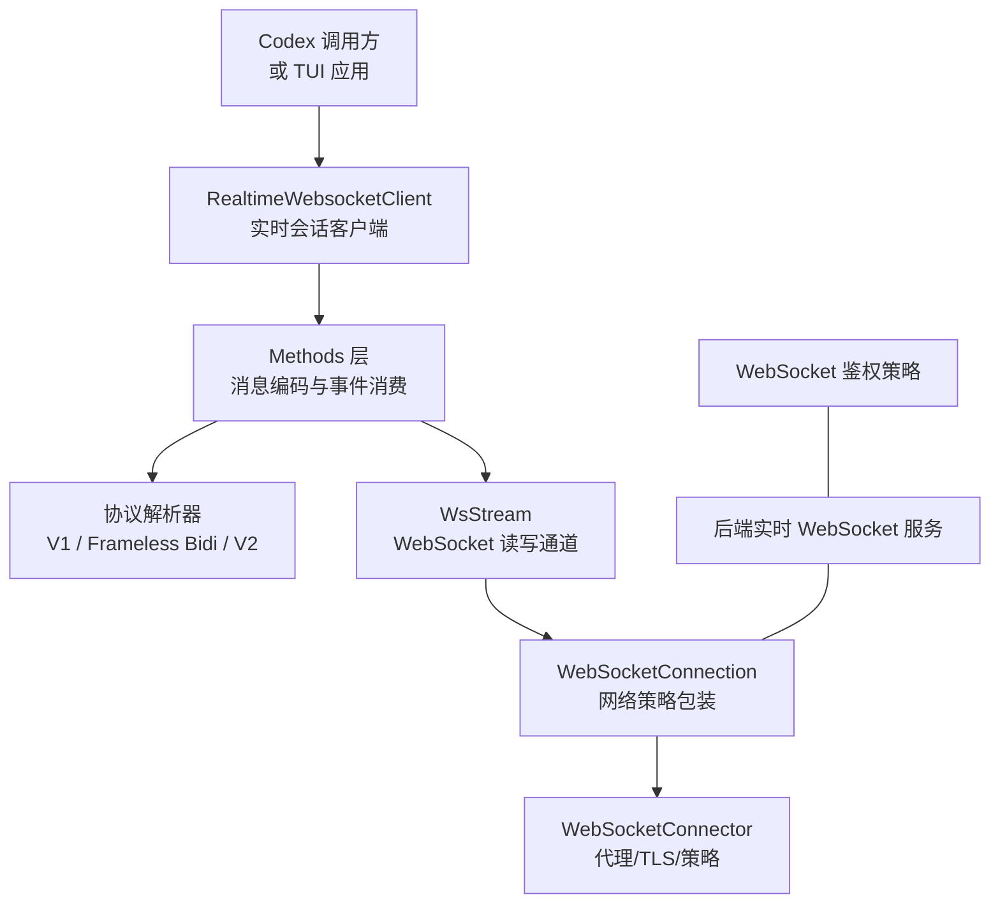
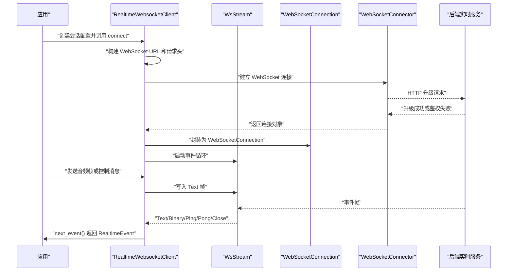
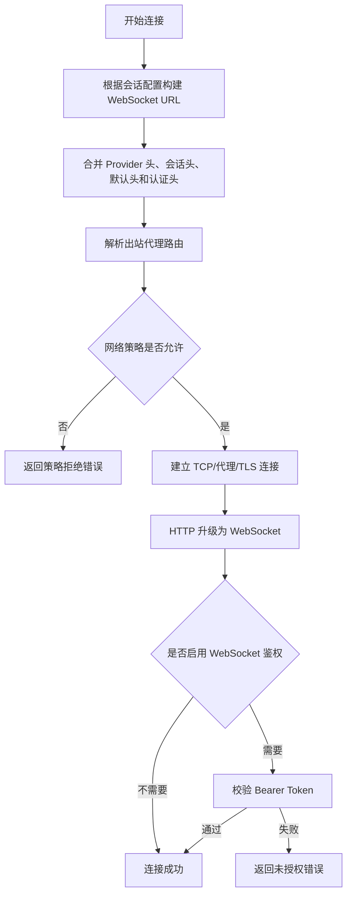
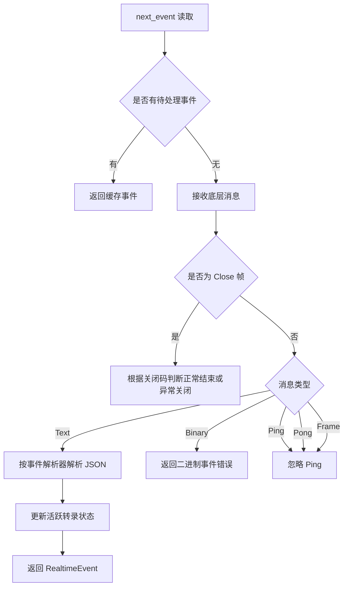
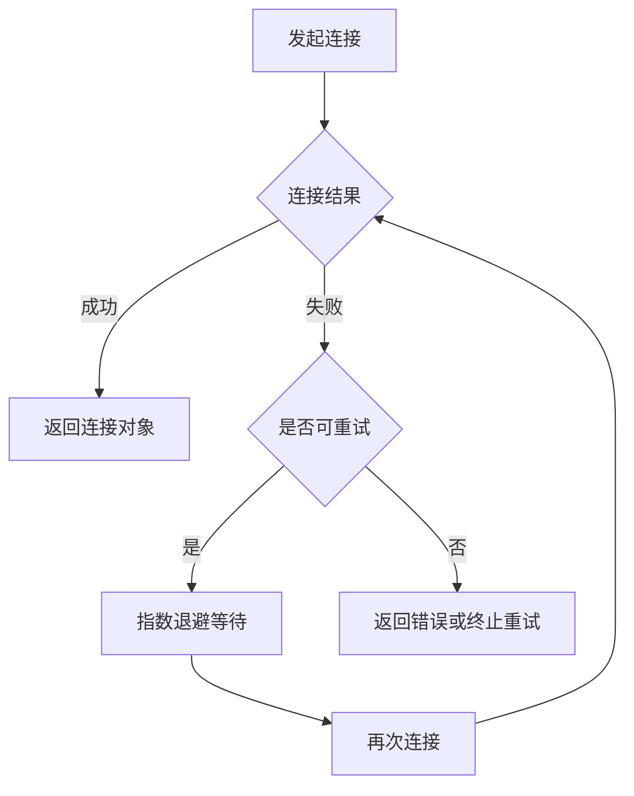

# WebSocket 实时协议

<cite>
**本文引用的文件**   
- [codex-api/realtime_websocket/mod.rs](file://codex-rs/codex-api/src/endpoint/realtime_websocket/mod.rs)
- [codex-api/realtime_websocket/protocol.rs](file://codex-rs/codex-api/src/endpoint/realtime_websocket/protocol.rs)
- [codex-api/realtime_websocket/protocol_common.rs](file://codex-rs/codex-api/src/endpoint/realtime_websocket/protocol_common.rs)
- [codex-api/realtime_websocket/protocol_v1.rs](file://codex-rs/codex-api/src/endpoint/realtime_websocket/protocol_v1.rs)
- [codex-api/realtime_websocket/protocol_frameless_bidi.rs](file://codex-rs/codex-api/src/endpoint/realtime_websocket/protocol_frameless_bidi.rs)
- [codex-api/realtime_websocket/methods.rs](file://codex-rs/codex-api/src/endpoint/realtime_websocket/methods.rs)
- [codex-api/realtime_websocket/methods_v1.rs](file://codex-rs/codex-api/src/endpoint/realtime_websocket/methods_v1.rs)
- [codex-api/realtime_websocket/methods_v2.rs](file://codex-rs/codex-api/src/endpoint/realtime_websocket/methods_v2.rs)
- [codex-api/realtime_websocket/methods_frameless_bidi.rs](file://codex-rs/codex-api/src/endpoint/realtime_websocket/methods_frameless_bidi.rs)
- [websocket-auth/lib.rs](file://codex-rs/websocket-auth/src/lib.rs)
- [websocket-client/lib.rs](file://codex-rs/websocket-client/src/lib.rs)
</cite>

## 目录

1. [引言](#引言)
2. [项目结构](#项目结构)
3. [核心组件](#核心组件)
4. [架构总览](#架构总览)
5. [详细组件分析](#详细组件分析)
6. [依赖关系分析](#依赖关系分析)
7. [性能与连接保活](#性能与连接保活)
8. [故障排查指南](#故障排查指南)
9. [结论](#结论)
10. [附录：消息类型与连接示例](#附录消息类型与连接示例)

## 引言

本文面向 Codex CLI 的 WebSocket 实时通信协议，聚焦以下目标：

- 说明客户端如何建立 WebSocket 连接、完成握手和认证。
- 解释实时事件订阅与发布模式，包括事件类型、消息格式和数据流控制。
- 描述心跳机制、连接保活以及断线重连策略。
- 说明会话状态更新、工具执行进度和模型响应流式传输等实时数据推送实现。
- 给出客户端连接管理最佳实践、错误处理和异常恢复建议。
- 提供具体连接流程和消息处理路径，便于在应用层实现对接。

Codex 的实时 WebSocket 能力集中在 `codex-api` 模块中，通过多种协议版本（V1、无帧双向 Frameless Bidi、Realtime V2）统一封装为内部事件；底层连接由 `websocket-client` 提供代理、TLS 和策略感知能力；服务端升级前的鉴权则由 `websocket-auth` 提供可配置策略。

## 项目结构

与 WebSocket 实时协议直接相关的代码分布在三个主要位置：

| 模块 | 职责 | 关键文件 |
|---|---|---|
| `codex-api/realtime_websocket` | 实时会话 API、协议解析、出站消息构造、事件轮询、音频帧发送、重连逻辑 | `mod.rs`、`protocol.rs`、`protocol_v1.rs`、`protocol_frameless_bidi.rs`、`methods.rs`、`methods_v1.rs`、`methods_v2.rs`、`methods_frameless_bidi.rs` |
| `websocket-client` | 基于代理策略、Cookie 和 TLS 的 WebSocket 连接抽象 | `lib.rs` |
| `websocket-auth` | WebSocket 升级前鉴权策略、能力令牌与签名 Bearer Token 校验 | `lib.rs` |

**图表来源**   
- [codex-api/realtime_websocket/methods.rs:880-1120](file://codex-rs/codex-api/src/endpoint/realtime_websocket/methods.rs#L880-L1120)
- [codex-api/realtime_websocket/protocol.rs:1-40](file://codex-rs/codex-api/src/endpoint/realtime_websocket/protocol.rs#L1-L40)
- [websocket-client/lib.rs:1-80](file://codex-rs/websocket-client/src/lib.rs#L1-L80)
- [websocket-auth/lib.rs:1-60](file://codex-rs/websocket-auth/src/lib.rs#L1-L60)

**章节来源**   
- [codex-api/realtime_websocket/mod.rs:1-22](file://codex-rs/codex-api/src/endpoint/realtime_websocket/mod.rs#L1-L22)

## 核心组件

### 实时会话客户端

`RealtimeWebsocketClient` 是外部应用发起实时会话的主要入口。它负责：

- 根据 Provider、模型、会话模式和事件解析器构建 WebSocket URL。
- 合并请求头、注入会话标识、附加身份认证头。
- 选择普通实时 WebSocket 或 WebRTC 旁路侧信道连接。
- 对侧信道连接失败进行退避重试。
- 返回统一的 `RealtimeWebsocketConnection`，向上暴露发送音频、关闭连接和读取事件的能力。

该客户端支持三种初始化方式：

| 初始化方式 | 用途 | 行为 |
|---|---|---|
| `connect` | 新建实时会话 | 根据当前 Provider 地址和模型生成实时 WebSocket URL |
| `connect_webrtc_sideband` | 加入已存在的 WebRTC 通话 | 使用 `call_id` 加入已有通话的侧信道控制通道 |
| `connect_existing_call_sideband` | 附加到尚未完全激活的通话 | 遇到 404 时按固定延迟重试，直到非 404 或非策略拒绝 |

**章节来源**   
- [codex-api/realtime_websocket/methods.rs:880-1120](file://codex-rs/codex-api/src/endpoint/realtime_websocket/methods.rs#L880-L1120)

### 协议解析器

协议层定义三种事件解析器：

| 解析器 | 对应协议 | 典型事件特征 |
|---|---|---|
| `V1` | 早期实时协议 | `session.updated`、`conversation.output_audio.delta`、`response.output_text.delta`、`error` |
| `FramelessBidi` | 无帧双向协议 | `session.started`、`output_audio.delta`、`input_transcript.added`、`turn.done`、`delegation.created` |
| `RealtimeV2` | 新版实时协议 | 由 `protocol_v2.rs` 解析（本仓库快照未展开其内容） |

所有文本消息都会先被解析为 JSON，再根据 `type` 字段路由到具体解析函数；未知事件会被记录日志并忽略。

**章节来源**   
- [codex-api/realtime_websocket/protocol.rs:1-40](file://codex-rs/codex-api/src/endpoint/realtime_websocket/protocol.rs#L1-L40)
- [codex-api/realtime_websocket/protocol_common.rs:1-83](file://codex-rs/codex-api/src/endpoint/realtime_websocket/protocol_common.rs#L1-L83)
- [codex-api/realtime_websocket/protocol_v1.rs:1-99](file://codex-rs/codex-api/src/endpoint/realtime_websocket/protocol_v1.rs#L1-L99)
- [codex-api/realtime_websocket/protocol_frameless_bidi.rs:1-99](file://codex-rs/codex-api/src/endpoint/realtime_websocket/protocol_frameless_bidi.rs#L1-L99)

### WebSocket 连接抽象

`WebSocketConnector` 负责：

- 从 HTTP 客户端工厂解析出站代理路由。
- 复用 ChatGPT Cookie 存储，在 WebSocket 握手失败时仍可能刷新基础设施 Cookie。
- 支持显式 TLS、继承 Rustls 配置或使用默认 TLS。
- 区分普通连接和仅允许回环地址的直接连接。
- 将结果包装为 `WebSocketConnection`，并携带路由亲和信息。

`WebSocketConnection` 实现异步流和写入接口，同时受网络许可策略约束：如果策略被撤销，读或写会立即转为权限拒绝错误。

**章节来源**   
- [websocket-client/lib.rs:1-120](file://codex-rs/websocket-client/src/lib.rs#L1-L120)
- [websocket-client/lib.rs:200-397](file://codex-rs/websocket-client/src/lib.rs#L200-L397)

### WebSocket 鉴权策略

`websocket-auth` 提供 WebSocket 升级前的鉴权策略，默认允许未认证连接；当启用鉴权后，服务器端会在升级前检查 `Authorization: Bearer <token>` 头。

支持的鉴权模式：

| 模式 | 输入形式 | 校验逻辑 |
|---|---|---|
| 能力令牌 | 文件或 SHA-256 摘要 | 比较传入 token 的 SHA-256 摘要 |
| 签名 Bearer Token | 共享密钥文件、可选签发者、受众、时钟偏差 | 使用 HS256 解码 JWT，校验过期时间、生效时间和受众 |

注意：该鉴权发生在 WebSocket 升级阶段，不负责对已建立连接做后续吊销检查。

**章节来源**   
- [websocket-auth/lib.rs:1-60](file://codex-rs/websocket-auth/src/lib.rs#L1-L60)
- [websocket-auth/lib.rs:200-360](file://codex-rs/websocket-auth/src/lib.rs#L200-L360)
- [websocket-auth/lib.rs:360-479](file://codex-rs/websocket-auth/src/lib.rs#L360-L479)

## 架构总览

Codex 的实时通信流程可以概括为：应用调用 `RealtimeWebsocketClient` → 构建请求和头部 → 通过 `WebSocketConnector` 建立 WebSocket → 通过 `WsStream` 转发文本和二进制帧 → 通过协议解析器转换为 `RealtimeEvent` → 应用层消费事件。

**图表来源**   
- [codex-api/realtime_websocket/methods.rs:880-1120](file://codex-rs/codex-api/src/endpoint/realtime_websocket/methods.rs#L880-L1120)
- [codex-api/realtime_websocket/methods.rs:263-318](file://codex-rs/codex-api/src/endpoint/realtime_websocket/methods.rs#L263-L318)
- [websocket-client/lib.rs:120-220](file://codex-rs/websocket-client/src/lib.rs#L120-L220)

## 详细组件分析

### 连接建立与握手流程

#### 1. 会话配置

`RealtimeSessionConfig` 包含会话指令、初始对话项、模型、会话 ID、事件解析器、会话模式和输出模态。它是连接起点，决定最终 WebSocket URL 和协议行为。

| 字段 | 作用 |
|---|---|
| `instructions` | 会话指令 |
| `initial_items` | 初始对话项 |
| `model` | 可选模型名 |
| `session_id` | 可选会话标识 |
| `event_parser` | 选择 V1、Frameless Bidi 或 V2 解析器 |
| `session_mode` | 会话模式，如对话或转录 |
| `output_modality` | 输出模态，如文本或音频 |
| `voice` | 语音设置 |

#### 2. URL 构建与请求头

客户端根据 Provider 基础地址、查询参数、模型、事件解析器和会话模式生成 WebSocket URL。请求头会合并 Provider 头、会话 ID 头、默认头和可选的身份认证头。

#### 3. TLS 与代理

连接使用应用级 TLS 配置，支持自定义 CA。代理路由由 HTTP 客户端工厂解析；对于回环直连，还会额外校验目标是否为本地回环地址。

#### 4. 认证

如果启用了身份提供者，每次握手都会重新获取认证头。服务端侧的 WebSocket 升级前鉴权由 `websocket-auth` 提供，可选择能力令牌或签名 Bearer Token。

**图表来源**   
- [codex-api/realtime_websocket/methods.rs:880-1120](file://codex-rs/codex-api/src/endpoint/realtime_websocket/methods.rs#L880-L1120)
- [websocket-client/lib.rs:120-220](file://codex-rs/websocket-client/src/lib.rs#L120-L220)
- [websocket-auth/lib.rs:300-420](file://codex-rs/websocket-auth/src/lib.rs#L300-L420)

**章节来源**   
- [codex-api/realtime_websocket/protocol.rs:1-40](file://codex-rs/codex-api/src/endpoint/realtime_websocket/protocol.rs#L1-L40)
- [codex-api/realtime_websocket/methods.rs:880-1120](file://codex-rs/codex-api/src/endpoint/realtime_websocket/methods.rs#L880-L1120)
- [websocket-client/lib.rs:120-220](file://codex-rs/websocket-client/src/lib.rs#L120-L220)
- [websocket-auth/lib.rs:300-420](file://codex-rs/websocket-auth/src/lib.rs#L300-L420)

### 消息订阅与发布模式

#### 事件消费

`RealtimeWebsocketEvents::next_event` 是应用消费实时事件的主入口。它会：

- 从缓冲队列取出已缓存事件。
- 阻塞等待底层消息。
- 将文本消息交给协议解析器。
- 维护活跃转录状态。
- 处理关闭帧、二进制帧、Ping/Pong 和未知帧。

**图表来源**   
- [codex-api/realtime_websocket/methods.rs:530-760](file://codex-rs/codex-api/src/endpoint/realtime_websocket/methods.rs#L530-L760)

#### 出站消息

客户端向服务端发送的消息主要是 JSON 文本帧，包括：

| 消息类别 | 用途 |
|---|---|
| `session.update` | 更新会话配置、音频输入输出、工具、语音等 |
| `response.create` | 触发一次响应创建 |
| `session.close` | 关闭会话 |
| `conversation.item.create` | 创建对话项 |
| `conversation.handoff.append` | 追加交接输出 |
| `input_audio_buffer.append` / `input_audio.append` | 上传音频帧 |
| `session.context.append` / `delegation.context.append` | Frameless Bidi 上下文追加 |

不同协议版本会使用不同的出站消息构造方法：

| 协议 | 构造文件 |
|---|---|
| V1 | `methods_v1.rs` |
| V2 | `methods_v2.rs` |
| Frameless Bidi | `methods_frameless_bidi.rs` |

**章节来源**   
- [codex-api/realtime_websocket/methods.rs:499-566](file://codex-rs/codex-api/src/endpoint/realtime_websocket/methods.rs#L499-L566)
- [codex-api/realtime_websocket/protocol.rs:40-200](file://codex-rs/codex-api/src/endpoint/realtime_websocket/protocol.rs#L40-L200)
- [codex-api/realtime_websocket/methods_v1.rs:1-83](file://codex-rs/codex-api/src/endpoint/realtime_websocket/methods_v1.rs#L1-L83)
- [codex-api/realtime_websocket/methods_v2.rs:1-180](file://codex-rs/codex-api/src/endpoint/realtime_websocket/methods_v2.rs#L1-L180)
- [codex-api/realtime_websocket/methods_frameless_bidi.rs:1-129](file://codex-rs/codex-api/src/endpoint/realtime_websocket/methods_frameless_bidi.rs#L1-L129)

### 心跳机制与连接保活

WebSocket 底层协议本身支持 Ping/Pong。Codex 的 `WsStream` 实现了自动 Pong 回复：

- 收到 Ping 时发送对应的 Pong。
- 收到 Pong 时忽略。
- 如果发送 Pong 失败，会将可能的策略拒绝错误上报到终端错误通道。

因此，心跳保活主要由 WebSocket 层和底层网络栈负责；Codex 没有在应用层额外实现定时心跳。

**章节来源**   
- [codex-api/realtime_websocket/methods.rs:150-210](file://codex-rs/codex-api/src/endpoint/realtime_websocket/methods.rs#L150-L210)

### 断线重连策略

重连逻辑主要体现在两个层面：

1. **侧信道连接重试**  
   `connect_sideband` 会对 WebRTC 旁路侧信道的连接失败进行退避重试，指数退避时间由 Provider 的 `retry.base_delay` 控制，最大尝试次数由 `retry.max_attempts` 控制。

2. **连接生命周期内的错误处理**  
   - 读取失败时标记连接已关闭并返回错误。
   - 关闭帧根据事件解析器决定是正常结束还是异常关闭。
   - 策略拒绝错误会被保留为明确的网络策略拒绝。

对于普通实时 WebSocket，代码中未实现通用“自动无限重连”；更常见的使用方式是上层在检测到连接结束后，依据业务语义决定是否重新调用 `connect`。

**图表来源**   
- [codex-api/realtime_websocket/methods.rs:1006-1042](file://codex-rs/codex-api/src/endpoint/realtime_websocket/methods.rs#L1006-L1042)

**章节来源**   
- [codex-api/realtime_websocket/methods.rs:1006-1042](file://codex-rs/codex-api/src/endpoint/realtime_websocket/methods.rs#L1006-L1042)
- [codex-api/realtime_websocket/methods.rs:556-638](file://codex-rs/codex-api/src/endpoint/realtime_websocket/methods.rs#L556-L638)

### 实时数据推送

#### 会话状态更新

会话状态主要通过 `session.updated` 或 Frameless Bidi 的 `session.started` / `session.updated` 事件通知。解析器会提取会话 ID 和指令，并映射为 `RealtimeEvent::SessionUpdated`。

#### 工具执行进度

工具执行进度通过对话项相关事件表达，例如：

- `conversation.item.added`
- `conversation.item.done`
- V2 中的函数调用输出消息 `conversation_function_call_output_message`

这些事件会让应用层知道某个工具调用是否已创建、是否已完成，以及是否需要把工具输出回填到会话中。

#### 模型响应流式传输

模型响应以流式事件形式到达：

| 数据类型 | V1 事件 | Frameless Bidi 事件 |
|---|---|---|
| 输出音频 | `conversation.output_audio.delta` | `output_audio.delta` |
| 用户输入转录增量 | `conversation.input_transcript.delta` | `input_transcript.added` |
| 助手输出转录增量 | `conversation.output_transcript.delta` | `output_transcript.added` |
| 转录完成 | `conversation.input_transcript.turn_marked` 等 | `turn.done` |
| 会话交接请求 | `conversation.handoff.requested` | `delegation.created` |

#### 活跃转录状态

`RealtimeWebsocketEvents` 会维护一个活跃转录状态，用于拼接用户和助手的转录片段，并在会话交接时保存完整上下文。这有助于历史回放、调试和诊断 ZIP 保存。

**章节来源**   
- [codex-api/realtime_websocket/protocol_common.rs:20-83](file://codex-rs/codex-api/src/endpoint/realtime_websocket/protocol_common.rs#L20-L83)
- [codex-api/realtime_websocket/protocol_v1.rs:10-99](file://codex-rs/codex-api/src/endpoint/realtime_websocket/protocol_v1.rs#L10-L99)
- [codex-api/realtime_websocket/protocol_frameless_bidi.rs:10-99](file://codex-rs/codex-api/src/endpoint/realtime_websocket/protocol_frameless_bidi.rs#L10-L99)
- [codex-api/realtime_websocket/methods.rs:556-760](file://codex-rs/codex-api/src/endpoint/realtime_websocket/methods.rs#L556-L760)
- [codex-api/realtime_websocket/methods_v2.rs:60-180](file://codex-rs/codex-api/src/endpoint/realtime_websocket/methods_v2.rs#L60-L180)

### 客户端连接管理最佳实践

| 场景 | 建议 |
|---|---|
| 首次连接 | 使用 `RealtimeWebsocketClient::connect`，传入完整的 `RealtimeSessionConfig`。 |
| 加入现有通话 | 使用 `connect_webrtc_sideband` 或 `connect_existing_call_sideband`，后者适合处理短暂 404。 |
| 多模型或多会话 | 每个独立会话使用独立的连接；避免复用已经关闭的连接。 |
| 音频输入 | 使用 `send_audio_frame` 发送结构化音频帧；确保采样率、声道数和数据格式与会话配置一致。 |
| 连接断开 | 根据 `next_event` 返回值判断正常结束还是异常错误；对可恢复错误进行有限次重试。 |
| 网络策略变更 | 注意 `WebSocketConnection` 在策略撤销后会返回权限拒绝错误；应停止使用该连接并重建。 |
| 代理环境 | 不要绕过 `WebSocketConnector`；让代理策略决定出站路由。 |
| TLS 证书 | 使用应用内建的 TLS 配置；避免自行替换根证书链导致证书验证不一致。 |
| 日志与诊断 | 关注 `realtime websocket wire` 日志目标和错误事件，便于定位协议不匹配或消息格式问题。 |

**章节来源**   
- [codex-api/realtime_websocket/methods.rs:292-318](file://codex-rs/codex-api/src/endpoint/realtime_websocket/methods.rs#L292-L318)
- [codex-api/realtime_websocket/methods.rs:556-760](file://codex-rs/codex-api/src/endpoint/realtime_websocket/methods.rs#L556-L760)
- [websocket-client/lib.rs:200-397](file://codex-rs/websocket-client/src/lib.rs#L200-L397)

## 依赖关系分析

```mermaid
classDiagram
    class RealtimeWebsocketClient {
        +connect(config, extra_headers, default_headers)
        +connect_webrtc_sideband(config, call_id, extra_headers, default_headers, transcript_state)
        +connect_existing_call_sideband(config, call_id, extra_headers, default_headers, transcript_state)
    }

    class RealtimeWebsocketConnection {
        +send_audio_frame(frame)
        +close()
        +close_transport()
    }

    class RealtimeWebsocketEvents {
        +next_event()
        +transcript_state()
        +take_completed_transcript(event, threshold)
    }

    class WebSocketConnector {
        +connect(request, config)
        +connect_loopback_direct(request, config)
    }

    class WebSocketConnection {
        +routing_affinity()
    }

    class WebsocketAuthPolicy {
        +authorize_upgrade(headers)
    }

    RealtimeWebsocketClient --> RealtimeWebsocketConnection : "创建"
    RealtimeWebsocketConnection --> RealtimeWebsocketEvents : "事件消费"
    RealtimeWebsocketClient --> WebSocketConnector : "建立底层连接"
    WebSocketConnector --> WebSocketConnection : "封装"
    WebsocketAuthPolicy --> RealtimeWebsocketClient : "握手前鉴权"
```

**图表来源**   
- [codex-api/realtime_websocket/methods.rs:263-318](file://codex-rs/codex-api/src/endpoint/realtime_websocket/methods.rs#L263-L318)
- [codex-api/realtime_websocket/methods.rs:880-1120](file://codex-rs/codex-api/src/endpoint/realtime_websocket/methods.rs#L880-L1120)
- [websocket-client/lib.rs:200-397](file://codex-rs/websocket-client/src/lib.rs#L200-L397)
- [websocket-auth/lib.rs:300-420](file://codex-rs/websocket-auth/src/lib.rs#L300-L420)

**章节来源**   
- [codex-api/realtime_websocket/mod.rs:1-22](file://codex-rs/codex-api/src/endpoint/realtime_websocket/mod.rs#L1-L22)
- [codex-api/realtime_websocket/methods.rs:880-1120](file://codex-rs/codex-api/src/endpoint/realtime_websocket/methods.rs#L880-L1120)
- [websocket-client/lib.rs:200-397](file://codex-rs/websocket-client/src/lib.rs#L200-L397)
- [websocket-auth/lib.rs:300-420](file://codex-rs/websocket-auth/src/lib.rs#L300-L420)

## 性能与连接保活

### 性能特性

- 文本消息采用 JSON 序列化/反序列化，适合控制消息和轻量事件。
- 音频帧通过专用方法发送，避免与应用层 JSON 消息混用。
- `WebSocketConnection` 支持 Nagle 算法禁用，适合低延迟实时场景。
- 事件解析器根据协议版本选择不同分支，避免重复解析。
- 活跃转录状态使用锁保护，但只在事件处理路径上访问，影响范围有限。

### 连接保活

- 底层 WebSocket 层自动回复 Pong。
- 应用层无需额外心跳，除非业务要求显式心跳语义。
- 若网络中间设备强制短连接，应在应用层增加业务心跳或定期发送轻量控制消息。

### 资源释放

- 连接关闭时应调用 `close` 或 `close_transport`。
- 不再使用的连接不应继续轮询 `next_event`。
- 策略撤销后的连接应立即丢弃，不可重试。

[本节为通用指导，不直接分析具体源码行]

## 故障排查指南

### 常见问题

| 现象 | 可能原因 | 处理建议 |
|---|---|---|
| 握手返回未授权 | WebSocket 鉴权未配置正确或 Token 无效 | 检查 `Authorization: Bearer` 头、能力令牌摘要或 JWT 签发者与受众 |
| 连接被策略拒绝 | 出站网络策略不允许目标地址 | 检查代理策略、账号绑定和网络许可 |
| 收到二进制帧报错 | 期望文本协议却收到二进制帧 | 确认协议版本是否正确，检查服务端输出 |
| 连接突然结束 | 服务端关闭、网络中断或协议异常 | 根据关闭码判断是否正常结束；对异常关闭进行有限重试 |
| 事件流提前结束 | 解析器期望 `session.started` 但未收到 | 检查 Frameless Bidi 会话是否真正启动 |
| 音频无法播放 | 采样率、声道数或数据格式不匹配 | 使用 `send_audio_frame` 并核对会话音频配置 |
| 重连耗尽 | 连续多次连接失败 | 检查网络、代理、TLS 证书和服务端可用性 |

### 错误分类

| 错误来源 | 类型 | 含义 |
|---|---|---|
| 网络策略 | `NetworkPolicyDenied` | 出站访问被策略拒绝 |
| 连接错误 | `WsError` | 底层 WebSocket 错误 |
| 协议错误 | `ApiError::Stream` | 消息编码、解析或会话状态错误 |
| 鉴权错误 | `WebsocketAuthError` | 升级前鉴权失败 |

**章节来源**   
- [codex-api/realtime_websocket/methods.rs:556-638](file://codex-rs/codex-api/src/endpoint/realtime_websocket/methods.rs#L556-L638)
- [websocket-client/lib.rs:1-80](file://codex-rs/websocket-client/src/lib.rs#L1-L80)
- [websocket-auth/lib.rs:360-479](file://codex-rs/websocket-auth/src/lib.rs#L360-L479)

## 结论

Codex 的 WebSocket 实时协议以 `codex-api` 为核心，将多种协议变体统一为内部事件模型，并通过 `websocket-client` 提供安全的网络连接能力，通过 `websocket-auth` 提供灵活的升级前鉴权策略。连接建立过程强调策略校验、代理支持和 TLS 一致性；事件消费过程强调协议版本适配、活跃转录维护和清晰的错误分类。

在实际使用中，建议优先使用 `RealtimeWebsocketClient` 提供的标准接口，避免直接操作底层 WebSocket 流；对于需要高可靠性的场景，应在应用层实现有限的重连策略，并结合日志和诊断数据定位协议不匹配、鉴权失败和网络策略问题。

[本节为总结性内容，不直接分析具体源码行]

## 附录：消息类型与连接示例

### 事件类型参考

| 事件类别 | V1 示例类型 | Frameless Bidi 示例类型 | 说明 |
|---|---|---|---|
| 会话更新 | `session.updated` | `session.started`、`session.updated` | 会话建立或配置更新 |
| 输出音频 | `conversation.output_audio.delta` | `output_audio.delta` | 流式音频数据 |
| 用户转录增量 | `conversation.input_transcript.delta` | `input_transcript.added` | 用户语音转文字增量 |
| 助手转录增量 | `conversation.output_transcript.delta` | `output_transcript.added` | 助手输出转文字增量 |
| 转录完成 | `conversation.input_transcript.turn_marked` 等 | `turn.done` | 某一方转录结束 |
| 会话交接 | `conversation.handoff.requested` | `delegation.created` | 控制权交接请求 |
| 错误 | `error` | `error` | 协议或服务端错误 |

**章节来源**   
- [codex-api/realtime_websocket/protocol_v1.rs:10-99](file://codex-rs/codex-api/src/endpoint/realtime_websocket/protocol_v1.rs#L10-L99)
- [codex-api/realtime_websocket/protocol_frameless_bidi.rs:10-99](file://codex-rs/codex-api/src/endpoint/realtime_websocket/protocol_frameless_bidi.rs#L10-L99)

### 连接示例路径

- 新建实时会话连接：  
  [codex-api/realtime_websocket/methods.rs:922-980](file://codex-rs/codex-api/src/endpoint/realtime_websocket/methods.rs#L922-L980)

- WebRTC 旁路侧信道连接：  
  [codex-api/realtime_websocket/methods.rs:988-1042](file://codex-rs/codex-api/src/endpoint/realtime_websocket/methods.rs#L988-L1042)

- 发送音频帧：  
  [codex-api/realtime_websocket/methods.rs:292-318](file://codex-rs/codex-api/src/endpoint/realtime_websocket/methods.rs#L292-L318)

- 读取下一个事件：  
  [codex-api/realtime_websocket/methods.rs:556-638](file://codex-rs/codex-api/src/endpoint/realtime_websocket/methods.rs#L556-L638)

- 关闭连接：  
  [codex-api/realtime_websocket/methods.rs:314-318](file://codex-rs/codex-api/src/endpoint/realtime_websocket/methods.rs#L314-L318)

- WebSocket 鉴权升级前校验：  
  [websocket-auth/lib.rs:300-420](file://codex-rs/websocket-auth/src/lib.rs#L300-L420)

- WebSocket 连接策略与 TLS 包装：  
  [websocket-client/lib.rs:120-220](file://codex-rs/websocket-client/src/lib.rs#L120-L220)

**章节来源**   
- [codex-api/realtime_websocket/methods.rs:292-318](file://codex-rs/codex-api/src/endpoint/realtime_websocket/methods.rs#L292-L318)
- [codex-api/realtime_websocket/methods.rs:556-638](file://codex-rs/codex-api/src/endpoint/realtime_websocket/methods.rs#L556-L638)
- [codex-api/realtime_websocket/methods.rs:922-1042](file://codex-rs/codex-api/src/endpoint/realtime_websocket/methods.rs#L922-L1042)
- [websocket-auth/lib.rs:300-420](file://codex-rs/websocket-auth/src/lib.rs#L300-L420)
- [websocket-client/lib.rs:120-220](file://codex-rs/websocket-client/src/lib.rs#L120-L220)