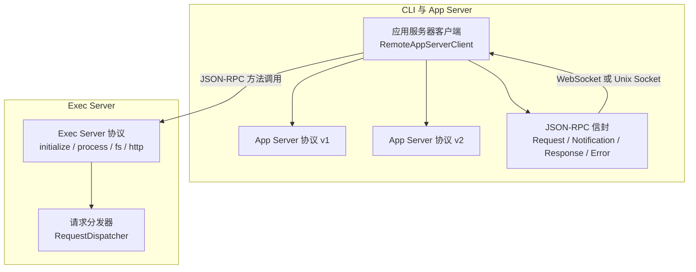
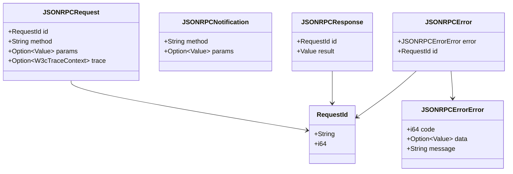
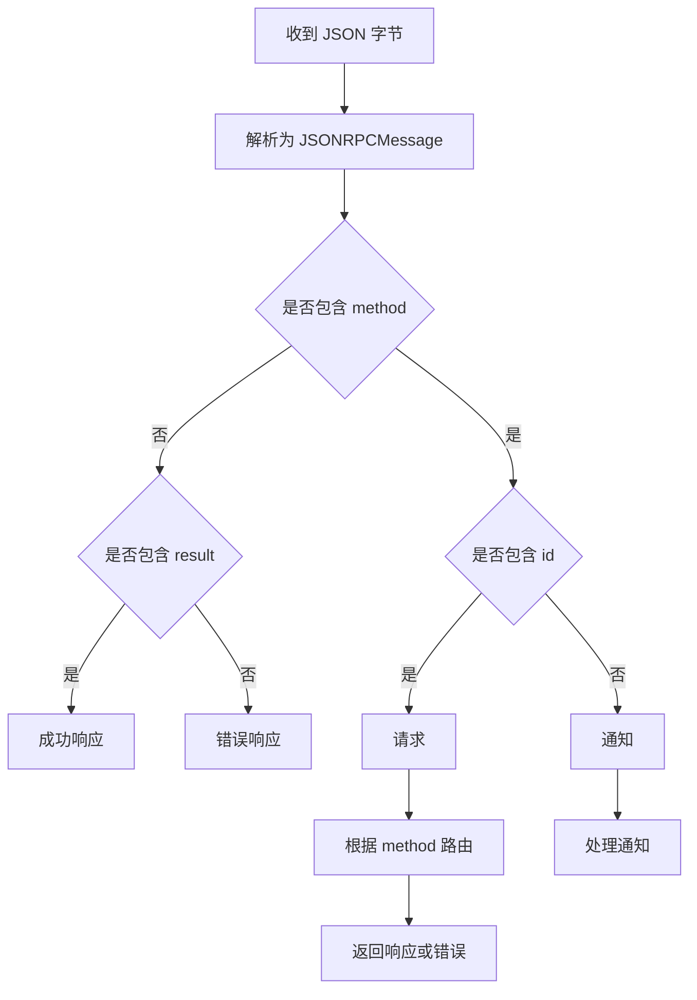
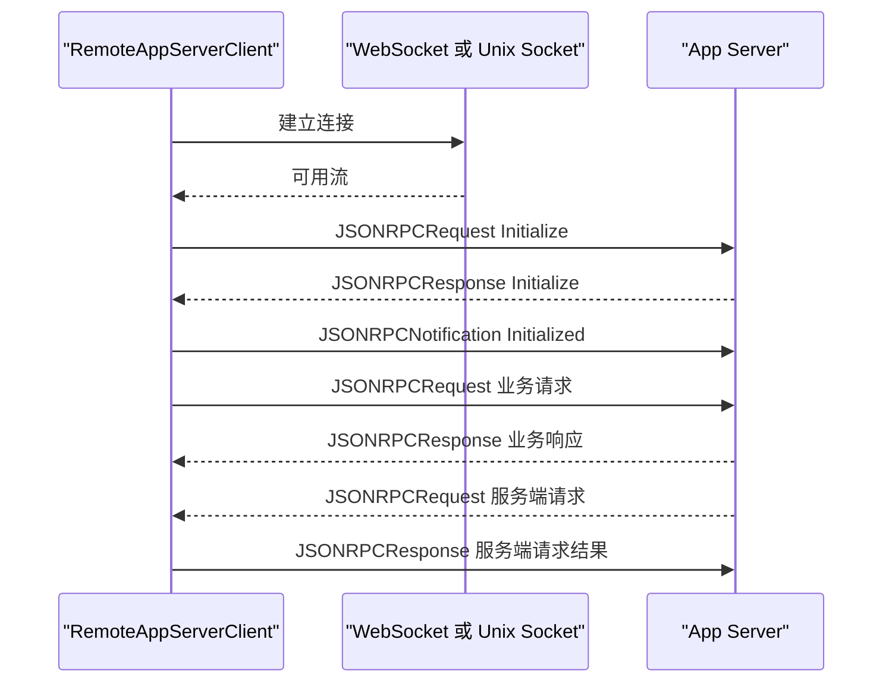
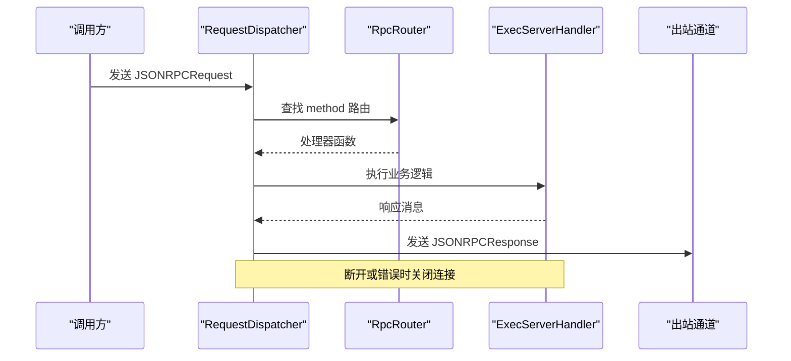
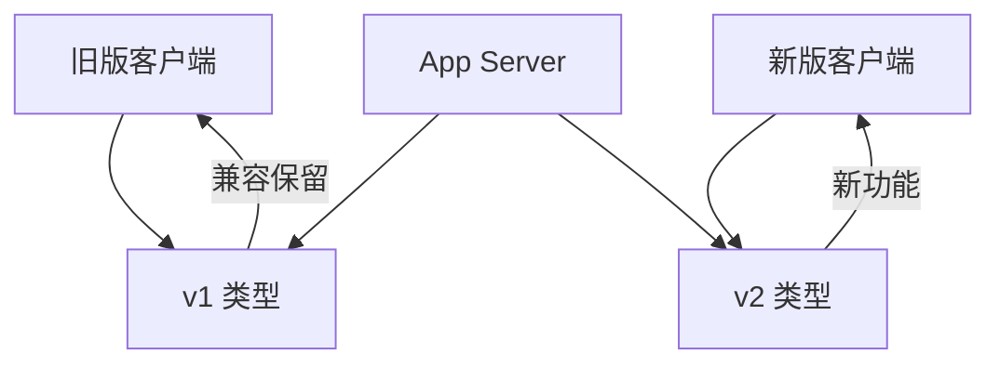
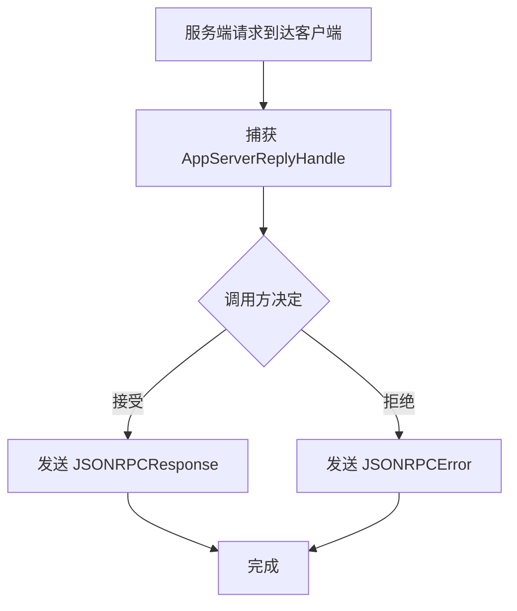
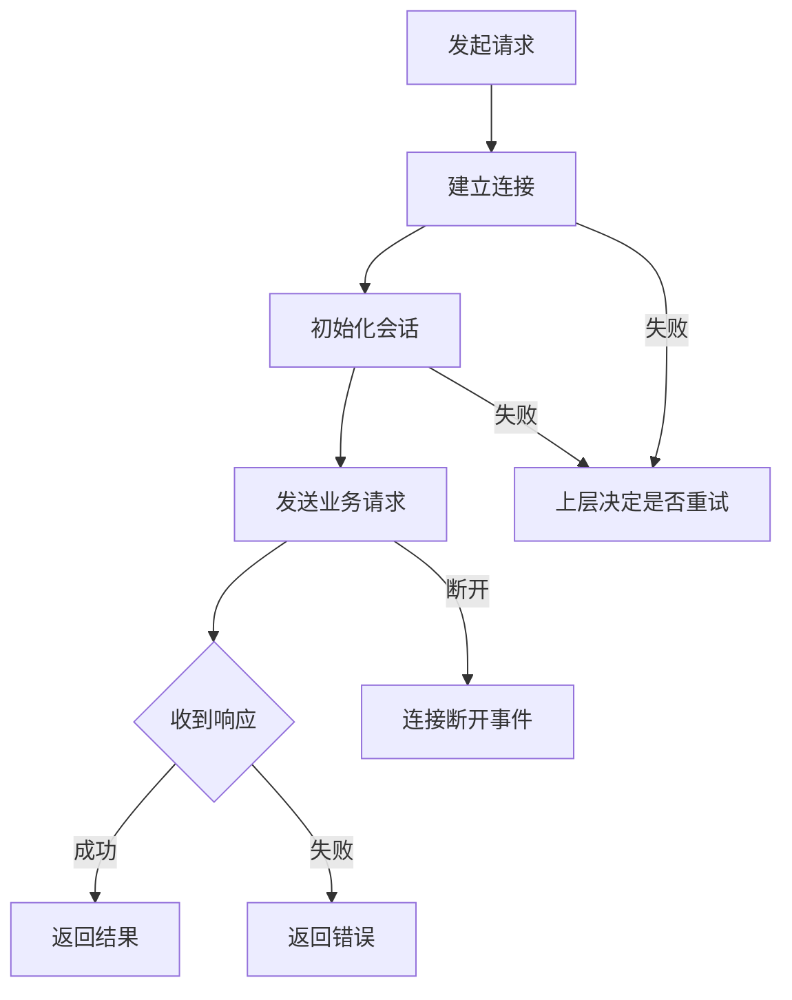

# gRPC 内部协议

<cite>
**本文引用的文件**   
- [exec-server-protocol/rpc.rs](file://codex-rs/exec-server-protocol/src/rpc.rs)
- [exec-server-protocol/protocol.rs](file://codex-rs/exec-server-protocol/src/protocol.rs)
- [app-server-protocol/rpc.rs](file://codex-rs/app-server-protocol/src/rpc.rs)
- [app-server-protocol/lib.rs](file://codex-rs/app-server-protocol/src/lib.rs)
- [app-server-protocol/protocol/mod.rs](file://codex-rs/app-server-protocol/src/protocol/mod.rs)
- [app-server-protocol/protocol/v1.rs](file://codex-rs/app-server-protocol/src/protocol/v1.rs)
- [app-server-client/src/remote.rs](file://codex-rs/app-server-client/src/remote.rs)
- [app-server-client/src/server_request.rs](file://codex-rs/app-server-client/src/server_request.rs)
- [exec-server/src/server/request_dispatcher.rs](file://codex-rs/exec-server/src/server/request_dispatcher.rs)
</cite>

## 目录
1. [引言](#引言)
2. [项目结构与协议边界](#项目结构与协议边界)
3. [核心结论：实际不是 gRPC，而是 JSON-RPC](#核心结论实际不是-grpc而是-json-rpc)
4. [App Server 与 Exec Server 之间的内部协议](#app-server-与-exec-server-之间的内部协议)
5. [消息格式、序列化与错误模型](#消息格式序列化与错误模型)
6. [传输层与安全机制](#传输层与安全机制)
7. [连接管理与初始化流程](#连接管理与初始化流程)
8. [版本管理：v1 与 v2 的兼容性策略](#版本管理v1-与-v2-的兼容性策略)
9. [关键 RPC 方法与数据流](#关键-rpc-方法与数据流)
10. [性能优化、超时与重试](#性能优化超时与重试)
11. [调试与故障排查](#调试与故障排查)
12. [Rust 调用示例参考](#rust-调用示例参考)
13. [结论](#结论)

## 引言

Codex CLI 的“内部协议”并不是业界常见的基于 `.proto` 的 gRPC 协议。仓库中的 App Server 与 Exec Server、以及 App Server 客户端与其远程端点之间，都使用 **JSON-RPC 风格的自定义协议**。该协议省略了标准 JSON-RPC 2.0 中要求但本实现不发送或期望的 `jsonrpc: "2.0"` 字段，并在请求中可选携带 W3C Trace Context，用于分布式追踪。

对 Codex CLI 开发者而言，最重要的区分是：

| 组件 | 协议角色 | 主要代码位置 | 传输方式 |
|---|---|---|---|
| App Server | 服务端，提供对话、线程、模型、配置等能力 | `app-server-protocol`、`app-server-daemon` | WebSocket 或本地 Unix Socket |
| App Server 客户端 | 发起内部 RPC 的 Rust 客户端 | `app-server-client` | WebSocket 或本地 Unix Socket |
| Exec Server | 执行进程、文件系统、HTTP 代理的沙箱执行环境 | `exec-server-protocol`、`exec-server` | JSON-RPC over socket/stdio（由上层传输承载） |

因此，文档标题中的 “gRPC 内部协议” 需要修正为：**Codex 内部使用 JSON-RPC 风格协议，而不是 gRPC；App Server 与 Exec Server 通过同一类 JSON-RPC 信封进行通信。**

**本节来源**
- [app-server-protocol/rpc.rs:1-88](file://codex-rs/app-server-protocol/src/rpc.rs#L1-L88)
- [exec-server-protocol/rpc.rs:1-278](file://codex-rs/exec-server-protocol/src/rpc.rs#L1-L278)

## 项目结构与协议边界

**图表来源**
- [app-server-client/src/remote.rs:185-267](file://codex-rs/app-server-client/src/remote.rs#L185-L267)
- [app-server-client/src/remote.rs:536-546](file://codex-rs/app-server-client/src/remote.rs#L536-L546)
- [app-server-client/src/remote.rs:852-958](file://codex-rs/app-server-client/src/remote.rs#L852-L958)
- [exec-server/src/server/request_dispatcher.rs:1-120](file://codex-rs/exec-server/src/server/request_dispatcher.rs#L1-L120)

### 模块职责

| 模块 | 职责 | 说明 |
|---|---|---|
| `app-server-protocol` | 定义 App Server 的消息类型、v1/v2 数据结构、共享 JSON-RPC 信封 | 暴露 v1 兼容类型和 v2 新类型 |
| `app-server-client` | 建立远程连接、维护会话、发送请求、处理通知和服务端请求 | 支持 WebSocket 和本地 Unix Socket |
| `exec-server-protocol` | 定义 Exec Server 的 JSON-RPC 方法、参数、响应、能力描述 | 面向沙箱执行、文件系统和 HTTP 代理 |
| `exec-server` | 接收 JSON-RPC 请求、路由到处理器、管理进程生命周期 | 负责并发控制、遥测和断开处理 |

**本节来源**
- [app-server-protocol/lib.rs:1-72](file://codex-rs/app-server-protocol/src/lib.rs#L1-L72)
- [app-server-protocol/protocol/mod.rs:1-13](file://codex-rs/app-server-protocol/src/protocol/mod.rs#L1-L13)
- [exec-server-protocol/src/protocol.rs:20-60](file://codex-rs/exec-server-protocol/src/protocol.rs#L20-L60)
- [exec-server/src/server/request_dispatcher.rs:1-60](file://codex-rs/exec-server/src/server/request_dispatcher.rs#L1-L60)

## 核心结论：实际不是 gRPC，而是 JSON-RPC

两个协议模块都明确声明：它们不使用真正的 JSON-RPC 2.0，因为不会在电路上发送 `jsonrpc: "2.0"` 字段。两者都定义了以下公共结构：

| 类型 | 作用 | 关键字段 |
|---|---|---|
| `RequestId` | 请求标识，可为字符串或整数 | `String`、`i64` |
| `JSONRPCRequest` | 需要响应的请求 | `id`、`method`、`params`、`trace` |
| `JSONRPCNotification` | 无需响应的通知 | `method`、`params` |
| `JSONRPCResponse` | 成功响应 | `id`、`result` |
| `JSONRPCError` | 失败响应 | `error.code`、`error.message`、`error.data`、`id` |

App Server 协议和 Exec Server 协议的信封结构基本一致，区别在于：

1. Exec Server 协议实现了更严格的反序列化限制，防止恶意或异常大的 JSON 消息耗尽内存。
2. App Server 协议在非测试构建中使用空宏生成 TypeScript 和 JSON Schema。
3. Exec Server 协议把 `Result` 定义为裸 `serde_json::Value`，而 App Server 协议也使用 `serde_json::Value` 作为通用结果类型。

**图表来源**
- [app-server-protocol/rpc.rs:1-88](file://codex-rs/app-server-protocol/src/rpc.rs#L1-L88)
- [exec-server-protocol/rpc.rs:1-278](file://codex-rs/exec-server-protocol/src/rpc.rs#L1-L278)

**本节来源**
- [app-server-protocol/rpc.rs:1-88](file://codex-rs/app-server-protocol/src/rpc.rs#L1-L88)
- [exec-server-protocol/rpc.rs:1-278](file://codex-rs/exec-server-protocol/src/rpc.rs#L1-L278)

## App Server 与 Exec Server 之间的内部协议

严格来说，仓库中没有名为 “App Server 与 Exec Server 之间的 gRPC 接口定义”。真正存在的是两类内部协议：

1. **App Server 内部协议**：由 `app-server-client` 与 App Server 使用，包含 v1 和 v2 数据类型。
2. **Exec Server 协议**：由上层组件调用 Exec Server，定义 `initialize`、`process/*`、`fs/*`、`http/request`、`capabilityRoots/discoverV1` 等方法。

Exec Server 协议以常量形式定义方法名：

| 类别 | 方法 | 含义 |
|---|---|---|
| 会话 | `initialize`、`initialized` | 初始化会话、标记已初始化 |
| 进程 | `process/start` | 启动子进程 |
| 进程 | `process/read` | 读取输出流 |
| 进程 | `process/write` | 写入 stdin |
| 进程 | `process/signal` | 发送中断信号 |
| 进程 | `process/terminate` | 终止进程 |
| 进程事件 | `process/output` | 输出增量通知 |
| 进程事件 | `process/exited` | 进程退出通知 |
| 进程事件 | `process/closed` | 流关闭通知 |
| 环境 | `environment/info`、`environment/status` | 查询执行环境信息 |
| 文件系统 | `fs/readFile`、`fs/open`、`fs/readBlock`、`fs/writeBlock`、`fs/close`、`fs/writeFile`、`fs/createDirectory`、`fs/getMetadata`、`fs/watchMissing`、`fs/missingChanged`、`fs/canonicalize`、`fs/readDirectory`、`fs/walk`、`fs/remove`、`fs/copy` | 沙箱内文件系统操作 |
| 能力发现 | `capabilityRoots/discoverV1` | 发现能力清单和插件 |
| HTTP | `http/request`、`http/request/bodyDelta` | 执行 executor-local HTTP 请求并流式返回响应体 |

这些方法不是 gRPC 服务定义，而是 JSON-RPC 字符串方法名。

**本节来源**
- [exec-server-protocol/src/protocol.rs:20-60](file://codex-rs/exec-server-protocol/src/protocol.rs#L20-L60)

## 消息格式、序列化与错误模型

### 消息类型

所有内部消息都是 JSON 对象，并通过 `JSONRPCMessage` 枚举解析：

| 消息类型 | 判断依据 | 行为 |
|---|---|---|
| 请求 | 包含 `method` 且包含 `id` | 必须返回响应或错误 |
| 通知 | 包含 `method` 但不包含 `id` | 单向发送，不需要响应 |
| 成功响应 | 包含 `result` | 对应某个请求的成功结果 |
| 错误响应 | 包含 `error` | 对应某个请求的失败结果 |

Exec Server 协议还引入了 **JSON 值节点预算**，默认最大允许约 256,000 个 JSON 节点，用于防御超大或畸形 JSON 导致的内存膨胀。

### 请求参数

- `params` 是可选的 `serde_json::Value`。
- 具体业务方法的参数由各自的结构体定义，例如 Exec Server 的 `InitializeParams`、`ExecParams`、`ReadParams`、`WriteParams`、`FsReadFileParams` 等。
- 部分 Exec Server 参数使用 `Wire*` 包装类型，用于处理历史兼容字段，例如 `WireExecParams`、`WireFsReadFileParams`。

### 错误模型

错误结构统一包含：

| 字段 | 含义 |
|---|---|
| `code` | 数值错误码 |
| `message` | 人类可读错误消息 |
| `data` | 可选扩展数据 |
| `id` | 被拒绝的请求标识 |

Exec Server 的分发器会把未识别的方法映射为 `method_not_found`，并把未知通知视为协议错误，可能关闭连接。

**图表来源**
- [exec-server-protocol/rpc.rs:1-200](file://codex-rs/exec-server-protocol/src/rpc.rs#L1-L200)
- [exec-server-protocol/rpc.rs:201-278](file://codex-rs/exec-server-protocol/src/rpc.rs#L201-L278)
- [app-server-protocol/rpc.rs:1-88](file://codex-rs/app-server-protocol/src/rpc.rs#L1-L88)

**本节来源**
- [exec-server-protocol/rpc.rs:1-278](file://codex-rs/exec-server-protocol/src/rpc.rs#L1-L278)
- [app-server-protocol/rpc.rs:1-88](file://codex-rs/app-server-protocol/src/rpc.rs#L1-L88)
- [exec-server/src/server/request_dispatcher.rs:120-260](file://codex-rs/exec-server/src/server/request_dispatcher.rs#L120-L260)

## 传输层与安全机制

App Server 客户端并不使用 gRPC 通道，而是使用 WebSocket 或本地 Unix Socket：

| 目标 | 传输方式 | 关键逻辑 |
|---|---|---|
| 远端 App Server | WebSocket URL | 通过 `connect_websocket_endpoint` 建立连接 |
| 本地 Windows 守护进程 | 本地 Unix Socket | 通过 `connect_unix_socket_endpoint` 建立连接 |
| 初始化 | JSON-RPC 请求 | 发送 `ClientRequest::Initialize` |
| 普通请求 | JSON-RPC 请求 | 封装为 `JSONRPCRequest` |
| 服务端请求 | 反向回调 | 将服务端请求转换为 `ServerRequest` |

连接建立后，客户端会：

1. 发送 `initialize` 请求。
2. 等待 `initialize` 响应。
3. 发送 `initialized` 通知。
4. 开始收发 JSON-RPC 消息。
5. 把服务端请求转换为类型安全的 `ServerRequest`。
6. 把服务端响应匹配到原始请求的 `RequestId`。

**图表来源**
- [app-server-client/src/remote.rs:185-267](file://codex-rs/app-server-client/src/remote.rs#L185-L267)
- [app-server-client/src/remote.rs:852-958](file://codex-rs/app-server-client/src/remote.rs#L852-L958)

安全方面：

- 认证通常由上层 WebSocket 或守护进程完成，协议本身没有内置用户名密码字段。
- 本地连接可通过策略校验对等端身份。
- 可携带 W3C Trace Context，便于链路追踪。
- Exec Server 协议对 JSON 大小做了预算限制，减少资源耗尽风险。

**本节来源**
- [app-server-client/src/remote.rs:185-267](file://codex-rs/app-server-client/src/remote.rs#L185-L267)
- [app-server-client/src/remote.rs:725-808](file://codex-rs/app-server-client/src/remote.rs#L725-L808)
- [app-server-client/src/remote.rs:852-958](file://codex-rs/app-server-client/src/remote.rs#L852-L958)

## 连接管理与初始化流程

### App Server 客户端连接

`RemoteAppServerClient` 暴露了多个入口：

| 方法 | 用途 |
|---|---|
| `connect` | 连接到显式端点 |
| `connect_local_daemon` | 连接本地守护进程并验证对等端 |
| `request` | 发送类型化请求 |
| `request_typed` | 发送请求并反序列化为指定类型 |
| `resolve_server_request` | 响应服务端主动发起的请求 |
| `reject_server_request` | 拒绝服务端主动发起的请求 |

初始化流程的关键步骤：

1. 建立底层流。
2. 构造 `ClientRequest::Initialize`。
3. 将其包装为 `JSONRPCRequest`。
4. 等待 `id == "initialize"` 的响应。
5. 发送 `initialized` 通知。
6. 进入正常请求/通知循环。

### Exec Server 请求分发

Exec Server 侧的 `RequestDispatcher` 负责：

- 接收 JSON-RPC 请求和通知。
- 按方法名查找路由。
- 执行处理器。
- 把响应写回出站通道。
- 处理断开、错误和未实现方法。
- 记录遥测指标。

**图表来源**
- [exec-server/src/server/request_dispatcher.rs:1-120](file://codex-rs/exec-server/src/server/request_dispatcher.rs#L1-L120)
- [exec-server/src/server/request_dispatcher.rs:120-260](file://codex-rs/exec-server/src/server/request_dispatcher.rs#L120-L260)

**本节来源**
- [app-server-client/src/remote.rs:185-267](file://codex-rs/app-server-client/src/remote.rs#L185-L267)
- [app-server-client/src/remote.rs:852-958](file://codex-rs/app-server-client/src/remote.rs#L852-L958)
- [exec-server/src/server/request_dispatcher.rs:1-260](file://codex-rs/exec-server/src/server/request_dispatcher.rs#L1-L260)

## 版本管理：v1 与 v2 的兼容性策略

App Server 协议明确划分了 `v1` 和 `v2` 两个命名空间：

- `protocol/mod.rs` 同时暴露 `pub mod v1;` 和 `pub mod v2;`。
- `lib.rs` 重新导出大量 v1 类型，包括 `InitializeParams`、`InitializeResponse`、`ClientInfo`、`SandboxSettings`、`Tools` 等。
- `lib.rs` 同时导出 `protocol::v2::*`。

这意味着：

| 版本 | 定位 | 典型用途 |
|---|---|---|
| v1 | 保留兼容层 | 旧版 CLI、工具链、外部消费者仍依赖的类型 |
| v2 | 当前协议主体 | 新的线程、模型、插件、诊断、权限等能力 |

迁移策略体现在公开重导出上：旧 API 不被直接删除，而是继续从根模块导出；新 API 则放在 `v2` 下，由较新的客户端选择使用。

Exec Server 协议也有类似的向后兼容模式，例如：

- `EnvironmentCapabilities` 用布尔标志描述新能力。
- `EnvironmentInfo.executor_version` 默认为 `0.0.0`，用于识别旧 exec-server。
- 部分字段标记为可选并使用 `skip_serializing_if`，避免破坏旧客户端。
- `WireExecParams`、`WireFsReadFileParams` 等类型用于处理历史字段差异。

**图表来源**
- [app-server-protocol/protocol/mod.rs:1-13](file://codex-rs/app-server-protocol/src/protocol/mod.rs#L1-L13)
- [app-server-protocol/lib.rs:1-72](file://codex-rs/app-server-protocol/src/lib.rs#L1-L72)
- [exec-server-protocol/src/protocol.rs:100-180](file://codex-rs/exec-server-protocol/src/protocol.rs#L100-L180)

**本节来源**
- [app-server-protocol/protocol/mod.rs:1-13](file://codex-rs/app-server-protocol/src/protocol/mod.rs#L1-L13)
- [app-server-protocol/lib.rs:1-72](file://codex-rs/app-server-protocol/src/lib.rs#L1-L72)
- [app-server-protocol/src/protocol/v1.rs:1-251](file://codex-rs/app-server-protocol/src/protocol/v1.rs#L1-L251)
- [exec-server-protocol/src/protocol.rs:100-180](file://codex-rs/exec-server-protocol/src/protocol.rs#L100-L180)

## 关键 RPC 方法与数据流

### Exec Server 关键方法

| 方法 | 方向 | 主要参数 | 主要响应或事件 |
|---|---|---|---|
| `initialize` | 客户端 → 服务端 | `client_name`、`resume_session_id` | `session_id`、`environment_info` |
| `initialized` | 客户端 → 服务端 | 无 | 无 |
| `process/start` | 客户端 → 服务端 | `process_id`、`argv`、`cwd`、`env`、`tty`、`sandbox` 等 | `process_id`、`sandbox_type` |
| `process/read` | 客户端 → 服务端 | `process_id`、`after_seq`、`max_bytes`、`wait_ms` | 输出块、是否退出、是否关闭 |
| `process/write` | 客户端 → 服务端 | `process_id`、`chunk`、`write_id` | 写入状态 |
| `process/signal` | 客户端 → 服务端 | `process_id`、`signal` | 空响应 |
| `process/terminate` | 客户端 → 服务端 | `process_id` | `running` |
| `process/output` | 服务端 → 客户端 | 通知 | 输出增量 |
| `process/exited` | 服务端 → 客户端 | 通知 | 退出信息 |
| `process/closed` | 服务端 → 客户端 | 通知 | 流关闭 |
| `environment/info` | 客户端 → 服务端 | 无 | 执行环境信息 |
| `environment/status` | 客户端 → 服务端 | 无 | 环境就绪状态 |
| `fs/readFile` | 客户端 → 服务端 | `path`、`follow_symlinks`、`sandbox` | Base64 数据 |
| `fs/open`、`fs/readBlock`、`fs/writeBlock`、`fs/close` | 客户端 → 服务端 | 文件句柄相关参数 | 操作结果 |
| `fs/writeFile`、`fs/createDirectory`、`fs/getMetadata`、`fs/canonicalize`、`fs/readDirectory`、`fs/walk`、`fs/remove`、`fs/copy` | 客户端 → 服务端 | 各方法自有参数 | 操作结果 |
| `capabilityRoots/discoverV1` | 客户端 → 服务端 | 能力根路径 | 能力发现和插件清单 |
| `http/request` | 客户端 → 服务端 | HTTP 方法、URL、头部、重定向策略 | HTTP 响应 |
| `http/request/bodyDelta` | 服务端 → 客户端 | 通知 | HTTP 响应体增量 |

Exec Server 的输出采用序列号机制：

- `seq` 表示输出顺序。
- `stream` 表示输出流类型。
- `chunk` 是 base64 编码的二进制块。
- `next_seq` 帮助客户端增量拉取后续输出。
- `exited`、`exit_code`、`closed`、`failure`、`sandbox_denied` 描述进程状态。

**本节来源**
- [exec-server-protocol/src/protocol.rs:20-60](file://codex-rs/exec-server-protocol/src/protocol.rs#L20-L60)
- [exec-server-protocol/src/protocol.rs:92-180](file://codex-rs/exec-server-protocol/src/protocol.rs#L92-L180)
- [exec-server-protocol/src/protocol.rs:376-512](file://codex-rs/exec-server-protocol/src/protocol.rs#L376-L512)
- [exec-server-protocol/src/protocol.rs:523-600](file://codex-rs/exec-server-protocol/src/protocol.rs#L523-L600)
- [exec-server-protocol/src/protocol.rs:606-733](file://codex-rs/exec-server-protocol/src/protocol.rs#L606-L733)
- [exec-server-protocol/src/protocol.rs:1168-1264](file://codex-rs/exec-server-protocol/src/protocol.rs#L1168-L1264)

### App Server 客户端与服务端交互

App Server 客户端将高层 `ClientRequest` 转换为 `JSONRPCRequest`，然后交给底层传输。服务端可以主动发起请求，客户端通过 `AppServerReplyHandle` 解决或拒绝。

关键点：

- 回复句柄是单次使用的。
- 拒绝时使用 `JSONRPCErrorError`。
- 如果连接已经失效，无法自动重试。
- 服务端请求必须绑定到原始连接，不能跨连接误用。

**图表来源**
- [app-server-client/src/server_request.rs:1-68](file://codex-rs/app-server-client/src/server_request.rs#L1-L68)

**本节来源**
- [app-server-client/src/server_request.rs:1-68](file://codex-rs/app-server-client/src/server_request.rs#L1-L68)

## 性能优化、超时与重试

### 序列化与内存保护

Exec Server 协议对 JSON 解析施加复杂度上限，避免大型数组或嵌套对象造成堆爆炸。这是内部协议中最重要的性能和安全防护之一。

### 并发与调度

Exec Server 的请求分发器支持两种模式：

| 模式 | 行为 |
|---|---|
| 内联模式 | 直接在当前任务中处理请求 |
| 并发模式 | 使用信号量限制普通请求和控制请求的并发数 |

这使长耗时请求不会阻塞其他请求，同时避免过多并发导致资源竞争。

### 超时

App Server 客户端的连接阶段有明确的超时语义：

- WebSocket 连接建立失败会返回带超时时序的错误。
- 本地 Unix Socket 连接也有超时包装。
- 初始化过程等待 `initialize` 响应，若连接中断则返回错误。

### 重试

现有客户端代码没有统一的自动重试策略：

- 连接失败返回 I/O 错误。
- 服务端请求回复句柄不会因连接失效而自动重试。
- 连接断开会转为 `Disconnected` 事件。
- 上层恢复逻辑应自行决定是否重试、退避或重建连接。

**图表来源**
- [app-server-client/src/remote.rs:725-808](file://codex-rs/app-server-client/src/remote.rs#L725-L808)
- [app-server-client/src/remote.rs:852-958](file://codex-rs/app-server-client/src/remote.rs#L852-L958)
- [exec-server/src/server/request_dispatcher.rs:1-120](file://codex-rs/exec-server/src/server/request_dispatcher.rs#L1-L120)

**本节来源**
- [exec-server-protocol/rpc.rs:1-200](file://codex-rs/exec-server-protocol/src/rpc.rs#L1-L200)
- [exec-server/src/server/request_dispatcher.rs:1-120](file://codex-rs/exec-server/src/server/request_dispatcher.rs#L1-L120)
- [app-server-client/src/remote.rs:725-808](file://codex-rs/app-server-client/src/remote.rs#L725-L808)
- [app-server-client/src/server_request.rs:1-68](file://codex-rs/app-server-client/src/server_request.rs#L1-L68)

## 调试与故障排查

### 常见问题

| 问题 | 可能原因 | 排查建议 |
|---|---|---|
| 收到 `method_not_found` | Exec Server 尚未实现该方法 | 检查方法名是否拼写正确，确认 exec-server 版本 |
| 连接立即断开 | 收到未识别通知或协议错误 | 检查 `initialized` 是否正确发送 |
| JSON 解析失败 | 消息不符合 JSON-RPC 形状或超出预算 | 查看 malformed message 日志 |
| 服务端请求无响应 | 调用方没有 resolve 或 reject | 检查 `AppServerReplyHandle` 是否被使用 |
| 进程输出丢失 | 未正确处理 `process/output` 或 `next_seq` | 检查输出流顺序和增量拉取逻辑 |
| 文件系统访问失败 | sandbox 策略拒绝或路径不存在 | 检查 `FileSystemSandboxContext` 和路径 URI |
| HTTP 请求中断 | 响应体过大或上游断开 | 检查 `http/request/bodyDelta` 流式消费 |

### 推荐调试步骤

1. 启用 tracing 日志，观察请求方法、队列耗时、响应结果和断开原因。
2. 确认 `initialize` 请求和 `initialized` 通知都已发送。
3. 对 Exec Server，优先验证 `environment/info` 和 `environment/status`。
4. 对进程操作，先启动进程，再按 `process/read` 的 `next_seq` 拉取输出。
5. 对文件系统操作，先验证 `fs/canonicalize` 和 `fs/getMetadata`。
6. 对 HTTP 代理，确认 `http/request` 返回响应，并消费 `http/request/bodyDelta`。
7. 对 App Server 客户端，确认连接是 WebSocket 还是 Unix Socket，并检查认证和端点策略。

**本节来源**
- [exec-server/src/server/request_dispatcher.rs:120-260](file://codex-rs/exec-server/src/server/request_dispatcher.rs#L120-L260)
- [app-server-client/src/remote.rs:267-395](file://codex-rs/app-server-client/src/remote.rs#L267-L395)
- [app-server-client/src/server_request.rs:1-68](file://codex-rs/app-server-client/src/server_request.rs#L1-L68)

## Rust 调用示例参考

由于仓库内部协议本质是 JSON-RPC，而非 gRPC，因此不应使用 `tonic` 生成的 gRPC 客户端来调用这些接口。正确方式是使用 `app-server-client` 提供的 `RemoteAppServerClient`，或通过 Exec Server 协议直接构造 JSON-RPC 请求。

### App Server 客户端调用

推荐路径：

1. 使用 `RemoteAppServerClient::connect` 或 `connect_local_daemon` 建立连接。
2. 使用 `request` 或 `request_typed` 发送 `ClientRequest`。
3. 如果需要响应服务端主动请求，使用 `resolve_server_request` 或 `reject_server_request`。
4. 监听 `AppServerEvent`，处理断连、通知和服务端请求。

示例参考位置：

- 连接与初始化：[app-server-client/src/remote.rs:185-267](file://codex-rs/app-server-client/src/remote.rs#L185-L267)
- 发送请求：[app-server-client/src/remote.rs:536-546](file://codex-rs/app-server-client/src/remote.rs#L536-L546)
- 响应服务端请求：[app-server-client/src/remote.rs:579-668](file://codex-rs/app-server-client/src/remote.rs#L579-L668)
- 服务端请求回复句柄：[app-server-client/src/server_request.rs:1-68](file://codex-rs/app-server-client/src/server_request.rs#L1-L68)

### Exec Server 协议调用

Exec Server 调用应围绕以下结构体和方法名展开：

| 场景 | 使用类型或方法 |
|---|---|
| 初始化 | `InitializeParams`、`InitializeResponse`、`initialize` |
| 启动进程 | `ExecParams`、`ExecResponse`、`process/start` |
| 读取输出 | `ReadParams`、`ReadResponse`、`process/read` |
| 写入输入 | `WriteParams`、`WriteResponse`、`process/write` |
| 控制进程 | `SignalParams`、`TerminateParams`、`process/signal`、`process/terminate` |
| 文件系统 | `FsReadFileParams`、`FsOpenParams`、`FsReadBlockParams` 等 |
| 能力发现 | `CapabilityRootsDiscoverParams`、`capabilityRoots/discoverV1` |
| HTTP 代理 | `HttpRequestParams`、`http/request`、`http/request/bodyDelta` |

示例参考位置：

- Exec Server JSON-RPC 信封：[exec-server-protocol/rpc.rs:201-278](file://codex-rs/exec-server-protocol/src/rpc.rs#L201-L278)
- Exec Server 方法常量与参数：[exec-server-protocol/src/protocol.rs:20-60](file://codex-rs/exec-server-protocol/src/protocol.rs#L20-L60)
- Exec Server 进程参数与响应：[exec-server-protocol/src/protocol.rs:376-600](file://codex-rs/exec-server-protocol/src/protocol.rs#L376-L600)
- Exec Server 文件系统参数：[exec-server-protocol/src/protocol.rs:606-924](file://codex-rs/exec-server-protocol/src/protocol.rs#L606-L924)
- Exec Server HTTP 参数：[exec-server-protocol/src/protocol.rs:1168-1219](file://codex-rs/exec-server-protocol/src/protocol.rs#L1168-L1219)

### 不要使用 gRPC 的原因

- 协议模块明确声明不使用 JSON-RPC 2.0 的完整语义。
- 没有 `.proto` 文件或 tonic 生成的 gRPC 服务。
- 消息形状是 `JSONRPCRequest`、`JSONRPCNotification`、`JSONRPCResponse`、`JSONRPCError`。
- 传输层是 WebSocket 或 Unix Socket，而不是 HTTP/2 gRPC。
- App Server 客户端直接构造 `JSONRPCRequest`，而不是 tonic 请求。

**本节来源**
- [app-server-client/src/remote.rs:185-267](file://codex-rs/app-server-client/src/remote.rs#L185-L267)
- [app-server-client/src/remote.rs:536-546](file://codex-rs/app-server-client/src/remote.rs#L536-L546)
- [app-server-client/src/remote.rs:579-668](file://codex-rs/app-server-client/src/remote.rs#L579-L668)
- [app-server-client/src/server_request.rs:1-68](file://codex-rs/app-server-client/src/server_request.rs#L1-L68)
- [exec-server-protocol/rpc.rs:201-278](file://codex-rs/exec-server-protocol/src/rpc.rs#L201-L278)
- [exec-server-protocol/src/protocol.rs:20-60](file://codex-rs/exec-server-protocol/src/protocol.rs#L20-L60)
- [exec-server-protocol/src/protocol.rs:376-600](file://codex-rs/exec-server-protocol/src/protocol.rs#L376-L600)
- [exec-server-protocol/src/protocol.rs:606-924](file://codex-rs/exec-server-protocol/src/protocol.rs#L606-L924)
- [exec-server-protocol/src/protocol.rs:1168-1219](file://codex-rs/exec-server-protocol/src/protocol.rs#L1168-L1219)

## 结论

Codex CLI 的内部协议不是 gRPC，而是基于 JSON-RPC 风格的内部通信协议。App Server 和 Exec Server 分别定义了自己的协议模块，并通过 WebSocket、Unix Socket 或上层传输承载 JSON-RPC 消息。

对于 Codex CLI 开发者，最重要的实践是：

1. 不要把 App Server 或 Exec Server 协议当作 gRPC 使用。
2. 使用 `app-server-client` 提供的客户端与 App Server 交互。
3. 使用 `exec-server-protocol` 中定义的 JSON-RPC 方法和数据结构与 Exec Server 交互。
4. 重视 `initialize`/`initialized` 初始化流程和连接断开处理。
5. 使用 `EnvironmentCapabilities`、`executor_version` 和 `Wire*` 类型处理版本兼容。
6. 对 Exec Server 的大体积 JSON 保持警惕，利用协议内置的 JSON 值预算。
7. 对重试和超时采取上层策略，因为当前客户端没有统一的自动重试。
8. 通过 tracing、请求方法名、错误码和连接事件进行调试。