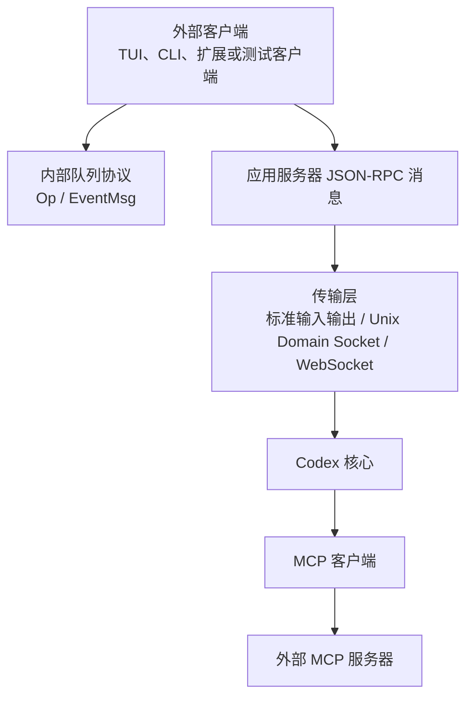
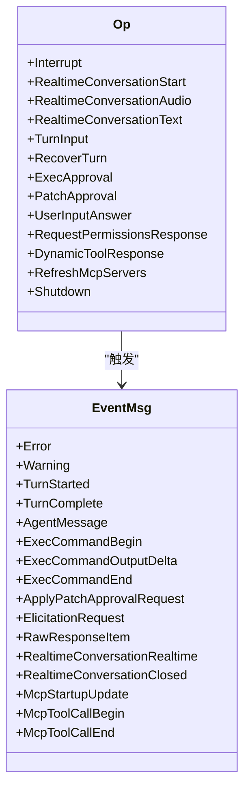
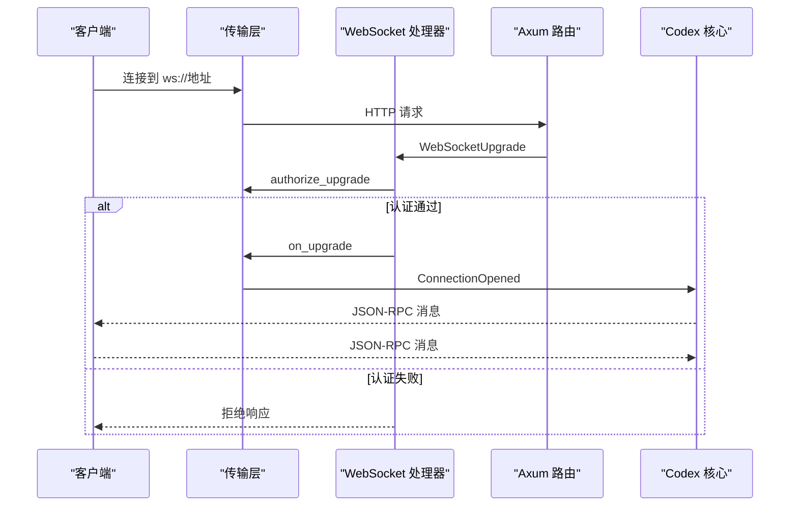
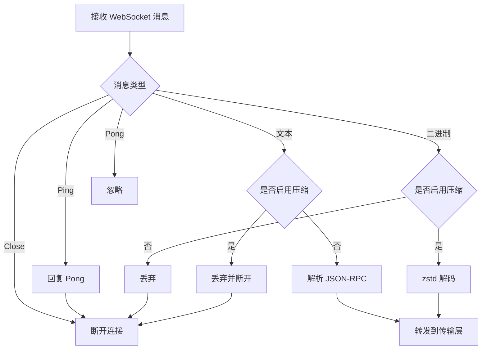
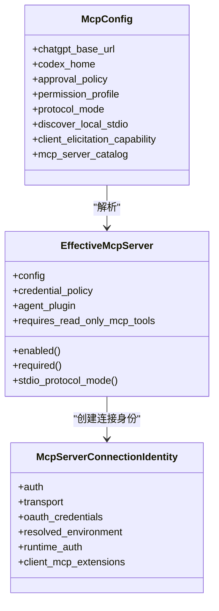
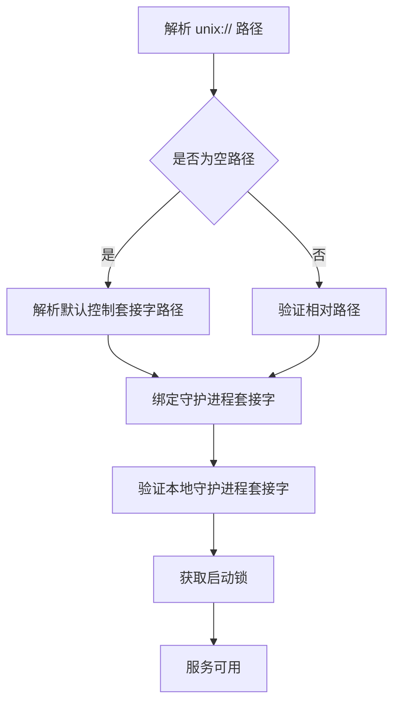
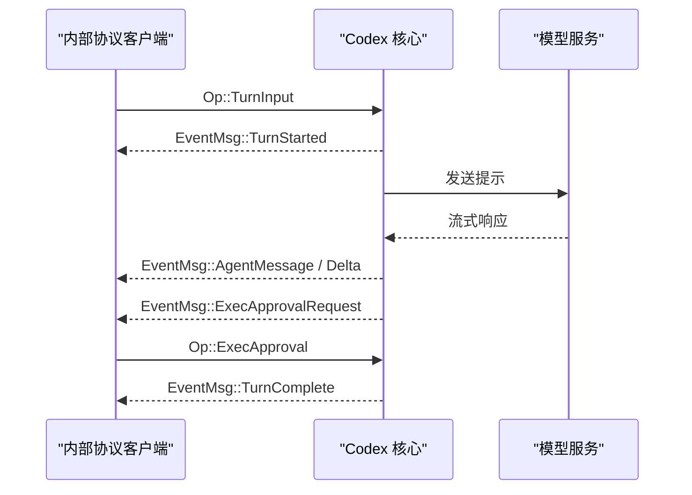
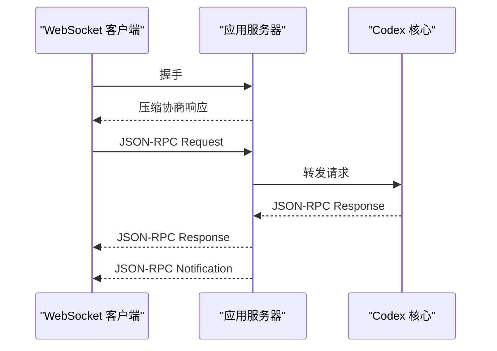
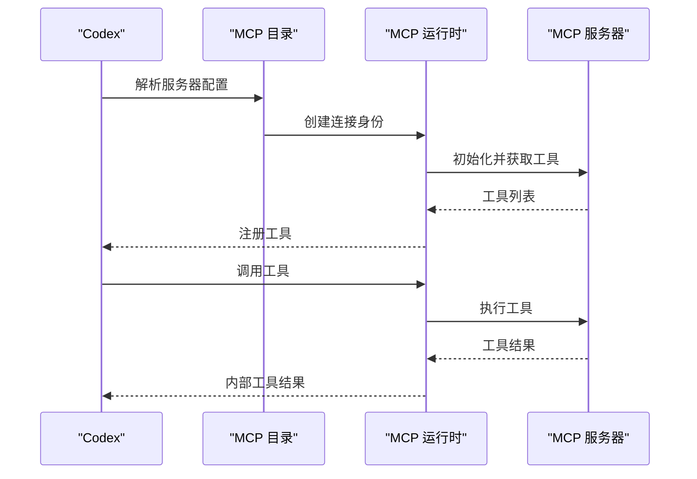
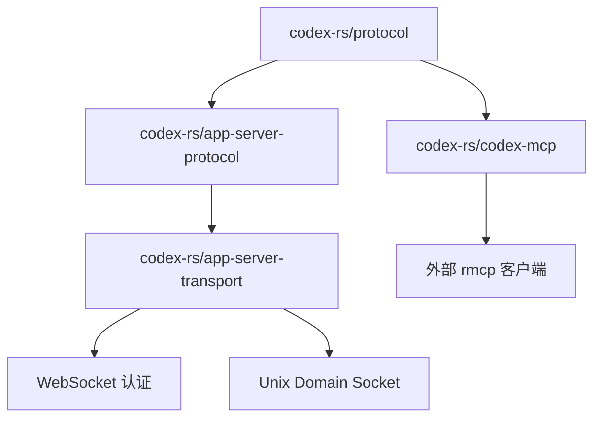

# 通信协议

<cite>
**本文引用的文件**   
- [protocol.rs](file://codex-rs/protocol/src/protocol.rs)
- [lib.rs（协议库）](file://codex-rs/protocol/src/lib.rs)
- [protocol_v1.md](file://codex-rs/docs/protocol_v1.md)
- [rpc.rs（应用服务器 RPC）](file://codex-rs/app-server-protocol/src/rpc.rs)
- [lib.rs（应用服务器协议库）](file://codex-rs/app-server-protocol/src/lib.rs)
- [mod.rs（传输层）](file://codex-rs/app-server-transport/src/transport/mod.rs)
- [websocket.rs（WebSocket 传输）](file://codex-rs/app-server-transport/src/transport/websocket.rs)
- [unix_socket.rs（Unix Domain Socket）](file://codex-rs/app-server-transport/src/transport/unix_socket.rs)
- [lib.rs（MCP 库）](file://codex-rs/codex-mcp/src/lib.rs)
- [server.rs（MCP 服务端）](file://codex-rs/codex-mcp/src/server.rs)
- [mod.rs（MCP 配置与策略）](file://codex-rs/codex-mcp/src/mcp/mod.rs)
</cite>

## 目录

1. [引言](#引言)
2. [项目结构](#项目结构)
3. [核心通信模型](#核心通信模型)
4. [内部进程间通信协议](#内部进程间通信协议)
5. [WebSocket 实时通信协议](#websocket-实时通信协议)
6. [Model Context Protocol 实现](#model-context-protocol-实现)
7. [网络传输与安全](#网络传输与安全)
8. [协议版本、错误码与调试](#协议版本错误码与调试)
9. [客户端与服务端示例](#客户端与服务端示例)
10. [依赖关系分析](#依赖关系分析)
11. [性能考虑](#性能考虑)
12. [故障排查指南](#故障排查指南)
13. [结论](#结论)

## 引言

Codex CLI 的通信协议不是单一接口，而是由多层协议组合而成：

- **内部队列协议**：用于外部界面或控制程序与 Codex 核心之间的双向任务提交和事件推送。
- **应用服务器 RPC 协议**：基于 JSON-RPC 风格的消息封装，承载会话、线程、工具调用、权限审批、实时语音和视频等高层业务语义。
- **WebSocket 传输协议**：在远程或容器化部署中，通过 WebSocket 承载上述 JSON-RPC 消息，并支持可选的二进制压缩。
- **Unix Domain Socket 与标准输入输出传输**：在本地进程内或同一主机上使用受控路径或管道进行低延迟通信。
- **Model Context Protocol**：Codex 作为 MCP 客户端，连接外部 MCP 服务器以扩展工具、资源和事件能力。

本文件重点从协议角度说明这些层次如何组合，而不是重复 UI 渲染逻辑或后端模型推理细节。

## 项目结构

与通信协议直接相关的代码主要分布在以下模块：

| 模块 | 职责 |
|---|---|
| `codex-rs/protocol` | 定义 Codex 内部操作、事件、会话参数、沙箱策略、实时对话数据结构。 |
| `codex-rs/app-server-protocol` | 定义应用服务器对外暴露的 JSON-RPC 消息类型、公共结构和导出能力。 |
| `codex-rs/app-server-transport` | 解析监听地址，管理 WebSocket、Unix Domain Socket、标准输入输出和远程控制通道。 |
| `codex-rs/codex-mcp` | 管理 MCP 服务器发现、认证、连接池、工具目录、资源访问和事件流。 |
| `codex-rmcp-client` | 实际使用 `rmcp` 库驱动 MCP 协议；该仓库在当前快照中未提供源码读取路径，因此本节不直接引用其实现细节。 |

**图表来源**   
- [protocol.rs:686-1230](file://codex-rs/protocol/src/protocol.rs#L686-L1230)
- [rpc.rs:1-88](file://codex-rs/app-server-protocol/src/rpc.rs#L1-L88)
- [mod.rs:120-220](file://codex-rs/app-server-transport/src/transport/mod.rs#L120-L220)
- [lib.rs（MCP 库）:1-154](file://codex-rs/codex-mcp/src/lib.rs#L1-L154)

**章节来源**   
- [protocol_v1.md:1-192](file://codex-rs/docs/protocol_v1.md#L1-L192)
- [lib.rs（协议库）:1-65](file://codex-rs/protocol/src/lib.rs#L1-L65)

## 核心通信模型

Codex 的核心通信模型建立在两个方向上：

1. **客户端到核心的提交**：称为 `Op`。它表示一个动作，例如启动轮次、中断执行、发起实时对话、请求权限审批、刷新 MCP 服务器等。
2. **核心到客户端的事件**：称为 `EventMsg`。它表示状态变化，例如轮次开始、模型消息、命令执行、补丁申请、实时音频帧、MCP 工具调用、错误或完成。

这两个枚举共同构成 Codex 内部协议的主要边界。它们被设计为 `non_exhaustive`，意味着未来可以增加新变体而不破坏已有客户端。

**图表来源**   
- [protocol.rs:686-1230](file://codex-rs/protocol/src/protocol.rs#L686-L1230)
- [protocol.rs:1520-1790](file://codex-rs/protocol/src/protocol.rs#L1520-L1790)

**章节来源**   
- [protocol.rs:686-1230](file://codex-rs/protocol/src/protocol.rs#L686-L1230)
- [protocol.rs:1520-1790](file://codex-rs/protocol/src/protocol.rs#L1520-L1790)
- [protocol_v1.md:1-192](file://codex-rs/docs/protocol_v1.md#L1-L192)

## 内部进程间通信协议

### 提交与事件

内部协议分为两类对象：

| 类别 | 名称 | 含义 |
|---|---|---|
| 提交 | `Op` | 客户端向 Codex 核心发送的动作。 |
| 事件 | `EventMsg` | Codex 核心向客户端推送的状态变更或结果。 |
| 包裹 | `Event` | 将事件与原始提交 ID 关联起来。 |

`Op` 包含大量运行时动作，包括：

- 实时对话生命周期：启动、附加流、发送音频或文本、关闭、分离会话。
- 轮次控制：提交用户输入、恢复中断轮次、挂起并关机。
- 权限审批：命令执行审批、补丁审批、取消补丁审批。
- 工具交互：用户输入回答、权限响应、动态工具响应。
- MCP 集成：刷新 MCP 服务器、解决 MCP 询问请求。
- 系统控制：关闭、清理后台终端、替换动态工具目录、设置线程内存模式。

`EventMsg` 覆盖更广泛的观察面，包括：

- 生命周期事件：轮次开始、轮次完成、会话已配置、关闭完成。
- 模型交互事件：模型消息、推理内容、原始响应项、上下文压缩、模型重路由。
- 执行事件：命令开始、增量输出、终端交互、命令结束。
- 安全事件：权限申请、补丁审批、Guardian 评估、流错误、安全缓冲。
- MCP 事件：启动进度、工具调用开始和结束、询问请求。
- 实时事件：实时对话开始、媒体数据、SDP、语音列表、关闭。

### 序列化机制

内部协议消息使用 Rust 的 `Serialize` 和 `Deserialize` 特性进行 JSON 序列化。文档明确指出，对于非帧传输如标准输入输出和 TCP，事件可以序列化为换行分隔的 JSON。这意味着：

- 每个消息通常是一个独立 JSON 对象。
- 客户端应按行解析。
- 字段顺序不应被假设。
- 新增字段应向后兼容，因为枚举标记为 `non_exhaustive`。

### 实时对话内部模型

实时对话在内部协议中使用一组专用结构：

- `ConversationStartParams`：描述实时会话的版本、输出模态、附件选项等。
- `RealtimeAttachmentOptions`：附加到现有调用的 I/O 行为。
- `RealtimeSidebandTransport`：在不打开新套接字时附加已有流的传输方式。
- `ConversationAudioParams`：音频帧采样率、声道数和样本数。
- `ConversationTextParams`：角色和文本输入。
- `ConversationSpeechParams`：可朗读文本。

这些结构通过 `Op::RealtimeConversation*` 系列变体进入核心，并通过 `EventMsg::RealtimeConversation*` 系列事件返回。

**章节来源**   
- [protocol.rs:686-1230](file://codex-rs/protocol/src/protocol.rs#L686-L1230)
- [protocol.rs:1520-1790](file://codex-rs/protocol/src/protocol.rs#L1520-L1790)
- [protocol.rs:1790-2500](file://codex-rs/protocol/src/protocol.rs#L1790-L2500)
- [protocol_v1.md:1-192](file://codex-rs/docs/protocol_v1.md#L1-L192)

## WebSocket 实时通信协议

### 传输选择

应用服务器支持多种监听地址：

| 值 | 含义 |
|---|---|
| `stdio://` | 标准输入输出传输。 |
| `unix://` | Unix Domain Socket。空路径会使用默认控制套接字路径。 |
| `off` | 禁用监听。 |
| `ws://地址` | WebSocket，绑定指定 TCP 地址。 |
| 其他值 | 解析失败。 |

WebSocket 监听器使用 Axum 构建 HTTP 路由，并在 `/readyz` 和 `/healthz` 提供健康检查。除健康检查和就绪检查外，其余请求走 WebSocket 升级处理。

### 连接建立流程

**图表来源**   
- [websocket.rs:120-220](file://codex-rs/app-server-transport/src/transport/websocket.rs#L120-L220)
- [mod.rs:120-220](file://codex-rs/app-server-transport/src/transport/mod.rs#L120-L220)

### 心跳机制

WebSocket 入站循环会处理以下消息类型：

| 消息类型 | 行为 |
|---|---|
| 文本消息 | 解码为 JSON-RPC 消息后转发给传输层。 |
| 二进制消息 | 仅在启用 zstd 压缩时接受，否则丢弃。 |
| Ping | 回复 Pong。 |
| Pong | 忽略，仅维持心跳语义。 |
| Close | 断开连接。 |

如果控制队列已满，无法回复 Pong，则记录警告并关闭连接。这使传输层能够检测对端是否仍然活跃，同时避免写入队列阻塞导致的心跳丢失。

### 压缩机制

WebSocket 支持可选的 zstd 流式压缩：

- 客户端在握手时携带压缩头。
- 服务器根据头决定是否启用压缩。
- 启用压缩后，出站消息编码为二进制帧。
- 入站二进制消息按帧解码为文本。
- 最大解压消息大小为 64 MiB。
- 明文连接收到二进制消息会被丢弃。
- 压缩连接收到文本消息会断开。

**图表来源**   
- [websocket.rs:350-482](file://codex-rs/app-server-transport/src/transport/websocket.rs#L350-L482)

### 出站队列

WebSocket 使用独立的出站通道，容量大于内部通道，以应对实时输出突发。每条队列消息可选择携带写完成通知，便于上层确认消息已成功发送。

**章节来源**   
- [mod.rs:120-220](file://codex-rs/app-server-transport/src/transport/mod.rs#L120-L220)
- [websocket.rs:120-220](file://codex-rs/app-server-transport/src/transport/websocket.rs#L120-L220)
- [websocket.rs:350-482](file://codex-rs/app-server-transport/src/transport/websocket.rs#L350-L482)

## Model Context Protocol 实现

### MCP 在 Codex 中的定位

Codex 本身是 MCP 客户端。它并不实现完整 MCP 服务器，而是：

- 加载 MCP 服务器配置。
- 根据传输类型启动 stdio 或 HTTP 连接。
- 协商协议模式。
- 获取工具目录和资源列表。
- 将 MCP 工具映射为 Codex 内部工具。
- 将 MCP 资源、事件和询问请求桥接到 Codex 内部协议。

### 配置与有效服务器

MCP 配置集中在 `McpConfig` 中，包含：

- ChatGPT 托管应用的基地址。
- Codex 家目录。
- OAuth 存储模式和密钥环后端。
- 工具目录缓存、批准策略、权限档案。
- 是否要求只读 MCP 工具。
- 本地 stdio 服务器探测开关。
- 客户端 MCP 扩展能力。
- 已解析的 MCP 服务器目录。

`EffectiveMcpServer` 是在运行时添加环境、认证、插件和只读限制后的最终服务器视图。

**图表来源**   
- [mod.rs:70-260](file://codex-rs/codex-mcp/src/mcp/mod.rs#L70-L260)
- [server.rs:1-240](file://codex-rs/codex-mcp/src/server.rs#L1-L240)

### 连接身份与凭据策略

`McpServerConnectionIdentity` 决定一个 MCP 连接的唯一性。它包含认证方式、传输配置、OAuth 凭据、环境变量、运行期环境和客户端扩展能力。相同身份的不同发布不会强制重新连接；只有影响连接标识的字段变化才会触发重建。

凭据策略区分两种场景：

- `HostFallbackAllowed`：主机配置的服务器可以回退到本地和旧式远程凭据解析。
- `ExecutorOnly`：执行器发现的名称绝不能查找主机环境变量。

### 协议模式与扩展

MCP 客户端使用 `McpProtocolMode` 控制与外部服务器的协议行为。Codex 还通过 `ClientMcpExtensions` 传递扩展能力，例如：

- 订阅能力。
- 资源分页能力。
- 网络策略元数据能力。
- 沙盒状态能力。

这些扩展由 MCP 库导出，供上层在初始化时声明。

### 工具命名与权限

MCP 工具名使用前缀隔离不同服务器。权限判定会根据工具批准模式、权限档案和沙箱策略决定是否自动批准 MCP 权限提示。

**章节来源**   
- [lib.rs（MCP 库）:1-154](file://codex-rs/codex-mcp/src/lib.rs#L1-L154)
- [server.rs:1-240](file://codex-rs/codex-mcp/src/server.rs#L1-L240)
- [mod.rs:70-260](file://codex-rs/codex-mcp/src/mcp/mod.rs#L70-L260)

## 网络传输与安全

### Unix Domain Socket

Unix Domain Socket 用于本地控制通道。关键安全点包括：

- 控制套接字路径可能通过哈希映射到共享守护进程目录。
- 目录需要所有者拥有权限。
- 存在验证函数，防止 SSH 端口转发伪装成真实守护进程套接字。
- 启动锁文件用于防止并发启动冲突。
- 旧套接字会在必要时清理。

**图表来源**   
- [mod.rs:120-220](file://codex-rs/app-server-transport/src/transport/mod.rs#L120-L220)
- [unix_socket.rs:300-470](file://codex-rs/app-server-transport/src/transport/unix_socket.rs#L300-L470)

### WebSocket 安全

WebSocket 监听器对非本地回环地址有额外保护：

- 如果没有配置能力令牌或签名 bearer token，则拒绝启动。
- 升级前调用 `authorize_upgrade` 校验请求头。
- 带 `Origin` 头的请求会被显式拒绝。
- 本地回环地址会打印安全提示。
- 非本地地址必须配置认证能力。

### TCP 与标准输入输出

- 标准输入输出适合本地进程间通信，无需网络暴露。
- TCP 地址通过 WebSocket URL 解析。
- 非帧传输使用换行分隔 JSON。
- WebSocket 传输使用帧，并可选二进制压缩。

**章节来源**   
- [mod.rs:120-220](file://codex-rs/app-server-transport/src/transport/mod.rs#L120-L220)
- [websocket.rs:120-220](file://codex-rs/app-server-transport/src/transport/websocket.rs#L120-L220)
- [unix_socket.rs:300-470](file://codex-rs/app-server-transport/src/transport/unix_socket.rs#L300-L470)

## 协议版本、错误码与调试

### 协议版本

Codex 内部协议没有全局版本号字段，但通过以下方式体现兼容性：

- `Op` 和 `EventMsg` 均为 `non_exhaustive`，允许新增变体。
- v1 和 v2 之间通过别名兼容：`task_started` 与 `turn_started`、`task_complete` 与 `turn_complete` 可互换。
- 应用服务器 RPC 明确保留 `JSONRPC_VERSION = "2.0"`，但不强制要求 `jsonrpc` 字段。
- MCP 协议模式通过环境变量和客户端扩展协商。

### 错误码

应用服务器 RPC 使用通用 JSON-RPC 错误结构：

| 字段 | 含义 |
|---|---|
| `code` | 数字错误码。 |
| `message` | 人类可读错误信息。 |
| `data` | 可选结构化错误数据。 |

Codex 内部错误通常通过 `EventMsg::Error` 传播，而不是直接使用 JSON-RPC 错误字段。MCP 相关错误可能出现在工具调用结果、启动事件或资源读取结果中。

### 调试方法

推荐调试路径：

1. 使用标准输入输出捕获换行分隔 JSON。
2. 查看 WebSocket 日志中的连接、压缩、ping/pong 和错误。
3. 检查 Unix Domain Socket 路径、所有权和启动锁。
4. 查看 MCP 启动更新、工具调用开始和结束事件。
5. 使用 TUI 或测试客户端复现问题，因为内部协议面向任意 UI 实现。

**章节来源**   
- [protocol.rs:1520-1790](file://codex-rs/protocol/src/protocol.rs#L1520-L1790)
- [rpc.rs:1-88](file://codex-rs/app-server-protocol/src/rpc.rs#L1-L88)
- [websocket.rs:120-220](file://codex-rs/app-server-transport/src/transport/websocket.rs#L120-L220)
- [protocol_v1.md:1-192](file://codex-rs/docs/protocol_v1.md#L1-L192)

## 客户端与服务端示例

### 内部协议客户端示例

一个内部协议客户端应：

1. 启动或连接到 Codex 核心。
2. 发送 `Op::TurnInput` 或其他提交。
3. 订阅 `EventMsg` 流。
4. 根据 `EventMsg::ExecApprovalRequest` 或 `EventMsg::ApplyPatchApprovalRequest` 等待审批。
5. 通过 `Op::ExecApproval`、`Op::PatchApproval` 或 `Op::UserInputAnswer` 返回决策。
6. 在 `EventMsg::TurnComplete` 或 `EventMsg::Error` 处终止当前轮次。

**图表来源**   
- [protocol.rs:686-1230](file://codex-rs/protocol/src/protocol.rs#L686-L1230)
- [protocol.rs:1520-1790](file://codex-rs/protocol/src/protocol.rs#L1520-L1790)
- [protocol_v1.md:1-192](file://codex-rs/docs/protocol_v1.md#L1-L192)

### WebSocket 客户端示例

WebSocket 客户端应：

1. 连接到 `ws://地址`。
2. 根据是否需要压缩设置请求头。
3. 发送 JSON-RPC 消息。
4. 接收 JSON-RPC 响应、通知和错误。
5. 处理 Ping/Pong 心跳。
6. 在连接关闭或压缩错误时重试或降级。

**图表来源**   
- [websocket.rs:120-220](file://codex-rs/app-server-transport/src/transport/websocket.rs#L120-L220)
- [rpc.rs:1-88](file://codex-rs/app-server-protocol/src/rpc.rs#L1-L88)

### MCP 客户端示例

Codex 的 MCP 客户端流程如下：

1. 从配置加载 MCP 服务器列表。
2. 判断是否使用本地 stdio 探测。
3. 根据传输类型启动 stdio 或 HTTP 连接。
4. 协商协议模式和扩展能力。
5. 拉取工具目录。
6. 将工具注册为 Codex 内部工具。
7. 在工具调用时桥接权限审批和沙箱策略。

**图表来源**   
- [lib.rs（MCP 库）:1-154](file://codex-rs/codex-mcp/src/lib.rs#L1-L154)
- [server.rs:1-240](file://codex-rs/codex-mcp/src/server.rs#L1-L240)
- [mod.rs:70-260](file://codex-rs/codex-mcp/src/mcp/mod.rs#L70-L260)

## 依赖关系分析

**图表来源**   
- [lib.rs（协议库）:1-65](file://codex-rs/protocol/src/lib.rs#L1-L65)
- [lib.rs（应用服务器协议库）:1-72](file://codex-rs/app-server-protocol/src/lib.rs#L1-L72)
- [lib.rs（MCP 库）:1-154](file://codex-rs/codex-mcp/src/lib.rs#L1-L154)

**章节来源**   
- [lib.rs（协议库）:1-65](file://codex-rs/protocol/src/lib.rs#L1-L65)
- [lib.rs（应用服务器协议库）:1-72](file://codex-rs/app-server-protocol/src/lib.rs#L1-L72)
- [lib.rs（MCP 库）:1-154](file://codex-rs/codex-mcp/src/lib.rs#L1-L154)

## 性能考虑

- WebSocket 出站通道容量较大，以降低实时输出突发时的背压风险。
- 压缩仅在双方协商后启用，避免不必要的 CPU 开销。
- 最大解压消息大小限制为 64 MiB，防止超大消息耗尽内存。
- 内部协议使用多通道和一次性回复，减少阻塞。
- MCP 工具目录和资源访问通常带有缓存和分页。
- 标准输入输出适合轻量级本地调试，但不适合高吞吐远程场景。

[本节为一般性指导，不直接分析具体代码行]

## 故障排查指南

| 现象 | 可能原因 | 建议操作 |
|---|---|---|
| WebSocket 连接被拒绝 | 缺少认证配置或非本地监听未启用能力令牌 | 配置 `--ws-auth capability-token` 或 `--ws-auth signed-bearer-token` |
| 压缩连接断开 | 明文连接收到二进制消息，或二进制连接收到文本消息 | 检查客户端压缩协商和消息类型 |
| Unix Domain Socket 不存在 | 路径无效、旧套接字残留或守护进程未启动 | 检查 `CODEX_HOME`、套接字路径和启动锁 |
| MCP 工具未出现 | 服务器未就绪、协议模式不匹配或权限被过滤 | 查看 `McpStartupUpdate` 和 `McpToolCallBegin` 事件 |
| 轮次卡住 | 审批未返回、MCP 询问未解决或连接断开 | 检查 `ExecApprovalRequest`、`ElicitationRequest` 和连接状态 |
| 实时音频无输出 | 会话未正确附加或音频参数不正确 | 检查 `RealtimeConversationAttach`、`RealtimeConversationAudio` 和相关事件 |

**章节来源**   
- [websocket.rs:120-220](file://codex-rs/app-server-transport/src/transport/websocket.rs#L120-L220)
- [websocket.rs:350-482](file://codex-rs/app-server-transport/src/transport/websocket.rs#L350-L482)
- [unix_socket.rs:300-470](file://codex-rs/app-server-transport/src/transport/unix_socket.rs#L300-L470)
- [protocol.rs:686-1230](file://codex-rs/protocol/src/protocol.rs#L686-L1230)
- [protocol.rs:1520-1790](file://codex-rs/protocol/src/protocol.rs#L1520-L1790)

## 结论

Codex CLI 的通信协议采用分层设计：内部队列协议定义语义，JSON-RPC 风格消息定义应用服务器接口，WebSocket、Unix Domain Socket 和标准输入输出提供传输抽象，MCP 客户端扩展工具生态。这种设计使 Codex 既能作为本地 CLI 运行，也能作为远程应用服务器运行，同时保持协议的可演进性和可扩展性。

实现方在扩展协议时应优先遵循以下原则：

- 新增事件或操作时使用 `non_exhaustive` 枚举。
- 保持序列化格式向后兼容。
- 在网络传输层显式处理认证、压缩和错误。
- 将 MCP 视为外部扩展边界，不将其内部实现混入核心协议。
- 通过事件而非隐式状态同步来驱动客户端。