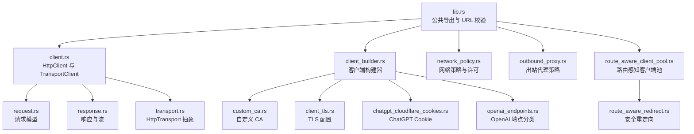
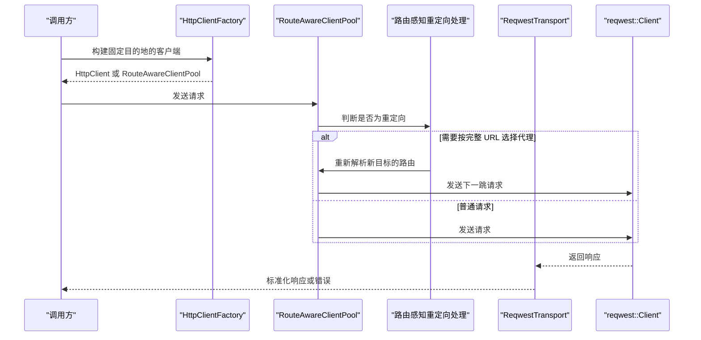
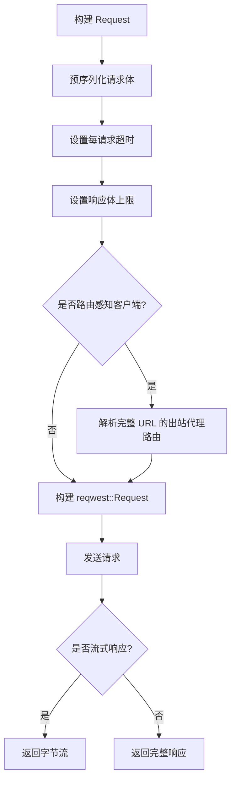
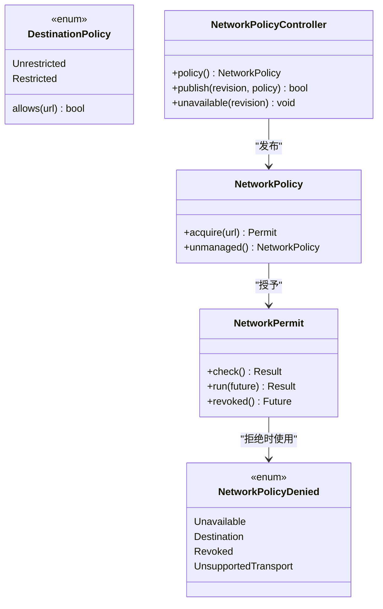
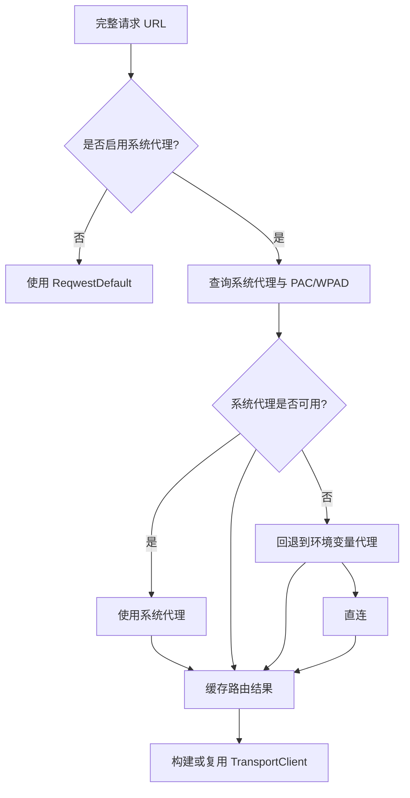
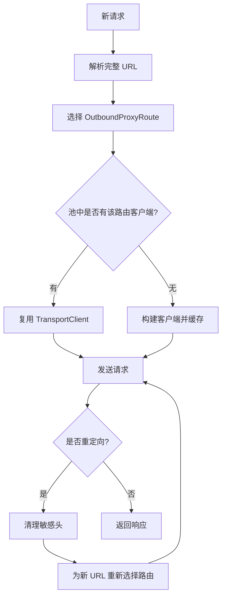
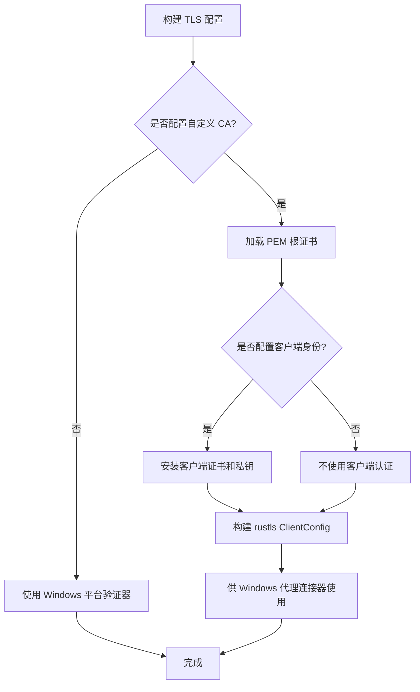
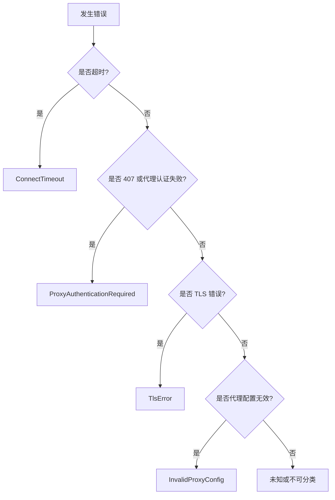
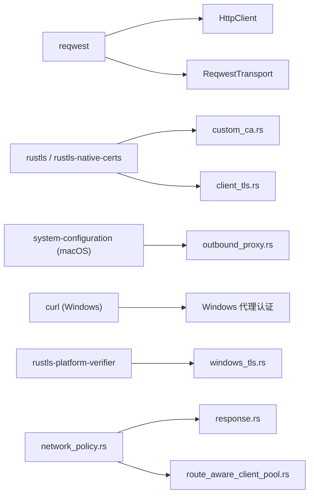

# HTTP 客户端

<cite>
**本文引用的文件**   
- [lib.rs](file://codex-rs/http-client/src/lib.rs)
- [client.rs](file://codex-rs/http-client/src/client.rs)
- [client_builder.rs](file://codex-rs/http-client/src/client_builder.rs)
- [network_policy.rs](file://codex-rs/http-client/src/network_policy.rs)
- [route_aware_client_pool.rs](file://codex-rs/http-client/src/route_aware_client_pool.rs)
- [outbound_proxy.rs](file://codex-rs/http-client/src/outbound_proxy.rs)
- [custom_ca.rs](file://codex-rs/http-client/src/custom_ca.rs)
- [client_tls.rs](file://codex-rs/http-client/src/client_tls.rs)
- [openai_endpoints.rs](file://codex-rs/http-client/src/openai_endpoints.rs)
- [chatgpt_cloudflare_cookies.rs](file://codex-rs/http-client/src/chatgpt_cloudflare_cookies.rs)
- [request.rs](file://codex-rs/http-client/src/request.rs)
- [response.rs](file://codex-rs/http-client/src/response.rs)
- [transport.rs](file://codex-rs/http-client/src/transport.rs)
- [route_aware_redirect.rs](file://codex-rs/http-client/src/route_aware_redirect.rs)
- [windows_tls.rs](file://codex-rs/http-client/src/windows_tls.rs)
</cite>

## 目录

1. [引言](#引言)
2. [项目结构](#项目结构)
3. [核心组件](#核心组件)
4. [架构总览](#架构总览)
5. [详细组件分析](#详细组件分析)
6. [依赖关系分析](#依赖关系分析)
7. [性能与可靠性](#性能与可靠性)
8. [故障排查指南](#故障排查指南)
9. [结论](#结论)

## 引言

`codex-http-client` 是 Codex 工作区中共享的低层 HTTP 传输实现，集中管理 `reqwest` 集成、出站代理策略、自定义 CA、路由感知连接池、OpenAI 专用端点识别、ChatGPT Cookie 管理以及 Windows 平台特殊处理。产品代码应优先使用本 crate 暴露的类型，而不是直接构造 `reqwest::Client`，从而保证：

- 所有出站请求遵循统一的网络策略和代理选择规则；
- 避免短生命周期客户端打乱连接复用；
- 对敏感 URL、响应头和代理配置进行可审计的日志脱敏；
- 在系统代理、PAC/WPAD、环境变量和直连之间按完整 URL 做路由决策；
- 在 ChatGPT/OpenAI 等特定场景下保持正确的 Cookie、域名白名单和头部行为。

该模块还定义了对上层重试、SSE 和请求尝试遥测友好的错误分类，但更高层的重试与流式处理策略通常位于调用方或更高层模块中。

## 项目结构

HTTP 客户端采用“功能域 + 运行时”组织方式：

| 目录/文件 | 职责 |
|---|---|
| `lib.rs` | 公共导出、URL 校验工具、模块入口 |
| `client.rs` | `HttpClient`、`TransportClient`、默认头部注入与诊断日志 |
| `client_builder.rs` | 严格构建流程、TLS 后端、Cookie、超时与代理策略装配 |
| `network_policy.rs` | 目的地白名单、撤销许可、不可重试的策略拒绝 |
| `outbound_proxy.rs` | 出站代理策略、系统代理发现、PAC/WPAD、无代理缓存 |
| `route_aware_client_pool.rs` | 按路由复用连接、重定向路由决策、错误分类 |
| `route_aware_redirect.rs` | 安全重定向、敏感头清理、Referer 规则 |
| `custom_ca.rs` | `CODEX_CA_CERTIFICATE`、`SSL_CERT_FILE`、PEM 解析、用户提示错误 |
| `client_tls.rs` | 根证书、双向 TLS、Windows 代理 TLS 配置 |
| `openai_endpoints.rs` | OpenAI 官方域名与受支持 API 主机分类 |
| `chatgpt_cloudflare_cookies.rs` | Cloudflare 基础设施 Cookie 共享存储 |
| `request.rs` | JSON/Raw 请求体、压缩、预序列化、超时与响应大小限制 |
| `response.rs` | 授权许可保留、流式响应、策略撤销检查 |
| `transport.rs` | `HttpTransport` 抽象、`ReqwestTransport`、错误映射、重试建议解析 |
| `windows_tls.rs` | Windows 平台信任策略验证器 |

**图表来源**
- [lib.rs:1-130](file://codex-rs/http-client/src/lib.rs#L1-L130)
- [client.rs:1-200](file://codex-rs/http-client/src/client.rs#L1-L200)
- [client_builder.rs:1-200](file://codex-rs/http-client/src/client_builder.rs#L1-L200)
- [route_aware_client_pool.rs:1-200](file://codex-rs/http-client/src/route_aware_client_pool.rs#L1-L200)
- [route_aware_redirect.rs:1-159](file://codex-rs/http-client/src/route_aware_redirect.rs#L1-L159)
- [custom_ca.rs:1-200](file://codex-rs/http-client/src/custom_ca.rs#L1-L200)
- [client_tls.rs:1-113](file://codex-rs/http-client/src/client_tls.rs#L1-L113)
- [openai_endpoints.rs:1-155](file://codex-rs/http-client/src/openai_endpoints.rs#L1-L155)
- [chatgpt_cloudflare_cookies.rs:1-200](file://codex-rs/http-client/src/chatgpt_cloudflare_cookies.rs#L1-L200)
- [request.rs:1-200](file://codex-rs/http-client/src/request.rs#L1-L200)
- [response.rs:1-147](file://codex-rs/http-client/src/response.rs#L1-L147)
- [transport.rs:1-200](file://codex-rs/http-client/src/transport.rs#L1-L200)

**章节来源**
- [lib.rs:1-130](file://codex-rs/http-client/src/lib.rs#L1-L130)
- [README.md:1-126](file://codex-rs/http-client/README.md#L1-L126)

## 核心组件

### HttpClient：可复用请求入口

`HttpClient` 封装底层 `reqwest::Client` 或路由感知客户端池，负责：

- 提供 `GET`、`HEAD`、`POST`、`DELETE`、`request` 等便捷方法；
- 将请求委托给 `RequestBuilder`；
- 区分直连执行与路由池执行；
- 控制是否记录请求 URL 和响应头；
- 合并默认头部与追踪头部；
- 为调试输出隐藏敏感信息。

当客户端通过工厂构建时，它可能持有直连的 `TransportClient`，也可能持有共享的 `RouteAwareClientPool`。调用 `get/post/delete/head/request` 时，会根据后端类型创建不同来源的 `RequestBuilder`。

**章节来源**
- [client.rs:1-200](file://codex-rs/http-client/src/client.rs#L1-L200)

### HttpTransport：统一传输抽象

`HttpTransport` 定义了固定客户端和路由池共享的请求执行接口：

- `execute`：返回完整响应；
- `stream`：返回带状态码、响应头和字节流的响应；
- 统一将 `Request` 转换为底层 `reqwest::Request`；
- 统一映射 `HttpError`、策略拒绝、连接失败、超时和网络错误；
- 根据是否需要路由感知决定走直连还是池化路径。

`ReqwestTransport` 适配 `HttpClient` 和 `RouteAwareClientPool`，并对响应体长度限制、错误体读取、`Retry-After` 头部解析和诊断日志做统一处理。

**章节来源**
- [transport.rs:1-200](file://codex-rs/http-client/src/transport.rs#L1-L200)

### Request 与 Response：请求模型与流式响应

`Request` 支持：

- JSON 主体、预编码 JSON 主体和原始字节主体；
- 可选 zstd 压缩；
- 单次预序列化，避免重试重复序列化；
- 每请求超时；
- 响应体最大字节数限制；
- 签名认证所需的最终请求体与头部快照。

`HttpResponse` 包装 `reqwest::Response`，并绑定 `NetworkPermit`。其流式读取会持续检查网络策略是否被撤销，确保即使响应已经建立，后续数据消费也能及时停止。

**章节来源**
- [request.rs:1-200](file://codex-rs/http-client/src/request.rs#L1-L200)
- [response.rs:1-147](file://codex-rs/http-client/src/response.rs#L1-L147)

## 架构总览

**图表来源**
- [client_builder.rs:1-200](file://codex-rs/http-client/src/client_builder.rs#L1-L200)
- [route_aware_client_pool.rs:1-200](file://codex-rs/http-client/src/route_aware_client_pool.rs#L1-L200)
- [route_aware_redirect.rs:1-159](file://codex-rs/http-client/src/route_aware_redirect.rs#L1-L159)
- [transport.rs:1-200](file://codex-rs/http-client/src/transport.rs#L1-L200)

## 详细组件分析

### 请求构建与发送流程

请求从 `Request` 或 `RequestBuilder` 开始，经过预序列化、压缩、超时设置，再进入 `ReqwestTransport`。如果客户端是路由感知类型，则先完成路由解析，最后交给 `reqwest::Client`。

**图表来源**
- [request.rs:1-200](file://codex-rs/http-client/src/request.rs#L1-L200)
- [transport.rs:1-200](file://codex-rs/http-client/src/transport.rs#L1-L200)
- [route_aware_client_pool.rs:1-200](file://codex-rs/http-client/src/route_aware_client_pool.rs#L1-L200)

**章节来源**
- [request.rs:1-200](file://codex-rs/http-client/src/request.rs#L1-L200)
- [transport.rs:1-200](file://codex-rs/http-client/src/transport.rs#L1-L200)

### 响应处理与流式数据传输

响应分为两类：

1. **一次性响应**：通过 `bytes`、`text`、`json` 等方法读取；
2. **流式响应**：通过 `bytes_stream` 或 `stream` 返回 `ByteStream`。

无论哪种方式，响应体消费都绑定 `NetworkPermit`。如果网络策略被撤销，流式读取会立即返回策略拒绝错误，而不是继续消耗远端数据。对于非流式读取，也会在执行前检查许可。

`HttpResponse` 还保留对底层 `reqwest::Response` 的解引用能力，使现有代码可以继续使用标准响应字段。

**章节来源**
- [response.rs:1-147](file://codex-rs/http-client/src/response.rs#L1-L147)
- [transport.rs:1-200](file://codex-rs/http-client/src/transport.rs#L1-L200)

### 网络策略控制机制

#### 目的地白名单

`DestinationPolicy` 支持两种模式：

| 模式 | 行为 |
|---|---|
| `Unrestricted` | 允许所有 HTTPS 和 WSS 请求 |
| `Restricted { allowed_hosts }` | 仅允许精确匹配且已规范化主机的 HTTPS/WSS 请求 |

白名单比较时会去掉末尾的点号，例如 `api.example.com.` 与 `api.example.com` 视为相同。这可以避免 DNS 后缀带来的边界差异。

#### 策略撤销

`NetworkPolicyController` 发布策略，每个请求获得一个 `NetworkPermit`。策略更新后：

- 不再符合新策略的请求会被标记为已撤销；
- 正在读取响应体的流会收到 `Revoked`；
- 旧许可不会让已撤销的目标继续访问。

#### 策略拒绝错误

`NetworkPolicyDenied` 提供确定性拒绝原因：

| 原因 | 含义 |
|---|---|
| `Unavailable` | 应用网络策略不可用 |
| `Destination` | 目标被白名单拒绝 |
| `Revoked` | 网络权限已被撤销 |
| `UnsupportedTransport` | SDK 传输被应用网络限制禁用 |

这类错误不是普通的网络连接失败，因此不应被简单归类为可重试错误。

**图表来源**
- [network_policy.rs:1-200](file://codex-rs/http-client/src/network_policy.rs#L1-L200)

**章节来源**
- [network_policy.rs:1-200](file://codex-rs/http-client/src/network_policy.rs#L1-L200)

### 出站代理策略与控制

#### 策略模式

`OutboundProxyPolicy` 有两种模式：

| 模式 | 行为 |
|---|---|
| `ReqwestDefault` | 保留 `reqwest` 内置代理行为 |
| `RespectSystemProxy` | 系统设置、PAC/WPAD、环境变量、直连按优先级解析 |

推荐做法是使用 `RespectSystemProxy`，因为系统代理决策可能因完整 URL 而变化，而 `ReqwestDefault` 只是兼容旧行为，并非通用默认值。

#### 路由结果

`OutboundProxyRoute` 表示最终出站行为：

| 路由 | 说明 |
|---|---|
| `TransportDefault` | 保留传输默认代理行为 |
| `Direct` | 直连，绕过传输级代理发现 |
| `Proxy { url, no_proxy }` | 通过指定代理，调试输出会脱敏 URL |

#### 系统代理缓存

系统代理解析结果会缓存：

- 成功结果默认存活约 60 秒；
- 不可用结果短暂缓存约 5 秒；
- 最大条目数为 256；
- macOS 和 Windows 上异步系统代理解析使用信号量限制并发。

**图表来源**
- [outbound_proxy.rs:1-200](file://codex-rs/http-client/src/outbound_proxy.rs#L1-L200)
- [route_aware_client_pool.rs:1-200](file://codex-rs/http-client/src/route_aware_client_pool.rs#L1-L200)

**章节来源**
- [outbound_proxy.rs:1-200](file://codex-rs/http-client/src/outbound_proxy.rs#L1-L200)

### 路由感知客户端池

`RouteAwareClientPool` 是连接复用、负载均衡和故障转移的核心：

- 按 `OutboundProxyRoute` 缓存最多 16 个 `TransportClient`；
- 每次请求都会基于完整 URL 重新选择路由；
- 重定向不会交给 `reqwest` 内部跟随，而是由池重新解析目标并选择路由；
- 跨 origin 重定向时移除敏感头；
- 构建客户端时使用互斥锁防止竞争；
- 返回的错误包含连接、代理、TLS、构建和策略等多类失败。

#### 连接复用

同一 `OutboundProxyRoute` 对应同一个底层 `TransportClient`，因此同一路径的连接可以复用。不同路由不会混用，避免把某个 URL 发送到错误的代理。

#### 重定向与敏感头清理

当发生重定向时：

- 根据状态码决定是否保留请求体；
- 删除 `Content-Type`、`Content-Length`、`Content-Encoding`、`Transfer-Encoding`；
- 跨 origin 时删除 `Authorization`、`Cookie`、`Proxy-Authorization`、`WWW-Authenticate`；
- 在保护敏感头部模式下，删除所有标记为敏感的头部；
- 安全设置 `Referer`，避免从 HTTPS 泄露到 HTTP。

**图表来源**
- [route_aware_client_pool.rs:1-200](file://codex-rs/http-client/src/route_aware_client_pool.rs#L1-L200)
- [route_aware_redirect.rs:1-159](file://codex-rs/http-client/src/route_aware_redirect.rs#L1-L159)

**章节来源**
- [route_aware_client_pool.rs:1-200](file://codex-rs/http-client/src/route_aware_client_pool.rs#L1-L200)
- [route_aware_redirect.rs:1-159](file://codex-rs/http-client/src/route_aware_redirect.rs#L1-L159)

### OpenAI API 专用端点处理

`openai_endpoints.rs` 不发起请求，只做目的地分类：

| 分类 | 含义 |
|---|---|
| `Supported` | 属于 OpenAI 或 ChatGPT 官方受支持主机，且满足 HTTPS、端口 443、无用户信息等条件 |
| `Unsupported` | 属于 OpenAI 相关域名，但不符合受支持条件 |
| `Other` | 不属于 OpenAI 或 ChatGPT 官方域名 |

这种分类用于区分“可能是 OpenAI 但格式不安全”和“完全无关的其他提供者”，避免把不受支持的变体误判为其他提供商。

受支持主机包括多个区域 API 主机、mTLS 主机、`api.openai.org`、`api.openai-staging.com` 以及允许的 ChatGPT 后端主机。

**章节来源**
- [openai_endpoints.rs:1-155](file://codex-rs/http-client/src/openai_endpoints.rs#L1-L155)

### ChatGPT Cookie 管理与 CloudFlare 集成

`ChatGptCloudflareCookieStore` 是进程内全局 Cookie 存储，但只允许存储：

- Cloudflare 文档化的基础设施 Cookie；
- `__oailb`，作为 OpenAI 基础设施路由 Cookie。

它明确拒绝存储 ChatGPT 账户、会话、认证或其他用户特定 Cookie。这样可以在不影响安全边界的前提下，维持 Cloudflare 与 OpenAI 基础设施所需的路由 Cookie。

`ChatGptCookieStore` 还可组合工厂配置的 Cookie，并将 Cloudflare Cookie 与应用配置 Cookie 合并。合并后的 Cookie 会继承敏感性标记。

`HttpClientFactory` 提供：

- `chatgpt_cookie_header`：为允许的 ChatGPT HTTPS/WSS 地址生成 Cookie；
- `store_chatgpt_response_cookies`：仅保存允许的 Cloudflare 基础设施 Cookie。

**章节来源**
- [chatgpt_cloudflare_cookies.rs:1-200](file://codex-rs/http-client/src/chatgpt_cloudflare_cookies.rs#L1-L200)

### TLS 设置与自定义 CA

#### 自定义 CA 来源

自定义 CA 支持通过以下环境变量加载：

| 变量 | 优先级 |
|---|---|
| `CODEX_CA_CERTIFICATE` | 高 |
| `SSL_CERT_FILE` | 低 |

空字符串被视为未设置。模块会：

- 读取 PEM 文件；
- 解析 `CERTIFICATE` 块；
- 容忍 OpenSSL 风格标签；
- 忽略 CRL 等非证书内容；
- 向 `reqwest` 或 `rustls` 注册根证书；
- 返回结构化错误，指导用户修复 CA 文件。

#### 客户端 TLS 配置

`HttpClientTlsConfig` 支持：

- 替换根证书的 PEM 证书；
- 安装客户端身份证书和私钥；
- 要求 HTTPS；
- 在 Windows 上为代理连接器提供 rustls 配置。

#### Windows 平台特殊处理

Windows 上存在两条路径：

1. 如果未配置自定义 CA 或客户端身份，则使用默认 Windows 平台验证器；
2. 如果配置了自定义 CA 或客户端身份，则构建 rustls `ClientConfig`，并通过 `rustls-platform-verifier` 使用 Windows 信任策略。

此外，Windows 还引入 `curl`、`tokio-rustls`、`socket2`、`windows-sys` 等依赖，用于 NTLM 代理认证、平台 TLS 行为和 WinHTTP 交互。

**图表来源**
- [custom_ca.rs:1-200](file://codex-rs/http-client/src/custom_ca.rs#L1-L200)
- [client_tls.rs:1-113](file://codex-rs/http-client/src/client_tls.rs#L1-L113)
- [windows_tls.rs:1-22](file://codex-rs/http-client/src/windows_tls.rs#L1-L22)

**章节来源**
- [custom_ca.rs:1-200](file://codex-rs/http-client/src/custom_ca.rs#L1-L200)
- [client_tls.rs:1-113](file://codex-rs/http-client/src/client_tls.rs#L1-L113)
- [windows_tls.rs:1-22](file://codex-rs/http-client/src/windows_tls.rs#L1-L22)

### 重试机制、超时控制与错误分类

#### 重试机制

本模块本身不实现业务级重试循环，而是提供：

- `Retry-After` 头部解析；
- 可区分的错误类型，便于上层决定重试策略；
- 预序列化请求体，使重试不需要重复 JSON 序列化或压缩；
- 明确的策略拒绝错误，避免把“应用禁止访问”当作网络抖动重试。

#### 超时控制

- `connect_timeout`：仅限制连接建立；
- 每请求 `timeout`：限制单个请求的生命周期；
- `response_body_limit_bytes`：限制响应体字节数，包括错误响应和流式响应；
- 路由感知请求中的显式超时会映射为 `Timeout` 错误。

#### 错误分类

`RouteAwareRequestError` 提供 `failure_class`，可分类为：

| 分类 | 触发条件 |
|---|---|
| `ConnectTimeout` | 显式超时或连接超时 |
| `ProxyAuthenticationRequired` | 407 或代理隧道认证失败 |
| `TlsError` | rustls/native-tls 错误、自定义 CA/TLS 构建失败 |
| `InvalidProxyConfig` | 代理配置无效 |
| `ProxyResolutionUnavailable` | 系统代理解析不可用 |

`ReqwestTransport` 进一步将错误映射为 `TransportError`，区分策略拒绝、连接错误、超时和普通网络错误。

**图表来源**
- [route_aware_client_pool.rs:1-200](file://codex-rs/http-client/src/route_aware_client_pool.rs#L1-L200)
- [transport.rs:1-200](file://codex-rs/http-client/src/transport.rs#L1-L200)
- [retry_after.rs:1-200](file://codex-rs/http-client/src/retry_after.rs#L1-L200)

**章节来源**
- [route_aware_client_pool.rs:1-200](file://codex-rs/http-client/src/route_aware_client_pool.rs#L1-L200)
- [transport.rs:1-200](file://codex-rs/http-client/src/transport.rs#L1-L200)

## 依赖关系分析

**图表来源**
- [Cargo.toml:1-59](file://codex-rs/http-client/Cargo.toml#L1-L59)
- [client.rs:1-200](file://codex-rs/http-client/src/client.rs#L1-L200)
- [custom_ca.rs:1-200](file://codex-rs/http-client/src/custom_ca.rs#L1-L200)
- [client_tls.rs:1-113](file://codex-rs/http-client/src/client_tls.rs#L1-L113)
- [outbound_proxy.rs:1-200](file://codex-rs/http-client/src/outbound_proxy.rs#L1-L200)
- [windows_tls.rs:1-22](file://codex-rs/http-client/src/windows_tls.rs#L1-L22)
- [response.rs:1-147](file://codex-rs/http-client/src/response.rs#L1-L147)

**章节来源**
- [Cargo.toml:1-59](file://codex-rs/http-client/Cargo.toml#L1-L59)

## 性能与可靠性

### 连接复用

- 每个 `RouteAwareClientPool` 最多缓存 16 条路由对应的 `TransportClient`；
- 同一 `OutboundProxyRoute` 复用底层 `reqwest::Client`；
- 长生命周期对象应避免为每个请求新建客户端或池；
- 可通过 `without_pool_idle_timeout` 在长时间空闲后仍复用连接。

### 系统代理缓存

系统代理解析具有 TTL 和最大条目限制，减少频繁调用平台代理设置的开销。

### 请求体优化

JSON 请求体可预序列化并在重试时复用，避免重复序列化。zstd 压缩也只在首次准备时计算，并在追踪开启时保留原始字节用于诊断。

### 响应体保护

- 响应体大小限制可防止异常或恶意大响应耗尽内存；
- 流式响应会在策略撤销时立即终止；
- 错误响应体在必要时才会读取，避免掩盖认证或可重试状态。

### 安全性

- 默认调试输出会脱敏 URL、代理配置和敏感头部；
- 可使用 `without_request_logging` 关闭 URL 和响应头诊断；
- 重定向跨 origin 时清理敏感头；
- ChatGPT Cookie 只允许基础设施 Cookie；
- OpenAI 端点分类要求 HTTPS、端口 443、无用户信息。

## 故障排查指南

| 现象 | 可能原因 | 排查建议 |
|---|---|---|
| 企业代理下 TLS 握手失败 | 未加载自定义 CA | 检查 `CODEX_CA_CERTIFICATE` 或 `SSL_CERT_FILE`，确认指向有效 PEM 文件 |
| 策略限制导致请求被拒绝 | 目标不在白名单 | 检查 `DestinationPolicy`，确认主机名精确匹配且使用 HTTPS/WSS |
| 代理返回 407 | 代理需要认证 | 检查 `Proxy-Authorization`、Windows NTLM 代理配置或上游认证流程 |
| 重定向后丢失凭据 | 跨 origin 重定向清理敏感头 | 确认上游重定向逻辑，避免把敏感请求重定向到其他域名 |
| 请求超时 | 连接超时或请求超时 | 区分 `connect_timeout` 与每请求 `timeout`，并查看 `failure_class` |
| Windows 平台证书问题 | 平台验证器或自定义 CA 配置不正确 | 确认是否应使用 `build_windows_platform_tls_config` 或传入自定义 CA |
| 日志泄露敏感 URL | 启用了请求诊断 | 使用 `without_request_logging` 构建客户端或池 |

**章节来源**
- [custom_ca.rs:1-200](file://codex-rs/http-client/src/custom_ca.rs#L1-L200)
- [network_policy.rs:1-200](file://codex-rs/http-client/src/network_policy.rs#L1-L200)
- [route_aware_client_pool.rs:1-200](file://codex-rs/http-client/src/route_aware_client_pool.rs#L1-L200)
- [route_aware_redirect.rs:1-159](file://codex-rs/http-client/src/route_aware_redirect.rs#L1-L159)
- [transport.rs:1-200](file://codex-rs/http-client/src/transport.rs#L1-L200)

## 结论

`codex-http-client` 将 HTTP 客户端从简单的 `reqwest` 包装升级为具备策略、路由、安全与平台适配能力的传输层。其设计重点在于：

- 通过 `HttpClientFactory` 和 `HttpClientBuilder` 显式表达代理策略；
- 通过 `RouteAwareClientPool` 按完整 URL 选择路由并复用连接；
- 通过 `network_policy` 实现可撤销的目的地白名单；
- 通过 `custom_ca` 和 `client_tls` 统一企业 CA 和双向 TLS；
- 通过 OpenAI 端点分类和 ChatGPT Cookie 白名单保障特定场景正确性；
- 通过结构化错误分类和流式策略检查提升可靠性和可观测性。

在实际使用中，应优先使用工厂或池构建客户端，避免为每个请求创建新连接，避免直接操作 `reqwest::Client`，并在涉及凭据的场景关闭请求诊断日志。