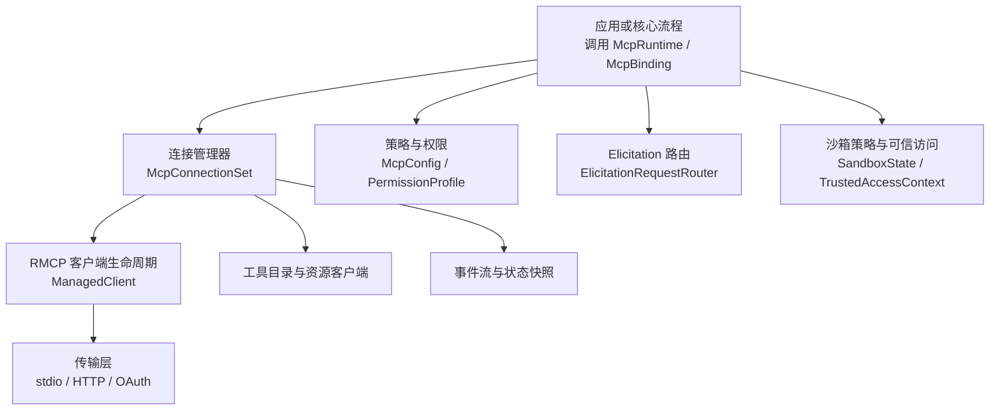
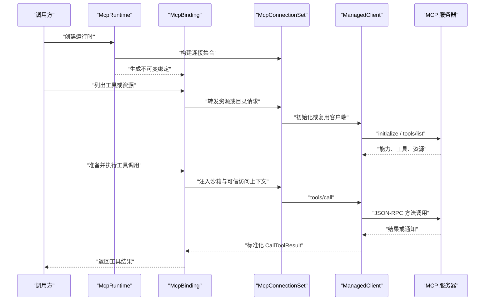
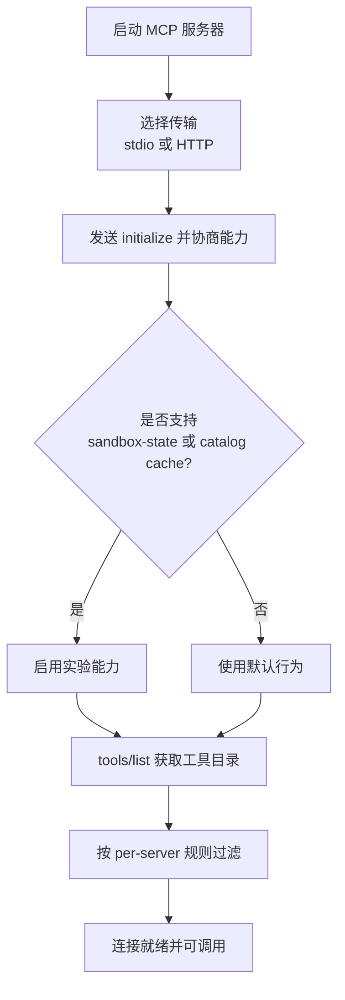
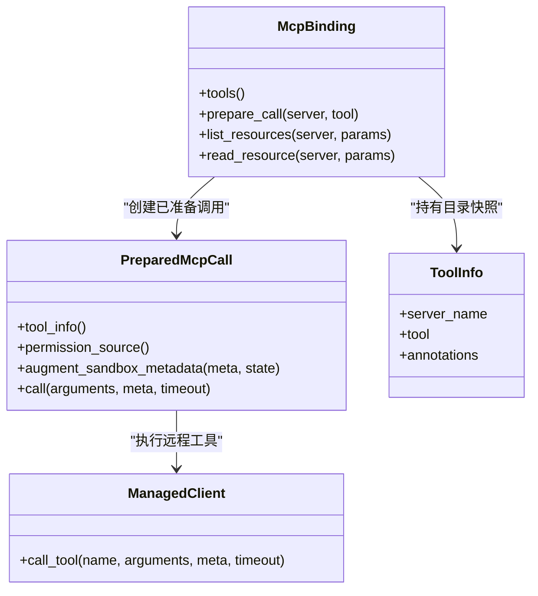
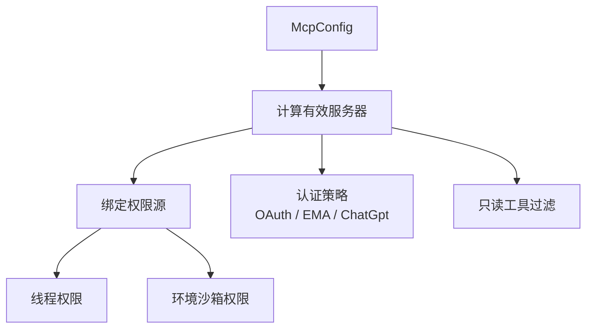
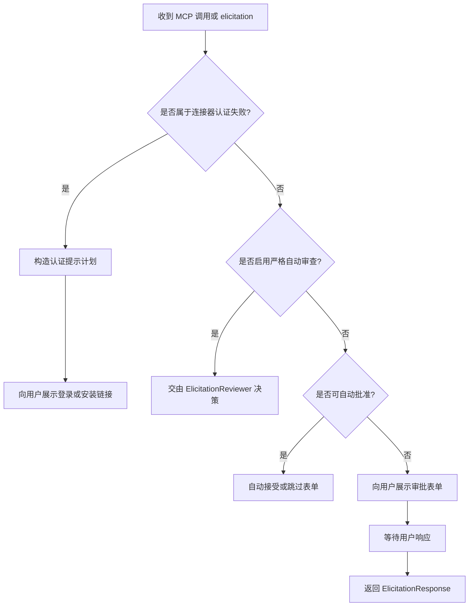
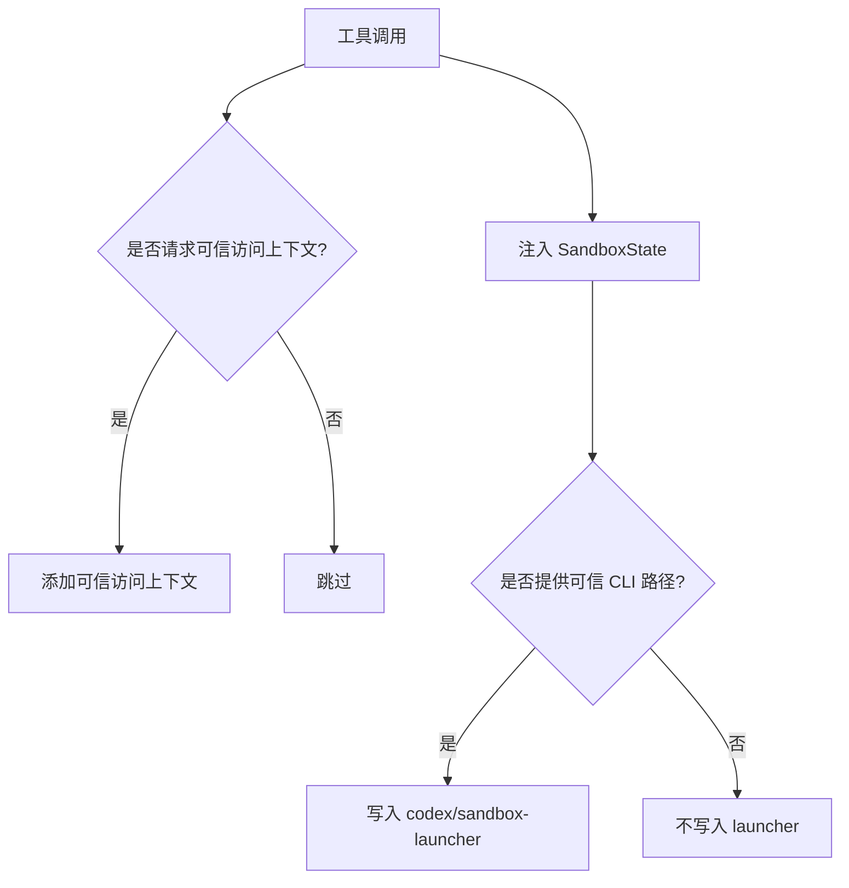
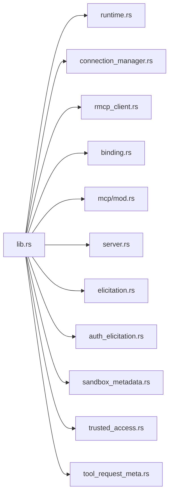

# MCP 协议

<cite>
**本文引用的文件**   
- [codex-rs/codex-mcp/src/lib.rs](file://codex-rs/codex-mcp/src/lib.rs)
- [codex-rs/codex-mcp/README.md](file://codex-rs/codex-mcp/README.md)
- [scripts/mcp_conformance/README.md](file://scripts/mcp_conformance/README.md)
- [codex-rs/codex-mcp/src/runtime.rs](file://codex-rs/codex-mcp/src/runtime.rs)
- [codex-rs/codex-mcp/src/connection_manager.rs](file://codex-rs/codex-mcp/src/connection_manager.rs)
- [codex-rs/codex-mcp/src/rmcp_client.rs](file://codex-rs/codex-mcp/src/rmcp_client.rs)
- [codex-rs/codex-mcp/src/server.rs](file://codex-rs/codex-mcp/src/server.rs)
- [codex-rs/codex-mcp/src/binding.rs](file://codex-rs/codex-mcp/src/binding.rs)
- [codex-rs/codex-mcp/src/mcp/mod.rs](file://codex-rs/codex-mcp/src/mcp/mod.rs)
- [codex-rs/codex-mcp/src/auth_elicitation.rs](file://codex-rs/codex-mcp/src/auth_elicitation.rs)
- [codex-rs/codex-mcp/src/elicitation.rs](file://codex-rs/codex-mcp/src/elicitation.rs)
- [codex-rs/codex-mcp/src/sandbox_metadata.rs](file://codex-rs/codex-mcp/src/sandbox_metadata.rs)
- [codex-rs/codex-mcp/src/tool_request_meta.rs](file://codex-rs/codex-mcp/src/tool_request_meta.rs)
- [codex-rs/codex-mcp/src/trusted_access.rs](file://codex-rs/codex-mcp/src/trusted_access.rs)
</cite>

## 目录
1. [简介](#简介)
2. [项目结构](#项目结构)
3. [核心组件](#核心组件)
4. [架构总览](#架构总览)
5. [详细组件分析](#详细组件分析)
6. [依赖关系分析](#依赖关系分析)
7. [性能与可观测性](#性能与可观测性)
8. [故障排查指南](#故障排查指南)
9. [结论](#结论)
10. [附录：MCP 服务器开发指南](#附录mcp-服务器开发指南)

## 简介
本文件面向在 Codex 中集成和扩展 Model Context Protocol（MCP）的开发者，系统性说明 Codex 如何通过 `codex-mcp` crate 管理 MCP 服务器的发现、能力协商、工具注册与调用、资源访问、审批元数据、权限与安全边界，并给出 MCP 服务器开发与调试建议。

Codex 中的 MCP 集成围绕以下目标展开：
- 将外部 MCP 服务器抽象为模型可见的工具和资源。
- 通过会话级策略、沙箱策略与审计元数据，隔离不同来源的外部执行能力。
- 支持多种传输（stdio、HTTP）、认证（OAuth、EMA、ChatGPT 托管）与协议版本模式。
- 提供一致性测试与回归基线，确保对官方 MCP 客户端合规性的持续验证。

## 项目结构
`codex-mcp` 是 Codex 内部实现 MCP 集成的 Rust crate，其职责包括：
- 运行时生命周期：创建、启动、复用和销毁 MCP 连接。
- 连接聚合：汇总多个 MCP 服务器的工具目录、资源列表和状态。
- 协议适配：使用 RMCP 客户端封装底层 JSON-RPC/MCP 消息。
- 安全策略：绑定权限源、注入沙箱策略与可信访问上下文。
- 用户交互：处理 MCP elicitation 请求与连接器认证提示。
- 配置解析：从全局配置推导有效服务器集合与认证策略。

**图表来源**
- [codex-rs/codex-mcp/src/lib.rs:1-154](file://codex-rs/codex-mcp/src/lib.rs#L1-L154)
- [codex-rs/codex-mcp/src/runtime.rs:1-200](file://codex-rs/codex-mcp/src/runtime.rs#L1-L200)
- [codex-rs/codex-mcp/src/connection_manager.rs:1-200](file://codex-rs/codex-mcp/src/connection_manager.rs#L1-L200)
- [codex-rs/codex-mcp/src/rmcp_client.rs:1-200](file://codex-rs/codex-mcp/src/rmcp_client.rs#L1-L200)

**章节来源**
- [codex-rs/codex-mcp/src/lib.rs:1-154](file://codex-rs/codex-mcp/src/lib.rs#L1-L154)

## 核心组件
- **McpRuntime**：线程级 MCP 运行时入口，负责根据输入构建已发布运行时、管理连接集合、事件流、工具目录缓存、认证上下文和 elicitation 路由器。
- **McpConnectionSet**：聚合所有 MCP 服务器连接，维护启动状态、工具目录、资源清单、网络策略元数据和连接共享。
- **ManagedClient**：单个 RMCP 客户端的生命周期包装器，负责握手、初始化、能力协商、工具列表获取、超时与重试。
- **McpBinding**：不可变绑定，包含模型可见工具目录、已准备调用的缓存以及资源访问代理。
- **PreparedMcpCall**：绑定到具体客户端、目录快照、权限来源和超时的工具调用句柄。
- **EffectiveMcpServer**：结合配置、凭据策略与插件标记后的“有效”服务器描述。
- **McpConfig**：从全局配置派生的运行时设置，决定协议模式、启用策略、权限源、OAuth 存储与审批策略。
- **ElicitationRequestRouter**：路由 MCP elicitation 请求，决定是否自动接受、拒绝、转交人工审查或向用户展示表单。
- **TrustedAccessContext**：为受信任主机插件工具附加可信访问上下文，用于审计与授权信息传递。
- **SandboxState**：以不透明方式传递给 MCP 服务器的沙箱策略对象，并与可选 launcher 元数据分离。

**章节来源**
- [codex-rs/codex-mcp/src/runtime.rs:1-200](file://codex-rs/codex-mcp/src/runtime.rs#L1-L200)
- [codex-rs/codex-mcp/src/connection_manager.rs:1-200](file://codex-rs/codex-mcp/src/connection_manager.rs#L1-L200)
- [codex-rs/codex-mcp/src/rmcp_client.rs:1-200](file://codex-rs/codex-mcp/src/rmcp_client.rs#L1-L200)
- [codex-rs/codex-mcp/src/binding.rs:1-200](file://codex-rs/codex-mcp/src/binding.rs#L1-L200)
- [codex-rs/codex-mcp/src/server.rs:1-200](file://codex-rs/codex-mcp/src/server.rs#L1-L200)
- [codex-rs/codex-mcp/src/mcp/mod.rs:1-200](file://codex-rs/codex-mcp/src/mcp/mod.rs#L1-L200)
- [codex-rs/codex-mcp/src/elicitation.rs:1-200](file://codex-rs/codex-mcp/src/elicitation.rs#L1-L200)
- [codex-rs/codex-mcp/src/trusted_access.rs:1-200](file://codex-rs/codex-mcp/src/trusted_access.rs#L1-L200)
- [codex-rs/codex-mcp/src/sandbox_metadata.rs:1-82](file://codex-rs/codex-mcp/src/sandbox_metadata.rs#L1-L82)

## 架构总览
Codex 的 MCP 集成采用分层设计：
- 顶层暴露 `McpRuntime` 和 `McpBinding`，供核心调度与采样流程使用。
- 中间层由 `McpConnectionSet` 管理连接、目录、资源和事件。
- 底层通过 `rmcp_client` 与 RMCP 库交互，完成传输建立、初始化、工具枚举、调用和错误处理。
- 策略层由 `McpConfig`、权限源和审计元数据共同控制。
- 用户交互层通过 `ElicitationRequestRouter` 与上层事件通道协作。

**图表来源**
- [codex-rs/codex-mcp/src/runtime.rs:1-200](file://codex-rs/codex-mcp/src/runtime.rs#L1-L200)
- [codex-rs/codex-mcp/src/binding.rs:200-537](file://codex-rs/codex-mcp/src/binding.rs#L200-L537)
- [codex-rs/codex-mcp/src/connection_manager.rs:1-200](file://codex-rs/codex-mcp/src/connection_manager.rs#L1-L200)
- [codex-rs/codex-mcp/src/rmcp_client.rs:1-200](file://codex-rs/codex-mcp/src/rmcp_client.rs#L1-L200)

## 详细组件分析

### 服务器发现与能力协商
Codex 在连接启动阶段完成以下工作：
- 根据传输类型选择 stdio 或 HTTP 启动策略。
- 使用 RMCP 客户端发送 `initialize`，协商协议版本、客户端能力与服务端能力。
- 读取服务端能力，决定是否启用 sandbox-state、tool-catalog-cache、network-policy-meta 等实验特性。
- 获取工具列表，并按 per-server 过滤器与模型可见性规则裁剪。
- 对 `codex_apps` 等托管服务器做特殊处理：非阻塞目录刷新、共享启动重试、与 ChatGPT 后端认证绑定。

关键实现要点：
- `ManagedClient` 负责传输构建、初始化、工具列表与超时控制。
- `McpConnectionSet` 聚合多个客户端，并在初始启动失败时保留 legacy fallback。
- `EffectiveMcpServer::can_discover_local_stdio` 限制某些需要会话认证的服务器的本地探测。
- `McpProtocolMode` 支持 legacy、intermediate、modern 三种协议模式，配合 conformance 测试覆盖。

**图表来源**
- [codex-rs/codex-mcp/src/rmcp_client.rs:1-200](file://codex-rs/codex-mcp/src/rmcp_client.rs#L1-L200)
- [codex-rs/codex-mcp/src/connection_manager.rs:1-200](file://codex-rs/codex-mcp/src/connection_manager.rs#L1-L200)
- [codex-rs/codex-mcp/src/server.rs:1-200](file://codex-rs/codex-mcp/src/server.rs#L1-L200)

**章节来源**
- [codex-rs/codex-mcp/src/rmcp_client.rs:1-200](file://codex-rs/codex-mcp/src/rmcp_client.rs#L1-L200)
- [codex-rs/codex-mcp/src/connection_manager.rs:1-200](file://codex-rs/codex-mcp/src/connection_manager.rs#L1-L200)
- [codex-rs/codex-mcp/src/server.rs:1-200](file://codex-rs/codex-mcp/src/server.rs#L1-L200)

### 工具注册机制
工具注册不是静态声明，而是运行时从 MCP 服务器拉取：
- `McpBinding` 持有不可变的工具目录快照，避免并发修改导致的竞争条件。
- `PreparedMcpCall` 将工具名、服务端元数据、目录快照、权限来源与客户端绑定在一起。
- 工具名称可通过前缀规范化为模型可见命名空间；`codex_apps` 工具还会进行规范化与插件归属映射。
- 对于只读工具，可在服务端进行 read-only 过滤与调用检查。

**图表来源**
- [codex-rs/codex-mcp/src/binding.rs:1-200](file://codex-rs/codex-mcp/src/binding.rs#L1-L200)
- [codex-rs/codex-mcp/src/binding.rs:200-537](file://codex-rs/codex-mcp/src/binding.rs#L200-L537)
- [codex-rs/codex-mcp/src/rmcp_client.rs:1-200](file://codex-rs/codex-mcp/src/rmcp_client.rs#L1-L200)

**章节来源**
- [codex-rs/codex-mcp/src/binding.rs:1-200](file://codex-rs/codex-mcp/src/binding.rs#L1-L200)
- [codex-rs/codex-mcp/src/binding.rs:200-537](file://codex-rs/codex-mcp/src/binding.rs#L200-L537)

### MCP 消息格式与协议扩展
Codex 通过 RMCP 客户端处理 MCP 消息，底层仍基于 JSON-RPC 2.0 扩展：
- 方法调用：例如 `tools/call`、`resources/list`、`resources/read`、`tools/list`、`initialize`。
- 通知：例如 `notifications/cancelled`、`notifications/message`、`notifications/logMessage`。
- 能力协商：`clientCapabilities` 与 `serverCapabilities` 控制功能开关。
- Codex 自定义扩展：
  - `codex/network-policy-meta`：在调用中携带网络策略元数据。
  - `codex/tool-catalog-cache`：工具目录缓存能力，默认关闭跨连接共享。
  - `codex/sandbox-state` 与 `codex/sandbox-state-meta`：沙箱策略别名。
  - `codex/sandbox-launcher`：仅对本地 stdio 且具备可验证 CLI 路径的场景提供。

注意：
- Codex 文档强调不应把 `_meta` 中的工具参数视为 authority；authority 来自沙箱策略、权限文件和可信访问上下文。
- Launcher 元数据缺失不代表允许 PATH 搜索或无沙箱回退。

**章节来源**
- [codex-rs/codex-mcp/src/rmcp_client.rs:1-200](file://codex-rs/codex-mcp/src/rmcp_client.rs#L1-L200)
- [codex-rs/codex-mcp/README.md:1-37](file://codex-rs/codex-mcp/README.md#L1-L37)
- [codex-rs/codex-mcp/src/sandbox_metadata.rs:1-82](file://codex-rs/codex-mcp/src/sandbox_metadata.rs#L1-L82)

### MCP 策略控制系统
Codex 将权限分为两层：
- **配置层**：`McpConfig` 决定哪些服务器生效、使用哪种协议模式、OAuth 存储方式、审批策略、是否要求只读工具等。
- **调用层**：`McpPermissionSource` 决定当前调用使用线程权限还是环境沙箱权限。

关键规则：
- 托管 `codex_apps` 服务器使用线程权限。
- 其他服务器若关联环境沙箱，则使用环境的 `PermissionProfile`。
- 本地环境或未明确绑定环境的服务器可能回退到线程权限。
- `effective_mcp_servers_from_configured` 会根据 ChatGPT 托管规则将部分 `ChatGpt` 认证降级为 `OAuth`。
- `has_explicit_http_authorization` 检测 HTTP 头中是否存在显式 Authorization，从而判断凭据策略。

**图表来源**
- [codex-rs/codex-mcp/src/mcp/mod.rs:200-607](file://codex-rs/codex-mcp/src/mcp/mod.rs#L200-L607)
- [codex-rs/codex-mcp/src/server.rs:1-200](file://codex-rs/codex-mcp/src/server.rs#L1-L200)
- [codex-rs/codex-mcp/src/binding.rs:200-537](file://codex-rs/codex-mcp/src/binding.rs#L200-L537)

**章节来源**
- [codex-rs/codex-mcp/src/mcp/mod.rs:200-607](file://codex-rs/codex-mcp/src/mcp/mod.rs#L200-L607)
- [codex-rs/codex-mcp/src/server.rs:1-200](file://codex-rs/codex-mcp/src/server.rs#L1-L200)
- [codex-rs/codex-mcp/src/binding.rs:200-537](file://codex-rs/codex-mcp/src/binding.rs#L200-L537)

### 审批元数据处理流程
MCP 审批涉及三类场景：
1. **MCP 工具调用审批**：由 `AskForApproval`、`PermissionProfile` 与 `AppToolApproval` 共同决定是否需要用户确认。
2. **MCP elicitation 请求**：由 `ElicitationRequestRouter` 决定是否自动接受、拒绝、走严格自动审查、或提交给用户。
3. **连接器认证失败提示**：当 `codex_apps` 连接器返回认证失败时，构造认证提示计划，引导用户完成登录或安装。

流程图如下：

**图表来源**
- [codex-rs/codex-mcp/src/elicitation.rs:1-591](file://codex-rs/codex-mcp/src/elicitation.rs#L1-L591)
- [codex-rs/codex-mcp/src/auth_elicitation.rs:1-200](file://codex-rs/codex-mcp/src/auth_elicitation.rs#L1-L200)
- [codex-rs/codex-mcp/src/mcp/mod.rs:1-200](file://codex-rs/codex-mcp/src/mcp/mod.rs#L1-L200)

**章节来源**
- [codex-rs/codex-mcp/src/elicitation.rs:1-591](file://codex-rs/codex-mcp/src/elicitation.rs#L1-L591)
- [codex-rs/codex-mcp/src/auth_elicitation.rs:1-200](file://codex-rs/codex-mcp/src/auth_elicitation.rs#L1-L200)
- [codex-rs/codex-mcp/src/mcp/mod.rs:1-200](file://codex-rs/codex-mcp/src/mcp/mod.rs#L1-L200)

### 沙箱策略与可信访问
沙箱策略与可信访问是两个互补的安全维度：
- **沙箱策略**：通过 `SandboxState` 以不透明形式传给 MCP 服务器，包含权限文件、工作目录、Linux Landlock 标志、MXC 标志等。Launcher 作为独立元数据存在，仅适用于本地 stdio。
- **可信访问上下文**：在特定条件下为受信任插件工具附加 `openai/entitlementContext`，用于审计和授权证明。

**图表来源**
- [codex-rs/codex-mcp/src/sandbox_metadata.rs:1-82](file://codex-rs/codex-mcp/src/sandbox_metadata.rs#L1-L82)
- [codex-rs/codex-mcp/src/trusted_access.rs:1-200](file://codex-rs/codex-mcp/src/trusted_access.rs#L1-L200)
- [codex-rs/codex-mcp/src/binding.rs:200-537](file://codex-rs/codex-mcp/src/binding.rs#L200-L537)

**章节来源**
- [codex-rs/codex-mcp/src/sandbox_metadata.rs:1-82](file://codex-rs/codex-mcp/src/sandbox_metadata.rs#L1-L82)
- [codex-rs/codex-mcp/src/trusted_access.rs:1-200](file://codex-rs/codex-mcp/src/trusted_access.rs#L1-L200)
- [codex-rs/codex-mcp/src/binding.rs:200-537](file://codex-rs/codex-mcp/src/binding.rs#L200-L537)

## 依赖关系分析
`codex-mcp` 对外暴露大量类型，但内部模块耦合清晰：
- `lib.rs` 集中导出公共 API。
- `runtime.rs` 组合连接、缓存、事件、认证和 elicitation。
- `connection_manager.rs` 管理连接集合与遥测。
- `rmcp_client.rs` 专注 RMCP 客户端生命周期。
- `binding.rs` 提供不可变绑定与工具调用入口。
- `mcp/mod.rs` 解析配置、计算有效服务器、构建快照。
- `server.rs` 定义有效服务器与连接身份。
- `elicitation.rs` 与 `auth_elicitation.rs` 分别处理通用 elicitation 与 `codex_apps` 认证提示。
- `sandbox_metadata.rs` 与 `trusted_access.rs` 提供安全元数据。
- `tool_request_meta.rs` 提供针对特定工具的请求元数据钩子。

**图表来源**
- [codex-rs/codex-mcp/src/lib.rs:1-154](file://codex-rs/codex-mcp/src/lib.rs#L1-L154)

**章节来源**
- [codex-rs/codex-mcp/src/lib.rs:1-154](file://codex-rs/codex-mcp/src/lib.rs#L1-L154)

## 性能与可观测性
- **连接复用**：`reusable_client` 与 `Shared` future 减少重复启动开销。
- **工具目录缓存**：通过 `McpToolCatalogCache` 和可选 `codex/tool-catalog-cache` 能力降低频繁枚举成本。
- **超时控制**：启动超时、工具调用超时与剩余超时计算防止长时间阻塞。
- **指标**：工具列表耗时、未命中缓存的工具获取耗时、`codex.apps.refresh.duration_ms` 等指标便于定位瓶颈。
- **连接数监控**：`LIVE_CONNECTIONS` 暴露当前活跃 MCP 连接数量。

优化建议：
- 对稳定 MCP 服务器启用工具目录缓存。
- 合理设置 `optional_mcp_startup_grace`，避免 Optional 服务器拖慢整体启动。
- 对高频工具调用复用 `PreparedMcpCall`，避免重新准备。
- 使用只读工具与只读过滤减少副作用。

**章节来源**
- [codex-rs/codex-mcp/src/connection_manager.rs:1-200](file://codex-rs/codex-mcp/src/connection_manager.rs#L1-L200)
- [codex-rs/codex-mcp/src/rmcp_client.rs:1-200](file://codex-rs/codex-mcp/src/rmcp_client.rs#L1-L200)
- [codex-rs/codex-mcp/src/binding.rs:200-537](file://codex-rs/codex-mcp/src/binding.rs#L200-L537)

## 故障排查指南
常见问题与定位方式：
- **服务器无法启动**：查看 `StartupOutcomeError`、`McpStartupFailure` 与连接失败原因；必要时检查 `can_discover_local_stdio` 与凭据策略。
- **认证失败**：区分 OAuth、EMA、ChatGpt 托管认证；对 `codex_apps` 连接器失败，使用 `connector_auth_failure_from_tool_result` 提取认证失败元数据。
- **工具调用超时**：检查 server-level `tool_timeout` 与调用层 `requested_timeout` 的最小值。
- **权限被拒绝**：确认 `McpPermissionSource` 使用的是线程权限还是环境沙箱权限，并检查 `PermissionProfile`。
- **Elicitation 未出现**：确认 `client_mcp_extensions` 是否启用相应扩展，以及 `ElicitationRequestRouter` 是否处于开放状态。
- **沙箱策略未生效**：确认服务器是否声明 `codex/sandbox-state` 能力，以及本地 stdio 是否具备可信 CLI 路径。

参考文件：
- 认证与连接器失败处理：[codex-rs/codex-mcp/src/auth_elicitation.rs:1-200](file://codex-rs/codex-mcp/src/auth_elicitation.rs#L1-L200)
- Elicitation 路由与拒绝逻辑：[codex-rs/codex-mcp/src/elicitation.rs:200-591](file://codex-rs/codex-mcp/src/elicitation.rs#L200-L591)
- 沙箱策略与 launcher：[codex-rs/codex-mcp/src/sandbox_metadata.rs:1-82](file://codex-rs/codex-mcp/src/sandbox_metadata.rs#L1-L82)
- 连接与启动错误：[codex-rs/codex-mcp/src/connection_manager.rs:1-200](file://codex-rs/codex-mcp/src/connection_manager.rs#L1-L200)

**章节来源**
- [codex-rs/codex-mcp/src/auth_elicitation.rs:1-200](file://codex-rs/codex-mcp/src/auth_elicitation.rs#L1-L200)
- [codex-rs/codex-mcp/src/elicitation.rs:200-591](file://codex-rs/codex-mcp/src/elicitation.rs#L200-L591)
- [codex-rs/codex-mcp/src/sandbox_metadata.rs:1-82](file://codex-rs/codex-mcp/src/sandbox_metadata.rs#L1-L82)
- [codex-rs/codex-mcp/src/connection_manager.rs:1-200](file://codex-rs/codex-mcp/src/connection_manager.rs#L1-L200)

## 结论
Codex 的 MCP 集成并非简单 JSON-RPC 封装，而是一个包含连接管理、能力协商、工具目录缓存、权限绑定、沙箱策略、可信访问、认证提示与一致性测试的完整子系统。对使用者而言，最重要的原则是：
- 将 MCP 服务器视为受限外部执行能力。
- 通过 `McpConfig` 和 `McpPermissionSource` 控制权限范围。
- 使用 `SandboxState` 与可信访问上下文记录调用上下文。
- 借助 elicitation 机制处理交互式审批与认证。
- 通过 conformance 测试保证协议兼容性与稳定性。

## 附录：MCP 服务器开发指南

### 最佳实践
- **明确能力声明**：如需接收沙箱策略，声明 `codex/sandbox-state`；不要依赖已弃用别名作为唯一入口。
- **正确处理 `_meta`**：只读取 `codex/sandbox-state`、`codex/sandbox-state-meta`、`codex/sandbox-launcher`；保留未知字段，不要反序列化后重建策略。
- **不要假设 launcher 可用**：launcher 缺失时不得回退到 PATH 搜索或无沙箱执行。
- **避免将模型参数当作 authority**：只有策略、权限文件和可信访问上下文代表授权。
- **谨慎使用只读工具**：如果工具无副作用，标注只读提示有助于服务端过滤与安全评估。
- **关注超时与取消**：长任务应支持取消令牌，避免阻塞上游调用链。

### 错误处理建议
- 对认证失败返回结构化错误，并通过 connector metadata 暴露认证原因、链接 ID 和错误动作。
- 对网络或 IO 错误区分瞬时失败与永久失败，以便上层重试或提示用户。
- 对 elicitation 请求返回明确的 `Accept`、`Decline`、`Cancel` 语义，并提供必要元数据。

### 调试技巧
- 使用 conformance 脚本运行官方 MCP 客户端合规测试，验证传输、认证、分页、SSE 帧与 keepalive。
- 查看工具目录缓存命中率与工具列表耗时指标。
- 在本地 stdio 服务器上打印收到的 `_meta`，确认 sandbox-state 与 launcher 是否按预期注入。
- 对 `codex_apps` 连接器失败，检查返回的 `is_auth_failure` 与 `error_action`，确保提示链路可恢复。

**章节来源**
- [codex-rs/codex-mcp/README.md:1-37](file://codex-rs/codex-mcp/README.md#L1-L37)
- [scripts/mcp_conformance/README.md:1-121](file://scripts/mcp_conformance/README.md#L1-L121)
- [codex-rs/codex-mcp/src/auth_elicitation.rs:1-200](file://codex-rs/codex-mcp/src/auth_elicitation.rs#L1-L200)
- [codex-rs/codex-mcp/src/sandbox_metadata.rs:1-82](file://codex-rs/codex-mcp/src/sandbox_metadata.rs#L1-L82)