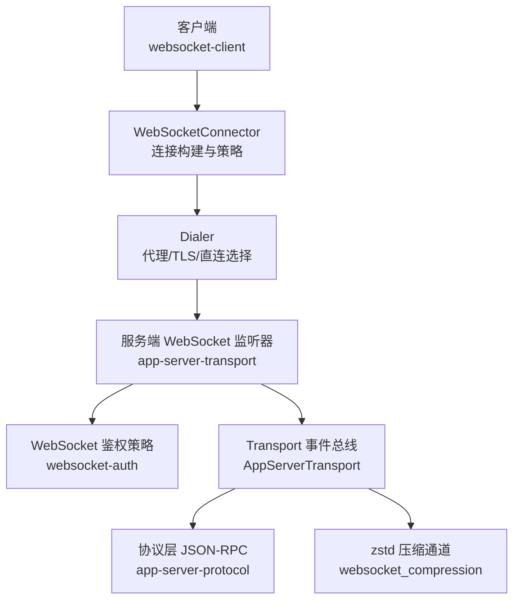
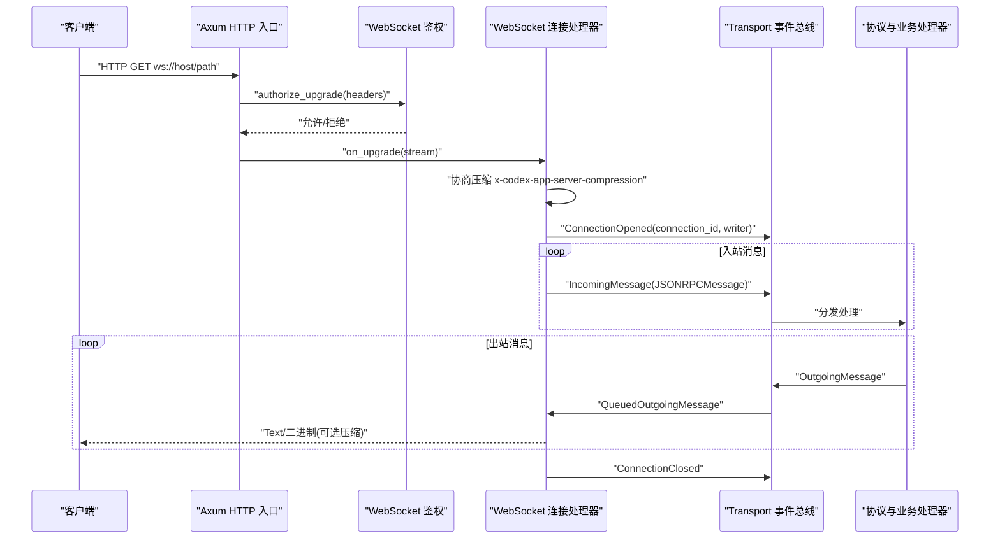
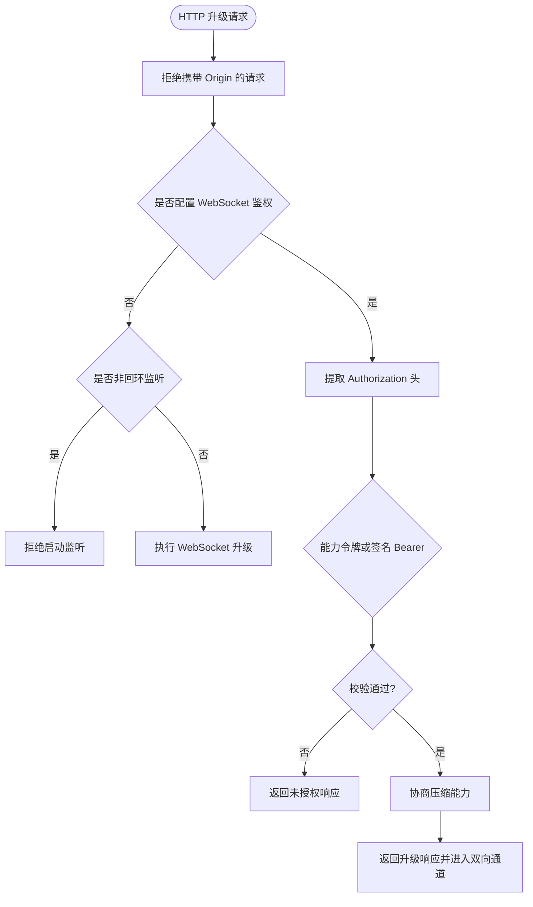
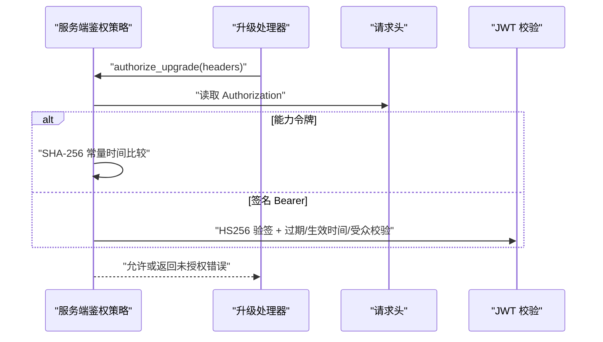
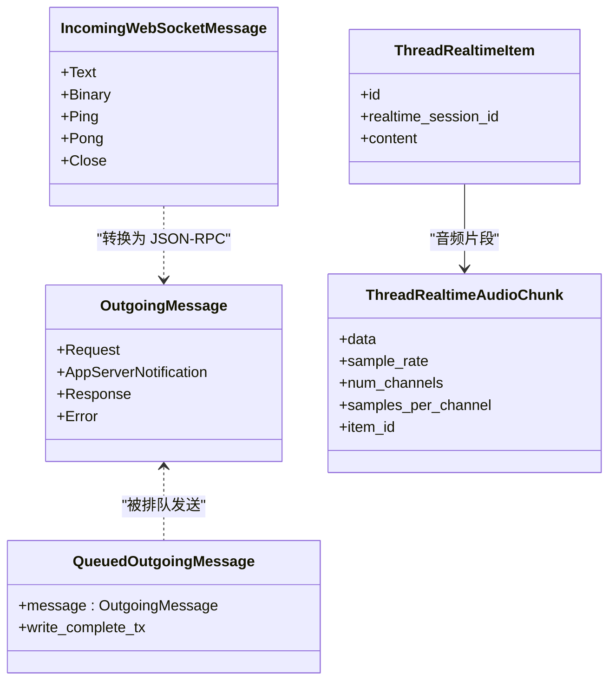
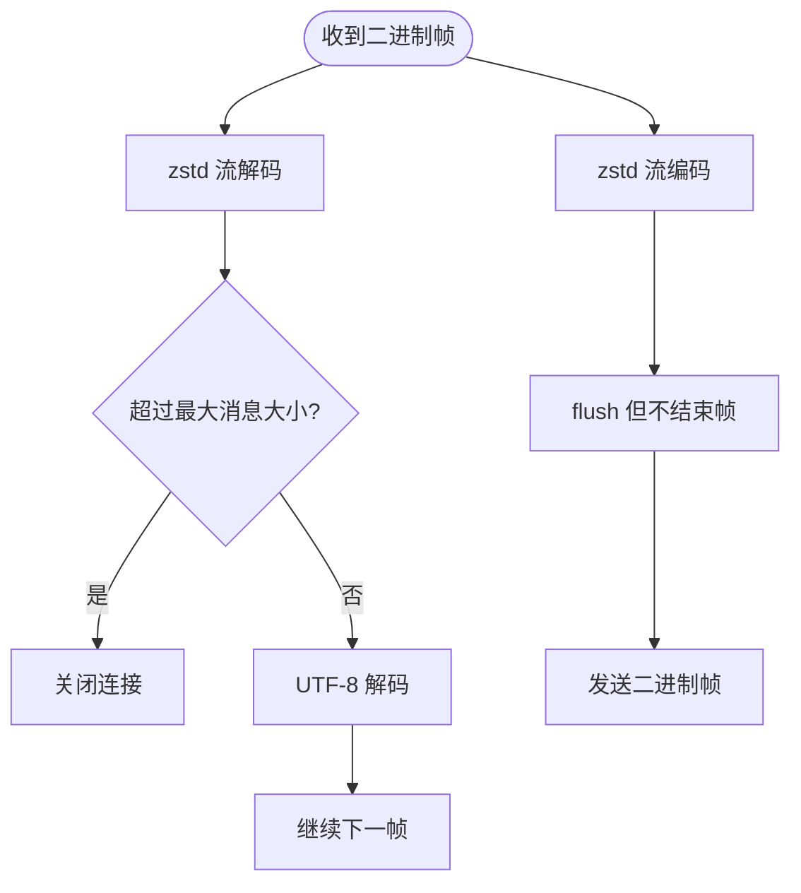
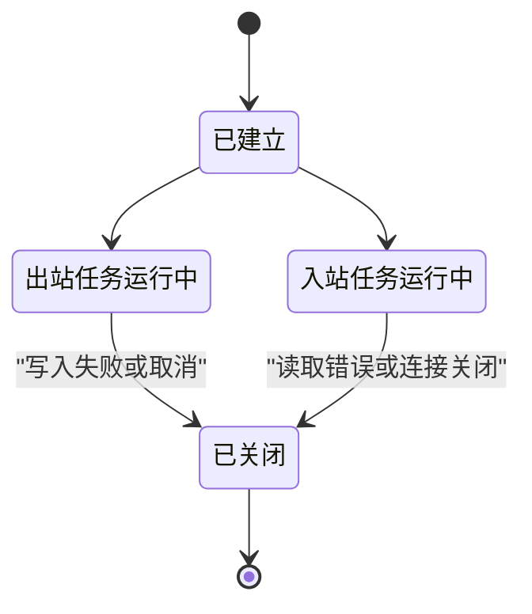
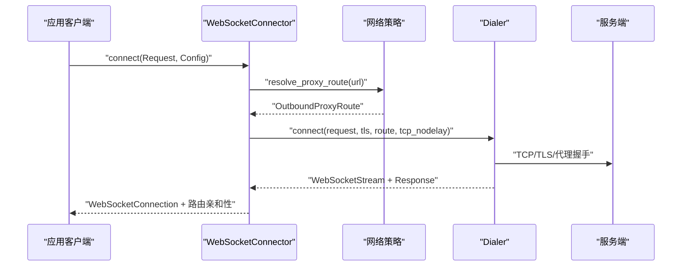
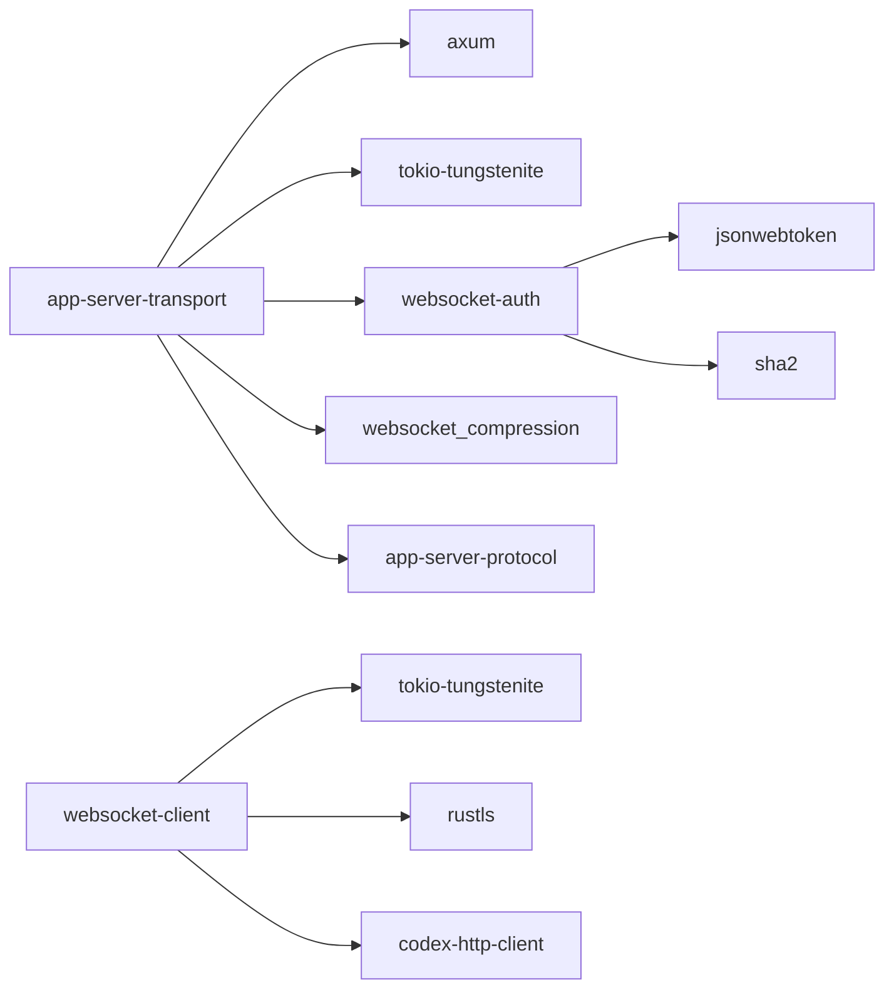
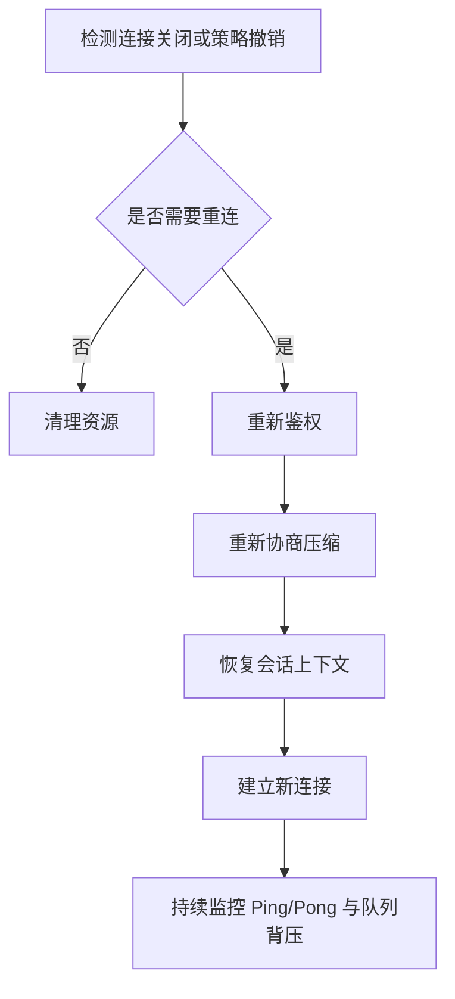

# WebSocket 通信

<cite>
**本文引用的文件**
- [lib.rs](file://codex-rs/app-server-transport/src/lib.rs)
- [mod.rs](file://codex-rs/app-server-transport/src/transport/mod.rs)
- [websocket.rs](file://codex-rs/app-server-transport/src/transport/websocket.rs)
- [connection_auth.rs](file://codex-rs/app-server-transport/src/connection_auth.rs)
- [outgoing_message.rs](file://codex-rs/app-server-transport/src/outgoing_message.rs)
- [websocket_compression.rs](file://codex-rs/app-server-transport/src/websocket_compression.rs)
- [lib.rs](file://codex-rs/websocket-auth/src/lib.rs)
- [lib.rs](file://codex-rs/websocket-client/src/lib.rs)
- [dialer.rs](file://codex-rs/websocket-client/src/dialer.rs)
- [realtime.rs](file://codex-rs/app-server-protocol/src/protocol/v2/realtime.rs)
</cite>

## 目录
1. [引言](#引言)
2. [项目结构](#项目结构)
3. [核心组件](#核心组件)
4. [架构总览](#架构总览)
5. [详细组件分析](#详细组件分析)
6. [依赖关系分析](#依赖关系分析)
7. [性能与压缩特性](#性能与压缩特性)
8. [连接状态、重连与会话恢复](#连接状态重连与会话恢复)
9. [实时功能：流式响应、进度更新与中断](#实时功能流式响应进度更新与中断)
10. [连接池、负载均衡与故障转移](#连接池负载均衡与故障转移)
11. [调试工具与性能分析方法](#调试工具与性能分析方法)
12. [结论](#结论)

## 引言
本文面向 Codex 仓库中基于 WebSocket 的实时通信子系统，系统性说明服务端与客户端的连接建立过程、握手协议、身份验证、能力协商、消息格式、压缩传输、连接状态管理、重连机制、断线检测、会话恢复、流式响应与中断处理，以及连接池、负载均衡、故障转移和调试方法。文档以代码仓库中的 `app-server-transport`、`websocket-auth`、`websocket-client` 和 `app-server-protocol` 等模块为依据，尽量用图示和路径引用代替直接粘贴源码，使非专业读者也能理解整体设计。

## 项目结构
WebSocket 相关实现分布在多个 crate 中，职责清晰分层：
- `app-server-transport`：服务端的 WebSocket 监听、握手、鉴权集成、消息编解码、出站队列、压缩与事件总线。
- `websocket-auth`：WebSocket 升级阶段的通用鉴权策略（能力令牌或签名 Bearer JWT）。
- `websocket-client`：客户端侧代理感知、TLS、Cookie、网络策略、直连回环与路由亲和性封装。
- `app-server-protocol`：JSON-RPC 消息模型、实时会话数据结构与类型映射。

**图表来源**
- [lib.rs:1-54](file://codex-rs/app-server-transport/src/lib.rs#L1-L54)
- [websocket.rs:1-200](file://codex-rs/app-server-transport/src/transport/websocket.rs#L1-L200)
- [lib.rs:1-200](file://codex-rs/websocket-auth/src/lib.rs#L1-L200)
- [lib.rs:1-200](file://codex-rs/websocket-client/src/lib.rs#L1-L200)
- [dialer.rs:1-200](file://codex-rs/websocket-client/src/dialer.rs#L1-L200)

**章节来源**
- [lib.rs:1-54](file://codex-rs/app-server-transport/src/lib.rs#L1-L54)
- [mod.rs:1-200](file://codex-rs/app-server-transport/src/transport/mod.rs#L1-L200)
- [websocket.rs:1-200](file://codex-rs/app-server-transport/src/transport/websocket.rs#L1-L200)
- [lib.rs:1-200](file://codex-rs/websocket-auth/src/lib.rs#L1-L200)
- [lib.rs:1-200](file://codex-rs/websocket-client/src/lib.rs#L1-L200)
- [dialer.rs:1-200](file://codex-rs/websocket-client/src/dialer.rs#L1-L200)

## 核心组件
- WebSocket 监听器：绑定地址、健康检查、拒绝携带 Origin 的请求、能力协商、启动 Axum Router。
- 连接生命周期：入站/出站任务拆分、Ping/Pong、断开取消令牌、出站队列背压。
- 鉴权策略：能力令牌 SHA-256 比较、签名 Bearer JWT 校验、不可信非本地监听保护。
- 消息序列化：统一 `OutgoingMessage` 枚举，JSON-RPC Request/Notification/Response/Error。
- 压缩通道：zstd-stream-v1 双向独立持久流、单帧不结束、按连接统计带宽。
- 客户端连接器：代理路由解析、Cookie 复用、网络策略许可、路由亲和性、回环直连。

**章节来源**
- [websocket.rs:1-200](file://codex-rs/app-server-transport/src/transport/websocket.rs#L1-L200)
- [websocket.rs:201-482](file://codex-rs/app-server-transport/src/transport/websocket.rs#L201-L482)
- [lib.rs:1-200](file://codex-rs/websocket-auth/src/lib.rs#L1-L200)
- [websocket_compression.rs:1-200](file://codex-rs/app-server-transport/src/websocket_compression.rs#L1-L200)
- [lib.rs:1-200](file://codex-rs/websocket-client/src/lib.rs#L1-L200)

## 架构总览
WebSocket 通信在应用服务器中以 Axum 作为 HTTP 入口，对 `/readyz`、`/healthz` 暴露健康端点，其余路径作为 WebSocket 升级入口。升级前执行鉴权；升级后启用可选 zstd 压缩；随后通过 Transport 事件总线将入站消息转发到上层业务处理器，并将出站消息写入独立 writer 任务。

**图表来源**
- [websocket.rs:1-200](file://codex-rs/app-server-transport/src/transport/websocket.rs#L1-L200)
- [websocket.rs:201-482](file://codex-rs/app-server-transport/src/transport/websocket.rs#L201-L482)
- [mod.rs:1-200](file://codex-rs/app-server-transport/src/transport/mod.rs#L1-L200)

## 详细组件分析

### 握手协议与能力协商
- HTTP 升级入口由 Axum 提供，健康端点返回成功状态码，其他路径走 WebSocket 升级。
- 鉴权在升级前完成：从请求头提取 `Authorization`，支持两种模式：
  - 能力令牌：服务端存储令牌的 SHA-256，使用常量时间比较防止时序攻击。
  - 签名 Bearer JWT：HS256 验签，可配置签发者、受众、最大时钟偏差。
- 非回环监听且未配置鉴权时，直接拒绝启动，避免无认证暴露风险。
- 能力协商通过自定义头部 `x-codex-app-server-compression` 完成：
  - 若客户端和服务端都声明 `zstd-stream-v1`，则后续消息以二进制帧承载 zstd 流；否则保持纯文本 JSON。
  - 每次重连重新建立压缩流，不跨连接复用 zstd 上下文。

**图表来源**
- [websocket.rs:1-200](file://codex-rs/app-server-transport/src/transport/websocket.rs#L1-L200)
- [lib.rs:200-479](file://codex-rs/websocket-auth/src/lib.rs#L200-L479)
- [websocket_compression.rs:1-200](file://codex-rs/app-server-transport/src/websocket_compression.rs#L1-L200)

**章节来源**
- [websocket.rs:1-200](file://codex-rs/app-server-transport/src/transport/websocket.rs#L1-L200)
- [lib.rs:200-479](file://codex-rs/websocket-auth/src/lib.rs#L200-L479)
- [websocket_compression.rs:1-200](file://codex-rs/app-server-transport/src/websocket_compression.rs#L1-L200)

### 身份验证流程
- 服务端加载配置后生成 `WebsocketAuthPolicy`，可选择能力令牌或签名 Bearer 模式。
- 升级阶段调用 `authorize_upgrade`，失败返回 HTTP 未授权响应。
- 能力令牌模式读取文件或十六进制 SHA-256，并使用常量时间相等比较。
- 签名 Bearer 模式仅做 HS256 解签与必要的时间与受众校验；注意该鉴权只针对升级阶段，不主动续期或吊销已建立连接。

**图表来源**
- [lib.rs:200-479](file://codex-rs/websocket-auth/src/lib.rs#L200-L479)
- [websocket.rs:1-200](file://codex-rs/app-server-transport/src/transport/websocket.rs#L1-L200)

**章节来源**
- [lib.rs:200-479](file://codex-rs/websocket-auth/src/lib.rs#L200-L479)
- [websocket.rs:1-200](file://codex-rs/app-server-transport/src/transport/websocket.rs#L1-L200)

### 实时消息格式与数据序列化
- 所有 WebSocket 消息均基于 JSON-RPC 消息模型，包括请求、通知、响应与错误。
- 出站消息统一封装为 `OutgoingMessage`，包含业务请求、应用服务器通知、响应与错误四类。
- 入站消息经 Transport 转换为 `IncomingMessage`，再交由上层处理逻辑进行 JSON-RPC 解析与分发。
- 实时会话领域类型集中在 `ThreadRealtimeItem`、`ThreadRealtimeAudioChunk` 等结构中，用于表达语音转写、会话开始/结束、以及将现有 agent 项嵌入实时对话。

**图表来源**
- [outgoing_message.rs:1-59](file://codex-rs/app-server-transport/src/outgoing_message.rs#L1-L59)
- [websocket.rs:201-482](file://codex-rs/app-server-transport/src/transport/websocket.rs#L201-L482)
- [realtime.rs:1-200](file://codex-rs/app-server-protocol/src/protocol/v2/realtime.rs#L1-L200)

**章节来源**
- [outgoing_message.rs:1-59](file://codex-rs/app-server-transport/src/outgoing_message.rs#L1-L59)
- [websocket.rs:201-482](file://codex-rs/app-server-transport/src/transport/websocket.rs#L201-L482)
- [realtime.rs:1-200](file://codex-rs/app-server-protocol/src/protocol/v2/realtime.rs#L1-L200)

### 压缩传输实现
- 压缩协议标识为 `zstd-stream-v1`，通过自定义头部协商。
- 每个方向维护独立的 zstd 编码器/解码器，消息之间不结束帧，仅在每帧末尾 flush。
- 解码侧限制单条解压后的最大消息大小，超限立即关闭连接。
- 压缩统计按连接 ID 和方向记录未压缩字节数、压缩字节数和消息数，周期性上报。

**图表来源**
- [websocket_compression.rs:1-200](file://codex-rs/app-server-transport/src/websocket_compression.rs#L1-L200)
- [websocket.rs:201-482](file://codex-rs/app-server-transport/src/transport/websocket.rs#L201-L482)

**章节来源**
- [websocket_compression.rs:1-200](file://codex-rs/app-server-transport/src/websocket_compression.rs#L1-L200)
- [websocket.rs:201-482](file://codex-rs/app-server-transport/src/transport/websocket.rs#L201-L482)

### 连接状态管理与断线检测
- 连接建立后分配唯一 `ConnectionId`，并通过 Transport 事件总线报告 `ConnectionOpened`。
- 入站/出站分别运行独立异步任务，任一任务退出即取消另一个任务，最终报告 `ConnectionClosed`。
- Ping/Pong 控制消息：服务端收到 Ping 后立即回复 Pong；若控制队列满或下游关闭，则关闭连接。
- 出站队列采用有界 channel，容量远大于内部消息通道，以容纳短时突发输出。

**图表来源**
- [websocket.rs:201-482](file://codex-rs/app-server-transport/src/transport/websocket.rs#L201-L482)

**章节来源**
- [websocket.rs:201-482](file://codex-rs/app-server-transport/src/transport/websocket.rs#L201-L482)

### 客户端连接构建与代理处理
- 客户端通过 `WebSocketConnector` 封装 TLS、代理、网络策略与 Cookie。
- 自动注入 ChatGPT Cookie，以便复用基础设施凭证；握手成功后还会保存响应 Cookie。
- 根据目标 URL 与网络策略决定直连、默认代理或显式代理路径；Windows 下对 407 代理认证重试。
- 支持回环直连，绕过代理设置，但仍需满足应用级目的地策略。
- 连接对象实现 Stream/Sink，并在策略撤销时优雅终止读写。

**图表来源**
- [lib.rs:1-200](file://codex-rs/websocket-client/src/lib.rs#L1-L200)
- [dialer.rs:1-200](file://codex-rs/websocket-client/src/dialer.rs#L1-L200)

**章节来源**
- [lib.rs:1-200](file://codex-rs/websocket-client/src/lib.rs#L1-L200)
- [lib.rs:200-397](file://codex-rs/websocket-client/src/lib.rs#L200-L397)
- [dialer.rs:1-200](file://codex-rs/websocket-client/src/dialer.rs#L1-L200)

## 依赖关系分析
- `app-server-transport` 依赖 `axum` 提供 HTTP 与 WebSocket 支持，依赖 `tokio-tungstenite` 处理底层流，依赖 `websocket-auth` 进行升级鉴权，依赖 `websocket_compression` 进行 zstd 流压缩。
- `websocket-auth` 依赖 `jsonwebtoken`、`sha2`、`http`、`clap` 等库处理 JWT 与命令行参数。
- `websocket-client` 依赖 `tokio-tungstenite`、`rustls`、`codex-http-client` 完成代理、TLS、网络策略与 Cookie 管理。
- 协议类型由 `app-server-protocol` 提供，保证服务端与客户端共享一致的 JSON-RPC 与实时会话模型。

**图表来源**
- [lib.rs:1-54](file://codex-rs/app-server-transport/src/lib.rs#L1-L54)
- [lib.rs:1-200](file://codex-rs/websocket-auth/src/lib.rs#L1-L200)
- [lib.rs:1-200](file://codex-rs/websocket-client/src/lib.rs#L1-L200)

**章节来源**
- [lib.rs:1-54](file://codex-rs/app-server-transport/src/lib.rs#L1-L54)
- [lib.rs:1-200](file://codex-rs/websocket-auth/src/lib.rs#L1-L200)
- [lib.rs:1-200](file://codex-rs/websocket-client/src/lib.rs#L1-L200)

## 性能与压缩特性
- 出站队列容量设置为较大的固定值，以缓冲短时突发输出，降低丢包概率。
- 压缩级别、窗口日志与缓冲区大小在压缩模块中明确配置，避免频繁 GC 与过大内存占用。
- 解压侧限制单条消息最大尺寸，防止恶意或异常压缩数据导致内存膨胀。
- 压缩统计周期上报，便于监控压缩率与吞吐。
- 客户端支持禁用 Nagle 算法以降低延迟，适用于低延迟交互场景。

[本节为通用性能建议与实现特征总结，无需具体文件分析]

## 连接状态、重连与会话恢复
- 当前实现中，WebSocket 连接的生命周期由入站/出站任务共同管理，任一端失败即关闭连接并上报 `ConnectionClosed`。
- 重连逻辑应由上层客户端驱动：当检测到连接关闭或策略撤销时，根据业务需求发起重连。
- 会话恢复方面，实时会话领域存在会话 ID 与会话结果字段，适合在上层持久化会话元信息，并在重连后恢复会话上下文。
- 认证变化可通过 `ConnectionAuth` 观察，若所有者代际变化，应中断或重建受影响的连接。

**图表来源**
- [websocket.rs:201-482](file://codex-rs/app-server-transport/src/transport/websocket.rs#L201-L482)
- [connection_auth.rs:1-51](file://codex-rs/app-server-transport/src/connection_auth.rs#L1-L51)
- [realtime.rs:1-200](file://codex-rs/app-server-protocol/src/protocol/v2/realtime.rs#L1-L200)

**章节来源**
- [websocket.rs:201-482](file://codex-rs/app-server-transport/src/transport/websocket.rs#L201-L482)
- [connection_auth.rs:1-51](file://codex-rs/app-server-transport/src/connection_auth.rs#L1-L51)
- [realtime.rs:1-200](file://codex-rs/app-server-protocol/src/protocol/v2/realtime.rs#L1-L200)

## 实时功能：流式响应、进度更新与中断
- 流式响应通过逐条推送 JSON-RPC 通知或请求实现，出站队列负责有序发送。
- 进度更新可由业务层定义具体的通知类型，并通过 `ServerNotificationEnvelope` 推送到客户端。
- 中断处理可通过连接取消令牌与上层业务取消上下文协作实现；当用户中断时，停止继续生产消息并尽快结束会话。
- 实时会话语义如会话开始、转写片段、会话结束等由 `ThreadRealtimeItemContent` 描述，可用于展示语音交互进度与结果。

**章节来源**
- [outgoing_message.rs:1-59](file://codex-rs/app-server-transport/src/outgoing_message.rs#L1-L59)
- [websocket.rs:201-482](file://codex-rs/app-server-transport/src/transport/websocket.rs#L201-L482)
- [realtime.rs:1-200](file://codex-rs/app-server-protocol/src/protocol/v2/realtime.rs#L1-L200)

## 连接池、负载均衡与故障转移
- 仓库未提供内置 WebSocket 连接池或负载均衡器。连接通常按需创建，由上层业务决定是否复用。
- 路由亲和性在客户端握手响应中捕获，便于多实例部署时将同一会话定向到稳定后端。
- 故障转移应由上层重试策略实现：检测到连接失败或鉴权失效时切换到备用节点。
- 对于代理与多出口场景，客户端可根据网络策略动态选择直连或代理路径，提高可用性。

[本节为架构层面的指导与建议，不涉及具体代码实现]

## 调试工具与性能分析方法
- 健康检查：通过 HTTP GET `/readyz` 与 `/healthz` 快速判断服务可用。
- 日志追踪：使用 tracing 记录连接建立、鉴权失败、压缩错误、接收错误与关闭事件。
- 压缩统计：通过压缩模块的周期性统计观察压缩率、未压缩/压缩字节数与消息数。
- 带宽监控：结合出站队列长度、消息序列化耗时与压缩编码耗时评估吞吐瓶颈。
- 延迟测量：在关键路径上记录时间戳，例如入站解析、业务处理、出站序列化与发送完成。
- 客户端调试：借助 `WebSocketConnection` 的策略撤销与路由亲和性，排查网络策略与代理问题。

**章节来源**
- [websocket.rs:1-200](file://codex-rs/app-server-transport/src/transport/websocket.rs#L1-L200)
- [websocket_compression.rs:1-200](file://codex-rs/app-server-transport/src/websocket_compression.rs#L1-L200)
- [lib.rs:200-397](file://codex-rs/websocket-client/src/lib.rs#L200-L397)

## 结论
Codex 的 WebSocket 实时通信体系围绕安全升级、能力协商、结构化 JSON-RPC 消息与 zstd 流压缩展开。服务端通过 Axum 提供稳定的接入面，结合鉴权策略与健康检查保障安全性与可观测性；客户端侧则通过代理感知、TLS、网络策略与 Cookie 复用提升可靠性与易用性。连接生命周期管理、出站队列与 Ping/Pong 提供了基础稳定性，而实时会话模型为语音与交互流式体验奠定基础。对于高可用与大规模部署，建议在应用层实现连接池、负载均衡与故障转移，并结合日志、压缩统计与延迟测量进行持续优化。