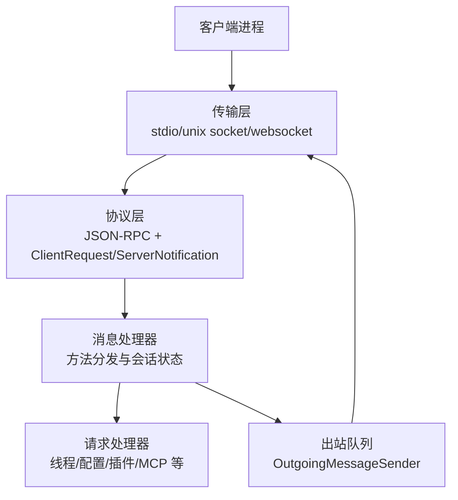
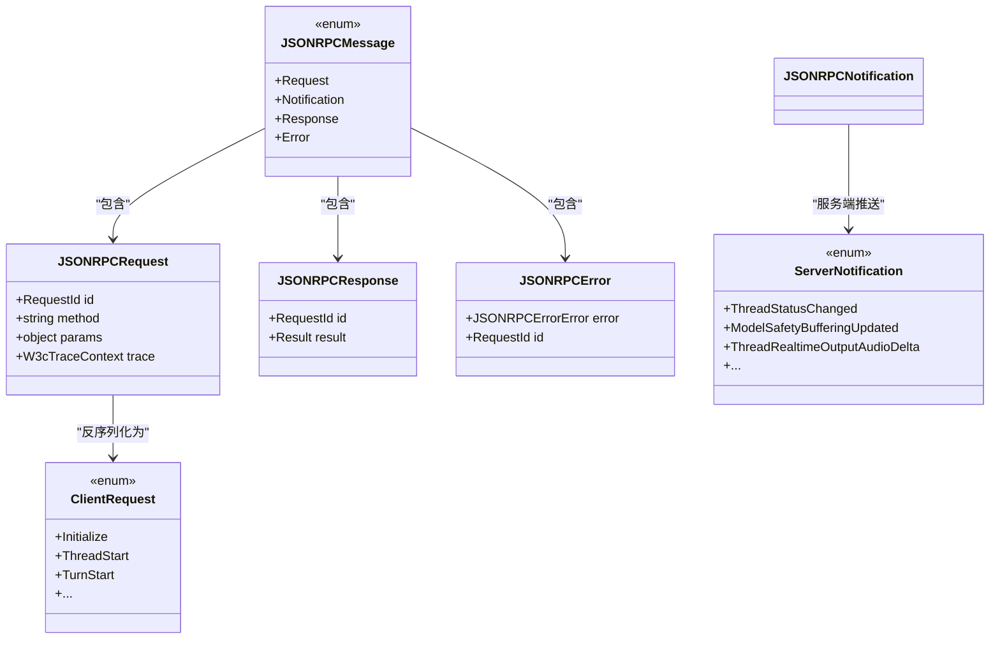
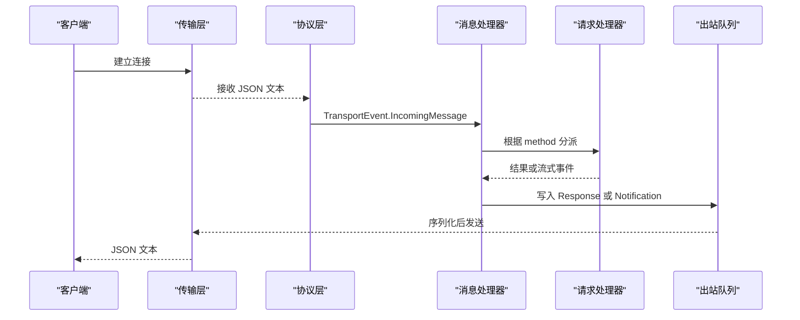
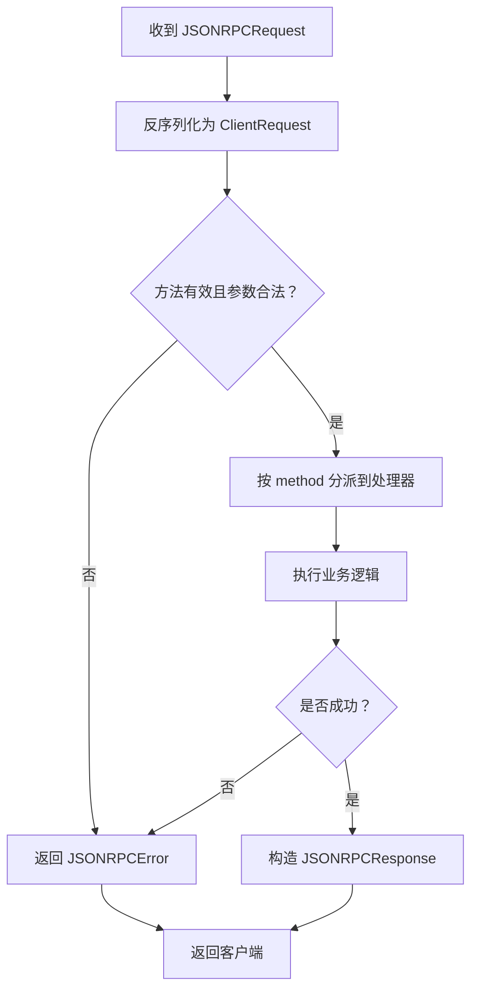
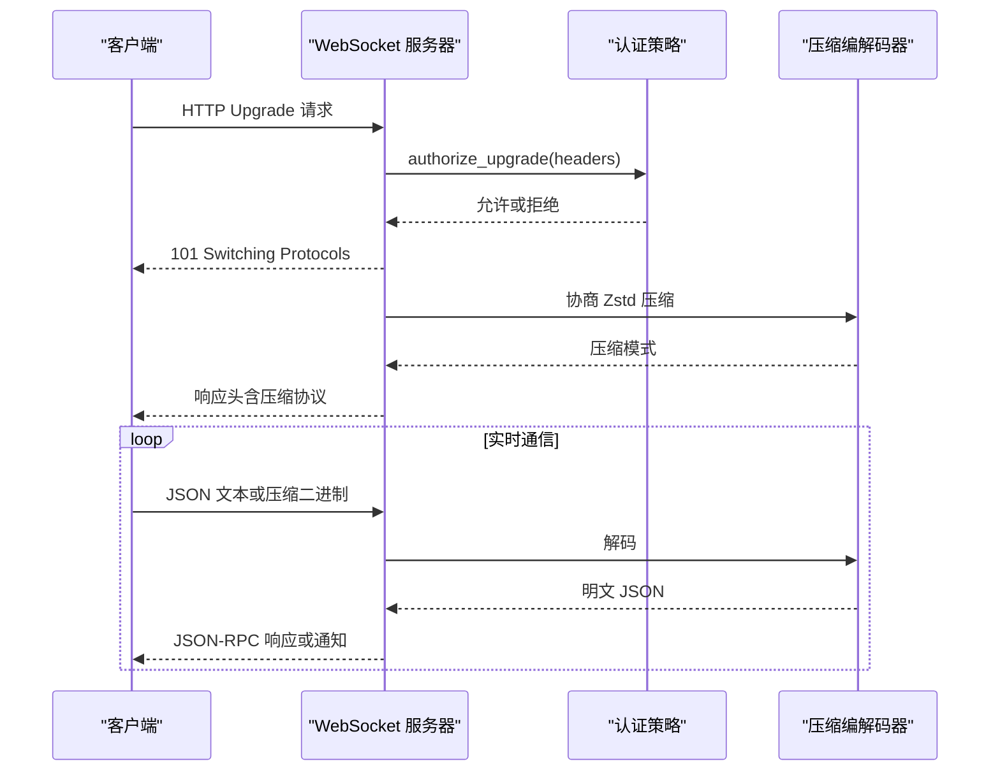
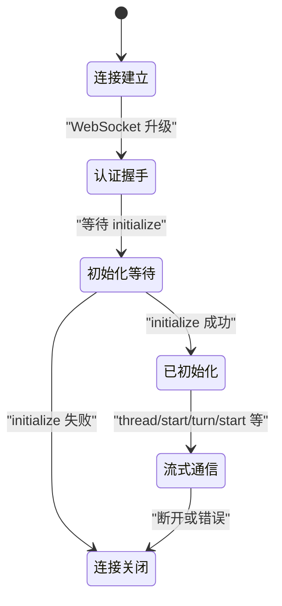
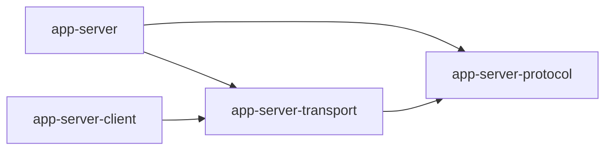
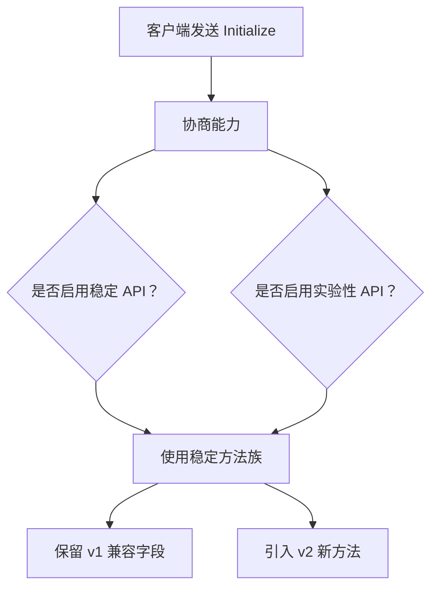
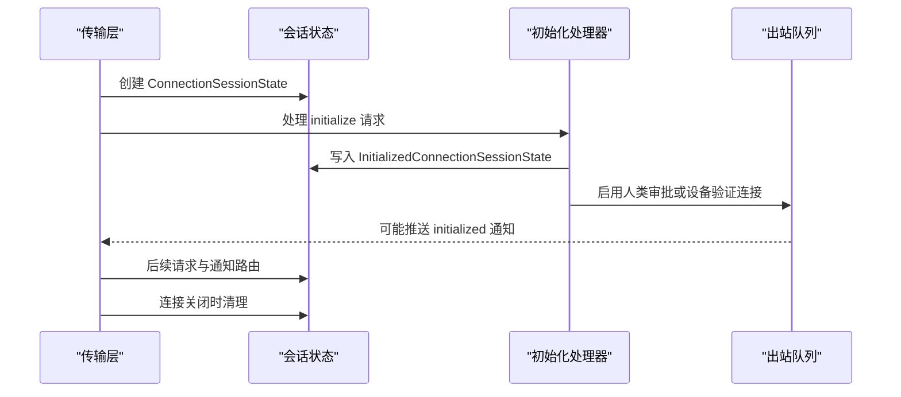

# 内部协议

<cite>
**本文引用的文件**   
- [app-server-protocol/src/lib.rs](file://codex-rs/app-server-protocol/src/lib.rs)
- [app-server-protocol/src/rpc.rs](file://codex-rs/app-server-protocol/src/rpc.rs)
- [app-server-protocol/src/protocol/mod.rs](file://codex-rs/app-server-protocol/src/protocol/mod.rs)
- [app-server-protocol/src/protocol/common.rs](file://codex-rs/app-server-protocol/src/protocol/common.rs)
- [app-server-protocol/src/protocol/v1.rs](file://codex-rs/app-server-protocol/src/protocol/v1.rs)
- [app-server-protocol/src/protocol/v2/mod.rs](file://codex-rs/app-server-protocol/src/protocol/v2/mod.rs)
- [app-server-transport/src/lib.rs](file://codex-rs/app-server-transport/src/lib.rs)
- [app-server-transport/src/transport/mod.rs](file://codex-rs/app-server-transport/src/transport/mod.rs)
- [app-server-transport/src/transport/websocket.rs](file://codex-rs/app-server-transport/src/transport/websocket.rs)
- [app-server-client/src/remote_websocket.rs](file://codex-rs/app-server-client/src/remote_websocket.rs)
- [app-server-client/src/cloud.rs](file://codex-rs/app-server-client/src/cloud.rs)
- [app-server/src/transport.rs](file://codex-rs/app-server/src/transport.rs)
- [app-server/src/message_processor.rs](file://codex-rs/app-server/src/message_processor.rs)
- [app-server/src/request_processors/initialize_processor.rs](file://codex-rs/app-server/src/request_processors/initialize_processor.rs)
</cite>

## 目录
1. [简介](#简介)
2. [项目结构](#项目结构)
3. [核心组件](#核心组件)
4. [架构总览](#架构总览)
5. [详细组件分析](#详细组件分析)
6. [依赖关系分析](#依赖关系分析)
7. [性能与容量特性](#性能与容量特性)
8. [协议版本与兼容性](#协议版本与兼容性)
9. [连接生命周期](#连接生命周期)
10. [错误处理](#错误处理)
11. [调试与诊断工具](#调试与诊断工具)
12. [结论](#结论)

## 简介
本文档面向内部开发者，系统性说明 App Server 与客户端之间的进程间通信协议。该协议以 JSON-RPC 2.0 为思想基础，但不要求标准字段；消息通过 stdin/stdout、Unix Socket 或 WebSocket 传输。重点包括：
- gRPC 接口定义：本仓库未实现 gRPC 接口；App Server 的对外 RPC 基于 JSON-RPC 风格的消息，而非 gRPC。
- WebSocket 实时通信协议：WebSocket 仅作为传输层，承载 JSON-RPC 请求、响应和通知；服务端提供健康检查端点 `/readyz` 与 `/healthz`，并支持可选 Zstd 压缩协商。
- App Server 与客户端的 RPC 规范：统一的 `ClientRequest` / `ServerNotification` / `JSONRPCMessage` 模型，包含请求-响应模式、流式事件、过载保护、序列化作用域、实验性功能开关等。
- 版本管理策略：协议类型分为 v1 与 v2，v1 用于初始化参数与兼容响应，v2 承载当前业务方法族；通过能力协商、实验性标记和向后兼容宏生成机制保证演进。
- 连接生命周期：连接建立、认证握手、初始化握手、心跳保活（由上层应用自行决定）、断开清理与远程管控。
- 调试与监控：服务端诊断、遥测、OTel Trace Context、WebSocket 压缩头、过载错误码、序列化/反序列化测试夹具。

## 项目结构
协议相关代码主要分布在以下 Rust crate 中：
- `codex-app-server-protocol`：协议类型、JSON-RPC 包装、ClientRequest/ServerNotification 枚举生成、v1/v2 数据模型、导出与 TypeScript 类型生成。
- `codex-app-server-transport`：传输抽象，支持 stdio、Unix Socket、WebSocket；负责接收/发送 JSON-RPC 消息、过载保护、连接 ID、压缩协商。
- `codex-app-server-client`：客户端侧封装，包括远程 WebSocket 握手与压缩解码、云后端通道。
- `app-server`：App Server 主逻辑，负责路由 JSON-RPC 到具体处理器、维护连接状态、过滤通知、执行线程与会话生命周期。

**图示来源**
- [app-server-transport/src/transport/mod.rs:1-120](file://codex-rs/app-server-transport/src/transport/mod.rs#L1-L120)
- [app-server-protocol/src/protocol/common.rs:520-700](file://codex-rs/app-server-protocol/src/protocol/common.rs#L520-L700)
- [app-server/src/message_processor.rs:1-120](file://codex-rs/app-server/src/message_processor.rs#L1-L120)

**章节来源**
- [app-server-protocol/src/lib.rs:1-72](file://codex-rs/app-server-protocol/src/lib.rs#L1-L72)
- [app-server-transport/src/lib.rs:1-54](file://codex-rs/app-server-transport/src/lib.rs#L1-L54)

## 核心组件
本节聚焦协议与传输的核心数据结构与职责边界。

### JSON-RPC 消息包装
协议不强制使用标准 `jsonrpc` 字段，而是定义通用消息类型：
- `JSONRPCMessage`：统一入口，可表示请求、通知、成功响应或错误响应。
- `JSONRPCRequest`：携带 `id`、`method`、可选 `params`、可选 W3C Trace Context。
- `JSONRPCResponse`：携带 `id` 与 `result`。
- `JSONRPCError`：携带错误对象，包含 `code`、`message`、可选 `data`。

这些类型是跨传输层的契约，所有请求与响应最终都会序列化为 JSON 文本在传输通道上传输。

**章节来源**
- [app-server-protocol/src/rpc.rs:1-88](file://codex-rs/app-server-protocol/src/rpc.rs#L1-L88)

### 客户端请求与服务端通知
协议通过宏生成两大枚举：
- `ClientRequest`：客户端发起的请求，每个变体对应一个 `method` 字符串、一组参数类型和返回类型。
- `ServerNotification`：服务端主动推送的事件，例如线程状态变更、模型缓冲更新、实时音频增量、目标更新等。

此外还生成：
- `ClientResponse`：带 `id` 和 typed response 的响应包装。
- `ClientResponsePayload`：响应载荷枚举，便于转换回 JSON-RPC result。
- `ServerNotificationEnvelope`：通知信封，包含时间戳等元数据。

**图示来源**
- [app-server-protocol/src/rpc.rs:1-88](file://codex-rs/app-server-protocol/src/rpc.rs#L1-L88)
- [app-server-protocol/src/protocol/common.rs:520-700](file://codex-rs/app-server-protocol/src/protocol/common.rs#L520-L700)
- [app-server-protocol/src/protocol/common.rs:1793-1862](file://codex-rs/app-server-protocol/src/protocol/common.rs#L1793-L1862)

**章节来源**
- [app-server-protocol/src/protocol/common.rs:520-700](file://codex-rs/app-server-protocol/src/protocol/common.rs#L520-L700)
- [app-server-protocol/src/protocol/common.rs:1793-1862](file://codex-rs/app-server-protocol/src/protocol/common.rs#L1793-L1862)

### 传输层抽象
`AppServerTransport` 支持多种监听模式：
- `Stdio`：默认传输，常用于本地进程内调用。
- `UnixSocket`：本地 Unix Socket，支持控制套接字路径解析。
- `WebSocket`：HTTP Upgrade 的 WebSocket，绑定地址并暴露健康检查。
- `Off`：禁用网络监听。

传输层还提供：
- `TransportEvent`：连接打开、关闭、入站消息等事件。
- `ConnectionId`：连接唯一标识。
- `CHANNEL_CAPACITY`：内部消息通道容量，默认 128。
- WebSocket 出站通道容量更大，用于容纳突发输出。

**章节来源**
- [app-server-transport/src/transport/mod.rs:1-120](file://codex-rs/app-server-transport/src/transport/mod.rs#L1-L120)
- [app-server-transport/src/lib.rs:1-54](file://codex-rs/app-server-transport/src/lib.rs#L1-L54)

## 架构总览
App Server 的运行时架构可理解为“传输层 → 协议层 → 消息处理器 → 领域处理器”的分层模型。

**图示来源**
- [app-server-transport/src/transport/mod.rs:200-400](file://codex-rs/app-server-transport/src/transport/mod.rs#L200-L400)
- [app-server/src/message_processor.rs:1-120](file://codex-rs/app-server/src/message_processor.rs#L1-L120)

## 详细组件分析

### RPC 调用规范
#### 请求-响应模式
客户端发送 `JSONRPCRequest`，其中：
- `id`：请求标识，可为字符串或整数。
- `method`：方法名，如 `initialize`、`thread/start`、`turn/start`。
- `params`：方法参数，类型为对应 `ClientRequest` 变体的参数结构。
- `trace`：可选的 W3C Trace Context，用于分布式追踪。

服务端收到后，将 `JSONRPCRequest` 转换为强类型的 `ClientRequest`，然后交给对应的请求处理器。成功时返回 `JSONRPCResponse`，失败时返回 `JSONRPCError`。

**图示来源**
- [app-server-protocol/src/rpc.rs:1-88](file://codex-rs/app-server-protocol/src/rpc.rs#L1-L88)
- [app-server-protocol/src/protocol/common.rs:520-700](file://codex-rs/app-server-protocol/src/protocol/common.rs#L520-L700)
- [app-server/src/message_processor.rs:120-220](file://codex-rs/app-server/src/message_processor.rs#L120-L220)

#### 流式传输
流式数据主要通过 `ServerNotification` 推送。典型场景包括：
- 线程状态变更。
- 模型安全缓冲更新。
- 线程实时输出音频增量。
- 线程目标更新、设置更新、审核元数据等。

客户端订阅这些通知，并在 UI 或上层逻辑中渲染。通知不包含 `id`，因此不需要显式响应。

**章节来源**
- [app-server-protocol/src/protocol/common.rs:1793-1862](file://codex-rs/app-server-protocol/src/protocol/common.rs#L1793-L1862)
- [app-server/src/message_processor.rs:4420-4682](file://codex-rs/app-server/src/message_processor.rs#L4420-L4682)

#### 错误处理机制
错误分为两类：
- 协议层错误：JSON 反序列化失败、未知方法、无效参数、已初始化重复调用等。
- 业务层错误：处理器抛出的结构化错误，封装为 `JSONRPCErrorError`。

传输层还会在服务端过载时返回专用错误码，提示客户端重试。

**章节来源**
- [app-server-transport/src/transport/mod.rs:200-400](file://codex-rs/app-server-transport/src/transport/mod.rs#L200-L400)
- [app-server/src/message_processor.rs:120-220](file://codex-rs/app-server/src/message_processor.rs#L120-L220)

### WebSocket 实时通信协议
WebSocket 作为传输通道，协议语义仍为 JSON-RPC。关键特性：
- 升级前进行 WebSocket 认证授权。
- 非 localhost 监听必须启用认证策略。
- 拒绝携带 `Origin` 头的请求，防止浏览器误用。
- 可选 Zstd 压缩协商，通过响应头指示。
- 提供 `/readyz` 与 `/healthz` 健康检查。

客户端侧：
- 根据响应头决定是否启用 Zstd 解码。
- 限制最大未分片帧大小，避免内存膨胀。
- 写失败时标记连接状态，避免压缩历史错位。

**图示来源**
- [app-server-transport/src/transport/websocket.rs:1-200](file://codex-rs/app-server-transport/src/transport/websocket.rs#L1-L200)
- [app-server-client/src/remote_websocket.rs:1-120](file://codex-rs/app-server-client/src/remote_websocket.rs#L1-L120)

**章节来源**
- [app-server-transport/src/transport/websocket.rs:1-200](file://codex-rs/app-server-transport/src/transport/websocket.rs#L1-L200)
- [app-server-client/src/remote_websocket.rs:1-120](file://codex-rs/app-server-client/src/remote_websocket.rs#L1-L120)

### 连接生命周期
连接生命周期包括：
1. 传输层接受连接，分配 `ConnectionId`。
2. WebSocket 升级阶段完成认证。
3. 客户端发送 `initialize` 请求。
4. 服务端校验并记录客户端能力、MCP 扩展、通知白名单等。
5. 可选推送 `initialized` 通知。
6. 业务请求与流式通知持续进行。
7. 连接关闭时清理会话状态。

**图示来源**
- [app-server-transport/src/transport/mod.rs:200-400](file://codex-rs/app-server-transport/src/transport/mod.rs#L200-L400)
- [app-server/src/request_processors/initialize_processor.rs:1-200](file://codex-rs/app-server/src/request_processors/initialize_processor.rs#L1-L200)

**章节来源**
- [app-server/src/request_processors/initialize_processor.rs:1-200](file://codex-rs/app-server/src/request_processors/initialize_processor.rs#L1-L200)
- [app-server/src/transport.rs:1-120](file://codex-rs/app-server/src/transport.rs#L1-L120)

### 认证握手
WebSocket 升级前调用认证策略：
- 非 localhost 监听若无认证配置则直接拒绝启动。
- 升级失败时返回相应状态码和消息。
- 本地回环地址允许无认证启动，但仍建议通过 SSH 端口转发访问。

客户端侧若需要远端访问，应确保上游代理或网关具备认证能力。

**章节来源**
- [app-server-transport/src/transport/websocket.rs:1-200](file://codex-rs/app-server-transport/src/transport/websocket.rs#L1-L200)

### 心跳保活
代码库未实现固定间隔的心跳包；心跳策略应由上层应用决定。常见做法：
- 客户端周期性发送轻量级请求，例如读取配置或查询服务状态。
- 服务端通过出站队列拥塞检测断开慢连接。
- 使用外部负载均衡器或代理的健康检查端点进行存活探测。

**章节来源**
- [app-server/src/transport.rs:120-249](file://codex-rs/app-server/src/transport.rs#L120-L249)

## 依赖关系分析
协议与传输模块之间存在清晰的单向依赖：
- `app-server` 依赖 `app-server-protocol` 和 `app-server-transport`。
- `app-server-protocol` 不依赖 `app-server-transport`。
- `app-server-transport` 依赖 `app-server-protocol` 中的 JSON-RPC 类型。
- `app-server-client` 依赖 `app-server-transport` 的压缩能力。

**图示来源**
- [app-server/src/transport.rs:1-120](file://codex-rs/app-server/src/transport.rs#L1-L120)
- [app-server-transport/src/lib.rs:1-54](file://codex-rs/app-server-transport/src/lib.rs#L1-L54)
- [app-server-protocol/src/lib.rs:1-72](file://codex-rs/app-server-protocol/src/lib.rs#L1-L72)

**章节来源**
- [app-server/src/transport.rs:1-120](file://codex-rs/app-server/src/transport.rs#L1-L120)
- [app-server-transport/src/lib.rs:1-54](file://codex-rs/app-server-transport/src/lib.rs#L1-L54)
- [app-server-protocol/src/lib.rs:1-72](file://codex-rs/app-server-protocol/src/lib.rs#L1-L72)

## 性能与容量特性
- 入站消息通道容量为 128，适合交互式 CLI 场景。
- WebSocket 出站通道容量更大，以应对 turn 输出突发。
- 当入站事件队列满时，对请求会立即返回过载错误；对响应会等待而非丢弃。
- 出站写失败或队列满时会断开慢连接，避免资源泄漏。
- WebSocket 最大解压缩消息大小与 Tungstenite/Axum 默认一致，防止超大消息。
- 客户端限制最大未分片帧字节数，避免单帧过大。

**章节来源**
- [app-server-transport/src/transport/mod.rs:1-120](file://codex-rs/app-server-transport/src/transport/mod.rs#L1-L120)
- [app-server-transport/src/transport/websocket.rs:1-200](file://codex-rs/app-server-transport/src/transport/websocket.rs#L1-L200)
- [app-server-client/src/remote_websocket.rs:1-120](file://codex-rs/app-server-client/src/remote_websocket.rs#L1-L120)
- [app-server/src/transport.rs:120-249](file://codex-rs/app-server/src/transport.rs#L120-L249)

## 协议版本与兼容性
协议类型分为两个命名空间：
- v1：主要用于初始化参数、部分兼容响应、旧版字段。
- v2：当前主流方法族，包括线程、项目、插件、MCP、用户验证、实时通信等。

兼容性策略：
- 通过宏生成 `ClientRequest`，每个方法声明包含 wire name、参数类型、响应类型、序列化作用域和实验性标记。
- 实验性 API 通过属性标注，客户端需显式启用 `experimentalApi` 能力才能接收相关通知或调用某些方法。
- 初始化阶段协商能力，包括实验性 API、人类审批、Gateway OAuth、MCP 扩展、通知白名单等。
- 移除字段会被显式拒绝，例如已废弃的 `permissionProfile` 字段。
- v1 与 v2 类型共存，新客户端可优先使用 v2，旧客户端仍可依赖 v1 初始化结构。

**图示来源**
- [app-server-protocol/src/protocol/v1.rs:1-200](file://codex-rs/app-server-protocol/src/protocol/v1.rs#L1-L200)
- [app-server-protocol/src/protocol/v2/mod.rs:1-93](file://codex-rs/app-server-protocol/src/protocol/v2/mod.rs#L1-L93)
- [app-server/src/request_processors/initialize_processor.rs:1-200](file://codex-rs/app-server/src/request_processors/initialize_processor.rs#L1-L200)
- [app-server/src/message_processor.rs:120-220](file://codex-rs/app-server/src/message_processor.rs#L120-L220)

**章节来源**
- [app-server-protocol/src/protocol/v1.rs:1-200](file://codex-rs/app-server-protocol/src/protocol/v1.rs#L1-L200)
- [app-server-protocol/src/protocol/v2/mod.rs:1-93](file://codex-rs/app-server-protocol/src/protocol/v2/mod.rs#L1-L93)
- [app-server/src/request_processors/initialize_processor.rs:1-200](file://codex-rs/app-server/src/request_processors/initialize_processor.rs#L1-L200)
- [app-server/src/message_processor.rs:120-220](file://codex-rs/app-server/src/message_processor.rs#L120-L220)

## 连接生命周期
连接生命周期由传输层、协议层和服务端会话状态共同维护：
- 传输层负责连接建立、事件派发、出站队列和断开清理。
- 协议层负责 JSON-RPC 反序列化和业务方法映射。
- 消息处理器维护 `ConnectionSessionState`，包括是否已初始化、实验性 API 开关、通知白名单、客户端名称和版本、MCP 扩展、请求签名需求等。
- 初始化处理器校验客户端信息、激活 Gateway OAuth 策略、设置默认来源和用户代理后缀。
- 出站消息会根据连接能力过滤实验性通知和字段。

**图示来源**
- [app-server/src/transport.rs:1-120](file://codex-rs/app-server/src/transport.rs#L1-L120)
- [app-server/src/message_processor.rs:200-300](file://codex-rs/app-server/src/message_processor.rs#L200-L300)
- [app-server/src/request_processors/initialize_processor.rs:1-200](file://codex-rs/app-server/src/request_processors/initialize_processor.rs#L1-L200)

**章节来源**
- [app-server/src/transport.rs:1-120](file://codex-rs/app-server/src/transport.rs#L1-L120)
- [app-server/src/message_processor.rs:200-300](file://codex-rs/app-server/src/message_processor.rs#L200-L300)
- [app-server/src/request_processors/initialize_processor.rs:1-200](file://codex-rs/app-server/src/request_processors/initialize_processor.rs#L1-L200)

## 错误处理
协议和服务端的错误处理遵循分层原则：

| 层级 | 错误类型 | 处理方式 |
| --- | --- | --- |
| 传输层 | JSON 反序列化失败 | 记录日志，不向客户端返回结构化错误 |
| 传输层 | 入站事件队列满 | 对请求返回过载错误，对响应等待 |
| 协议层 | 未知方法或无效参数 | 返回 JSONRPCError，包含错误码和消息 |
| 业务层 | 处理器异常 | 封装为 JSONRPCErrorError，附带 code、message、data |
| 出站层 | 序列化失败 | 尝试降级为错误响应，若失败则记录日志 |
| 连接层 | 出站队列满或写失败 | 断开慢连接，防止资源泄漏 |

常用错误码：
- `-32603`：内部错误。
- `-32001`：服务器过载。

**章节来源**
- [app-server-transport/src/transport/mod.rs:200-400](file://codex-rs/app-server-transport/src/transport/mod.rs#L200-L400)
- [app-server/src/message_processor.rs:120-220](file://codex-rs/app-server/src/message_processor.rs#L120-L220)
- [app-server/src/transport.rs:120-249](file://codex-rs/app-server/src/transport.rs#L120-L249)

## 调试与诊断工具
协议和传输层提供了多个调试与诊断入口：

- 服务端诊断请求：`server/diagnostics`，用于读取进程本地诊断信息，属于实验性 API。
- 遥测与追踪：
  - 初始化请求携带 `trace` 字段，支持 W3C Trace Context。
  - 初始化过程记录 analytics 事件，包括客户端名称、传输方式、能力等。
- WebSocket 健康检查：
  - `/readyz` 返回成功状态。
  - `/healthz` 返回成功状态。
- 压缩调试：
  - 响应头包含压缩协议标识。
  - 客户端根据响应头选择解码器。
- 序列化测试夹具：
  - 协议层提供 JSON Schema 与 TypeScript 类型导出工具。
  - 测试用例验证出站消息形状、响应序列化、溢出行为。

**章节来源**
- [app-server-protocol/src/protocol/common.rs:520-700](file://codex-rs/app-server-protocol/src/protocol/common.rs#L520-L700)
- [app-server/src/request_processors/initialize_processor.rs:1-200](file://codex-rs/app-server/src/request_processors/initialize_processor.rs#L1-L200)
- [app-server-transport/src/transport/websocket.rs:1-200](file://codex-rs/app-server-transport/src/transport/websocket.rs#L1-L200)
- [app-server-client/src/remote_websocket.rs:1-120](file://codex-rs/app-server-client/src/remote_websocket.rs#L1-L120)

## 结论
App Server 的内部协议以 JSON-RPC 风格消息为核心，通过 stdio、Unix Socket 和 WebSocket 三种传输方式提供服务。协议类型分为 v1 与 v2，通过能力协商、实验性标记和宏生成机制实现向后兼容与向前演进。WebSocket 作为实时通道，承载流式通知，并通过认证、压缩、健康检查和过载保护提升可靠性。错误处理贯穿传输层、协议层和业务层，确保客户端可获得明确的状态反馈。对于 gRPC，当前仓库未实现 gRPC 接口；如需集成 gRPC，应在网关或适配层进行桥接，而不是替换现有 JSON-RPC 协议。