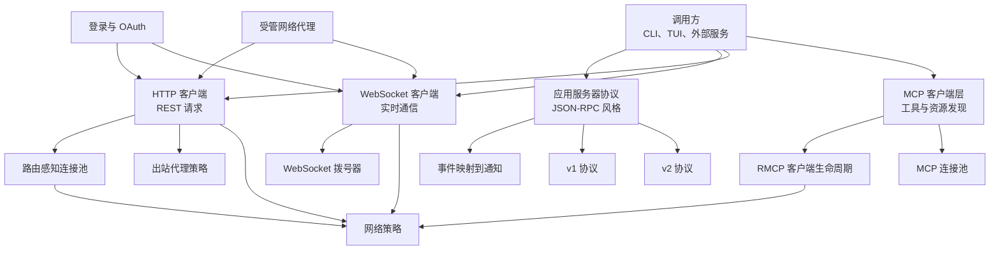
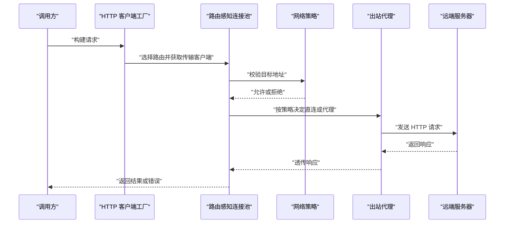
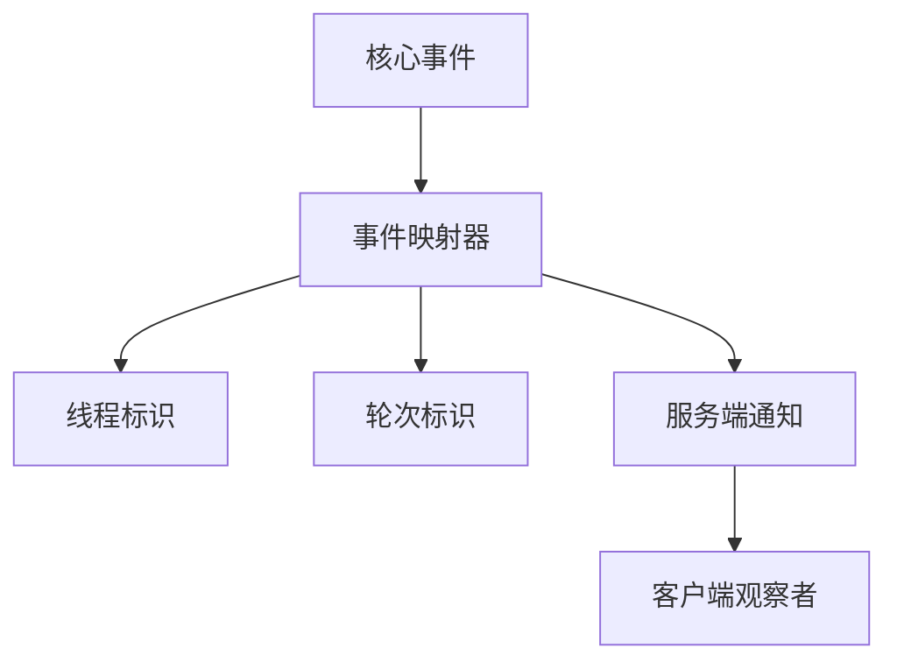
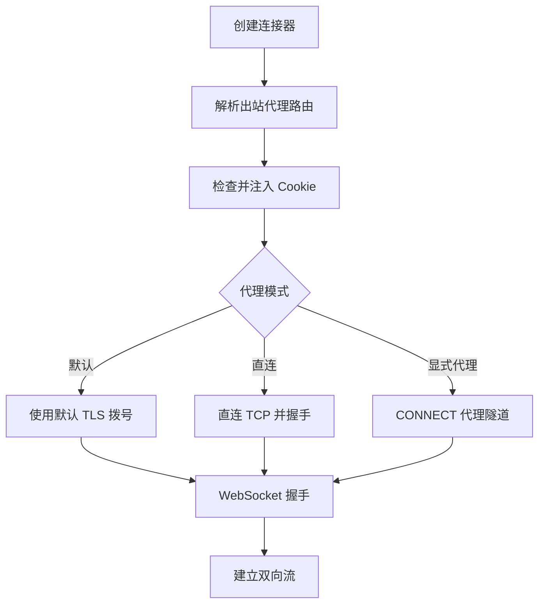
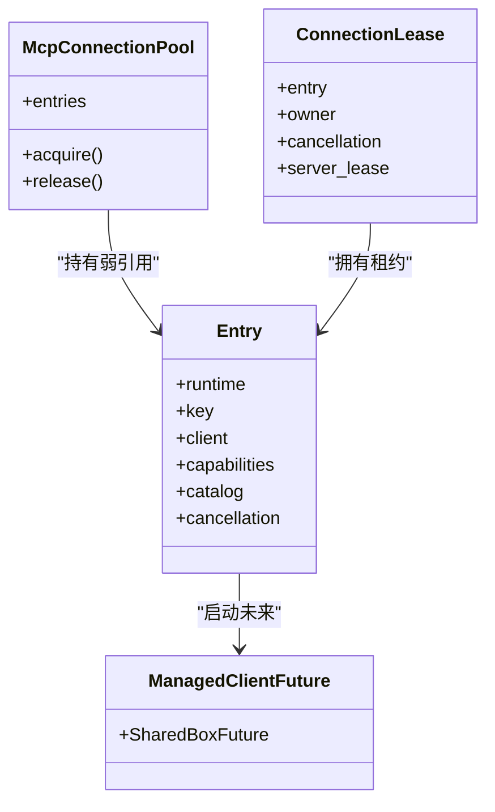
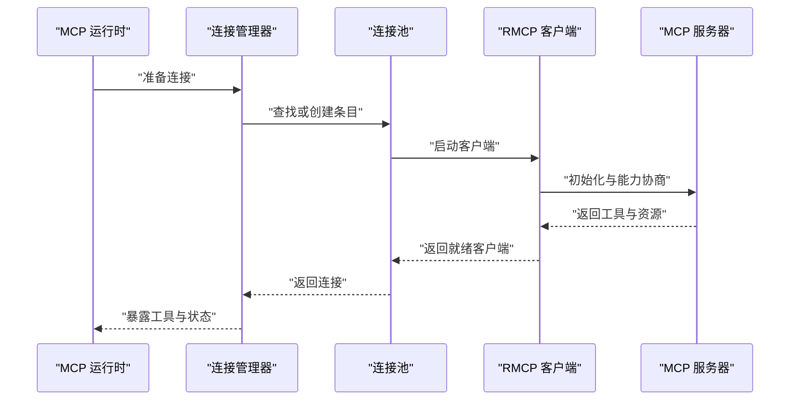
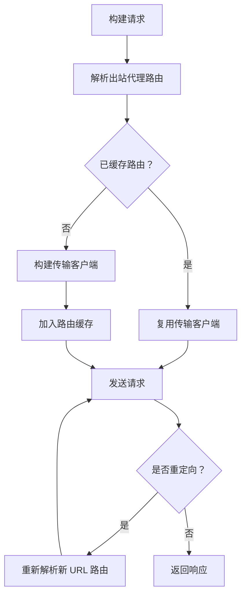
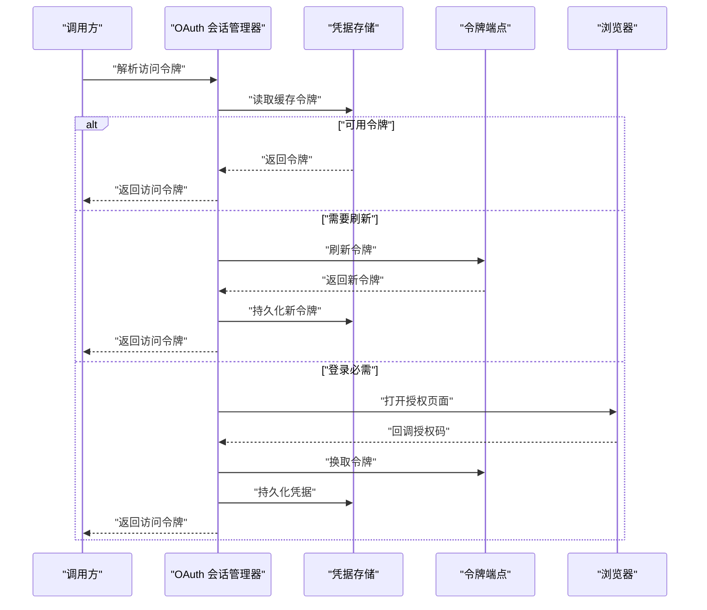
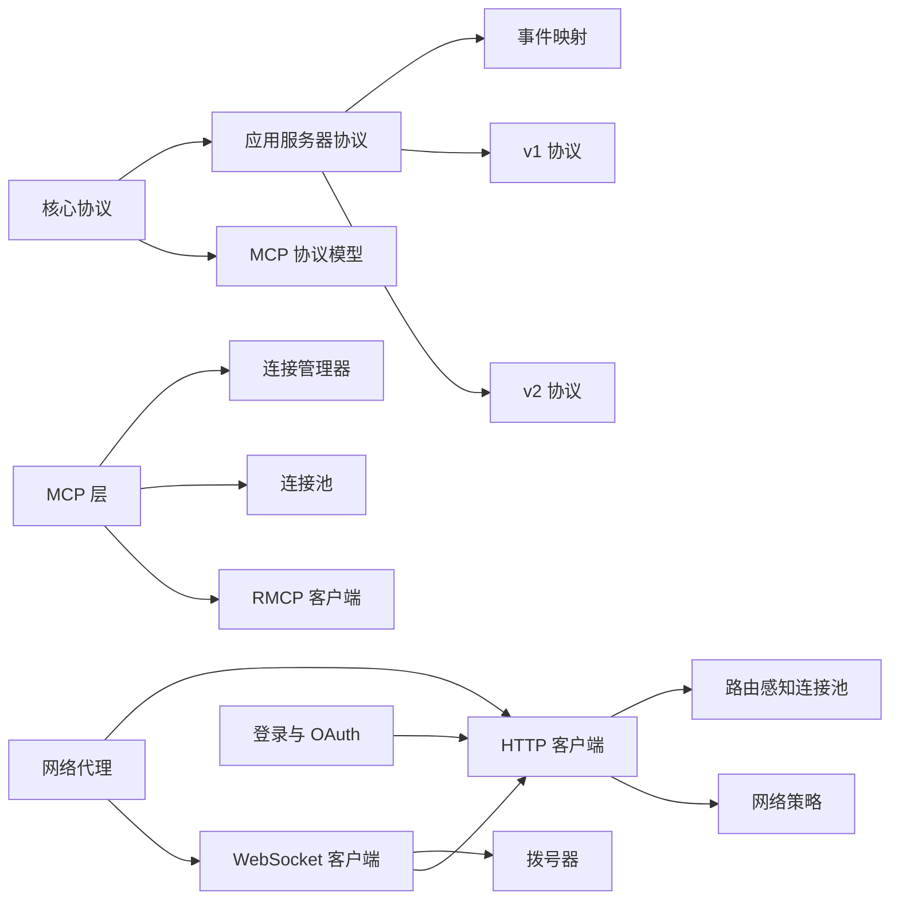

# 网络与协议

<cite>
**本文引用的文件**   
- [protocol/lib.rs](file://codex-rs/protocol/src/lib.rs)
- [app-server-protocol/rpc.rs](file://codex-rs/app-server-protocol/src/rpc.rs)
- [app-server-protocol/protocol/mod.rs](file://codex-rs/app-server-protocol/src/protocol/mod.rs)
- [app-server-protocol/protocol/common.rs](file://codex-rs/app-server-protocol/src/protocol/common.rs)
- [app-server-protocol/protocol/event_mapping.rs](file://codex-rs/app-server-protocol/src/protocol/event_mapping.rs)
- [app-server-protocol/protocol/v1.rs](file://codex-rs/app-server-protocol/src/protocol/v1.rs)
- [app-server-protocol/protocol/v2/mod.rs](file://codex-rs/app-server-protocol/src/protocol/v2/mod.rs)
- [app-server-protocol/protocol/v2/thread.rs](file://codex-rs/app-server-protocol/src/protocol/v2/thread.rs)
- [app-server-protocol/protocol/v2/realtime.rs](file://codex-rs/app-server-protocol/src/protocol/v2/realtime.rs)
- [codex-mcp/connection_pool.rs](file://codex-rs/codex-mcp/src/connection_pool.rs)
- [codex-mcp/connection_manager.rs](file://codex-rs/codex-mcp/src/connection_manager.rs)
- [codex-mcp/rmcp_client.rs](file://codex-rs/codex-mcp/src/rmcp_client.rs)
- [codex-mcp/mcp/mod.rs](file://codex-rs/codex-mcp/src/mcp/mod.rs)
- [http-client/lib.rs](file://codex-rs/http-client/src/lib.rs)
- [http-client/route_aware_client_pool.rs](file://codex-rs/http-client/src/route_aware_client_pool.rs)
- [websocket-client/lib.rs](file://codex-rs/websocket-client/src/lib.rs)
- [websocket-client/dialer.rs](file://codex-rs/websocket-client/src/dialer.rs)
- [login/lib.rs](file://codex-rs/login/src/lib.rs)
- [login/oauth_session.rs](file://codex-rs/login/src/oauth_session.rs)
- [network-proxy/lib.rs](file://codex-rs/network-proxy/src/lib.rs)
- [network-proxy/proxy.rs](file://codex-rs/network-proxy/src/proxy.rs)
</cite>

## 目录

1. [引言](#引言)
2. [项目结构](#项目结构)
3. [核心组件](#核心组件)
4. [架构总览](#架构总览)
5. [详细组件分析](#详细组件分析)
6. [依赖关系分析](#依赖关系分析)
7. [性能与连接管理](#性能与连接管理)
8. [协议版本兼容性与迁移](#协议版本兼容性与迁移)
9. [网络调试与监控](#网络调试与监控)
10. [故障排查指南](#故障排查指南)
11. [结论](#结论)

## 引言

本文件聚焦仓库中的网络与协议层，目标是说明：

- 内部进程间通信机制。
- 应用服务器协议、WebSocket 实时通信协议。
- HTTP REST API、MCP 协议及 OAuth 认证流程。
- Protobuf、JSON 等消息序列化方式。
- 连接池、重试、负载均衡、代理和策略控制。
- 协议版本兼容性管理与迁移建议。
- 网络调试工具与性能监控方法。

该仓库采用多 crate 的 Rust 工程结构，网络相关能力分布在 `codex-rs` 下的多个子模块中：HTTP 客户端、WebSocket 客户端、登录与 OAuth、应用服务器协议、MCP 集成、受管网络代理以及核心协议模型。

## 项目结构

从“网络与协议”角度，可以把仓库划分为以下主要层次：

**图表来源**
- [http-client/lib.rs:1-130](file://codex-rs/http-client/src/lib.rs#L1-L130)
- [websocket-client/lib.rs:1-200](file://codex-rs/websocket-client/src/lib.rs#L1-L200)
- [app-server-protocol/rpc.rs:1-88](file://codex-rs/app-server-protocol/src/rpc.rs#L1-L88)
- [app-server-protocol/protocol/v2/mod.rs:1-93](file://codex-rs/app-server-protocol/src/protocol/v2/mod.rs#L1-L93)
- [codex-mcp/connection_pool.rs:1-200](file://codex-rs/codex-mcp/src/connection_pool.rs#L1-L200)
- [network-proxy/lib.rs:1-140](file://codex-rs/network-proxy/src/lib.rs#L1-L140)

**章节来源**
- [protocol/lib.rs:1-65](file://codex-rs/protocol/src/lib.rs#L1-L65)
- [app-server-protocol/lib.rs:1-72](file://codex-rs/app-server-protocol/src/lib.rs#L1-L72)
- [codex-mcp/lib.rs:1-154](file://codex-rs/codex-mcp/src/lib.rs#L1-L154)
- [http-client/lib.rs:1-130](file://codex-rs/http-client/src/lib.rs#L1-L130)
- [websocket-client/lib.rs:1-200](file://codex-rs/websocket-client/src/lib.rs#L1-L200)
- [login/lib.rs:1-102](file://codex-rs/login/src/lib.rs#L1-L102)
- [network-proxy/lib.rs:1-140](file://codex-rs/network-proxy/src/lib.rs#L1-L140)

## 核心组件

### 核心协议模型

`codex_protocol` 是内部领域模型和基础协议的公共边界。它暴露会话、线程、权限、沙箱、动态工具、OpenAI 模型、MCP、网络策略等类型，但不直接定义对外 HTTP 或 gRPC 接口；对外协议主要由 `app-server-protocol`、`codex-mcp`、`http-client`、`websocket-client` 和 `login` 承担。

关键职责包括：

- 线程、会话、工具、权限、沙箱等共享数据结构。
- OpenAI 模型、推理强度、插件等开放模型扩展。
- MCP 基础模型和策略。
- 网络策略、错误信息、执行输出等通用类型。

**章节来源**
- [protocol/lib.rs:1-65](file://codex-rs/protocol/src/lib.rs#L1-L65)

### 应用服务器协议

应用服务器协议不是传统意义上的 JSON-RPC 2.0，而是基于 JSON 的请求-通知-响应消息格式。其根对象支持请求、通知、成功响应和错误响应，并允许请求携带 W3C Trace Context。

核心设计点：

- 使用字符串或整数作为请求标识。
- 所有消息通过 JSON 序列化和反序列化。
- 提供 v1 和 v2 两套协议类型。
- 将核心事件映射为服务端通知。
- 支持认证模式协商、能力声明、实验性 API 开关。

**章节来源**
- [app-server-protocol/rpc.rs:1-88](file://codex-rs/app-server-protocol/src/rpc.rs#L1-L88)
- [app-server-protocol/protocol/mod.rs:1-13](file://codex-rs/app-server-protocol/src/protocol/mod.rs#L1-L13)
- [app-server-protocol/protocol/common.rs:1-200](file://codex-rs/app-server-protocol/src/protocol/common.rs#L1-L200)

### WebSocket 实时通信

WebSocket 客户端复用 HTTP 客户端的 Cookie 存储、出站代理策略和网络策略，用于建立安全握手。它支持：

- 显式 TLS 配置。
- 直连回环地址。
- 根据 HTTP 工厂解析出站代理。
- 自动注入 ChatGPT Cookie。
- TCP Nagle 算法可选关闭。
- 从底层错误恢复网络策略拒绝。

**章节来源**
- [websocket-client/lib.rs:1-200](file://codex-rs/websocket-client/src/lib.rs#L1-L200)
- [websocket-client/dialer.rs:1-200](file://codex-rs/websocket-client/src/dialer.rs#L1-L200)

### MCP 协议集成

MCP 层负责注册、启动、缓存、复用和撤销 MCP 服务器连接，并将 MCP 工具暴露给 Codex 的工具生态。它包含：

- MCP 运行时配置。
- 连接管理器。
- 连接池。
- RMCP 客户端生命周期。
- OAuth 状态、作用域、回调处理。
- 工具目录缓存和资源客户端。

**章节来源**
- [codex-mcp/lib.rs:1-154](file://codex-rs/codex-mcp/src/lib.rs#L1-L154)
- [codex-mcp/mcp/mod.rs:1-200](file://codex-rs/codex-mcp/src/mcp/mod.rs#L1-L200)
- [codex-mcp/connection_manager.rs:1-200](file://codex-rs/codex-mcp/src/connection_manager.rs#L1-L200)
- [codex-mcp/connection_pool.rs:1-200](file://codex-rs/codex-mcp/src/connection_pool.rs#L1-L200)
- [codex-mcp/rmcp_client.rs:1-200](file://codex-rs/codex-mcp/src/rmcp_client.rs#L1-L200)

### HTTP REST 客户端

HTTP 客户端提供面向外部服务的统一访问能力，包括：

- HTTPS 端点校验。
- 自定义 CA 和平台证书链。
- 出站代理策略。
- 路由感知连接池。
- 重定向、TLS 后端回退。
- 网络策略控制器。

**章节来源**
- [http-client/lib.rs:1-130](file://codex-rs/http-client/src/lib.rs#L1-L130)
- [http-client/route_aware_client_pool.rs:1-200](file://codex-rs/http-client/src/route_aware_client_pool.rs#L1-L200)

### 登录与 OAuth

登录模块封装了用户身份、令牌、OAuth 会话、设备码登录、工作区路由和凭据存储。OAuth 会话管理器负责：

- 解析访问令牌。
- 刷新过期令牌。
- 浏览器交互式登录。
- 凭据持久化。
- 登录状态广播。
- 失败后按策略恢复。

**章节来源**
- [login/lib.rs:1-102](file://codex-rs/login/src/lib.rs#L1-L102)
- [login/oauth_session.rs:1-200](file://codex-rs/login/src/oauth_session.rs#L1-L200)

### 受管网络代理

网络代理是一个可配置的受管网络边界，提供：

- HTTP 代理。
- SOCKS5 代理。
- MITM 与证书管理。
- 凭据代理。
- 域名匹配与网络策略。
- 远程配置。
- Windows 专用入站通道。

**章节来源**
- [network-proxy/lib.rs:1-140](file://codex-rs/network-proxy/src/lib.rs#L1-L140)
- [network-proxy/proxy.rs:1-200](file://codex-rs/network-proxy/src/proxy.rs#L1-L200)

## 架构总览

下图展示一次典型的外部 HTTP 请求路径，以及它在网络策略、代理、TLS 和连接池中的流转。

**图表来源**
- [http-client/lib.rs:1-130](file://codex-rs/http-client/src/lib.rs#L1-L130)
- [http-client/route_aware_client_pool.rs:1-200](file://codex-rs/http-client/src/route_aware_client_pool.rs#L1-L200)
- [network-proxy/lib.rs:1-140](file://codex-rs/network-proxy/src/lib.rs#L1-L140)

## 详细组件分析

### 应用服务器协议与事件流

应用服务器协议通过 JSON 消息承载请求、通知和响应，并通过事件映射把内部核心事件投影为 v2 通知。

#### 消息格式

| 类别 | 关键字段 | 说明 |
|---|---|---|
| 请求 | `id`、`method`、`params`、`trace` | 带唯一标识的方法调用，可选分布式追踪上下文 |
| 通知 | `method`、`params` | 单向事件，不要求响应 |
| 成功响应 | `id`、`result` | 对应请求的成功结果 |
| 错误响应 | `id`、`error.code`、`error.message`、`error.data` | 结构化错误 |

#### 事件映射

核心事件被转换为服务端通知，例如动态工具调用完成、协作代理启动、终端交互、补丁变更等。这种映射让上层协议不必直接耦合内部事件枚举。

**图表来源**
- [app-server-protocol/rpc.rs:1-88](file://codex-rs/app-server-protocol/src/rpc.rs#L1-L88)
- [app-server-protocol/protocol/event_mapping.rs:1-200](file://codex-rs/app-server-protocol/src/protocol/event_mapping.rs#L1-L200)

#### 认证模式

认证模式涵盖 API Key、ChatGPT OAuth、Headers、Agent Identity、个人访问令牌、Bedrock API Key 和 Bedrock Access Keys。这些模式用于协商 app-server 的连接身份，并区分是否走 Codex 后端还是直接模型提供商。

**章节来源**
- [app-server-protocol/rpc.rs:1-88](file://codex-rs/app-server-protocol/src/rpc.rs#L1-L88)
- [app-server-protocol/protocol/common.rs:1-200](file://codex-rs/app-server-protocol/src/protocol/common.rs#L1-L200)
- [app-server-protocol/protocol/event_mapping.rs:1-200](file://codex-rs/app-server-protocol/src/protocol/event_mapping.rs#L1-L200)

### WebSocket 实时通信协议

WebSocket 连接由 `WebSocketConnector` 发起，最终进入 `dialer` 模块进行实际拨号。连接过程遵循以下逻辑：

**图表来源**
- [websocket-client/lib.rs:1-200](file://codex-rs/websocket-client/src/lib.rs#L1-L200)
- [websocket-client/dialer.rs:1-200](file://codex-rs/websocket-client/src/dialer.rs#L1-L200)

WebSocket 协议本身在代码中以 tungstenite 的 Request、Response、Message 抽象表示；Codex 在其之上叠加了：

- 网络策略许可。
- 出站代理路由。
- 自定义 TLS。
- 回环直连保护。
- Cookie 复用。

**章节来源**
- [websocket-client/lib.rs:1-200](file://codex-rs/websocket-client/src/lib.rs#L1-L200)
- [websocket-client/dialer.rs:1-200](file://codex-rs/websocket-client/src/dialer.rs#L1-L200)

### MCP 协议与连接管理

MCP 层既管理连接生命周期，也管理工具与资源发现。连接池会按服务器名称、连接身份、账户、认证状态、启动超时和目录项上限生成键，从而复用本地 stdio 连接。

**图表来源**
- [codex-mcp/connection_pool.rs:1-200](file://codex-rs/codex-mcp/src/connection_pool.rs#L1-L200)

连接管理器聚合多个 MCP 服务器连接，维护启动状态、元数据、工具列表和资源。它还支持：

- 可重用客户端。
- 遗留回退。
- 启动失败恢复。
- OAuth 凭据比较。
- 并发启动任务。

**图表来源**
- [codex-mcp/connection_manager.rs:1-200](file://codex-rs/codex-mcp/src/connection_manager.rs#L1-L200)
- [codex-mcp/rmcp_client.rs:1-200](file://codex-rs/codex-mcp/src/rmcp_client.rs#L1-L200)

#### MCP 协议版本与能力

MCP 客户端支持协议版本、能力协商、Elicitation、工具分页、目录缓存能力等。连接池还引入连接租约能力，使应用能够显式管理长连接上的请求所有权。

**章节来源**
- [codex-mcp/connection_pool.rs:1-200](file://codex-rs/codex-mcp/src/connection_pool.rs#L1-L200)
- [codex-mcp/rmcp_client.rs:1-200](file://codex-rs/codex-mcp/src/rmcp_client.rs#L1-L200)

### HTTP REST API 与路由感知连接池

HTTP 客户端通过 `HttpClientFactory` 和 `RouteAwareClientPool` 管理连接。每个请求都会重新解析路由，但连接仍按出站代理路由复用。

**图表来源**
- [http-client/route_aware_client_pool.rs:1-200](file://codex-rs/http-client/src/route_aware_client_pool.rs#L1-L200)

连接池的错误分类支持识别超时、代理认证失败、TLS 错误、无效代理配置、策略拒绝等场景。

**章节来源**
- [http-client/lib.rs:1-130](file://codex-rs/http-client/src/lib.rs#L1-L130)
- [http-client/route_aware_client_pool.rs:1-200](file://codex-rs/http-client/src/route_aware_client_pool.rs#L1-L200)

### OAuth 认证流程

OAuth 会话管理器围绕令牌缓存、刷新、交互式登录和持久化组织状态。

**图表来源**
- [login/oauth_session.rs:1-200](file://codex-rs/login/src/oauth_session.rs#L1-L200)

**章节来源**
- [login/lib.rs:1-102](file://codex-rs/login/src/lib.rs#L1-L102)
- [login/oauth_session.rs:1-200](file://codex-rs/login/src/oauth_session.rs#L1-L200)

### 内部协议与进程间通信

仓库中没有集中定义的 gRPC 服务接口。主要的内部协议集中在：

- `codex_protocol`：领域模型和基础协议类型。
- `app-server-protocol`：JSON 风格的内部 RPC 消息。
- `codex-mcp` 与 `rmcp`：MCP 工具协议。
- WebSocket：实时事件与音频片段。
- 网络代理：HTTP/SOCKS 转发、MITM、凭据注入。

如果未来引入 gRPC，当前更适合新增独立 crate，并在 `http-client` 或新的 transport crate 中实现客户端，同时保留现有 JSON 协议作为稳定边界。

**章节来源**
- [protocol/lib.rs:1-65](file://codex-rs/protocol/src/lib.rs#L1-L65)
- [app-server-protocol/rpc.rs:1-88](file://codex-rs/app-server-protocol/src/rpc.rs#L1-L88)
- [codex-mcp/rmcp_client.rs:1-200](file://codex-rs/codex-mcp/src/rmcp_client.rs#L1-L200)

## 依赖关系分析

**图表来源**
- [protocol/lib.rs:1-65](file://codex-rs/protocol/src/lib.rs#L1-L65)
- [app-server-protocol/lib.rs:1-72](file://codex-rs/app-server-protocol/src/lib.rs#L1-L72)
- [http-client/lib.rs:1-130](file://codex-rs/http-client/src/lib.rs#L1-L130)
- [websocket-client/lib.rs:1-200](file://codex-rs/websocket-client/src/lib.rs#L1-L200)
- [codex-mcp/lib.rs:1-154](file://codex-rs/codex-mcp/src/lib.rs#L1-L154)
- [login/lib.rs:1-102](file://codex-rs/login/src/lib.rs#L1-L102)
- [network-proxy/lib.rs:1-140](file://codex-rs/network-proxy/src/lib.rs#L1-L140)

### 耦合与内聚

- `app-server-protocol` 与 `codex_protocol` 解耦良好：前者定义外部可见消息，后者提供领域模型。
- `codex-mcp` 对 `codex_login`、`codex_http_client`、`codex_rmcp_client` 存在较强依赖，因为 MCP 工具可能触发认证、网络和远程工具调用。
- `websocket-client` 高度依赖 `http-client`，避免重复实现 TLS、代理和 Cookie 管理。
- `http-client` 通过 `NetworkPolicyController` 将策略与传输解耦。
- `network-proxy` 是横向基础设施，被 HTTP 和 WebSocket 共同使用。

### 潜在循环依赖

当前代码结构以模块和 crate 边界隔离依赖，未发现明显的循环导入风险。若新增跨模块调用，应优先通过 trait、枚举或消息类型传递行为，而不是直接相互引用实现细节。

## 性能与连接管理

### 连接池

- **HTTP 路由感知连接池**：按出站代理路由复用传输客户端，每个重定向都重新解析路由，但连接仍可复用。
- **MCP 连接池**：按服务器名、身份、账户、认证状态、启动超时、目录大小限制复用本地 stdio 连接，并为每个聊天分配租约。

优化建议：

- 对于高频短连接，保持合理的路由缓存上限，避免过多客户端实例。
- 对 MCP 服务器，明确设置启动超时和目录项上限，避免慢启动拖垮整体。
- 对实时 WebSocket 连接，启用 TCP NoDelay 以降低延迟。

**章节来源**
- [http-client/route_aware_client_pool.rs:1-200](file://codex-rs/http-client/src/route_aware_client_pool.rs#L1-L200)
- [codex-mcp/connection_pool.rs:1-200](file://codex-rs/codex-mcp/src/connection_pool.rs#L1-L200)
- [websocket-client/lib.rs:1-200](file://codex-rs/websocket-client/src/lib.rs#L1-L200)

### 重试机制

- MCP Apps 启动连接具有重连状态，记录最近错误、重试间隔和连续失败次数。
- OAuth 会话在令牌被拒绝后可按策略恢复，避免无限重试同一失效令牌。
- WebSocket 拨号器对代理 407 等场景有特定重试路径。

注意事项：

- 幂等请求适合重试；非幂等写入必须谨慎。
- 重试应结合指数退避、最大重试次数和取消令牌。
- 网络策略拒绝不应简单重试，应先修正策略或用户授权。

**章节来源**
- [codex-mcp/rmcp_client.rs:1-200](file://codex-rs/codex-mcp/src/rmcp_client.rs#L1-L200)
- [login/oauth_session.rs:1-200](file://codex-rs/login/src/oauth_session.rs#L1-L200)
- [websocket-client/dialer.rs:1-200](file://codex-rs/websocket-client/src/dialer.rs#L1-L200)

### 负载均衡

当前代码没有集中式的服务器侧负载均衡器。负载均衡主要通过以下方式间接实现：

- 出站代理策略选择不同上游。
- 重定向时重新解析路由。
- 多 MCP 服务器连接并行启动。
- 多账号或工作区路由可能影响下游服务选择。

如果需要更强的负载均衡，可在 `http-client` 或网络代理层增加健康检查、权重路由和故障转移策略。

[本节为通用指导，不直接分析具体文件]

## 协议版本兼容性与迁移

### 应用服务器协议版本

仓库明确维护 v1 和 v2 协议。v1 侧重初始化和旧版字段，v2 提供更丰富的线程、实时、权限、模型、MCP、诊断等能力。

迁移建议：

- 客户端优先声明 v2 能力，并逐步启用实验性字段。
- 服务端对新字段使用可选字段和向后兼容枚举。
- 对破坏性变更使用新的协议命名空间或版本号。
- 通过 `InitializeCapabilities` 协商功能开关，而非强制升级。

**章节来源**
- [app-server-protocol/protocol/v1.rs:1-200](file://codex-rs/app-server-protocol/src/protocol/v1.rs#L1-L200)
- [app-server-protocol/protocol/v2/mod.rs:1-93](file://codex-rs/app-server-protocol/src/protocol/v2/mod.rs#L1-L93)

### MCP 协议版本

MCP 客户端使用 rmcp 模型中的协议版本、能力协商和工具发现。连接池还支持连接租约能力，用于区分共享连接上的请求所有权。

迁移建议：

- 对新增 MCP 能力使用能力协商。
- 对不兼容服务器保留 legacy fallback。
- 对工具目录变更使用增量更新或版本标记。
- 对需要强一致性的长连接使用显式租约。

**章节来源**
- [codex-mcp/connection_pool.rs:1-200](file://codex-rs/codex-mcp/src/connection_pool.rs#L1-L200)
- [codex-mcp/rmcp_client.rs:1-200](file://codex-rs/codex-mcp/src/rmcp_client.rs#L1-L200)

### WebSocket 协议演进

WebSocket 协议目前更偏实现细节，而非公开 API 契约。演进时应注意：

- 保持握手兼容。
- 对消息结构使用可扩展字段。
- 对音频帧、转录、会话状态等实时数据定义明确版本。
- 对网络策略拒绝和代理错误做可观测上报。

**章节来源**
- [websocket-client/lib.rs:1-200](file://codex-rs/websocket-client/src/lib.rs#L1-L200)
- [websocket-client/dialer.rs:1-200](file://codex-rs/websocket-client/src/dialer.rs#L1-L200)

## 网络调试与监控

### 调试建议

- 使用 `validate_endpoint_url` 和 `validate_https_endpoint_url` 验证外部端点。
- 通过路由感知错误的 `failure_class` 区分代理、TLS、策略和超时问题。
- 观察 MCP 连接的生命周期指标，如活跃连接数、工具列表耗时、Apps 刷新耗时。
- 使用 WebSocket 的网络策略拒绝恢复函数判断连接失败原因。
- 使用网络代理的审计元数据和阻断请求观察器排查受管代理决策。

**章节来源**
- [http-client/lib.rs:1-130](file://codex-rs/http-client/src/lib.rs#L1-L130)
- [http-client/route_aware_client_pool.rs:1-200](file://codex-rs/http-client/src/route_aware_client_pool.rs#L1-L200)
- [websocket-client/lib.rs:1-200](file://codex-rs/websocket-client/src/lib.rs#L1-L200)
- [network-proxy/lib.rs:1-140](file://codex-rs/network-proxy/src/lib.rs#L1-L140)

### 性能监控

- 关注 MCP 活跃连接数指标。
- 监控工具列表和未缓存工具获取耗时。
- 监控 Apps 工具刷新耗时。
- 统计 OAuth 刷新失败、登录必需、浏览器登录频率。
- 统计 WebSocket 连接失败分类。
- 在网络代理层统计阻断请求数量和原因。

**章节来源**
- [codex-mcp/connection_manager.rs:1-200](file://codex-rs/codex-mcp/src/connection_manager.rs#L1-L200)
- [codex-mcp/rmcp_client.rs:1-200](file://codex-rs/codex-mcp/src/rmcp_client.rs#L1-L200)
- [login/oauth_session.rs:1-200](file://codex-rs/login/src/oauth_session.rs#L1-L200)
- [network-proxy/lib.rs:1-140](file://codex-rs/network-proxy/src/lib.rs#L1-L140)

## 故障排查指南

### 常见网络连接问题

| 现象 | 可能原因 | 排查方向 |
|---|---|---|
| HTTPS 端点被拒绝 | 非 HTTPS 或包含用户信息 | 使用端点校验函数 |
| 代理认证失败 | 系统代理或手动代理未正确配置 | 检查出站代理路由和 Windows 代理认证 |
| TLS 握手失败 | 自定义 CA、平台证书或 SNI 配置异常 | 检查自定义 CA 和 TLS 后端 |
| WebSocket 无法连接 | 网络策略拒绝或代理 CONNECT 失败 | 检查策略许可和拨号日志 |
| MCP 工具不可用 | 服务器启动失败或目录发现超时 | 查看启动状态、回退连接和超时配置 |
| OAuth 令牌无效 | 令牌过期或被服务端拒绝 | 触发刷新或交互式登录 |
| 请求被代理阻断 | 网络策略或企业策略拒绝 | 检查代理审计和策略决策 |

**章节来源**
- [http-client/lib.rs:1-130](file://codex-rs/http-client/src/lib.rs#L1-L130)
- [websocket-client/dialer.rs:1-200](file://codex-rs/websocket-client/src/dialer.rs#L1-L200)
- [codex-mcp/connection_manager.rs:1-200](file://codex-rs/codex-mcp/src/connection_manager.rs#L1-L200)
- [login/oauth_session.rs:1-200](file://codex-rs/login/src/oauth_session.rs#L1-L200)
- [network-proxy/proxy.rs:1-200](file://codex-rs/network-proxy/src/proxy.rs#L1-L200)

## 结论

该仓库的网络与协议层以 Rust 多 crate 形式组织，核心特点是：

- 内部协议以 JSON 为主，通过 `app-server-protocol` 暴露 v1 和 v2。
- WebSocket 复用 HTTP 客户端的安全、代理和策略能力。
- MCP 层承担工具协议、连接管理和 OAuth 集成。
- HTTP 客户端提供路由感知连接池、TLS 回退和网络策略控制。
- OAuth 会话统一管理令牌、刷新和用户登录。
- 网络代理提供受管网络边界、MITM 和企业策略入口。

未来若引入 gRPC，建议将其作为新的传输层，并与现有 JSON 协议、MCP 协议和 WebSocket 协议共存，同时保持 `codex_protocol` 作为稳定的领域模型边界。