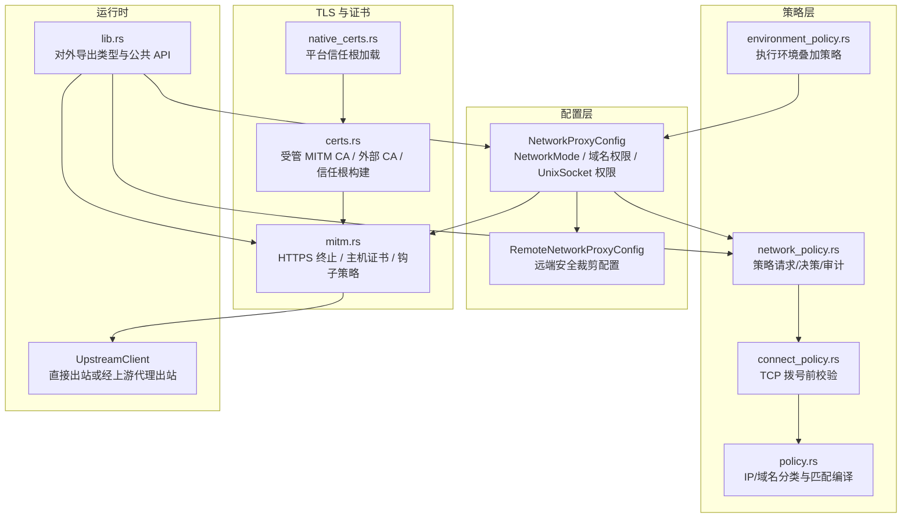
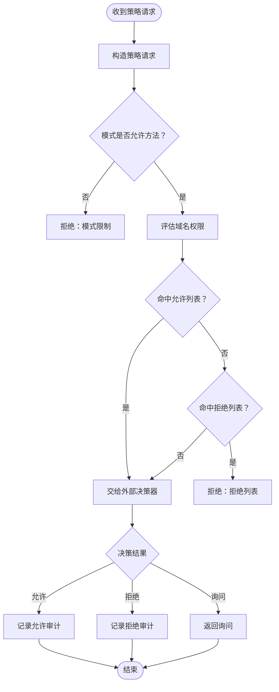
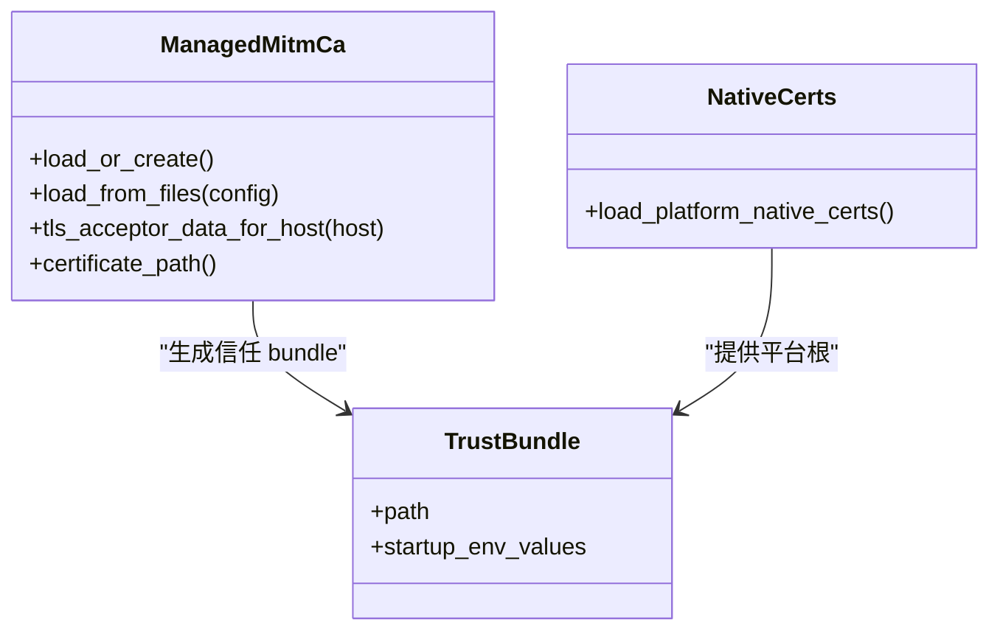
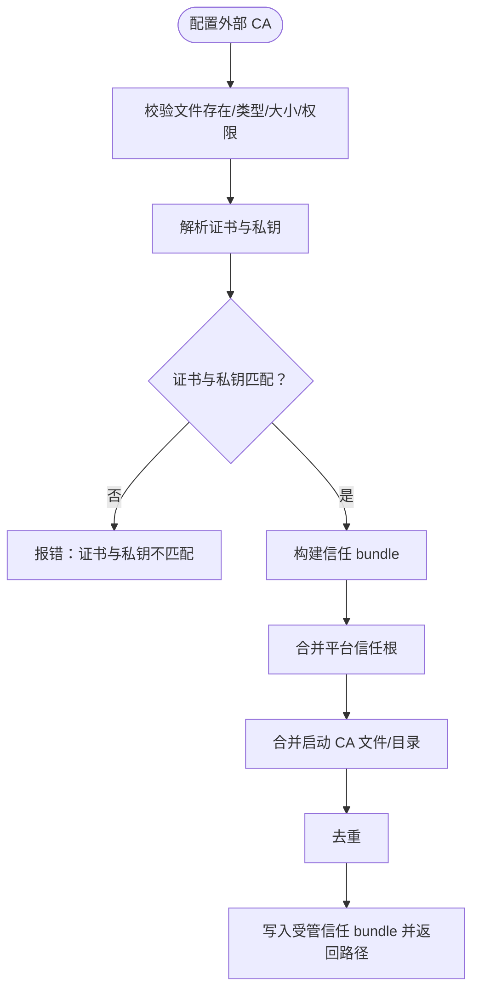
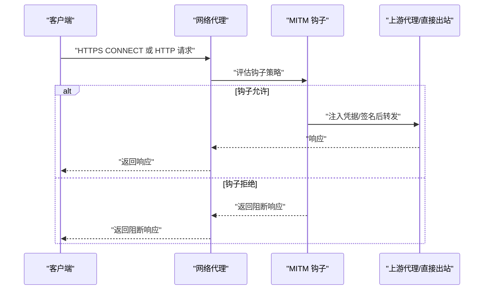
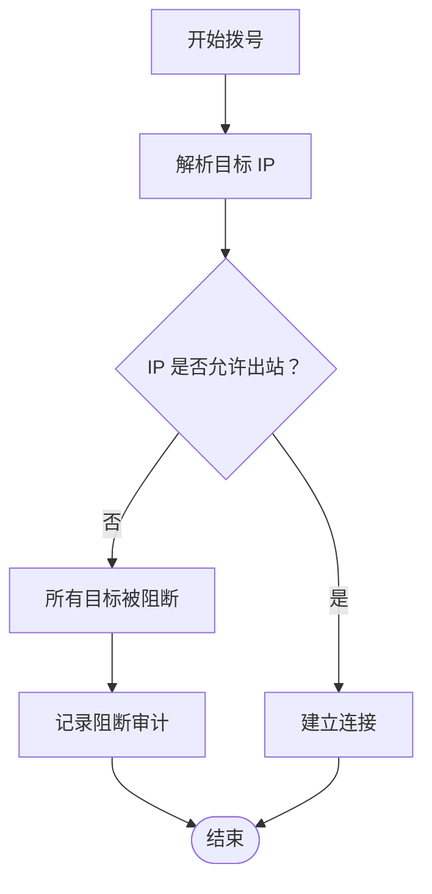
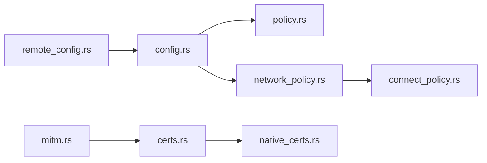

# 网络安全

<cite>
**本文引用的文件**   
- [codex-rs/network-proxy/src/lib.rs](file://codex-rs/network-proxy/src/lib.rs)
- [codex-rs/network-proxy/src/config.rs](file://codex-rs/network-proxy/src/config.rs)
- [codex-rs/network-proxy/src/network_policy.rs](file://codex-rs/network-proxy/src/network_policy.rs)
- [codex-rs/network-proxy/src/policy.rs](file://codex-rs/network-proxy/src/policy.rs)
- [codex-rs/network-proxy/src/connect_policy.rs](file://codex-rs/network-proxy/src/connect_policy.rs)
- [codex-rs/network-proxy/src/environment_policy.rs](file://codex-rs/network-proxy/src/environment_policy.rs)
- [codex-rs/network-proxy/src/certs.rs](file://codex-rs/network-proxy/src/certs.rs)
- [codex-rs/network-proxy/src/native_certs.rs](file://codex-rs/network-proxy/src/native_certs.rs)
- [codex-rs/network-proxy/src/mitm.rs](file://codex-rs/network-proxy/src/mitm.rs)
- [codex-rs/network-proxy/src/remote_config.rs](file://codex-rs/network-proxy/src/remote_config.rs)
</cite>

## 目录
1. [引言](#引言)
2. [项目结构](#项目结构)
3. [核心组件](#核心组件)
4. [架构总览](#架构总览)
5. [详细组件分析](#详细组件分析)
6. [依赖关系分析](#依赖关系分析)
7. [性能与安全性权衡](#性能与安全性权衡)
8. [故障排查指南](#故障排查指南)
9. [结论](#结论)
10. [附录：安全配置示例与常见问题](#附录安全配置示例与常见问题)

## 引言
本文件面向企业环境中的 Codex 网络代理子系统，系统性说明以下安全能力：
- 网络策略系统：允许/拒绝规则、动态策略更新、策略冲突解决。
- TLS 与证书管理：证书验证、加密套件选择、证书链验证。
- 自定义 CA 部署：企业根证书与中间证书处理、受管 MITM CA。
- 代理配置安全：上游代理认证、隧道加密、流量监控。
- 最佳实践：最小权限、传输加密、输入校验等。
- 常见安全问题及解决方案。

该子系统位于 `codex-rs/network-proxy`，以 Rust 实现，通过配置对象、策略评估器、TLS/MITM 层、连接级策略检查器和审计记录共同构成端到端的安全网络出口。

## 项目结构
网络代理模块由若干职责清晰的子模块组成：
- 配置与模式：定义网络模式、域名权限、Unix Socket 权限、MITM CA 配置等。
- 策略决策：将请求元数据转换为策略请求，产出允许/拒绝/询问结果，并记录审计事件。
- 连接级策略：在 TCP 拨号阶段再次校验目标地址是否被阻断，防止 DNS 重绑定绕过。
- TLS 与证书：加载平台信任根、启动时传入的 CA、受管 MITM CA，并为 HTTPS 出站建立信任根。
- MITM：按需终止 HTTPS、生成主机证书、执行钩子策略、注入或替换凭据、转发到上游或直接出站。
- 远程执行安全：仅向远端 executor 发送安全的最小化配置，屏蔽敏感字段。



**图表来源**
- [codex-rs/network-proxy/src/lib.rs:1-140](file://codex-rs/network-proxy/src/lib.rs#L1-L140)
- [codex-rs/network-proxy/src/config.rs:1-200](file://codex-rs/network-proxy/src/config.rs#L1-L200)
- [codex-rs/network-proxy/src/network_policy.rs:1-200](file://codex-rs/network-proxy/src/network_policy.rs#L1-L200)
- [codex-rs/network-proxy/src/connect_policy.rs:1-200](file://codex-rs/network-proxy/src/connect_policy.rs#L1-L200)
- [codex-rs/network-proxy/src/policy.rs:1-200](file://codex-rs/network-proxy/src/policy.rs#L1-L200)
- [codex-rs/network-proxy/src/environment_policy.rs:1-116](file://codex-rs/network-proxy/src/environment_policy.rs#L1-L116)
- [codex-rs/network-proxy/src/certs.rs:1-200](file://codex-rs/network-proxy/src/certs.rs#L1-L200)
- [codex-rs/network-proxy/src/native_certs.rs:1-200](file://codex-rs/network-proxy/src/native_certs.rs#L1-L200)
- [codex-rs/network-proxy/src/mitm.rs:1-200](file://codex-rs/network-proxy/src/mitm.rs#L1-L200)

**章节来源**
- [codex-rs/network-proxy/src/lib.rs:1-140](file://codex-rs/network-proxy/src/lib.rs#L1-L140)

## 核心组件
- 网络模式与基础配置：支持受限模式（仅 GET/HEAD/OPTIONS）和完全模式；可启用 SOCKS5、上游代理、Unix Socket 白名单、本地绑定控制、MITM 与 MITM 钩子。
- 策略决策接口：统一接收协议、主机、端口、方法、客户端地址等上下文，返回允许、拒绝或询问；同时输出不可阻塞的审计事件。
- 连接级策略：对已允许的域名再次按解析后的 IP 判定是否为私有/环回/链路本地等，阻止直接出站至本地网络。
- TLS 与证书：
  - 加载平台原生信任根。
  - 合并进程启动时传入的 CA 路径与环境变量。
  - 维护受管 MITM CA 及其信任 bundle，为 HTTPS 出站构造 rustls 信任根。
  - 支持外部 CA 私钥/证书文件，但要求严格权限校验。
- MITM：可选终止 HTTPS，按钩子策略注入/替换凭据、签名请求，再转发到上游或直接出站。
- 远程配置：向远端 executor 下发“仅包含必要策略”的配置，屏蔽 MITM、外部 CA、明文凭据注入、MITM 钩子等高风险能力。

**章节来源**
- [codex-rs/network-proxy/src/config.rs:1-200](file://codex-rs/network-proxy/src/config.rs#L1-L200)
- [codex-rs/network-proxy/src/config.rs:200-500](file://codex-rs/network-proxy/src/config.rs#L200-L500)
- [codex-rs/network-proxy/src/network_policy.rs:1-200](file://codex-rs/network-proxy/src/network_policy.rs#L1-L200)
- [codex-rs/network-proxy/src/connect_policy.rs:1-200](file://codex-rs/network-proxy/src/connect_policy.rs#L1-L200)
- [codex-rs/network-proxy/src/certs.rs:1-200](file://codex-rs/network-proxy/src/certs.rs#L1-L200)
- [codex-rs/network-proxy/src/mitm.rs:1-200](file://codex-rs/network-proxy/src/mitm.rs#L1-L200)
- [codex-rs/network-proxy/src/remote_config.rs:1-200](file://codex-rs/network-proxy/src/remote_config.rs#L1-L200)

## 架构总览
网络代理的核心流程分为四层：
1. 请求进入代理监听器后，先构造策略请求。
2. 策略决策器依据当前配置、模式、域名权限、执行环境策略以及外部 decider 决定允许、拒绝或询问。
3. 若允许，进入连接层：TCP 拨号前再次校验解析后的 IP，防止 DNS 重绑定绕过。
4. 若启用 MITM，则终止 HTTPS，执行钩子策略，必要时注入凭据或修改请求体，再转发到上游或直接出站。

```mermaid
sequenceDiagram
    participant Client as "调用方"
    participant Proxy as "网络代理"
    participant Policy as "策略决策器"
    participant Connector as "TCP 连接器"
    participant Mitm as "MITM 层"
    participant Upstream as "上游代理或直接出站"

    Client->>Proxy: "发起 HTTP/SOCKS/CONNECT"
    Proxy->>Policy: "构造策略请求并评估"
    alt 允许
        Proxy->>Connector: "根据授权进行拨号"
        Connector->>Connector: "校验解析后的 IP 是否允许"
        opt 启用 MITM
            Connector->>Mitm: "终止 HTTPS 并应用钩子策略"
            Mitm->>Upstream: "转发请求"
        else 未启用 MITM
            Connector->>Upstream: "直接转发"
        end
        Upstream-->>Proxy: "响应"
        Proxy-->>Client: "返回响应"
    else 拒绝或询问
        Policy-->>Proxy: "拒绝/询问"
        Proxy-->>Client: "返回阻断响应"
    end
```

**图表来源**
- [codex-rs/network-proxy/src/network_policy.rs:1-200](file://codex-rs/network-proxy/src/network_policy.rs#L1-L200)
- [codex-rs/network-proxy/src/connect_policy.rs:1-200](file://codex-rs/network-proxy/src/connect_policy.rs#L1-L200)
- [codex-rs/network-proxy/src/mitm.rs:1-200](file://codex-rs/network-proxy/src/mitm.rs#L1-L200)

## 详细组件分析

### 网络策略系统：允许/拒绝规则、动态更新与冲突解决
- 策略模型
  - 策略请求包含协议、主机、端口、方法、客户端地址、执行上下文等。
  - 策略决策包括允许、拒绝、询问；拒绝附带原因与来源，如基线策略、模式守卫、代理状态或外部决策器。
  - 审计事件独立于强制逻辑，不阻塞放行，用于集中观测与合规记录。
- 动态更新
  - 配置支持保存并恢复允许/拒绝列表；允许/拒绝条目去重并按优先级合并。
  - 支持增量插入、覆盖特定模式的权限，保留无效条目外的有效拒绝。
  - 执行环境策略可对控制器配置进行叠加，但不允许移除另一方的审查选择器或越权放开 Socket。
- 冲突解决
  - 域名权限的优先级顺序为：无 < 允许 < 拒绝，拒绝优先。
  - 环境策略中，“允许全部 Unix Socket”不能覆盖任一方的显式拒绝。
  - 上游代理开关需控制器和执行环境双方同意才生效。



**图表来源**
- [codex-rs/network-proxy/src/network_policy.rs:1-200](file://codex-rs/network-proxy/src/network_policy.rs#L1-L200)
- [codex-rs/network-proxy/src/config.rs:1-200](file://codex-rs/network-proxy/src/config.rs#L1-L200)
- [codex-rs/network-proxy/src/environment_policy.rs:1-116](file://codex-rs/network-proxy/src/environment_policy.rs#L1-L116)

**章节来源**
- [codex-rs/network-proxy/src/network_policy.rs:1-200](file://codex-rs/network-proxy/src/network_policy.rs#L1-L200)
- [codex-rs/network-proxy/src/config.rs:1-200](file://codex-rs/network-proxy/src/config.rs#L1-L200)
- [codex-rs/network-proxy/src/environment_policy.rs:1-116](file://codex-rs/network-proxy/src/environment_policy.rs#L1-L116)

### TLS 配置管理：证书验证、加密套件与证书链
- 平台信任根加载
  - Linux/FreeBSD/Illumos/Solaris/NetBSD/AIX 等平台分别读取系统证书目录或文件。
  - macOS 从用户/管理员/系统信任设置中提取信任根。
  - Windows 从当前用户的 ROOT 存储中筛选可用且时间有效的证书。
- 启动时 CA 注入
  - 支持通过环境变量指定 CA 文件或目录，如 `SSL_CERT_FILE`、`REQUESTS_CA_BUNDLE`、`CURL_CA_BUNDLE`、`NODE_EXTRA_CA_CERTS`、`GIT_SSL_CAINFO` 等。
  - 构建信任 bundle 时会合并平台根、启动 CA、受管 MITM CA，并进行去重。
- 加密套件与协议版本
  - MITM 服务端接受所有 TLS 版本，ALPN 支持 HTTP/2 与 HTTP/1.1。
  - 出站信任根由 rustls RootCertStore 提供，忽略无法解析的证书并记录警告。
- 证书链验证
  - 外部 CA 证书与私钥必须匹配；私钥文件在非 Unix 平台默认不支持，避免权限不可验证。
  - 外部私钥文件要求普通文件、不超过大小上限，且在 Unix 上禁止组与其他用户可读。



**图表来源**
- [codex-rs/network-proxy/src/certs.rs:1-200](file://codex-rs/network-proxy/src/certs.rs#L1-L200)
- [codex-rs/network-proxy/src/native_certs.rs:1-200](file://codex-rs/network-proxy/src/native_certs.rs#L1-L200)

**章节来源**
- [codex-rs/network-proxy/src/certs.rs:200-500](file://codex-rs/network-proxy/src/certs.rs#L200-L500)
- [codex-rs/network-proxy/src/native_certs.rs:1-200](file://codex-rs/network-proxy/src/native_certs.rs#L1-L200)
- [codex-rs/network-proxy/src/mitm.rs:1-200](file://codex-rs/network-proxy/src/mitm.rs#L1-L200)

### 自定义 CA 与企业中间证书处理
- 受管 MITM CA
  - 首次启动时创建进程级 CA，持久化证书与锁定文件，并清理旧工件。
  - 生成 per-host 叶子证书，扩展用途限定为服务器认证。
- 外部 CA
  - 通过绝对路径提供证书与私钥，校验二者匹配。
  - 私钥仅在 Unix 平台支持，且要求文件权限不允许组和其他用户访问。
- 企业中间证书
  - 通过环境变量指向的 CA bundle 或目录加载中间证书，并与平台根合并。
  - 构建信任 bundle 时自动去重，跳过重复证书。
  - 对于启动 CA bundle，支持 TRUSTED CERTIFICATE 标记的转换与 DER 提取。



**图表来源**
- [codex-rs/network-proxy/src/certs.rs:200-500](file://codex-rs/network-proxy/src/certs.rs#L200-L500)

**章节来源**
- [codex-rs/network-proxy/src/certs.rs:200-500](file://codex-rs/network-proxy/src/certs.rs#L200-L500)

### 代理配置安全：认证、隧道加密与流量监控
- 上游代理认证
  - 可通过环境变量与配置启用 SOCKS5 与 UDP。
  - 支持上游代理开关，但需与执行环境策略共同批准。
- 隧道加密
  - MITM 模式下，HTTPS 出站使用受管或外部 CA 生成的叶子证书终止 TLS。
  - 上游代理可选择直连或使用带 TLS 根的上游客户端。
- 流量监控
  - 策略决策与阻断均记录审计事件。
  - MITM 可选开启请求体检查，但默认关闭以减少开销与隐私风险。
  - 支持 AWS SigV4 头保护与凭据注入/替换，结合钩子策略实施细粒度控制。



**图表来源**
- [codex-rs/network-proxy/src/mitm.rs:200-500](file://codex-rs/network-proxy/src/mitm.rs#L200-L500)

**章节来源**
- [codex-rs/network-proxy/src/config.rs:200-500](file://codex-rs/network-proxy/src/config.rs#L200-L500)
- [codex-rs/network-proxy/src/mitm.rs:200-500](file://codex-rs/network-proxy/src/mitm.rs#L200-L500)

### 连接级策略：DNS 重绑定防护与本地网络访问控制
- 在 TCP 拨号阶段，即使域名已通过策略允许，也会基于实际解析出的 IP 再次判断：
  - 环回、链路本地、多播、未指定、CGNAT、测试网段等均被视为非公网。
  - 若均为被阻断的地址，则记录阻断审计并返回“所有解析目标被拒绝”。
- 在 MITM 场景下，内层 HTTPS 请求会再次校验是否允许本地绑定，防范 CONNECT 与后续请求之间的 DNS 重绑定。



**图表来源**
- [codex-rs/network-proxy/src/connect_policy.rs:1-200](file://codex-rs/network-proxy/src/connect_policy.rs#L1-L200)
- [codex-rs/network-proxy/src/policy.rs:1-200](file://codex-rs/network-proxy/src/policy.rs#L1-L200)

**章节来源**
- [codex-rs/network-proxy/src/connect_policy.rs:1-200](file://codex-rs/network-proxy/src/connect_policy.rs#L1-L200)
- [codex-rs/network-proxy/src/policy.rs:1-200](file://codex-rs/network-proxy/src/policy.rs#L1-L200)

## 依赖关系分析
- 配置层依赖策略层：域名单、拒绝单、模式、Socket 权限直接影响策略评估。
- 策略层依赖基础策略工具：域名模式编译、IP 分类与匹配。
- MITM 层依赖证书模块与上游客户端：证书用于终止 TLS，上游客户端负责最终出站。
- 远程配置对敏感字段进行裁剪：禁止外发 MITM、外部 CA、明文凭据注入与钩子。



**图表来源**
- [codex-rs/network-proxy/src/config.rs:1-200](file://codex-rs/network-proxy/src/config.rs#L1-L200)
- [codex-rs/network-proxy/src/policy.rs:1-200](file://codex-rs/network-proxy/src/policy.rs#L1-L200)
- [codex-rs/network-proxy/src/network_policy.rs:1-200](file://codex-rs/network-proxy/src/network_policy.rs#L1-L200)
- [codex-rs/network-proxy/src/connect_policy.rs:1-200](file://codex-rs/network-proxy/src/connect_policy.rs#L1-L200)
- [codex-rs/network-proxy/src/mitm.rs:1-200](file://codex-rs/network-proxy/src/mitm.rs#L1-L200)
- [codex-rs/network-proxy/src/certs.rs:1-200](file://codex-rs/network-proxy/src/certs.rs#L1-L200)
- [codex-rs/network-proxy/src/native_certs.rs:1-200](file://codex-rs/network-proxy/src/native_certs.rs#L1-L200)
- [codex-rs/network-proxy/src/remote_config.rs:1-200](file://codex-rs/network-proxy/src/remote_config.rs#L1-L200)

**章节来源**
- [codex-rs/network-proxy/src/remote_config.rs:200-262](file://codex-rs/network-proxy/src/remote_config.rs#L200-L262)

## 性能与安全性权衡
- MITM 的可见性与性能
  - 启用 MITM 会增加 TLS 终止、证书签发与可能的请求体检查开销。
  - 默认关闭请求体检查，避免显著性能影响与隐私暴露。
- 策略评估的成本
  - 策略评估本身轻量，但外部决策器可能引入延迟；远端执行时可传入策略决策超时预算。
- 证书加载与去重
  - 平台信任根与启动 CA 合并后进行去重，减少冗余证书带来的内存与解析成本。
- 上游代理与直连
  - 允许上游代理可减少出站策略复杂度，但需额外认证与隧道加密保障。

[本节为通用指导，不直接分析具体代码文件]

## 故障排查指南
- 策略被拒绝
  - 检查是否命中拒绝列表或模式限制。
  - 查看策略审计事件，确认拒绝来源是基线策略、模式守卫还是外部决策器。
- DNS 重绑定导致出站失败
  - 观察连接层是否因解析到的 IP 属于本地/私有网络而被阻断。
  - 确保域名与 IP 一致且不在阻断范围内。
- MITM 钩子拒绝
  - 检查钩子策略是否匹配目标与方法。
  - 确认凭据注入或签名流程未抛出错误。
- 证书问题
  - 外部 CA 私钥是否在 Unix 平台且权限正确。
  - 证书与私钥是否匹配。
  - 启动 CA bundle 是否包含至少一个有效证书。
- 远端执行失败
  - 检查远端配置是否尝试启用不受支持的 MITM、外部 CA 或明文凭据注入。

**章节来源**
- [codex-rs/network-proxy/src/network_policy.rs:1-200](file://codex-rs/network-proxy/src/network_policy.rs#L1-L200)
- [codex-rs/network-proxy/src/connect_policy.rs:1-200](file://codex-rs/network-proxy/src/connect_policy.rs#L1-L200)
- [codex-rs/network-proxy/src/mitm.rs:200-500](file://codex-rs/network-proxy/src/mitm.rs#L200-L500)
- [codex-rs/network-proxy/src/certs.rs:200-500](file://codex-rs/network-proxy/src/certs.rs#L200-L500)
- [codex-rs/network-proxy/src/remote_config.rs:200-262](file://codex-rs/network-proxy/src/remote_config.rs#L200-L262)

## 结论
Codex 网络代理子系统以配置驱动的策略引擎为核心，结合连接级 IP 校验、平台信任根与受管 MITM CA，形成从域名到 IP、从策略到连接的纵深防御体系。企业环境中可通过外部 CA 与中间证书完成信任链对接，并通过钩子策略与上游代理认证实现精细化流量控制。远端执行时自动裁剪高风险能力，确保最小权限与数据安全。

[本节为总结性内容，不直接分析具体代码文件]

## 附录：安全配置示例与常见问题

### 安全配置建议
- 使用受限模式
  - 在不需要完整网络访问的执行环境中启用受限模式，仅允许 GET/HEAD/OPTIONS。
- 精确域名策略
  - 明确列出允许与拒绝域名，拒绝优先；避免宽泛通配符。
- 谨慎启用 Unix Socket
  - 显式允许必要路径，避免“允许全部”；当代理可达非本机时，应强制环回绑定。
- 传输加密
  - 始终启用 HTTPS 出站；如需 MITM，仅在企业可信环境中启用，并使用外部 CA 或受管 CA。
- 上游代理
  - 启用上游代理时需配置认证与加密，并确保上游代理具备相应访问控制。

**章节来源**
- [codex-rs/network-proxy/src/config.rs:200-500](file://codex-rs/network-proxy/src/config.rs#L200-L500)
- [codex-rs/network-proxy/src/environment_policy.rs:1-116](file://codex-rs/network-proxy/src/environment_policy.rs#L1-L116)

### 常见问题与解决方案
- 问题：外部 CA 加载失败
  - 检查证书与私钥是否匹配，私钥文件权限是否正确。
  - 确认 CA bundle 路径有效且包含有效证书。
- 问题：远端执行报错不支持 MITM
  - 远端配置禁用了 MITM、外部 CA、明文凭据注入与钩子；需在本地启用相关能力或通过其他机制实现。
- 问题：出站被阻断到本地网络
  - 检查域名解析后的 IP 是否属于环回、链路本地、私有或 CGNAT 范围。
- 问题：MITM 钩子拒绝请求
  - 检查钩子匹配条件与凭据注入逻辑，确认未触发签名失败。

**章节来源**
- [codex-rs/network-proxy/src/certs.rs:200-500](file://codex-rs/network-proxy/src/certs.rs#L200-L500)
- [codex-rs/network-proxy/src/remote_config.rs:200-262](file://codex-rs/network-proxy/src/remote_config.rs#L200-L262)
- [codex-rs/network-proxy/src/connect_policy.rs:1-200](file://codex-rs/network-proxy/src/connect_policy.rs#L1-L200)
- [codex-rs/network-proxy/src/mitm.rs:200-500](file://codex-rs/network-proxy/src/mitm.rs#L200-L500)